# 项目回顾：11 月 5–9 日的三段工作

写于 2026-11-10，供重新进入项目时阅读。范围是 `kvcached-validation` 分支上的全部工作：
**kvcached 验证 → 混部 VRAM 调整原型 → 显存带宽干扰研究**。3 月到 10 月的十个 study 已有两份核对过的
总报告（`project_summary/REPORT_SUMMARY.md`、`REPORT_CHRONOLOGICAL.md`），这里不重复，只在第 2 节说明衔接。

本文所有数字都取自各份报告和结果文件，出处在第 10 节。本文是二次整理，没有新实验；标注「回顾时的观察」的
句子是这次整理时从已有表格里读出来的，不在任何报告里。

用词：**显存** = 显卡自带的 32 GB 内存，「显存带宽」指 SM ↔ 显存这条通道；**主机内存** = 机器的 DDR，
经 PCIe 与 GPU 交换数据。decode = 解码；tenant = 放到同一张 GPU 上的第二个任务；scheme = 一种混部方案。

---

## 1. 一页版

**要回答的问题。** 提案的方向建立在一个想法上：decode GPU 在低负载时有空闲显存和算力，可以让给另一个
任务（tenant），负载上来时再收回。按我的整理，这要求三件事成立：(1) 推理引擎的 KV 预算能在运行中调整；
(2) 调整能跟上负载，且不伤 decode；(3) tenant 用空闲算力时对 decode 的干扰可控。五天的工作依次检验了这三件事。

| 阶段 | 日期 | 问题 | 结论 |
|---|---|---|---|
| 一、kvcached 验证 | 11-05 | KV 预算能不能在线调整？配合 LMCache 行不行？ | **能在线调整**，零开销，和重启到同一预算无差别。kvcached 0.1.6 + LMCache MP connector **不行**；换 kvcached main 后 `engine_driven` 模式可以。 |
| 二、混部原型 | 11-05 夜 – 11-06，11-09 凌晨 | 显存能不能跟着负载在 decode 和 tenant 之间来回让？算力怎么分？ | **显存这一半解决了**：引擎从不失败、从不抢占，GPU 从不超订。**算力这一半有两个可用方案**（动态 green context、TPOT 反馈限速），代价模型是每 1k tenant tok/s 让 decode 慢约 2.2 %。 |
| 三、显存带宽干扰 | 11-09 下午 – 晚上 | tenant 为什么会拖慢 decode？限制 SM 管不管用？ | decode 的瓶颈是 **SM 到显存的共用通道**，分开 SM 隔不开。decode 付的是 tenant 每秒搬的字节（每 100 GB/s 慢 4–7 %），外加 kernel 启动和纯算术的额外代价。**限 SM 是个弱旋钮**。直接限字节/时机的方案只是提议，还没做。 |

**八条最重要的结论**

1. kvcached 改 KV 上限约 1.3 s 生效；不杀正在跑的请求，显存随请求结束释放（3–21 s）；固定预算下每步零开销。
2. 2 QPS、带主机内存 offload 时，KV 预算从 13 GiB 在线缩到 4 GiB，decode 速度和吞吐不变，TTFT p50 只从 51 ms 升到 155 ms；墙在「在途请求的 KV」处（3–4 GiB 之间）。
3. 同一条请求时间线下，在线调整和重启到同一预算在每个预算点都无法区分（TTFT 差 ≤ 2 ms，TPOT 差 ≤ 0.1 ms）。
4. 显存调度环路（router + VRAM scheduler + tenant 阶梯）在 11 分钟、0.5–4 req/s 的负载下：0 失败、0 抢占、0 秒超订；静态划分两头都输（低负载 +30–80 % TPOT，3–4 req/s 排队 5–13 s）。
5. 这个引擎上「等空闲再跑」的时间片方式没用：decode 只要有请求在跑，GPU 就约 100 % 忙，tenant 一个 token 都训不了。
6. tenant 的代价是内存流量：MPS 混跑、MPS 20 % 上限、不相交 SM、SLO 限速都落在同一条线上（+2.2 % TPOT / 1k tok/s）；tenant 的「形状」能让每 token 代价差 7 倍。
7. decode 单独跑时，56–80 个 SM 就到显存带宽平台（约 1.34 TB/s）；正因为在平台上，别的 SM 上的任务搬的每个字节都从它这里扣。
8. tenant 只占 8 个 SM，decode 也慢 5–7 %；SM 减到 1/12，伤害只降到约 1/4。

**现在的状态。** 代码、数据、报告全部提交并推送（`a3f1fa6`，`origin/kvcached-validation`）。带宽研究的结果
只写进了独立报告 `REPORT_bandwidth*.md`，**还没并入主报告** `REPORT.md` / `REPORT_zh.md`。改进方案 C1–C4
一个都没实现。没有后台实验在跑。

---

## 2. 在整个项目里的位置

3–10 月的工作（六个分支、十个 study）从「GPU 利用率到底量的是什么」走到「KV 被 offload 到主机内存时，
decode 引擎的容量由什么决定」。总报告第 7 节的落点是 KV-slot 模型：在一个随负载变化的拐点以下，decode
引擎的性能完全不依赖它的显存预算；过了拐点，只通过「预算能放下几个完整请求」起作用。

这个结论的推论就是提案的出发点：拐点以下的显存是白占的，可以让出去。11 月的工作是对这个推论的工程验证：

- 之前的 study 改预算都靠**重启**引擎。阶段一检验能不能**在线**改。
- `vram-limit` 分支的 study 1（逐个预算重启扫描）在阶段一第 7 节用在线方式重做，拐点位置一致。
- 之前的 `gpu-interfere` 分支复现过「显存带宽和 L2 跨不相交 SM 也互相干扰」。阶段三在 decode + 真实
  tenant 上把这件事量化成了 GB/s。

---

## 3. 平台和约定

| 项 | 值 |
|---|---|
| GPU | 2 × RTX 5090，每张 170 个 SM、32 GB 显存（31.35 GiB 可用），标称显存带宽 1.78 TB/s |
| 功耗 | 第 1 轮 600 W；11-09 起两张卡都限 500 W，之后所有实验沿用 |
| 主机 | 60 GiB 主机内存；PCIe 实测约 14 GB/s；`/dev/shm` 31 GiB |
| 软件 | vLLM 0.30（Model Runner V2）、kvcached 0.1.6（阶段一 A/B）和 main `9106e0f`（其余）、LMCache 0.5.6、torch 2.13 + cu130 |
| 推理模型 | Llama-3-8B bf16；每 token 128 KiB KV，6144-token 前缀 ≈ 0.77 GiB |
| tenant | Qwen2.5-0.5B LoRA 微调（r=16，bf16）；第 2 轮另有 Qwen2.5-3B fp8 纯 prefill 引擎 |
| 参考负载 | 32 个 session × 6144-token 前缀，每次 +128 新 token → 生成 128 token，Zipf-1.1，固定种子 |

工作约定：每个结论先拆解再下；可疑点复跑；无人值守时每个决定先写预测再写结果（`DECISIONS.md`）；
报告正文英文，另有中文通俗版；不写「DRAM」；模型权重都在 `/mnt/storage/huggingface`。

---

## 4. 阶段一：kvcached 验证（11-05）

目录 `kvcached_validation/`，报告 `kvcached_validation/REPORT.md`，决策日志 D1–D10。

### 4.1 实验 A：kvcached 单独，带负载缩和扩

| 实验 | 负载 | 结果 |
|---|---|---|
| A1 | 3.5 req/s × 128 输出 token，12 G → 3 G → 12 G | 480/480 完成，0 抢占。缩的瞬间 15 个在跑，靠正常结束降到 4 个；NVML 显存 29.66 → 20.66 GiB，0.5 s 开始动，2.7 s 到位。扩：3.0 → 11.9 GiB 用 6.2 s，受 prefill 准入速度限制。 |
| A2（主实验） | 1.2 req/s × 512 输出 token，同样的限额序列 | 160/160 完成。缩的瞬间没有请求被停；kvcached 用量 8 s 内 11.5 → 4.1 GiB，21 s 后才低于 3 GiB（等在驻请求结束）。**抢占 15 次**，13 次 token 流停顿 > 1 s（1.7–7.0 s）。 |
| A3 | 固定 8 GiB，plain 对 kvcached | decode 步 p50 14.03 对 14.03 ms，p90 16.17 对 16.18 ms，TTFT 相同，8 条固定 prompt 的贪心输出逐字节相同。 |

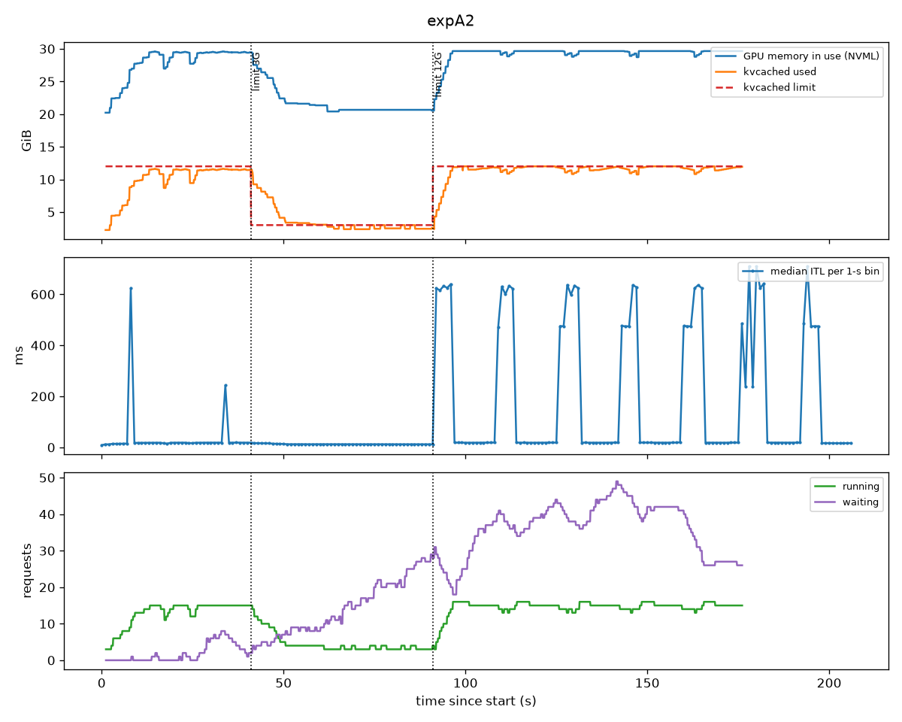

**怎么理解。** kvcached 靠缩小 vLLM 的**逻辑** block 池来执行上限。超出的新分配在 vLLM 自己的调度器里
失败，vLLM 用它标准的「抢占再重算」应对。所以正在跑的请求不会因为缩而被杀，但也不是白缩：如果它们
decode 还要长，超过上限就会像 KV 满了一样被抢占。**缩的时候要留出在驻请求继续增长的余量。**

### 4.2 实验 B：kvcached + LMCache MP connector（kvcached 0.1.6）

| 运行 | 配置 | 结果 |
|---|---|---|
| B1 | `lmcache_driven`（默认） | 引擎在注册 KV 时失败：传统 CUDA IPC 不能导出 VMM 地址 |
| B2 | 加 `use_vmm_api=true` | 失败：kvcached 默认布局把 32 层交错在每个 block 里，张量不连续 |
| B2b | 再加按层分池 | 失败：kvcached 的页在 `cuMemCreate` 时没申请可导出句柄（`requestedHandleTypes=0`） |
| B3 | `engine_driven`，256-token 的小 store | 能跑：91/91 完成，缩到 2 G 再扩回都没出事 |
| 压力版 | `engine_driven`，2–3k token 的大 store | **引擎崩溃**（148 s；不调限额时 90 s 也崩）：LMCache 异步 store 读到 kvcached 已解除映射的页，内核 `Xid 31`。plain 引擎同样负载 94/94 正常。 |

结论：**这两个版本不能一起用**，而且触发崩溃不需要调整限额。B3 能撑过去只是竞态没输。另外两个副产物：
LMCache MP connector 本身会让 8 条短 prompt 里 4 条的贪心输出变化；它的 inline 传输只有约 5k tok/s，
每次加载会让所有 decode 停约 0.8 s。

**后续（11-09，D12–D13）：** 在 kvcached main 上重跑同样的压力负载，`engine_driven` 跑了 10 分钟、每 15 s
调一次限额，341/341 正常，输出与 plain 引擎 8/8 一致，Xid 31 在上游已经没有了。零拷贝的 VMM 模式仍然不通，
卡在 LMCache 一侧（每个张量只导入一个句柄，kvcached 是 2 MiB 一页）。

### 4.3 固定 2 QPS，在线缩预算（重做 study 1）

kvcached main + vLLM 原生主机内存 offload（24 GiB 层），prefix caching 开，`KVCACHED_MAX_CACHED_TOKENS=-1`。

| 上限 | 带 offload：TTFT p50 / p95 | 抢占 | 不带 offload：TTFT p50 / p95 |
|---|---|---|---|
| 13 G | 51 / 499 ms | 0 | 52 / 1 265 ms |
| 10 G | 52 / 454 | 0 | 66 / 773 |
| 8 G | 91 / 399 | 0 | 505 / 2 580 |
| 6 G | 72 / 351 | 0 | 500 / 1 541 |
| 5 G | 146 / 770 | 0 | 3 488 / 9 041 |
| 4 G | 155 / 795 | 0 | 7 053 / 13 410 |
| 3 G | 3 210 / 5 837 | 0 | 27 986 / 56 741 |
| 2 G | 18 019 / 23 670 | 0 | 89 754 / 107 649 |

- 带 offload：13 → 4 GiB 之间 decode 不受影响（ITL 12.6–13.1 ms，244–277 tok/s），GPU 前缀命中从 76 %
  降到 43 %，主机内存层接住（命中 72 → 95 %）。3 GiB 以下在途请求放不下，引擎**排队**，但不抢占、不失败。
- 不带 offload：拐点上移到 8 GiB（Zipf 热集放不下的地方）。
- 和 study 1 的静态重启扫描比：拐点和平坦区一样；过了拐点，kvcached 把过载变成准入排队，而不是 study 1
  里的「抢占–重算」螺旋和卡死。

### 4.4 在线对静态，同一条时间线

第一次比较里 8 GiB 窗口读出 91 ms 对静态的 57 ms，看起来像调整有代价。查下来是**窗口假象**：连续扫描
给每个预算的是 Zipf 序列里不同的 60 s 切片，切片之间自己就差 ±40 ms。改成每个预算都回放**同一条**时间线后：

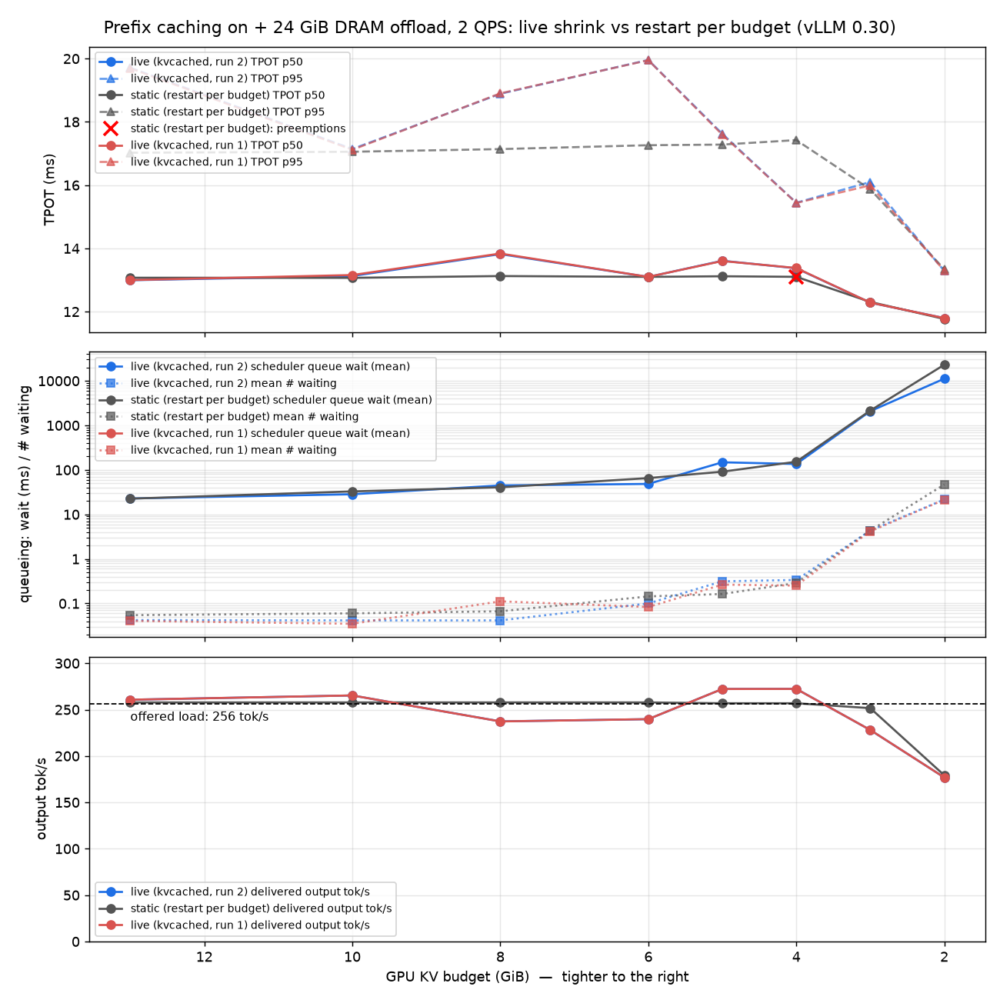

| GPU KV | 在线：TTFT p50 / 排队 / TPOT / 抢占 | 静态重启：同上 |
|---|---|---|
| 13 GiB | 51 ms / 27 ms / 13.1 ms / 0 | 52 / 23 / 13.1 / 0 |
| 8 | 58 / 42 / 13.2 / 0 | 58 / 41 / 13.1 / 0 |
| 5 | 137 / 92 / 13.1 / 0 | 136 / 91 / 13.1 / 0 |
| 4 | 154 / 151 / 13.1 / 2 | 155 / 153 / 13.1 / 2 |
| 3 | 2 333 / 2 050 / 12.3 / 0 | 2 451 / 2 154 / 12.3 / 0 |
| 2 | 32 153 / 22 981 / 11.8 / 0 | 32 134 / 22 996 / 11.8 / 0 |

**原地改预算，没有任何重启不用付的代价。** decode-only 模拟（prefix caching 关，28 GiB 层装下所有前缀）
结论相同：13 → 4 GiB TPOT 一直是 13.2–13.4 ms，GPU 上任何时候只有约 3 GiB 在途 KV；3 GiB 以下是容量
受限（258 tok/s 的供给只交付 226，再到 158），0 失败 0 抢占。

### 4.5 阶段一的限制

单 GPU、单模型、TP=1。A/B 用 0.1.6，扫描用 main。只测了 Zipf。连续扫描每窗约 110 个请求，同时间线
扫描每预算 300 个。FlashInfer 采样器全程关闭（这个 build 的 JIT 不认 sm_120）。

---

## 5. 阶段二：混部 VRAM 调整原型（11-05 夜 – 11-06 第 1 轮；11-09 凌晨第 2 轮）

目录 `coloc_adjust/`，主报告 `REPORT.md` / `REPORT_zh.md`，prefill tenant 单独一份 `REPORT_pf*.md`，
决策日志 D1–D19（D1–D10 第 1 轮，D11–D19 第 2 轮）。下面的数字除注明外都是第 2 轮（GPU 0，500 W）。

### 5.1 造了什么

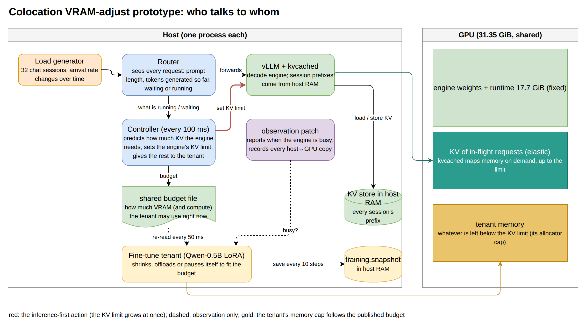

- **Router / VRAM scheduler**（`controller.py`）。所有请求过一个流式 HTTP router，它知道每个请求的 prompt
  长度、`max_tokens` 和已生成 token 数，所以在跑和在排队的请求的 KV 需求是精确的。每 100 ms 算一次需求：
  要涨立刻涨，要降得连续 5 s 低于「需求 − 1 GiB」才降，且不低于在跑请求已占的量。tenant 预算 =
  `31.35 − 17.0（引擎固定占用，启动时 NVML 实测）− 2.0（tenant 自己的上下文等）− 0.5（安全）− KV 上限`，
  写到 `/dev/shm`。vLLM 的调度器一行没改。
- **微调 tenant**（`ft_worker.py`）。每个 optimizer step 前读预算，选能放下的最高配置：整批 → 微批
  k=2/4/8 → 激活 offload 到主机内存 → 冻结权重按层从主机内存流式读入 → 暂停。step 内每 50 ms 轮询预算，
  放不下就抢占自己；每 10 步和每次换档前做快照；torch 的分配上限跟着预算走，估错了只会 OOM tenant，不会伤引擎。

  | 配置 | 微批 k | 需要显存 | 吞吐 |
  |---|---|---|---|
  | 整批 | 1 | 15.9 GiB | 44.8k tok/s |
  | 微批 | 2 / 4 / 8 | 8.7 / 5.0 / 3.2 GiB | 38.7k / 29.6k / 19.5k |
  | + 激活 offload | 8 | 2.5 GiB | 3.9k |
  | + 12 / 20 层流式 | 8 | 2.2 / 1.9 GiB | 3.2k / 2.8k |
  | 暂停 | – | 0.4 GiB | 0 |

  实际上阶梯就是：微批降到约 3 GiB，然后是很慢的 offload 档，然后暂停。
- **Prefill tenant**（`pf_tenant.py`，第 2 轮）。第二个 vLLM 引擎，只做 prefill，自己一个 kvcached 实例；
  预算不够时在适配器处拦住新请求，空闲 3 s 后让引擎 sleep（GPU 占用 4.5 → 1.4 GiB，约 260 ms），预算回来再唤醒。
- **传输追踪**。每一次主机↔GPU 拷贝都带来源记录，加 NVML 的 PCIe、功耗、SM 忙碌度和显存控制器忙碌度。
- **算力共享**：MPS；green context 用 ctypes 直接调 libcuda（`green_ctx.py`）。

### 5.2 负载和基线

到达率分段恒定：1 → 2 → 3 → 1 → 4 → 0.5 → 2 → 3 → 2 → 1 → 1 req/s，共 11 分钟，每个 scheme 回放同一条序列。
基线 = 引擎单独跑、KV 上限跟负载走（`adjust_notenant`）。500 W 上限对基线没有可测影响（各阶段 TPOT 与
600 W 相差 ≤ 0.3 ms）。

### 5.3 结果

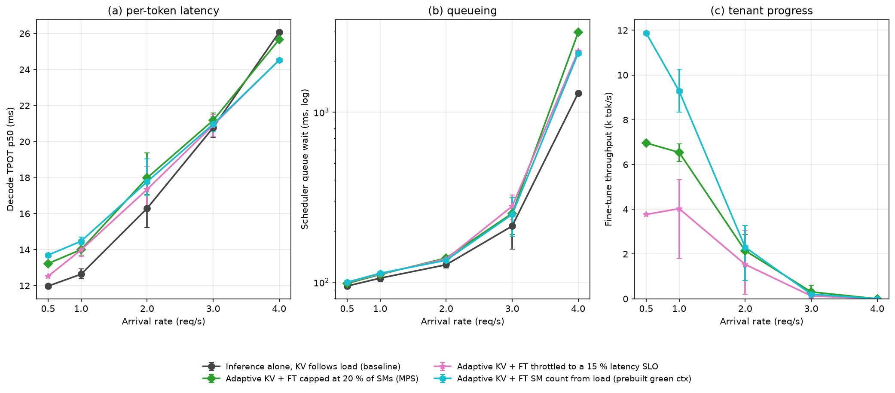

decode TPOT p50（ms，括号内为相对基线的变化），3 和 4 req/s 的排队等待，tenant 吞吐（k tok/s）：

| scheme | 0.5 req/s | 1 | 2 | 3 | 4 | 排队 @3 / @4 (ms) | tenant @0.5 / 1 / 2 |
|---|---|---|---|---|---|---|---|
| 引擎单独（基线） | 12.0 | 12.6 | 16.3 | 20.8 | 26.1 | 214 / 1 292 | – |
| 静态划分 | 21.8 (+82 %) | 16.7 (+32 %) | 21.8 (+34 %) | 23.0 | 22.9 | 4 941 / 13 472 | 13.2 / 12.2 / 12.9 |
| 自适应 KV + 空闲门 | 12.1 (+1 %) | 12.8 (+1 %) | 16.5 (+1 %) | 20.9 | 25.2 | 238 / 2 262 | 0 / 0 / 0 |
| 自适应 KV + MPS | 15.4 (+29 %) | 16.3 (+29 %) | 18.9 (+16 %) | 21.4 | 25.0 | 257 / 2 302 | 14.5 / 11.7 / 3.0 |
| 自适应 KV + MPS 20 % | 13.2 (+10 %) | 14.0 (+11 %) | 18.0 (+10 %) | 21.2 | 25.7 | 254 / 2 940 | 7.0 / 6.5 / 2.2 |
| 自适应 KV + 不相交 SM 128/42 | 15.3 (+28 %) | 16.2 (+28 %) | 18.6 (+14 %) | 21.3 | 24.1 | 308 / 3 367 | 13.7 / 11.6 / 2.9 |
| 自适应 KV + 5 % 延迟 SLO | 12.8 (+7 %) | 13.1 (+3 %) | 16.9 (+4 %) | 20.8 | 22.3 | 306 / 2 425 | 3.8 / 1.2 / 0.4 |
| 自适应 KV + 15 % 延迟 SLO | 12.5 (+5 %) | 14.0 (+11 %) | 17.3 (+6 %) | 20.9 | 24.5 | 280 / 2 277 | 3.8 / 4.0 / 1.5 |
| **自适应 KV + 动态 green context（预建）** | 13.7 (+14 %) | 14.5 (+15 %) | 17.8 (+9 %) | 21.0 | 24.5 | 250 / 2 216 | 11.9 / 9.3 / 2.3 |

3–4 req/s 时 tenant 是暂停的，所以各自适应 scheme 在那里都回到基线。

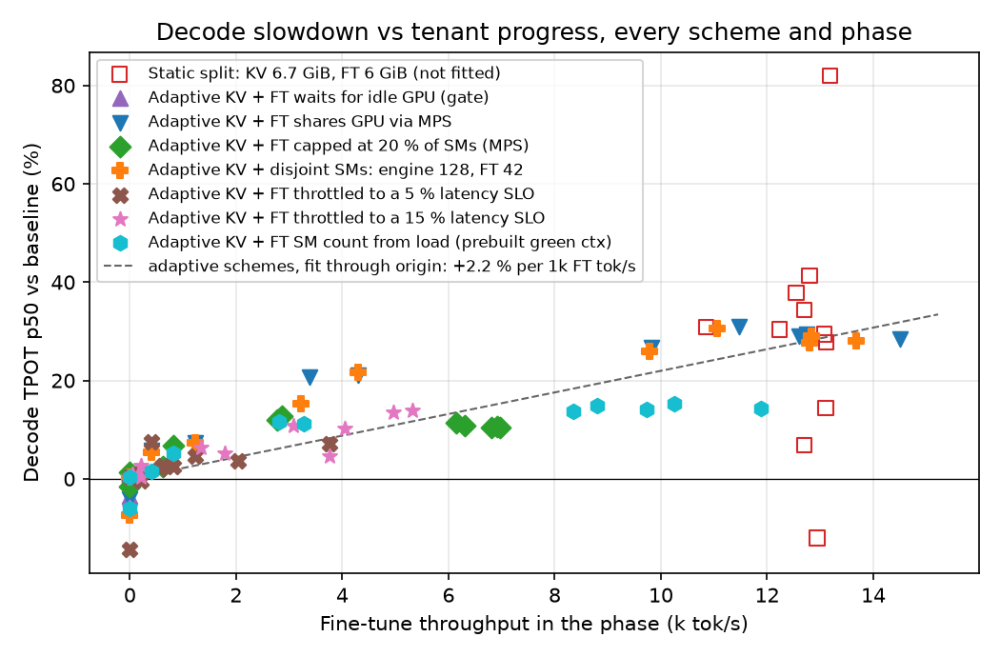

### 5.4 读出来的东西

1. **调整本身对 decode 零代价。** 引擎单独、上限跟负载在 2 ↔ 12.65 GiB 之间变，和固定 13 GiB 在每个阶段
   TPOT 差 ≤ 0.1 ms（第 1 轮）。
2. **静态划分两头都输。** 引擎固定 6.69 GiB、tenant 全速：低负载 +30 % 以上，3–4 req/s 排队 5–13 s，
   负载降回 0.5 req/s 时积压还有 26 s 深；低负载时引擎预算里有 4–8 GiB 空着。
3. **显存环路按设计工作，记账现在是诚实的。** 所有第 2 轮运行里「已映射 KV + tenant + 固定占用」超过
   GPU 的时间是 0 秒。诚实记账的代价是容量：3–4 req/s 的需求（12.65 GiB）超过 tenant 暂停后能映射的量
   （约 12.4 GiB），调度器在那里等（`grow_wait`）。
4. **时间片方式在这个引擎上没用。** 空闲门把 decode 保护得很好（+1 %），但 tenant 训练量为 0：
   Model Runner V2 引擎只要有请求在跑，GPU 就约 100 % 忙（D5）。
5. **限制 tenant 的份额有用；它跑在哪不重要，跑多少才重要。** MPS 20 % 上限：+10–11 % TPOT 换约 55 %
   的 tenant 吞吐。不相交的 128/42 划分：代价和吞吐都与不限制的 MPS 混跑一样。图里这些 scheme 和 SLO 限速
   落在同一条线上：**每 1k tenant tok/s，TPOT +2.2 %**。
6. **共享的资源是内存流量，tenant 的形状决定一个 token 多贵。** 形状探测（固定 4k tok/s 上限，每种形状
   60 s）：每 1k tok/s 的 decode 变慢为 k=4 微批 1.3 %、k=8 2.6 %、激活 offload 5.9 %、12/20 层流式
   9.2 / 8.2 %。

   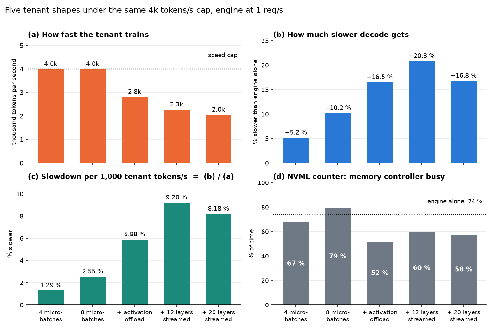

7. **NVML 的显存控制器忙碌度不能当反馈信号。** 引擎单独就读 49–73 %，不随 tenant 吞吐上升，分不开两个用户。
8. **同样的 tok/s，SM 少一些 decode 反而付得少**（第 2 轮的意外）。预建的动态 green context（0.5–1 req/s
   时给 tenant 64–96 个 SM）：9–12k tok/s 换 +14–15 %；MPS 全 SM 混跑是 12–14k 换 +29 %。跑了 898 步、
   切换 174 次，没有泄漏。**为什么便宜，至今没有解释**（见第 8 节）。
9. **延迟 SLO 可以直接执行。** 15 % 目标：各阶段保持在 +0–14 %，tenant 1.3–5.3k tok/s。5 % 目标：
   能守住 +2–7 %，但 tenant 基本被压在 500 tok/s 的地板上，因为 5 % 低于 10 s TPOT 窗口的噪声（±4 %）。

### 5.5 Prefill 引擎当 tenant

| scheme | 0.5 req/s | 1 | 2 | 4 | tenant @0.5 / 1 / 2（k prompt tok/s） |
|---|---|---|---|---|---|
| 基线（`pf_base`） | 12.1 | 12.7 | 16.3 | 27.5 | – |
| MPS | 12.7 (+5 %) | 13.4 (+6 %) | 16.3 (+0 %) | 24.9 | 9.3 / 6.2 / 0.0 |
| MPS 20 % | 12.5 (+4 %) | 13.7 (+8 %) | 16.4 (+1 %) | 25.3 | 8.9 / 7.1 / 0.6 |
| 不相交 SM | 12.6 (+4 %) | 13.4 (+6 %) | 16.3 (+0 %) | 25.4 | 9.3 / 6.9 / 0.0 |

- 三种算力方式无法区分：**限制它的是显存，不是算力**。固定占用 4.5 GiB，留给两个引擎 KV 的只有 9.4 GiB，
  8B 从 2 req/s 起自己就要更多，tenant 整段都在睡。
- 它交付的 6–13k tok/s 是把睡眠期间积压的 prompt 一次清掉，不是稳态（供给只有 3.1k tok/s）。
- 每个 prompt token 的代价约为微调 tenant 的一半（约 1 % / 1k tok/s）。
- 两个记账缺口：睡着时实占 1.4 GiB，调度器仍按 4.5 GiB 记，3 GiB 白白闲着；唤醒余量（1 GiB）小于唤醒
  要放回的权重（3.1 GiB），`pf_split` 因此在 4 req/s 阶段醒来，把 8B 的排队等待翻了一倍。

### 5.6 主机↔GPU 传输不是瓶颈

推理加载 768 MiB 用 55.7 ms（13.5 GiB/s，约为链路能力的 93 %），整个 11 分钟平均只用 1.36 GiB/s。
与 tenant 拷贝重叠的加载是 56.1–56.3 ms，对 55.7 ms：量不出变慢。拷贝之间不互相拖慢，但拷贝多的
tenant 形状让 decode 每 token 多付 3–7 倍：它们抢的是显存系统，不是 PCIe。

---

## 6. 阶段三：显存带宽干扰（11-09 下午 – 晚上）

独立报告 `REPORT_bandwidth.md` / `REPORT_bandwidth_zh.md`（面向非专业读者，四条结论）；实验清单和结果
1–20 在 `../TODO.md`；相关工作 `RELATED_bandwidth.md`。全部在 GPU 1、500 W。

这一段的起因是 11-09 你定的方向：报告后面集中在「混部时发生了什么、怎么解释、怎么提高」，以及三个猜想：
H1 限 SM 限不住带宽伤害；H2 带宽是瓶颈；H3 SM 少了 tenant 会把更多 block 堆到剩下的 SM 上，所以带宽对
SM 不是线性的。

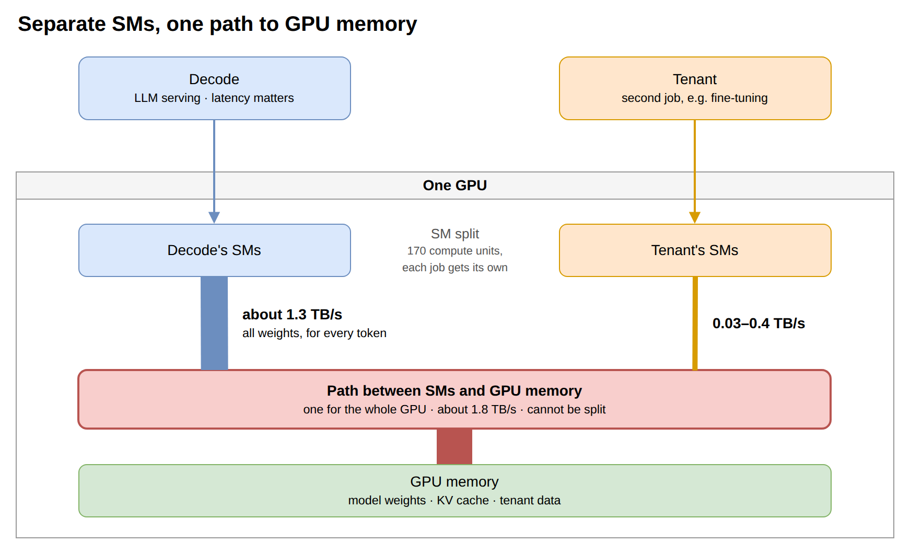

### 6.1 方法上的两个决定

- **decode 用合成替身。** Llama-3-8B 一步 decode 的矩阵运算，随机权重，每步读 15.01 GB 权重 + 每个请求
  0.822 GB KV。好处是每步可重复到 1 % 以内，字节数精确已知。
- **用字节数做账。** GPM 计数器 `DRAM_BW_UTIL` 用 decode 的已知读速率校准：1 % = 17.79 GB/s（54 个点，
  中位误差 0.5 %）。它给的是所有任务的和，所以每个任务自己的部分要靠各自数字节。

### 6.2 decode 单独跑：拐点（主报告 2.6 节 / `knee_probe.py`）

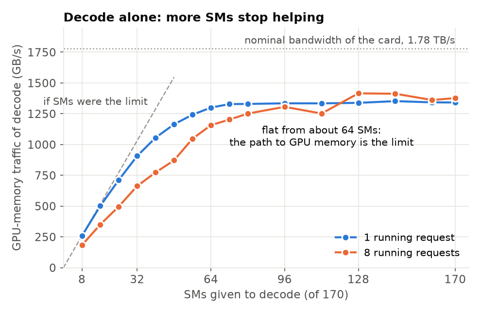

| SM 数 | 1 个请求：每步 / 读速率 | 8 个请求 |
|---|---|---|
| 8 | 61.4 ms / 258 GB/s | 119 ms / 181 GB/s |
| 32 | 17.45 ms / 907 | 32.6 ms / 663 |
| 64 | 12.17 ms / 1 301 | 18.39 ms / 1 174 |
| 96 | 11.86 ms / 1 335 | 16.9 ms / 1 278 |
| 170 | 11.79 ms / 1 343 | 15.68 ms / 1 377 |

拐点（达到全速 90 % 的第一个 SM 数）：1 个请求 56 个 SM，4 个请求 72，8 和 14 个请求 80。平台在
1.34–1.42 TB/s，约为标称值的 75 %。prefill 没有拐点（64 个 SM 49 % 全速，128 个 88 %），它是算力受限的。

### 6.3 真实 tenant 进来（E3.1、E1.3，`knee_bw2`）

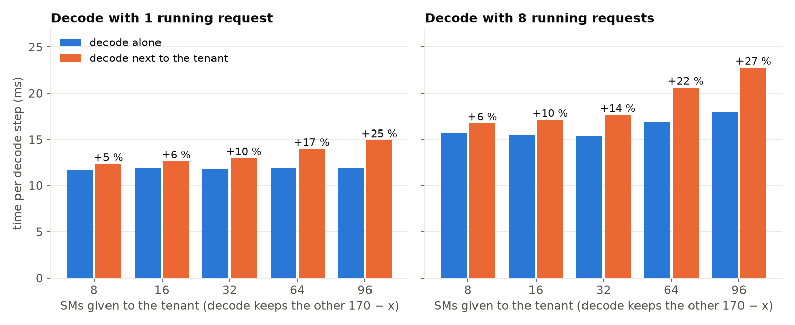

| tenant 的 SM 数 | tenant 流量 | decode 变慢：1 / 4 / 8 个请求 | decode 少掉的 ÷ tenant 搬的 |
|---|---|---|---|
| 8 | 34–41 GB/s | +5.4 / +7.5 / +6.4 % | 2.0–2.4 |
| 16 | 62–74 | +6.4 / +9.1 / +9.9 % | 1.3–1.7 |
| 32 | 108–126 | +9.7 / +15.3 / +14.4 % | 1.1–1.5 |
| 64 | 179–206 | +17.4 / +19.5 / +22.4 % | 1.05–1.14 |
| 96 | 251–261 | +24.7 / +29.1 / +26.6 % | 0.98–1.08 |

- **总量不涨。** decode 单独 1.33–1.40 TB/s；加上 tenant 后合计 1.21–1.35 TB/s（不相交 SM）。tenant 的
  流量是从 decode 那里扣出来的。
- **tenant 的带宽不和 SM 成正比（H3）。** tenant 单独：170 → 8 个 SM（少到 1/21），流量 414 → 50 GB/s
  （少到 1/8）；每个 SM 的流量从 2.4 涨到 6.3 GB/s，SM 忙碌度从 59 % 涨到 96 %；每 token 一直是
  13.4–14.3 MB。同样的工作把剩下的 SM 填满了。
- **共用 SM 伤的是 tenant 自己。** 它在 decode 旁边的吞吐：共用 SM 时是单独时的 34–73 %，不相交时 68–88 %。

### 6.4 可调流量的干扰任务（E1.2，`aggr_corun`）

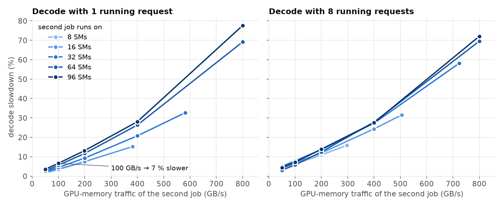

把 tenant 换成一个只读显存、流量可设定的任务，放在自己的 SM 上。

| 干扰任务的 SM 数 | 每 100 GB/s 让 decode 慢（1 个请求 / 8 个请求） | 不限速时 |
|---|---|---|
| 8 | 3.8 % / 4.6 % | 205–298 GB/s → +8–16 % |
| 16 | 3.8 % / 5.7 % | |
| 32 | 5.3 % / 6.4 % | |
| 64 | 6.8 % / 7.2 % | |
| 96 | 7.0 % / 6.7 % | 955–1 059 GB/s → +106–124 % |

- 固定 SM 数时，变慢对 GB/s 近似线性。
- 同样的 GB/s，从 8–16 个 SM 发出比从 64–96 个 SM 发出便宜约一半（只读任务）。原因没解释。
- 干扰任务每搬 1 GB/s，decode 少搬约 0.5–1 GB/s（200 GB/s 以上的点是 0.46–0.84；更小流量的点受基线抖动影响，不可靠）。合计能到 1.60–1.62 TB/s（计数器 88–91 %），所以
  decode 单独时并没有把带宽占满，只是它够得着的部分用满了。
- 调用大小的对照：同样 GB/s 用 256 MB 一次（调用数 1/4），decode 步时间差 ≤ 0.8 %；32 MB 一次（调用数
  2 倍），慢 0–3 %。主要跟 GB/s 走。

### 6.5 为什么真实 tenant 比它的字节更贵（E2.7，`aggr_modes`）

真实 tenant 在 8 个 SM 上搬 34–41 GB/s，按只读曲线应该让 decode 慢 1.4–2.6 %，实际 5.4–6.4 %。
让干扰任务做五种工作：

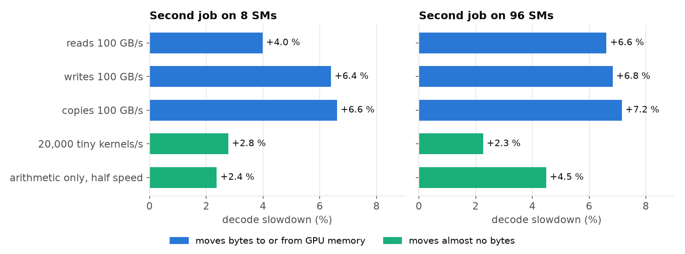

| 工作类型 | 在 8 个 SM 上 | 在 96 个 SM 上 |
|---|---|---|
| 读，每 100 GB/s | 4.0 %（1 请求），5.5–6.3 %（8 请求） | 5.4–7.0 % |
| 写 / 拷贝，每 100 GB/s | 6.1–6.6 %（1 请求），7.1–7.8 %（8 请求） | 6.1–8.2 % |
| 只启动极小 kernel（不搬字节），2k–130k 次/秒 | +0.7 到 +5.8 % | 相同 |
| 只做算术（不搬字节） | +1.4–2.6 %（1 请求），+3.8–6.9 %（8 请求） | 全速时 +8.6–9.8 % |

- 不限速时，96 个 SM 上的写或拷贝让 decode 慢约 200 %，读是 105–120 %。
- 96 个 SM 全速做算术会顶到 500 W 上限，时钟频率降 8–9 %：**功耗是两个任务共用的第二样东西**。读、写、
  拷贝的测量点时钟没变，所以字节的结论不是功耗造成的。
- 20 个可疑点复跑，每步时间差 ≤ 0.5 %。
- **解释只到「说得通」的程度**：写、kernel 启动、算术各加 1–3 个百分点，合起来和 4 个百分点的差距相当。
  tenant 的 kernel 启动频率没测，三样也没放在一起测过。

### 6.6 所以限 SM 是弱旋钮

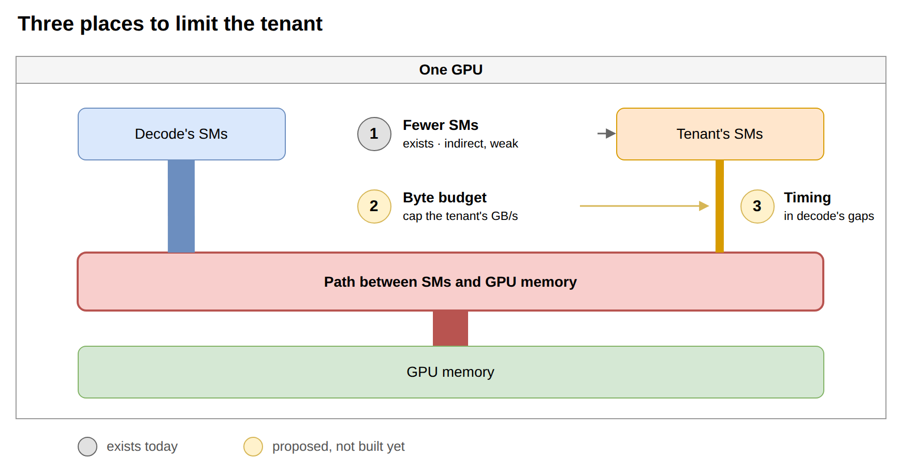

从 96 个 SM 减到 8 个（1/12）：tenant 流量降到 1/6–1/7，它自己的速度降到约 1/7，对 decode 的伤害只降到约
1/4（25–29 % → 5–7 %），而且最小设置仍有约 5 % 的地板。

**提议的改进（都没实现）：**

| 编号 | 想法 | 最接近的已有工作 |
|---|---|---|
| C1 | 字节预算：VRAM scheduler 给 tenant 一个 GB/s 额度，tenant 用每 token 约 14 MB 换算，在微批之间停顿 | MemGuard、Ripple |
| C2 | 错开时间：tenant 在 decode 不太用带宽的时候干活。decode 节点上几乎没有这样的时候（已测），只作为 C1 里的一条规则保留：没有请求在跑时放开额度 | Orion、Hummingbird、LLMStation |
| C3 | 每 token 少搬字节：形状探测里每 token 代价有 7 倍差距，选最便宜且还能训练的形状 | – |
| C4 | 把 tenant 的 step 切碎，让限额或暂停能在一个 decode 步内生效 | LLMStation 的 tasklet |

### 6.7 相关工作调研（约 25 篇，一个下午）

1. **SM 划分不隔离带宽，文献和我们的测量一致**（Elvinger 等、Mosaic、Hummingbird、Ripple 都有数字）。
2. 真正能给带宽份额的机制都是对内存通道的静态划分（MIG、染色），消费级 Blackwell 卡上都用不了。
3. **给尽力而为的 GPU tenant 做字节计量的预算，只见于保护 CPU 任务的场景**（Ripple，统一内存设备）。
   以带宽受限的 decode 为受害者、在没有 MIG 的独立 GPU 上做字节预算：没找到。这是可能的贡献点。
4. Mosaic 的两个警告对任何字节模型都适用：读和写对受害者的代价不同；画像相同的受害者变慢程度也不同。
   E2.7 在我们的设置里看到了前一条。

调研里每个来源标了核对程度（读了原文 / 部分读 / 只看摘要 / 凭记忆），引用前看标记。

---

## 7. 中途被修正的认识

这些是做的过程中被数据推翻或收窄的说法，回看时最容易记混。

| 原来的说法 | 修正后 | 出处 |
|---|---|---|
| 异步 store 是安全的，因为 vLLM 会等 store 完成才放 block | 不成立：大 store 下读到已解除映射的页，引擎崩溃 | 阶段一 §5，提交 `eb4d8bc` |
| 在线缩到 8 GiB 比静态慢（91 对 57 ms） | 窗口假象；同一时间线下无差别 | 阶段一 §7，D10 |
| kvcached 和 LMCache 不能一起用 | 只对 0.1.6 成立；main + `engine_driven` 可以 | D12–D13 |
| 「GPU 忙」信号可以用来找空闲窗口 | 第一版量的是 kernel 发射时间不是 GPU 时间；重做后发现 decode 约 100 % 忙，空闲门饿死 tenant | D5 |
| 第 1 轮的显存记账 | 引擎固定占用里混进了 tenant 的上下文（17.7 GiB），且没给 tenant 自己留量；第 2 轮改为实测 16.97 + 2.0 + 0.5，涨幅不超过实际空闲 | D11 |
| 第 1 轮的静态划分结果 | 那次其实开着空闲门，tenant 被饿死；现在单列为 `static_split_gate`，真正的静态划分更差 | D15 |
| 第 2 轮第一批自适应 scheme | 待处理的 grow 在需求回落后没被放弃，tenant 两个阶段后一直暂停；修复后重跑了 6 个 | D16 |
| 动态 green context 不可用 | 第 1 轮每次切换重建上下文导致分配器泄漏；预建上下文、只切 stream 后 174 次切换无泄漏 | D8–D9，D18 |
| 「tenant 放在哪些 SM 上不重要」 | 太强：**静态**放置不重要；随负载下降的份额有用 | 主报告 2.4 |
| 引擎的 SM 下限大概 30–40 | 实测约 80（1 个请求时 56） | 主报告 2.6 |
| H1 后半句：同样 GB/s，SM 多少伤害一样 | 只读任务从 8–16 个 SM 发出便宜约一半；真实 tenant 的趋势相反（8 个 SM 时每字节更贵） | TODO H1 |
| tenant 的额外代价有一个主因 | 没有单一主因：写、启动、算术各 1–3 个百分点 | E2.7 |

---

## 8. 还不知道的，和下一步

**没解释的现象**

- `green_dyn2` 为什么便宜（+14 % 对 MPS 的 +29 %）。主报告里的解释仍是猜想。*回顾时的观察*：`knee_bw2`
  里 tenant 在 64–96 个不相交 SM 上每 1k tok/s 的代价是 1.3–1.5 %，在 170 个共用 SM 上是 1.9–2.4 %，
  方向一致；但那是合成 decode 和另一种 tenant 配置，没有专门验证，而且同一张表里 8 个 SM 是 2.2–2.7 %。
- 只读任务为什么从少量 SM 发出时每字节更便宜。
- 从 8 个 SM 上做纯算术，时钟没变，为什么还能让 decode 慢 2.6–6.9 %。8 个请求时计数器比 decode 自己的
  字节多 2.5–6.6 %，L2 共享是候选解释，只是猜想。
- decode 基线为什么会落在相差约 1 %（早先最多 3.6 %）的两个水平上（E2.6）。
- 8 和 4 个请求时，两个任务字节之和比计数器低 3–4.5 %（40–60 GB/s 没着落）。
- 112 个 SM 时 4 和 8 请求的步比 96 个 SM 时慢约 4 %，复现过，没解释。

**没做的实验**（`TODO.md`）：E1.1 同流量两种旋钮（SM 限制对停顿）；E2.2 全 SM 的写/拷贝上限；E2.3
寄存器级算术和干净的 L2 测试；E2.4 按 tenant 阶段拆 decode 步时间；E2.5 Nsight 的逐 kernel 画像；
E2.6 基线水平；E2.8 损失是否跟 decode 的忙碌比例走；E3.3 固定网格 kernel；E3.4 tenant 时间去向。

**没建的东西**：C1–C4 全部；prefill tenant 的两个记账修复（睡眠占用记回、唤醒余量）；用 TPOT 误差而不是
到达率来驱动动态 SM 份额；真正的 prefill–decode 对（3B 的 KV 现在只写不读）。

**没合并的文档**：带宽研究（E1.2、E1.3、E2.7、E3.1）还不在主报告 `REPORT.md` / `REPORT_zh.md` 里。

**我的建议顺序**（供参考）：先做 E1.1 + C1 的最小版本。E1.1 直接回答「同样的流量，停顿是否比限 SM 更
护 decode」，C1 的第一步就是它；这是唯一一条从「解释」走到「改进」的路，也对应调研里没找到先例的位置。

---

## 9. 贯穿全部的限制

- 一张卡、一个推理模型（Llama-3-8B bf16）、TP=1、一种负载分布（Zipf-1.1）。
- 阶段三的 decode 是合成步，不是真实引擎；真实引擎上的同类现象在阶段二里见过（+2.2 % / 1k tok/s），噪声更大。
- 500 W 上限：阶段二基线不受影响；阶段三里全速算术任务的结果依赖它。
- 大部分点只跑一次（阶段三每点 4 s）；复跑过的点步时间一致，但基线两水平问题让每个「变慢百分比」带约
  ±1 个百分点。
- 带宽通道是靠数字节推断的，没有硬件层面的直接证据。
- 所有「改进」都是提议。

---

## 10. 文件地图

仓库 `/home/jiaxuan/Documents/Projects/kvcache-vram_size`，分支 `kvcached-validation`，远端
`852866031/cuda-schedule-project`。

| 想看什么 | 去哪 |
|---|---|
| 3–10 月全貌 | `project_summary/REPORT_SUMMARY.md`、`REPORT_CHRONOLOGICAL.md` |
| 阶段一报告 / 决策 | `kvcached_validation/REPORT.md`、`DECISIONS.md`（D1–D10） |
| 阶段一脚本 / 数据 | `kvcached_validation/scripts/`、`results/` |
| 阶段二主报告 | `coloc_adjust/report/REPORT.md`（英）、`REPORT_zh.md`（中文通俗版） |
| prefill tenant 报告 | `coloc_adjust/report/REPORT_pf.md`、`REPORT_pf_zh.md` |
| 阶段二决策 / 设计 / 计划 | `report/DECISIONS.md`（D1–D19）、`DESIGN.md`、`PLAN_overnight2.md` |
| 阶段二逐阶段表 | `report/round2_tables.md`、`results/<scheme>_phases.md` |
| 阶段二数据 | `results/`（第 2 轮，500 W）、`results_600w/`（第 1 轮） |
| 带宽独立报告 | `report/REPORT_bandwidth.md`、`REPORT_bandwidth_zh.md` |
| 带宽实验清单和结果 1–20 | `coloc_adjust/TODO.md` |
| 相关工作 | `report/RELATED_bandwidth.md` |
| 带宽数据 | `results/knee_probe.csv`、`knee_bw2*`、`aggr_corun*`、`aggr_modes*` |
| 结构图源文件 | `coloc_adjust/diagrams/01…10*.drawio`（`export_png.py` 导出） |
| 核心代码 | `controller.py`（router + scheduler）、`ft_worker.py`、`pf_tenant.py`、`green_ctx.py`、`knee_probe.py`、`knee_corun.py`、`bw_aggr.py`、`aggr_corun.py` |

关键提交：`cc3fba2`–`29ebb96`（阶段一，11-05）；`e35e668`（原型第 1 轮，11-06）；`49e4b96`（第 2 轮完成，
11-09 06:11）；`af11b32`（prefill tenant 报告）；`15fc64a`（显存 / 主机内存用词）；`ae557ea`（拐点）；
`a3f1fa6`（带宽实验 + 独立报告，已推送）。

---

## 11. 再动手之前要记得的坑

- 权重只在 `/mnt/storage/huggingface`；工具 shell 不读 `~/.profile`，启动脚本必须自己 `export HF_HOME`。
- 跑之前先看 GPU 是否空闲（别的项目也会用）；每张 GPU 一个 MPS daemon 和一个 pipe 目录。
- 钉住的主机内存太多会让机器卡死；LMCache 的 pinned L1 控制在几 GiB。`/dev/shm` 只有 31 GiB，两个引擎的
  层要一起放得下。
- `stop.sh` 会杀掉所有 vLLM；`pgrep` 会匹配到自己。
- FlashInfer 采样器要关（`VLLM_USE_FLASHINFER_SAMPLER=0`）；LMCache server 用 5556 端口；vLLM sleep 需要
  `VLLM_SERVER_DEV_MODE=1`。
- 用了 offload 就要 kvcached main，并设 `KVCACHED_MAX_CACHED_TOKENS=-1`。
- decode 在「remaining」green context 上的基线会在两个水平间跳，50–100 GB/s 的小差异要跨重启比较。
- 不推 Overleaf，不动 `proposal/` 和 `project_summary/`。
