# Colocation VRAM-adjust prototype — report

Round 1: 2026-11-05/06 (GPU 1, 600 W, archived in `../results_600w/`). **Round 2: 2026-11-09 (GPU 0,
both GPUs capped at 500 W, `../results/`)** — all figures and tables below are from round 2 unless
stated; round 1 is referred to where it differs. Branch `kvcached-validation`, directory
`coloc_adjust/`. Design in [DESIGN.md](../DESIGN.md), the round-2 plan in
[PLAN_overnight2.md](../PLAN_overnight2.md), run-by-run predictions and outcomes in
[DECISIONS.md](DECISIONS.md) (D1–D10 round 1, D11–D19 round 2).

## 1. What was built

One RTX 5090 serves a Llama-3-8B decode node (vLLM 0.30 + kvcached main, native DRAM offload
with a 28 GiB tier in /dev/shm, prefix caching off, so the GPU holds only in-flight KV) and, beside
it, a tenant: a Qwen2.5-0.5B LoRA fine-tune in most schemes, a Qwen2.5-3B fp8 prefill-only engine
in the round-2 prefill schemes. Nothing is changed inside vLLM's scheduler:

- **Router / VRAM scheduler** (`controller.py`, one process): every request passes through a
  streaming HTTP router that knows its prompt length, `max_tokens` and tokens generated so far,
  so the KV block demand of the running set and the queue is exact (⌈prompt/16⌉ blocks at
  admission, +1 block per 16 generated tokens, 2 MiB per block). Every 100 ms: `need = (running
  final + waiting final) × 2 MiB + λ̂·1 s·0.78 GiB + 0.5 GiB`; the kvcached limit grows to `need`
  at once and shrinks only after 5 s below `need − 1 GiB`, never below what the running set holds.
  The tenant budget `31.35 − 17.0 − 2.0 − 0.5 − limit` GiB (total − engine weights and runtime as
  measured by NVML at start − the tenant's own context, weights and optimizer − safety) is
  published to `/dev/shm`, lowered at once on the way up and raised only once kvcached's mapped
  bytes are under the new limit. Round 2 added two guards: the limit may only promise memory that
  is free right now (kvcached's mapped bytes + NVML free − safety), so a grow waits for the tenant
  to release (`grow_wait`) and is abandoned if demand falls back first (D11, D16); and, optionally
  (`--tpot-slo`), the scheduler measures decode TPOT over the last 10 s, compares it with the
  no-tenant reference for the current arrival rate and publishes a tokens/s cap for the tenant
  (multiplicative update every 2 s).
- **Fine-tune tenant** (`ft_worker.py`): before each optimizer step reads the budget and picks the
  highest configuration whose calibrated need fits (drop at once, climb after 3 s): full batch
  → micro-batches k = 2/4/8 → + activation offload to pinned DRAM → + frozen base weights of
  12/20 layers streamed from DRAM → pause (snapshot, everything to host). LoRA weights, optimizer,
  scheduler, step and RNG are snapshotted to DRAM every 10 steps and before every tier change; a
  budget poll inside the step (every 50 ms, from the per-block hooks) preempts a step that no
  longer fits; the torch allocator cap follows the budget so a mis-estimate OOMs the tenant, never
  the engine. Round 2: it honours the published tokens/s cap by sleeping after each step, and
  with `--green-prebuilt` it builds green contexts of 128/96/64/32/16 SMs at start and only
  switches streams between steps (the round-1 per-switch context creation leaked allocator memory).
- **Prefill tenant** (`pf_tenant.py`, round 2): a second vLLM engine (Qwen2.5-3B, fp8, its own
  kvcached instance, KV streamed to a 3.5 GiB host-RAM tier, `max_tokens = 1`) behind an adapter
  that sets the engine's kvcached limit from the budget, holds new requests at the proxy when the
  budget is below 0.25 GiB, and puts the engine to sleep (weights to host, 4.9 → 1.4 GiB on the
  GPU) after 5 s idle; it wakes in 0.3 s when the budget returns.
- **Transfer tracing**: every host↔GPU copy is recorded with its source — the engine's native
  offload transfers (bytes and CUDA-event time from vLLM's own transfer results, via an
  observation-only `sitecustomize`) and the tenant's activation/weight/snapshot copies — plus
  NVML's PCIe counters, and in round 2 NVML's power, SM-busy and **DRAM-controller-busy** readings
  every 100 ms.

Compute sharing: MPS daemon (user-space), engine and tenant as MPS clients; green contexts via
ctypes on libcuda (`green_ctx.py`).

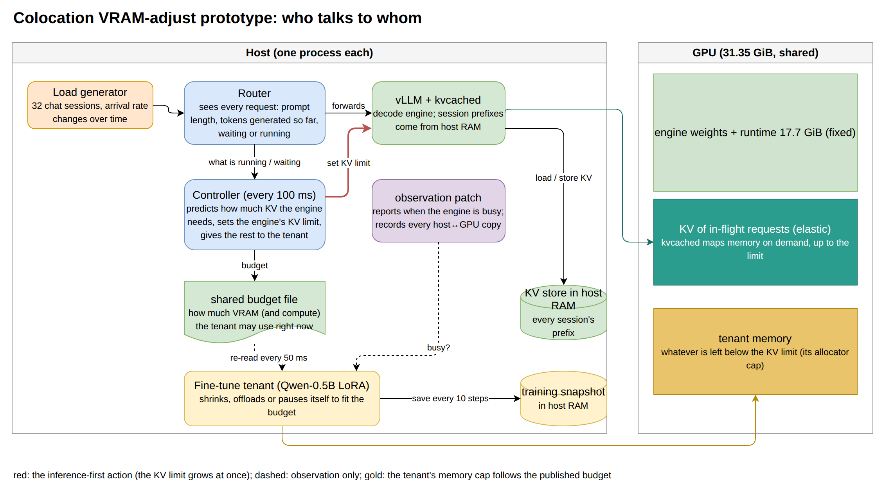

*Diagram 1 — the components and what triggers what: the router feeds demand to the VRAM scheduler, the VRAM scheduler sets kvcached's limit (red, inference first) and publishes the remainder to the tenant; the observation patch only reports.*

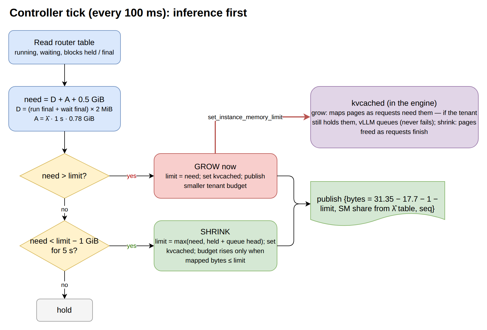

*Diagram 2 — one VRAM scheduler tick: grow at once when demand exceeds the limit, shrink only after 5 s of slack and never below what running requests hold.*

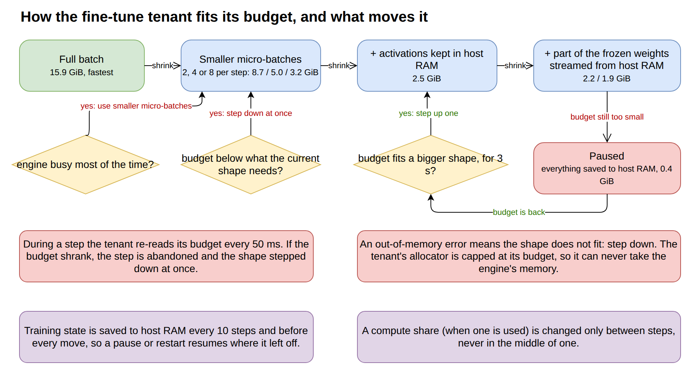

*Diagram 3 — the tenant's ladder and the triggers that move it: budget polls inside the step, OOM as a signal, 3-s hold before climbing, DRAM snapshots around every move.*

### Tenant configurations (calibrated solo on GPU 1, `tiers.json`)

| cfg | tier | micro-batches k | activation offload | layers streamed | grad ckpt | need GiB | step ms | tok/s |
|---|---|---|---|---|---|---|---|---|
| 0 | 0 full batch | 1 | – | 0 | off | 15.9 | 91 | 44.8k |
| 1 | 1 | 2 | – | 0 | off | 8.7 | 106 | 38.7k |
| 2 | 1 | 4 | – | 0 | off | 5.0 | 138 | 29.6k |
| 3 | 1 | 8 | – | 0 | off | 3.2 | 210 | 19.5k |
| 4 | 2 | 8 | yes | 0 | on | 2.5 | 1045 | 3.9k |
| 5 | 3 | 8 | yes | 12 | on | 2.2 | 1294 | 3.2k |
| 6 | 3 | 8 | yes | 20 | on | 1.9 | 1452 | 2.8k |
| 7 | 4 pause | – | – | – | – | 0.4 | – | 0 |

Activation offload moves ~4.8 GB per step each way at k = 8 and costs 5× in step time; with
gradient checkpointing already on it saves little memory (the floor, ~1.9 GiB, is the
lm_head/embedding plus one micro-batch's logits), so in practice the ladder is micro-batching
down to ~3 GiB, then the slow offload tiers, then pause.

## 2. Evaluation

Reference workload (32 sessions × 6144-token prefixes, +128 new tokens → 128 out, Zipf-1.1,
seeded) with a piecewise-constant arrival-rate schedule after a 32-request warm-up:

| from (s) | 0 | 90 | 180 | 270 | 360 | 420 | 480 | 510 | 540 | 570 | 600–660 |
|---|---|---|---|---|---|---|---|---|---|---|---|
| req/s | 1 | 2 | 3 | 1 | 4 | 0.5 | 2 | 3 | 2 | 1 | 1 |

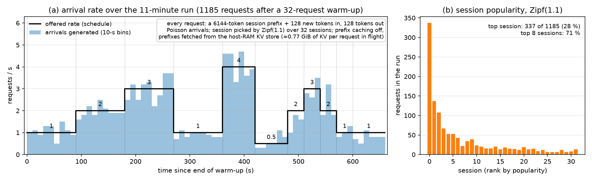

*Figure 0 — the workload trace every scheme is driven with (`../plot_workload.py`, from the baseline run's request log). (a) The offered arrival rate and the Poisson arrivals actually generated, 10-s bins; the same seeded sequence is replayed in every scheme. (b) Session popularity: Zipf(1.1) over 32 sessions, so a few prefixes dominate the host-RAM store's traffic. Every request carries a 6144-token session prefix plus 128 new tokens and produces 128 tokens, i.e. about 0.77 GiB of KV while in flight.*

Each scheme is one continuous 11-minute run (`run_eval6.sh`, `run_eval_pf.sh`, `run_probe.sh`;
round 1: `run_eval3.sh`). Per-phase numbers skip the first 10 s of each phase. Decode is judged on
TPOT, scheduler queue wait, delivered throughput and failures (decode-only TTFT is fetch +
128-token prefill, ~160 ms); the tenant on tokens/s (prompt tokens/s for the prefill tenant) and
its configuration. **Baseline:** the engine alone with its KV limit following the load
(`adjust_notenant`); the 500 W cap changed it by nothing measurable (TPOT within 0.3 ms of the
600 W run in every phase, [round2_tables.md](round2_tables.md)), the GPU draws 290–385 W per
phase under this load.

### 2.1 What the schemes are

| scheme | engine KV limit | tenant | compute sharing | round |
|---|---|---|---|---|
| `adjust_notenant` | VRAM scheduler | none | – (baseline) | 1, 2 |
| `static_split` | fixed 6.69 GiB (= the 2 req/s need) | fixed 6 GiB budget (cfg 2) | MPS co-run | 1, 2 |
| `static_split_gate` | fixed 6.69 GiB | fixed 6 GiB | idle-window gate (the round-1 runner's setting; D15) | 2 |
| `adjust` | VRAM scheduler | tiered | idle-window gate + MPS | 1, 2 |
| `adjust_nogate` | VRAM scheduler | tiered | MPS co-run, no cap | 1, 2 |
| `adjust_mps20` | VRAM scheduler | tiered | MPS, tenant capped at 20 % of SM threads | 1, 2 |
| `green32`, `green_dyn`, `engine_green`, `green_opt` | VRAM scheduler | tiered | round-1 green-context schemes (table in 2.3) | 1 |
| `green_split` | VRAM scheduler | tiered | engine steps on SMs 0–127, tenant on the remaining 42 (static, disjoint) | 1, 2 |
| `tpot_slo5`, `tpot_slo15` | VRAM scheduler + TPOT feedback | tiered, tokens/s cap | MPS; the cap holds decode within +5 % / +15 % of the baseline | 2 |
| `green_dyn2` | VRAM scheduler | tiered, SM count from the arrival rate (128/96/64/32/16 at 0/0.5/1/2/≥3 req/s) | prebuilt green contexts, stream switch only | 2 |
| `pf_mps`, `pf_mps20`, `pf_split` | VRAM scheduler | 3B prefill engine, sleep tier | MPS / MPS 20 % / engine 128 SMs + tenant 42 SMs | 2 |
| `pf_base` | VRAM scheduler | none | baseline for the prefill schemes (8B host tier 25.5 GiB instead of 28, to leave /dev/shm room for the 3B's tier) | 2 |
| `probe` | fixed 3 GiB | fixed 7.5 GiB, one shape per 60-s window, 4 k tok/s cap | MPS; measures the decode cost of each tenant shape | 2 |

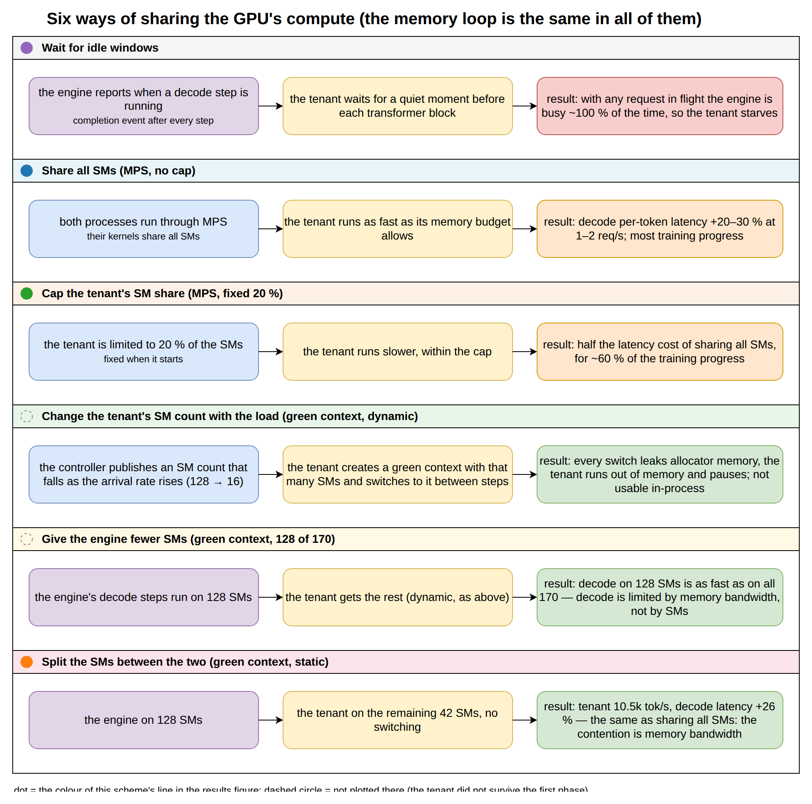

*Diagram 4 — the compute-sharing mechanisms tried (source `../diagrams/04_compute_sharing.drawio`); the memory loop is the same in all of them. The dot before each title is the colour of that scheme's line in Figure 1.*

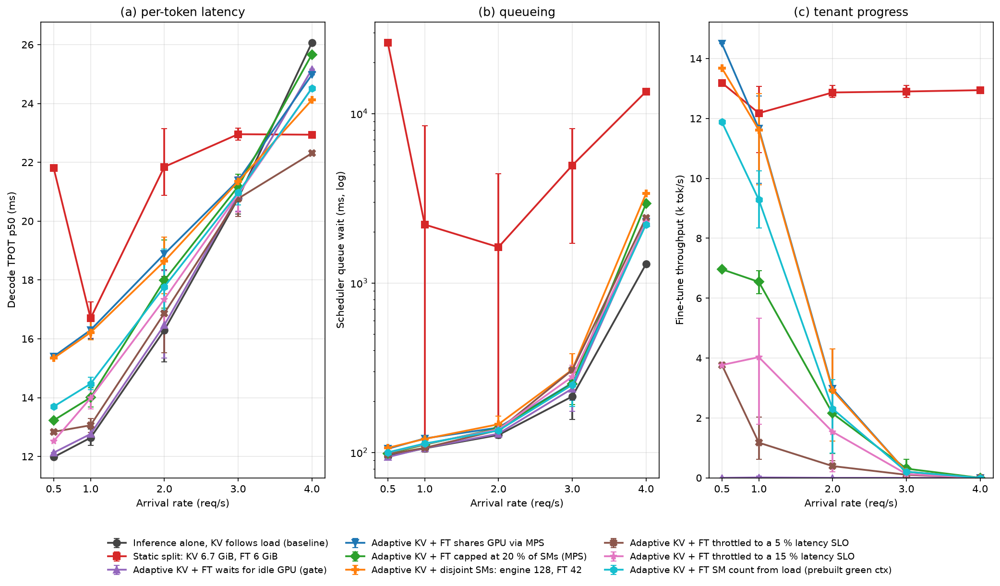

*Figure 1 — decode latency (a), scheduler queue wait (b) and fine-tune throughput (c) against the
arrival rate, pooling the phases that share a rate (marker = mean, bar = min..max across the
repeats; `plot_arms.py`). Reading: adaptive schemes sit on the baseline in (a) and (b) at 3–4 req/s,
where the tenant is paused, and pay a tenant-speed-dependent premium at 0.5–2 req/s; the static
split pays 30–80 % everywhere and queues seconds once the load passes 2 req/s. The two round-2
mechanisms that move the trade-off are the prebuilt dynamic green context (cyan: the throughput of
MPS co-running for half its latency cost) and the 15 % latency-SLO cap (pink: the decode cost
held where it was asked to be).*

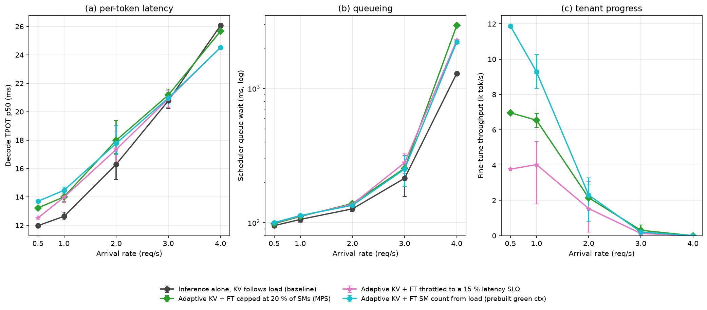

*Figure 1b — the same panels for the baseline and the three schemes with the best latency/throughput
trade-off (`plot_arms.py --only …`). The 20 % MPS cap (green) and the prebuilt dynamic green context
(cyan) both deliver 7–12k tok/s at 0.5–1 req/s; the green context costs about the same decode latency
(+10–15 %) for 40–70 % more tenant throughput and falls to the baseline by 2 req/s. The 15 % SLO cap
(pink) is the choice when the decode budget is fixed: it stays within the target at every rate and
hands the tenant whatever that leaves (1–5k tok/s).*

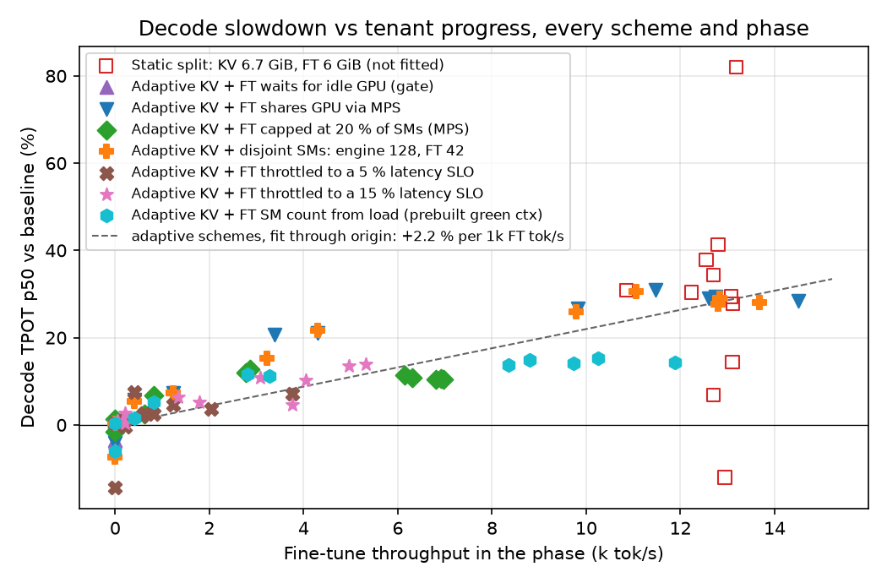

*Figure 2 — the same runs, one point per scheme and phase: decode slowdown over the baseline against
the tenant's throughput in that phase. MPS co-running, the MPS cap, the disjoint SM partition and
the SLO-capped runs fall on one line, about +2.2 % TPOT per 1 000 tenant tokens/s; the prebuilt
dynamic green context (cyan) sits clearly under it (+14 % at 8–12 k tok/s); the static split's
points are off the line because its cost is KV starvation, not the tenant's speed.*

### 2.2 Decode and tenant under each scheme

<!-- round2-compact-start -->
*Decode TPOT p50 in ms at each arrival rate (mean over the phases that share the rate; in brackets the change against the baseline), the scheduler queue wait at 3 and 4 req/s, and the tenant's throughput at 0.5 / 1 / 2 req/s (k tok/s; for the prefill tenant, k prompt tok/s). Round 2, 500 W, GPU 0. Full per-phase tables: [round2_tables.md](round2_tables.md).*

**Fine-tune tenant family**

| scheme | 0.5 | 1 | 2 | 3 | 4 | queue @3 / @4 (ms) | tenant k tok/s @0.5 / 1 / 2 |
|---|---|---|---|---|---|---|---|
| Inference alone (baseline) | 12.0 | 12.6 | 16.3 | 20.8 | 26.1 | 214 / 1292 |  |
| Static split | 21.8 (+82 %) | 16.7 (+32 %) | 21.8 (+34 %) | 23.0 (+11 %) | 22.9 (-12 %) | 4941 / 13472 | 13.2 / 12.2 / 12.9 |
| Static split + idle gate | 12.5 (+4 %) | 12.8 (+1 %) | 16.5 (+1 %) | 18.6 (-10 %) | 18.6 (-28 %) | 1019 / 9225 | 0.0 / 0.0 / 0.0 |
| Adaptive KV + gate | 12.1 (+1 %) | 12.8 (+1 %) | 16.5 (+1 %) | 20.9 (+0 %) | 25.2 (-3 %) | 238 / 2262 | 0.0 / 0.0 / 0.0 |
| Adaptive KV + MPS | 15.4 (+29 %) | 16.3 (+29 %) | 18.9 (+16 %) | 21.4 (+3 %) | 25.0 (-4 %) | 257 / 2302 | 14.5 / 11.7 / 3.0 |
| Adaptive KV + MPS 20 % | 13.2 (+10 %) | 14.0 (+11 %) | 18.0 (+10 %) | 21.2 (+2 %) | 25.7 (-2 %) | 254 / 2940 | 7.0 / 6.5 / 2.2 |
| Adaptive KV + disjoint SMs 128/42 | 15.3 (+28 %) | 16.2 (+28 %) | 18.6 (+14 %) | 21.3 (+3 %) | 24.1 (-7 %) | 308 / 3367 | 13.7 / 11.6 / 2.9 |
| Adaptive KV + 5 % latency SLO | 12.8 (+7 %) | 13.1 (+3 %) | 16.9 (+4 %) | 20.8 (-0 %) | 22.3 (-14 %) | 306 / 2425 | 3.8 / 1.2 / 0.4 |
| Adaptive KV + 15 % latency SLO | 12.5 (+5 %) | 14.0 (+11 %) | 17.3 (+6 %) | 20.9 (+1 %) | 24.5 (-6 %) | 280 / 2277 | 3.8 / 4.0 / 1.5 |
| Adaptive KV + dynamic green ctx (prebuilt) | 13.7 (+14 %) | 14.5 (+15 %) | 17.8 (+9 %) | 21.0 (+1 %) | 24.5 (-6 %) | 250 / 2216 | 11.9 / 9.3 / 2.3 |

**Prefill tenant family** (the 8B's host tier is 25.5 GiB here instead of 28, hence its own baseline)

| scheme | 0.5 | 1 | 2 | 3 | 4 | queue @3 / @4 (ms) | tenant k tok/s @0.5 / 1 / 2 |
|---|---|---|---|---|---|---|---|
| Inference alone, 25.5 GiB tier (prefill baseline) | 12.1 | 12.7 | 16.3 | 21.3 | 27.5 | 219 / 1303 |  |
| 3B prefill tenant, MPS | 12.7 (+5 %) | 13.4 (+6 %) | 16.3 (+0 %) | 21.3 (-0 %) | 24.9 (-9 %) | 260 / 3360 | 9.3 / 6.2 / 0.0 |
| 3B prefill tenant, MPS 20 % | 12.5 (+4 %) | 13.7 (+8 %) | 16.4 (+1 %) | 21.4 (+0 %) | 25.3 (-8 %) | 240 / 2176 | 8.9 / 7.1 / 0.6 |
| 3B prefill tenant, disjoint SMs | 12.6 (+4 %) | 13.4 (+6 %) | 16.3 (+0 %) | 21.3 (-0 %) | 25.4 (-8 %) | 262 / 6659 | 9.3 / 6.9 / 0.0 |

<!-- round2-compact-end -->

Round-1 (600 W) tables for the same schemes are in the git history of this file and in
`../results_600w/`; the only round-1 numbers that differ from round 2 beyond noise are the
`static_split` ones, because round 1 ran it with the idle gate on (kept as `static_split_gate`).

### 2.3 Green-context schemes

`green_ctx.py`, ctypes on libcuda; round 1 details in DECISIONS D8–D10, round 2 in D18.

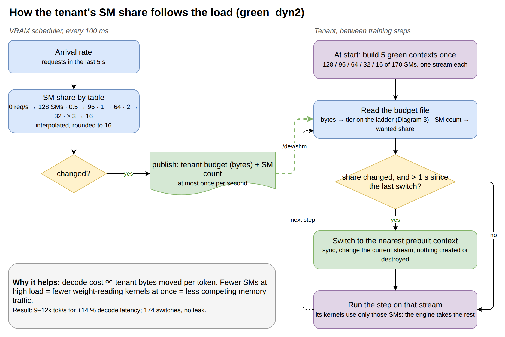

*Diagram 5 — the SM-share loop of `green_dyn2`: the scheduler maps the arrival rate to an SM count and publishes it with the budget; the tenant switches between contexts it built once at start. The memory ladder (Diagram 3) runs unchanged alongside.*

| scheme | decode at 1 / 2 req/s (TPOT, queue) | tenant at 1 / 0.5 req/s | note |
|---|---|---|---|
| `green32` (tenant on 32 SMs, round 1) | 14.4 / 16.6 ms, 119 / 132 ms | 6.3k / 7.3k tok/s | same trade as the MPS 20 % cap |
| `green_dyn` (SM count from λ̂, context re-created per change, round 1) | tenant died in phase 1 | 1.4k then 0 | re-creating the context on every share change leaked allocator memory (7.7 GiB reserved for a 5 GiB config) → OOM to pause |
| `engine_green` (engine on 128 SMs, round 1) | **12.9–13.2 / 15.2 ms — equal to the baseline** | tenant died as above | a bandwidth-bound decode node gives up a quarter of its SMs for free |
| `green_split` (engine 128 SMs, tenant the other 42, static) | 16.2 / 18.6 ms, 123 / 150 ms | 11.6k / 13.7k | tenant progress of MPS co-running, decode cost of MPS co-running: **disjoint SMs alone do not remove the interference** |
| **`green_dyn2`** (prebuilt 128/96/64/32/16-SM contexts, stream switch only, round 2) | **14.5 / 17.8 ms, 115 / 134 ms** | **9.3k / 11.9k** | 898 steps, 174 switches, reserved ≤ 8.7 GiB under a ≤ 9.9 GiB budget: no leak; **half the decode cost of MPS co-running at 80 % of its tenant throughput** |

### 2.4 Reading the results (per-second view in `../results/<scheme>_timeline.png`)

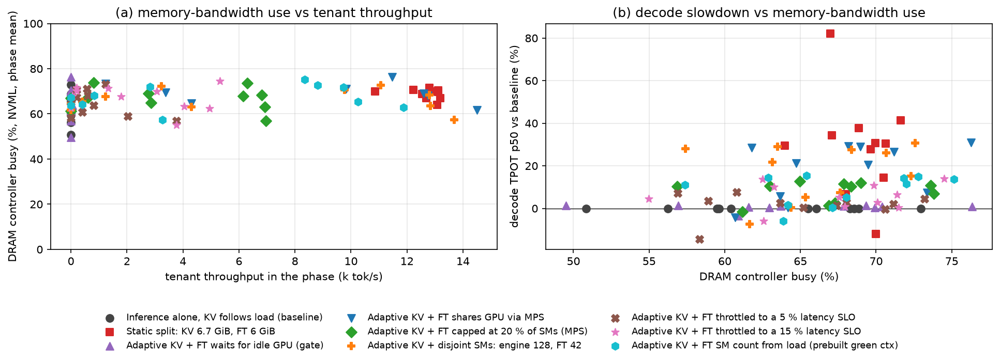

*Figure 4 — the direct test of the bandwidth reading (`plot_dram.py`, NVML memory-controller busy,
phase means). (a) The counter against the tenant's throughput: it sits at 55–75 % whether the
tenant runs at 0 or 14 k tok/s, because decode alone already keeps the controller that busy and
the counter cannot separate the two users. (b) The decode slowdown against the counter: no
relation. The tenant's token rate (Figure 2) predicts the slowdown; this counter does not.*

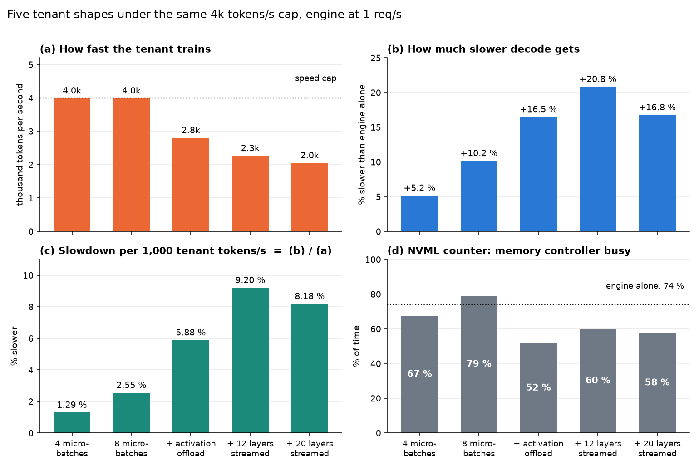

*Figure 5 — the shape probe (`run_probe.sh`, `analyze_probe.py`): engine at 1 req/s with a fixed
3 GiB KV limit, tenant at a fixed 7.5 GiB budget and the same 4 k tok/s cap in every window, one
60-s window per shape. (a) Decode slowdown per 1 k tenant tok/s by shape: k = 4 micro-batches
1.3 %, k = 8 2.6 %, activation offload 5.9 %, 12 / 20 streamed layers 9.2 / 8.2 %. (b) The
memory-controller counter for the same windows, with the no-tenant level dotted: it falls for the
copy-heavy shapes while their cost rises.*

- **Resizing costs decode nothing.** The engine alone with its limit following the load equals
  the engine alone with a fixed 13 GiB limit in every phase (round 1, TPOT within 0.1 ms); changing
  kvcached's limit 2 ↔ 12.65 GiB with the load is invisible to the engine.
- **Static partitioning fails both ways.** With the engine fixed at 6.69 GiB and the tenant running
  flat out beside it (12–13k tok/s), decode pays +30 % TPOT at 1–2 req/s, queues 5–13 s at 3–4 req/s
  and the backlog is still 26 s deep when the load has dropped to 0.5 req/s; at low load 4–8 GiB of
  the engine's budget sit unused.
- **The memory loop works as designed, and its accounting is now honest.** Round 1 took the
  engine's fixed footprint from NVML with the tenant's context included (17.7 GiB) and left no
  allowance for the tenant's own context, so the plotted tenant memory could cross the KV limit
  (it never caused a physical collision — the GPU was never oversubscribed, D11). Round 2 measures
  the engine's footprint at start (16.97 GiB), reserves 2 GiB for the tenant's context, weights and
  optimizer and 0.5 GiB safety, and caps every grow at the memory actually free. Over all
  round-2 runs the sum of KV mapped + tenant + fixed never exceeded the GPU (0 s in every scheme,
  [round2_tables.md](round2_tables.md)); the tenant's footprint exceeds its budget only while it is
  paused (0.6 GiB of model and optimizer against a 0 GiB budget, inside the 2 GiB allowance). The
  price of honest accounting is capacity: at 3–4 req/s the demand (12.65 GiB) exceeds what can be
  mapped with the tenant paused (≈ 12.4 GiB), so the scheduler waits there (`grow_wait`, the whole
  4 req/s phase) and the tenant stays paused as before. A bug in the first round-2 chain — the
  pending grow was never abandoned when demand fell, so the tenant stayed paused for the rest of
  the run — was found in the scheduler log, fixed and the six affected runs repeated (D16).
- **Time-sharing is dead on this engine.** The idle-window gate protects decode perfectly
  (+1 %) and the tenant trains nothing, because the Model Runner V2 engine keeps the GPU busy
  ~100 % of the time while any request runs (D5). Un-gated co-running under MPS costs decode
  +29 % TPOT at 0.5–1 req/s, +15 % at 2 req/s and ~0 at ≥ 3 req/s (the tenant is paused there).
- **Capping the tenant's share works; where it runs does not matter, how much it runs does.**
  20 % of the SM threads (MPS) gives +10–11 % TPOT for ~55 % of the un-capped tenant throughput;
  a disjoint 128/42 partition gives the un-capped cost for the un-capped throughput. In Figure 2
  these schemes and the SLO-capped runs share one line, +2.2 % TPOT per 1 k tenant tok/s.
- **The shared resource is memory traffic, and the tenant's shape sets how much a token costs**
  (Figures 4 and 5). Decode streams the 15 GiB of weights every ~13 ms; a tenant token costs decode
  in proportion to the bytes it moves: 1.3 % per 1 k tok/s with k = 4 micro-batches, 2.6 % with
  k = 8 (the weights are re-read twice as often per token), 5.9 % with activation offload and
  8–9 % with weight streaming (the copies compete too). NVML's DRAM-controller-busy counter does
  not separate the two users — it reads 49–73 % with the engine alone and does not rise with the
  tenant's throughput (Figure 4a) — so it is not a usable feedback signal; the tenant's token rate
  and shape are.
- **Fewer SMs for the same tokens/s costs decode less.** This is the round-2 surprise: the prebuilt
  dynamic green context (64–96 SMs at 0.5–1 req/s) gives the tenant 9–12k tok/s for +14–15 % TPOT,
  where MPS co-running on all SMs pays +29 % for 12–14k, and the fixed 42-SM partition pays +28 %
  for 12–14k. With fewer SMs the tenant's kernels run longer and overlap decode's weight stream
  with fewer concurrent re-reads per token; the 42-SM partition did not show this because at
  k = 2–4 the tenant on 42 SMs still runs flat out. The round-1 conclusion "placement does not
  matter" was therefore too strong: *static* placement does not matter, a share that falls with
  the load does.
- **A latency SLO can be enforced directly.** With the tokens/s cap driven by the measured decode
  TPOT, the 15 % scheme stays within +0–14 % in every phase with the tenant at 1.3–5.3k tok/s
  (on the Figure-2 line, as it should: the cap only moves the tenant along the line). The 5 %
  scheme holds +2–7 % but mostly pins the tenant at its 500 tok/s floor: a 5 % target is inside the
  noise of a 10-s TPOT window (the baseline moves ±4 % between repeats of the same phase).

### 2.5 The prefill tenant (round 2, plan P3)

A different kind of tenant: a Qwen2.5-3B (fp8) vLLM engine that only prefills 3072-token prompts
at 1 req/s (3.1k prompt tok/s offered) and streams the KV to a host-RAM tier, i.e. the "prefill
node" of a disaggregated pair sharing the GPU with the decode node. Its footprint is 4.5 GiB fixed
(weights, context, kvcached segment) plus KV; it has no ladder, only KV limit → hold → sleep
(Diagram 6).

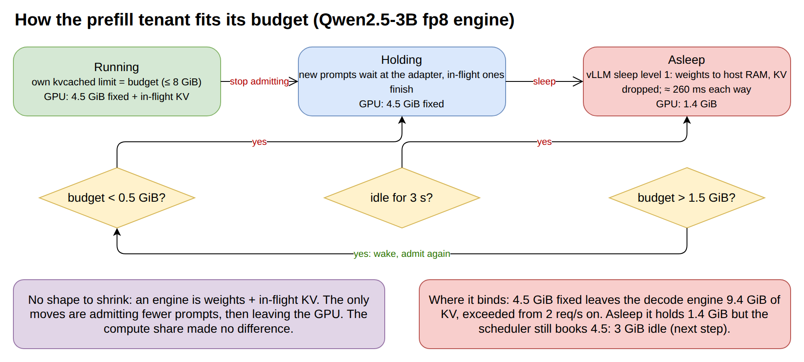

*Diagram 6 — the prefill tenant's three states (`pf_tenant.py`): run with its kvcached limit at the budget, hold new prompts under 0.5 GiB, sleep after 3 idle seconds, wake once the budget is back above 1.5 GiB. The red note is where the scheme binds.*

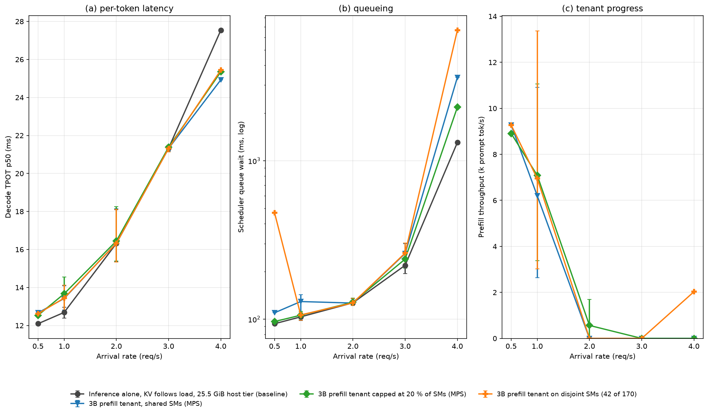

*Figure 6 — the three prefill-tenant schemes against their own baseline (`plot_arms.py --pf`): decode latency, queue wait and the tenant's delivered prompt tokens/s per arrival rate.*

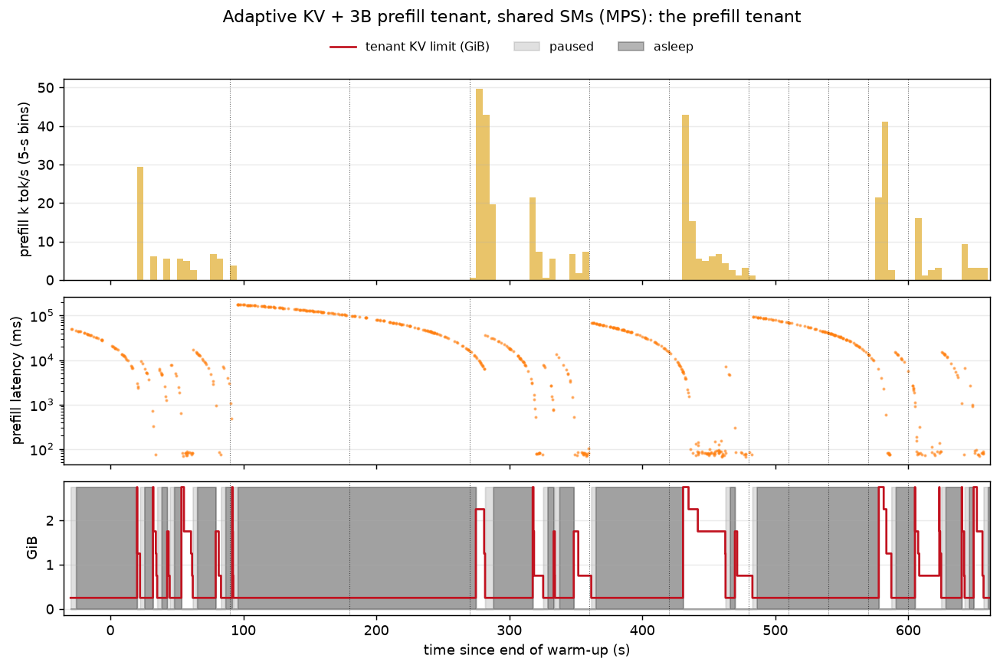

*Figure 7 — the prefill tenant under MPS over the run (`analyze_pf.py`): its throughput in 5-s bins, the latency of each prompt (queueing at the adapter included), and its KV limit with the paused (light) and asleep (dark) spans.*

<!-- pf-outcome-start -->
**Outcome (D19).** The three schemes are indistinguishable: decode **+4–8 % at 0.5–1 req/s and 0 % at
≥ 2 req/s**, the tenant delivering **6–9 k prompt tok/s at 0.5–1 req/s and nothing at ≥ 2 req/s**,
where it is asleep for the whole phase (0 failed requests; `pf_base` equals the main baseline, so the
smaller host tier costs nothing). The compute mechanism did not matter because compute never became
the limit: the tenant's **4.5 GiB fixed footprint** leaves 9.4 GiB for the 8B's KV and its own, and
the 8B's demand exceeds that from 2 req/s on, so the adapter holds requests and the engine sleeps.
While it sleeps its real footprint is 1.4 GiB, but the scheduler's allowance stays at 4.5 GiB — 3 GiB
idle in every ≥ 2 req/s phase. The prompt latencies in the sleeping phases (45–190 s median) are
queueing at the adapter, not prefill time (71 ms for 3072 tokens when awake). Per prompt token the
prefill tenant costs decode less than the fine-tune tenant (≈ 1 % per 1 k tok/s against 2.2 %): prefill
reads the weights once per 8 k-token batch. In `pf_split` the budget returned briefly inside the
4 req/s phase, the tenant woke and the engine's queue doubled (6.7 s): the wake margin must cover the
3.5 GiB a wake costs.
<!-- pf-outcome-end -->

## 3. Host↔GPU transfers

Every host↔GPU copy was recorded with its source (figure `../results/<scheme>_xfer.png`; records in
`../results/<scheme>_xfer_{inf,ft}.csv`; NVML PCIe counters in the sampler CSV).

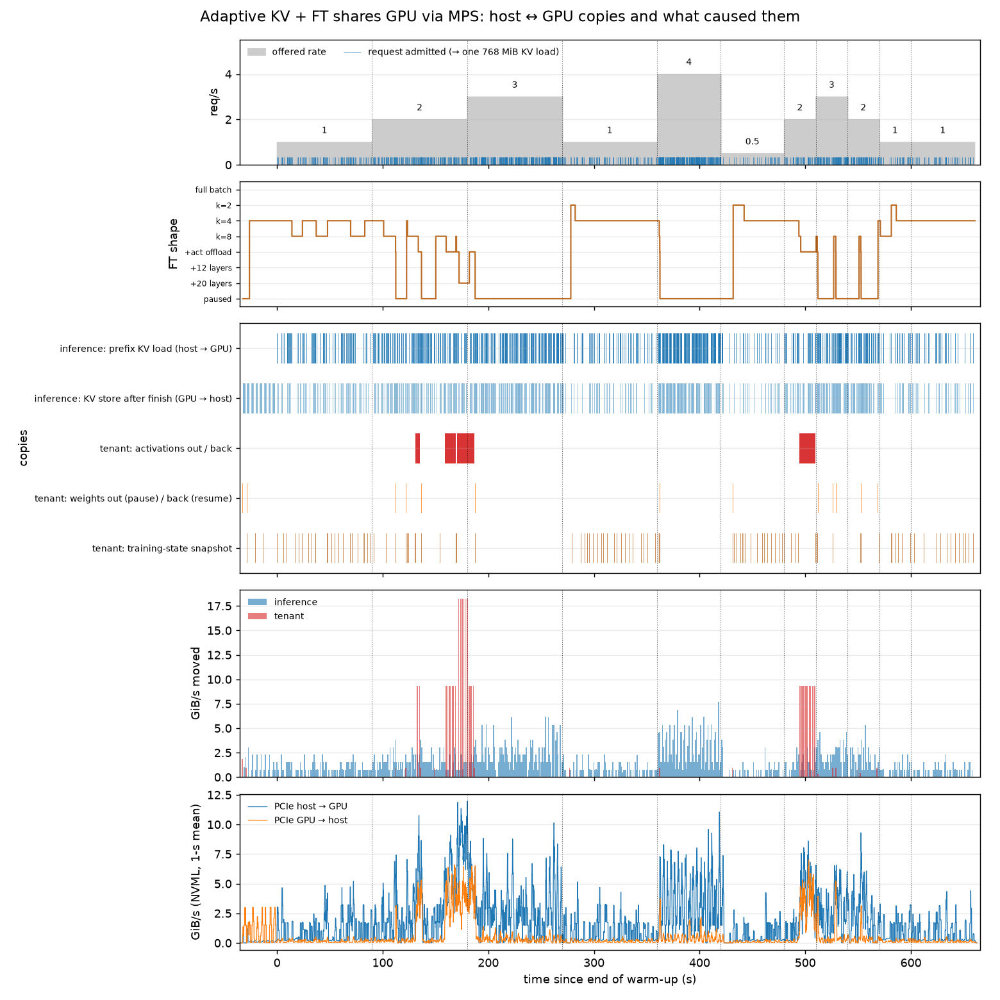

*Figure 3 — every host↔GPU copy in the MPS scheme and what caused it. Top two rows are the causes:
each admitted request (blue tick) triggers one 768 MiB prefix load and, when it finishes, one
16 MiB store; each move of the tenant's shape triggers the tenant's copies (activations out and
back on the way through the activation-offload shape, weights out on pause and back on resume), and
a snapshot goes out every 10 steps. The middle row shows the copies themselves as spans, the fourth
the bytes moved per second by source, the last NVML's PCIe counters. The same figure exists for
every scheme in `../results/<scheme>_xfer.png`.*

| | per copy | per 11-minute run |
|---|---|---|
| inference loads (DRAM → GPU, one per admitted request) | 768 MiB in 55.7 ms = **13.5 GiB/s** (≈ 93 % of the 14.5 GB/s the link delivers) | 1 176 loads, 880 GiB, 1.36 GiB/s average |
| inference stores (GPU → DRAM, one per finished request) | 16 MiB in 1.2 ms | 1 219 stores, 51 GiB |
| tenant activation offload (tier 2) | 4.7 GB out and 4.7 GB back per step, 354 ms out | 6 steps in the MPS scheme, 56 GiB |
| tenant pause / resume | ~1 GB in 195 / 98 ms | 8 / 9 times in the MPS scheme |
| tenant snapshots | 8 MB, < 50 ms | 176 in the MPS scheme |

Contention: inference loads that overlapped a tenant copy took 56.1–56.3 ms against 55.7 ms
alone (n = 32–74 per scheme) — no measurable slowdown, because the link is busy only ~10 % of the
time on average and the tenant's large copies are rare (activation offload is the slow tier that
the budget ladder seldom lands on). The NVML counters agree with the records on the time
structure (bursts of 15 GiB/s at every admission); their 20-ms sampling overstates peaks (a
35 GiB/s reading during an activation offload is a window artefact). The probe (Figure 5) adds the
other side of this: the copies do not slow each other, but a tenant shape that copies a lot costs
decode 3–7× more per token than one that does not — the copies compete with decode for the GPU's
memory system, not with each other for the link.

## 4. What this shows

Figure-centred summary (diagrams 1–4, Figures 0–7, `../results/<scheme>_timeline.png`,
`../results/<scheme>_xfer.png`):

1. **The memory half of the problem is solved, with honest accounting** (diagrams 1–3). A router in
   front of vLLM knows the exact KV demand of what is running and queued; the VRAM scheduler raises
   kvcached's limit the moment demand exceeds it — and only as far as memory is actually free —
   and lowers it with hysteresis; the tenant climbs and drops a ladder of configurations with a
   50-ms preemption poll inside its steps and DRAM snapshots. Over an 11-minute schedule from 0.5
   to 4 req/s the engine never failed and never preempted, the GPU was never oversubscribed, and
   resizing itself costs nothing. Static partitioning lost on both sides: 5–26 s of queueing at and
   after 3–4 req/s, +30 % decode latency at low load, idle VRAM at low load.
2. **The compute half now has two workable schemes, and a model of the cost.** The cost of a
   tenant is memory traffic: +2.2 % decode TPOT per 1 k tenant tok/s for the fine-tune tenant's
   usual shape, more for shapes that re-read weights or copy activations (Figure 5), nothing at
   ≥ 3 req/s where the tenant is paused anyway. Two mechanisms move the trade-off: (a) a dynamic
   green context with prebuilt SM partitions (`green_dyn2`) gives 9–12k tok/s for +14 % — half the
   cost of MPS co-running at 80 % of its throughput, and it survived 174 switches without the
   round-1 leak; (b) a tokens/s cap driven by the measured decode latency (`tpot_slo15`) enforces a
   stated SLO directly (+0–14 % for a 15 % target), while a 5 % target is below the measurement
   noise of a 10-s window. Time-sharing (idle-window gate) remains useless on this engine, and a
   fixed SM partition alone does not help.
3. **A prefill engine as the tenant is memory-limited, not compute-limited.** With a 4.5 GiB fixed
   footprint it only fits beside the decode node at ≤ 1 req/s; there it adds +5–6 % decode TPOT and
   delivers 6–9k prompt tok/s in bursts, and at ≥ 2 req/s it sleeps. Sleep frees 3 GiB that the
   scheduler does not yet credit back to the KV pool — the obvious next fix (section 2.5).
4. **kvcached + LMCache's MP connector works on kvcached main** (plan P4, D12–D13, GPU 1): the
   `engine_driven` mode ran 10 minutes of heavy store/retrieve traffic with the limit resized every
   15 s, 341/341 requests ok, outputs identical to the plain engine; the Xid 31 fault seen with
   kvcached 0.1.6 is gone (main orders page unmaps behind the GPU's progress) and the pin layer
   written for it was not needed. The zero-copy VMM mode stays blocked on LMCache's side: it
   imports one handle per tensor, kvcached maps 2 MiB pages.
5. **Host↔GPU traffic is not the bottleneck**: inference loads run at 13.5 GiB/s, average link use
   is 1.4 GiB/s, and loads that overlap tenant copies are not measurably slower.

What to do next: (a) make the dynamic SM share the default and drive it from the measured TPOT
error instead of the arrival rate (the green-context table is open-loop; the SLO loop is closed but
moves only the token rate), with a target above the measurement noise (≥ 10 %) or a longer window;
(b) under a tokens/s cap, choose the tenant's shape by traffic per token (largest micro-batch that
fits, never a streaming shape at high rate); (c) credit the sleeping prefill tenant's released
memory to the KV pool (read the adapter's live footprint instead of a fixed allowance) and give it
a 16–32-SM green context; (d) a tenant whose bytes are already resident (LoRA on the served model,
DeltaServe-style) is still the way to a near-zero-cost tenant.
