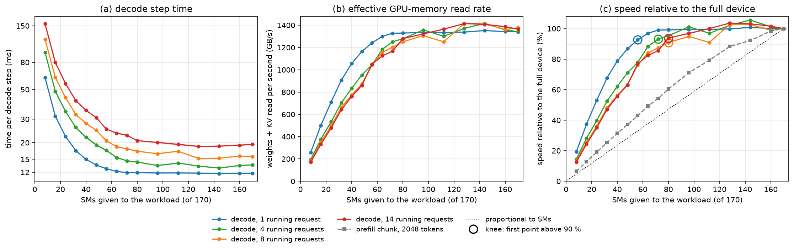
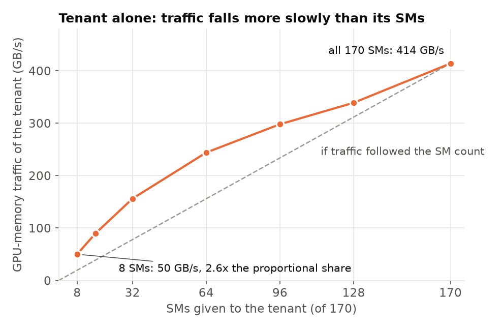
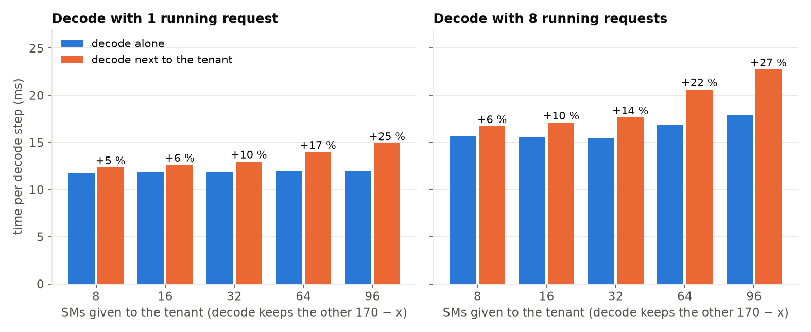
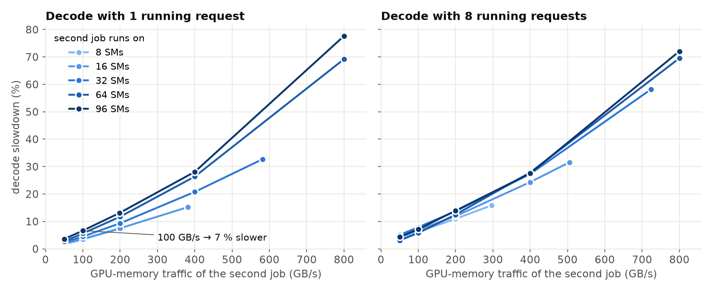
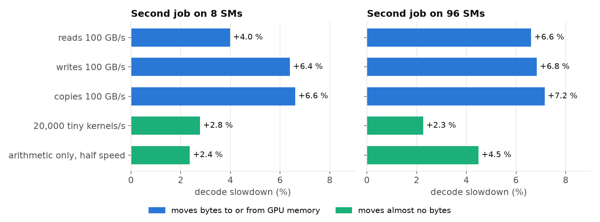
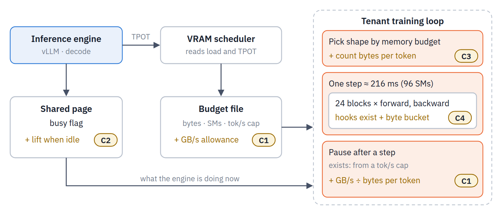
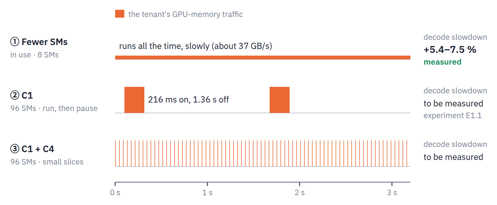
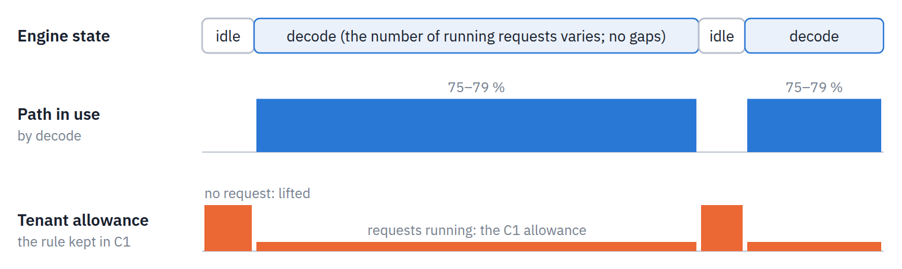
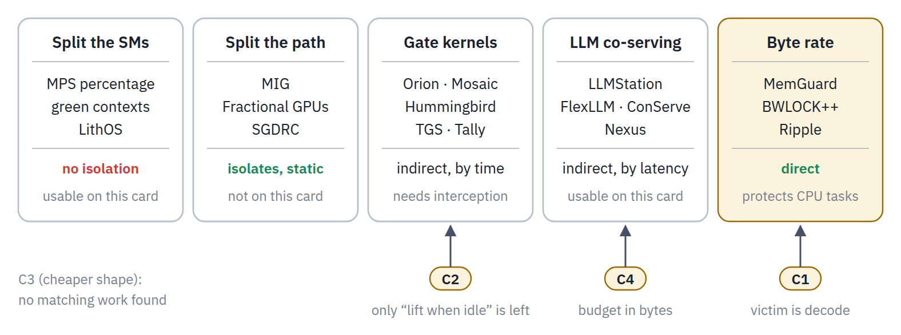

# Colocation VRAM-adjust prototype — report

Round 1: 2026-11-05/06 (GPU 1, 600 W, archived in `../results_600w/`). **Round 2: 2026-11-09 (GPU 0,
both GPUs capped at 500 W, `../results/`)** — all figures and tables below are from round 2 unless
stated; round 1 is referred to where it differs. Branch `kvcached-validation`, directory
`coloc_adjust/`. Design in [DESIGN.md](../DESIGN.md), the round-2 plan in
[PLAN_overnight2.md](../PLAN_overnight2.md), run-by-run predictions and outcomes in
[DECISIONS.md](DECISIONS.md) (D1–D10 round 1, D11–D19 round 2). Section 2.7 summarises the
bandwidth-interference measurements (full account in [REPORT_bandwidth.md](REPORT_bandwidth.md)),
section 5 the next steps and section 6 the related work.

**Terminology.** Two memories appear in this report and are kept apart by name. **GPU memory** is
the 5090's 31.35 GiB of GDDR7: "GPU memory bandwidth" is the SM ↔ GPU-memory path (≈ 1.8 TB/s) and
"GPU-memory-controller busy" is NVML's reading of it. **Host RAM** is the machine's 60 GiB of DDR: the
KV tiers, the tenant's offloaded activations, streamed weights and snapshots live there and move over
PCIe (≈ 14 GB/s). The word DRAM is not used for either.

## 1. What was built

One RTX 5090 serves a Llama-3-8B decode node (vLLM 0.30 + kvcached main, native host-RAM offload
with a 28 GiB tier in /dev/shm, prefix caching off, so the GPU holds only in-flight KV) and, beside
it, a tenant: a Qwen2.5-0.5B LoRA fine-tune in most schemes, a Qwen2.5-3B fp8 prefill-only engine
in the round-2 prefill schemes. Nothing is changed inside vLLM's scheduler:

- **Router / VRAM scheduler** (`controller.py`, one process): every request passes through a
  streaming HTTP router that knows its prompt length, `max_tokens` and tokens generated so far,
  so the KV block demand of the running set and the queue is exact (⌈prompt/16⌉ blocks at
  admission, +1 block per 16 generated tokens, 2 MiB per block). Every 100 ms: `need = (running
  final + waiting final) × 2 MiB + λ̂·1 s·0.78 GiB + 0.5 GiB`; the kvcached limit grows to `need`
  at once and shrinks only after 5 s below `need − 1 GiB`, never below what the running set holds.
  The tenant budget `31.35 − 17.0 − 2.0 − 0.5 − limit` GiB (total − engine weights and runtime as
  measured by NVML at start − the tenant's own context, weights and optimizer − safety) is
  published to `/dev/shm`, lowered at once on the way up and raised only once kvcached's mapped
  bytes are under the new limit. Round 2 added two guards: the limit may only promise memory that
  is free right now (kvcached's mapped bytes + NVML free − safety), so a grow waits for the tenant
  to release (`grow_wait`) and is abandoned if demand falls back first (D11, D16); and, optionally
  (`--tpot-slo`), the scheduler measures decode TPOT over the last 10 s, compares it with the
  no-tenant reference for the current arrival rate and publishes a tokens/s cap for the tenant
  (multiplicative update every 2 s).
- **Fine-tune tenant** (`ft_worker.py`): before each optimizer step reads the budget and picks the
  highest configuration whose calibrated need fits (drop at once, climb after 3 s): full batch
  → micro-batches k = 2/4/8 → + activation offload to pinned host RAM → + frozen base weights of
  12/20 layers streamed from host RAM → pause (snapshot, everything to host). LoRA weights, optimizer,
  scheduler, step and RNG are snapshotted to host RAM every 10 steps and before every tier change; a
  budget poll inside the step (every 50 ms, from the per-block hooks) preempts a step that no
  longer fits; the torch allocator cap follows the budget so a mis-estimate OOMs the tenant, never
  the engine. Round 2: it honours the published tokens/s cap by sleeping after each step, and
  with `--green-prebuilt` it builds green contexts of 128/96/64/32/16 SMs at start and only
  switches streams between steps (the round-1 per-switch context creation leaked allocator memory).
- **Prefill tenant** (`pf_tenant.py`, round 2): a second vLLM engine (Qwen2.5-3B, fp8, its own
  kvcached instance, KV streamed to a 3.5 GiB host-RAM tier, `max_tokens = 1`) behind an adapter
  that sets the engine's kvcached limit from the budget, holds new requests at the proxy when the
  budget is below 0.5 GiB, and puts the engine to sleep (weights to host, 4.5 → 1.4 GiB on the
  GPU) after 3 s idle; it wakes in ≈ 0.3 s once the budget is back above 1.5 GiB. Own report:
  [REPORT_pf.md](REPORT_pf.md).
- **Transfer tracing**: every host↔GPU copy is recorded with its source — the engine's native
  offload transfers (bytes and CUDA-event time from vLLM's own transfer results, via an
  observation-only `sitecustomize`) and the tenant's activation/weight/snapshot copies — plus
  NVML's PCIe counters, and in round 2 NVML's power, SM-busy and **GPU-memory-controller-busy** readings (the SM ↔ GPU-memory path)
  every 100 ms.

Compute sharing: MPS daemon (user-space), engine and tenant as MPS clients; green contexts via
ctypes on libcuda (`green_ctx.py`).

*Diagram 1 — the components and what triggers what: the router feeds demand to the VRAM scheduler, the VRAM scheduler sets kvcached's limit (red, inference first) and publishes the remainder to the tenant; the observation patch only reports.*

*Diagram 2 — one VRAM scheduler tick: grow at once when demand exceeds the limit, shrink only after 5 s of slack and never below what running requests hold.*

*Diagram 3 — the tenant's ladder and the triggers that move it: budget polls inside the step, OOM as a signal, 3-s hold before climbing, host-RAM snapshots around every move.*

### Tenant configurations (calibrated solo on GPU 1, `tiers.json`)

| cfg | tier | micro-batches k | activation offload | layers streamed | grad ckpt | need GiB | step ms | tok/s |
|---|---|---|---|---|---|---|---|---|
| 0 | 0 full batch | 1 | – | 0 | off | 15.9 | 91 | 44.8k |
| 1 | 1 | 2 | – | 0 | off | 8.7 | 106 | 38.7k |
| 2 | 1 | 4 | – | 0 | off | 5.0 | 138 | 29.6k |
| 3 | 1 | 8 | – | 0 | off | 3.2 | 210 | 19.5k |
| 4 | 2 | 8 | yes | 0 | on | 2.5 | 1045 | 3.9k |
| 5 | 3 | 8 | yes | 12 | on | 2.2 | 1294 | 3.2k |
| 6 | 3 | 8 | yes | 20 | on | 1.9 | 1452 | 2.8k |
| 7 | 4 pause | – | – | – | – | 0.4 | – | 0 |

Activation offload moves ~4.8 GB per step each way at k = 8 and costs 5× in step time; with
gradient checkpointing already on it saves little memory (the floor, ~1.9 GiB, is the
lm_head/embedding plus one micro-batch's logits), so in practice the ladder is micro-batching
down to ~3 GiB, then the slow offload tiers, then pause.

## 2. Evaluation

Reference workload (32 sessions × 6144-token prefixes, +128 new tokens → 128 out, Zipf-1.1,
seeded) with a piecewise-constant arrival-rate schedule after a 32-request warm-up:

| from (s) | 0 | 90 | 180 | 270 | 360 | 420 | 480 | 510 | 540 | 570 | 600–660 |
|---|---|---|---|---|---|---|---|---|---|---|---|
| req/s | 1 | 2 | 3 | 1 | 4 | 0.5 | 2 | 3 | 2 | 1 | 1 |

*Figure 0 — the workload trace every scheme is driven with (`../plot_workload.py`, from the baseline run's request log). (a) The offered arrival rate and the Poisson arrivals actually generated, 10-s bins; the same seeded sequence is replayed in every scheme. (b) Session popularity: Zipf(1.1) over 32 sessions, so a few prefixes dominate the host-RAM store's traffic. Every request carries a 6144-token session prefix plus 128 new tokens and produces 128 tokens, i.e. about 0.77 GiB of KV while in flight.*

Each scheme is one continuous 11-minute run (`run_eval6.sh`, `run_eval_pf.sh`, `run_probe.sh`;
round 1: `run_eval3.sh`). Per-phase numbers skip the first 10 s of each phase. Decode is judged on
TPOT, scheduler queue wait, delivered throughput and failures (decode-only TTFT is fetch +
128-token prefill, ~160 ms); the tenant on tokens/s (prompt tokens/s for the prefill tenant) and
its configuration. **Baseline:** the engine alone with its KV limit following the load
(`adjust_notenant`); the 500 W cap changed it by nothing measurable (TPOT within 0.3 ms of the
600 W run in every phase, [round2_tables.md](round2_tables.md)), the GPU draws 290–385 W per
phase under this load.

### 2.1 What the schemes are

| scheme | engine KV limit | tenant | compute sharing | round |
|---|---|---|---|---|
| `adjust_notenant` | VRAM scheduler | none | – (baseline) | 1, 2 |
| `static_split` | fixed 6.69 GiB (= the 2 req/s need) | fixed 6 GiB budget (cfg 2) | MPS co-run | 1, 2 |
| `static_split_gate` | fixed 6.69 GiB | fixed 6 GiB | idle-window gate (the round-1 runner's setting; D15) | 2 |
| `adjust` | VRAM scheduler | tiered | idle-window gate + MPS | 1, 2 |
| `adjust_nogate` | VRAM scheduler | tiered | MPS co-run, no cap | 1, 2 |
| `adjust_mps20` | VRAM scheduler | tiered | MPS, tenant capped at 20 % of SM threads | 1, 2 |
| `green32`, `green_dyn`, `engine_green`, `green_opt` | VRAM scheduler | tiered | round-1 green-context schemes (table in 2.3) | 1 |
| `green_split` | VRAM scheduler | tiered | engine steps on SMs 0–127, tenant on the remaining 42 (static, disjoint) | 1, 2 |
| `tpot_slo5`, `tpot_slo15` | VRAM scheduler + TPOT feedback | tiered, tokens/s cap | MPS; the cap holds decode within +5 % / +15 % of the baseline | 2 |
| `green_dyn2` | VRAM scheduler | tiered, SM count from the arrival rate (128/96/64/32/16 at 0/0.5/1/2/≥3 req/s) | prebuilt green contexts, stream switch only | 2 |
| `pf_mps`, `pf_mps20`, `pf_split` | VRAM scheduler | 3B prefill engine, sleep tier | MPS / MPS 20 % / engine 128 SMs + tenant 42 SMs | 2 |
| `pf_base` | VRAM scheduler | none | baseline for the prefill schemes (8B host tier 25.5 GiB instead of 28, to leave /dev/shm room for the 3B's tier) | 2 |
| `probe` | fixed 3 GiB | fixed 7.5 GiB, one shape per 60-s window, 4 k tok/s cap | MPS; measures the decode cost of each tenant shape | 2 |

*Diagram 4 — the compute-sharing mechanisms tried (source `../diagrams/04_compute_sharing.drawio`); the memory loop is the same in all of them. The dot before each title is the colour of that scheme's line in Figure 1.*

*Figure 1 — decode latency (a), scheduler queue wait (b) and fine-tune throughput (c) against the
arrival rate, pooling the phases that share a rate (marker = mean, bar = min..max across the
repeats; `plot_arms.py`). Reading: adaptive schemes sit on the baseline in (a) and (b) at 3–4 req/s,
where the tenant is paused, and pay a tenant-speed-dependent premium at 0.5–2 req/s; the static
split pays 30–80 % everywhere and queues seconds once the load passes 2 req/s. The two round-2
mechanisms that move the trade-off are the prebuilt dynamic green context (cyan: the throughput of
MPS co-running for half its latency cost) and the 15 % latency-SLO cap (pink: the decode cost
held where it was asked to be).*

*Figure 1b — the same panels for the baseline and the three schemes with the best latency/throughput
trade-off (`plot_arms.py --only …`). The 20 % MPS cap (green) and the prebuilt dynamic green context
(cyan) both deliver 7–12k tok/s at 0.5–1 req/s; the green context costs about the same decode latency
(+10–15 %) for 40–70 % more tenant throughput and falls to the baseline by 2 req/s. The 15 % SLO cap
(pink) is the choice when the decode budget is fixed: it stays within the target at every rate and
hands the tenant whatever that leaves (1–5k tok/s).*

*Figure 2 — the same runs, one point per scheme and phase: decode slowdown over the baseline against
the tenant's throughput in that phase. MPS co-running, the MPS cap, the disjoint SM partition and
the SLO-capped runs fall on one line, about +2.2 % TPOT per 1 000 tenant tokens/s; the prebuilt
dynamic green context (cyan) sits clearly under it (+14 % at 8–12 k tok/s); the static split's
points are off the line because its cost is KV starvation, not the tenant's speed.*

### 2.2 Decode and tenant under each scheme

<!-- round2-compact-start -->
*Decode TPOT p50 in ms at each arrival rate (mean over the phases that share the rate; in brackets the change against the baseline), the scheduler queue wait at 3 and 4 req/s, and the tenant's throughput at 0.5 / 1 / 2 req/s (k tok/s; for the prefill tenant, k prompt tok/s). Round 2, 500 W, GPU 0. Full per-phase tables: [round2_tables.md](round2_tables.md).*

**Fine-tune tenant family**

| scheme | 0.5 | 1 | 2 | 3 | 4 | queue @3 / @4 (ms) | tenant k tok/s @0.5 / 1 / 2 |
|---|---|---|---|---|---|---|---|
| Inference alone (baseline) | 12.0 | 12.6 | 16.3 | 20.8 | 26.1 | 214 / 1292 |  |
| Static split | 21.8 (+82 %) | 16.7 (+32 %) | 21.8 (+34 %) | 23.0 (+11 %) | 22.9 (-12 %) | 4941 / 13472 | 13.2 / 12.2 / 12.9 |
| Static split + idle gate | 12.5 (+4 %) | 12.8 (+1 %) | 16.5 (+1 %) | 18.6 (-10 %) | 18.6 (-28 %) | 1019 / 9225 | 0.0 / 0.0 / 0.0 |
| Adaptive KV + gate | 12.1 (+1 %) | 12.8 (+1 %) | 16.5 (+1 %) | 20.9 (+0 %) | 25.2 (-3 %) | 238 / 2262 | 0.0 / 0.0 / 0.0 |
| Adaptive KV + MPS | 15.4 (+29 %) | 16.3 (+29 %) | 18.9 (+16 %) | 21.4 (+3 %) | 25.0 (-4 %) | 257 / 2302 | 14.5 / 11.7 / 3.0 |
| Adaptive KV + MPS 20 % | 13.2 (+10 %) | 14.0 (+11 %) | 18.0 (+10 %) | 21.2 (+2 %) | 25.7 (-2 %) | 254 / 2940 | 7.0 / 6.5 / 2.2 |
| Adaptive KV + disjoint SMs 128/42 | 15.3 (+28 %) | 16.2 (+28 %) | 18.6 (+14 %) | 21.3 (+3 %) | 24.1 (-7 %) | 308 / 3367 | 13.7 / 11.6 / 2.9 |
| Adaptive KV + 5 % latency SLO | 12.8 (+7 %) | 13.1 (+3 %) | 16.9 (+4 %) | 20.8 (-0 %) | 22.3 (-14 %) | 306 / 2425 | 3.8 / 1.2 / 0.4 |
| Adaptive KV + 15 % latency SLO | 12.5 (+5 %) | 14.0 (+11 %) | 17.3 (+6 %) | 20.9 (+1 %) | 24.5 (-6 %) | 280 / 2277 | 3.8 / 4.0 / 1.5 |
| Adaptive KV + dynamic green ctx (prebuilt) | 13.7 (+14 %) | 14.5 (+15 %) | 17.8 (+9 %) | 21.0 (+1 %) | 24.5 (-6 %) | 250 / 2216 | 11.9 / 9.3 / 2.3 |

**Prefill tenant family** (the 8B's host tier is 25.5 GiB here instead of 28, hence its own baseline)

| scheme | 0.5 | 1 | 2 | 3 | 4 | queue @3 / @4 (ms) | tenant k tok/s @0.5 / 1 / 2 |
|---|---|---|---|---|---|---|---|
| Inference alone, 25.5 GiB tier (prefill baseline) | 12.1 | 12.7 | 16.3 | 21.3 | 27.5 | 219 / 1303 |  |
| 3B prefill tenant, MPS | 12.7 (+5 %) | 13.4 (+6 %) | 16.3 (+0 %) | 21.3 (-0 %) | 24.9 (-9 %) | 260 / 3360 | 9.3 / 6.2 / 0.0 |
| 3B prefill tenant, MPS 20 % | 12.5 (+4 %) | 13.7 (+8 %) | 16.4 (+1 %) | 21.4 (+0 %) | 25.3 (-8 %) | 240 / 2176 | 8.9 / 7.1 / 0.6 |
| 3B prefill tenant, disjoint SMs | 12.6 (+4 %) | 13.4 (+6 %) | 16.3 (+0 %) | 21.3 (-0 %) | 25.4 (-8 %) | 262 / 6659 | 9.3 / 6.9 / 0.0 |

<!-- round2-compact-end -->

Round-1 (600 W) tables for the same schemes are in the git history of this file and in
`../results_600w/`; the only round-1 numbers that differ from round 2 beyond noise are the
`static_split` ones, because round 1 ran it with the idle gate on (kept as `static_split_gate`).

### 2.3 Green-context schemes

`green_ctx.py`, ctypes on libcuda; round 1 details in DECISIONS D8–D10, round 2 in D18.

*Diagram 5 — the SM-share loop of `green_dyn2`: the scheduler maps the arrival rate to an SM count and publishes it with the budget; the tenant switches between contexts it built once at start. The memory ladder (Diagram 3) runs unchanged alongside.*

| scheme | decode at 1 / 2 req/s (TPOT, queue) | tenant at 1 / 0.5 req/s | note |
|---|---|---|---|
| `green32` (tenant on 32 SMs, round 1) | 14.4 / 16.6 ms, 119 / 132 ms | 6.3k / 7.3k tok/s | same trade as the MPS 20 % cap |
| `green_dyn` (SM count from λ̂, context re-created per change, round 1) | tenant died in phase 1 | 1.4k then 0 | re-creating the context on every share change leaked allocator memory (7.7 GiB reserved for a 5 GiB config) → OOM to pause |
| `engine_green` (engine on 128 SMs, round 1) | **12.9–13.2 / 15.2 ms — equal to the baseline** | tenant died as above | a bandwidth-bound decode node gives up a quarter of its SMs for free |
| `green_split` (engine 128 SMs, tenant the other 42, static) | 16.2 / 18.6 ms, 123 / 150 ms | 11.6k / 13.7k | tenant progress of MPS co-running, decode cost of MPS co-running: **disjoint SMs alone do not remove the interference** |
| **`green_dyn2`** (prebuilt 128/96/64/32/16-SM contexts, stream switch only, round 2) | **14.5 / 17.8 ms, 115 / 134 ms** | **9.3k / 11.9k** | 898 steps, 174 switches, reserved ≤ 8.7 GiB under a ≤ 9.9 GiB budget: no leak; **half the decode cost of MPS co-running at 80 % of its tenant throughput** |

### 2.4 Reading the results (per-second view in `../results/<scheme>_timeline.png`)

*Figure 4 — the direct test of the bandwidth reading (`plot_dram.py`, NVML GPU-memory-controller busy,
phase means). (a) The counter against the tenant's throughput: it sits at 55–75 % whether the
tenant runs at 0 or 14 k tok/s, because decode alone already keeps the controller that busy and
the counter cannot separate the two users. (b) The decode slowdown against the counter: no
relation. The slowdown follows the tenant's token rate (Figure 2), not this counter.*

*Figure 5 — the shape probe (`run_probe.sh`, `analyze_probe.py`): engine at 1 req/s with a fixed
3 GiB KV limit, tenant at a fixed 7.5 GiB budget and the same 4 k tok/s cap in every window, one
60-s window per shape. (a) The tenant's training speed: the two micro-batch shapes reach the cap,
the other three stay below it (2.8k, 2.3k, 2.0k tok/s). (b) Decode slowdown against the engine
alone: +5.2 % to +20.8 %. (c) Their ratio, the decode slowdown per 1 k tenant tok/s: k = 4
micro-batches 1.3 %, k = 8 2.6 %, activation offload 5.9 %, 12 / 20 streamed layers 9.2 / 8.2 %.
(d) NVML's memory-controller counter for the same windows, with the engine-alone level dotted: it
falls for the copy-heavy shapes while their cost rises.*

- **Resizing costs decode nothing.** The engine alone with its limit following the load equals
  the engine alone with a fixed 13 GiB limit in every phase (round 1, TPOT within 0.1 ms); changing
  kvcached's limit 2 ↔ 12.65 GiB with the load is invisible to the engine.
- **Static partitioning fails both ways.** With the engine fixed at 6.69 GiB and the tenant running
  flat out beside it (12–13k tok/s), decode pays +30 % TPOT at 1–2 req/s, queues 5–13 s at 3–4 req/s
  and the backlog is still 26 s deep when the load has dropped to 0.5 req/s; at low load 4–8 GiB of
  the engine's budget sit unused.
- **The memory loop works as designed, and its accounting is now honest.** Round 1 took the
  engine's fixed footprint from NVML with the tenant's context included (17.7 GiB) and left no
  allowance for the tenant's own context, so the plotted tenant memory could cross the KV limit
  (it never caused a physical collision — the GPU was never oversubscribed, D11). Round 2 measures
  the engine's footprint at start (16.97 GiB), reserves 2 GiB for the tenant's context, weights and
  optimizer and 0.5 GiB safety, and caps every grow at the memory actually free. Over all
  round-2 runs the sum of KV mapped + tenant + fixed never exceeded the GPU (0 s in every scheme,
  [round2_tables.md](round2_tables.md)); the tenant's footprint exceeds its budget only while it is
  paused (0.6 GiB of model and optimizer against a 0 GiB budget, inside the 2 GiB allowance). The
  price of honest accounting is capacity: at 3–4 req/s the demand (12.65 GiB) exceeds what can be
  mapped with the tenant paused (≈ 12.4 GiB), so the scheduler waits there (`grow_wait`, the whole
  4 req/s phase) and the tenant stays paused as before. A bug in the first round-2 chain — the
  pending grow was never abandoned when demand fell, so the tenant stayed paused for the rest of
  the run — was found in the scheduler log, fixed and the six affected runs repeated (D16).
- **Time-sharing is dead on this engine.** The idle-window gate protects decode perfectly
  (+1 %) and the tenant trains nothing, because the Model Runner V2 engine keeps the GPU busy
  ~100 % of the time while any request runs (D5). Un-gated co-running under MPS costs decode
  +29 % TPOT at 0.5–1 req/s, +15 % at 2 req/s and ~0 at ≥ 3 req/s (the tenant is paused there).
- **Capping the tenant's share works; where it runs does not matter, how much it runs does.**
  20 % of the SM threads (MPS) gives +10–11 % TPOT for ~55 % of the un-capped tenant throughput;
  a disjoint 128/42 partition gives the un-capped cost for the un-capped throughput. In Figure 2
  these schemes and the SLO-capped runs share one line, +2.2 % TPOT per 1 k tenant tok/s.
- **The tenant's shape sets how much a token costs** (Figures 4 and 5). Decode slowdown per 1 k
  tenant tok/s: 1.3 % with k = 4 micro-batches, 2.6 % with k = 8, 5.9 % with activation offload and
  8–9 % with weight streaming. NVML's GPU-memory-controller-busy counter does not separate the two
  users — it reads 49–73 % with the engine alone and does not rise with the tenant's throughput
  (Figure 4a) — so it is not a usable feedback signal; the tenant's token rate and shape are.
  Section 2.7 measures the traffic itself.
- **A dynamic SM share is cheaper than MPS co-running.** The prebuilt dynamic green context
  (64–96 SMs at 0.5–1 req/s) gives the tenant 9–12k tok/s for +14–15 % TPOT, where MPS co-running
  on all SMs pays +29 % for 12–14k, and the fixed 42-SM partition pays +28 % for 12–14k. The cause
  is not identified. The round-1 conclusion "placement does not matter" was too strong: a *static*
  partition does not change the cost, a share that falls with the load does.
- **A latency SLO can be enforced directly.** With the tokens/s cap driven by the measured decode
  TPOT, the 15 % scheme stays within +0–14 % in every phase with the tenant at 1.3–5.3k tok/s
  (on the Figure-2 line, as it should: the cap only moves the tenant along the line). The 5 %
  scheme holds +2–7 % but mostly pins the tenant at its 500 tok/s floor: a 5 % target is inside the
  noise of a 10-s TPOT window (the baseline moves ±4 % between repeats of the same phase).

### 2.5 The prefill tenant (round 2, plan P3)

A different kind of tenant: a Qwen2.5-3B (fp8) vLLM engine that only prefills and streams its KV to
host RAM, i.e. the prefill node of a disaggregated pair sharing the GPU with the decode node. It has
its own report, **[REPORT_pf.md](REPORT_pf.md)**, with the architecture (Diagram A), the adapter's
states (Diagram B), figures and tables. In short (D19): the three compute schemes (MPS, MPS 20 %,
disjoint SMs) are indistinguishable at **+4–8 % decode at 0.5–1 req/s and 0 % from 2 req/s on**,
because the tenant's **4.5 GiB fixed footprint** leaves only 9.4 GiB for both engines' KV and the 8B
needs more than that from 2 req/s, so the tenant sleeps through those phases. Per prompt token it costs
decode about half of what the fine-tune tenant costs. Two accounting gaps remain: the sleeping
footprint (1.4 GiB) is still booked at 4.5 GiB, and the wake margin is below the wake cost.

### 2.6 How many SMs a decode step needs: the bandwidth knee (Nov 9, GPU 1)

Every green-context scheme rests on one assumption: the decode node can give up SMs without getting
slower, because its steps wait for GPU memory and not for arithmetic. `knee_probe.py` measures how
far that holds. It runs one **synthetic decode step with Llama-3-8B shapes** — 32 layers of merged
qkv, o, merged gate/up and down projections, grouped-query attention over a per-request KV of 6272
tokens, the lm_head on the last token; random bf16 weights, since timing does not depend on the
values — so that each step reads the 15.0 GB of weights once plus 0.82 GB of KV per running request,
as a real decode step does. The step runs **alone** on GPU 1 (500 W, no MPS, no tenant) inside green
contexts of 8 to 160 SMs (the driver grants multiples of 8) and on the full device (170 SMs), for 1,
4, 8 and 14 running requests, with a 2048-token prefill chunk as the contrast. Each point is the
median of 5 timed groups.

Is the step representative? On the full device it takes 11.8 / 13.6 / 15.7 / 19.4 ms for 1 / 4 / 8 /
14 requests; the real engine's TPOT is 12.0–12.6 ms at 0.5–1 req/s and 26 ms at 4 req/s with 14–15
requests running (section 2.2). The synthetic step has no sampling, scheduling or detokenisation, so
it is a lower bound that gets looser as the batch grows. Launching one step costs the CPU 2–3 ms, so
the timings are GPU-bound.

*Figure 6 — one decode step alone on N SMs (`../knee_probe.py`, `../plot_knee.py`, data
`../results/knee_probe.csv`). (a) Step time. (b) Effective GPU-memory read rate: the bytes one step
must read (weights + KV) over the step time. (c) Speed relative to the full device; the circles mark
the knee, the first SM count within 10 % of full-device speed; the grey dashed line is the prefill
chunk and the dotted line is "proportional to SMs".*

*Step time in ms (speed relative to the full device). Full table with 112, 144 and 160 SMs in the CSV.*

| SMs | decode, 1 request | decode, 4 requests | decode, 8 requests | decode, 14 requests | prefill chunk, 2048 tokens |
|---|---|---|---|---|---|
| 8 | 61.4 ms (19 %) | 94.8 ms (14 %) | 118.7 ms (13 %) | 155.1 ms (13 %) | 3096 ms (6 %) |
| 16 | 31.6 ms (37 %) | 48.5 ms (28 %) | 61.6 ms (25 %) | 79.8 ms (24 %) | 1558 ms (13 %) |
| 24 | 22.3 ms (53 %) | 34.3 ms (40 %) | 43.5 ms (36 %) | 55.5 ms (35 %) | 1045 ms (19 %) |
| 32 | 17.5 ms (68 %) | 26.0 ms (52 %) | 32.6 ms (48 %) | 41.3 ms (47 %) | 784 ms (25 %) |
| 40 | 15.0 ms (79 %) | 22.0 ms (62 %) | 27.9 ms (56 %) | 34.9 ms (56 %) | 636 ms (31 %) |
| 48 | 13.6 ms (87 %) | 19.2 ms (71 %) | 24.8 ms (63 %) | 30.8 ms (63 %) | 535 ms (37 %) |
| 56 | 12.7 ms (93 %) | 17.5 ms (78 %) | 20.6 ms (76 %) | 25.3 ms (77 %) | 463 ms (43 %) |
| 64 | 12.2 ms (97 %) | 15.5 ms (88 %) | 18.7 ms (84 %) | 23.6 ms (82 %) | 404 ms (49 %) |
| 72 | 11.9 ms (99 %) | 14.6 ms (93 %) | 18.0 ms (87 %) | 22.7 ms (85 %) | 367 ms (54 %) |
| 80 | 11.9 ms (99 %) | 14.3 ms (95 %) | 17.3 ms (91 %) | 20.7 ms (94 %) | 329 ms (60 %) |
| 96 | 11.9 ms (100 %) | 13.5 ms (101 %) | 16.5 ms (95 %) | 20.1 ms (97 %) | 280 ms (71 %) |
| 128 | 11.8 ms (100 %) | 13.3 ms (102 %) | 15.2 ms (103 %) | 18.7 ms (104 %) | 225 ms (88 %) |
| 170 (full device) | 11.8 ms (100 %) | 13.6 ms (100 %) | 15.7 ms (100 %) | 19.4 ms (100 %) | 199 ms (100 %) |

- **Two segments.** Below the knee the read rate grows almost in proportion to the SM count: up to
  40 SMs each SM pulls 26–32 GB/s with 1 running request and 19–24 GB/s with 4–14. Past the knee
  it is flat at **1.34–1.42 TB/s for all four loads**, about 75 % of the card's nominal 1.8 TB/s:
  there the step is bound by GPU memory bandwidth and more SMs buy nothing.
- **The knee is at 56 SMs for 1 running request, 72 for 4, and 80 for 8 and 14** (± one grid step of
  8 SMs; run-to-run the medians move by at most 3 %). More running requests move it to the right.
- **A prefill chunk has no knee**: 49 % of full speed on 64 SMs, 88 % on 128. It is compute-bound.
- One oddity: at 112 SMs the 4- and 8-request steps are about 4 % slower than at 96 SMs and 5–13 %
  slower than at 128. It reproduced in two reruns with 7 groups each and is unexplained.

What follows for the schemes:

- **The engine's SM floor is about 80, not a small number.** `engine_green` (engine on 128 SMs =
  baseline) sits on the plateau, consistent with this curve. With disjoint partitions on this
  170-SM card the tenant can have at most about 90 SMs before a loaded decode node loses more than
  10 % from the SM shortage alone; a lightly loaded one (1 running request) can go down to 56.
- **Being on the plateau does not protect decode from a co-runner; it is the reason a co-runner
  hurts.** On the plateau the step is limited by the one resource that SM partitions do not divide.
  Whatever GPU-memory traffic the tenant adds is taken out of the same 1.4 TB/s, and decode slows
  accordingly (section 2.7 measures this: the two jobs' sum does not grow). This is what
  `green_split` showed: engine on 128 SMs (plateau), tenant on the
  other 42, +28 % TPOT, the same as MPS co-running.
- **An SM cap limits a job's traffic only below that job's own knee, and 42 SMs is a weak cap.**
  A decode-shaped kernel on 40 SMs already pulls 0.76–1.06 TB/s, more than half of the plateau.
  The fine-tune tenant's own curve is in section 2.7: 156 GB/s on 32 SMs and 244 GB/s on 64.
- **`green_dyn2`'s lower cost is not explained by this curve.** At 0.5–1 req/s it gave the tenant
  64–96 SMs, which for a decode-shaped load is at or above the knee.

Limits: the step is synthetic and runs alone. The co-run version — the same decode step on N SMs
with the tenant on M SMs — and the tenant's own curve are in section 2.7.

### 2.7 Bandwidth interference: decode next to a tenant (Nov 9, GPU 1)

Section 2.6 measured the decode step alone. This section puts a second job next to it and counts
bytes. The decode step is the synthetic step of 2.6. The tenant is the fine-tune tenant in its
usual shape (cfg 2, k = 4), on a green context of M SMs; decode has the other SMs unless stated.
Traffic is read from the device-wide GPU-memory-bandwidth counter (NVML GPM), calibrated against
the decode step's known read rate: 1 % = 17.79 GB/s over 54 decode-alone points, median error
0.5 %. The counter gives the sum of all jobs, so each job's part comes from its own byte count.
The full account, with the test set-up and every table, is in
[REPORT_bandwidth.md](REPORT_bandwidth.md); the list of results is in [`../TODO.md`](../TODO.md).

**The tenant alone.**

*Figure 7 — the fine-tune tenant alone on M SMs: GPU-memory traffic against M
(`../plot_bw_report.py`, table "Tenant alone" of `../results/knee_bw2_summary.md`). The dashed
line is traffic proportional to the SM count.*

| Tenant SMs | tok/s | GB/s | GB/s per SM | MB per token | SM busy share |
|---|---|---|---|---|---|
| 170 | 29,006 | 414 | 2.4 | 14.3 | 59 % |
| 128 | 24,516 | 339 | 2.7 | 13.8 | 59 % |
| 96 | 21,942 | 298 | 3.1 | 13.6 | 63 % |
| 64 | 17,947 | 244 | 3.8 | 13.6 | 69 % |
| 32 | 11,642 | 156 | 4.9 | 13.4 | 83 % |
| 16 | 6,543 | 90 | 5.7 | 13.8 | 91 % |
| 8 | 3,490 | 50 | 6.3 | 14.3 | 96 % |

The tenant moves 13.4–14.3 MB per token at every SM count, so its traffic follows its throughput.
Its traffic is not proportional to its SMs: from 170 to 8 SMs (1/21) it falls from 414 to 50 GB/s
(1/8), and traffic per SM rises from 2.4 to 6.3 GB/s.

**Decode next to the tenant.**

*Figure 8 — time per decode step, alone (blue) and next to the tenant (orange), tenant on disjoint
SMs (`../results/knee_bw2.csv`). Blue is decode alone on exactly the SMs it has in the orange
case, so the difference is not caused by decode having fewer SMs.*

| Tenant SMs | Tenant tok/s (share of its solo rate) | Tenant GB/s | Decode slowdown, 1 / 4 / 8 requests | Decode's lost GB/s ÷ tenant's GB/s |
|---|---|---|---|---|
| 8 | 2.4–2.9k (69–82 %) | 34–41 | +5.4 / +7.5 / +6.4 % | 2.0–2.4 |
| 16 | 4.5–5.3k (68–81 %) | 62–74 | +6.4 / +9.1 / +9.9 % | 1.3–1.7 |
| 32 | 8.0–9.4k (69–81 %) | 108–126 | +9.7 / +15.3 / +14.4 % | 1.1–1.5 |
| 64 | 13.2–15.2k (74–85 %) | 179–206 | +17.4 / +19.5 / +22.4 % | 1.05–1.14 |
| 96 | 18.5–19.2k (84–88 %) | 251–261 | +24.7 / +29.1 / +26.6 % | 0.98–1.08 |

- **Separate SMs do not protect decode.** With the tenant on only 8 SMs, moving 3 % of what
  decode moves, decode is 5–7 % slower.
- **The total does not grow.** Decode alone moves 1.33–1.40 TB/s; decode plus tenant move
  1.21–1.35 TB/s. The tenant's traffic is taken out of decode's.
- **An SM limit is a weak knob.** From 96 to 8 SMs the tenant's traffic falls to 1/6–1/7 and its
  own throughput to about 1/7 (about 19k → 2.4–2.9k tok/s), while the harm to decode falls only to
  about 1/4 (25–29 % → 5–7 %), with a floor near 5 %.
- **Per unit of training, few SMs cost decode more.** Decode slowdown per 1 k tenant tok/s is
  2.2–2.7 % with the tenant on 8 disjoint SMs and 1.3–1.5 % on 64–96.
- On shared SMs (decode on all 170, the tenant on M of them) the tenant reaches only 34–73 % of
  its solo rate, against 68–88 % on disjoint SMs.

**Where the bandwidth ceiling is.**

| What runs | GPU-memory traffic | Share of the nominal 1.78 TB/s |
|---|---|---|
| Decode alone | 1.33–1.40 TB/s | 75–79 % |
| Decode + the tenant (sum) | 1.26–1.41 | 71–79 % |
| A read-only job alone (256 MB per call) | 1.58–1.61 | 88–90 % |
| A write-only job alone (96 SMs) | 1.55 | 86.6 % |
| Decode + an unthrottled read-only job (sum) | 1.60–1.62 | 88–91 % |

No combination reached the nominal figure. Decode loses while the total is far below any of these
levels: a read-only job on 96 SMs moving 50 GB/s next to a decode step with 8 requests takes
decode from 1,207 to 1,156 GB/s, the sum stays at 1,206 GB/s (68 % of nominal) and decode is 4.3 %
slower. The measurements show that the path as a whole is shared. They do not show which part of
it does the limiting.

**A second job with set traffic.** The tenant is replaced by a synthetic job on its own SMs that
moves a set number of GB/s (`../bw_aggr.py`, `../aggr_corun.py`).

*Figure 9 — decode slowdown against the traffic of a read-only second job, one line per number of
SMs it runs on (`../results/aggr_corun.csv`).*

- At a fixed SM count the slowdown is close to linear in GB/s: per 100 GB/s about 4 % from 8–16
  SMs and about 7 % from 64–96 SMs with one running request, 5–7 % with eight.
- The SM count sets how much the job can move at most: 205–298 GB/s from 8 SMs (decode +8–16 %),
  955–1,059 GB/s from 96 SMs (decode +106–124 %).

*Figure 10 — decode slowdown (one running request) next to five kinds of second job. Blue: jobs
that move 100 GB/s. Green: jobs that move almost no bytes (`../results/aggr_modes.csv`; 20 points
rerun, step times within 0.5 %).*

| Kind of work | On 8 SMs | On 96 SMs |
|---|---|---|
| Read, per 100 GB/s | 4.0 % (1 request), 5.5–6.3 % (8 requests) | 5.4–7.0 % |
| Write or copy, per 100 GB/s | 6.1–6.6 % (1 request), 7.1–7.8 % (8 requests) | 6.1–8.2 % |
| Tiny kernel launches only, 2k–130k per second | +0.7 to +5.8 % | the same |
| Arithmetic only | +1.4–2.6 % (1 request), +3.8–6.9 % (8 requests) | +8.6–9.8 % at full speed |

- **The real tenant costs more than its bytes.** On 8 SMs it moves 34–41 GB/s, which by Figure 9
  would cost decode 1.4–2.6 % as reads; the measured slowdown is 5.4–6.4 %. Writes, kernel
  launches and arithmetic each cost decode something of their own, measured one at a time; the
  fine-tune tenant does all three.
- **Power is a second shared resource.** Arithmetic at full speed on 96 SMs drives the board to
  the 500 W cap and the clock drops 8–9 %. At the read, write and copy points the clock is
  unchanged, so the byte results are not a power effect.

Limits: decode is the synthetic step, most points were run once (4-s windows), and the decode
baseline sits on one of two levels about 1 % apart, which puts about ±1 point on every slowdown.
## 3. Host↔GPU transfers

Every host↔GPU copy was recorded with its source (figure `../results/<scheme>_xfer.png`; records in
`../results/<scheme>_xfer_{inf,ft}.csv`; NVML PCIe counters in the sampler CSV).

*Figure 3 — every host↔GPU copy in the MPS scheme and what caused it. Top two rows are the causes:
each admitted request (blue tick) triggers one 768 MiB prefix load and, when it finishes, one
16 MiB store; each move of the tenant's shape triggers the tenant's copies (activations out and
back on the way through the activation-offload shape, weights out on pause and back on resume), and
a snapshot goes out every 10 steps. The middle row shows the copies themselves as spans, the fourth
the bytes moved per second by source, the last NVML's PCIe counters. The same figure exists for
every scheme in `../results/<scheme>_xfer.png`.*

| | per copy | per 11-minute run |
|---|---|---|
| inference loads (host RAM → GPU, one per admitted request) | 768 MiB in 55.7 ms = **13.5 GiB/s** (≈ 93 % of the 14.5 GB/s the link delivers) | 1 176 loads, 880 GiB, 1.36 GiB/s average |
| inference stores (GPU → host RAM, one per finished request) | 16 MiB in 1.2 ms | 1 219 stores, 51 GiB |
| tenant activation offload (tier 2) | 4.7 GB out and 4.7 GB back per step, 354 ms out | 6 steps in the MPS scheme, 56 GiB |
| tenant pause / resume | ~1 GB in 195 / 98 ms | 8 / 9 times in the MPS scheme |
| tenant snapshots | 8 MB, < 50 ms | 176 in the MPS scheme |

Contention: inference loads that overlapped a tenant copy took 56.1–56.3 ms against 55.7 ms
alone (n = 32–74 per scheme) — no measurable slowdown, because the link is busy only ~10 % of the
time on average and the tenant's large copies are rare (activation offload is the slow tier that
the budget ladder seldom lands on). The NVML counters agree with the records on the time
structure (bursts of 15 GiB/s at every admission); their 20-ms sampling overstates peaks (a
35 GiB/s reading during an activation offload is a window artefact). The probe (Figure 5) adds the
other side of this: the copies do not slow each other, but a tenant shape that copies a lot costs
decode 3–7× more per token than one that does not — the copies compete with decode for the GPU's
memory system, not with each other for the link.

## 4. What this shows

Figure-centred summary (diagrams 1–5, Figures 0–10, `../results/<scheme>_timeline.png`,
`../results/<scheme>_xfer.png`):

1. **The memory half of the problem is solved, with honest accounting** (diagrams 1–3). A router in
   front of vLLM knows the exact KV demand of what is running and queued; the VRAM scheduler raises
   kvcached's limit the moment demand exceeds it — and only as far as memory is actually free —
   and lowers it with hysteresis; the tenant climbs and drops a ladder of configurations with a
   50-ms preemption poll inside its steps and host-RAM snapshots. Over an 11-minute schedule from 0.5
   to 4 req/s the engine never failed and never preempted, the GPU was never oversubscribed, and
   resizing itself costs nothing. Static partitioning lost on both sides: 5–26 s of queueing at and
   after 3–4 req/s, +30 % decode latency at low load, idle VRAM at low load.
2. **The compute half now has two workable schemes, and a model of the cost.** The cost of a
   tenant is memory traffic: +2.2 % decode TPOT per 1 k tenant tok/s for the fine-tune tenant's
   usual shape, more for the micro-batch-8, activation-offload and weight-streaming shapes (Figure 5), nothing at
   ≥ 3 req/s where the tenant is paused anyway. Two mechanisms move the trade-off: (a) a dynamic
   green context with prebuilt SM partitions (`green_dyn2`) gives 9–12k tok/s for +14 % — half the
   cost of MPS co-running at 80 % of its throughput, and it survived 174 switches without the
   round-1 leak; (b) a tokens/s cap driven by the measured decode latency (`tpot_slo15`) enforces a
   stated SLO directly (+0–14 % for a 15 % target), while a 5 % target is below the measurement
   noise of a 10-s window. Time-sharing (idle-window gate) remains useless on this engine, and a
   fixed SM partition alone does not help. The knee measurement (Figure 6) says why and sets the
   limits: alone, a decode step reaches the GPU-memory-bandwidth plateau (1.34–1.42 TB/s) at 56 SMs
   with 1 running request and at 72–80 SMs with 4–14, so the engine needs about 80 SMs, and on the
   plateau every byte the tenant moves is taken from decode whichever SMs the tenant runs on.
3. **A prefill engine as the tenant is memory-limited, not compute-limited.** With a 4.5 GiB fixed
   footprint it only fits beside the decode node at ≤ 1 req/s; there it adds +5–6 % decode TPOT and
   delivers 6–9k prompt tok/s in bursts, and at ≥ 2 req/s it sleeps. Sleep frees 3 GiB that the
   scheduler does not yet credit back to the KV pool — the obvious next fix (section 2.5).
4. **kvcached + LMCache's MP connector works on kvcached main** (plan P4, D12–D13, GPU 1): the
   `engine_driven` mode ran 10 minutes of heavy store/retrieve traffic with the limit resized every
   15 s, 341/341 requests ok, outputs identical to the plain engine; the Xid 31 fault seen with
   kvcached 0.1.6 is gone (main orders page unmaps behind the GPU's progress) and the pin layer
   written for it was not needed. The zero-copy VMM mode stays blocked on LMCache's side: it
   imports one handle per tensor, kvcached maps 2 MiB pages.
5. **Host↔GPU traffic is not the bottleneck**: inference loads run at 13.5 GiB/s, average link use
   is 1.4 GiB/s, and loads that overlap tenant copies are not measurably slower.
6. **Separate SMs do not separate the path to GPU memory, and an SM limit is a weak knob**
   (section 2.7, Figures 7–10). Next to the tenant, the two jobs' traffic sums to 1.21–1.35 TB/s
   against 1.33–1.40 TB/s for decode alone: what the tenant moves, decode loses. A read-only
   second job costs decode 4–7 % per 100 GB/s, close to linearly. Cutting the tenant from 96 to
   8 SMs cuts its own throughput to about 1/7 and the harm to decode only to about 1/4, with a
   floor near 5 %. Writes, kernel launches and arithmetic each add a cost of their own.

## 5. Next steps: limit the tenant's bytes directly

Nothing in this section is built or measured. It says what will be built, what the prototype
already has, and which experiment decides each step. The numbers quoted are the measurements of
section 2.

Section 2.7 leaves three measurements: decode's cost follows the bytes the tenant moves; an SM
limit acts on those bytes only indirectly and has a floor near 5 %; and while requests are running
decode leaves no gaps (section 2.4). The steps therefore limit the bytes directly (C1), spread
them evenly in time (C4) and make the same training move fewer bytes (C3). Using idle time (C2)
has almost no room on a decode node and is kept as one rule of C1.

*Diagram 6 — where each step attaches to the prototype (source
`../diagrams/11_next_steps_attach.svg`). Plain text is what the code already has; yellow tags mark
what is to be built. All steps change only the tenant's own loop and two fields in shared files:
no driver change, no interception of CUDA calls, no change to the inference engine.*

| | In one line | Already in the code | To build | Decided by |
|---|---|---|---|---|
| **C1** byte budget | Give the tenant a GB/s allowance; it pauses when over | A tok/s cap with a pause after each step; the TPOT feedback loop (`tpot_slo15`) | A GB/s field in the budget file; bytes per token for each shape; the conversion | E1.1: at equal traffic, pauses against an SM limit |
| **C4** finer steps | Move the pause from the end of a step to block boundaries | A hook before each block's forward and backward pass; CUDA event sync | A byte bucket inside the hooks | The cost of one sync per boundary |
| **C3** cheaper shape | Pick the shape that moves the fewest bytes per token and still trains | Shape chosen by GPU-memory budget; the cost per token of 5 shapes (Figure 5) | Bytes per token for each shape; a bandwidth constraint in the choice | Whether the 7-fold cost range follows bytes per token |
| **C2** timing | Lift the allowance while no request is running | The engine's busy flag, read by the tenant at block boundaries | One rule inside C1 | Measured: little room (below) |

### 5.1 C1: a byte budget

The tenant gets an allowance: at most so many bytes per second on average. It works at full
speed, stops when the allowance is used, and continues when it is refilled.

Today the tenant is held back by giving it fewer SMs, so that it works slowly all the time. By
section 2.7 this costs decode 2.2–2.7 % per 1 k tenant tok/s on 8 disjoint SMs, against 1.3–1.5 %
on 64–96. C1 holds the tenant back the other way: enough SMs, less time.

*Diagram 7 — three ways to hold the tenant to the same amount of work, about 2.6k tok/s (source
`../diagrams/12_three_ways.svg`). Bar height is the tenant's GPU-memory traffic at that moment,
area is bytes moved; 3.2 s, to scale. Row 1 is measured; rows 2 and 3 are planned. Scale: on 96
disjoint SMs the tenant runs at 18.5–19.2k tok/s and one step is 4,096 tokens, about 216 ms; on
8 SMs it runs at 2.4–2.9k tok/s.*

1. The VRAM scheduler writes one more field into the budget file: how many GB/s the tenant may
   use now. The starting value comes from the measured price (the decode slowdown allowed, divided
   by the cost per 100 GB/s); TPOT feedback then corrects it. The feedback loop exists: it is
   `tpot_slo15`, which held +0–14 % in every phase.
2. The tenant converts GB/s into tok/s by dividing by the bytes per token of its current shape.
   One shape is measured so far (13.4–14.3 MB). The others are measured once each at start-up,
   when the tenant has the GPU to itself and the bandwidth counter reads its traffic alone.
3. The tenant runs on a larger set of SMs (96, for example) and pauses after each step so that
   its average traffic stays inside the allowance. The pause exists; today it is computed from
   tok/s.

The allowance is in bytes and not in tok/s because, at the same 1 k tok/s, different tenant shapes
cost decode up to 7 times more (Figure 5): a tok/s cap has to be retuned whenever the tenant
changes shape, a byte allowance does not.

**The deciding experiment (E1.1).** Bring the tenant to the same tok/s in two ways: with an SM
limit, and on all SMs with pauses. Three traffic levels × decode batch sizes 1, 4 and 8; compare
the mean and p99 of decode step time. About 15 minutes of GPU time. If the two curves coincide, a
byte budget does not beat an SM limit on cost, and what remains is that it has no floor and can be
adjusted continuously.

### 5.2 C4: finer steps

With the pause after a step, the tenant alternates between about 216 ms at full speed and a longer
pause, and one such burst spans more than ten decode steps (12–18 ms each). C4 cuts the same work
into slices shorter than one decode step (row 3 of Diagram 7).

1. Each block of the tenant model already has a hook before its forward pass and one before its
   backward pass; today they check the GPU-memory budget and the idle gate. The model has 24
   blocks, so one step with 4 micro-batches has 4 × 48 = 192 points where it can stop, one every
   1.1 ms on average on 96 SMs.
2. A byte bucket goes into the hook. At each boundary it is charged an equal part of the step's
   bytes. When the bucket is empty, the tenant first waits for the GPU to finish the kernels
   already submitted (a CUDA event sync, which exists) and then sleeps until the bucket is
   refilled.
3. The refill rate is the GB/s allowance of C1. The bucket size sets the length of a slice; the
   target is shorter than one decode step.

Not covered: the optimizer update and the loss computation are outside the blocks; a block cannot
be split further; charging every boundary equally is an assumption, since the split of bytes
between forward and backward passes is not measured yet. To measure first: the cost of one sync
per boundary, 192 per step. The idle-gate scheme used this code path, but the tenant trained
nothing in that run, so it left no overhead data.

### 5.3 C3: fewer bytes per tenant token

The starting point is the shape probe (Figure 5): at the same 4k tok/s cap the decode cost per
1 k tenant tok/s runs from 1.3 % to 9.2 % across five shapes.

1. Run each shape alone and measure its bytes per token with the bandwidth counter. Only cfg 2
   (k = 4) is measured so far. About 10 minutes of GPU time.
2. Check whether the decode cost per token is proportional to bytes per token.
3. If it is: the tenant's choice of shape, which today looks only at GPU memory, gets one more
   constraint. Among the shapes that fit both the memory budget and the byte allowance it picks
   the one with the highest tok/s.
4. If it is not: the choice uses the measured decode cost per token of each shape instead of
   bytes.

### 5.4 C2: timing has little room on a decode node

The idea was to let the tenant work when decode does not need the path. On a decode node there
are only two such moments: the gaps between decode steps, and the time with no request at all.

*Diagram 8 — what timing can use on a decode node (schematic, not to scale; source
`../diagrams/13_decode_node_timing.svg`). The engine fetches the prefix KV and prefills only the
128 new tokens of each request (about 160 ms together); the rest is decode.*

- **There are no gaps between steps.** While any request is running the GPU is busy 93–100 % of
  the time at 0.5–3 req/s (D5). The idle-gate scheme, which let the tenant run only in the gaps,
  kept decode at +1 % and trained nothing (section 2.2).
- **The number of running requests does not change decode's use of the path**: 75–79 % of the
  nominal bandwidth with 1, 4 and 8 requests (section 2.7).
- **What is left is the time with no request at all**: at most about 7 % at 0.5 req/s and above.

C2 is therefore not a step of its own. It is kept as one rule of C1: the tenant reads the existing
busy flag and lifts its allowance while no request is running.

### 5.5 Order of work, and the other open items

| Order | What | What it answers | GPU time (estimate) |
|---|---|---|---|
| 1 | E1.1: equal traffic, two knobs | Whether C1 is worth building | about 15 min |
| 2 | C1, smallest version: GB/s in the budget file, conversion in the tenant | Comparison with `tpot_slo15` and `green_dyn2` on the full 11-minute schedule | about 12 min per scheme |
| 3 | C4: byte bucket in the block hooks | Decode p99; the overhead of the syncs | about 12 min per scheme |
| 4 | C3, first step: bytes per token of each shape | Whether the 7-fold range follows bytes | about 10 min |

Also open, from the earlier sections: drive the dynamic SM share from the measured TPOT error
instead of the arrival rate (the green-context table is open-loop; the SLO loop is closed but
moves only the token rate), with a target above the measurement noise (≥ 10 %) or a longer window;
for the prefill tenant, credit the memory released during sleep to the KV pool by reading the
adapter's live footprint, and wake only when the budget exceeds the weights (section 2.5); keep
the engine at ≥ 80 SMs whenever the partitions are disjoint (section 2.6).

## 6. Related work

About 25 sources were surveyed; the working note with all of them is
[RELATED_bandwidth.md](RELATED_bandwidth.md). "Not found" means not found in what was read. The
last column of the table says how far each source was read: **full text**; **partial** (part read,
the rest from an automatic summary); **abstract** (abstract or README only).

*Diagram 9 — existing work grouped by the knob it turns, with whether it controls GPU memory
bandwidth and whether it is usable on this RTX 5090; the tags show where the steps of section 5
land (source `../diagrams/14_related_work_map.svg`).*

1. **Splitting SMs does not isolate bandwidth; the literature agrees with section 2.7.** Elvinger
   et al., Mosaic, Hummingbird and Ripple each say so, with numbers.
2. **The mechanisms that do give a bandwidth share are static partitions of the memory path**
   (MIG, path colouring). None is usable on a consumer RTX 5090, and a fixed share would also cap
   decode, which alone uses 75–79 %.
3. **A byte budget for a GPU job exists only to protect CPU tasks.** Systems with decode as the
   victim admit work per kernel or per token, by latency. None counts bytes.

| Work | What it does | Relation to this work | Read |
|---|---|---|---|
| Elvinger et al. (SoCC 2025) | Measurement only. On an H100, Llama-3.1-8B decode on 64 SMs next to a copy kernel on the other 68 SMs slows by up to 1.3× | Same effect as section 2.7; proposes no mechanism | full text |
| MIG (NVIDIA) | Each instance owns a part of the memory path: L2 partitions, memory controllers, address buses | The only vendor mechanism that isolates bandwidth. Not supported on GeForce; shares are fixed | full text |
| Fractional GPUs (RTAS 2019) | Reverse-engineers the mapping from physical address to L2 set and memory bank, then uses page colouring so two partitions share neither | Needs a modified kernel driver and application source changes; done on GTX 1070/1080 and V100 | partial |
| SGDRC (PPoPP 2025) | The same idea for newer cards: the low-priority job gets 1/3 of the channels; each of its tensors exists twice, and it switches to the restricted copy under colocation | About one month of reverse engineering per GPU model; closed-source kernels unsupported; no generative LLM evaluated | full text |
| Orion (EuroSys 2024) | Profiles every kernel offline. While a high-priority kernel runs, it admits a low-priority kernel only if it needs few SMs and has a different profile (one memory-bound, the other compute-bound) | Decides per kernel, does not count bytes; states that LLMs are not its target workload | full text |
| Mosaic (preprint) | Predicts the slowdown of each kernel pair from solo profiles and admits a kernel only if the predicted latency stays within the target | Two warnings: total bandwidth alone does not predict interference; victims with similar profiles can slow very differently | partial |
| Hummingbird (preprint) | Cuts low-priority kernels into pieces of about 400 µs and runs them only in detected gaps | Controls timing; does not cap bandwidth | partial |
| TGS (NSDI 2023), Tally (ASPLOS 2025) | TGS watches the production job's performance and adjusts the low-priority job's share by feedback. Tally slices and preempts at thread-block level | TGS is of the same kind as `tpot_slo15`; no bandwidth model | abstract |
| MemGuard (RTAS 2013), BWLOCK++ (ECRTS 2018) | On CPUs: each core has a budget of memory accesses per period; when a hardware counter reaches it, the core is stalled until the next period | The original byte budget. It relies on per-core counters; a GPU has no per-process bandwidth counter | abstract |
| Ripple (preprint) | On a device where CPU and GPU share memory: cuts the LLM's forward pass into layer units and admits them in grants sized by the CPU task's deadline; needs no counter | The nearest to a byte budget for GPU traffic. It protects CPU tasks, and the LLM is the job being throttled | full text |
| LLMStation (ATC 2025) | LoRA fine-tuning and decode share a base model. For each decode iteration it chooses how many fine-tuning `tasklet`s to run so the iteration stays within its latency target; fine-tuning is suspended during prefill; the backward pass can be cut at operator boundaries | The closest setting to ours. Its budget is latency, not bytes | full text |
| Nexus (preprint) | Prefill and decode in one engine on green-context partitions that are resized at run time | Bandwidth appears only in its prediction model; nothing limits it | partial |
| FlexLLM, ConServe (preprints) | Co-serve fine-tuning or offline requests with online inference at token granularity | Do not count bytes | abstract |
| LithOS (SOSP 2025) | Schedules by groups of SMs and splits kernels | No treatment of bandwidth or L2 found | partial |

The steps of section 5 against the nearest work:

| | What the nearest work does | What is different here |
|---|---|---|
| **C1** | MemGuard: a budget per core and period, enforced with hardware counters. Ripple: admits the LLM's layer units by the CPU task's deadline | The victim is decode on the GPU and the throttled job is the tenant. With no per-process counter, the tenant accounts for itself with its bytes per token (cooperative) |
| **C4** | LLMStation's `tasklet`s with a suspendable backward pass; Hummingbird's kernel pieces of about 400 µs; Tally's thread-block slicing | The tenant is a separate process that stops only at block boundaries (about 1 ms apart), with no change to autograd and no call interception. The budget is in bytes |
| **C3** | None found. Two near ideas: SGDRC keeps a second copy of low-priority tensors on restricted channels; a simulation study (HPCA 2018) finds that a job's memory traffic is set by its active threads, not by its core count | What changes is the shape of the training job itself |
| **C2** | Orion checks per kernel whether profiles are complementary. Hummingbird runs low-priority work only in detected gaps. LLMStation suspends fine-tuning during prefill | All rely on the victim having periods in which it does not need bandwidth. A decode node has none, so only "lift the allowance when no request is running" is left |

- **The position with no precedent found**: a byte budget for a low-priority tenant, with a
  bandwidth-bound decode step as the victim, on a discrete GPU without MIG. This is C1.
- **Two things section 2.7 already adds**: no source reports how a tenant's bandwidth changes with
  its SM count (Figure 7); and Elvinger et al. note that the usual profiler cannot measure under
  colocation, where the device-wide bandwidth counter can.
- **One point that differs from Mosaic**: Mosaic reports that reads hurt the victim more than
  writes. Section 2.7 measures about the same cost per byte for reads, writes and copies from 96
  SMs, and a higher cost for writes and copies from 8 SMs.
