# Colocation VRAM-adjust prototype — report

Round 1: 2026-11-05/06 (GPU 1, 600 W, archived in `../results_600w/`). **Round 2: 2026-11-09 (GPU 0,
both GPUs capped at 500 W, `../results/`)** — all figures and tables below are from round 2 unless
stated; round 1 is referred to where it differs. Branch `kvcached-validation`, directory
`coloc_adjust/`. Design in [DESIGN.md](../DESIGN.md), the round-2 plan in
[PLAN_overnight2.md](../PLAN_overnight2.md), run-by-run predictions and outcomes in
[DECISIONS.md](DECISIONS.md) (D1–D10 round 1, D11–D19 round 2, D20–D28 the night of Nov 16). Section 0 is the storyline. Sections
2.2.1 and 2.2.2 (tail latency, and decode's slowdown split by what the tenant is doing) are
re-analyses of the round-2 runs added on Nov 15. Section 2.7 analyses what makes a tenant slow
decode (full account in [REPORT_bandwidth.md](REPORT_bandwidth.md)), section 5 has the next steps and, in 5.7, what the night of Nov 16 measured of them,
section 6 the related work, section 7 the open questions and limits.

**Terminology.** Two memories appear in this report and are kept apart by name. **GPU memory** is
the 5090's 31.35 GiB of GDDR7: "GPU memory bandwidth" is the SM ↔ GPU-memory path (≈ 1.8 TB/s) and
"GPU-memory-controller busy" is NVML's reading of it. **Host RAM** is the machine's 60 GiB of DDR: the
KV tiers, the tenant's offloaded activations, streamed weights and snapshots live there and move over
PCIe (≈ 14 GB/s). The word DRAM is not used for either.

## 0. Storyline

Each step says what was known, what was done, what came out, and the goal it led to. Steps 1–7
are measured; step 8 is the plan.

0. **Starting point.** The earlier studies ended on one result: with KV offloaded to host RAM, a
   decode engine's performance does not depend on its GPU-memory budget below a knee that moves
   with load. So the GPU memory below the knee, and the SMs decode does not need, could go to a
   second job on the same GPU (the tenant). *Goal: test this. First: can the budget change
   without restarting the engine?*
1. **Can the KV budget change live?** ([`../../kvcached_validation/REPORT.md`](../../kvcached_validation/REPORT.md))
   kvcached shrinks and grows the budget under load. A new limit takes effect in about 1.3 s, kills
   no request and costs nothing per step, and at every budget it is indistinguishable from a
   restart at that budget. *Goal: make the budget follow load and hand the rest to a tenant.*
2. **Can GPU memory follow load?** (sections 1 and 2.2) A router, a VRAM scheduler and a tenant
   that moves along a ladder of shapes, with no change to vLLM: 0 failures, 0 preemptions and 0 s
   oversubscribed over 11 minutes at 0.5–4 req/s. A static split loses at both ends. The memory
   half is solved. *Goal: the tenant also uses compute; find what that costs decode and how to
   bound it.*
3. **How should compute be shared?** (sections 2.1–2.4) Four classes of sharing were tried: take
   turns; run together without a limit; together with fewer SMs; together with less time. Taking
   turns gives the tenant nothing, because the GPU is busy 93–100 % of the time while requests
   run. Running together costs +2.2 % TPOT per 1 k tenant tok/s. The two fewer-SM schemes are
   the cheapest per token and slow decode evenly; throttling holds the median but not the tail;
   while the tenant pauses, decode is back at its baseline. One result does not fit a picture of
   two jobs competing for compute: disjoint SMs cost as much as shared SMs. *Goal: find what the
   two jobs actually share.*
4. **What limits decode?** (section 2.6) Alone, a decode step reaches its GPU-memory-bandwidth
   plateau on 56–80 SMs. It is limited by the path to GPU memory, not by compute. *Goal: see how
   the bytes divide when a tenant joins.*
5. **With a tenant next to it** (section 2.7). The two jobs' traffic does not add up: what the
   tenant moves, decode loses. A tenant on 8 SMs still costs 5–7 %. Cutting its SMs to 1/12 cuts
   its own throughput to 1/7 and the harm only to 1/4. Separate SMs do not separate the path, and
   an SM limit is a weak knob. *Goal: check that decode is reacting to bytes, and to what else.*
6. **Is it the bytes?** (section 2.7) A synthetic second job with a set traffic: decode's
   slowdown is close to linear in GB/s, 4–7 % per 100 GB/s. The real tenant costs more than its
   bytes: writes, kernel launches and arithmetic each add a cost, and power is shared too.
   *Goal: see what existing work does about this.*
7. **Existing work** (section 6). The literature agrees that splitting SMs does not isolate
   bandwidth; the mechanisms that do are not available on this card; a byte budget for a GPU job
   exists only to protect CPU tasks. *Goal: control the tenant's bytes directly.*
8. **Next, planned** (section 5). C1, a byte budget kept in two ways (pause after each step, or
   in finer slices); C2, a tenant changed so that the same work uses less of the GPU-memory
   bandwidth and decode slows down less. The first experiment is E1.1.
9. **Measured, Nov 16** (section 5.7). At the same tenant work, a byte allowance on 32 SMs halves
   decode's cost against the latency-feedback scheme and removes its tail (mean token gap +5.6 /
   +6.3 % against +12.2 / +11.0 %; p90 +6 / +4 % against +28 / +15 %). A compiled tenant moves
   41 % fewer bytes per token with the same training and brings decode to +4.3 / +4.0 %. Slicing
   the tenant's work finer shows nothing on the real engine. The shapes with offload cost decode
   three to four times more per byte than the fast ones and should not run next to decode.

## 1. What was built

One RTX 5090 serves a Llama-3-8B decode node (vLLM 0.30 + kvcached main, native host-RAM offload
with a 28 GiB tier in /dev/shm, prefix caching off, so the GPU holds only in-flight KV) and, beside
it, a tenant: a Qwen2.5-0.5B LoRA fine-tune in most schemes, a Qwen2.5-3B fp8 prefill-only engine
in the round-2 prefill schemes. Nothing is changed inside vLLM's scheduler:

- **Router / VRAM scheduler** (`controller.py`, one process): every request passes through a
  streaming HTTP router that knows its prompt length, `max_tokens` and tokens generated so far,
  so the KV block demand of the running set and the queue is exact (⌈prompt/16⌉ blocks at
  admission, +1 block per 16 generated tokens, 2 MiB per block). Every 100 ms: `need = (running
  final + waiting final) × 2 MiB + λ̂·1 s·0.78 GiB + 0.5 GiB`; the kvcached limit grows to `need`
  at once and shrinks only after 5 s below `need − 1 GiB`, never below what the running set holds.
  The tenant budget `31.35 − 17.0 − 2.0 − 0.5 − limit` GiB (total − engine weights and runtime as
  measured by NVML at start − the tenant's own context, weights and optimizer − safety) is
  published to `/dev/shm`, lowered at once on the way up and raised only once kvcached's mapped
  bytes are under the new limit. Round 2 added two guards: the limit may only promise memory that
  is free right now (kvcached's mapped bytes + NVML free − safety), so a grow waits for the tenant
  to release (`grow_wait`) and is abandoned if demand falls back first (D11, D16); and, optionally
  (`--tpot-slo`), the scheduler measures decode TPOT over the last 10 s, compares it with the
  no-tenant reference for the current arrival rate and publishes a tokens/s cap for the tenant
  (multiplicative update every 2 s).
- **Fine-tune tenant** (`ft_worker.py`): before each optimizer step reads the budget and picks the
  highest configuration whose calibrated need fits (drop at once, climb after 3 s): full batch
  → micro-batches k = 2/4/8 → + activation offload to pinned host RAM → + frozen base weights of
  12/20 layers streamed from host RAM → pause (snapshot, everything to host). LoRA weights, optimizer,
  scheduler, step and RNG are snapshotted to host RAM every 10 steps and before every tier change; a
  budget poll inside the step (every 50 ms, from the per-block hooks) preempts a step that no
  longer fits; the torch allocator cap follows the budget so a mis-estimate OOMs the tenant, never
  the engine. Round 2: it honours the published tokens/s cap by sleeping after each step, and
  with `--green-prebuilt` it builds green contexts of 128/96/64/32/16 SMs at start and only
  switches streams between steps (the round-1 per-switch context creation leaked allocator memory).
- **Prefill tenant** (`pf_tenant.py`, round 2): a second vLLM engine (Qwen2.5-3B, fp8, its own
  kvcached instance, KV streamed to a 3.5 GiB host-RAM tier, `max_tokens = 1`) behind an adapter
  that sets the engine's kvcached limit from the budget, holds new requests at the proxy when the
  budget is below 0.5 GiB, and puts the engine to sleep (weights to host, 4.5 → 1.4 GiB on the
  GPU) after 3 s idle; it wakes in ≈ 0.3 s once the budget is back above 1.5 GiB. Own report:
  [REPORT_pf.md](REPORT_pf.md).
- **Transfer tracing**: every host↔GPU copy is recorded with its source — the engine's native
  offload transfers (bytes and CUDA-event time from vLLM's own transfer results, via an
  observation-only `sitecustomize`) and the tenant's activation/weight/snapshot copies — plus
  NVML's PCIe counters, and in round 2 NVML's power, SM-busy and **GPU-memory-controller-busy** readings (the SM ↔ GPU-memory path)
  every 100 ms.

Compute sharing: MPS daemon (user-space), engine and tenant as MPS clients; green contexts via
ctypes on libcuda (`green_ctx.py`).

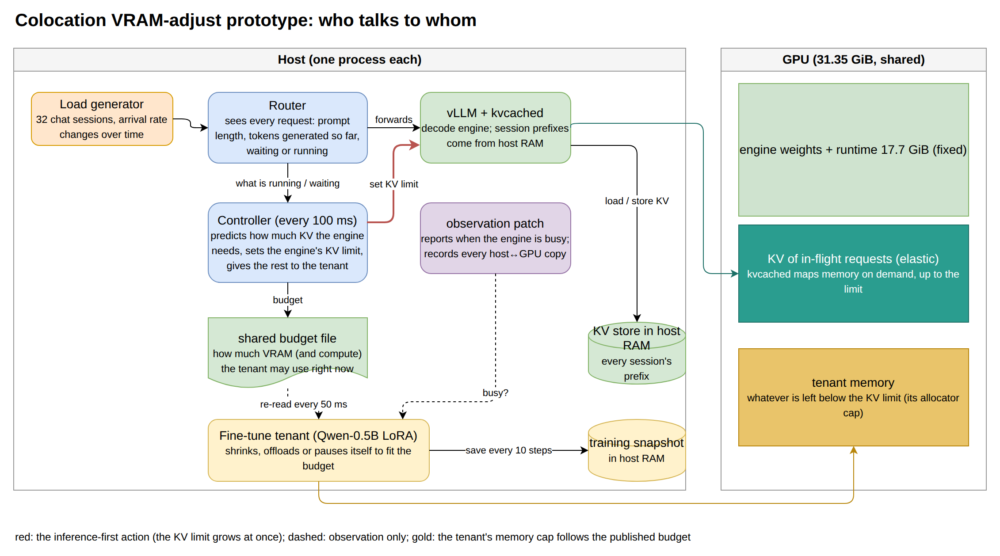

*Diagram 1 — the components and what triggers what: the router feeds demand to the VRAM scheduler, the VRAM scheduler sets kvcached's limit (red, inference first) and publishes the remainder to the tenant; the observation patch only reports.*

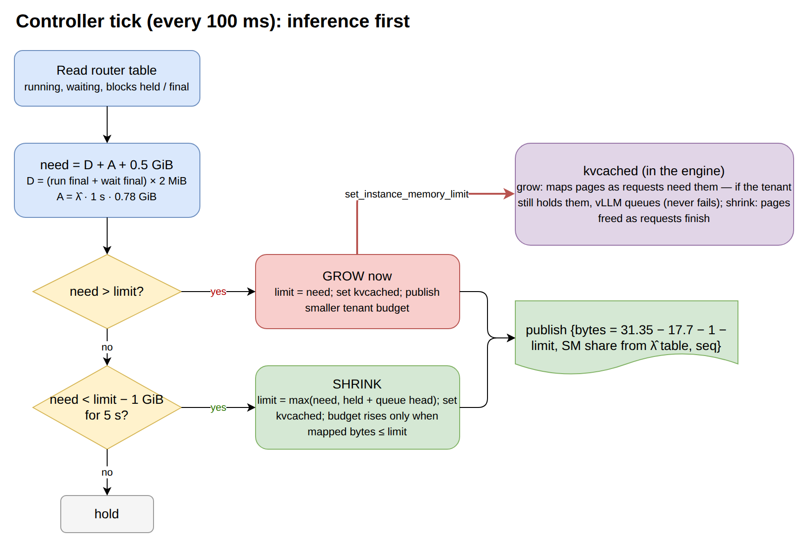

*Diagram 2 — one VRAM scheduler tick: grow at once when demand exceeds the limit, shrink only after 5 s of slack and never below what running requests hold.*

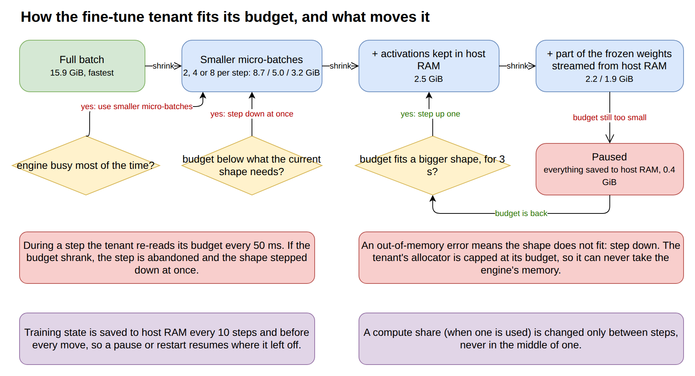

*Diagram 3 — the tenant's ladder and the triggers that move it: budget polls inside the step, OOM as a signal, 3-s hold before climbing, host-RAM snapshots around every move.*

### Tenant configurations (calibrated solo on GPU 1, `tiers.json`)

| cfg | tier | micro-batches k | activation offload | layers streamed | grad ckpt | need GiB | step ms | tok/s |
|---|---|---|---|---|---|---|---|---|
| 0 | 0 full batch | 1 | – | 0 | off | 15.9 | 91 | 44.8k |
| 1 | 1 | 2 | – | 0 | off | 8.7 | 106 | 38.7k |
| 2 | 1 | 4 | – | 0 | off | 5.0 | 138 | 29.6k |
| 3 | 1 | 8 | – | 0 | off | 3.2 | 210 | 19.5k |
| 4 | 2 | 8 | yes | 0 | on | 2.5 | 1045 | 3.9k |
| 5 | 3 | 8 | yes | 12 | on | 2.2 | 1294 | 3.2k |
| 6 | 3 | 8 | yes | 20 | on | 1.9 | 1452 | 2.8k |
| 7 | 4 pause | – | – | – | – | 0.4 | – | 0 |

Activation offload moves ~4.8 GB per step each way at k = 8 and costs 5× in step time; with
gradient checkpointing already on it saves little memory (the floor, ~1.9 GiB, is the
lm_head/embedding plus one micro-batch's logits), so in practice the ladder is micro-batching
down to ~3 GiB, then the slow offload tiers, then pause.

## 2. Evaluation

Reference workload (32 sessions × 6144-token prefixes, +128 new tokens → 128 out, Zipf-1.1,
seeded) with a piecewise-constant arrival-rate schedule after a 32-request warm-up:

| from (s) | 0 | 90 | 180 | 270 | 360 | 420 | 480 | 510 | 540 | 570 | 600–660 |
|---|---|---|---|---|---|---|---|---|---|---|---|
| req/s | 1 | 2 | 3 | 1 | 4 | 0.5 | 2 | 3 | 2 | 1 | 1 |

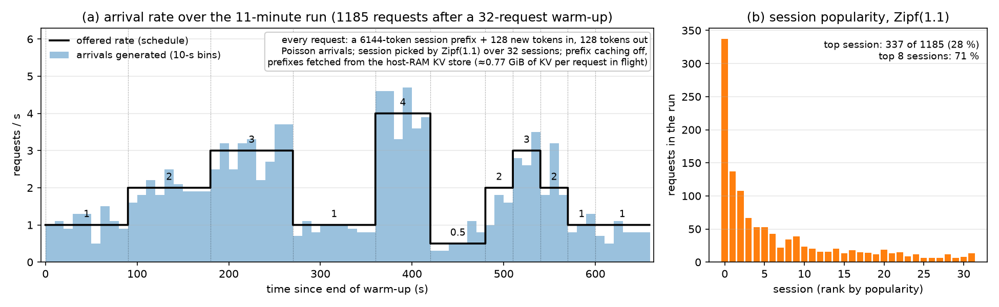

*Figure 0 — the workload trace every scheme is driven with (`../plot_workload.py`, from the baseline run's request log). (a) The offered arrival rate and the Poisson arrivals actually generated, 10-s bins; the same seeded sequence is replayed in every scheme. (b) Session popularity: Zipf(1.1) over 32 sessions, so a few prefixes dominate the host-RAM store's traffic. Every request carries a 6144-token session prefix plus 128 new tokens and produces 128 tokens, i.e. about 0.77 GiB of KV while in flight.*

Each scheme is one continuous 11-minute run (`run_eval6.sh`, `run_eval_pf.sh`, `run_probe.sh`;
round 1: `run_eval3.sh`). Per-phase numbers skip the first 10 s of each phase. Decode is judged on
TPOT, scheduler queue wait, delivered throughput and failures (decode-only TTFT is fetch +
128-token prefill, ~160 ms); the tenant on tokens/s (prompt tokens/s for the prefill tenant) and
its configuration. **Baseline:** the engine alone with its KV limit following the load
(`adjust_notenant`); the 500 W cap changed it by nothing measurable (TPOT within 0.3 ms of the
600 W run in every phase, [round2_tables.md](round2_tables.md)), the GPU draws 290–385 W per
phase under this load.

### 2.1 What the schemes are

The schemes fall into four classes by how compute is shared. GPU memory follows the load in all
of them except the static split.

| class | scheme | GPU memory | compute | when the tenant runs |
|---|---|---|---|---|
| reference | `adjust_notenant` (baseline) | follows load | no tenant | – |
| reference | `static_split` | **fixed**: engine KV 6.69 GiB, tenant 6 GiB | MPS co-run on all SMs | always |
| **A** take turns | `adjust` (idle gate) | follows load | the tenant waits before each block while the engine is busy | only when the engine is idle |
| **B** together, no limit | `adjust_nogate` (MPS) | follows load | both jobs share all 170 SMs | always |
| **C** together, fewer SMs | `adjust_mps20` | follows load | SMs shared, the tenant capped at 20 % of them | always |
| | `green_split` | follows load | engine on 128 SMs, tenant on the other 42 | always |
| | `green_dyn2` | follows load | the tenant's SM count follows the arrival rate: 96 / 64 / 32 / 16 at 0.5 / 1 / 2 / ≥ 3 req/s | always |
| **D** together, less time | `tpot_slo15` | follows load | all SMs shared; every 2 s the scheduler compares decode TPOT with the target (baseline +15 %) and sets a tokens/s cap; the tenant pauses after each step to keep it | runs, then pauses |
| | `tpot_slo5` | follows load | the same with a +5 % target | runs, then pauses |

"Always" means the tenant does not stop by itself. At 3–4 req/s the memory budget is zero and
the tenant is paused in every scheme. The full list, with the round-1 schemes, follows.

| scheme | engine KV limit | tenant | compute sharing | round |
|---|---|---|---|---|
| `adjust_notenant` | VRAM scheduler | none | – (baseline) | 1, 2 |
| `static_split` | fixed 6.69 GiB (= the 2 req/s need) | fixed 6 GiB budget (cfg 2) | MPS co-run | 1, 2 |
| `static_split_gate` | fixed 6.69 GiB | fixed 6 GiB | idle-window gate (the round-1 runner's setting; D15) | 2 |
| `adjust` | VRAM scheduler | tiered | idle-window gate + MPS | 1, 2 |
| `adjust_nogate` | VRAM scheduler | tiered | MPS co-run, no cap | 1, 2 |
| `adjust_mps20` | VRAM scheduler | tiered | MPS, tenant capped at 20 % of SM threads | 1, 2 |
| `green32`, `green_dyn`, `engine_green`, `green_opt` | VRAM scheduler | tiered | round-1 green-context schemes (table in 2.3) | 1 |
| `green_split` | VRAM scheduler | tiered | engine steps on SMs 0–127, tenant on the remaining 42 (static, disjoint) | 1, 2 |
| `tpot_slo5`, `tpot_slo15` | VRAM scheduler + TPOT feedback | tiered, tokens/s cap | MPS; the cap holds decode within +5 % / +15 % of the baseline | 2 |
| `green_dyn2` | VRAM scheduler | tiered, SM count from the arrival rate (128/96/64/32/16 at 0/0.5/1/2/≥3 req/s) | prebuilt green contexts, stream switch only | 2 |
| `pf_mps`, `pf_mps20`, `pf_split` | VRAM scheduler | 3B prefill engine, sleep tier | MPS / MPS 20 % / engine 128 SMs + tenant 42 SMs | 2 |
| `pf_base` | VRAM scheduler | none | baseline for the prefill schemes (8B host tier 25.5 GiB instead of 28, to leave /dev/shm room for the 3B's tier) | 2 |
| `probe` | fixed 3 GiB | fixed 7.5 GiB, one shape per 60-s window, 4 k tok/s cap | MPS; measures the decode cost of each tenant shape | 2 |

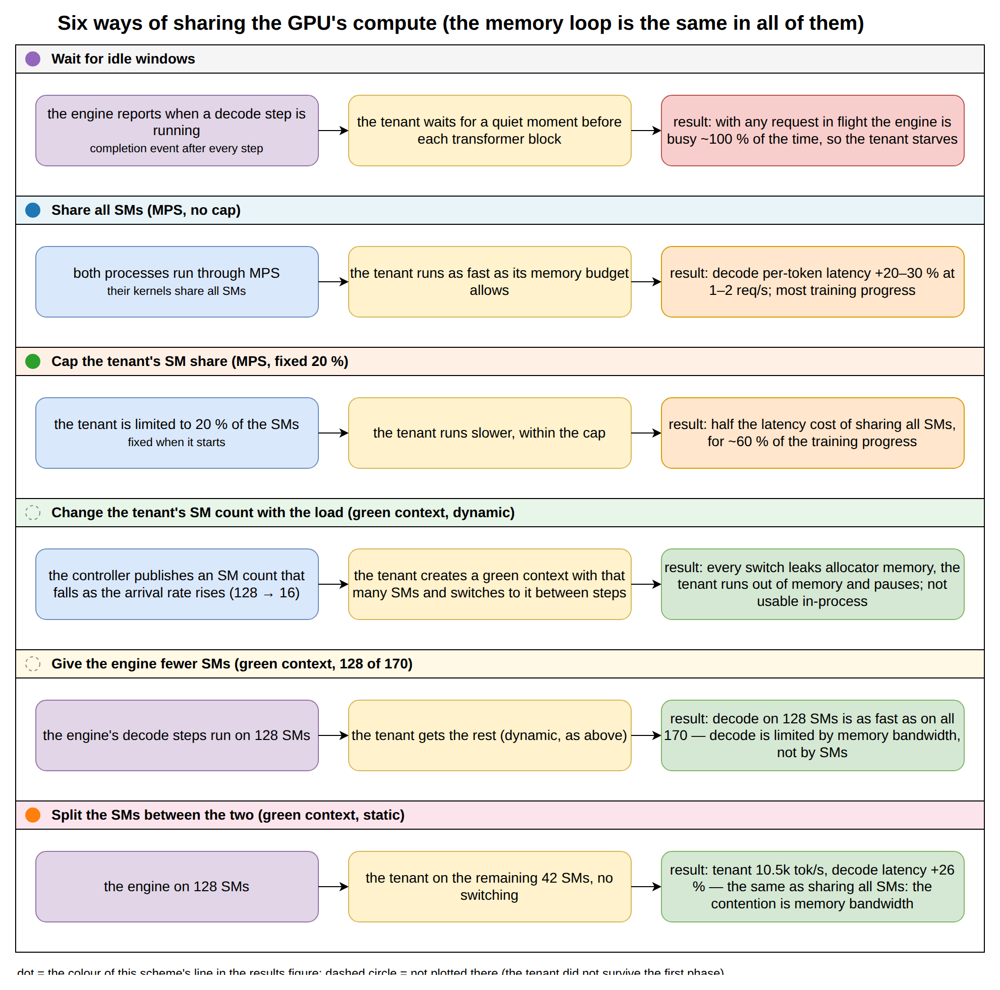

*Diagram 4 — the compute-sharing mechanisms tried (source `../diagrams/04_compute_sharing.drawio`); the memory loop is the same in all of them. The dot before each title is the colour of that scheme's line in Figure 1.*

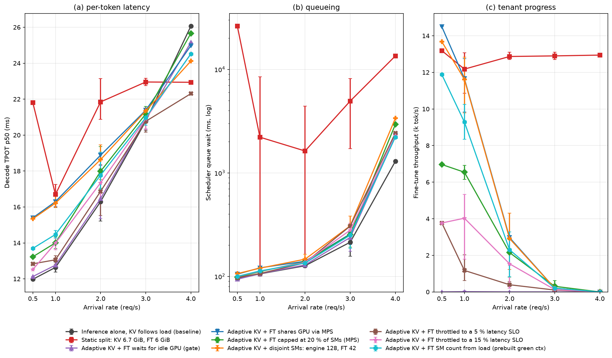

*Figure 1 — decode latency (a), scheduler queue wait (b) and fine-tune throughput (c) against the
arrival rate, pooling the phases that share a rate (marker = mean, bar = min..max across the
repeats; `plot_arms.py`). Reading: adaptive schemes sit on the baseline in (a) and (b) at 3–4 req/s,
where the tenant is paused, and pay a tenant-speed-dependent premium at 0.5–2 req/s; the static
split pays 30–80 % everywhere and queues seconds once the load passes 2 req/s. The two round-2
mechanisms that move the trade-off are the prebuilt dynamic green context (cyan: the throughput of
MPS co-running for half its latency cost) and the 15 % latency-SLO cap (pink: the decode cost
held where it was asked to be).*

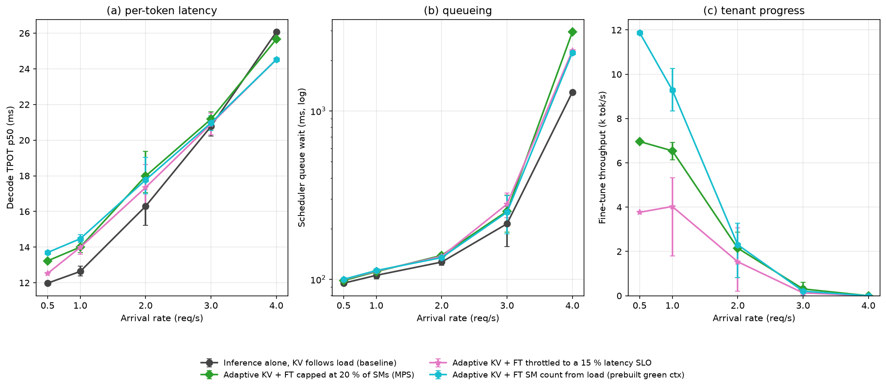

*Figure 1b — the same panels for the baseline and the three schemes with the best latency/throughput
trade-off (`plot_arms.py --only …`). The 20 % MPS cap (green) and the prebuilt dynamic green context
(cyan) both deliver 7–12k tok/s at 0.5–1 req/s; the green context costs about the same decode latency
(+10–15 %) for 40–70 % more tenant throughput and falls to the baseline by 2 req/s. The 15 % SLO cap
(pink) is the choice when the decode budget is fixed: it stays within the target at every rate and
hands the tenant whatever that leaves (1–5k tok/s).*

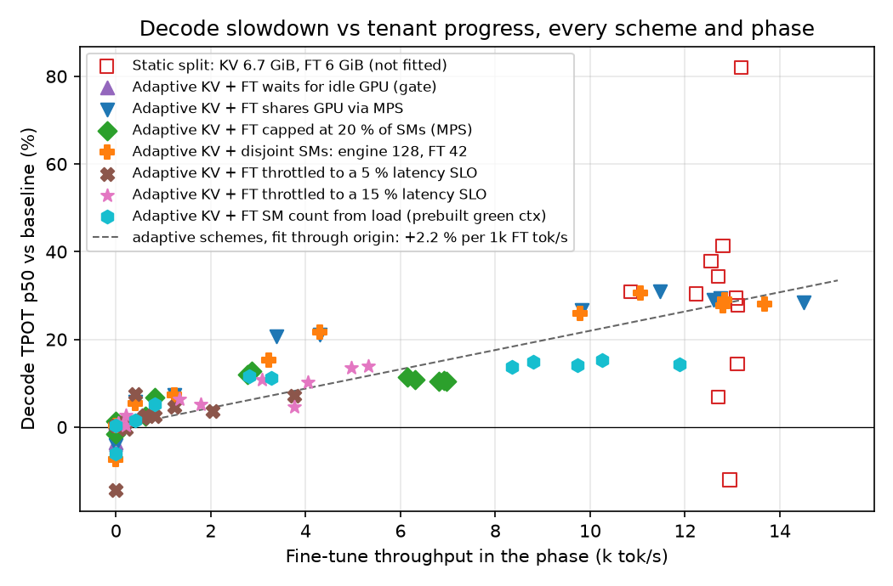

*Figure 2 — the same runs, one point per scheme and phase: decode slowdown over the baseline against
the tenant's throughput in that phase. MPS co-running, the MPS cap, the disjoint SM partition and
the SLO-capped runs fall on one line, about +2.2 % TPOT per 1 000 tenant tokens/s; the prebuilt
dynamic green context (cyan) sits clearly under it (+14 % at 8–12 k tok/s); the static split's
points are off the line because its cost is KV starvation, not the tenant's speed.*

### 2.2 Decode and tenant under each scheme

<!-- round2-compact-start -->
*Decode TPOT p50 in ms at each arrival rate (mean over the phases that share the rate; in brackets the change against the baseline), the scheduler queue wait at 3 and 4 req/s, and the tenant's throughput at 0.5 / 1 / 2 req/s (k tok/s; for the prefill tenant, k prompt tok/s). Round 2, 500 W, GPU 0. Full per-phase tables: [round2_tables.md](round2_tables.md).*

**Fine-tune tenant family**

| scheme | 0.5 | 1 | 2 | 3 | 4 | queue @3 / @4 (ms) | tenant k tok/s @0.5 / 1 / 2 |
|---|---|---|---|---|---|---|---|
| Inference alone (baseline) | 12.0 | 12.6 | 16.3 | 20.8 | 26.1 | 214 / 1292 |  |
| Static split | 21.8 (+82 %) | 16.7 (+32 %) | 21.8 (+34 %) | 23.0 (+11 %) | 22.9 (-12 %) | 4941 / 13472 | 13.2 / 12.2 / 12.9 |
| Static split + idle gate | 12.5 (+4 %) | 12.8 (+1 %) | 16.5 (+1 %) | 18.6 (-10 %) | 18.6 (-28 %) | 1019 / 9225 | 0.0 / 0.0 / 0.0 |
| Adaptive KV + gate | 12.1 (+1 %) | 12.8 (+1 %) | 16.5 (+1 %) | 20.9 (+0 %) | 25.2 (-3 %) | 238 / 2262 | 0.0 / 0.0 / 0.0 |
| Adaptive KV + MPS | 15.4 (+29 %) | 16.3 (+29 %) | 18.9 (+16 %) | 21.4 (+3 %) | 25.0 (-4 %) | 257 / 2302 | 14.5 / 11.7 / 3.0 |
| Adaptive KV + MPS 20 % | 13.2 (+10 %) | 14.0 (+11 %) | 18.0 (+10 %) | 21.2 (+2 %) | 25.7 (-2 %) | 254 / 2940 | 7.0 / 6.5 / 2.2 |
| Adaptive KV + disjoint SMs 128/42 | 15.3 (+28 %) | 16.2 (+28 %) | 18.6 (+14 %) | 21.3 (+3 %) | 24.1 (-7 %) | 308 / 3367 | 13.7 / 11.6 / 2.9 |
| Adaptive KV + 5 % latency SLO | 12.8 (+7 %) | 13.1 (+3 %) | 16.9 (+4 %) | 20.8 (-0 %) | 22.3 (-14 %) | 306 / 2425 | 3.8 / 1.2 / 0.4 |
| Adaptive KV + 15 % latency SLO | 12.5 (+5 %) | 14.0 (+11 %) | 17.3 (+6 %) | 20.9 (+1 %) | 24.5 (-6 %) | 280 / 2277 | 3.8 / 4.0 / 1.5 |
| Adaptive KV + dynamic green ctx (prebuilt) | 13.7 (+14 %) | 14.5 (+15 %) | 17.8 (+9 %) | 21.0 (+1 %) | 24.5 (-6 %) | 250 / 2216 | 11.9 / 9.3 / 2.3 |

**Prefill tenant family** (the 8B's host tier is 25.5 GiB here instead of 28, hence its own baseline)

| scheme | 0.5 | 1 | 2 | 3 | 4 | queue @3 / @4 (ms) | tenant k tok/s @0.5 / 1 / 2 |
|---|---|---|---|---|---|---|---|
| Inference alone, 25.5 GiB tier (prefill baseline) | 12.1 | 12.7 | 16.3 | 21.3 | 27.5 | 219 / 1303 |  |
| 3B prefill tenant, MPS | 12.7 (+5 %) | 13.4 (+6 %) | 16.3 (+0 %) | 21.3 (-0 %) | 24.9 (-9 %) | 260 / 3360 | 9.3 / 6.2 / 0.0 |
| 3B prefill tenant, MPS 20 % | 12.5 (+4 %) | 13.7 (+8 %) | 16.4 (+1 %) | 21.4 (+0 %) | 25.3 (-8 %) | 240 / 2176 | 8.9 / 7.1 / 0.6 |
| 3B prefill tenant, disjoint SMs | 12.6 (+4 %) | 13.4 (+6 %) | 16.3 (+0 %) | 21.3 (-0 %) | 25.4 (-8 %) | 262 / 6659 | 9.3 / 6.9 / 0.0 |

<!-- round2-compact-end -->

Round-1 (600 W) tables for the same schemes are in the git history of this file and in
`../results_600w/`; the only round-1 numbers that differ from round 2 beyond noise are the
`static_split` ones, because round 1 ran it with the idle gate on (kept as `static_split_gate`).

**The same results with the best three of each column marked.** ①②③ mark the three best values
of a column; ties share a mark and the baseline does not take part. Lower is better for TPOT,
queue wait and cost; higher is better for tenant throughput. Where a cell holds several numbers,
each is ranked on its own. The last column is the decode slowdown divided by the tenant's k tok/s.

| scheme | class | TPOT @0.5 req/s | @1 | @2 | queue @3 / @4 (ms) | tenant k tok/s @0.5 / 1 / 2 | % per 1 k tok/s @0.5 / 1 |
|---|---|---|---|---|---|---|---|
| Inference alone (baseline) | – | 12.0 | 12.6 | 16.3 | 214 / 1292 | – | – |
| Static split | – | 21.8 (+82 %) | 16.7 (+32 %) | 21.8 (+34 %) | 4941 / 13472 | ③ 13.2 / ① 12.2 / ① 12.9 | 6.2 / 2.7 |
| Idle gate | A | ① 12.1 (+1 %) | ① 12.8 (+1 %) | ① 16.5 (+1 %) | ① 238 / ② 2262 | 0 / 0 / 0 | tenant did not run |
| MPS | B | 15.4 (+29 %) | 16.3 (+29 %) | 18.9 (+16 %) | 257 / 2302 | ① 14.5 / ② 11.7 / ② 3.0 | 2.0 / 2.5 |
| MPS 20 % | C | 13.2 (+10 %) | ③ 14.0 (+11 %) | 18.0 (+10 %) | ③ 254 / 2940 | 7.0 / 6.5 / 2.2 | ③ 1.4 / ② 1.7 |
| Disjoint SMs 128/42 | C | 15.3 (+28 %) | 16.2 (+28 %) | 18.6 (+14 %) | 308 / 3367 | ② 13.7 / ③ 11.6 / ③ 2.9 | 2.0 / ③ 2.5 |
| Dynamic green contexts | C | 13.7 (+14 %) | 14.5 (+15 %) | 17.8 (+9 %) | ② 250 / ① 2216 | 11.9 / 9.3 / 2.3 | ② 1.2 / ① 1.6 |
| 15 % latency SLO | D | ② 12.5 (+5 %) | ③ 14.0 (+11 %) | ③ 17.3 (+6 %) | 280 / ③ 2277 | 3.8 / 4.0 / 1.5 | ① 1.1 / 2.8 |
| 5 % latency SLO | D | ③ 12.8 (+7 %) | ② 13.1 (+3 %) | ② 16.9 (+4 %) | 306 / 2425 | 3.8 / 1.2 / 0.4 | 1.8 / 3.3 |

Two marks need a caution. The idle gate has ① in every decode column because its tenant did not
run. The static split has ① for tenant throughput because it never gives GPU memory back; it pays
for that with +32–82 % TPOT and 5–13 s of queueing. And the last column is unstable for the two
throttled schemes: their slowdown comes in bursts, so the median used here gives 1.1–3.3 % where
the mean gives 2.3–2.9 %, and the +3 % of the 5 % scheme at 1 req/s is inside the ±4 % noise.

### 2.2.1 The tail: TPOT p90

The tables above use the median. The same request logs give the 90th percentile
(`../analyze_overlap.py` computes the per-request TPOT the same way as `round2_tables.py`):
TPOT p90 in ms with the change against the baseline's p90, best three per column marked; the
last column repeats the change of the median.

| scheme | class | p90 @0.5 req/s | p90 @1 | p90 @2 | median, for comparison @0.5 / 1 |
|---|---|---|---|---|---|
| Inference alone (baseline) | – | 13.3 | 14.1 | 18.9 | – |
| Static split | – | 23.1 (+74 %) | 19.2 (+37 %) | 22.8 (+21 %) | +82 / +32 % |
| Idle gate | A | ① 13.3 (+0 %) | ① 14.3 (+1 %) | ① 19.1 (+1 %) | +1 / +1 % |
| MPS | B | 17.0 (+27 %) | 18.4 (+31 %) | 21.3 (+13 %) | +29 / +29 % |
| MPS 20 % | C | ② 14.7 (+10 %) | ③ 15.8 (+12 %) | ③ 20.3 (+8 %) | +10 / +11 % |
| Disjoint SMs 128/42 | C | 17.0 (+28 %) | 18.2 (+30 %) | 21.5 (+14 %) | +28 / +28 % |
| Dynamic green contexts | C | ③ 15.3 (+15 %) | 16.3 (+16 %) | 20.5 (+9 %) | +14 / +15 % |
| 15 % latency SLO | D | 17.1 (+29 %) | 16.3 (+16 %) | ② 20.2 (+7 %) | +5 / +11 % |
| 5 % latency SLO | D | 17.0 (+28 %) | ② 14.6 (+4 %) | 20.4 (+8 %) | +7 / +3 % |

- **For the two fewer-SM schemes the tail equals the median**: +10–12 % with MPS 20 %, +15–16 %
  with dynamic green contexts. Their slowdown is even.
- **For the two throttled schemes the median looks good at 0.5 req/s and the tail is as slow as
  with no throttle**: +5 % against +29 % for the 15 % scheme, +7 % against +28 % for the 5 % scheme;
  un-throttled MPS is at +27 %.
- **The cause is the feedback loop, not the run-and-pause pattern.** In that phase the scheduler's
  cap swings between 500 and 20,000 tokens/s; the tenant's longest pause is 8 s and for the rest
  it runs near full speed. Requests that fall into a full-speed stretch make up the tail.
- **A fixed cap has no such tail.** The shape probe uses a fixed 4 k tok/s cap, with the tenant
  running 0.35 s and pausing 0.67 s in a regular pattern: median +5 %, p90 +6 %. A request takes
  1.5–2 s and so spans more than one cycle.

### 2.2.2 The average, and the moments when the tenant runs

The slowdowns above are averages over a phase. The request log has a timestamp for every decode
token and the tenant's log says when each of its steps computed and when it slept, so every
decode token gap can be assigned to "tenant running" or "tenant not running"
(`../analyze_overlap.py`, tables in `../results/overlap_summary.md`). This is a re-analysis of
the existing runs.

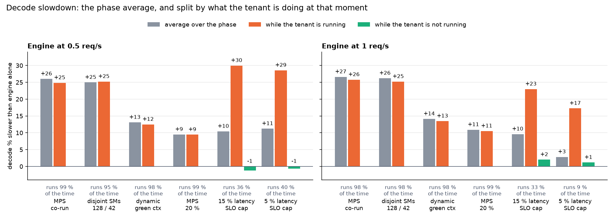

*Figure 11 — decode slowdown at 0.5 and 1 req/s: the phase average (grey), while the tenant runs
(orange) and while it does not (green); the small print under each group is the share of time the
tenant runs. Mean of the token gaps against the same phases of the no-tenant run.*

| scheme | class | tenant runs, share of time | decode, phase average | while the tenant runs | while it does not |
|---|---|---|---|---|---|
| MPS | B | 99 / 98 % | +26.0 / +26.6 % | ③ +24.9 / +25.8 % | – |
| MPS 20 % | C | 99 / 99 % | ① +9.5 / ③ +10.9 % | ① +9.4 / ① +10.5 % | – |
| Disjoint SMs 128/42 | C | 95 / 98 % | +25.0 / +26.2 % | +25.2 / +25.2 % | – |
| Dynamic green contexts | C | 98 / 98 % | +13.1 / +14.1 % | ② +12.5 / ② +13.5 % | – |
| 15 % latency SLO | D | 36 / 33 % | ② +10.4 / ② +9.6 % | +30.0 / +23.0 % | −1.2 / +2.0 % |
| 5 % latency SLO | D | 40 / 9 % | ③ +11.2 / ① +2.8 % | +28.6 / ③ +17.2 % | −0.7 / +1.2 % |

Each cell: 0.5 req/s / 1 req/s. "–": that state covers under 5 % of the time. The idle gate is
left out because its tenant did not run. These are means over token gaps; the tables above use
the median of per-request TPOT, so the numbers differ a little (15 % scheme: +5 % / +11 % there,
+10.4 % / +9.6 % here).

1. **While the tenant does not run, decode is at its baseline** (−1 to +2 %). A pause leaves
   nothing behind.
2. **Throttling (class D) does not lower the slowdown at the moments of overlap; it shortens the
   overlap.** While the tenant runs, decode is 23–30 % slower, as with un-throttled MPS (25–26 %),
   but the tenant runs only a third of the time. The average is the product: 36 % × 30 % ≈ 10.8 %,
   measured 10.4 %.
3. **Fewer SMs (class C) lower the slowdown at every moment, and the tenant runs all the time**:
   +9–11 % with MPS 20 %, +12–14 % with dynamic green contexts. The disjoint 128/42 split is the
   exception at +25 %, because the tenant still runs flat out on 42 SMs.
4. **Per token, less time saves nothing and fewer SMs do.** Decode slowdown per 1 k tenant tok/s
   at 1 req/s: MPS 2.3 %, 15 % scheme 2.4 %, disjoint SMs 2.3 %; MPS 20 % 1.7 %, dynamic green
   contexts 1.5 %.
5. **At 2 req/s the comparison has to change.** The tenant is paused by its memory budget about
   half of the time, and exactly when the load peaks, so a phase average mixes load and tenant
   state. Against the no-tenant run at the same number of running requests: +8–15 % while the
   tenant runs, −2 to 0 % while it does not. The conclusions are the same.

### 2.3 Green-context schemes

`green_ctx.py`, ctypes on libcuda; round 1 details in DECISIONS D8–D10, round 2 in D18.

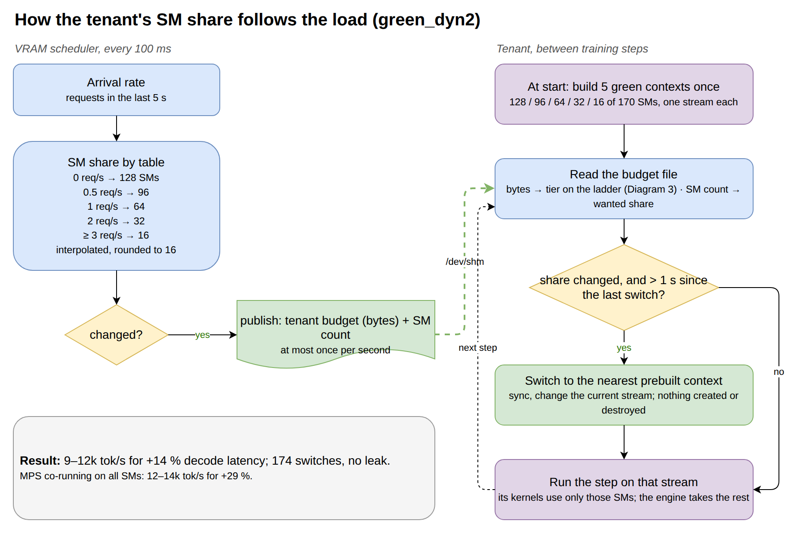

*Diagram 5 — the SM-share loop of `green_dyn2`: the scheduler maps the arrival rate to an SM count and publishes it with the budget; the tenant switches between contexts it built once at start. The memory ladder (Diagram 3) runs unchanged alongside.*

| scheme | decode at 1 / 2 req/s (TPOT, queue) | tenant at 1 / 0.5 req/s | note |
|---|---|---|---|
| `green32` (tenant on 32 SMs, round 1) | 14.4 / 16.6 ms, 119 / 132 ms | 6.3k / 7.3k tok/s | same trade as the MPS 20 % cap |
| `green_dyn` (SM count from λ̂, context re-created per change, round 1) | tenant died in phase 1 | 1.4k then 0 | re-creating the context on every share change leaked allocator memory (7.7 GiB reserved for a 5 GiB config) → OOM to pause |
| `engine_green` (engine on 128 SMs, round 1) | **12.9–13.2 / 15.2 ms — equal to the baseline** | tenant died as above | a bandwidth-bound decode node gives up a quarter of its SMs for free |
| `green_split` (engine 128 SMs, tenant the other 42, static) | 16.2 / 18.6 ms, 123 / 150 ms | 11.6k / 13.7k | tenant progress of MPS co-running, decode cost of MPS co-running: **disjoint SMs alone do not remove the interference** |
| **`green_dyn2`** (prebuilt 128/96/64/32/16-SM contexts, stream switch only, round 2) | **14.5 / 17.8 ms, 115 / 134 ms** | **9.3k / 11.9k** | 898 steps, 174 switches, reserved ≤ 8.7 GiB under a ≤ 9.9 GiB budget: no leak; **half the decode cost of MPS co-running at 80 % of its tenant throughput** |

### 2.4 Reading the results (per-second view in `../results/<scheme>_timeline.png`)

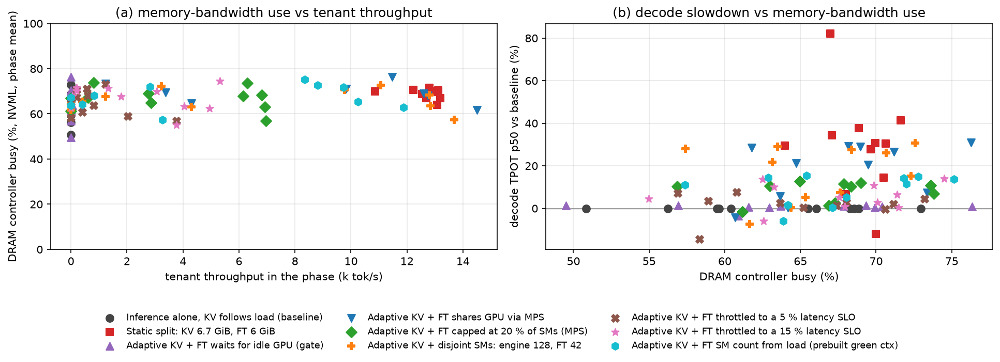

*Figure 4 — the direct test of the bandwidth reading (`plot_dram.py`, NVML GPU-memory-controller busy,
phase means). (a) The counter against the tenant's throughput: it sits at 55–75 % whether the
tenant runs at 0 or 14 k tok/s, because decode alone already keeps the controller that busy and
the counter cannot separate the two users. (b) The decode slowdown against the counter: no
relation. The slowdown follows the tenant's token rate (Figure 2), not this counter.*

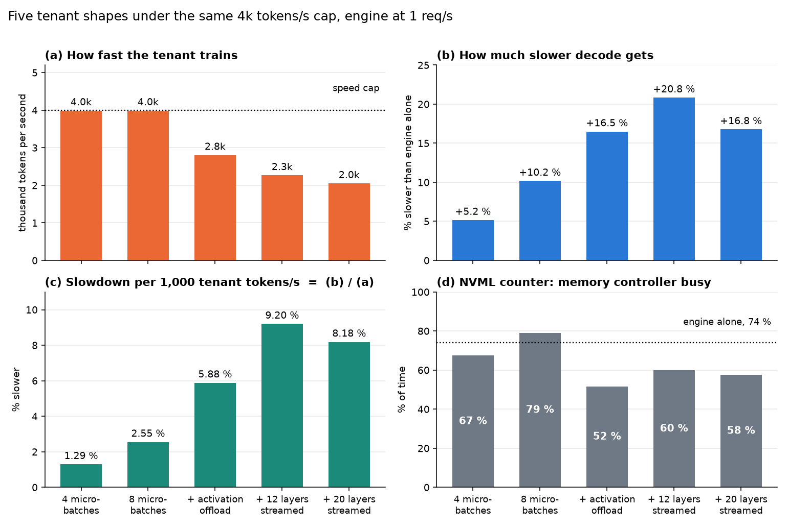

*Figure 5 — the shape probe (`run_probe.sh`, `analyze_probe.py`): engine at 1 req/s with a fixed
3 GiB KV limit, tenant at a fixed 7.5 GiB budget and the same 4 k tok/s cap in every window, one
60-s window per shape. (a) The tenant's training speed: the two micro-batch shapes reach the cap,
the other three stay below it (2.8k, 2.3k, 2.0k tok/s). (b) Decode slowdown against the engine
alone: +5.2 % to +20.8 %. (c) Their ratio, the decode slowdown per 1 k tenant tok/s: k = 4
micro-batches 1.3 %, k = 8 2.6 %, activation offload 5.9 %, 12 / 20 streamed layers 9.2 / 8.2 %.
(d) NVML's memory-controller counter for the same windows, with the engine-alone level dotted: it
falls for the copy-heavy shapes while their cost rises.*

- **Resizing costs decode nothing.** The engine alone with its limit following the load equals
  the engine alone with a fixed 13 GiB limit in every phase (round 1, TPOT within 0.1 ms); changing
  kvcached's limit 2 ↔ 12.65 GiB with the load is invisible to the engine.
- **Static partitioning fails both ways.** With the engine fixed at 6.69 GiB and the tenant running
  flat out beside it (12–13k tok/s), decode pays +30 % TPOT at 1–2 req/s, queues 5–13 s at 3–4 req/s
  and the backlog is still 26 s deep when the load has dropped to 0.5 req/s; at low load 4–8 GiB of
  the engine's budget sit unused.
- **The memory loop works as designed, and its accounting is now honest.** Round 1 took the
  engine's fixed footprint from NVML with the tenant's context included (17.7 GiB) and left no
  allowance for the tenant's own context, so the plotted tenant memory could cross the KV limit
  (it never caused a physical collision — the GPU was never oversubscribed, D11). Round 2 measures
  the engine's footprint at start (16.97 GiB), reserves 2 GiB for the tenant's context, weights and
  optimizer and 0.5 GiB safety, and caps every grow at the memory actually free. Over all
  round-2 runs the sum of KV mapped + tenant + fixed never exceeded the GPU (0 s in every scheme,
  [round2_tables.md](round2_tables.md)); the tenant's footprint exceeds its budget only while it is
  paused (0.6 GiB of model and optimizer against a 0 GiB budget, inside the 2 GiB allowance). The
  price of honest accounting is capacity: at 3–4 req/s the demand (12.65 GiB) exceeds what can be
  mapped with the tenant paused (≈ 12.4 GiB), so the scheduler waits there (`grow_wait`, the whole
  4 req/s phase) and the tenant stays paused as before. A bug in the first round-2 chain — the
  pending grow was never abandoned when demand fell, so the tenant stayed paused for the rest of
  the run — was found in the scheduler log, fixed and the six affected runs repeated (D16).
- **Time-sharing is dead on this engine.** The idle-window gate protects decode perfectly
  (+1 %) and the tenant trains nothing, because the Model Runner V2 engine keeps the GPU busy
  ~100 % of the time while any request runs (D5). Un-gated co-running under MPS costs decode
  +29 % TPOT at 0.5–1 req/s, +15 % at 2 req/s and ~0 at ≥ 3 req/s (the tenant is paused there).
- **Capping the tenant's share works; where it runs does not matter, how much it runs does.**
  20 % of the SM threads (MPS) gives +10–11 % TPOT for ~55 % of the un-capped tenant throughput;
  a disjoint 128/42 partition gives the un-capped cost for the un-capped throughput. In Figure 2
  these schemes and the SLO-capped runs share one line, +2.2 % TPOT per 1 k tenant tok/s.
- **The tenant's shape sets how much a token costs** (Figures 4 and 5). Decode slowdown per 1 k
  tenant tok/s: 1.3 % with k = 4 micro-batches, 2.6 % with k = 8, 5.9 % with activation offload and
  8–9 % with weight streaming. Split by tenant state, the shapes slow decode alike while they run
  (+16–22 %) and differ in how fast the tenant runs (11.4k down to 2.0k tok/s; section 5.4). NVML's GPU-memory-controller-busy counter does not separate the two
  users — it reads 49–73 % with the engine alone and does not rise with the tenant's throughput
  (Figure 4a) — so it is not a usable feedback signal; the tenant's token rate and shape are.
  Section 2.7 measures the traffic itself.
- **A dynamic SM share is cheaper than MPS co-running.** The prebuilt dynamic green context
  (64–96 SMs at 0.5–1 req/s) gives the tenant 9–12k tok/s for +14–15 % TPOT, where MPS co-running
  on all SMs pays +29 % for 12–14k, and the fixed 42-SM partition pays +28 % for 12–14k. The cause
  is not identified. The round-1 conclusion "placement does not matter" was too strong: a *static*
  partition does not change the cost, a share that falls with the load does.
- **A latency SLO can be enforced directly.** With the tokens/s cap driven by the measured decode
  TPOT, the 15 % scheme stays within +0–14 % in every phase with the tenant at 1.3–5.3k tok/s
  (on the Figure-2 line, as it should: the cap only moves the tenant along the line). The 5 %
  scheme holds +2–7 % but mostly pins the tenant at its 500 tok/s floor: a 5 % target is inside the
  noise of a 10-s TPOT window (the baseline moves ±4 % between repeats of the same phase). These
  are medians: at 0.5 req/s the p90 of both throttled schemes is +28–29 %, because the loop swings
  the cap (section 2.2.1).
- **Less time and fewer SMs act differently** (section 2.2.2). Throttling leaves the slowdown at
  the moments of overlap where it was (+23–30 %) and shortens the overlap; while the tenant
  pauses, decode is at its baseline. Fewer SMs lower the slowdown at every moment (+9–14 %) with
  the tenant running all the time, and are cheaper per token.

### 2.5 The prefill tenant (round 2, plan P3)

A different kind of tenant: a Qwen2.5-3B (fp8) vLLM engine that only prefills and streams its KV to
host RAM, i.e. the prefill node of a disaggregated pair sharing the GPU with the decode node. It has
its own report, **[REPORT_pf.md](REPORT_pf.md)**, with the architecture (Diagram A), the adapter's
states (Diagram B), figures and tables. In short (D19): the three compute schemes (MPS, MPS 20 %,
disjoint SMs) are indistinguishable at **+4–8 % decode at 0.5–1 req/s and 0 % from 2 req/s on**,
because the tenant's **4.5 GiB fixed footprint** leaves only 9.4 GiB for both engines' KV and the 8B
needs more than that from 2 req/s, so the tenant sleeps through those phases. Per prompt token it costs
decode about half of what the fine-tune tenant costs. Two accounting gaps remain: the sleeping
footprint (1.4 GiB) is still booked at 4.5 GiB, and the wake margin is below the wake cost.

### 2.6 How many SMs a decode step needs: the bandwidth knee (Nov 9, GPU 1)

Every green-context scheme rests on one assumption: the decode node can give up SMs without getting
slower, because its steps wait for GPU memory and not for arithmetic. `knee_probe.py` measures how
far that holds. It runs one **synthetic decode step with Llama-3-8B shapes** — 32 layers of merged
qkv, o, merged gate/up and down projections, grouped-query attention over a per-request KV of 6272
tokens, the lm_head on the last token; random bf16 weights, since timing does not depend on the
values — so that each step reads the 15.0 GB of weights once plus 0.82 GB of KV per running request,
as a real decode step does. The step runs **alone** on GPU 1 (500 W, no MPS, no tenant) inside green
contexts of 8 to 160 SMs (the driver grants multiples of 8) and on the full device (170 SMs), for 1,
4, 8 and 14 running requests, with a 2048-token prefill chunk as the contrast. Each point is the
median of 5 timed groups.

Is the step representative? On the full device it takes 11.8 / 13.6 / 15.7 / 19.4 ms for 1 / 4 / 8 /
14 requests; the real engine's TPOT is 12.0–12.6 ms at 0.5–1 req/s and 26 ms at 4 req/s with 14–15
requests running (section 2.2). The synthetic step has no sampling, scheduling or detokenisation, so
it is a lower bound that gets looser as the batch grows. Launching one step costs the CPU 2–3 ms, so
the timings are GPU-bound.

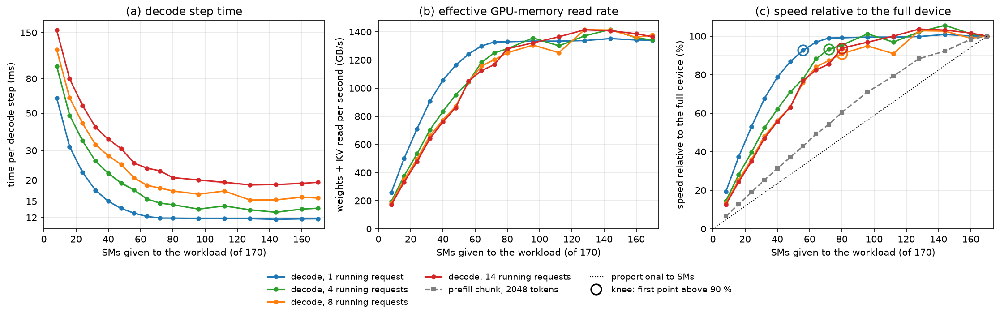

*Figure 6 — one decode step alone on N SMs (`../knee_probe.py`, `../plot_knee.py`, data
`../results/knee_probe.csv`). (a) Step time. (b) Effective GPU-memory read rate: the bytes one step
must read (weights + KV) over the step time. (c) Speed relative to the full device; the circles mark
the knee, the first SM count within 10 % of full-device speed; the grey dashed line is the prefill
chunk and the dotted line is "proportional to SMs".*

*Step time in ms (speed relative to the full device). Full table with 112, 144 and 160 SMs in the CSV.*

| SMs | decode, 1 request | decode, 4 requests | decode, 8 requests | decode, 14 requests | prefill chunk, 2048 tokens |
|---|---|---|---|---|---|
| 8 | 61.4 ms (19 %) | 94.8 ms (14 %) | 118.7 ms (13 %) | 155.1 ms (13 %) | 3096 ms (6 %) |
| 16 | 31.6 ms (37 %) | 48.5 ms (28 %) | 61.6 ms (25 %) | 79.8 ms (24 %) | 1558 ms (13 %) |
| 24 | 22.3 ms (53 %) | 34.3 ms (40 %) | 43.5 ms (36 %) | 55.5 ms (35 %) | 1045 ms (19 %) |
| 32 | 17.5 ms (68 %) | 26.0 ms (52 %) | 32.6 ms (48 %) | 41.3 ms (47 %) | 784 ms (25 %) |
| 40 | 15.0 ms (79 %) | 22.0 ms (62 %) | 27.9 ms (56 %) | 34.9 ms (56 %) | 636 ms (31 %) |
| 48 | 13.6 ms (87 %) | 19.2 ms (71 %) | 24.8 ms (63 %) | 30.8 ms (63 %) | 535 ms (37 %) |
| 56 | 12.7 ms (93 %) | 17.5 ms (78 %) | 20.6 ms (76 %) | 25.3 ms (77 %) | 463 ms (43 %) |
| 64 | 12.2 ms (97 %) | 15.5 ms (88 %) | 18.7 ms (84 %) | 23.6 ms (82 %) | 404 ms (49 %) |
| 72 | 11.9 ms (99 %) | 14.6 ms (93 %) | 18.0 ms (87 %) | 22.7 ms (85 %) | 367 ms (54 %) |
| 80 | 11.9 ms (99 %) | 14.3 ms (95 %) | 17.3 ms (91 %) | 20.7 ms (94 %) | 329 ms (60 %) |
| 96 | 11.9 ms (100 %) | 13.5 ms (101 %) | 16.5 ms (95 %) | 20.1 ms (97 %) | 280 ms (71 %) |
| 128 | 11.8 ms (100 %) | 13.3 ms (102 %) | 15.2 ms (103 %) | 18.7 ms (104 %) | 225 ms (88 %) |
| 170 (full device) | 11.8 ms (100 %) | 13.6 ms (100 %) | 15.7 ms (100 %) | 19.4 ms (100 %) | 199 ms (100 %) |

- **Two segments.** Below the knee the read rate grows almost in proportion to the SM count: up to
  40 SMs each SM pulls 26–32 GB/s with 1 running request and 19–24 GB/s with 4–14. Past the knee
  it is flat at **1.34–1.42 TB/s for all four loads**, about 75 % of the card's nominal 1.8 TB/s:
  there the step is bound by GPU memory bandwidth and more SMs buy nothing.
- **The knee is at 56 SMs for 1 running request, 72 for 4, and 80 for 8 and 14** (± one grid step of
  8 SMs; run-to-run the medians move by at most 3 %). More running requests move it to the right.
- **A prefill chunk has no knee**: 49 % of full speed on 64 SMs, 88 % on 128. It is compute-bound.
- One oddity: at 112 SMs the 4- and 8-request steps are about 4 % slower than at 96 SMs and 5–13 %
  slower than at 128. It reproduced in two reruns with 7 groups each and is unexplained.

What follows for the schemes:

- **The engine's SM floor is about 80, not a small number.** `engine_green` (engine on 128 SMs =
  baseline) sits on the plateau, consistent with this curve. With disjoint partitions on this
  170-SM card the tenant can have at most about 90 SMs before a loaded decode node loses more than
  10 % from the SM shortage alone; a lightly loaded one (1 running request) can go down to 56.
- **Being on the plateau does not protect decode from a co-runner; it is the reason a co-runner
  hurts.** On the plateau the step is limited by the one resource that SM partitions do not divide.
  Whatever GPU-memory traffic the tenant adds is taken out of the same 1.4 TB/s, and decode slows
  accordingly (section 2.7 measures this: the two jobs' sum does not grow). This is what
  `green_split` showed: engine on 128 SMs (plateau), tenant on the
  other 42, +28 % TPOT, the same as MPS co-running.
- **An SM cap limits a job's traffic only below that job's own knee, and 42 SMs is a weak cap.**
  A decode-shaped kernel on 40 SMs already pulls 0.76–1.06 TB/s, more than half of the plateau.
  The fine-tune tenant's own curve is in section 2.7: 156 GB/s on 32 SMs and 244 GB/s on 64.
- **`green_dyn2`'s lower cost is not explained by this curve.** At 0.5–1 req/s it gave the tenant
  64–96 SMs, which for a decode-shaped load is at or above the knee.

Limits: the step is synthetic and runs alone. The co-run version — the same decode step on N SMs
with the tenant on M SMs — and the tenant's own curve are in section 2.7.

### 2.7 What makes a tenant slow decode: the factors (Nov 9, GPU 1)

**The conclusion first.** The main factor is the bytes the tenant moves between the SMs and GPU
memory: the two jobs' SMs can be separated, the path to GPU memory cannot. After that come writes
to GPU memory, kernel launches, arithmetic and power. How many SMs the tenant has is an indirect
and weak factor.

**Why this part was needed.** If the tenant slowed decode by competing for compute, separating
the SMs would fix it. Three results of the sections above say otherwise:

- **Separate SMs, same cost.** Engine on 128 SMs and tenant on the other 42: decode +28 %. Both
  on all SMs: +29 % (section 2.2).
- **Decode is not short of SMs.** The engine on 128 SMs is as fast as on all 170 (section 2.3).
- **It is not the host link either.** PCIe is used at about 10 % on average and inference loads
  that overlap tenant copies are not slower (section 3).

So the two jobs compete for something that is neither SMs nor PCIe. This part asks what it is,
and whether the one knob at hand, the tenant's SM count, controls it.

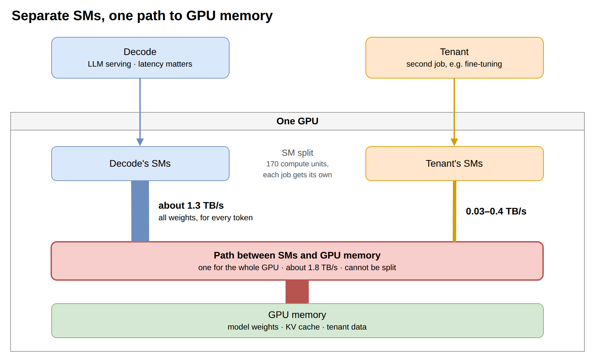

*Diagram 6 — the structure the answers point to (source `../diagrams/08_shared_memory_path.drawio`):
the SMs can be split between the jobs, the path from the SMs to GPU memory cannot. It is inferred
from byte counting, not observed inside the card.*

**Five questions, each raised by the answer before it.**

| | Question | How it was tested | Answer |
|---|---|---|---|
| 1 | What limits decode: SMs or something else? | Decode alone on 8 to 170 SMs (section 2.6) | **Not SMs.** It tops out on 56–80 SMs at about 1.34 TB/s. The limit is the path to GPU memory |
| 2 | The path is taken by decode; where do the tenant's bytes come from? | The real tenant next to decode, bytes of both counted | **Out of decode's.** The two jobs' sum does not grow |
| 3 | Does giving the tenant fewer SMs protect decode? | Tenant from 96 down to 8 SMs | **Only weakly.** 1/12 of the SMs: the tenant runs at 1/7, the harm falls to 1/4, and about 5 % stays |
| 4 | Is decode reacting to bytes? | A second job whose GB/s can be set | **Yes.** The slowdown is close to linear: 4–7 % per 100 GB/s |
| 5 | Why does the real tenant cost more than its bytes? | The second job doing only reads, only writes, only launches, only arithmetic | **Three more things cost.** Writes, kernel launches and arithmetic; power is shared too |

Together: what decode pays depends mainly on how many bytes the tenant moves. The tenant's SM
count acts on that only indirectly. This is the starting point of section 5.

**Set-up.** Section 2.6 measured the decode step alone. Here a second job runs next to it and
the bytes are counted. The decode step is the synthetic step of 2.6. The tenant is the fine-tune tenant in its
usual shape (cfg 2, k = 4), on a green context of M SMs; decode has the other SMs unless stated.
Traffic is read from the device-wide GPU-memory-bandwidth counter (NVML GPM), calibrated against
the decode step's known read rate: 1 % = 17.79 GB/s over 54 decode-alone points, median error
0.5 %. The counter gives the sum of all jobs, so each job's part comes from its own byte count.
The full account, with the test set-up and every table, is in
[REPORT_bandwidth.md](REPORT_bandwidth.md); the list of results is in [`../TODO.md`](../TODO.md).

**Question 3, first half: the tenant alone.**

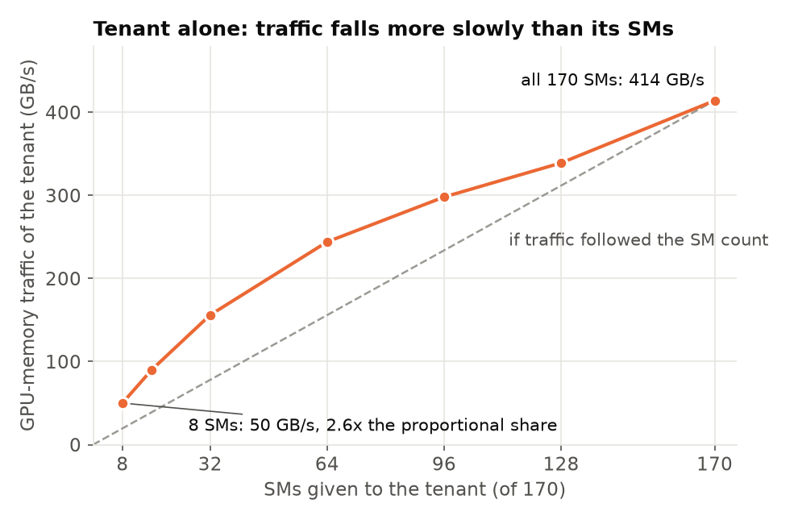

*Figure 7 — the fine-tune tenant alone on M SMs: GPU-memory traffic against M
(`../plot_bw_report.py`, table "Tenant alone" of `../results/knee_bw2_summary.md`). The dashed
line is traffic proportional to the SM count.*

| Tenant SMs | tok/s | GB/s | GB/s per SM | MB per token | SM busy share |
|---|---|---|---|---|---|
| 170 | 29,006 | 414 | 2.4 | 14.3 | 59 % |
| 128 | 24,516 | 339 | 2.7 | 13.8 | 59 % |
| 96 | 21,942 | 298 | 3.1 | 13.6 | 63 % |
| 64 | 17,947 | 244 | 3.8 | 13.6 | 69 % |
| 32 | 11,642 | 156 | 4.9 | 13.4 | 83 % |
| 16 | 6,543 | 90 | 5.7 | 13.8 | 91 % |
| 8 | 3,490 | 50 | 6.3 | 14.3 | 96 % |

The tenant moves 13.4–14.3 MB per token at every SM count, so its traffic follows its throughput.
Its traffic is not proportional to its SMs: from 170 to 8 SMs (1/21) it falls from 414 to 50 GB/s
(1/8), and traffic per SM rises from 2.4 to 6.3 GB/s.

**Questions 2 and 3: decode next to the tenant.**

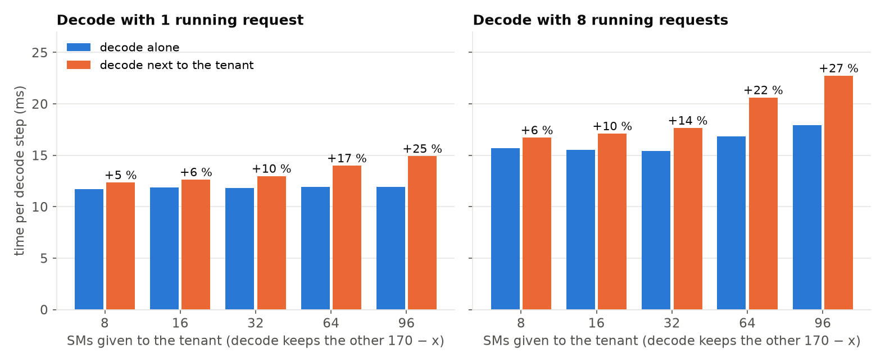

*Figure 8 — time per decode step, alone (blue) and next to the tenant (orange), tenant on disjoint
SMs (`../results/knee_bw2.csv`). Blue is decode alone on exactly the SMs it has in the orange
case, so the difference is not caused by decode having fewer SMs.*

| Tenant SMs | Tenant tok/s (share of its solo rate) | Tenant GB/s | Decode slowdown, 1 / 4 / 8 requests | Decode's lost GB/s ÷ tenant's GB/s |
|---|---|---|---|---|
| 8 | 2.4–2.9k (69–82 %) | 34–41 | +5.4 / +7.5 / +6.4 % | 2.0–2.4 |
| 16 | 4.5–5.3k (68–81 %) | 62–74 | +6.4 / +9.1 / +9.9 % | 1.3–1.7 |
| 32 | 8.0–9.4k (69–81 %) | 108–126 | +9.7 / +15.3 / +14.4 % | 1.1–1.5 |
| 64 | 13.2–15.2k (74–85 %) | 179–206 | +17.4 / +19.5 / +22.4 % | 1.05–1.14 |
| 96 | 18.5–19.2k (84–88 %) | 251–261 | +24.7 / +29.1 / +26.6 % | 0.98–1.08 |

- **Separate SMs do not protect decode.** With the tenant on only 8 SMs, moving 3 % of what
  decode moves, decode is 5–7 % slower.
- **The total does not grow.** Decode alone moves 1.33–1.40 TB/s; decode plus tenant move
  1.21–1.35 TB/s. The tenant's traffic is taken out of decode's.
- **An SM limit is a weak knob.** From 96 to 8 SMs the tenant's traffic falls to 1/6–1/7 and its
  own throughput to about 1/7 (about 19k → 2.4–2.9k tok/s), while the harm to decode falls only to
  about 1/4 (25–29 % → 5–7 %), with a floor near 5 %.
- **Per unit of training, few SMs cost decode more.** Decode slowdown per 1 k tenant tok/s is
  2.2–2.7 % with the tenant on 8 disjoint SMs and 1.3–1.5 % on 64–96.
- On shared SMs (decode on all 170, the tenant on M of them) the tenant reaches only 34–73 % of
  its solo rate, against 68–88 % on disjoint SMs.

**Question 2, continued: where the bandwidth ceiling is.**

| What runs | GPU-memory traffic | Share of the nominal 1.78 TB/s |
|---|---|---|
| Decode alone | 1.33–1.40 TB/s | 75–79 % |
| Decode + the tenant (sum) | 1.26–1.41 | 71–79 % |
| A read-only job alone (256 MB per call) | 1.58–1.61 | 88–90 % |
| A write-only job alone (96 SMs) | 1.55 | 86.6 % |
| Decode + an unthrottled read-only job (sum) | 1.60–1.62 | 88–91 % |

No combination reached the nominal figure. Decode loses while the total is far below any of these
levels: a read-only job on 96 SMs moving 50 GB/s next to a decode step with 8 requests takes
decode from 1,207 to 1,156 GB/s, the sum stays at 1,206 GB/s (68 % of nominal) and decode is 4.3 %
slower. The measurements show that the path as a whole is shared. They do not show which part of
it does the limiting.

**Questions 4 and 5: a second job with set traffic.** The tenant is replaced by a synthetic job on its own SMs that
moves a set number of GB/s (`../bw_aggr.py`, `../aggr_corun.py`).

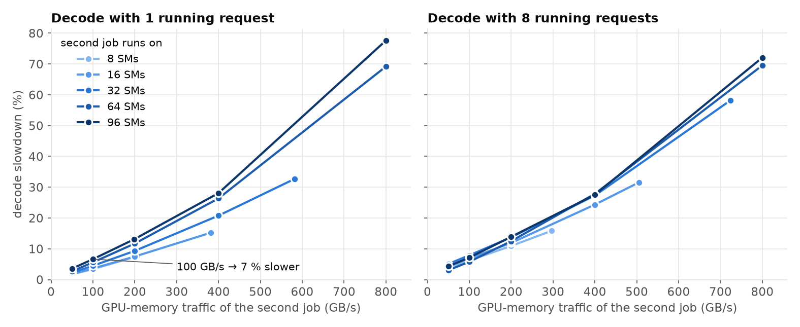

*Figure 9 — decode slowdown against the traffic of a read-only second job, one line per number of
SMs it runs on (`../results/aggr_corun.csv`).*

- At a fixed SM count the slowdown is close to linear in GB/s: per 100 GB/s about 4 % from 8–16
  SMs and about 7 % from 64–96 SMs with one running request, 5–7 % with eight.
- The SM count sets how much the job can move at most: 205–298 GB/s from 8 SMs (decode +8–16 %),
  955–1,059 GB/s from 96 SMs (decode +106–124 %).

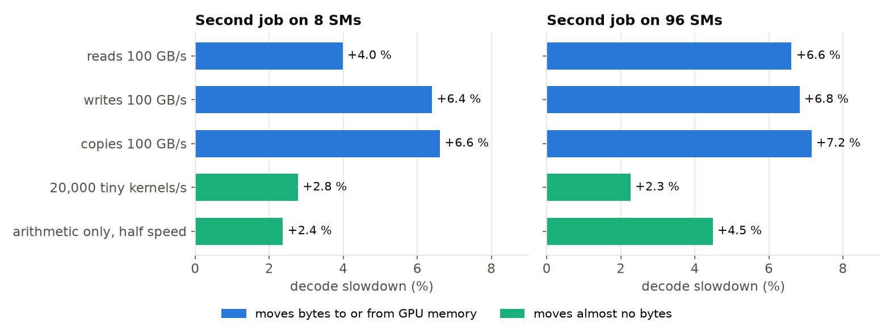

*Figure 10 — decode slowdown (one running request) next to five kinds of second job. Blue: jobs
that move 100 GB/s. Green: jobs that move almost no bytes (`../results/aggr_modes.csv`; 20 points
rerun, step times within 0.5 %).*

| Kind of work | On 8 SMs | On 96 SMs |
|---|---|---|
| Read, per 100 GB/s | 4.0 % (1 request), 5.5–6.3 % (8 requests) | 5.4–7.0 % |
| Write or copy, per 100 GB/s | 6.1–6.6 % (1 request), 7.1–7.8 % (8 requests) | 6.1–8.2 % |
| Tiny kernel launches only, 2k–130k per second | +0.7 to +5.8 % | the same |
| Arithmetic only | +1.4–2.6 % (1 request), +3.8–6.9 % (8 requests) | +8.6–9.8 % at full speed |

- **The real tenant costs more than its bytes.** On 8 SMs it moves 34–41 GB/s, which by Figure 9
  would cost decode 1.4–2.6 % as reads; the measured slowdown is 5.4–6.4 %. Writes, kernel
  launches and arithmetic each cost decode something of their own, measured one at a time; the
  fine-tune tenant does all three.
- **Power is a second shared resource.** Arithmetic at full speed on 96 SMs drives the board to
  the 500 W cap and the clock drops 8–9 %. At the read, write and copy points the clock is
  unchanged, so the byte results are not a power effect.

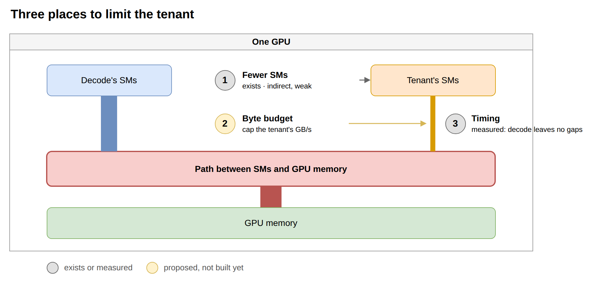

*Diagram 7 — the places where the tenant can be limited (source `../diagrams/10_where_to_limit.drawio`).
Fewer SMs (1) is the knob in use and is weak; a byte budget (2) is the plan of section 5; timing
(3) has almost no room, because decode leaves no gaps (section 5.5).*

Limits: decode is the synthetic step, most points were run once (4-s windows), and the decode
baseline sits on one of two levels about 1 % apart, which puts about ±1 point on every slowdown.
## 3. Host↔GPU transfers

Every host↔GPU copy was recorded with its source (figure `../results/<scheme>_xfer.png`; records in
`../results/<scheme>_xfer_{inf,ft}.csv`; NVML PCIe counters in the sampler CSV).

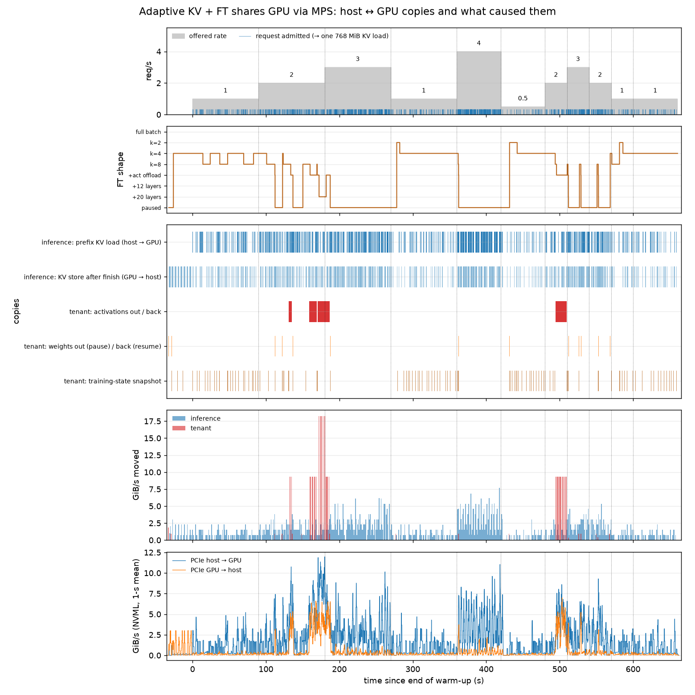

*Figure 3 — every host↔GPU copy in the MPS scheme and what caused it. Top two rows are the causes:
each admitted request (blue tick) triggers one 768 MiB prefix load and, when it finishes, one
16 MiB store; each move of the tenant's shape triggers the tenant's copies (activations out and
back on the way through the activation-offload shape, weights out on pause and back on resume), and
a snapshot goes out every 10 steps. The middle row shows the copies themselves as spans, the fourth
the bytes moved per second by source, the last NVML's PCIe counters. The same figure exists for
every scheme in `../results/<scheme>_xfer.png`.*

| | per copy | per 11-minute run |
|---|---|---|
| inference loads (host RAM → GPU, one per admitted request) | 768 MiB in 55.7 ms = **13.5 GiB/s** (≈ 93 % of the 14.5 GB/s the link delivers) | 1 176 loads, 880 GiB, 1.36 GiB/s average |
| inference stores (GPU → host RAM, one per finished request) | 16 MiB in 1.2 ms | 1 219 stores, 51 GiB |
| tenant activation offload (tier 2) | 4.7 GB out and 4.7 GB back per step, 354 ms out | 6 steps in the MPS scheme, 56 GiB |
| tenant pause / resume | ~1 GB in 195 / 98 ms | 8 / 9 times in the MPS scheme |
| tenant snapshots | 8 MB, < 50 ms | 176 in the MPS scheme |

Contention: inference loads that overlapped a tenant copy took 56.1–56.3 ms against 55.7 ms
alone (n = 32–74 per scheme) — no measurable slowdown, because the link is busy only ~10 % of the
time on average and the tenant's large copies are rare (activation offload is the slow tier that
the budget ladder seldom lands on). The NVML counters agree with the records on the time
structure (bursts of 15 GiB/s at every admission); their 20-ms sampling overstates peaks (a
35 GiB/s reading during an activation offload is a window artefact). The probe (Figure 5) adds the
other side of this: the copies do not slow each other, but a tenant shape that copies a lot costs
decode 3–7× more per token than one that does not — the copies compete with decode for the GPU's
memory system, not with each other for the link.

## 4. What this shows

Figure-centred summary (diagrams 1–7, Figures 0–12, `../results/<scheme>_timeline.png`,
`../results/<scheme>_xfer.png`):

1. **The memory half of the problem is solved, with honest accounting** (diagrams 1–3). A router in
   front of vLLM knows the exact KV demand of what is running and queued; the VRAM scheduler raises
   kvcached's limit the moment demand exceeds it — and only as far as memory is actually free —
   and lowers it with hysteresis; the tenant climbs and drops a ladder of configurations with a
   50-ms preemption poll inside its steps and host-RAM snapshots. Over an 11-minute schedule from 0.5
   to 4 req/s the engine never failed and never preempted, the GPU was never oversubscribed, and
   resizing itself costs nothing. Static partitioning lost on both sides: 5–26 s of queueing at and
   after 3–4 req/s, +30 % decode latency at low load, idle VRAM at low load.
2. **The compute half now has two workable schemes, and a model of the cost.** The cost of a
   tenant is memory traffic: +2.2 % decode TPOT per 1 k tenant tok/s for the fine-tune tenant's
   usual shape, more for the micro-batch-8, activation-offload and weight-streaming shapes (Figure 5), nothing at
   ≥ 3 req/s where the tenant is paused anyway. Two mechanisms move the trade-off: (a) a dynamic
   green context with prebuilt SM partitions (`green_dyn2`) gives 9–12k tok/s for +14 % — half the
   cost of MPS co-running at 80 % of its throughput, and it survived 174 switches without the
   round-1 leak; (b) a tokens/s cap driven by the measured decode latency (`tpot_slo15`) enforces a
   stated SLO directly (+0–14 % for a 15 % target), while a 5 % target is below the measurement
   noise of a 10-s window. Time-sharing (idle-window gate) remains useless on this engine, and a
   fixed SM partition alone does not help. The knee measurement (Figure 6) says why and sets the
   limits: alone, a decode step reaches the GPU-memory-bandwidth plateau (1.34–1.42 TB/s) at 56 SMs
   with 1 running request and at 72–80 SMs with 4–14, so the engine needs about 80 SMs, and on the
   plateau every byte the tenant moves is taken from decode whichever SMs the tenant runs on.
3. **A prefill engine as the tenant is memory-limited, not compute-limited.** With a 4.5 GiB fixed
   footprint it only fits beside the decode node at ≤ 1 req/s; there it adds +5–6 % decode TPOT and
   delivers 6–9k prompt tok/s in bursts, and at ≥ 2 req/s it sleeps. Sleep frees 3 GiB that the
   scheduler does not yet credit back to the KV pool — the obvious next fix (section 2.5).
4. **kvcached + LMCache's MP connector works on kvcached main** (plan P4, D12–D13, GPU 1): the
   `engine_driven` mode ran 10 minutes of heavy store/retrieve traffic with the limit resized every
   15 s, 341/341 requests ok, outputs identical to the plain engine; the Xid 31 fault seen with
   kvcached 0.1.6 is gone (main orders page unmaps behind the GPU's progress) and the pin layer
   written for it was not needed. The zero-copy VMM mode stays blocked on LMCache's side: it
   imports one handle per tensor, kvcached maps 2 MiB pages.
5. **Host↔GPU traffic is not the bottleneck**: inference loads run at 13.5 GiB/s, average link use
   is 1.4 GiB/s, and loads that overlap tenant copies are not measurably slower.
6. **Separate SMs do not separate the path to GPU memory, and an SM limit is a weak knob**
   (section 2.7, Figures 7–10). Next to the tenant, the two jobs' traffic sums to 1.21–1.35 TB/s
   against 1.33–1.40 TB/s for decode alone: what the tenant moves, decode loses. A read-only
   second job costs decode 4–7 % per 100 GB/s, close to linearly. Cutting the tenant from 96 to
   8 SMs cuts its own throughput to about 1/7 and the harm to decode only to about 1/4, with a
   floor near 5 %. Writes, kernel launches and arithmetic each add a cost of their own.
7. **Throttling and fewer SMs are different tools** (sections 2.2.1, 2.2.2, Figure 11). While the
   tenant pauses, decode is at its baseline, and while it runs under a tokens/s cap decode is as
   slow as with no cap: a cap shortens the overlap, it does not soften it. Fewer SMs soften it
   and cost less per tenant token (1.5–1.7 % per 1 k tok/s against 2.3–2.4 %). The feedback loop
   of the SLO schemes holds the median but swings the cap, so at 0.5 req/s their p90 is +28–29 %
   where a fixed cap gives p90 = median.

## 5. Next steps: limit the tenant's bytes, and make the tenant use fewer

Sections 5.1 to 5.6 are the design as it stood before the night of Nov 16: what would be built,
what the prototype already had, and which experiment decides each step; the numbers they quote
are the measurements of section 2. **Section 5.7 has what that night measured**, including the
points where it corrects 5.1 to 5.6.

### 5.1 What the steps rest on

Two sets of measurements meet. **Section 2.7 says what to control**: the bytes the tenant moves,
not its SMs. **Section 2.2.2 says how**: letting the tenant run and pause is a usable handle,
because decode is at its baseline while the tenant pauses. C1 joins the two: it limits the tenant
from outside. C2 takes the first finding to the tenant itself: if decode pays for the tenant's
bytes, change the tenant so that the same work moves fewer.

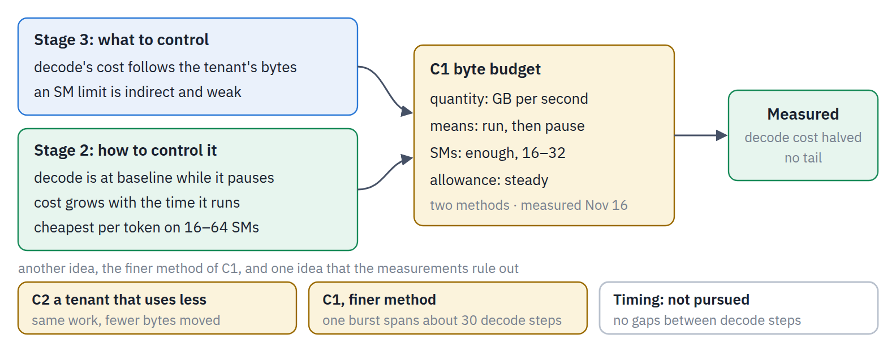

*Diagram 8 — from the measurements to the ideas (source `../diagrams/15_measurements_to_ideas.svg`,
drawn by `../diagrams/make_svg.py`). The two boxes on the left are measured; the yellow boxes are
the designs that follow and are not built.*

| Measured | Where | So | Lands in |
|---|---|---|---|
| Decode's slowdown follows the second job's bytes: 4–7 % per 100 GB/s; the two jobs' sum does not grow | 2.7, questions 2 and 4 | The quantity to control is bytes, not SMs | **C1**: the allowance is in GB/s |
| An SM limit is indirect and weak, with a floor near 5 %. 8 SMs is the dearest point per token, 16–64 SMs the cheapest | 2.7, question 3; 2.2.2 | Do not squeeze the tenant onto few SMs; give it a few dozen | **C1**: enough SMs |
| While the tenant pauses decode is at its baseline (−1 to +2 %); while it runs the cost is that of continuous co-running | 2.2.2 | Run-and-pause acts linearly in time and can keep an allowance | **C1**: kept by pausing |
| With a fixed cap p90 equals the median; when the feedback loop swings the cap, p90 is as with no throttle | 2.2.1 | The allowance must change slowly | **C1**: a steady allowance |
| At the same tok/s, tenant shapes differ 7-fold in cost; while running they slow decode alike and differ in speed | 2.4, 5.4 | Tokens/s is the wrong unit; how the tenant computes changes what a token costs decode | The unit of **C1**; **C2** |
| Counted on the CPU, not measured on the GPU: 88 % of the bytes of a tenant step are intermediate results; a shorter backward pass has 36–44 % fewer bytes per token | 5.4 | The tenant's traffic for the same work can be lowered | **C2** |
| One full-speed burst of the tenant spans about thirty decode steps; a regular run-and-pause averages out over a request | 2.2.1 | Slicing improves only the jitter between tokens | **C1**, second method, later |
| There are no gaps between decode steps (GPU busy 93–100 %); under the idle gate the tenant trained nothing | 2.2, 2.4 | There is no period for the tenant to hide in | Timing is not pursued |
| In the literature a byte budget is used only to protect CPU tasks | 6 | A byte budget with decode as the victim has no precedent found | **C1** is new |

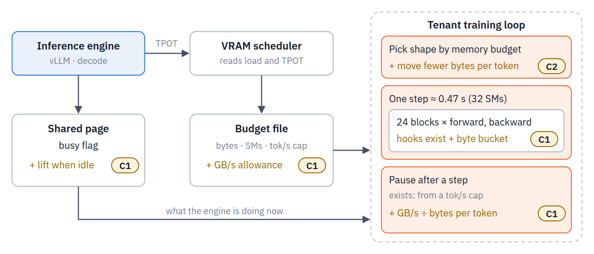

*Diagram 9 — where each step attaches to the prototype (source
`../diagrams/11_next_steps_attach.svg`). Plain text is what the code already has; yellow tags mark
what is to be built. All steps change only the tenant's own loop and two fields in shared files:
no driver change, no interception of CUDA calls, no change to the inference engine.*

| | In one line | Already in the code | To build | Decided by |
|---|---|---|---|---|
| **C1** byte budget, first method | Give the tenant a GB/s allowance; it pauses when over | A tok/s cap with a pause after each step; the TPOT feedback loop (`tpot_slo15`) | A GB/s field in the budget file; bytes per token for each shape; the conversion | E1.1: at equal traffic, pauses against an SM limit |
| **C1** byte budget, second method | Move the pause from the end of a step to block boundaries | A hook before each block's forward and backward pass; CUDA event sync | A byte bucket inside the hooks | The cost of one sync per boundary |
| **C2** a tenant that uses less bandwidth | Change the tenant so that the same work moves fewer bytes, and decode slows down less | Five shapes chosen by GPU-memory budget; fused attention; an operator count on the CPU | Bytes per token of each shape and variant from the GPU counter; switches in the tenant for merged operators, a chunked output layer and LoRA on the top layers | Whether decode's slowdown at equal tenant work falls with the tenant's bytes per token (not tested yet) |

### 5.2 C1: a byte budget (first method: pause after each step)

The tenant gets an allowance: at most so many bytes per second on average. It works at full
speed, stops when the allowance is used, and continues when it is refilled. There are two ways to
keep the same allowance: pause after each step (this section; half of it exists in the code), or
pause at block boundaries so that the work comes in much shorter slices (section 5.3).

Today the tenant is held back by giving it fewer SMs, so that it works slowly all the time.
Section 2.7 gives the cost of that per unit of training:

| Tenant on (disjoint SMs) | Decode slowdown per 1 k tenant tok/s | SMs left for decode | Decode slower from the SM loss alone |
|---|---|---|---|
| 8 | 2.2–2.7 % | 162 | about 0 |
| 16 | 1.4–1.9 % | 154 | about 0 |
| 32 | 1.2–1.7 % | 138 | about 0 |
| 64 | 1.3–1.5 % | 106 | +2–7 % |
| 96 | 1.3–1.5 % | 74 | +2–14 % |

8 SMs is the dearest point per token, 1.5–2 times the others; from 16 SMs up the cost per token
is flat; and from 64 SMs up decode itself runs short of SMs. C1 therefore holds the tenant back
the other way: 16–32 SMs, and less time. A comparison that needs no extrapolation: on 8 SMs the
tenant runs at 2.4–2.9k tok/s for +5.4–7.5 % decode; on 16 SMs at 4.5–5.3k tok/s for +6.4–9.9 %,
1.9 times the training for 1–2.4 points more.

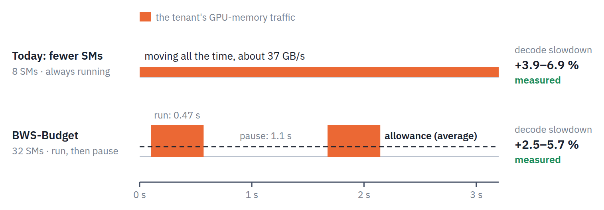

*Diagram 10 — C1, first method (source `../diagrams/12_c1_budget.svg`). Both rows do the same
amount of work, about 2.6k tok/s; bar height is the tenant's GPU-memory traffic at that moment,
area is bytes moved; 3.2 s, to scale. The dashed line is the allowance: the average, as high as
the bar of the first row. Scale: on 32 disjoint SMs the tenant runs at 8.0–9.4k tok/s and one
step of 4,096 tokens takes about 0.47 s; on 8 SMs it runs at 2.4–2.9k tok/s.*

1. The VRAM scheduler writes one more field into the budget file: how many GB/s the tenant may
   use now. The starting value comes from the measured price (the decode slowdown allowed, divided
   by the cost per 100 GB/s); TPOT feedback then corrects it, slowly (section 2.2.1).
2. The tenant converts GB/s into tok/s by dividing by the bytes per token of its current shape.
   One shape is measured so far (13.4–14.3 MB). The others are measured once each at start-up,
   when the tenant has the GPU to itself and the bandwidth counter reads its traffic alone.
3. The tenant runs on 16–32 SMs and pauses after each step so that its average traffic stays
   inside the allowance. The pause exists; today it is computed from tok/s.
4. While no request is running (the engine's busy flag is clear) the allowance is lifted; it is
   restored when the first request arrives.

The allowance is in bytes and not in tok/s because, at the same 1 k tok/s, different tenant shapes
cost decode up to 7 times more (Figure 5): a tok/s cap has to be retuned whenever the tenant
changes shape, a byte allowance does not.

What section 2.2.2 already supports: decode is at its baseline while the tenant pauses, and
while it runs the cost is that of continuous co-running (both with all SMs shared). Not measured:
the two together, a tenant on 32 SMs that runs and pauses.

**The deciding experiment (E1.1).** Bring the tenant to the same tok/s in two ways: by giving it
only 8 SMs, and by giving it 32 SMs with pauses. Three traffic levels × decode batch sizes 1, 4
and 8; compare the mean and p90 of decode step time. About 15 minutes of GPU time. If the two
curves coincide, a byte budget does not beat an SM limit on cost, and what remains is that it has
no floor and can be adjusted continuously.

### 5.3 C1, second method: pauses at block boundaries

With the pause after a step, the tenant alternates between about 0.47 s at full speed and a longer
pause, and one such burst spans about thirty decode steps (12–18 ms each). The second method
keeps the same allowance and cuts the same work into slices shorter than one decode step.

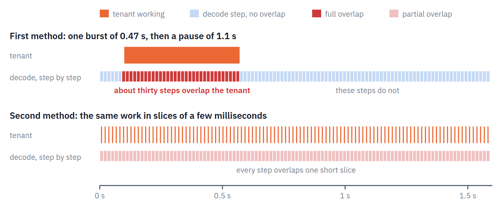

*Diagram 11 — the two methods at the scale of single decode steps (source
`../diagrams/16_c1_finer.svg`). Each small cell is one decode step of about 15 ms; 1.6 s shown.
Both rows do the same work. The first row is drawn from measured numbers; the second is the
design.*

1. Each block of the tenant model already has a hook before its forward pass and one before its
   backward pass; today they check the GPU-memory budget and the idle gate. The model has 24
   blocks, so one step with 4 micro-batches has 4 × 48 = 192 points where it can stop, one every
   2.4 ms on average on 32 SMs.
2. A byte bucket goes into the hook. At each boundary it is charged an equal part of the step's
   bytes. When the bucket is empty, the tenant first waits for the GPU to finish the kernels
   already submitted (a CUDA event sync, which exists) and then sleeps until the bucket is
   refilled.
3. The refill rate is the GB/s allowance of C1. The bucket size sets the length of a slice; the
   target is shorter than one decode step.

Why it comes later: it does not change the average, only how evenly the slowdown is spread, and
over a request a regular run-and-pause already averages out (fixed cap: median +5 %, p90 +6 %,
section 2.2.1). What it would improve is the jitter between tokens. Not covered: the optimizer
update and the loss computation are outside the blocks; a block cannot be split further; charging
every boundary equally is an assumption, since the split of bytes between forward and backward
passes is not measured yet. To measure first: the cost of one sync per boundary, 192 per step.

### 5.4 C2: a tenant that uses less of the GPU-memory bandwidth

C1 limits the tenant from outside and leaves it as it is. C2 changes the tenant: the same
training work should put less traffic on the path between GPU memory and the SMs, so that decode
slows down less. Its measure is **decode's slowdown at equal tenant work**. Nothing of C2 is
measured next to decode yet; this section says what is known about the tenant's bytes and which
means there are.

**Where the tenant's bytes go.** One micro-batch of the tenant (2 × 512 tokens) was taken apart
operator by operator **on the CPU, with no GPU used** (`../tenant_inventory.py`,
`../results/tenant_inventory.md`): every primitive operator of the forward and backward pass,
with the bytes it reads and writes at 2 bytes per element. This is a count, not a GPU
measurement: it assumes each operator is its own kernel that reads its inputs from GPU memory and
writes its output there.

| Variant | Operator calls that move data | MB per token | of which forward / backward | Weights' share |
|---|---|---|---|---|
| The tenant as it is (LoRA on all 24 layers) | 3,302 | 17.0 | 6.7 / 10.2 | 12 % |
| Forward pass only | 1,318 | 6.7 | 6.7 / 0 | 17 % |
| LoRA on the top 8 layers | 1,710 | 10.9 | 6.2 / 4.7 | 15 % |
| LoRA on the top 4 layers | 1,318 | 9.4 | 6.1 / 3.3 | 16 % |
| 8 sequences per pass (1 micro-batch) | 3,302 | 15.4 | 5.8 / 9.5 | 3 % |
| 1 sequence per pass (8 micro-batches) | 3,301 | 19.1 | 7.9 / 11.2 | 22 % |
| Attention not fused (`eager`) | 3,720 | 23.3 | 9.8 / 13.5 | 9 % |

- The count gives 17.0 MB per token for the tenant's usual shape; the GPU counter measured
  13.4–14.3 MB (section 2.7). The count is an upper estimate of the same order.
- **Weights are 12 % of the bytes; 88 % are intermediate results** written to memory by one
  operator and read back by the next. Element-wise multiplications and additions alone are 37 %.
- **The output layer is about a fifth**: the logits over the 151,936-token vocabulary are 297 MB
  for one micro-batch and are written or read about ten times between the last projection, the
  loss and their backward passes.
- **More tokens per pass over the weights changes little**: 15.4 to 19.1 MB per token from 1 to 8
  micro-batches. Only the weights' part moves.
- **A shorter backward pass changes a lot**: LoRA on the top 4–8 layers gives 9.4–10.9 MB per
  token, 36–44 % less, with half the operator calls.
- The tenant already uses the fused attention; without it the count would be 37 % higher.

**The means**, from the least to the most invasive. None is measured next to decode.

| | Means | Does the training change? | What is known |
|---|---|---|---|
| 1 | Choose among the shapes the tenant already has | No | Measured next to decode, one 60-s window per shape (below). Bytes per token known for one shape only |
| 2 | Settings: micro-batch size, attention implementation | No | By count: micro-batch size moves the bytes per token by about ±10 %; the fused attention is already in use |
| 3 | Merge operators so that intermediate results stay inside the SMs and are not written to GPU memory: the element-wise chains (by a compiler or by hand-written kernels), the output layer and loss | No | By count these are 37 % and about a fifth of the bytes. LoRAFusion reports 34–37 % less GPU-memory traffic from merged LoRA kernels, for the job's own speed (section 6) |
| 4 | Train fewer layers: LoRA on the top layers only | Yes; whether the result is as good is a separate question | By count 36–44 % fewer bytes per token |

**Means 1, the shapes, is the only one with measurements.** A shape is how the tenant computes
one step, with the training itself unchanged: into how many micro-batches the 8 sequences are
split (1, 2, 4 or 8), whether intermediate results are moved to host RAM, and whether the weights
of 12 or 20 layers are kept in host RAM and read in layer by layer. The shapes were built to save
GPU memory, and the tenant steps down through them when decode needs memory back.

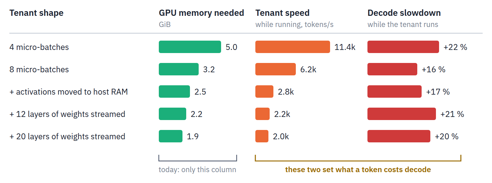

*Diagram 12 — the five shapes of the shape probe (source `../diagrams/17_shapes.svg`): the GPU
memory each needs (`../tiers.json`), the tenant's speed while it runs and decode's slowdown while
it runs (`../results/overlap_summary.md`; one 60-s window per shape).*

While the tenant runs, decode is 16–22 % slower with every shape. The shapes differ in the
tenant's own speed, 11.4k down to 2.0k tok/s: a shape that saves memory is slower and has to run
longer for the same tokens. To deliver the same 4 k tok/s the first shape runs 31 % of the time,
the second 61 %, the last three all the time. The slowdown divided by the speed is the cost per
1 k tok/s: about 2 %, 2.5 %, 6 %, 10 % and 10 %. So among the shapes that fit GPU memory the
fastest costs decode least for the same work.

**What is not known, and decides C2:**

- **The decode side.** That decode's slowdown follows the tenant's tokens/s is measured within
  one shape (section 2.7). Whether it falls when the same tokens/s move fewer bytes has not been
  tested with any variant.
- **The slow shapes.** They slow decode as much while they run as the fast ones, at a fifth to a
  quarter of the tokens per second. Their bytes per token are not measured. Either they move
  several times more bytes for a token, or decode is paying for something other than bytes there.
- **A tenant left to run flat out.** A variant with fewer bytes per token may simply run faster
  and fill the same bandwidth. C2 is therefore compared at equal tenant work, and it needs C1 or
  an SM limit next to it to hold the work fixed.
- **The floor.** A second job that moves no bytes still slows decode from 8 SMs, by 1.4–2.6 %
  with one request and 3.8–6.9 % with eight (section 2.7). No change to the tenant's bytes goes below that.

### 5.5 Not pursued: timing on a decode node

The idea was to let the tenant work when decode does not need the path. On a decode node there
are only two such moments: the gaps between decode steps, and the time with no request at all.

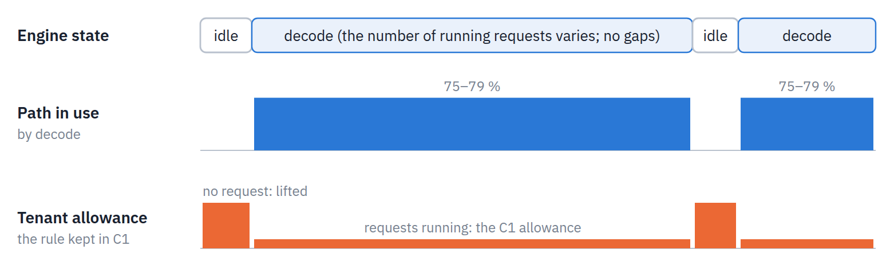

*Diagram 13 — what timing can use on a decode node (schematic, not to scale; source
`../diagrams/13_decode_node_timing.svg`). The engine fetches the prefix KV and prefills only the
128 new tokens of each request (about 160 ms together); the rest is decode.*

- **There are no gaps between steps.** While any request is running the GPU is busy 93–100 % of
  the time at 0.5–3 req/s (D5). The idle-gate scheme, which let the tenant run only in the gaps,
  kept decode at +1 % and trained nothing (section 2.2).
- **The number of running requests does not change decode's use of the path**: 75–79 % of the
  nominal bandwidth with 1, 4 and 8 requests (section 2.7).
- **What is left is the time with no request at all**: at most about 7 % at 0.5 req/s and above.

Timing is therefore not a step of its own. What is left of it is rule 4 of C1.

### 5.6 Order of work

| Order | What | What it answers | GPU time (estimate) |
|---|---|---|---|
| 1 | E1.1: equal traffic, two knobs | Whether C1 is worth building | about 15 min |
| 2 | C1, first method: GB/s in the budget file, conversion in the tenant, a slowly changing allowance | Comparison with `tpot_slo15` and `green_dyn2` on the full 11-minute schedule, median and p90 | about 12 min per scheme |
| 3 | C2, tenant side: the table of section 5.4 from the GPU counter, for every shape and variant | Where the tenant's bytes go; how far each means lowers them; C1's conversion | about 25 min |
| 4 | C2, decode side: variants with fewer bytes per token next to decode, at equal tenant tokens/s; then on the 11-minute schedule | Whether decode's slowdown falls with the tenant's bytes per token | about 35 min, then about 12 min per scheme |
| 5 | C1, second method: byte bucket in the block hooks | Jitter between tokens; the overhead of the syncs | about 12 min per scheme |

The runs, with a prediction written down before each, are in
[`../PLAN_overnight3.md`](../PLAN_overnight3.md).

Also open, from the earlier sections: drive the dynamic SM share from the measured TPOT error
instead of the arrival rate (the green-context table is open-loop); for the prefill tenant,
credit the memory released during sleep to the KV pool by reading the adapter's live footprint,
and wake only when the budget exceeds the weights (section 2.5); keep the engine at ≥ 80 SMs
whenever the partitions are disjoint (section 2.6); and express the results in the proposal's
metric, the load served within the SLO.

### 5.7 Measured on Nov 16: C1 and C2

One night on both cards, with a prediction written down before each run
([`../PLAN_overnight3.md`](../PLAN_overnight3.md)); every prediction and outcome is in
[DECISIONS.md](DECISIONS.md), D20–D28. The tenant got a GB/s allowance (the budget file's new
field, turned into tokens/s with the bytes per token of its shape), a second way to keep it
(slices at block boundaries), and switches for variants that move fewer bytes per token. The
synthetic runs use the decode step of section 2.6 on GPU 1; the real-engine runs use the
11-minute schedule on GPU 0, against a baseline of the same night (TPOT median 12.0 / 12.7 /
16.4 ms at 0.5 / 1 / 2 req/s; the Nov 9 baseline was 12.0 / 12.6 / 16.3). Two controls were run
again and reproduce their Nov 9 results within 2 points.

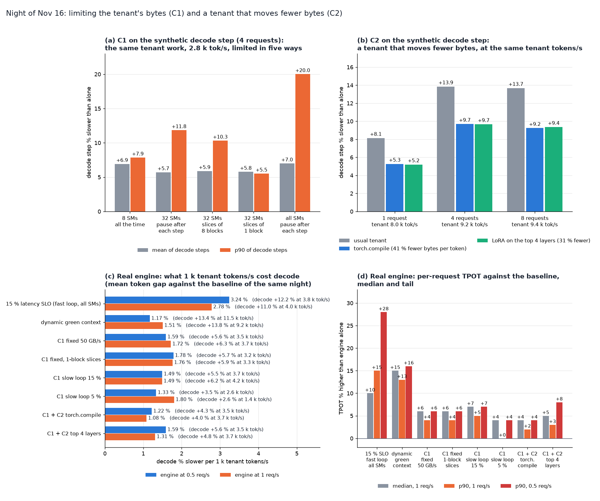

*Figure 12 — the night of Nov 16 (`../plot_o3.py`). (a) and (b): the synthetic decode step, both
passes averaged (they differ by at most 0.2 points). (c) and (d): the real engine against the
baseline of the same night.*

**C2, the tenant side: how many bytes a token costs** (tenant alone on 32 SMs, about 43 s each;
the counter was calibrated again: 1 % = 17.79 GB/s).

| Tenant | MB per token | vs usual | tokens/s | Does the training change? |
|---|---|---|---|---|
| Usual shape, 4 micro-batches | 13.47 | – | 11,628 | – |
| 1 / 2 / 8 micro-batches | 15.58 / 13.48 / 14.88 | +16 / 0 / +10 % | 14,543 / 13,416 / 9,579 | No |
| Slow shapes: activations, + 12, + 20 layers in host RAM | 15.19 / 16.57 / 17.61 | +13 / +23 / +31 % | 3,246 / 2,566 / 2,364 | No |
| Attention not fused (`eager`) | 20.66 | +53 % | 10,096 | No |
| **`torch.compile`** | **7.95** | **−41 %** | 14,457 | No |
| Output layer and loss in chunks of 16 positions | 42.23 | +214 % | 7,706 | No |
| LoRA on the top 8 / top 4 layers | 10.10 / 9.24 | −25 / −31 % | 17,743 / 20,198 | Yes |
| Forward only (reference) | 3.73 | −72 % | 25,010 | Nothing is trained |

- Merging operators with the compiler removes 41 % of the tenant's traffic and makes it 24 %
  faster, with the same training.
- Chunking the output layer was a design error: each chunk reads the 272-MB output matrix again.
- The operator count of section 5.4 overstated the saving of the top-layer variants by about 12
  points and had the direction wrong for one micro-batch.
- The slow shapes move only 42–49 GB/s while they run (the fast ones 143–181 GB/s).

**C2, the decode side: at equal tenant work, fewer bytes cost decode less** (Figure 12b; tenant on
32 SMs, synthetic decode step on the other 138).

| Tenant, all at the usual tenant's tokens/s | 1 request | 4 | 8 | per 1 k tok/s |
|---|---|---|---|---|
| Usual | +8.1 % | +13.9 % | +13.7 % | 1.02 / 1.51 / 1.46 % |
| `torch.compile` | +5.3 % | +9.7 % | +9.2 % | 0.66 / 1.06 / 0.99 % |
| LoRA on the top 4 layers | +5.2 % | +9.7 % | +9.4 % | 0.65 / 1.06 / 1.00 % |

Decode's slowdown falls by 30–36 %. Against the tenant's GB/s all settings lie on one line
(7.0–8.5 % per 100 GB/s at one request). Left to run flat out, the variants run faster instead:
the compiled tenant then does a third more work for a slightly lower cost (+7.2 %), the
top-4-layers tenant does 80 % more and costs more (+9.6 %). C2 therefore needs C1 next to it.

**C1 on the synthetic step: the same tenant work, limited in different ways** (Figure 12a).

| Tenant doing 2.4 / 2.8 / 2.9 k tok/s | Mean, 1 / 4 / 8 requests | p90 of single steps |
|---|---|---|
| 8 SMs all the time | +3.9 / +6.9 / +5.9 % | +5.4 / +7.9 / +8.2 % |
| 32 SMs, pause after each step | +2.5 / +5.7 / +5.5 % | +5.8 / +11.8 / +11.0 % |
| 32 SMs, slices of 8 blocks | +2.6 / +5.9 / +5.6 % | +5.5 / +10.3 / +9.1 % |
| 32 SMs, slices of 1 block (about 2.4 ms) | +2.6 / +5.8 / +5.5 % | +2.2 / +5.5 / +5.2 % |
| All SMs, pause after each step | +4.6 / +7.0 / +6.5 % | +12.7 / +20.0 / +19.0 % |

- A few dozen SMs with pauses is cheaper than 8 SMs all the time, but by 0.4–1.4 points, not the
  2–3 predicted: while the tenant pauses, decode is still +2.7–3.0 % at 4 and 8 requests (+0.7 %
  at one). It is not the power limit and not a recovery after the burst; the cause is open.
- All SMs with pauses, which is what `tpot_slo15` does, is no better than 8 SMs and has the
  worst tail.
- Slices of one block bring the p90 of single decode steps down to the mean, at 5 % of the
  tenant's speed while running. The syncs themselves cost the tenant under 1 %.

**C1 and C2 on the real engine** (Figure 12c, d; 0.5 / 1 req/s; the mean token gap and the
per-request TPOT are against the baseline of the same night).

| Scheme | Tenant tok/s | Mean token gap | per 1 k tok/s | TPOT median | TPOT p90 |
|---|---|---|---|---|---|
| `tpot_slo15`: fast loop, all SMs (control) | 3,769 / 3,953 | +12.2 / +11.0 % | 3.2 / 2.8 % | +7 / +10 % | +28 / +15 % |
| `green_dyn2`: 16–96 SMs by load (control) | 11,468 / 9,154 | +13.4 / +13.8 % | 1.2 / 1.5 % | +14 / +15 % | +16 / +13 % |
| C1: 32 SMs, fixed 50 GB/s, pause after a step | 3,524 / 3,670 | +5.6 / +6.3 % | 1.6 / 1.7 % | +6 / +6 % | +6 / +4 % |
| C1: the same in 1-block slices | 3,195 / 3,348 | +5.7 / +5.9 % | 1.8 / 1.8 % | +6 / +6 % | +6 / +4 % |
| C1: slow loop, target +15 % | 3,686 / 4,167 | +5.5 / +6.2 % | 1.5 / 1.5 % | +6 / +7 % | +7 / +5 % |
| C1: slow loop, target +5 % | 2,622 / 1,442 | +3.5 / +2.6 % | 1.3 / 1.8 % | +3 / +4 % | +4 / +0 % |
| C1 + C2: fixed 50 GB/s' worth of tokens, compiled tenant | 3,524 / 3,688 | +4.3 / +4.0 % | 1.2 / 1.1 % | +5 / +4 % | +4 / +2 % |
| C1 + C2: the same, LoRA on the top 4 layers | 3,524 / 3,670 | +5.6 / +4.8 % | 1.6 / 1.3 % | +5 / +5 % | +8 / +3 % |

- **C1, first method, works as predicted.** At the tenant work of `tpot_slo15`, a fixed byte
  allowance on 32 SMs halves decode's cost (+5.6 / +6.3 % against +12.2 / +11.0 %) and brings the
  p90 back to the median (+6 / +4 % against +28 / +15 %).
- **A slowly moving allowance holds its target** where the fast loop did not: with a +5 % target,
  median +3 / +4 % at both rates (the fast loop: +11 % at 0.5 req/s). It is more careful than
  asked: with the +15 % target decode is +5.5 / +6.2 % and the tenant does no more work than under
  `tpot_slo15`; with +5 % the allowance sits at its floor at 1 req/s.
- **C1, second method, shows nothing on the real engine.** Per-request TPOT is identical, the p90
  of token gaps is unchanged (+7.9 / +14.3 % against +8.2 / +14.7 %), and the tenant loses 9 % of
  its tokens. The gain on the synthetic step does not carry over.
- **C2 holds for the compiled tenant:** the same tokens/s cost decode +4.3 / +4.0 % instead of
  +5.6 / +6.3 %. For the top-4-layers tenant the gain shows only at 1 req/s.
- **Not running the slow shapes pays.** The compiled tenant cannot run the shapes with offload and
  pauses instead: at 2 req/s it does 1,502 tok/s against 1,809 and decode is +2.5 % against +7.3 %.

**The slow shapes cost more than their bytes** (real engine at 1 req/s, every shape under the same
50 GB/s allowance on 32 SMs, 120 s each, two passes).

| Shape | MB per token | Tenant tok/s | Share of time computing | GB/s while computing | Decode, mean token gap | per 100 GB/s |
|---|---|---|---|---|---|---|
| 4 micro-batches | 13.5 | 3,701 | 62 % | 80 | +6.0 % | 12 % |
| 8 micro-batches | 14.9 | 3,321 | 75 % | 66 | +7.5 % | 15 % |
| + activations in host RAM | 15.2 | 2,086 | 100 % | 32 | +10.0 % | 32 % |
| + 12 layers in host RAM | 16.6 | 1,818 | 100 % | 30 | +14.0 % | 46 % |
| + 20 layers in host RAM | 17.6 | 1,670 | 100 % | 29 | +13.0 % | 44 % |

The three shapes with offload move four tenths of the fast shapes' traffic and slow decode by
more, for half the tokens: three to four times the cost per byte. A byte allowance does not
charge them correctly. What they add is copies between host RAM and GPU memory for every block
and many small kernels; which of these decode pays for is not measured. So the shape rule of C2
is: next to decode, do not run a shape with offload; pause instead.

**The floor: a second job that moves no bytes still costs decode 2–10 %**, for three separate
reasons, each seen on its own (arithmetic-only job flat out, synthetic decode step). About 100 k
launches per second of a 16-KB kernel: +3–5 %, with the clock unchanged and the card under its
power limit. Arithmetic on 32 SMs: the card reaches its 500-W limit, the clock falls by 2–7 % and
decode slows by 4–10 %. A 64-MB working set next to 8 requests: the device counter reads 6–8 %
more traffic than decode's own, and decode slows by 5–7 % with no clock change. Merged kernels
(fewer launches) and headroom under the power limit therefore lower the floor as well.

**Not obtained: the prefill tenant on green contexts that follow the scheduler.** The tenant
engine faults (Xid 31) the first time it moves from the stream it started on to a green context,
and the fault takes the decode engine down with it; this happened with CUDA graphs on and again
with them off. An engine that sits on one green context from its first step ran without fault on
Nov 9 (section 2.5), and the fine-tune tenant switches contexts without fault. The prediction
for this run (decode's cost unchanged, the tenant's own prefill slower) is untested.

**In the proposal's metric.** With targets of TPOT ≤ 20 ms and TTFT ≤ 500 ms per request (my
proposal, not a given), every scheme serves all requests within them at 0.5 and 1 req/s. Over
the whole schedule the requests per second within both targets are 1.07 for the engine alone,
0.97 for `tpot_slo15`, 1.03 for `green_dyn2`, 1.01–1.02 for the C1 schemes and 1.03 for C1 + C2
with the compiled tenant, which trains 2.1 k tok/s on average over the run.

**Limits of this night.** One run per scheme on the real engine. The two baselines of the night
agree within 0.4 % in the mean token gap, but the per-request p90 of the opening one is 3 % above
the closing one (GPU 1 was busy during the first and idle during the last runs), so p90
comparisons across that line carry about 3 points of doubt. The compiled tenant was restricted on
the night to shapes compiled at start, after a test showed a 46-s stall when a shape is compiled
in mid-run. Whether LoRA on the top 4 layers trains as well as on all layers was not examined.
One synthetic run (R1) was stopped by a cleanup step of the other card's launcher and rerun in full.

## 6. Related work

Two searches. The first (Nov 9, about 25 sources) covers work that limits or schedules GPU memory
bandwidth between co-running jobs. The second (Nov 15) looked for work that changes the
neighbour's own execution, for C2 (section 5.4). The working note with all sources is
[RELATED_bandwidth.md](RELATED_bandwidth.md). "Not found" means not found in what was read. The
last column of the table says how far each source was read: **full text**; **partial** (part
read, the rest from an automatic summary); **abstract** (abstract or README only). Rows marked
**search** come from the second search, which was carried out by an automated search agent: its
reading depth is given, and I have not re-read those papers myself.

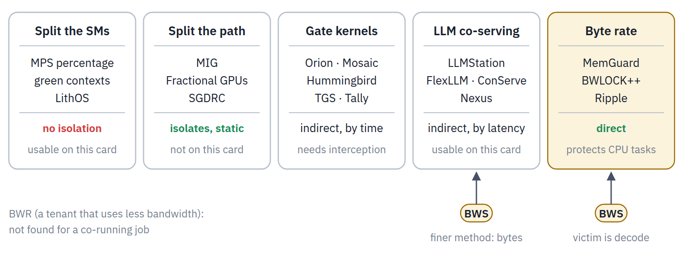

*Diagram 14 — existing work grouped by the knob it turns, with whether it controls GPU memory
bandwidth and whether it is usable on this RTX 5090; the tags show where the steps of section 5
land (source `../diagrams/14_related_work_map.svg`).*

1. **Splitting SMs does not isolate bandwidth; the literature agrees with section 2.7.** Elvinger
   et al., Mosaic, Hummingbird and Ripple each say so, with numbers.
2. **The mechanisms that do give a bandwidth share are static partitions of the memory path**
   (MIG, path colouring). None is usable on a consumer RTX 5090, and a fixed share would also cap
   decode, which alone uses 75–79 %.
3. **A byte budget for a GPU job exists only to protect CPU tasks.** Systems with decode as the
   victim admit work per kernel or per token, by latency. None counts bytes.

| Work | What it does | Relation to this work | Read |
|---|---|---|---|
| Elvinger et al. (SoCC 2025) | Measurement only. On an H100, Llama-3.1-8B decode on 64 SMs next to a copy kernel on the other 68 SMs slows by up to 1.3× | Same effect as section 2.7; proposes no mechanism | full text |
| MIG (NVIDIA) | Each instance owns a part of the memory path: L2 partitions, memory controllers, address buses | The only vendor mechanism that isolates bandwidth. Not supported on GeForce; shares are fixed | full text |
| Fractional GPUs (RTAS 2019) | Reverse-engineers the mapping from physical address to L2 set and memory bank, then uses page colouring so two partitions share neither | Needs a modified kernel driver and application source changes; done on GTX 1070/1080 and V100 | partial |
| SGDRC (PPoPP 2025) | The same idea for newer cards: the low-priority job gets 1/3 of the channels; each of its tensors exists twice, and it switches to the restricted copy under colocation | About one month of reverse engineering per GPU model; closed-source kernels unsupported; no generative LLM evaluated | full text |
| Orion (EuroSys 2024) | Profiles every kernel offline. While a high-priority kernel runs, it admits a low-priority kernel only if it needs few SMs and has a different profile (one memory-bound, the other compute-bound) | Decides per kernel, does not count bytes; states that LLMs are not its target workload | full text |
| Mosaic (preprint) | Predicts the slowdown of each kernel pair from solo profiles and admits a kernel only if the predicted latency stays within the target | Two warnings: total bandwidth alone does not predict interference; victims with similar profiles can slow very differently | partial |
| Hummingbird (preprint) | Cuts low-priority kernels into pieces of about 400 µs and runs them only in detected gaps | Controls timing; does not cap bandwidth | partial |
| TGS (NSDI 2023), Tally (ASPLOS 2025) | TGS watches the production job's performance and adjusts the low-priority job's share by feedback. Tally slices and preempts at thread-block level | TGS is of the same kind as `tpot_slo15`; no bandwidth model | abstract |
| MemGuard (RTAS 2013), BWLOCK++ (ECRTS 2018) | On CPUs: each core has a budget of memory accesses per period; when a hardware counter reaches it, the core is stalled until the next period | The original byte budget. It relies on per-core counters; a GPU has no per-process bandwidth counter | abstract |
| Ripple (preprint) | On a device where CPU and GPU share memory: cuts the LLM's forward pass into layer units and admits them in grants sized by the CPU task's deadline; needs no counter | The nearest to a byte budget for GPU traffic. It protects CPU tasks, and the LLM is the job being throttled | full text |
| LLMStation (ATC 2025) | LoRA fine-tuning and decode share a base model. For each decode iteration it chooses how many fine-tuning `tasklet`s to run so the iteration stays within its latency target; fine-tuning is suspended during prefill; the backward pass can be cut at operator boundaries | The closest setting to ours. Its budget is latency, not bytes | full text |
| Nexus (preprint) | Prefill and decode in one engine on green-context partitions that are resized at run time | Bandwidth appears only in its prediction model; nothing limits it | partial |
| FlexLLM, ConServe (preprints) | Co-serve fine-tuning or offline requests with online inference at token granularity | Do not count bytes | abstract |
| LithOS (SOSP 2025) | Schedules by groups of SMs and splits kernels | No treatment of bandwidth or L2 found | partial |
| Harli (preprint, Nov 2025) | Colocates PEFT fine-tuning with LLM decode on SM partitions (green contexts). Measures decode at about 85 % memory-bandwidth and 40 % SM utilisation, models the interference as memory-bandwidth contention that is linear in the fine-tuner's SM share, and cuts the fine-tuning job into per-layer pieces of about 10 ms | The closest work in setting and diagnosis. Its bandwidth lever is the SM split; section 2.7 finds the SM share a weak control of the tenant's traffic | search, full text |
| LoRAFusion (EuroSys 2026) | Fuses the memory-bound operators of LoRA fine-tuning into custom kernels. Reports GPU-memory traffic down 34–37 % and kernels up to 1.39× faster | One of C2's means (merged operators) with byte measurements, on the same kind of neighbour, for the job's own speed; no co-running job | search, full text |
| ConCo (ICS 2025) | Compiles several kernel variants per inference model, each tuned for a share of the SMs, and picks by concurrency level; notes that the variants put less pressure on global-memory bandwidth | Symmetric inference tasks and a throughput goal; lower bandwidth pressure is a by-product, not the objective | search, full text |
| QoS-Compile (CGO 2012), ReQoS (ASPLOS 2013), Protean Code (MICRO 2014) | On CPUs: the low-priority application's code is changed to be a better neighbour, by inserted no-ops and naps that lower its memory request rate, or by non-temporal hints that lower its cache pressure | The precedent for "a good neighbour by code change". They slow the job or cut cache pressure; none raises its work per byte | search, partial / abstract / full text |
| SIRIUS (ATC 2025) | A training job shrinks its batch within milliseconds to hand GPU memory to inference | A best-effort job changed to be a good neighbour, for memory capacity, not bandwidth | search, partial |
| Ladder Side-Tuning (NeurIPS 2022), Quantized Side Tuning (ACL 2024) | Train a small side network fed by a frozen backbone, with no backward pass through the backbone; the second also keeps the backbone in 4 bits | Candidate frugal neighbours; they report memory footprint, not memory traffic | search, abstract |

The steps of section 5 against the nearest work:

| | What the nearest work does | What is different here |
|---|---|---|
| **C1** | MemGuard: a budget per core and period, enforced with hardware counters. Ripple: admits the LLM's layer units by the CPU task's deadline | The victim is decode on the GPU and the throttled job is the tenant. With no per-process counter, the tenant accounts for itself with its bytes per token (cooperative) |
| **C1**, second method | LLMStation's `tasklet`s with a suspendable backward pass; Hummingbird's kernel pieces of about 400 µs; Tally's thread-block slicing | The tenant is a separate process that stops only at block boundaries (about 1 ms apart), with no change to autograd and no call interception. The budget is in bytes |
| **C2** | LoRAFusion merges the memory-bound operators of LoRA fine-tuning and measures the bytes, for the job's own speed. ConCo compiles kernel variants per SM share; lower bandwidth pressure is a by-product. The Protean Code line changes a neighbour's code on CPUs, to slow it or cut its cache pressure. SGDRC keeps a second copy of low-priority tensors on restricted channels | The tenant's bytes for the same work are lowered **because** a bandwidth-bound decode step runs next to it, and the result is judged by decode's slowdown |
| Timing (not pursued) | Orion checks per kernel whether profiles are complementary. Hummingbird runs low-priority work only in detected gaps. LLMStation suspends fine-tuning during prefill | All rely on the victim having periods in which it does not need bandwidth. A decode node has none, so only "lift the allowance when no request is running" is left |

- **The position with no precedent found**: a byte budget for a low-priority tenant, with a
  bandwidth-bound decode step as the victim, on a discrete GPU without MIG. This is C1. Harli is
  the nearest: the same setting and a bandwidth model, with the SM split as its lever.
- **For C2, no source was found** that changes the neighbour so that it uses less GPU-memory
  bandwidth because a bandwidth-bound job runs next to it. The pieces exist
  apart: LoRAFusion has the mechanism and measures bytes, with no co-runner; Harli has the
  setting, with SMs as the lever; the Protean Code line has the idea of changing the neighbour's
  code, on CPUs and for cache pressure.
- **Two things section 2.7 already adds**: no source reports how a tenant's bandwidth changes with
  its SM count (Figure 7); and Elvinger et al. note that the usual profiler cannot measure under
  colocation, where the device-wide bandwidth counter can.
- **One point that differs from Mosaic**: Mosaic reports that reads hurt the victim more than
  writes. Section 2.7 measures about the same cost per byte for reads, writes and copies from 96
  SMs, and a higher cost for writes and copies from 8 SMs.

## 7. Open questions and limits

Observations that have no explanation yet:

- Decode alone stops at 75–79 % of the nominal bandwidth, while a pure reader reaches 88–90 %.
- Which part of the path between the SMs and GPU memory does the limiting when the total is below
  these levels.
- A read-only job costs decode about half as much per byte from 8–16 SMs as from 64–96 SMs; for
  the real tenant the direction is the opposite (8 SMs is its dearest point).
- An arithmetic-only job on 8 SMs, with the clock unchanged, slows a decode step with 8 requests
  by 3.8–6.9 %, and the bandwidth counter then reads 2.5–6.6 % more bytes than decode's own.
- Dynamic green contexts cost less per tenant token than MPS co-running on all SMs.
- The decode baseline sits on one of two levels about 1 % apart, fixed for a whole run.
- With 4 and 8 requests, the two jobs' bytes add up to 3–4.5 % less than the counter reads.

Limits of these results:

- One GPU model, one inference model (Llama-3-8B), one workload distribution (Zipf-1.1), and one
  kind of tenant for most numbers (a LoRA fine-tune).
- In sections 2.6 and 2.7 decode is a synthetic step, not a serving engine; the serving engine of
  section 2.2 shows the same effect with more noise.
- Each scheme was run once. Most points of section 2.7 were run once in 4-s windows; twenty were
  rerun and agreed within 0.5 %. The two baseline levels put about ±1 point on every slowdown
  there.
- Sections 2.2.1 and 2.2.2 are re-analyses of the existing runs; the shape probe has one 60-s
  window per shape.
- The shared path is inferred from byte counting. There is no direct hardware-level observation.
- One power setting, a 500 W cap; the power effect of section 2.7 depends on it.
