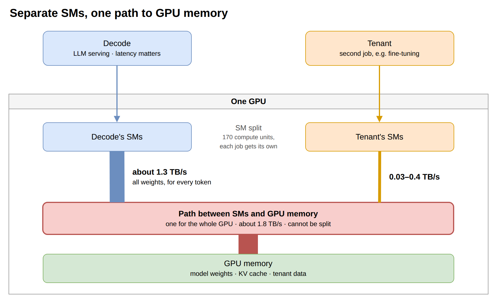
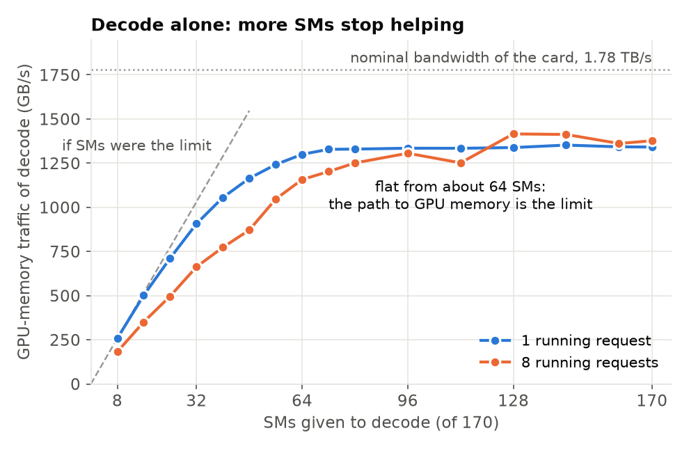
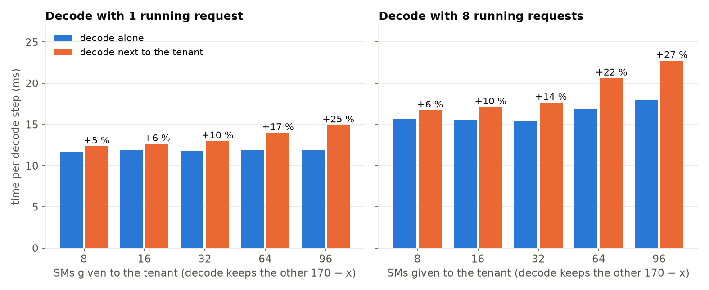
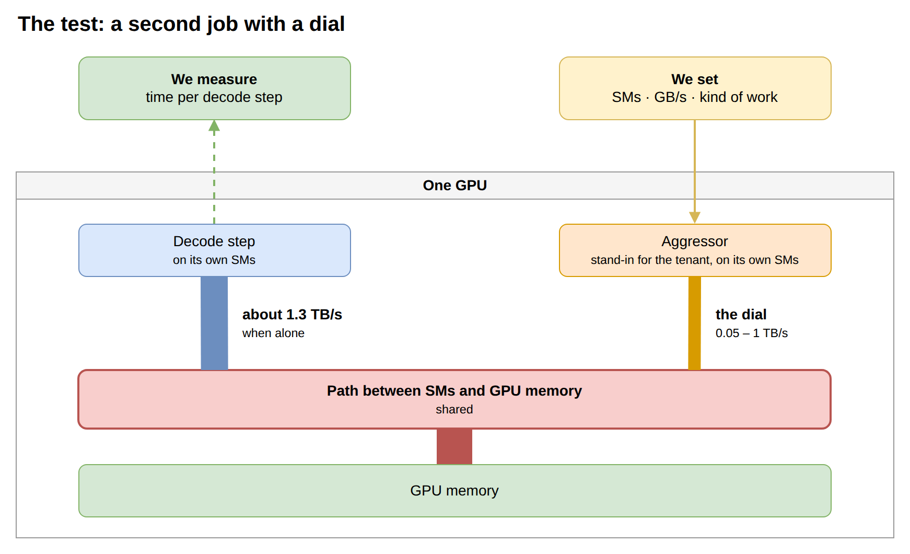
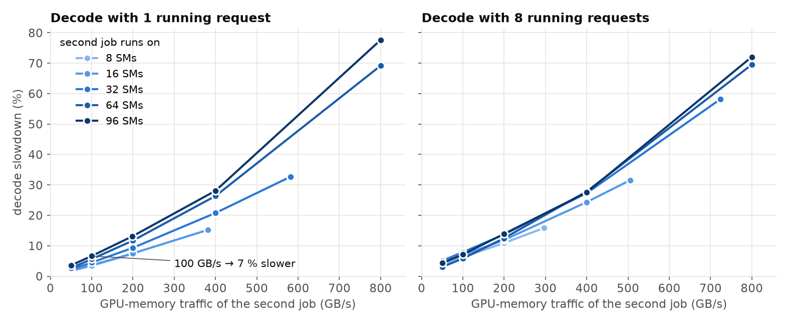
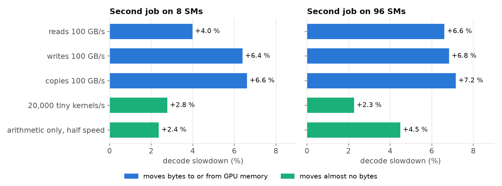
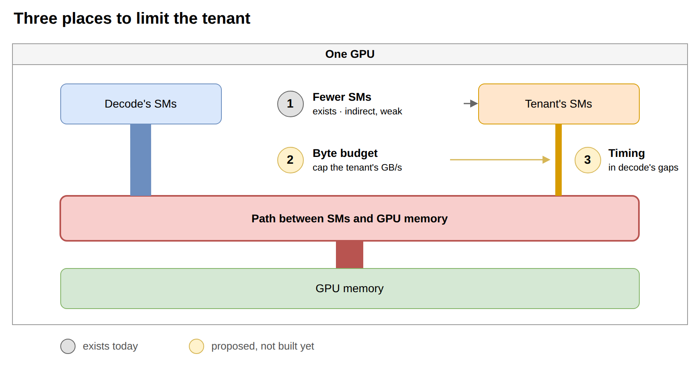

# Why a small second job still slows decode — the shared path to GPU memory

Standalone report, 2026-11-09. One RTX 5090 (GPU 1; 170 SMs, 32 GB, 500 W power cap). It explains,
for a reader who does not work on GPUs, one finding of the colocation prototype
([REPORT.md](REPORT.md)): what happens to an LLM's decode speed when a second job shares its GPU,
why, and what could be done. Experiments and open items are listed in [`../TODO.md`](../TODO.md);
related work is in [RELATED_bandwidth.md](RELATED_bandwidth.md). Chinese version:
[REPORT_bandwidth_zh.md](REPORT_bandwidth_zh.md).

## The four insights

> **1. Giving each job its own compute units does not isolate them.** A second job on only 8 of
> the GPU's 170 compute units slows decode by 5–7 %; on 96 units, by 25–29 %.

> **2. What decode pays for is the second job's bytes per second.** All compute units reach GPU
> memory through one shared path, and decode alone keeps that path busy. Every 100 GB/s the second
> job moves costs decode 4–7 %, whether it comes from 8 units or from 96.

> **3. Bytes are not the whole bill.** Starting many small pieces of work, or plain arithmetic
> that moves no bytes, each costs decode another 1–7 %. This is why a real fine-tuning job costs
> two to four times what its bytes alone predict.

> **4. Limiting compute units is the wrong knob.** Twelve times fewer units for the tenant cut the
> harm only four times, and never to zero. The tenant's bytes and their timing have to be limited
> directly. This is a proposal; it is not built yet.

Words used here. **Decode**: the LLM producing text, one token per step. **Tenant**: the second
job placed on the same GPU. **SM** (streaming multiprocessor): one of the GPU's 170 compute units;
the GPU can give each job its own set. **GPU memory**: the card's own 32 GB, where the model
weights live (host RAM, the machine's main memory, plays no part in this report). **GB/s**: bytes
moved per second between the SMs and GPU memory.

## 1. The setting: two jobs, separate SMs, one path to GPU memory

*Diagram A — the structure behind every result in this report (source
`../diagrams/08_shared_memory_path.drawio`). The SMs can be split between the jobs. The path from
the SMs to GPU memory cannot.*

A GPU that serves an LLM is not fully used: at low load a large part of its memory and of its
SMs is idle. The colocation prototype puts a tenant there. The GPU offers a way to keep the two
apart: each job gets its own SMs. The question of this report is whether that is enough to
protect decode.

## 2. Decode alone: limited by the path, not by the SMs

To produce one token, decode reads **every weight of the model once**. For an 8-billion-parameter
model that is 15 GB per token, plus 0.8 GB of cache per running request. At 12 ms per token this
is 1.3 TB every second.

*Figure 1 — decode alone, on a growing number of SMs. Vertical axis: how many bytes per second it
pulls from GPU memory (more is faster). Data: `../results/knee_probe.csv`.*

How to read it. On few SMs decode is limited by its SMs: on 8 SMs it moves 258 GB/s and a step
takes 61 ms. More SMs help up to about 64. From there the line is flat: 1.30 TB/s on 64 SMs,
1.33 TB/s on 80, 1.34 TB/s on all 170 (11.8 ms per step). Past that point decode is waiting for
bytes, not for compute.

So with one running request decode needs fewer than half of the SMs (64 SMs give 97 % of full
speed). With eight requests it needs somewhat more: 80 SMs give 90 %. Either way dozens of SMs
look free, which is what makes colocation attractive. The next section shows they are not free.

## 3. What happens when a tenant moves in

The tenant is a small fine-tuning job (Qwen2.5-0.5B, LoRA). It gets its own SMs; decode gets all
the others. No SM is shared.

*Figure 2 — time per decode step, alone (blue) and next to the tenant (orange). Blue is decode
alone on exactly the SMs it has in the orange case. Data: `../results/knee_bw2.csv`.*

| SMs for the tenant | Tenant's traffic | Decode slowdown, 1 request | 8 requests |
|---|---|---|---|
| 8 | 34–41 GB/s | +5.4 % | +6.4 % |
| 16 | 62–74 GB/s | +6.4 % | +9.9 % |
| 32 | 108–126 GB/s | +9.7 % | +14.4 % |
| 64 | 179–206 GB/s | +17.4 % | +22.4 % |
| 96 | 251–261 GB/s | +24.7 % | +26.6 % |

Each slowdown is against decode alone on the same SMs, so it is not caused by decode having fewer
SMs. Decode slows down more the more the tenant does. Even a tenant on 8 SMs, moving 3 % of what
decode moves, costs 5–7 %. **Separate SMs do not protect decode** (insight 1).

## 4. Why: the two jobs' bytes share one path

To find out what decode is reacting to, the tenant is replaced by a test job whose behaviour can
be set exactly.

*Diagram B — the test (source `../diagrams/09_aggressor_test.drawio`). The aggressor runs on its
own SMs and moves a set number of GB/s to or from GPU memory. Decode's step time is measured.*

*Figure 3 — decode slowdown against the aggressor's traffic; here the aggressor only reads. One
line per number of SMs the aggressor runs on. Data: `../results/aggr_corun.csv`.*

How to read it.

- **The slowdown follows the bytes.** The lines rise steadily: each 100 GB/s costs decode about
  4 % when the aggressor has 8–16 SMs and about 7 % when it has 64–96 (one running request); 5–7 %
  with eight requests.
- **The number of SMs matters little at equal traffic.** With eight requests the five lines
  nearly coincide. What the SM count does set is how much traffic the aggressor *can* produce:
  from 8 SMs it tops out near 200–300 GB/s (decode +8 to +16 %), from 96 SMs near 1,000 GB/s
  (decode more than twice as slow).
- **What the second job moves, decode loses.** For every GB/s the aggressor moves, decode moves
  between half a GB/s and one GB/s less. With the real tenant the total does not grow at all:
  1.21–1.35 TB/s for both jobs together, against 1.33 TB/s for decode alone.

This is the picture of Diagram A: one path, already kept busy by decode, and every byte of the
second job has to pass through it too (insight 2).

## 5. Why the real tenant costs more than its bytes

Figure 3 predicts the cost of a job that reads. The real tenant on 8 SMs moves 34–41 GB/s, which
by Figure 3 should cost decode 1.4 % (one request) to 2.6 % (eight). It costs 5.4 % and 6.4 %.

The aggressor was therefore given five kinds of work, each next to the same decode step:

*Figure 4 — decode slowdown (one running request) next to five kinds of second job. Blue: jobs
that move 100 GB/s. Green: jobs that move almost no bytes. "Tiny kernels": 20,000 very small
pieces of GPU work per second. "Arithmetic only": matrix products small enough to stay in the
GPU's cache, at half their top speed. Data: `../results/aggr_modes.csv`.*

Three things add to the cost of bytes:

1. **Writing costs more than reading when the job has few SMs.** From 96 SMs, reads, writes and
   copies cost about the same (5–8 % per 100 GB/s). From 8 SMs, writes and copies cost about 6 %
   per 100 GB/s and reads 4 % with one request; 7–8 % against 6 % with eight.
2. **Starting work costs something even with no bytes.** A job that only launches tiny kernels
   slows decode by 1–2 % at 2,000–5,000 launches per second and by 3–6 % at 100,000 or more. The
   cost is the same from 8 and from 96 SMs.
3. **Arithmetic costs something even with no bytes.** From 8 SMs it slows decode by 1.4–2.6 %
   with one request and 4–7 % with eight. From 96 SMs at full speed the card reaches its 500 W
   power cap, its clock drops by 9 %, and decode slows by 9–10 %. Power is a second thing the two
   jobs share. (The byte results above are not a power effect: the clock did not move in them.)

A fine-tuning job does all three: it writes, it launches many small kernels, and it computes.
At the tenant's traffic, writing instead of reading adds under 1 point; launches at 5,000–20,000
per second add 1–3 points; arithmetic on 8 SMs adds 1–3 points (one request). Together that is
about the size of the 4-point gap. **This is a plausible account, not a proof**: the tenant's
launch rate is not measured, and the three were not tested together (insight 3).

## 6. What to do about it

*Diagram C — three places to put a limit on the tenant (source
`../diagrams/10_where_to_limit.drawio`).*

**1. Fewer SMs — exists, but weak.** Going from 96 to 8 SMs (12 times fewer) cuts the tenant's
traffic 6–7 times and its own speed 7 times, but the harm to decode only 4 times (from 25–29 % to
5–7 %). It acts on bytes only indirectly, does nothing about launches, and has a floor: the
smallest setting still costs 5 %.

**2. A byte budget — proposed.** Give the tenant a GB/s allowance and let it pause between small
batches to stay inside it. Figure 3 says what an allowance costs decode: 4–7 % per 100 GB/s. This
is the knob that matches what decode actually pays for.

**3. Timing — proposed, with little room on a decode node.** The idea: let the tenant move its
bytes when decode does not need the path. On this engine such moments are rare. It only decodes:
the long prompt prefix arrives as cached KV, and the engine itself reads in only the 128 new
tokens of each request. While any request is running the GPU is busy 93–100 % of the time (in the
main report, a tenant allowed to run only in the gaps trained nothing), and decode keeps the path
equally busy with 1, 4 or 8 requests. What is left is the time with no request at all: at most
about 7 % at 0.5 requests per second and above. So timing is not a knob of its own here. It
reduces to one rule inside the byte budget: lift the allowance while no request is running.

Two more ideas come with these: make the tenant cost less per unit of useful work (in an earlier
probe the harm to decode per tenant token varied 7-fold between tenant configurations), and cut
its work into smaller pieces so a limit takes effect within one decode step.

**None of 2 and 3 is built or measured yet** (insight 4). They are items C1–C4 of
[`../TODO.md`](../TODO.md).

## 7. What this report does not show

- **Decode is a stand-in.** The measurements use the matrix products of one Llama-3-8B decode
  step with random weights, not a serving engine. That makes steps repeatable to under 1 %. The
  serving engine showed the same effect in the main report, with more noise.
- **One card, one power setting.** RTX 5090 at a 500 W cap. The power effect in section 5 depends
  on that cap.
- **Mostly one run per point**, 4-second windows. Twenty points of section 5 were run twice and
  their step times agreed within 0.5 %. The decode baseline, however, sits on one of two levels
  about 1 % apart (up to 3.6 % in earlier runs; cause not found), so each slowdown figure carries
  about ±1 point.
- **No hardware-level proof.** The path is identified by counting bytes, not by looking inside
  the card. Why a reader on few SMs costs less per byte than on many is not explained.
- **The fixes are proposals.**

## 8. Files

| What | Where |
|---|---|
| Decode alone against SMs | `knee_probe.py`, `results/knee_probe.csv` |
| Decode next to the real tenant | `knee_corun.py`, `results/knee_bw2.csv`, `results/knee_bw2_summary.md` |
| Aggressor with a traffic dial | `bw_aggr.py`, `aggr_corun.py`, `results/aggr_corun.csv`, `results/aggr_corun_summary.md` |
| Kinds of work | `aggr_corun.py --modes`, `results/aggr_modes.csv`, `results/aggr_modes_summary.md` (rerun: `results/aggr_modes_r2*`) |
| Figures 1–4 | `plot_bw_report.py` |
| Diagrams A–C | `diagrams/08…10*.drawio`, `diagrams/export_png.py` |
