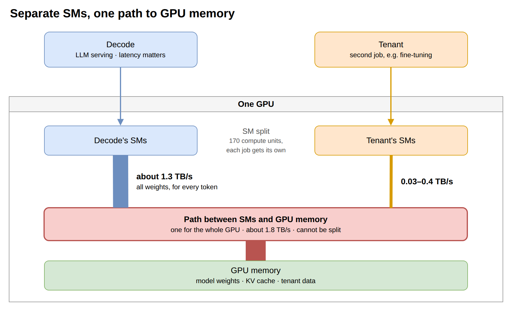
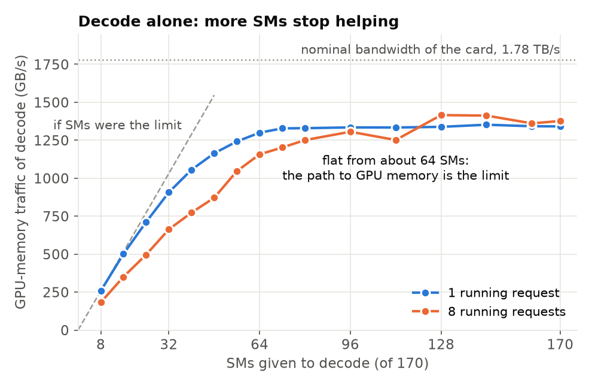
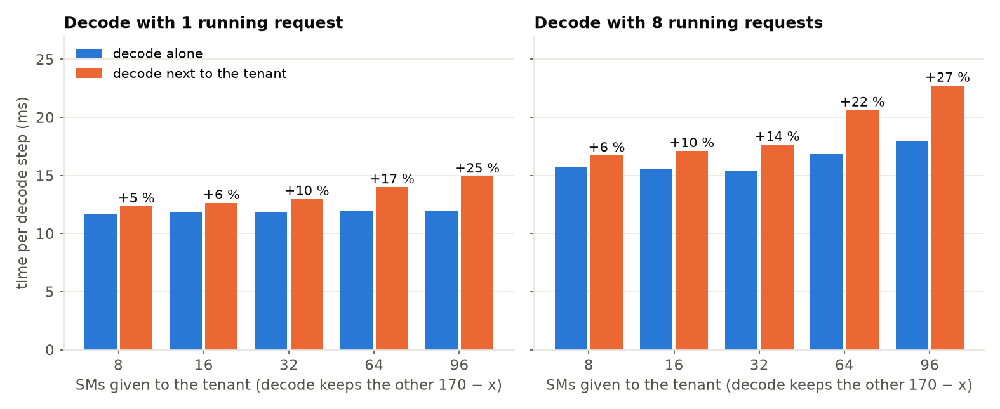
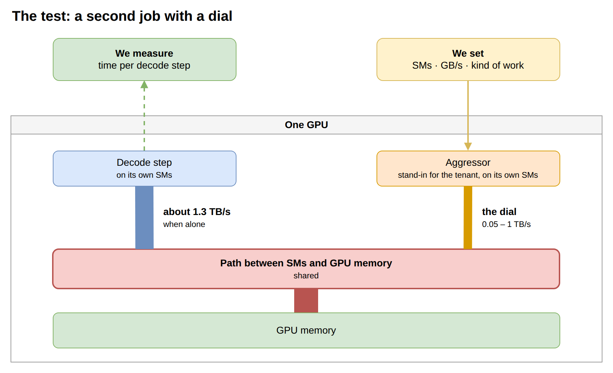
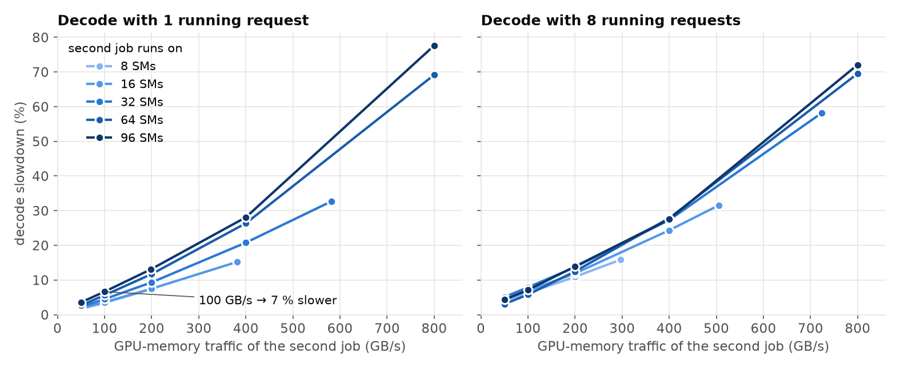
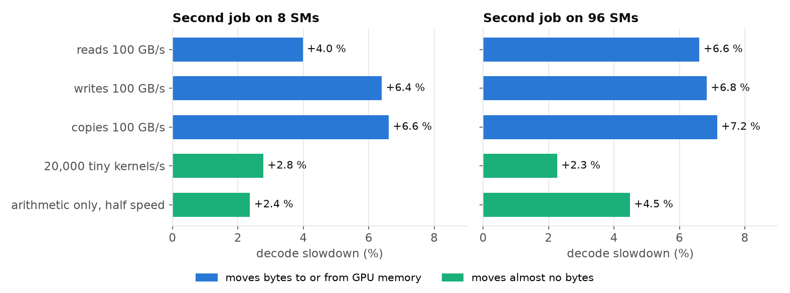
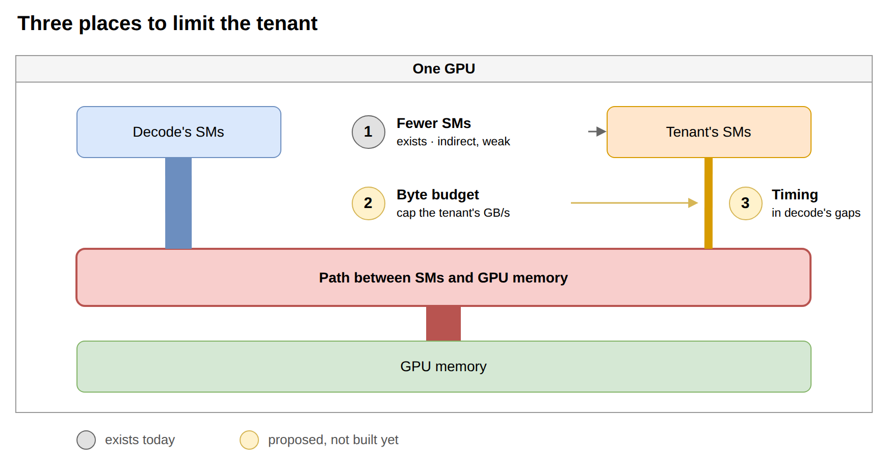

# 为什么很小的第二个任务也会拖慢 decode —— 通往显存的那条共用通道

独立报告，2026-11-09。一张 RTX 5090（GPU 1；170 个 SM，32 GB 显存，功耗上限 500 W）。这份报告面向不做
GPU 的读者，讲清楚混部原型（[REPORT_zh.md](REPORT_zh.md)）里的一个发现：第二个任务和 LLM 共用一张 GPU
时，decode 的速度会怎样、为什么、能怎么办。实验清单和未完成项在 [`../TODO.md`](../TODO.md)，相关工作在
[RELATED_bandwidth.md](RELATED_bandwidth.md)。英文版：[REPORT_bandwidth.md](REPORT_bandwidth.md)。

## 四条结论

> **1. 给两个任务各分一批计算单元，并不能把它们隔开。** 第二个任务只占 170 个计算单元里的 8 个，decode
> 就慢 5–7 %；占 96 个，慢 25–29 %。

> **2. decode 付出的代价，取决于第二个任务每秒搬多少字节。** 所有计算单元都经过同一条通道访问显存，
> decode 自己就能让这条通道一直忙。第二个任务每搬 100 GB/s，decode 就慢 4–7 %，不管这些字节来自 8 个
> 单元还是 96 个。

> **3. 代价不只是字节。** 频繁地启动很多小任务，或者只做算术、几乎不搬字节，各自还会让 decode 再慢
> 1–7 %。所以真实的微调任务造成的拖慢，是按它的字节数预测值的 2–4 倍。

> **4. 限制计算单元是个错的旋钮。** 把 tenant 的计算单元减到 1/12，对 decode 的伤害只降到 1/4，而且
> 降不到零。应该直接限制 tenant 的字节量和搬运时机。这是提议，还没有实现。

用到的词。**decode（解码）**：LLM 生成文字，每一步出一个 token。**tenant（租户）**：放到同一张 GPU 上的
第二个任务。**SM**：GPU 的计算单元，这张卡有 170 个，可以给每个任务划一批专用的。**显存**：显卡自带的
32 GB 内存，模型权重放在这里（主机内存，也就是机器的主内存，和这份报告无关）。**GB/s**：SM 和显存之间
每秒搬运的字节数。

## 1. 场景：两个任务，各用各的 SM，共用一条通往显存的通道

*示意图 A —— 这份报告所有结果背后的结构（源文件 `../diagrams/08_shared_memory_path.drawio`）。SM 可以
在两个任务之间划分，SM 到显存的通道不能。*

一张跑 LLM 服务的 GPU 并没有被用满：负载低的时候，很大一部分显存和 SM 是闲着的。混部原型就把一个
tenant 放进去。GPU 提供了一种隔离手段：每个任务用自己的 SM。这份报告要回答的是：这样够不够保护
decode。

## 2. decode 单独跑：瓶颈在通道，不在 SM

每生成一个 token，decode 要把**模型的全部权重读一遍**。8B 参数的模型就是每个 token 读 15 GB，每个
正在处理的请求再加 0.8 GB 缓存。按 12 ms 一个 token 算，就是每秒 1.3 TB。

*图 1 —— decode 单独跑，SM 数逐渐增加。纵轴：它每秒从显存读多少字节（越高越快）。数据：
`../results/knee_probe.csv`。*

怎么看这张图。SM 少的时候，decode 受限于 SM：8 个 SM 时每秒 258 GB，一步 61 ms。SM 增加到大约 64 个
之前都有帮助。之后曲线变平：64 个 SM 1.30 TB/s，80 个 1.33 TB/s，170 个全给也只有 1.34 TB/s（一步
11.8 ms）。过了这个点，decode 是在等字节，不是在等计算。

所以只有一个请求时，decode 用不到一半的 SM（64 个 SM 就有全速的 97 %）。8 个请求时需要多一些：80 个
SM 有 90 %。不管哪种情况，都有几十个 SM 看起来是空闲的，这正是混部吸引人的地方。下一节会看到，它们
并不是白给的。

## 3. tenant 进来之后发生什么

tenant 是一个小的微调任务（Qwen2.5-0.5B，LoRA）。它用自己的 SM，其余的 SM 全给 decode，没有任何 SM
是共用的。

*图 2 —— decode 每一步的时间：单独跑（蓝）和旁边有 tenant（橙）。蓝色是 decode 在同样那批 SM 上单独跑
的结果。数据：`../results/knee_bw2.csv`。*

| tenant 的 SM 数 | tenant 的流量 | decode 变慢，1 个请求 | 8 个请求 |
|---|---|---|---|
| 8 | 34–41 GB/s | +5.4 % | +6.4 % |
| 16 | 62–74 GB/s | +6.4 % | +9.9 % |
| 32 | 108–126 GB/s | +9.7 % | +14.4 % |
| 64 | 179–206 GB/s | +17.4 % | +22.4 % |
| 96 | 251–261 GB/s | +24.7 % | +26.6 % |

每个变慢的比例都是和「decode 在同样的 SM 上单独跑」比的，所以不是因为 decode 的 SM 变少了。tenant 干得
越多，decode 越慢。即使 tenant 只有 8 个 SM、搬的字节只有 decode 的 3 %，decode 也慢 5–7 %。**分开 SM
保护不了 decode**（结论 1）。

## 4. 为什么：两个任务的字节走同一条通道

为了弄清 decode 到底在对什么起反应，我们把 tenant 换成一个行为可以精确设定的测试任务。

*示意图 B —— 测试方法（源文件 `../diagrams/09_aggressor_test.drawio`）。干扰任务（aggressor）跑在自己的
SM 上，按设定的 GB/s 读写显存；我们测 decode 每一步的时间。*

*图 3 —— decode 变慢的比例随干扰任务流量的变化；这里干扰任务只读。每条线对应干扰任务用的一种 SM 数。
数据：`../results/aggr_corun.csv`。*

怎么看这张图。

- **变慢的幅度跟着字节走。** 几条线都稳步上升：1 个请求时，干扰任务有 8–16 个 SM，每 100 GB/s 让
  decode 慢约 4 %；有 64–96 个 SM，约 7 %。8 个请求时是 5–7 %。
- **流量相同时，SM 数影响不大。** 8 个请求时五条线几乎重合。SM 数决定的是干扰任务**最多能**搬多少：
  8 个 SM 时最多 200–300 GB/s（decode 慢 8–16 %），96 个 SM 时接近 1,000 GB/s（decode 慢一倍以上）。
- **第二个任务搬走多少，decode 就少多少。** 干扰任务每搬 1 GB/s，decode 就少搬 0.5–1 GB/s。换成真实
  tenant 时，总量完全不涨：两个任务加起来 1.21–1.35 TB/s，而 decode 单独跑就有 1.33 TB/s。

这就是示意图 A 的画面：一条通道，decode 自己已经让它一直忙，第二个任务的每个字节也得从这里过
（结论 2）。

## 5. 为什么真实 tenant 的代价比它的字节数更大

图 3 预测的是一个只读任务的代价。真实 tenant 在 8 个 SM 上搬 34–41 GB/s，按图 3 应该让 decode 慢
1.4 %（1 个请求）到 2.6 %（8 个请求）。实际是 5.4 % 和 6.4 %。

于是我们让干扰任务做五种不同的工作，每种都放在同一个 decode 旁边：

*图 4 —— 五种第二任务旁边 decode 变慢的比例（1 个请求）。蓝色：每秒搬 100 GB 的任务（读 / 写 / 拷贝）。
绿色：几乎不搬字节的任务。"tiny kernels"：每秒启动 20,000 个极小的 GPU 任务。"arithmetic only"：
小到能留在 GPU 缓存里的矩阵乘法，以最高速度的一半运行。数据：`../results/aggr_modes.csv`。*

除了字节本身，还有三样东西在加码：

1. **SM 少的时候，写比读贵。** 从 96 个 SM 发出时，读、写、拷贝的代价差不多（每 100 GB/s 5–8 %）。
   从 8 个 SM 发出时，1 个请求下写和拷贝约 6 %、读 4 %；8 个请求下是 7–8 % 对 6 %。
2. **不搬字节，光是启动任务也有代价。** 一个只启动极小 kernel 的任务，每秒 2,000–5,000 次时让 decode
   慢 1–2 %，每秒 10 万次以上时慢 3–6 %。8 个 SM 和 96 个 SM 结果一样。
3. **不搬字节，光做算术也有代价。** 从 8 个 SM 上做，1 个请求时让 decode 慢 1.4–2.6 %，8 个请求时
   4–7 %。从 96 个 SM 上全速做，整卡功耗顶到 500 W 上限，时钟频率下降 9 %，decode 慢 9–10 %。功耗是
   两个任务共用的第二样东西。（上面关于字节的结果不是功耗造成的：那些测量里时钟频率没有变。）

微调任务三样都占：它要写，要启动很多小 kernel，还要计算。按 tenant 的流量算，把读换成写多不到 1 个
百分点；每秒 5,000–20,000 次启动多 1–3 个百分点；8 个 SM 上的算术多 1–3 个百分点（1 个请求）。加起来
和那 4 个百分点的差距大小相当。**这是一个说得通的解释，不是证明**：tenant 的 kernel 启动频率没有测，
这三样也没有放在一起测过（结论 3）。

## 6. 能怎么办

*示意图 C —— 可以给 tenant 加限制的三个位置（源文件 `../diagrams/10_where_to_limit.drawio`）。*

**1. 减少 SM —— 现成的手段，但效果弱。** 从 96 个 SM 减到 8 个（1/12），tenant 的流量降到 1/6–1/7，
它自己的速度降到 1/7，而对 decode 的伤害只降到约 1/4（从 25–29 % 到 5–7 %）。它只是间接地影响字节，
管不了 kernel 启动，而且有下限：最小的设置仍然要让 decode 慢 5 %。

**2. 字节预算 —— 提议。** 给 tenant 一个 GB/s 额度，让它在小批次之间停顿，保证不超额。图 3 给出了
额度的价格：每 100 GB/s 让 decode 慢 4–7 %。这个旋钮对准的正是 decode 真正付出的东西。

**3. 错开时间 —— 提议，但在 decode 节点上空间很小。** 想法是让 tenant 在 decode 不需要这条通道的时候
搬字节。在这个引擎上，这样的时候很少。它只做 decode：长的 prompt 前缀是以缓存好的 KV 的形式送来的，
引擎自己只读入每个请求新增的 128 个 token。只要有请求在跑，GPU 有 93–100 % 的时间在忙（主报告里，
只允许 tenant 在空隙里跑的方案，训练量是零）；1、4、8 个请求时，decode 让这条通道一样忙。剩下的只有
完全没有请求的时间：每秒 0.5 个请求以上时最多约 7 %。所以错开时间在这里不是一个独立的旋钮，它退化成
字节预算里的一条规则：没有请求在跑时，放开额度。

另外还有两个配套的想法：让 tenant 每做一份有用的工作代价更小（之前的一个探测里，不同 tenant 配置下
每个 tenant token 对 decode 的伤害相差 7 倍）；以及把它的工作切得更碎，让限制能在一个 decode 步之内
生效。

**第 2、3 条都还没有实现，也没有测过**（结论 4）。它们对应 [`../TODO.md`](../TODO.md) 里的 C1–C4。

## 7. 这份报告没有证明什么

- **decode 是替身。** 测量用的是 Llama-3-8B 一步 decode 里的矩阵运算，权重是随机数，不是真实的推理
  引擎。这样每一步可以重复到 1 % 以内。主报告里真实的推理引擎表现出同样的现象，只是噪声更大。
- **一张卡，一个功耗设置。** RTX 5090，500 W 上限。第 5 节的功耗效应依赖这个上限。
- **大部分点只跑了一次**，每个点 4 秒。第 5 节有 20 个点跑了两次，每步时间相差不超过 0.5 %。但 decode
  的基线会落在相差约 1 % 的两个水平之一（早先的实验里最多相差 3.6 %，原因未找到），所以每个「变慢
  百分比」带有大约 ±1 个百分点的不确定性。
- **没有硬件层面的证明。** 这条通道是通过数字节推断出来的，不是从显卡内部看到的。为什么 SM 少的读
  任务每字节的代价比 SM 多的更低，还没有解释。
- **改进方案都只是提议。**

## 8. 文件

| 内容 | 位置 |
|---|---|
| decode 单独跑，不同 SM 数 | `knee_probe.py`，`results/knee_probe.csv` |
| decode 和真实 tenant 一起跑 | `knee_corun.py`，`results/knee_bw2.csv`，`results/knee_bw2_summary.md` |
| 流量可调的干扰任务 | `bw_aggr.py`，`aggr_corun.py`，`results/aggr_corun.csv`，`results/aggr_corun_summary.md` |
| 五种工作类型 | `aggr_corun.py --modes`，`results/aggr_modes.csv`，`results/aggr_modes_summary.md`（复跑：`results/aggr_modes_r2*`） |
| 图 1–4 | `plot_bw_report.py` |
| 示意图 A–C | `diagrams/08…10*.drawio`，`diagrams/export_png.py` |
