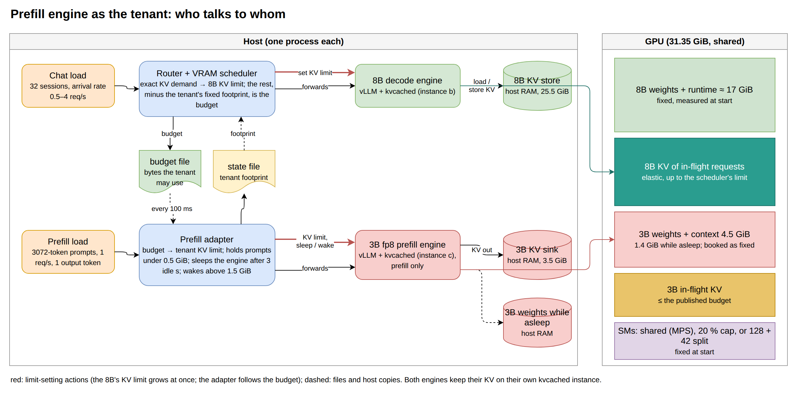
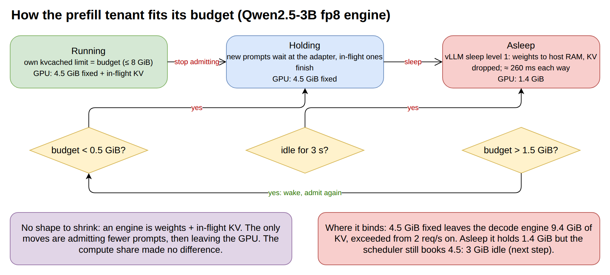
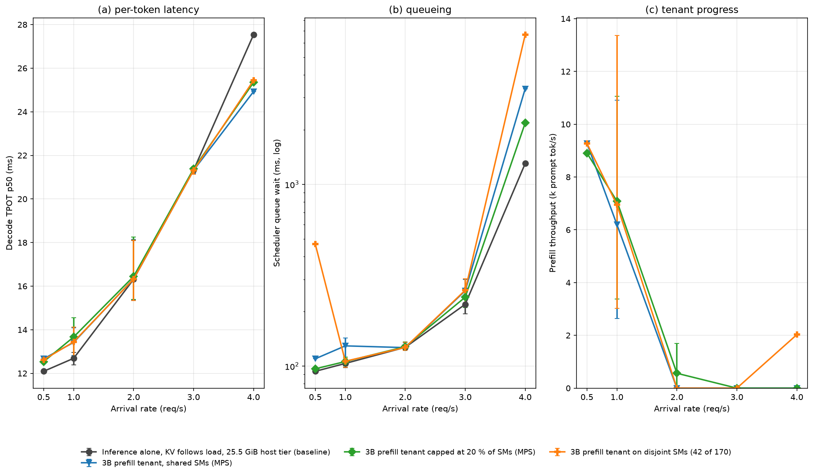
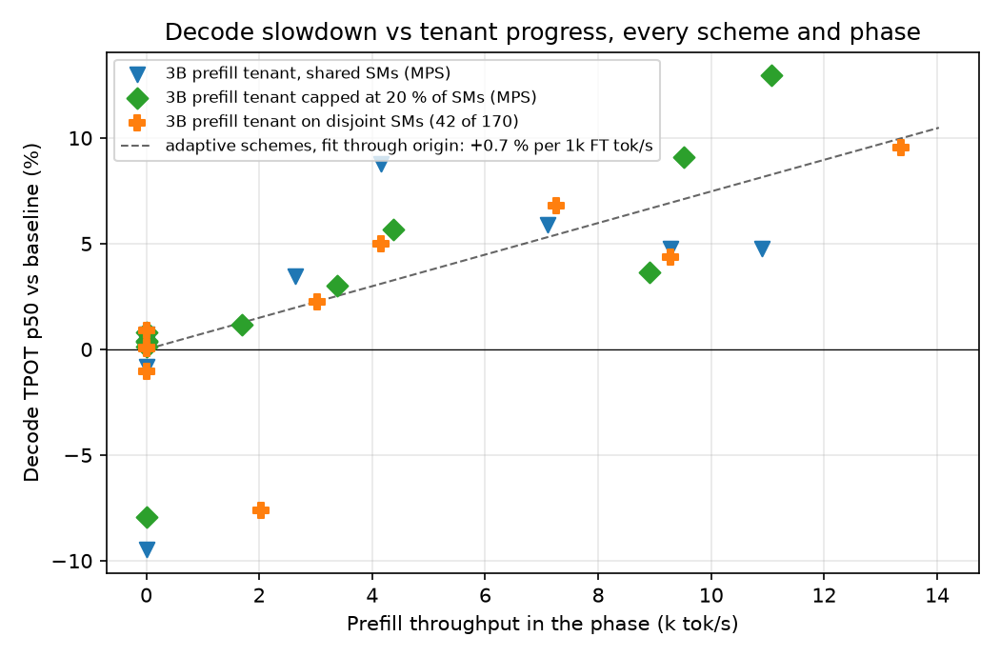
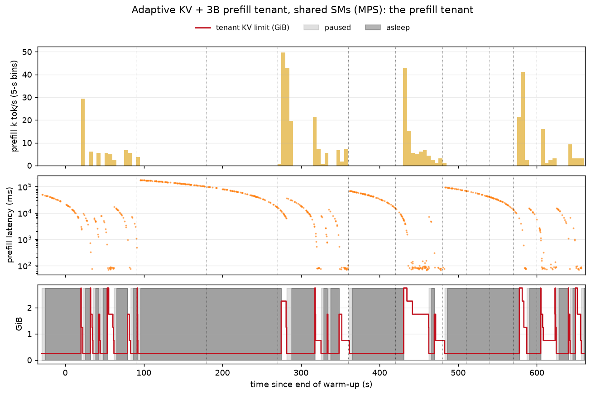
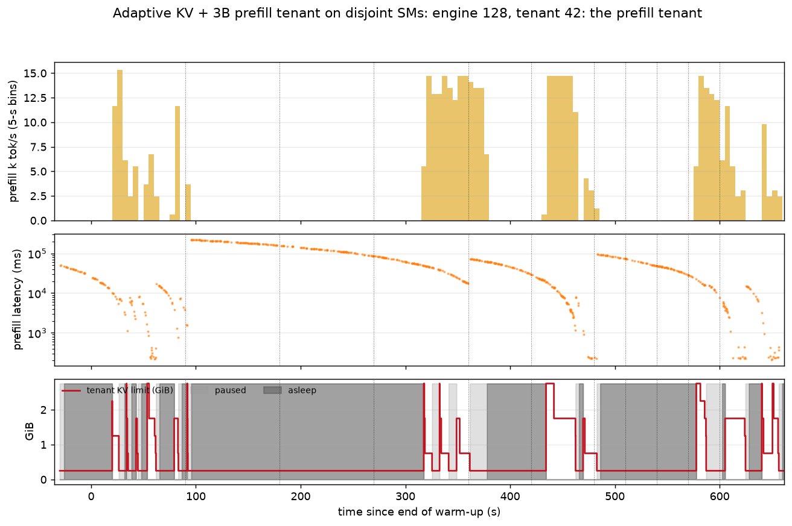

# A prefill engine as the colocation tenant — report

Round 2 of the colocation prototype, plan P3 (2026-11-09, GPU 0, 500 W cap). This report covers
one variant of the prototype: the tenant beside the 8B decode engine is **a second inference
engine that only prefills**, not a fine-tune job. Everything else — router, VRAM scheduler, kvcached,
workload — is the main prototype's; see [REPORT.md](REPORT.md) for it. Predictions and outcomes are
in [DECISIONS.md](DECISIONS.md) D14 and D19. Results in `../results/pf_*`.

## 1. What was built



*Diagram A — the prefill-tenant variant (source `../diagrams/07_pf_architecture.drawio`). Two vLLM
engines share the GPU, each on its own kvcached instance. The VRAM scheduler sets the 8B's KV limit
from the router's exact demand and publishes the remainder, minus the tenant's fixed footprint, as the
budget. The prefill adapter turns that budget into the 3B's KV limit and, when it is too small, holds
prompts and puts the engine to sleep. The adapter reports the tenant's footprint back through the
state file.*

**Why this tenant.** A disaggregated serving pair has a prefill node and a decode node; the question
is whether the prefill node can live on the decode node's GPU and use the memory the decode engine
does not need at low load. Prefill is compute-bound and keeps no state between requests, so it is a
tenant with no training ladder: it either runs, waits, or leaves the GPU.

- **Tenant engine.** Qwen2.5-3B, `--quantization fp8` (sm_120), `--max-model-len 4608`,
  `--max-num-seqs 8`, `--max-num-batched-tokens 8192`, kvcached instance `vllm_c`, native CPU KV
  offload with a **3.5 GiB tier** in /dev/shm. The 8B's own tier is 25.5 GiB instead of 28 so both
  fit in the 31 GiB of /dev/shm (D14). Prefill of a 3072-token prompt takes 71 ms when the engine is
  awake and alone.
- **Load.** 3072-token prompts at 1 req/s with `max_tokens = 1` (3.1k prompt tok/s offered), through
  the adapter; the KV lands in the host tier and is never read back. The 8B gets the reference chat
  trace of the main report (0.5–4 req/s schedule).
- **Prefill adapter** (`pf_tenant.py`, Diagram B). Every 100 ms it reads the scheduler's budget file
  and moves between three states. Running: the 3B's kvcached limit is set to the budget (256 MiB
  steps, at most 8 GiB), so its in-flight prompts are bounded by it. Holding, when the budget falls
  under 0.5 GiB: new prompts wait at the adapter, in-flight ones finish, the limit sits at its 256 MiB
  floor; admission resumes as soon as the budget is back. Asleep: after 3 s of holding with nothing
  in flight it calls vLLM's `/sleep?level=1` (weights to host RAM, KV discarded; needs
  `VLLM_SERVER_DEV_MODE=1`), which takes the engine from 4.5 to 1.4 GiB on the GPU in ≈ 260 ms; it
  wakes (`/wake_up`, ≈ 260 ms) once the budget is back above 1.5 GiB (floor + 1 GiB margin). It writes
  its footprint (fixed + kvcached mapped) to the state file the scheduler reads.
- **Scheduler accounting.** The runner measures the tenant engine's fixed footprint by NVML right
  after it starts (used memory before vs after: **4.50 GiB** — fp8 weights, CUDA context, kvcached
  segment) and passes it as `--tenant-fixed-gib`. The budget is then
  `31.35 − 16.97 (8B fixed) − 4.50 − 0.5 (safety) − KV limit`, i.e. a pool of **9.4 GiB** shared
  between the 8B's KV and the 3B's KV. The 8B's limit is capped at memory actually free, so the GPU
  is never oversubscribed (0 s in any run).
- **Three compute schemes and a baseline** (`run_eval_pf.sh`):

| scheme | compute sharing | memory |
|---|---|---|
| `pf_base` | 8B alone (25.5 GiB host tier) | baseline for this family; equals the main baseline within noise (D19) |
| `pf_mps` | both engines on all SMs through MPS | VRAM scheduler + adapter |
| `pf_mps20` | tenant engine capped at 20 % of the SM threads (MPS) | same |
| `pf_split` | 8B on the first 128 SMs (green context), tenant on the remaining 42 | same |



*Diagram B — the adapter's three states and what moves it; the red note is where the scheme binds.*

## 2. Evaluation

Same protocol as the main report: one 11-minute run per scheme, the 8B driven by the reference trace
(phases of 0.5–4 req/s), the tenant by its own 1 req/s prefill stream. Decode is judged on TPOT p50
and the scheduler's queue wait; the tenant on delivered prompt tokens/s, prompt latency at the
adapter, failures, and the fraction of each phase it spends asleep.



*Figure 1 — the three prefill schemes against their own baseline (`plot_arms.py --pf`): decode TPOT
(a), queue wait (b), delivered prompt tokens/s (c) per arrival rate, phases pooled by rate (marker =
mean, bar = min..max).*



*Figure 2 — decode slowdown over the baseline against tenant prompt tokens/s, one point per scheme
and phase. The three mechanisms lie on one line, as for the fine-tune tenant; the slope is ≈ 1 % per
1k prompt tok/s, half the fine-tune tenant's 2.2 %.*



*Figure 3 — the tenant under `pf_mps` over the run (`analyze_pf.py`): delivered prompt tokens/s in
5-s bins, latency of every prompt (adapter queueing included; the ≈ 70 ms floor is the prefill
itself), and its KV limit with the holding (light) and asleep (dark) spans. Throughput comes in
bursts of up to 50k tok/s when the engine wakes and drains the prompts that queued while it slept.*



*Figure 4 — the same for `pf_split`. In the 4 req/s phase (360–420 s) the budget came back briefly,
the engine woke and prefilled 2k tok/s, and the 8B's queue wait doubled (6.7 s against 3.4 s):
the 1 GiB wake margin is smaller than the 3.5 GiB a wake puts back on the GPU.*

### 2.1 Numbers

Per arrival rate (phases pooled; TPOT p50 in ms, change against `pf_base` in brackets; queue wait
at 3 and 4 req/s in ms; tenant prompt tok/s at 0.5 / 1 / 2 req/s):

| scheme | 0.5 req/s | 1 | 2 | 3 | 4 | queue @3 / @4 | tenant k tok/s @0.5 / 1 / 2 |
|---|---|---|---|---|---|---|---|
| `pf_base` | 12.1 | 12.7 | 16.3 | 21.3 | 27.5 | 219 / 1303 | — |
| `pf_mps` | 12.7 (+5 %) | 13.4 (+6 %) | 16.3 (+0 %) | 21.3 (−0 %) | 24.9 (−9 %) | 260 / 3360 | 9.3 / 6.2 / 0.0 |
| `pf_mps20` | 12.5 (+4 %) | 13.7 (+8 %) | 16.4 (+1 %) | 21.4 (+0 %) | 25.3 (−8 %) | 240 / 2176 | 8.9 / 7.1 / 0.6 |
| `pf_split` | 12.6 (+4 %) | 13.4 (+6 %) | 16.3 (+0 %) | 21.3 (−0 %) | 25.4 (−8 %) | 262 / 6659 | 9.3 / 6.9 / 0.0 |

Per phase (decode TPOT p50 with the change against `pf_base`; tenant prompt tok/s delivered; share of
the phase the engine was asleep):

| phase | `pf_base` | `pf_mps` | `pf_mps20` | `pf_split` |
|---|---|---|---|---|
| 0 s, 1 req/s | 13.0 | 14.1 (+9 %) · 4.1k · 55 % | 13.7 (+6 %) · 4.4k · 41 % | 13.6 (+5 %) · 4.1k · 49 % |
| 90 s, 2 | 15.3 | 15.4 (+0 %) · 0 · 100 % | 15.4 (+0 %) · 0 · 100 % | 15.3 (+0 %) · 0 · 100 % |
| 180 s, 3 | 21.3 | 21.5 (+1 %) · 0 · 100 % | 21.4 (+0 %) · 0 · 100 % | 21.5 (+1 %) · 0 · 100 % |
| 270 s, 1 | 12.5 | 13.3 (+6 %) · 7.1k · 57 % | 13.7 (+9 %) · 9.5k · 0 % | 13.4 (+7 %) · 7.3k · 47 % |
| 360 s, 4 | 27.5 | 24.9 (−9 %) · 0 · 100 % | 25.3 (−8 %) · 0 · 100 % | 25.4 (−8 %) · 2.0k · 85 % |
| 420 s, 0.5 | 12.1 | 12.7 (+5 %) · 9.3k · 8 % | 12.5 (+4 %) · 8.9k · 5 % | 12.6 (+4 %) · 9.3k · 15 % |
| 480 s, 2 | 15.5 | 15.5 (+0 %) · 0 · 100 % | 15.7 (+1 %) · 1.7k · 53 % | 15.5 (+0 %) · 0 · 100 % |
| 510 s, 3 | 21.4 | 21.2 (−1 %) · 0 · 100 % | 21.4 (+0 %) · 0 · 100 % | 21.1 (−1 %) · 0 · 100 % |
| 540 s, 2 | 18.1 | 18.2 (+0 %) · 0 · 100 % | 18.2 (+1 %) · 0 · 100 % | 18.1 (+0 %) · 0 · 100 % |
| 570 s, 1 | 12.9 | 13.5 (+5 %) · 10.9k · 48 % | 14.6 (+13 %) · 11.1k · 0 % | 14.1 (+10 %) · 13.4k · 0 % |
| 600 s, 1 | 12.4 | 12.8 (+3 %) · 2.6k · 33 % | 12.8 (+3 %) · 3.4k · 7 % | 12.7 (+2 %) · 3.0k · 26 % |

0 failed requests in every run. Full per-phase tables with queue wait, KV limit and budget:
`../results/pf_*_phases.md`.

### 2.2 Reading the results

- **The three compute mechanisms are indistinguishable.** MPS, a 20 % MPS cap and a disjoint
  128/42 SM split give the same decode cost (+4–8 % at 0.5–1 req/s, 0 % from 2 req/s on) and the
  same tenant throughput. Compute never became the limit.
- **Memory is the limit.** With 4.5 GiB fixed the pool left for both engines' KV is 9.4 GiB. The
  8B's demand alone passes that from 2 req/s on, the budget goes to zero, the adapter holds prompts
  and the engine sleeps for the whole phase. The tenant works only in the 0.5 and 1 req/s phases,
  and even there it is asleep 30–57 % of the time under MPS.
- **Delivered throughput is backlog, not steady state.** The offered load is 3.1k prompt tok/s. The
  6–13k tok/s in the awake phases are the prompts that queued during the sleeping phases being
  drained in bursts (Figure 3), which is also why the adapter-side prompt latency is 45–190 s in the
  sleeping phases and ≈ 70 ms when the engine is awake and idle.
- **The tenant's footprint costs the decode engine at high load.** The 8B's maximum KV limit is 12.0
  or 12.5 GiB in these schemes against 12.65 GiB in the baseline, so at 4 req/s the engine queues
  more (2.2–6.7 s against 1.3 s). Its TPOT is 8–9 % lower there for the same reason: fewer requests
  in the batch. Smaller batches, longer queue — a cost, not a gain.
- **Per prompt token, prefill is a cheap tenant.** +6 % decode for 6–7k tok/s is ≈ 1 % per 1k tok/s,
  below the fine-tune tenant's 2.2 %: a prefill batch of up to 8k tokens reads the weights once, so
  it moves fewer bytes per token than a training step. This is the same relation the shape probe
  found for the fine-tune tenant (decode cost ∝ bytes moved per token).
- **The sleeping footprint is not credited back.** Asleep the engine holds 1.4 GiB, but the scheduler
  books the 4.5 GiB it measured at start, so 3 GiB sit idle in every ≥ 2 req/s phase — memory the
  8B's KV could have used to queue less at 4 req/s.
- **The wake margin must cover the wake cost.** Waking puts 3.1 GiB of weights back on the GPU
  within 260 ms. A 1 GiB margin let `pf_split` wake inside the 4 req/s phase and double the 8B's
  queue wait (Figure 4). The margin should be ≥ the weights, or the wake should wait for the
  scheduler's confirmation.
- **`pf_base` equals the main baseline** (TPOT within 0.2 ms except 27.5 against 26.1 ms at 4 req/s,
  queue identical), so shrinking the 8B's host tier from 28 to 25.5 GiB cost nothing.

## 3. What this shows

1. A prefill engine can be a colocation tenant with no changes to vLLM: an adapter and the kvcached
   limit are enough to make it follow the budget, and sleep mode makes "leave the GPU" a 260 ms
   action. Nothing failed and the GPU was never oversubscribed.
2. Whether it is **useful** is decided by its fixed footprint against what the decode engine leaves
   at low load, not by how the SMs are shared. On a 32 GiB GPU with an 8B decode engine, a 3B fp8
   prefill engine fits only at ≤ 1 req/s.
3. When it does fit, its decode cost per prompt token is about half the fine-tune tenant's, consistent
   with the cost model of the main report (bytes moved per token).
4. The accounting has two gaps that make the scheme look worse than it is: the sleeping footprint is
   booked at the awake value, and the wake margin is below the wake cost.

## 4. Next steps

- (a) Make the scheduler read the tenant's live footprint from the state file (1.4 GiB asleep) instead
  of the fixed 4.5 GiB, and give the freed 3 GiB to the 8B's KV limit (less queueing at 4 req/s).
- (b) Wake only when the budget exceeds the weights (≈ 3.5 GiB) plus the first prompt's KV, or let
  the scheduler grant the wake.
- (c) A smaller fixed footprint: a 1.5B fp8 engine (≈ 2.5 GiB) would fit up to 2 req/s; or run the
  prefill engine on a 16–32-SM green context so its share can follow the load like `green_dyn2`.
- (d) A real prefill-decode pair: the 3B's KV read back by a decode node instead of being a sink.

## 5. Files

`pf_tenant.py` (adapter), `run_eval_pf.sh` (runner: both engines, scheduler, adapter, loads, analysis),
`analyze_pf.py` (tenant metrics and `<scheme>_pf.png`), `plot_arms.py --pf` (Figures 1–2),
`arm_names.py` (`PF_ARMS`). Results: `../results/pf_{base,mps,mps20,split}_*`. Run:

```bash
PF_SLEEP=1 bash run_eval_pf.sh pf_mps
```
