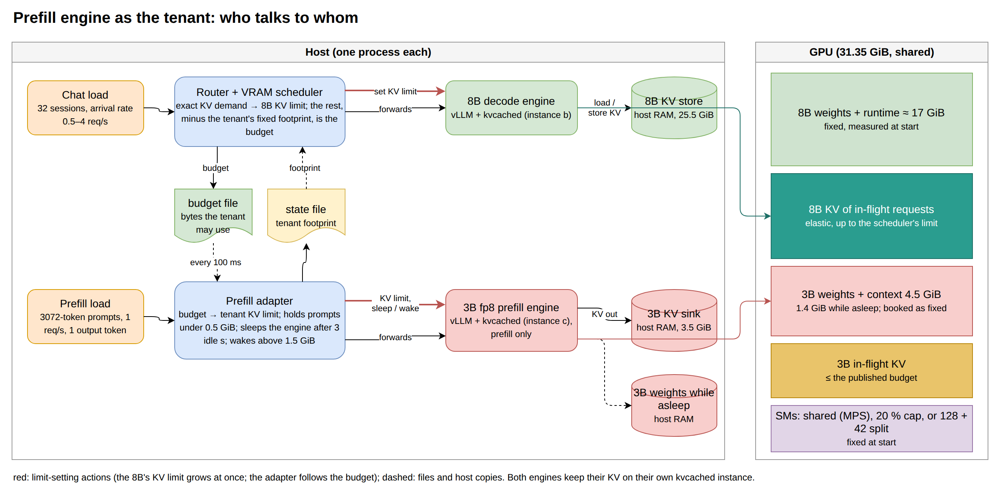
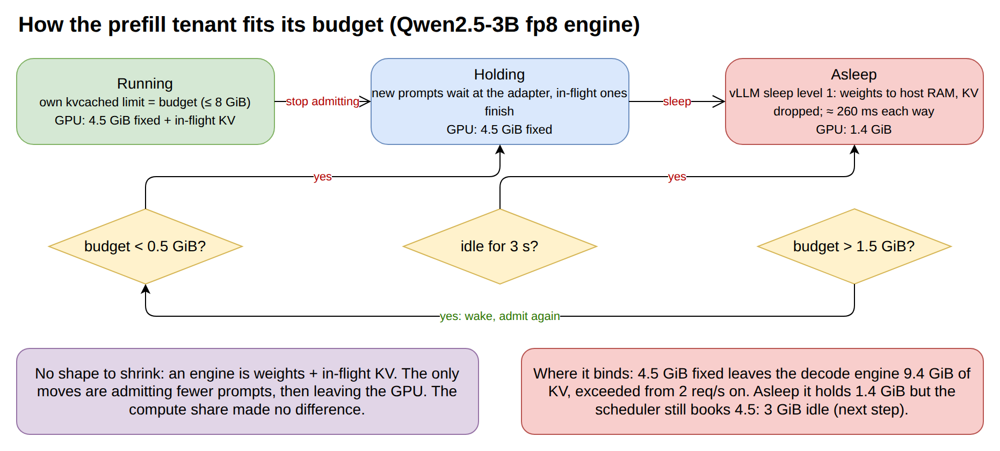
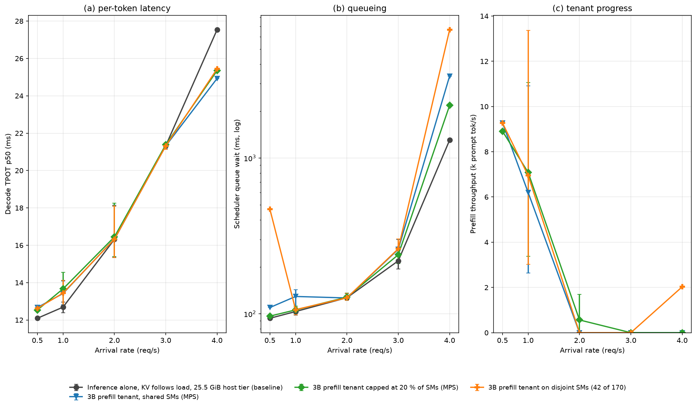
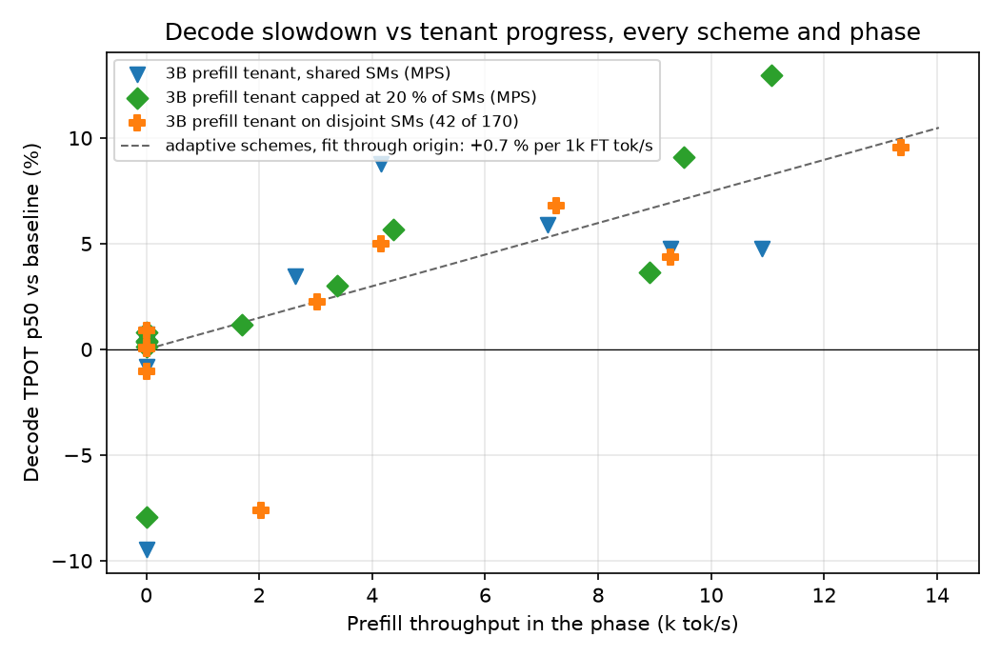
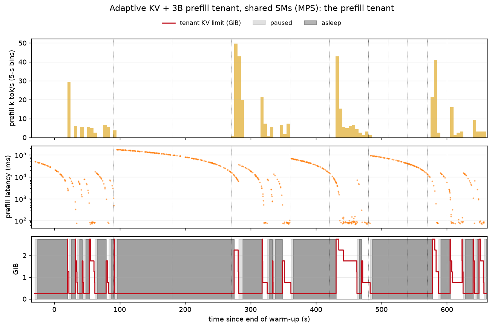
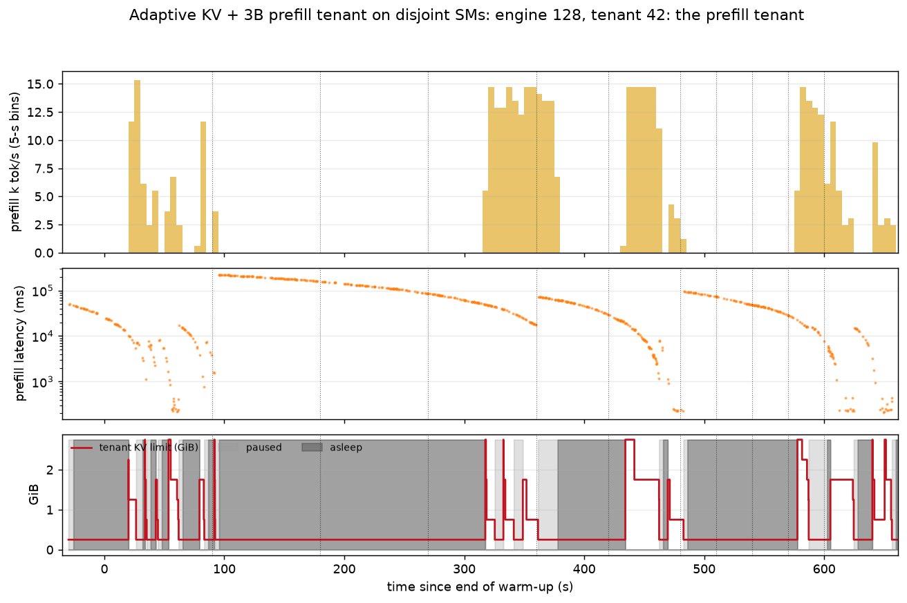

# 用一个 prefill 引擎当 colocation 的 tenant：做了什么、发生了什么、结论是什么

这是第二轮（2026-11-09，GPU 0，500 W）里计划 P3 的部分。和主报告 [REPORT_zh.md](REPORT_zh.md) 的
区别只有一个：8B decode 引擎旁边的 tenant 不是训练任务，而是**第二个只做 prefill 的推理引擎**。
router、VRAM scheduler、kvcached、负载都和主报告一样。预测和结果记录在 [DECISIONS.md](DECISIONS.md)
的 D14 和 D19，数据在 `../results/pf_*`。

## 0. 一句话总结

prefill 引擎能当 tenant，不改 vLLM，一个适配器加 kvcached 上限就够，sleep 让"让出 GPU"变成 260 ms 的
动作；但它能不能用取决于它**固定占多少显存**，不取决于算力怎么分。3B fp8 固定占 4.5 GiB，在 8B 旁边只有
≤ 1 req/s 时装得下，≥ 2 req/s 整个阶段都在睡。装得下的时候，它对 decode 的代价按每 1k prompt tok/s 算
约 1%，是训练 tenant 的一半。

## 1. 系统长什么样（图 A）

*图 A：两个 vLLM 引擎共用一张卡，各自有自己的 kvcached 实例。VRAM scheduler 按 router 看到的精确需求设
8B 的 KV 上限，剩下的显存扣掉 tenant 的固定占用后作为预算发布；prefill 适配器把预算变成 3B 的 KV 上限，
预算太小就扣请求、让引擎睡眠，并把自己的占用写回状态文件。红色是设上限的动作，虚线是文件和 host 拷贝。*

**为什么试这个 tenant。** PD 分离里 prefill 节点和 decode 节点是分开的机器，问题是 prefill 节点能不能
挤到 decode 节点的卡上，用 decode 在低负载时不需要的那部分显存。prefill 是算力密集、请求之间不留状态，
所以它没有训练那种降级阶梯：要么跑，要么等，要么走。

- **tenant 引擎**：Qwen2.5-3B，fp8，最大上下文 4608，最多 8 个并发、每批 8192 token，kvcached 实例
  `vllm_c`，KV 卸到 host RAM 的 **3.5 GiB** 层（/dev/shm 一共 31 GiB，8B 自己的层从 28 缩到 25.5 才放得下，
  见 D14）。醒着且独占时 3072 token 的 prompt 71 ms 做完。
- **负载**：3072-token 的 prompt，1 req/s，只要 1 个输出 token（约 3.1k prompt tok/s），走适配器；
  KV 写到 host 层就不再读回。8B 跑主报告那条 0.5–4 req/s 的参考负载。
- **适配器**（`pf_tenant.py`，图 B）：每 100 ms 读预算文件，在三个状态间切换。**运行**：把 3B 的
  kvcached 上限设成预算（256 MiB 步进，最多 8 GiB），在途 prompt 自然被它限制。**扣住**：预算低于 0.5 GiB
  时新 prompt 在适配器排队，在途的跑完，上限退到 256 MiB 地板；预算一回来就放行。**睡眠**：扣住 3 秒且没有
  在途请求就调 vLLM 的 sleep level 1（权重进 host RAM、KV 丢掉，需要 `VLLM_SERVER_DEV_MODE=1`），显存
  4.5 → 1.4 GiB，约 260 ms；预算回到 1.5 GiB 以上（地板 + 1 GiB 余量）才唤醒，也约 260 ms。它把自己的
  占用（固定 + kvcached 已映射）写进 scheduler 读的状态文件。
- **记账**：启动脚本在 tenant 引擎起来后用 NVML 量它的固定占用（前后差：**4.50 GiB**，fp8 权重 + CUDA
  context + kvcached 段），传给 scheduler。预算 = 31.35 − 16.97（8B 固定）− 4.50 − 0.5（安全）− KV 上限，
  也就是两个引擎的 KV 一共只有 **9.4 GiB** 的池子。8B 的上限按实际空闲封顶，所以从没超订。
- **三种算力方案加一个 baseline**（`run_eval_pf.sh`）：

| 方案 | 算力 | 显存 |
|---|---|---|
| `pf_base` | 8B 单跑（host 层 25.5 GiB） | 这一组的 baseline；和主 baseline 在噪声内一致 |
| `pf_mps` | 两个引擎通过 MPS 共用所有 SM | VRAM scheduler + 适配器 |
| `pf_mps20` | tenant 引擎限 20% SM 线程（MPS） | 同上 |
| `pf_split` | 8B 在前 128 个 SM（green context），tenant 在剩下 42 个 | 同上 |

*图 B：适配器的三个状态和切换条件，红框是它卡住的地方。*

## 2. 评测怎么做的

和主报告相同：每个方案连续跑 11 分钟，8B 走参考负载（0.5–4 req/s 的阶段），tenant 走自己 1 req/s 的
prefill 流。decode 看 TPOT p50 和调度排队；tenant 看交付的 prompt tok/s、在适配器处的 prompt 延迟、
失败数，以及每个阶段睡着的时间比例。

## 3. 看图

### 图 1：各方案的指标对到达率

三个面板：(a) decode TPOT，(b) 排队，(c) tenant 交付的 prompt tok/s。相同到达率的阶段合并。三条 tenant
线几乎重合：0.5–1 req/s 时 decode 高 4–8%，tenant 6–9k tok/s；2 req/s 起和 baseline 重合，tenant 为零。

### 图 2：推理变慢多少 vs tenant 跑多快

每个方案每个阶段一个点。三种机制落在同一条线上，斜率约每 1k prompt tok/s 1%，是训练 tenant（2.2%）的
一半：一批最多 8k token 的 prefill 只读一遍权重，每 token 搬的字节少。

### 图 3：tenant 的时间线（`pf_mps`）

上：5 秒一格的 prompt tok/s；中：每个 prompt 的延迟（含在适配器排队；70 ms 的地板就是 prefill 本身）；
下：它的 KV 上限，浅灰 = 扣住，深灰 = 睡着。吞吐是一阵一阵的，醒来时把睡着期间排队的 prompt 一次清掉，
峰值 50k tok/s；2、3、4 req/s 的阶段整段都是深灰。

### 图 4：唤醒踩错时机（`pf_split`）

4 req/s 阶段（360–420 s）中途预算短暂回来，引擎醒了、做了 2k tok/s 的 prefill，8B 的排队从 3.4 秒翻到
6.7 秒。1 GiB 的唤醒余量小于唤醒要放回 GPU 的 3.5 GiB。

### 数字表

按到达率合并（TPOT p50 ms，括号里是相对 `pf_base` 的变化；3 和 4 req/s 的排队 ms；tenant 在 0.5 / 1 / 2
req/s 的 k prompt tok/s）：

| 方案 | 0.5 req/s | 1 | 2 | 3 | 4 | 排队 @3 / @4 | tenant @0.5 / 1 / 2 |
|---|---|---|---|---|---|---|---|
| `pf_base` | 12.1 | 12.7 | 16.3 | 21.3 | 27.5 | 219 / 1303 | — |
| `pf_mps` | 12.7 (+5%) | 13.4 (+6%) | 16.3 (+0%) | 21.3 (−0%) | 24.9 (−9%) | 260 / 3360 | 9.3 / 6.2 / 0.0 |
| `pf_mps20` | 12.5 (+4%) | 13.7 (+8%) | 16.4 (+1%) | 21.4 (+0%) | 25.3 (−8%) | 240 / 2176 | 8.9 / 7.1 / 0.6 |
| `pf_split` | 12.6 (+4%) | 13.4 (+6%) | 16.3 (+0%) | 21.3 (−0%) | 25.4 (−8%) | 262 / 6659 | 9.3 / 6.9 / 0.0 |

逐阶段（decode TPOT 及相对 `pf_base` 的变化 · tenant 交付 prompt tok/s · 该阶段睡着的比例）：

| 阶段 | `pf_base` | `pf_mps` | `pf_mps20` | `pf_split` |
|---|---|---|---|---|
| 0 s，1 req/s | 13.0 | 14.1 (+9%) · 4.1k · 55% | 13.7 (+6%) · 4.4k · 41% | 13.6 (+5%) · 4.1k · 49% |
| 90 s，2 | 15.3 | 15.4 (+0%) · 0 · 100% | 15.4 (+0%) · 0 · 100% | 15.3 (+0%) · 0 · 100% |
| 180 s，3 | 21.3 | 21.5 (+1%) · 0 · 100% | 21.4 (+0%) · 0 · 100% | 21.5 (+1%) · 0 · 100% |
| 270 s，1 | 12.5 | 13.3 (+6%) · 7.1k · 57% | 13.7 (+9%) · 9.5k · 0% | 13.4 (+7%) · 7.3k · 47% |
| 360 s，4 | 27.5 | 24.9 (−9%) · 0 · 100% | 25.3 (−8%) · 0 · 100% | 25.4 (−8%) · 2.0k · 85% |
| 420 s，0.5 | 12.1 | 12.7 (+5%) · 9.3k · 8% | 12.5 (+4%) · 8.9k · 5% | 12.6 (+4%) · 9.3k · 15% |
| 480 s，2 | 15.5 | 15.5 (+0%) · 0 · 100% | 15.7 (+1%) · 1.7k · 53% | 15.5 (+0%) · 0 · 100% |
| 510 s，3 | 21.4 | 21.2 (−1%) · 0 · 100% | 21.4 (+0%) · 0 · 100% | 21.1 (−1%) · 0 · 100% |
| 540 s，2 | 18.1 | 18.2 (+0%) · 0 · 100% | 18.2 (+1%) · 0 · 100% | 18.1 (+0%) · 0 · 100% |
| 570 s，1 | 12.9 | 13.5 (+5%) · 10.9k · 48% | 14.6 (+13%) · 11.1k · 0% | 14.1 (+10%) · 13.4k · 0% |
| 600 s，1 | 12.4 | 12.8 (+3%) · 2.6k · 33% | 12.8 (+3%) · 3.4k · 7% | 12.7 (+2%) · 3.0k · 26% |

所有运行 0 个失败请求。带排队、KV 上限、预算的完整逐阶段表在 `../results/pf_*_phases.md`。

## 4. 怎么读

- **三种算力机制没有区别。** MPS、MPS 限 20%、128/42 切分，decode 代价一样（0.5–1 req/s 时 +4–8%，
  2 req/s 起 0%），tenant 吞吐也一样。算力从来没成为瓶颈。
- **瓶颈是显存。** 固定 4.5 GiB 之后两个引擎的 KV 池只有 9.4 GiB，8B 自己的需求从 2 req/s 起就超过它，
  预算归零，适配器扣请求，引擎整段睡着。tenant 只在 0.5 和 1 req/s 的阶段能干活，而且 MPS 下在 1 req/s
  阶段还有 30–57% 的时间在睡。
- **交付吞吐是在清积压，不是稳态。** 给的负载只有 3.1k prompt tok/s，醒着阶段的 6–13k 是睡着期间排队的
  prompt 被一次清掉（图 3）。所以睡着阶段 prompt 延迟中位 45–190 秒，醒着且空闲时只有 70 ms。
- **tenant 的固定占用在高负载时反过来让 decode 付代价。** 这几个方案里 8B 的 KV 上限最高只到 12.0 或
  12.5 GiB，baseline 是 12.65，所以 4 req/s 时排队 2.2–6.7 秒对 baseline 的 1.3 秒。TPOT 反而低 8–9%
  是同一个原因：批更小。批小、队长，是代价不是收益。
- **按 prompt token 算 prefill 是便宜的 tenant。** +6% 对 6–7k tok/s 约等于每 1k 1%，低于训练 tenant 的
  2.2%：一批 8k token 只读一遍权重，每 token 搬的字节少。这和主报告形态探针得到的"代价 ∝ 每 token
  搬的字节"是同一条规律。
- **睡着释放的显存没记回。** 睡着时实际 1.4 GiB，scheduler 仍按启动时量的 4.5 记，每个 ≥ 2 req/s 阶段
  有 3 GiB 闲着——本可以给 8B 的 KV，让 4 req/s 少排队。
- **唤醒余量必须盖住唤醒成本。** 唤醒在 260 ms 内把 3.1 GiB 权重放回 GPU，1 GiB 余量让 `pf_split` 在
  4 req/s 阶段中途醒了一次、8B 排队翻倍（图 4）。余量应 ≥ 权重大小，或者由 scheduler 批准唤醒。
- **`pf_base` 和主 baseline 一致**（TPOT 差 0.2 ms 以内，只有 4 req/s 是 27.5 对 26.1，排队相同），8B 的
  host 层从 28 缩到 25.5 GiB 没有代价。

## 5. 结论和下一步

1. prefill 引擎当 tenant 可行，不改 vLLM：适配器 + kvcached 上限就能让它跟预算，sleep 让"让出 GPU"只要
   260 ms。全程没有失败、没有超订。
2. 它**有没有用**由固定占用和 decode 低负载时剩下的显存决定，不由 SM 怎么分决定。32 GiB 的卡配 8B
   decode，3B fp8 只在 ≤ 1 req/s 时放得下。
3. 放得下时，它每 prompt token 的 decode 代价约为训练 tenant 的一半，符合主报告的字节代价模型。
4. 记账有两个缺口让它显得比实际差：睡着时仍按醒着的占用记，唤醒余量小于唤醒成本。

下一步：(a) scheduler 读状态文件里的实时占用（睡着 1.4 GiB）而不是固定 4.5，省出的 3 GiB 给 8B 的 KV；
(b) 唤醒条件改成预算 > 权重（约 3.5 GiB）+ 第一个 prompt 的 KV，或由 scheduler 批准；(c) 更小的固定
占用：1.5B fp8（约 2.5 GiB）能撑到 2 req/s，或把 prefill 引擎放到 16–32 SM 的 green context 上、份额随
负载变；(d) 真正的 PD 对：3B 的 KV 由 decode 节点读回，而不是写进去就不管。

文件：`pf_tenant.py`（适配器）、`run_eval_pf.sh`（启动两个引擎、scheduler、适配器、负载、分析）、
`analyze_pf.py`（tenant 指标和 `<方案>_pf.png`）、`plot_arms.py --pf`（图 1、2）。数据在
`../results/pf_{base,mps,mps20,split}_*`。运行：`PF_SLEEP=1 bash run_eval_pf.sh pf_mps`。
