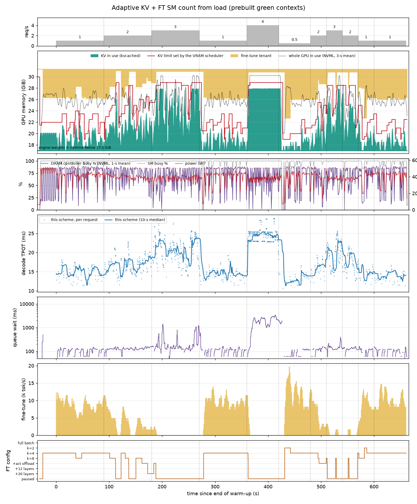

# Colocation VRAM-adjust 原型：做了什么、发生了什么、结论是什么

> 中文白话版。数据、表格和每个实验的预测/结果记录见英文 [REPORT.md](REPORT.md) 和 [DECISIONS.md](DECISIONS.md)
> （D1–D10 是第一轮，D11–D19 是第二轮）。系统图嵌在下面（PNG 在 `figures/`，draw.io 源文件在 `../diagrams/`）。
> **第一轮**（11 月 5–6 日）在 GPU 1、600 W 下跑，结果归档在 `../results_600w/`；
> **第二轮**（11 月 9 日夜）在 GPU 0、两块卡都限 500 W 下跑，`../results/`。下面所有图表都是第二轮的，
> 第一轮只在有差别的地方提。推理模型 Llama-3-8B（vLLM 0.30 + kvcached），训练模型 Qwen2.5-0.5B LoRA；
> 第二轮另加了一个"prefill 引擎当 tenant"的变种（Qwen2.5-3B fp8）。

---

## 0. 一句话总结

显存这一半解决了，而且第二轮把账算实了：推理的 KV 预算随负载在线涨缩，训练任务按剩余显存自动降档、
卸载、暂停再恢复，整个过程推理零失败、GPU 从未超卖。**算力这一半有了两个能用的方案**：
(1) **预建好的动态 green context**——训练任务的 SM 数随到达率变，context 在启动时建好、步间只切 stream，
不再漏显存，推理只慢 +14% 就换到 9–12k tok/s 的训练吞吐，是 MPS 共用全部 SM 代价的一半；
(2) **用 decode 延迟反馈直接限训练速率**——定一个 15% 的延迟目标，每个阶段都守住了。
干扰的本质也更清楚了：**训练每个 token 搬多少字节，推理就慢多少**——micro-batch 越小、越依赖
offload/权重流式的形态，每 1k tok/s 的代价越高（1.3% → 9%）。NVML 的"DRAM 控制器忙碌度"分不出
两个用户，不能当反馈信号。

---

## 1. 系统长什么样（图 A）

*图 A：组件和触发关系。红色是推理优先的动作（KV 上限立刻涨），虚线是只观察不干预，金色是训练任务的分配器上限跟着发布的预算走。*

设计上有一个硬约束：**不改 vLLM 的调度代码**。所以调度逻辑全部放在引擎外面：

- **Router**（`controller.py`，:8001 → :8000）：所有请求先经过它。它记下每个请求的 prompt 长度、
  已经生成了多少 token、是否还在排队，于是能精确算出"现在跑着的 + 排队的请求一共需要多少 KV"：
  进入时 ⌈prompt/16⌉ 个 block，之后每 16 个 token 加一个 block，每个 block 2 MiB。
- **VRAM scheduler**（同一个进程，100 ms 一拍）：算出需求后通过 kvcached 改 vLLM 的 KV 上限，
  再把剩下的显存发布给训练任务。第二轮的账：
  `预算 = 31.35 − 17.0（引擎权重+运行时，启动时用 NVML 实测）− 2.0（训练任务自己的 context、权重、优化器）− 0.5（安全余量）− KV 上限`。
  第一轮用的是 17.7 且没给训练任务留 context 的份，所以时间线图上黄色会"侵入"红线——那是账没算对，
  不是真的超卖（D11）。第二轮还加了一条：**上限只能承诺现在真空闲的显存**（kvcached 已映射的 + NVML
  显示空闲的 − 余量），不够就等训练任务先释放（`grow_wait`），需求回落就放弃这次等待（D16）。
- **Tenant**（`ft_worker.py`）：Qwen2.5-0.5B LoRA 训练进程，自己读预算、自己换形态。第二轮它还
  会读一个 tokens/s 上限（每步后 sleep 来遵守），并且可以在启动时把 128/96/64/32/16 个 SM 的
  green context 一次建好，步间只切 stream。
- **Prefill tenant**（`pf_tenant.py`，第二轮新增）：第二个 vLLM 引擎（Qwen2.5-3B fp8，自己的 kvcached
  实例，KV 流到 3.5 GiB 的 host RAM 层，只做 prefill），前面一个适配器按预算设它的 KV 上限、预算低于
  0.5 GiB 时把新请求扣在门口、空闲 3 秒后让引擎睡眠（权重回 host，显存 4.5 → 1.4 GiB），预算回到
  1.5 GiB 以上约 0.3 秒唤醒。单独的报告：[REPORT_pf_zh.md](REPORT_pf_zh.md)。
- **观察补丁**（`hp_patch/sitecustomize.py`）：只记录引擎的 offload 传输、可选地把引擎的 step 放到
  green context 上，不改调度。
- **采样器**：每 100 ms 记 kvcached 用量、NVML 显存、PCIe 计数，第二轮加了功耗、SM 忙碌度和
  **DRAM 控制器忙碌度**。

## 2. VRAM scheduler 每一拍做什么（图 B）

*图 B：VRAM scheduler 的一拍。需求超上限立刻涨；低于上限 1 GiB 持续 5 秒才缩，且不低于运行中请求已持有的量。*

原则是**推理绝对优先**：

1. 算 need = 在跑和排队请求的 KV + 按最近到达率预估的 1 秒新请求 + 0.5 GiB 余量。
2. need **超过**当前上限：**立刻**涨，同时把更小的预算发布给训练任务；涨不动（显存还没空出来）就
   等，等的期间训练任务已经收到了更小的预算、正在往下降。
3. need **低于**上限 1 GiB 以上且**持续 5 秒**：才缩。缩的下限是正在跑的请求已持有的 block。
4. 训练任务的预算只在 kvcached 实际映射的字节数 ≤ 新上限之后才涨回去。

第二轮验证：所有方案零失败、零 preemption；每一拍检查"KV 已映射 + 训练任务 + 引擎固定"都没有超过
31.35 GiB（每个方案 0 秒）。代价是容量：3–4 req/s 时需求 12.65 GiB 超过训练任务暂停后能映射的
≈12.4 GiB，调度器在那里一直等（4 req/s 整个阶段），训练任务保持暂停——这和第一轮一样。

第二轮还抓到并修了一个 bug：第一遍跑的时候，需求回落后那次"等待中的涨"没有被取消，训练任务的预算
就一直是 0，后面 8 分钟都在暂停。从调度器日志里看出来（5285 拍里 5285 拍 `grow_wait`），修好后把
受影响的六个方案重跑了（D16）。

## 3. 训练任务的降级阶梯（图 C）

*图 C：训练任务的阶梯和每一步的触发条件：step 中途轮询预算、OOM 当信号、爬升前等 3 秒、每次换档前后快照到 DRAM。*

校准后的显存需求（`tiers.json`，GPU 1 单独测）：

| 档 | 形态 | 需要的显存 |
|---|---|---|
| T0 | 整批 8×512 | 15.9 GiB |
| T1 | micro-batch k=2 / 4 / 8，梯度累积 | 8.7 / 5.0 / 3.2 GiB |
| T2 | + 激活 offload 到 pinned DRAM | 2.5 GiB |
| T3 | + 权重流式：12 / 20 层 base 权重从 DRAM 读 | 2.2 / 1.9 GiB |
| T4 | 暂停：快照 + 模型 + 优化器全部到 host | 0.4 GiB |

触发方式：预算不够 → 立刻降档（每 50 ms 看一眼预算，不够就在 step 中途放弃）；OOM → 再降一档
（分配器上限就是预算，OOM 只发生在训练进程里）；往上爬要预算足够持续 3 秒；每 10 步和每次换档前
快照到 DRAM。第二轮多了一个开关：tokens/s 上限（每步后 sleep）。

**第二轮的一个新发现（形态探针，图 5）**：同样 4k tok/s 的训练吞吐，推理慢多少取决于形态——
k=4 每 1k tok/s 慢 1.3%，k=8 慢 2.6%（权重每个 token 多读一倍次），激活 offload 5.9%，权重流式
8–9%。所以阶梯下面几档"省显存但搬很多字节"的形态，在有 tokens/s 上限的时候反而不该用：
能放下的最大 micro-batch 才是对推理最便宜的形态。

## 4. 评测怎么做的

参考负载（32 个 session × 6144-token 前缀 + 128 个新 token，Zipf-1.1，固定种子）经过 router
打到引擎，到达率按下面的时间表变化（11 分钟）：

| 从第几秒 | 0 | 90 | 180 | 270 | 360 | 420 | 480 | 510 | 540 | 570 | 600–660 |
|---|---|---|---|---|---|---|---|---|---|---|---|
| 到达率 (req/s) | 1 | 2 | 3 | 1 | 4 | 0.5 | 2 | 3 | 2 | 1 | 1 |

*图 0：所有方案共用的负载轨迹（`../plot_workload.py`，取自 baseline 那次运行的请求日志）。(a) 时间表给定的到达率和实际生成的 Poisson 到达（10 秒一格），固定种子，每个方案重放的是同一条序列。(b) 32 个 session 的热度，Zipf(1.1)，少数几个前缀占了大部分流量。每个请求带 6144 token 的 session 前缀加 128 个新 token，生成 128 个 token，在飞行中占约 0.77 GiB 的 KV。*

推理看 TPOT、调度排队时间、交付吞吐、失败数；训练看 token/s 和它所处的档位（prefill tenant 看
prompt token/s）。每个阶段去掉前 10 秒。**Baseline**：引擎单独跑、KV 上限随到达率调整、没有训练任务。
限到 500 W 对 baseline 没有可测的影响（每个阶段 TPOT 和 600 W 相差 < 0.3 ms），这个负载下 GPU
实际只吃 290–385 W。

## 5. 算力共享试了七种（图 D）

*图 D：七种算力共享机制，每一行是机制、训练任务怎么跑、结果。显存环路在所有行里相同。标题前的圆点颜色就是该方案在图 1 折线图里的颜色；虚线圆圈的那种是第一轮里训练任务第一阶段就挂了、没画进图的。*

| | 机制 | 结果（第二轮，500 W） |
|---|---|---|
| A | **空闲窗口 gate**：训练每个 block 前等 GPU 空闲 | MRV2 的 decode 只要有请求在跑就 ~100% busy。推理只慢 1%，训练一步都跑不了。**饿死。** |
| B | **MPS 不限**：两个进程共用所有 SM | 训练 12–14k tok/s，0.5–1 req/s 时 decode TPOT +29%，2 req/s +15%。 |
| C | **MPS 固定 20% SM** | +10–11%，训练保留约一半（6.5–7k tok/s）。 |
| D | **动态 green context，预建**（第二轮重做）：启动时建好 128/96/64/32/16 SM 的 context，按到达率切 | **跑完全程，174 次切换，没有漏显存**。训练 9–12k tok/s，decode 只 +14–15%——**B 的代价的一半，B 的吞吐的 80%**。第一轮每次切换新建 context 的版本漏显存、训练 OOM 暂停。 |
| E | **引擎放到 128/170 SM 上**（第一轮） | decode 和 baseline 一样。decode 不是 SM 瓶颈，让出 1/4 SM 免费。 |
| F | **静态不相交分区**：引擎 128 SM，训练 42 SM | 训练 12–14k tok/s，decode +28%，和 B 一样。**固定分区本身不解决干扰。** |
| G | **用 decode 延迟反馈限训练速率**（第二轮新增）：调度器每 2 秒比较最近 10 秒的 TPOT 和"没有训练任务时这个到达率的 TPOT"，发布一个 tokens/s 上限 | **15% 目标：每个阶段都守住**（+0–14%），训练 1.3–5.3k tok/s。5% 目标：守住了（+2–7%）但训练几乎一直被压在 500 tok/s 的下限——5% 比 10 秒窗口的 TPOT 测量噪声（±4%）还小，环路总以为超标。 |

为什么 D 比 F 好、F 和 B 一样？F 的训练在 42 个 SM 上照样跑满（12–14k tok/s），搬的字节和 B 一样多；
D 在低负载给 64–96 个 SM，训练吞吐略低，但每个 token 同时在读权重的 kernel 更少，和 decode 的权重
流争得更少。第一轮"放哪里都一样"的结论说得太满了：**固定放哪里一样，随负载变的份额不一样**。

*图 E：方案 D 的 SM 份额环路。左边调度器按到达率查表得到训练任务的 SM 数，和显存预算一起发布；右边训练进程启动时建好五个 green context，step 之间只换 stream。显存阶梯（图 C）照常运行。灰框是它有效的原因：SM 少了，同时读权重的 kernel 就少，训练的内存流量被摊薄。*

## 6. 看图

### 图 1：各方案的指标对到达率

三个面板：(a) decode TPOT，(b) 调度排队，(c) 训练吞吐。相同到达率的阶段合并（点 = 均值，误差线 =
重复阶段的最小到最大）。灰色 baseline 是下界；3–4 req/s 时所有自适应方案和 baseline 重合（训练已暂停）；
0.5–2 req/s 时高出的那截取决于训练跑多快。第二轮新加的两条线：**青色（预建动态 green context）**
在蓝色/橙色下面一半的位置但吞吐接近；**粉色（15% 延迟目标）**贴在 baseline 上方 15% 以内。
红色 static split 两头都输：每个到达率都慢 30–80%，超过 2 req/s 后排队到秒级且恢复不了。

### 图 1b：只看效果最好的几个方案

把图 1 里表现最好的三个方案和 baseline 单独拿出来画。**绿色（MPS 限 20% SM）**和**青色（预建动态
green context）**在 0.5–1 req/s 时都给训练 7–12k tok/s，解码代价差不多（+10–15%），但青色的训练吞吐
高 40–70%，并且到 2 req/s 就回到 baseline 上。**粉色（15% 延迟目标）**适合"解码预算定死"的场景：
每个到达率都守在目标内，剩多少算力给训练多少（1–5k tok/s）。

### 图 2：推理变慢多少 vs 训练跑多快

每个方案每个阶段一个点。MPS、MPS 20%、不相交分区、延迟反馈限速的点都落在一条过原点的直线上
（**每 1k 训练 tok/s，decode TPOT 慢约 2.2%**）；青色（预建动态 green context）明显在线下面
（8–12k tok/s 只 +14%）。static split 的点（空心）偏离这条线，因为它的代价来自 KV 不够而不是训练速度。

### 图 4：DRAM 控制器忙碌度不是好的反馈信号

(a) NVML 的 DRAM 控制器忙碌度对训练吞吐：训练 0 还是 14k tok/s，它都在 55–75%——推理自己就把
控制器占到这个程度，这个计数器分不出两个用户。(b) 推理慢多少对这个忙碌度：没有关系。
所以"看 DRAM 忙碌度来调训练"行不通；看训练的 token 速率和形态才行。

### 图 5：形态探针——训练每个 token 的代价由形态决定

引擎 1 req/s、KV 上限固定 3 GiB；训练预算固定 7.5 GiB、tokens/s 上限固定 4k，每种形态跑 60 秒。
(a) 每 1k 训练 tok/s 推理慢多少：k=4 1.3%，k=8 2.6%，激活 offload 5.9%，12/20 层权重流式 9.2/8.2%。
(b) 同一批窗口的 DRAM 忙碌度：搬字节多的形态反而更低（它们在等拷贝），代价却更高。

### 图 3（每个方案一张，`../results/<方案>_timeline.png`）：逐秒时间线

以预建动态 green context（方案 D）为例，七行从上到下：到达率；GPU 显存（青色 = 推理 KV 实际占用，
红线 = VRAM scheduler 设的 KV 上限，黄色 = 训练任务占用，黑细线 = NVML 看到的整卡用量，
只画 17 GiB 引擎固定部分以上）；DRAM 忙碌度 / SM 忙碌度 / 功耗；decode TPOT；调度排队；
训练吞吐；训练所处的档位。到达率涨 → 红线立刻上抬、黄色被压缩、档位往下掉；4 req/s 阶段训练整个
暂停，TPOT 和 baseline 重合；负载回落 5 秒后红线下调、黄色回来、档位爬回 k=2/k=4。

### prefill 引擎当 tenant：单独一份报告

Qwen2.5-3B fp8 只做 prefill、KV 流到 host RAM，相当于 PD 分离里的 prefill 节点和 decode 节点共卡。
这个变种单独写在 **[REPORT_pf_zh.md](REPORT_pf_zh.md)** 里，有它自己的架构图、状态图、图表和数字。
一句话（D19）：三种算力机制没有区别，decode **0.5–1 req/s 时 +4–8%，≥ 2 req/s 时 0%**，因为 tenant
**固定占 4.5 GiB**，两个引擎的 KV 只剩 9.4 GiB，8B 从 2 req/s 起就要得更多，tenant 整段睡着。按 prompt
token 算它的 decode 代价约为训练 tenant 的一半。记账还有两个缺口：睡着时 1.4 GiB 仍按 4.5 记，唤醒余量
小于唤醒成本。

### 数字表

<!-- round2-compact-start -->
*Decode TPOT p50 in ms at each arrival rate (mean over the phases that share the rate; in brackets the change against the baseline), the scheduler queue wait at 3 and 4 req/s, and the tenant's throughput at 0.5 / 1 / 2 req/s (k tok/s; for the prefill tenant, k prompt tok/s). Round 2, 500 W, GPU 0. Full per-phase tables: [round2_tables.md](round2_tables.md).*

**Fine-tune tenant family**

| scheme | 0.5 | 1 | 2 | 3 | 4 | queue @3 / @4 (ms) | tenant k tok/s @0.5 / 1 / 2 |
|---|---|---|---|---|---|---|---|
| Inference alone (baseline) | 12.0 | 12.6 | 16.3 | 20.8 | 26.1 | 214 / 1292 |  |
| Static split | 21.8 (+82 %) | 16.7 (+32 %) | 21.8 (+34 %) | 23.0 (+11 %) | 22.9 (-12 %) | 4941 / 13472 | 13.2 / 12.2 / 12.9 |
| Static split + idle gate | 12.5 (+4 %) | 12.8 (+1 %) | 16.5 (+1 %) | 18.6 (-10 %) | 18.6 (-28 %) | 1019 / 9225 | 0.0 / 0.0 / 0.0 |
| Adaptive KV + gate | 12.1 (+1 %) | 12.8 (+1 %) | 16.5 (+1 %) | 20.9 (+0 %) | 25.2 (-3 %) | 238 / 2262 | 0.0 / 0.0 / 0.0 |
| Adaptive KV + MPS | 15.4 (+29 %) | 16.3 (+29 %) | 18.9 (+16 %) | 21.4 (+3 %) | 25.0 (-4 %) | 257 / 2302 | 14.5 / 11.7 / 3.0 |
| Adaptive KV + MPS 20 % | 13.2 (+10 %) | 14.0 (+11 %) | 18.0 (+10 %) | 21.2 (+2 %) | 25.7 (-2 %) | 254 / 2940 | 7.0 / 6.5 / 2.2 |
| Adaptive KV + disjoint SMs 128/42 | 15.3 (+28 %) | 16.2 (+28 %) | 18.6 (+14 %) | 21.3 (+3 %) | 24.1 (-7 %) | 308 / 3367 | 13.7 / 11.6 / 2.9 |
| Adaptive KV + 5 % latency SLO | 12.8 (+7 %) | 13.1 (+3 %) | 16.9 (+4 %) | 20.8 (-0 %) | 22.3 (-14 %) | 306 / 2425 | 3.8 / 1.2 / 0.4 |
| Adaptive KV + 15 % latency SLO | 12.5 (+5 %) | 14.0 (+11 %) | 17.3 (+6 %) | 20.9 (+1 %) | 24.5 (-6 %) | 280 / 2277 | 3.8 / 4.0 / 1.5 |
| Adaptive KV + dynamic green ctx (prebuilt) | 13.7 (+14 %) | 14.5 (+15 %) | 17.8 (+9 %) | 21.0 (+1 %) | 24.5 (-6 %) | 250 / 2216 | 11.9 / 9.3 / 2.3 |

**Prefill tenant family** (the 8B's host tier is 25.5 GiB here instead of 28, hence its own baseline)

| scheme | 0.5 | 1 | 2 | 3 | 4 | queue @3 / @4 (ms) | tenant k tok/s @0.5 / 1 / 2 |
|---|---|---|---|---|---|---|---|
| Inference alone, 25.5 GiB tier (prefill baseline) | 12.1 | 12.7 | 16.3 | 21.3 | 27.5 | 219 / 1303 |  |
| 3B prefill tenant, MPS | 12.7 (+5 %) | 13.4 (+6 %) | 16.3 (+0 %) | 21.3 (-0 %) | 24.9 (-9 %) | 260 / 3360 | 9.3 / 6.2 / 0.0 |
| 3B prefill tenant, MPS 20 % | 12.5 (+4 %) | 13.7 (+8 %) | 16.4 (+1 %) | 21.4 (+0 %) | 25.3 (-8 %) | 240 / 2176 | 8.9 / 7.1 / 0.6 |
| 3B prefill tenant, disjoint SMs | 12.6 (+4 %) | 13.4 (+6 %) | 16.3 (+0 %) | 21.3 (-0 %) | 25.4 (-8 %) | 262 / 6659 | 9.3 / 6.9 / 0.0 |

<!-- round2-compact-end -->

## 7. 传输路径不是瓶颈

*图 3：MPS 方案里的每一次 host↔GPU 拷贝，以及它为什么发生。上面两行是原因：每个请求进入（蓝色刻度）触发一次 768 MiB 的前缀 KV 加载，结束时触发一次 16 MiB 的回存；训练任务每换一次形态就触发它的拷贝（经过"激活 offload"档时激活出去再回来，暂停时权重出去、恢复时回来），另外每 10 步一次快照。中间一行是拷贝本身，第四行是每秒搬运的字节数（按来源），最后一行是 NVML 的 PCIe 计数。*

推理的 KV load 走 13.5 GiB/s，链路平均只忙 10%；和训练的拷贝有并发时 load 时长中位数没有可测的变化。
所以推理的代价不是 PCIe 争用。但图 5 补了另一面：拷贝之间不互相拖慢，可"拷贝多的训练形态"对 decode 的
代价是不拷贝形态的 3–7 倍——拷贝和 decode 争的是 GPU 的内存系统，不是和彼此争链路。

## 8. kvcached + LMCache（第二轮 P4，GPU 1）

kvcached main 上，LMCache 0.5.6 的 MP connector `engine_driven` 模式**能用了**：10 分钟高强度
store/retrieve、每 15 秒改一次 KV 上限（2 ↔ 12 GiB），341/341 请求成功，输出和不带 connector 的引擎
8/8 一致，没有 Xid。kvcached 0.1.6 上的 Xid 31 崩溃在 main 上消失了（main 把页的 unmap 排在 GPU 进度
之后），为它写的 pin 层没派上用场。零拷贝的 VMM 模式还是卡在 LMCache 那边：它要求一个 tensor 一个
handle，kvcached 是 2 MiB 一页。

## 9. 结论和下一步

**解决了的**
- 不改 vLLM，router + VRAM scheduler + kvcached 让推理 KV 预算随负载在线涨缩，推理零失败、零代价，
  账算实了（实测引擎固定量、给 tenant 留 context、只承诺真空闲的显存）、GPU 从未超卖。
- 训练任务按三层设计降档、卸载、暂停、恢复；tokens/s 限速、预建 green context 切换都工作。
- 算力共享有了两个能用的方案：**预建动态 green context**（+14% 换 9–12k tok/s）和
  **延迟反馈限速**（15% 目标守得住）。
- 干扰的模型：代价 ∝ 训练每 token 搬的字节；形态决定每 token 的字节数。
- kvcached + LMCache engine_driven 在 kvcached main 上能用。

**没解决 / 要注意的**
- 5% 这种小目标低于 10 秒窗口的测量噪声，要么目标 ≥ 10%，要么窗口更长（环路就慢于 30–60 秒的阶段）。
- prefill 引擎当 tenant 受显存限制：固定 4.5 GiB 只在 ≤ 1 req/s 时放得下，≥ 2 req/s 就一直在睡；
  睡眠释放的 3 GiB 调度器还没记回 KV 池。
- 零拷贝的 LMCache 模式要 LMCache 那边改。

**下一步建议**
1. 把动态 SM 份额设成默认，并改成用 TPOT 偏差驱动（现在的 SM 表是按到达率开环查表，限速环路是闭环
   但只动 token 速率），目标定在噪声之上（≥ 10%）。
2. 有 tokens/s 上限时，训练形态按"每 token 搬多少字节"选：放得下的最大 micro-batch，高速率下
   永远不用流式形态。
3. prefill tenant：读适配器报的实时占用（睡着时 1.4 GiB）而不是固定 4.5 GiB，再给它 16–32 SM 的
   green context。
4. 真正接近零代价的 tenant 还是"字节已经在卡上"的那种（在被服务的模型上做 LoRA，DeltaServe 式）。

---

文件索引：`controller.py`（router + VRAM scheduler）、`ft_worker.py`（训练任务）、`pf_tenant.py`
（prefill tenant 适配器）、`green_ctx.py`、`hp_patch/sitecustomize.py`（引擎观察补丁）、
`run_eval6.sh` / `run_eval_pf.sh` / `run_probe.sh`（各方案的启动脚本）、
`analyze_coloc.py` / `analyze_pf.py` / `analyze_probe.py` / `plot_arms.py` / `plot_dram.py` /
`round2_tables.py`（分析和画图）、`../results/`（每个方案的阶段表、时间线图、传输图）、
`../results_600w/`（第一轮）。
