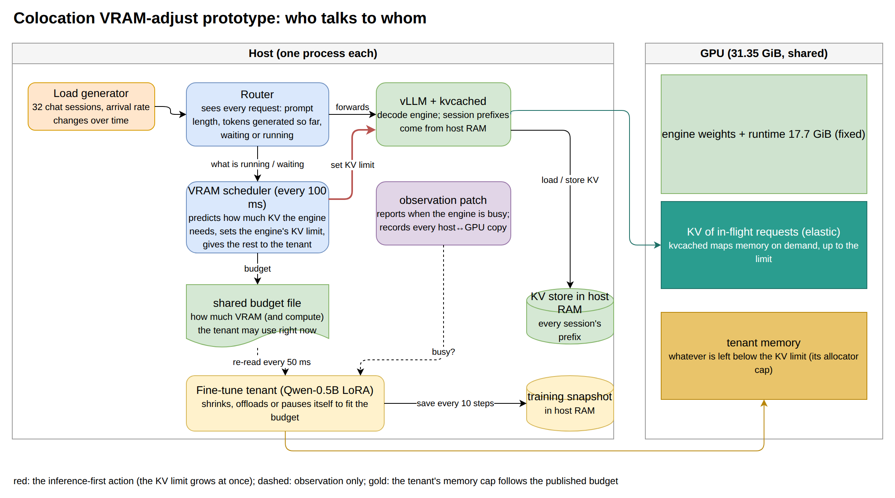
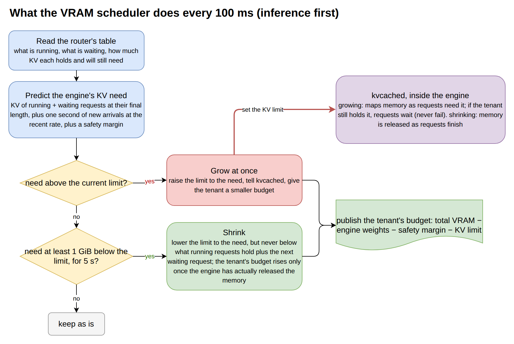
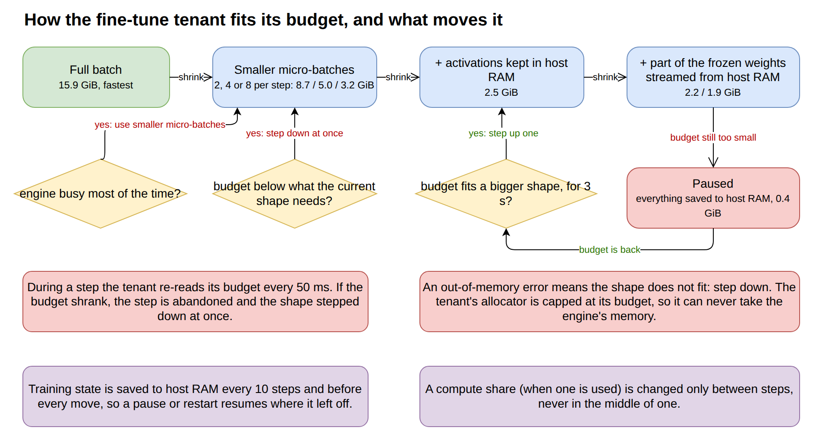
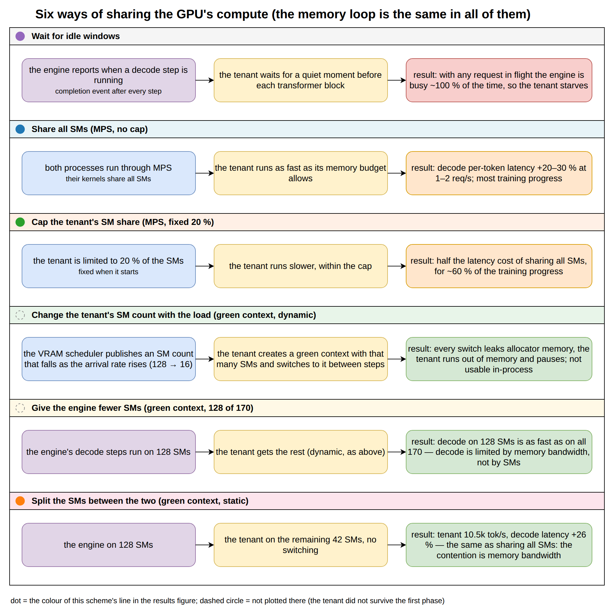
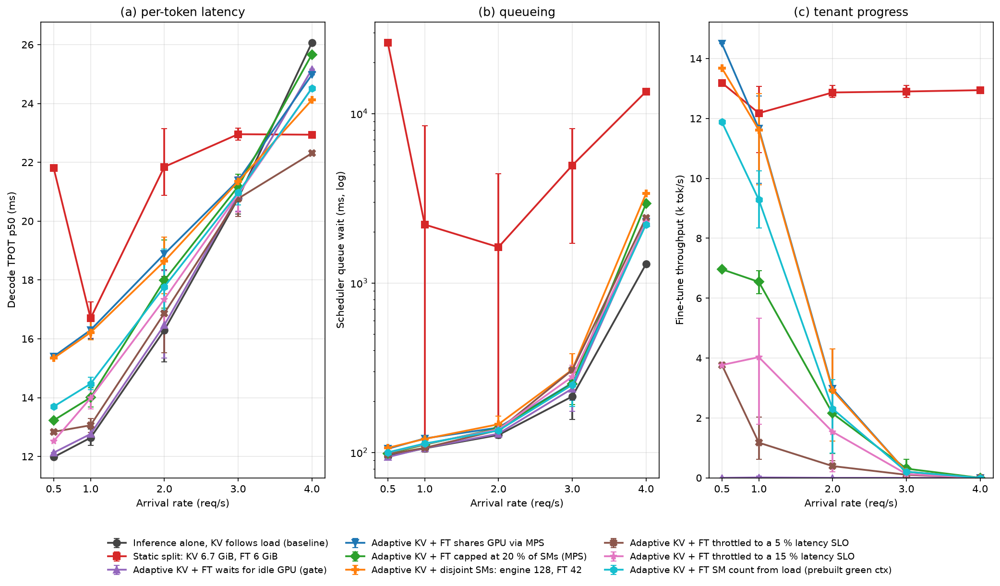
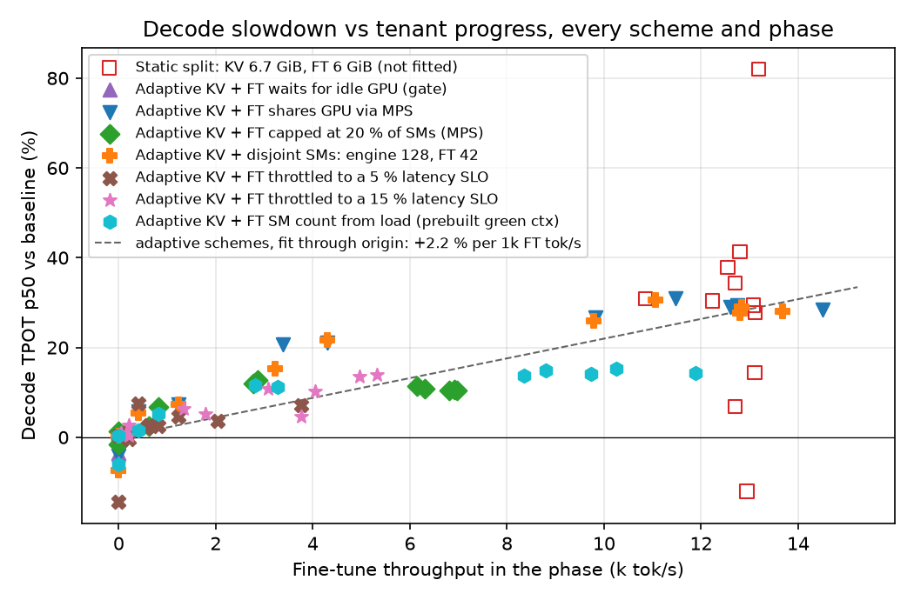
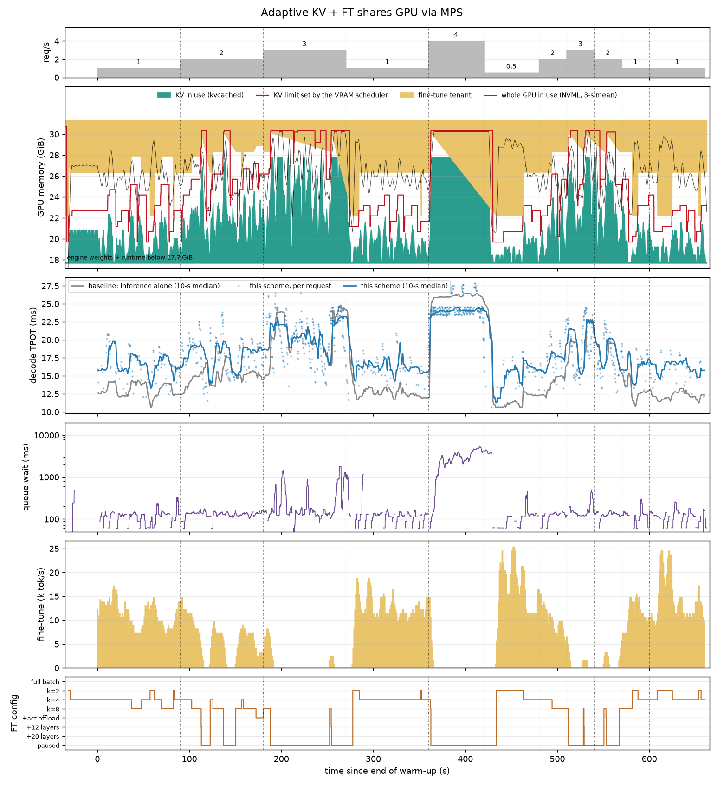

# Colocation VRAM-adjust 原型：做了什么、发生了什么、结论是什么

> 中文白话版。数据、表格和每个实验的预测/结果记录见英文 [REPORT.md](REPORT.md) 和 [DECISIONS.md](DECISIONS.md)。
> 系统图嵌在下面（PNG 在 `figures/`，draw.io 源文件在 `../diagrams/`，`../diagrams/export_png.py` 重新导出）。
> 所有实验在 2× RTX 5090 的 GPU 1 上跑，推理模型 Llama-3-8B（vLLM 0.30 + kvcached），
> 训练模型 Qwen2.5-0.5B LoRA。

---

## 0. 一句话总结

显存这一半的问题解决了：推理的 KV 预算可以随负载在线涨缩，训练任务按剩余显存自动降档、
卸载、甚至整个暂停再恢复，整个过程推理零失败。**算力这一半没有解决**：不管用什么方式切分
SM（MPS、MPS 限额、green context 静态分区），推理 decode 变慢的幅度都只和训练任务的
token 吞吐成正比（每 1k tok/s 约慢 2.3%），说明争的是 **DRAM 带宽**而不是 SM。

---

## 1. 系统长什么样（图 A）

*图 A：组件和触发关系。红色是推理优先的动作（KV 上限立刻涨），虚线是只观察不干预，金色是训练任务的分配器上限跟着发布的预算走。*

设计上有一个硬约束：**不改 vLLM 的调度代码**。所以调度逻辑全部放在引擎外面：

- **Router**（`controller.py`，aiohttp，:8001 → :8000）：所有请求先经过它。它记下每个请求的
  prompt 长度、已经生成了多少 token、是否还在排队，于是能用 kv_slots 报告里的模型算出
  "现在跑着的 + 排队的请求一共需要多少 KV"：进入时 ⌈prompt/16⌉ 个 block，之后每 16 个
  token 加一个 block，每个 block 2 MiB（Llama-3-8B）。
- **VRAM scheduler**（同一个进程，100 ms 一拍）：算出需求后通过 kvcached 的
  `set_instance_memory_limit` 改 vLLM 的 KV 上限，再把剩下的显存
  （31.35 − 17.7 权重和运行时 − 1 余量 − KV 上限）写进 `/dev/shm/coloc_ft_budget`
  发布给训练任务。
- **Tenant**（`ft_worker.py`）：Qwen2.5-0.5B LoRA 训练进程，自己读预算、自己换形态。
- **观察补丁**（`hp_patch/sitecustomize.py`，通过 PYTHONPATH 加载，不改调度）：在引擎里
  发布"GPU 正在跑 decode"的 busy 信号、记录所有 offload 传输、可选地把引擎的 step 放到
  green context 上。
- **传输追踪**（`xfer_trace.py`）：每一次 host↔GPU 拷贝都记录时间戳、时长、字节数、来源
  （推理的 KV offload 算 inf，训练的激活/权重/快照算 ft）。

## 2. VRAM scheduler 每一拍做什么（图 B）

*图 B：VRAM scheduler 的一拍。需求超上限立刻涨；低于上限 1 GiB 持续 5 秒才缩，且不低于运行中请求已持有的量。*

原则是**推理绝对优先**：

1. 读 router 表，算 need = 在跑和排队请求的 KV + 按最近到达率预估的 1 秒新请求 + 0.5 GiB 余量。
2. need **超过**当前上限：**立刻**涨到 need，同时把更小的预算发布给训练任务。
3. need **低于**上限 1 GiB 以上且**持续 5 秒**：才缩。缩的下限是正在跑的请求已持有的
   block 加队头请求的需求——永远不会收走运行中请求的页（kvcached 本身也保证这点）。
4. 训练任务的预算只在 kvcached 实际 mapped 的字节数 ≤ 新上限之后才涨回去。

验证结果：**所有方案零失败请求，零 preemption**，引擎从未因为训练任务还占着页而出错，
最坏情况是 vLLM 短暂排队等页。在线改上限本身对推理没有代价：
"引擎单独跑、上限跟着负载变"和"引擎单独跑、上限固定 13 GiB"的 TPOT 每个阶段相差 < 0.1 ms。

## 3. 训练任务的降级阶梯（图 C）

*图 C：训练任务的阶梯和每一步的触发条件：step 中途轮询预算、OOM 当信号、爬升前等 3 秒、每次换档前后快照到 DRAM。*

按你定的三层抢占设计实现，校准后的显存需求（`tiers.json`，GPU 1 单独测）：

| 档 | 形态 | 需要的显存 |
|---|---|---|
| T0 | 整批 8×512 | 15.9 GiB |
| T1 | micro-batch k=2 / 4 / 8，梯度累积 | 8.7 / 5.0 / 3.2 GiB |
| T2 | + 激活 offload 到 pinned DRAM（`saved_tensors_hooks`） | 2.5 GiB |
| T3 | + 权重流式：12 / 20 层 base 权重从 DRAM 读 | 2.2 / 1.9 GiB |
| T4 | 暂停：快照 + 模型 + 优化器全部到 host | 0.4 GiB |

触发方式：
- **预算不够 → 立刻降档**：每个 decoder 层的 hook 每 50 ms 看一眼预算文件，不够就在 step
  中途抛 `Preempt`，放弃这一步直接降。
- **OOM → 视为该档不合适，再降一档**。训练进程的分配器上限就是预算，所以 OOM 永远只
  发生在训练进程里，不会波及引擎。
- **往上爬要预算足够持续 3 秒**，防止抖动。
- **每 10 步和每次换档前快照到 DRAM**（`/dev/shm/coloc_ft_snapshot.pt`），暂停后从快照恢复。

完全 offload（T4）这条路在 3–4 QPS 阶段真实触发过（训练吞吐降到 0），负载回落后正常
恢复并爬回 k=2/k=4。

## 4. 评测怎么做的

参考负载（32 个 session × 6144-token 前缀 + 128 个新 token，Zipf-1.1，固定种子）经过 router
打到引擎，到达率按下面的时间表变化（11 分钟）：

| 从第几秒 | 0 | 90 | 180 | 270 | 360 | 420 | 480 | 510 | 540 | 570 | 600–660 |
|---|---|---|---|---|---|---|---|---|---|---|---|
| 到达率 (req/s) | 1 | 2 | 3 | 1 | 4 | 0.5 | 2 | 3 | 2 | 1 | 1 |

推理看 TPOT、调度排队时间、交付吞吐、失败数（decode-only 的 TTFT 只是取 KV + 128 token
prefill，不做评价指标）；训练看 token/s 和它所处的档位。每个阶段去掉前 10 秒。

**Baseline** 按你的定义：引擎单独跑、KV 上限随到达率调整、没有训练任务。

## 5. 算力共享试了六种（图 D）

*图 D：六种算力共享机制，每一行是机制、训练任务怎么跑、结果。显存环路在所有行里相同。标题前的圆点颜色就是该方案在图 1 折线图里的颜色；虚线圆圈的两种没画进图 1（训练任务第一阶段就挂了）。*

显存环路在所有方案里完全一样，只换算力共享机制：

| | 机制 | 结果 |
|---|---|---|
| A | **空闲窗口 gate**：引擎补丁发布 busy，训练每个 block 前等 GPU 空闲 | 用 CUDA 完成事件重测后发现 MRV2 的 decode 只要有请求在跑就 ~100% busy，训练几乎拿不到窗口，整个 11 分钟只跑了 32 步。**饿死。** |
| B | **MPS 不限**：两个进程共用所有 SM | 训练进度最多，但 1–2 QPS 时 decode TPOT 慢 20–30%。 |
| C | **MPS 固定 20% SM**（`CUDA_MPS_ACTIVE_THREAD_PERCENTAGE=20`） | 代价减半（+12–13%），训练保留约 60% 的进度。**目前最实用的折中。** |
| D | **动态 green context**：VRAM scheduler 按到达率发 SM 数（128/64/32/16），训练进程内切换 | 能跑，但 PyTorch 分配器的内存池绑在 stream 上，切换会漏内存（5 GiB 的配置占到 7.7 GiB reserved）→ OOM → 暂停。**进程内动态切换不可靠。** |
| E | **引擎放到 128/170 SM 的 green context 上** | decode 性能和 baseline **一样**（TPOT 12.9–13.2 ms vs 12.9）。decode 根本不是 SM 瓶颈，让出 1/4 的 SM 是免费的。 |
| F | **静态不相交分区**：引擎 SM 0–127，训练另外 42 个 SM | 训练 10.5k tok/s，但 decode 仍然 +26% TPOT，和 B 一样。**分区本身不解决干扰。** |

## 6. 看图

### 图 1：各方案的指标对到达率

三个面板：(a) decode TPOT，(b) 调度排队，(c) 训练吞吐。相同到达率的阶段合并
（点 = 均值，误差线 = 重复阶段的最小到最大）。

怎么读：
- 灰色 baseline 是下界。3–4 QPS 时所有自适应方案和 baseline 重合——因为训练已经被
  暂停了，显存全给了推理。
- 0.5–2 QPS 时自适应方案比 baseline 高出一截，高多少取决于训练跑得多快：MPS 不限
  （蓝）和不相交分区（橙）最高，MPS 20%（绿）一半，gate（紫）贴着 baseline 但训练吞吐
  是 0。
- 红色 static split（引擎固定 6.69 GiB = 2 QPS 的需求，训练固定 6 GiB）**两头都输**：
  推理在每个到达率都慢 20–80%，超过 2 QPS 后排队到秒级，而且一旦积压就恢复不了
  （1 QPS 的误差线拉到 8 秒就是这个原因）。

### 图 2：推理变慢多少 vs 训练跑多快

每个方案每个阶段一个点。所有自适应方案不管用什么共享机制都落在同一条过原点的直线上：
**每 1k 训练 tok/s，decode TPOT 慢约 2.3%**。static split 的点（空心）偏离这条线，因为它的
代价来自 KV 不够而不是训练速度。这张图是"瓶颈是 DRAM 带宽"这个结论的直接证据。

### 图 3（每个方案一张，`../results/<arm>_timeline.png`）：每个方案的逐秒时间线

以 MPS 不限（方案 B）为例，六行从上到下：到达率；GPU 显存分配（青色 = 推理 KV 实际占用，
红线 = VRAM scheduler 设的 KV 上限，黄色 = 训练任务占用，只画 17.7 GiB 权重以上的部分）；
decode TPOT（蓝 = 本方案，灰 = baseline 同一时间线）；调度排队；训练吞吐；训练所处的档位。

可以直接看到：到达率涨 → 红线立刻上抬、黄色被压缩、档位往下掉；4 QPS 阶段训练整个暂停
（黄色退到 0.4 GiB，档位 = paused），推理 TPOT 和 baseline 重合；负载回落 5 秒后红线下调，
黄色回来，档位爬回 k=2。蓝线和灰线之间的差距就是训练付出的推理代价，训练吞吐高的时候差距大。

## 7. 传输路径不是瓶颈

每一次 host↔GPU 拷贝都记了下来（`../results/<arm>_xfer.png`，原始记录在 `xfer_*.csv`）。
推理的 KV load 走 13.5 GiB/s 左右，训练的激活 offload 和权重流式有并发时 load 时长中位数
没有可测的变化。训练的快照（约 1 GiB）每 10 步一次，在 PCIe 上是短脉冲。所以上面的
decode 代价不是 PCIe 争用，是 GPU 内部的 DRAM 带宽。

## 8. 结论和下一步

**解决了的**
- 不改 vLLM，用 router + VRAM scheduler + kvcached 就能让推理的 KV 预算跟着负载在线涨缩，
  推理零失败、零代价。
- 训练任务按三层设计降档、卸载、暂停、恢复，中途抢占（50 ms 内）和 DRAM 快照都工作。
- 全部 host↔GPU 数据移动可追踪，带来源标签。

**没解决的**
- 推理受到的干扰 ∝ 训练任务的 token 吞吐，与 SM 分配方式无关。MPS / green context 分 SM
  只能通过"把训练拖慢"间接保护推理，分区本身不管用。
- 进程内动态切换 green context 会漏显存，不能直接用。

**下一步建议**
1. 用 **TPOT 反馈直接控训练速率**（比如每步后 sleep 一个由 TPOT 偏差决定的时间），而不是
   按到达率查表控 SM——既然代价只和 token 吞吐有关，控吞吐才是直接的。
2. 选**带宽友好的训练形态**：小 batch、更多重计算、少读写激活，让每 tok/s 的带宽占用更低。
3. 如果一定要动态 green context：预先创建几个固定 SM 数的 context 轮换，或者换档时从
   快照重启进程，避开分配器内存池的问题。

---

文件索引：`controller.py`（router + VRAM scheduler）、`ft_worker.py`（训练任务）、
`green_ctx.py`（green context 封装）、`hp_patch/sitecustomize.py`（引擎观察补丁）、
`run_eval*.sh`（各方案的启动脚本）、`analyze_coloc.py` / `plot_arms.py`（分析和画图）、
`../results/`（每个方案的阶段表、时间线图、传输图）。
