# Colocation VRAM-adjust 原型：做了什么、发生了什么、结论是什么

> 中文白话版。数据、表格和每个实验的预测/结果记录见英文 [REPORT.md](REPORT.md) 和 [DECISIONS.md](DECISIONS.md)
> （D1–D10 是第一轮，D11–D19 是第二轮）。系统图嵌在下面（PNG 在 `figures/`，draw.io 源文件在 `../diagrams/`）。
> **第一轮**（11 月 5–6 日）在 GPU 1、600 W 下跑，结果归档在 `../results_600w/`；
> **第二轮**（11 月 9 日夜）在 GPU 0、两块卡都限 500 W 下跑，`../results/`。下面所有图表都是第二轮的，
> 第一轮只在有差别的地方提。推理模型 Llama-3-8B（vLLM 0.30 + kvcached），训练模型 Qwen2.5-0.5B LoRA；
> 第二轮另加了一个"prefill 引擎当 tenant"的变种（Qwen2.5-3B fp8）。
> 开头有一节故事线。图 7–10 分析训练任务为什么拖慢 decode（完整版见 [REPORT_bandwidth_zh.md](REPORT_bandwidth_zh.md)）；
> p90 表和图 11 是 11 月 15 日对第二轮运行的重新分析；第 10 节是下一步（10.7 是 11 月 16 日的实测），第 11 节是已有工作，第 12 节是没解释的问题和局限。

---

## 0. 一句话总结

显存这一半解决了，而且第二轮把账算实了：推理的 KV 预算随负载在线涨缩，训练任务按剩余显存自动降档、
卸载、暂停再恢复，整个过程推理零失败、GPU 从未超卖。**算力这一半有了两个能用的方案**：
(1) **预建好的动态 green context**——训练任务的 SM 数随到达率变，context 在启动时建好、步间只切 stream，
不再漏显存，推理只慢 +14% 就换到 9–12k tok/s 的训练吞吐，是 MPS 共用全部 SM 代价的一半；
(2) **用 decode 延迟反馈直接限训练速率**——定一个 15% 的延迟目标，每个阶段都守住了。
训练任务的形态决定它每个 token 让推理慢多少：micro-batch 越小、越依赖 offload/权重流式的形态，
每 1k tok/s 的代价越高（1.3% → 9%）。NVML 的"显存控制器忙碌度"分不出两个用户，不能当反馈信号。
之后的带宽测量（图 7–10）给出了原因：两个任务分开用 SM，但共用通往显存的那条通道，训练任务搬的字节
是从 decode 那里扣出来的；把训练任务的 SM 减到 1/12，对 decode 的伤害只降到 1/4。

---

## 故事线

每一步写：当时已知什么、做了什么、得到什么，以及由此引出的下一个目标。第 1–7 步是测出来的，第 8 步是计划。

0. **起点。** 之前的工作落在一个结论上：KV 放到主机内存以后，在一个随负载变化的拐点以下，decode 引擎的
   性能不依赖它的显存预算。所以拐点以下的显存，以及 decode 用不上的 SM，可以让给同一张 GPU 上的第二个
   任务（tenant）。*目标：验证这一点。先回答：不重启引擎能不能改预算？*
1. **预算能不能在线改？**（[`../../kvcached_validation/REPORT.md`](../../kvcached_validation/REPORT.md)）
   kvcached 能在带负载时缩、扩 KV 预算。新上限约 1.3 秒生效，不杀请求，每步零开销，在每个预算点上都和
   重启到该预算分不出来。*目标：让预算跟着负载走，把剩下的交给 tenant。*
2. **显存能不能跟着负载让？**（第 1–3 节，第 6 节的数字表）router、VRAM scheduler 加上会换档的训练任务，
   不改 vLLM：11 分钟、0.5–4 req/s，0 失败、0 抢占、0 秒超卖。静态划分两头都输。显存这一半解决了。
   *目标：tenant 同时还在用算力，弄清它让 decode 付多少代价，以及怎么限住。*
3. **算力怎么分？**（第 5、6 节）试了四类分法：轮流用；同时用不限制；同时用少给 SM；同时用少给时间。
   轮流用时训练一步都跑不了，因为只要有请求在跑，GPU 有 93–100 % 的时间在忙。同时用的代价是每 1k 训练
   tok/s 让 TPOT 慢 2.2 %。少给 SM 的两种方案每个 token 最便宜，而且变慢是均匀的；限速守得住中位数，
   守不住尾部；训练歇着时 decode 回到基线。有一个结果和"两个任务抢算力"对不上：SM 分开和 SM 共用代价
   一样。*目标：找出两个任务到底共用什么。*
4. **decode 被什么卡住？**（图 6）decode 单独跑时，56–80 个 SM 就到显存带宽的平台。卡住它的是通往显存的
   通道，不是算力。*目标：tenant 进来以后字节怎么分。*
5. **旁边有 tenant 时**（图 7、8）。两个任务的流量合计不涨：tenant 搬多少，decode 就少多少。tenant 只占
   8 个 SM，decode 也慢 5–7 %。SM 减到 1/12，tenant 自己慢到 1/7，对 decode 的伤害只降到 1/4。分开 SM
   隔不开通道，限 SM 是弱旋钮。*目标：确认 decode 是在对字节做反应，以及还对什么做反应。*
6. **是字节吗？**（图 9、10）换成流量可以设定的第二个任务：decode 变慢的幅度对 GB/s 近似是直线，
   每 100 GB/s 慢 4–7 %。真实 tenant 比它的字节更贵：写、启动 kernel、做算术各自还有代价，功耗也是共用的。
   *目标：看已有工作怎么处理这件事。*
7. **已有工作**（第 11 节）。文献一致认为分 SM 隔不开带宽；能隔的机制这张卡用不了；按字节给 GPU 任务定
   预算只见于保护 CPU 任务。*目标：直接管 tenant 搬的字节。*
8. **下一步，计划**（第 10 节）。C1 字节预算，有两种守法（每步之后停，或者切成小片）；C2 改训练任务
   自己，让同样的训练少占显存带宽，decode 少慢一些。第一个实验是 E1.1。
9. **实测，11 月 16 日**（10.7 节）。训练进度相同时，32 个 SM 上的字节额度让 decode 的代价比按延迟反馈的方案
   少一半，并且没有了长尾（token 间隔平均 +5.6 / +6.3 % 对 +12.2 / +11.0 %；p90 +6 / +4 % 对 +28 / +15 %）。
   编译过的训练任务每 token 少搬 41 % 的数据，训练内容不变，decode 降到 +4.3 / +4.0 %。把训练切得更碎，在
   真引擎上看不出效果。带 offload 的形态每个字节的代价是快形态的三到四倍，挨着 decode 时不该跑。

---

**用词约定。** 本报告涉及两种内存，名字分开。**显存**是 5090 上 31.35 GiB 的 GDDR7："显存带宽"指 SM 和
显存之间那条路（约 1.8 TB/s），"显存控制器忙碌度"是 NVML 对它的读数。**主机内存（host RAM）**是机器上
60 GiB 的 DDR：KV 的 host 层、训练卸载出去的激活、流式读取的权重和训练快照都放在这里，走 PCIe
（约 14 GB/s）。全文不再用 "DRAM" 这个词。

## 1. 系统长什么样（图 A）

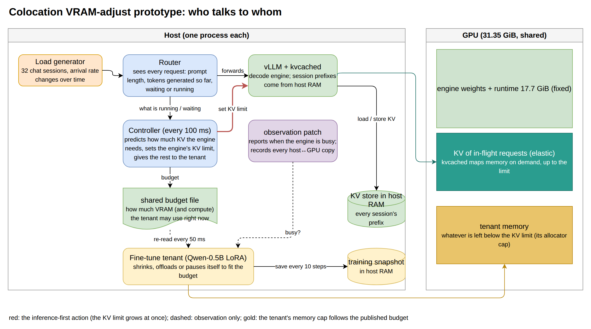

*图 A：组件和触发关系。红色是推理优先的动作（KV 上限立刻涨），虚线是只观察不干预，金色是训练任务的分配器上限跟着发布的预算走。*

设计上有一个硬约束：**不改 vLLM 的调度代码**。所以调度逻辑全部放在引擎外面：

- **Router**（`controller.py`，:8001 → :8000）：所有请求先经过它。它记下每个请求的 prompt 长度、
  已经生成了多少 token、是否还在排队，于是能精确算出"现在跑着的 + 排队的请求一共需要多少 KV"：
  进入时 ⌈prompt/16⌉ 个 block，之后每 16 个 token 加一个 block，每个 block 2 MiB。
- **VRAM scheduler**（同一个进程，100 ms 一拍）：算出需求后通过 kvcached 改 vLLM 的 KV 上限，
  再把剩下的显存发布给训练任务。第二轮的账：
  `预算 = 31.35 − 17.0（引擎权重+运行时，启动时用 NVML 实测）− 2.0（训练任务自己的 context、权重、优化器）− 0.5（安全余量）− KV 上限`。
  第一轮用的是 17.7 且没给训练任务留 context 的份，所以时间线图上黄色会"侵入"红线——那是账没算对，
  不是真的超卖（D11）。第二轮还加了一条：**上限只能承诺现在真空闲的显存**（kvcached 已映射的 + NVML
  显示空闲的 − 余量），不够就等训练任务先释放（`grow_wait`），需求回落就放弃这次等待（D16）。
- **Tenant**（`ft_worker.py`）：Qwen2.5-0.5B LoRA 训练进程，自己读预算、自己换形态。第二轮它还
  会读一个 tokens/s 上限（每步后 sleep 来遵守），并且可以在启动时把 128/96/64/32/16 个 SM 的
  green context 一次建好，步间只切 stream。
- **Prefill tenant**（`pf_tenant.py`，第二轮新增）：第二个 vLLM 引擎（Qwen2.5-3B fp8，自己的 kvcached
  实例，KV 流到 3.5 GiB 的 host RAM 层，只做 prefill），前面一个适配器按预算设它的 KV 上限、预算低于
  0.5 GiB 时把新请求扣在门口、空闲 3 秒后让引擎睡眠（权重回 host，显存 4.5 → 1.4 GiB），预算回到
  1.5 GiB 以上约 0.3 秒唤醒。单独的报告：[REPORT_pf_zh.md](REPORT_pf_zh.md)。
- **观察补丁**（`hp_patch/sitecustomize.py`）：只记录引擎的 offload 传输、可选地把引擎的 step 放到
  green context 上，不改调度。
- **采样器**：每 100 ms 记 kvcached 用量、NVML 显存、PCIe 计数，第二轮加了功耗、SM 忙碌度和
  **显存控制器忙碌度**。

## 2. VRAM scheduler 每一拍做什么（图 B）

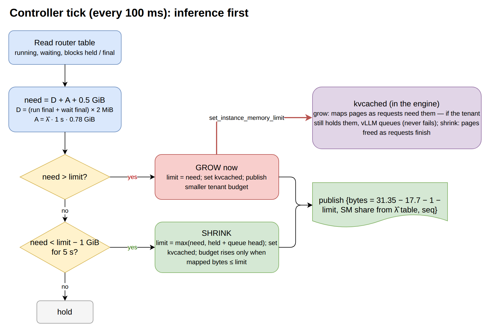

*图 B：VRAM scheduler 的一拍。需求超上限立刻涨；低于上限 1 GiB 持续 5 秒才缩，且不低于运行中请求已持有的量。*

原则是**推理绝对优先**：

1. 算 need = 在跑和排队请求的 KV + 按最近到达率预估的 1 秒新请求 + 0.5 GiB 余量。
2. need **超过**当前上限：**立刻**涨，同时把更小的预算发布给训练任务；涨不动（显存还没空出来）就
   等，等的期间训练任务已经收到了更小的预算、正在往下降。
3. need **低于**上限 1 GiB 以上且**持续 5 秒**：才缩。缩的下限是正在跑的请求已持有的 block。
4. 训练任务的预算只在 kvcached 实际映射的字节数 ≤ 新上限之后才涨回去。

第二轮验证：所有方案零失败、零 preemption；每一拍检查"KV 已映射 + 训练任务 + 引擎固定"都没有超过
31.35 GiB（每个方案 0 秒）。代价是容量：3–4 req/s 时需求 12.65 GiB 超过训练任务暂停后能映射的
≈12.4 GiB，调度器在那里一直等（4 req/s 整个阶段），训练任务保持暂停——这和第一轮一样。

第二轮还抓到并修了一个 bug：第一遍跑的时候，需求回落后那次"等待中的涨"没有被取消，训练任务的预算
就一直是 0，后面 8 分钟都在暂停。从调度器日志里看出来（5285 拍里 5285 拍 `grow_wait`），修好后把
受影响的六个方案重跑了（D16）。

## 3. 训练任务的降级阶梯（图 C）

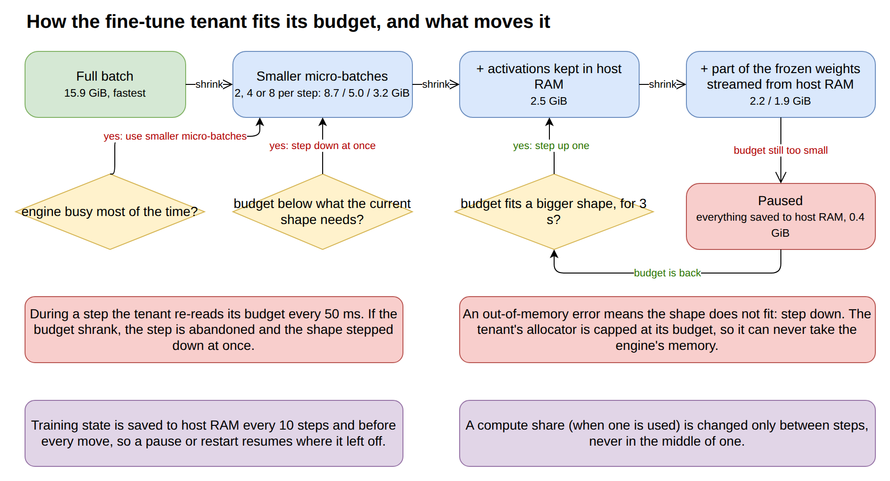

*图 C：训练任务的阶梯和每一步的触发条件：step 中途轮询预算、OOM 当信号、爬升前等 3 秒、每次换档前后快照到主机内存。*

校准后的显存需求（`tiers.json`，GPU 1 单独测）：

| 档 | 形态 | 需要的显存 |
|---|---|---|
| T0 | 整批 8×512 | 15.9 GiB |
| T1 | micro-batch k=2 / 4 / 8，梯度累积 | 8.7 / 5.0 / 3.2 GiB |
| T2 | + 激活 offload 到 pinned 主机内存 | 2.5 GiB |
| T3 | + 权重流式：12 / 20 层 base 权重从主机内存读 | 2.2 / 1.9 GiB |
| T4 | 暂停：快照 + 模型 + 优化器全部到 host | 0.4 GiB |

触发方式：预算不够 → 立刻降档（每 50 ms 看一眼预算，不够就在 step 中途放弃）；OOM → 再降一档
（分配器上限就是预算，OOM 只发生在训练进程里）；往上爬要预算足够持续 3 秒；每 10 步和每次换档前
快照到主机内存。第二轮多了一个开关：tokens/s 上限（每步后 sleep）。

**第二轮的一个新发现（形态探针，图 5）**：同样 4k tok/s 的训练吞吐，推理慢多少取决于形态——
k=4 每 1k tok/s 慢 1.3%，k=8 慢 2.6%（权重每个 token 多读一倍次），激活 offload 5.9%，权重流式
8–9%。所以阶梯下面几档"省显存但搬很多字节"的形态，在有 tokens/s 上限的时候反而不该用：
能放下的最大 micro-batch 才是对推理最便宜的形态。

## 4. 评测怎么做的

参考负载（32 个 session × 6144-token 前缀 + 128 个新 token，Zipf-1.1，固定种子）经过 router
打到引擎，到达率按下面的时间表变化（11 分钟）：

| 从第几秒 | 0 | 90 | 180 | 270 | 360 | 420 | 480 | 510 | 540 | 570 | 600–660 |
|---|---|---|---|---|---|---|---|---|---|---|---|
| 到达率 (req/s) | 1 | 2 | 3 | 1 | 4 | 0.5 | 2 | 3 | 2 | 1 | 1 |

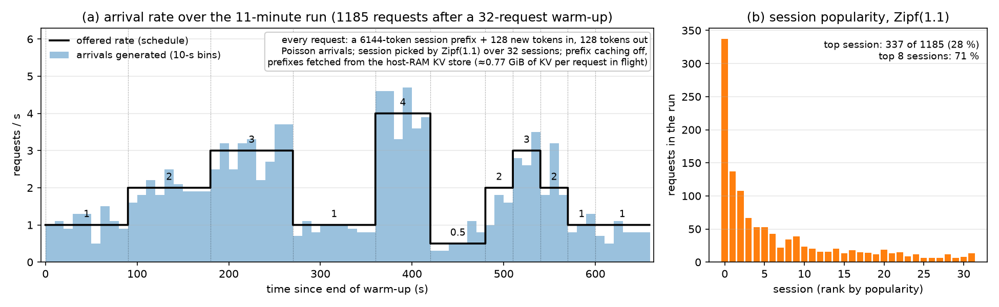

*图 0：所有方案共用的负载轨迹（`../plot_workload.py`，取自 baseline 那次运行的请求日志）。(a) 时间表给定的到达率和实际生成的 Poisson 到达（10 秒一格），固定种子，每个方案重放的是同一条序列。(b) 32 个 session 的热度，Zipf(1.1)，少数几个前缀占了大部分流量。每个请求带 6144 token 的 session 前缀加 128 个新 token，生成 128 个 token，在飞行中占约 0.77 GiB 的 KV。*

推理看 TPOT、调度排队时间、交付吞吐、失败数；训练看 token/s 和它所处的档位（prefill tenant 看
prompt token/s）。每个阶段去掉前 10 秒。**Baseline**：引擎单独跑、KV 上限随到达率调整、没有训练任务。
限到 500 W 对 baseline 没有可测的影响（每个阶段 TPOT 和 600 W 相差 < 0.3 ms），这个负载下 GPU
实际只吃 290–385 W。

## 5. 算力共享试了七种（图 D）

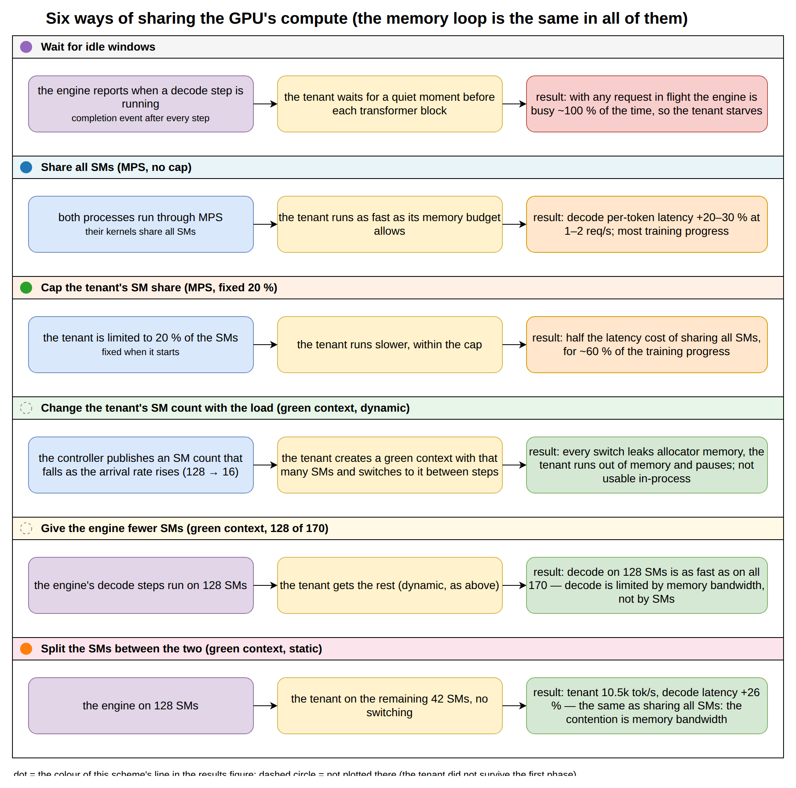

*图 D：七种算力共享机制，每一行是机制、训练任务怎么跑、结果。显存环路在所有行里相同。标题前的圆点颜色就是该方案在图 1 折线图里的颜色；虚线圆圈的那种是第一轮里训练任务第一阶段就挂了、没画进图的。*

| | 机制 | 结果（第二轮，500 W） |
|---|---|---|
| A | **空闲窗口 gate**：训练每个 block 前等 GPU 空闲 | MRV2 的 decode 只要有请求在跑就 ~100% busy。推理只慢 1%，训练一步都跑不了。**饿死。** |
| B | **MPS 不限**：两个进程共用所有 SM | 训练 12–14k tok/s，0.5–1 req/s 时 decode TPOT +29%，2 req/s +15%。 |
| C | **MPS 固定 20% SM** | +10–11%，训练保留约一半（6.5–7k tok/s）。 |
| D | **动态 green context，预建**（第二轮重做）：启动时建好 128/96/64/32/16 SM 的 context，按到达率切 | **跑完全程，174 次切换，没有漏显存**。训练 9–12k tok/s，decode 只 +14–15%——**B 的代价的一半，B 的吞吐的 80%**。第一轮每次切换新建 context 的版本漏显存、训练 OOM 暂停。 |
| E | **引擎放到 128/170 SM 上**（第一轮） | decode 和 baseline 一样。decode 不是 SM 瓶颈，让出 1/4 SM 免费。 |
| F | **静态不相交分区**：引擎 128 SM，训练 42 SM | 训练 12–14k tok/s，decode +28%，和 B 一样。**固定分区本身不解决干扰。** |
| G | **用 decode 延迟反馈限训练速率**（第二轮新增）：调度器每 2 秒比较最近 10 秒的 TPOT 和"没有训练任务时这个到达率的 TPOT"，发布一个 tokens/s 上限 | **15% 目标：每个阶段都守住**（+0–14%），训练 1.3–5.3k tok/s。5% 目标：守住了（+2–7%）但训练几乎一直被压在 500 tok/s 的下限——5% 比 10 秒窗口的 TPOT 测量噪声（±4%）还小，环路总以为超标。 |

F 和 B 一样：F 的训练在 42 个 SM 上照样跑满（12–14k tok/s）。D 在低负载给 64–96 个 SM，训练
9–12k tok/s，decode 只 +14–15%。D 为什么更便宜，原因还没有找到。第一轮"放哪里都一样"的结论说得
太满了：**固定放哪里一样，随负载变的份额不一样**。

**按算力怎么分，七种方案分成四类。** 除了静态划分，显存都是跟着负载调的。

| 类别 | 方案 | 显存 | 算力 | 训练什么时候在跑 |
|---|---|---|---|---|
| 对照 | baseline（引擎单独） | 跟着负载调 | 没有训练任务 | – |
| 对照 | static split | **固定切开**：引擎的 KV 6.69 GiB，训练 6 GiB | MPS 共用全部 SM | 一直在跑 |
| 轮流用 | A 空闲窗口 gate | 跟着负载调 | 训练每算一小段前先看引擎忙不忙，忙就等 | 只在引擎空闲时 |
| 同时用，不限制 | B MPS 不限 | 跟着负载调 | 两个任务共用全部 170 个 SM | 一直在跑 |
| 同时用，少给 SM | C MPS 20 % | 跟着负载调 | SM 共用，训练最多用其中 20 % | 一直在跑 |
| | F 静态不相交分区 | 跟着负载调 | 引擎 128 个 SM，训练另外 42 个 | 一直在跑 |
| | D 动态 green context | 跟着负载调 | 训练的 SM 数随到达率变：0.5 / 1 / 2 / ≥ 3 req/s 给 96 / 64 / 32 / 16 个 | 一直在跑 |
| 同时用，少给时间 | G 15 % 延迟目标 | 跟着负载调 | 共用全部 SM；调度器每 2 秒比较 decode 的 TPOT 和目标（baseline +15 %），给训练一个 tokens/s 上限，训练每步之后停一会儿来遵守 | 干一阵歇一阵 |
| | G 5 % 延迟目标 | 跟着负载调 | 同上，目标 +5 % | 干一阵歇一阵 |

"一直在跑"指训练不主动停。3–4 req/s 时显存预算归零，所有方案里的训练都被暂停。方案 E（引擎只用
128 个 SM）是第一轮的对照，不在这张表里。

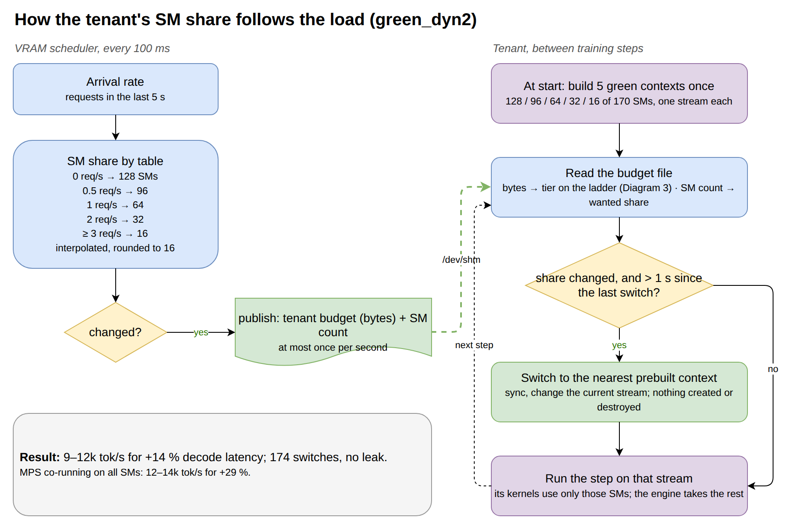

*图 E：方案 D 的 SM 份额环路。左边调度器按到达率查表得到训练任务的 SM 数，和显存预算一起发布；右边训练进程启动时建好五个 green context，step 之间只换 stream。显存阶梯（图 C）照常运行。灰框是结果：9–12k tok/s 换 +14% 的 decode 延迟，174 次切换没有漏显存。*

## 6. 看图

### 图 1：各方案的指标对到达率

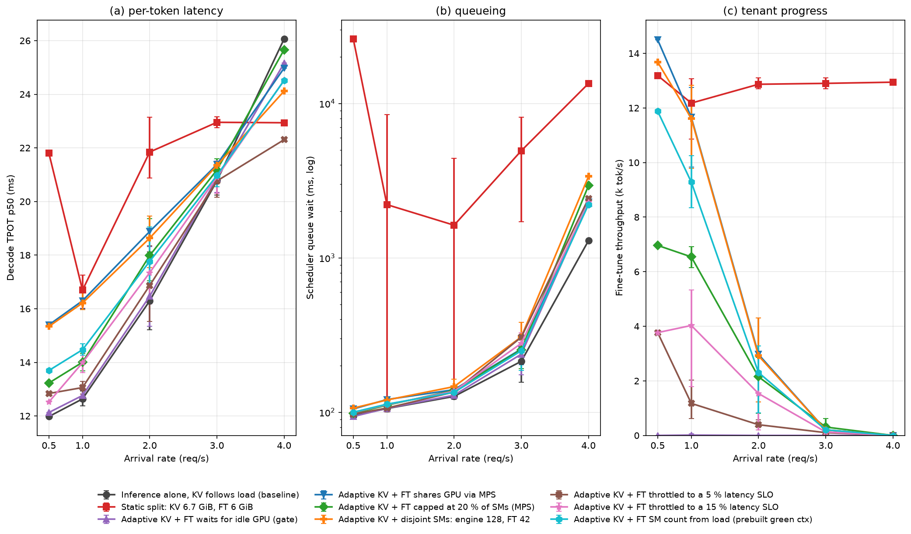

三个面板：(a) decode TPOT，(b) 调度排队，(c) 训练吞吐。相同到达率的阶段合并（点 = 均值，误差线 =
重复阶段的最小到最大）。灰色 baseline 是下界；3–4 req/s 时所有自适应方案和 baseline 重合（训练已暂停）；
0.5–2 req/s 时高出的那截取决于训练跑多快。第二轮新加的两条线：**青色（预建动态 green context）**
在蓝色/橙色下面一半的位置但吞吐接近；**粉色（15% 延迟目标）**贴在 baseline 上方 15% 以内。
红色 static split 两头都输：每个到达率都慢 30–80%，超过 2 req/s 后排队到秒级且恢复不了。

### 图 1b：只看效果最好的几个方案

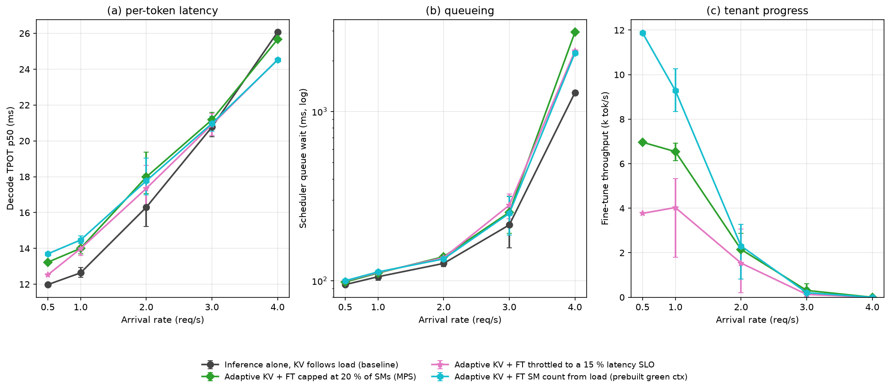

把图 1 里表现最好的三个方案和 baseline 单独拿出来画。**绿色（MPS 限 20% SM）**和**青色（预建动态
green context）**在 0.5–1 req/s 时都给训练 7–12k tok/s，解码代价差不多（+10–15%），但青色的训练吞吐
高 40–70%，并且到 2 req/s 就回到 baseline 上。**粉色（15% 延迟目标）**适合"解码预算定死"的场景：
每个到达率都守在目标内，剩多少算力给训练多少（1–5k tok/s）。

### 图 2：推理变慢多少 vs 训练跑多快

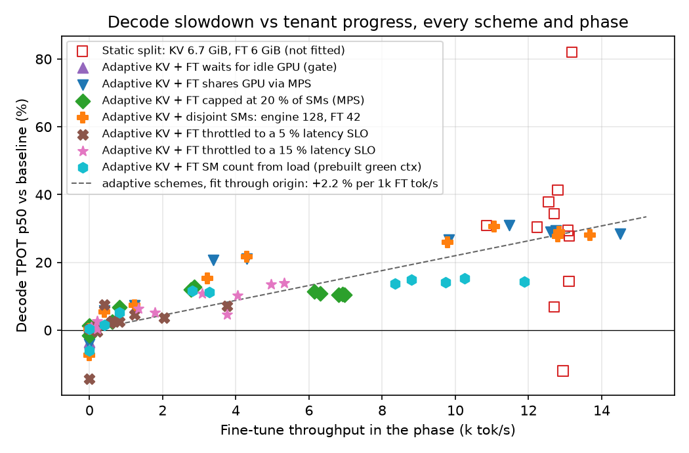

每个方案每个阶段一个点。MPS、MPS 20%、不相交分区、延迟反馈限速的点都落在一条过原点的直线上
（**每 1k 训练 tok/s，decode TPOT 慢约 2.2%**）；青色（预建动态 green context）明显在线下面
（8–12k tok/s 只 +14%）。static split 的点（空心）偏离这条线，因为它的代价来自 KV 不够而不是训练速度。

### 图 4：显存控制器忙碌度不是好的反馈信号

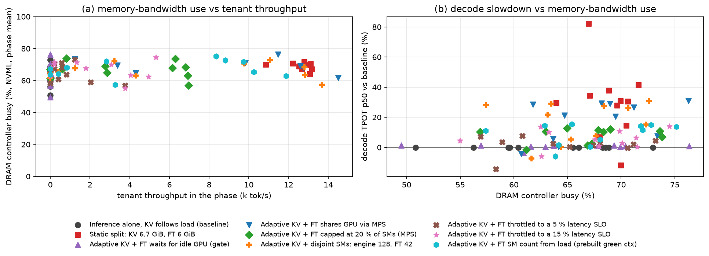

(a) NVML 的 显存控制器忙碌度对训练吞吐：训练 0 还是 14k tok/s，它都在 55–75%——推理自己就把
控制器占到这个程度，这个计数器分不出两个用户。(b) 推理慢多少对这个忙碌度：没有关系。
所以"看 显存忙碌度来调训练"行不通；看训练的 token 速率和形态才行。

### 图 5：形态探针——训练每个 token 的代价由形态决定

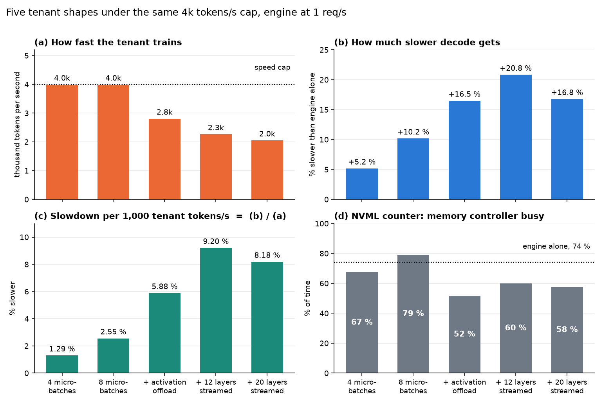

引擎 1 req/s、KV 上限固定 3 GiB；训练预算固定 7.5 GiB、tokens/s 上限固定 4k，每种形态跑 60 秒。
(a) 训练跑多快：两种 micro-batch 形态跑到了上限，后三种跑不到（2.8k、2.3k、2.0k tok/s）。
(b) 推理比引擎单独跑慢多少：+5.2% 到 +20.8%。
(c) 两者相除，每 1k 训练 tok/s 推理慢多少：k=4 1.3%，k=8 2.6%，激活 offload 5.9%，12/20 层权重流式 9.2/8.2%。
(d) 同一批窗口的显存控制器忙碌度（NVML），虚线是引擎单独跑的水平：搬字节多的形态反而更低，代价却更高。

### 图 6：decode 一步需要多少个 SM（显存带宽拐点）

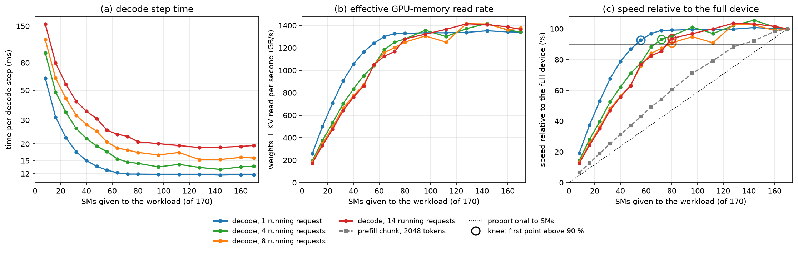

所有 green context 方案都依赖一个假设：decode 引擎可以让出一部分 SM 而不变慢，因为它的每一步是在等
显存，而不是在等计算。`knee_probe.py` 直接量这个假设能成立到哪里（11 月 9 日，GPU 1）。

**怎么做的。** 用 Llama-3-8B 的形状搭一个**合成的 decode 步**：32 层，每层是合并的 qkv、o、合并的
gate/up、down 四个投影，加上对每个请求 6272 token 的 KV 做 GQA 注意力，最后一个 token 过 lm_head。
权重是随机的 bf16（耗时和数值无关）。这样每一步要把 15.0 GB 权重读一遍，再加每个运行中请求 0.82 GB
的 KV，和真实 decode 步一样。这个步**单独**跑在 GPU 1 上（500 W，不开 MPS，没有 tenant），放进
8 到 160 个 SM 的 green context（驱动只给 8 的倍数），再和整卡 170 个 SM 比。运行中请求数取
1、4、8、14，另外加一个 2048 token 的 prefill chunk 做对照。每个点是 5 组计时的中位数。

**这个步像不像真的 decode。** 整卡上 1/4/8/14 个请求的步时间是 11.8/13.6/15.7/19.4 ms；真实引擎的
TPOT 在 0.5–1 req/s 时是 12.0–12.6 ms，4 req/s（14–15 个请求在跑）时是 26 ms。合成步没有采样、
调度、detokenize，所以是下界，batch 越大差得越多。CPU 发起一步只要 2–3 ms，所以量到的是 GPU 的时间。

**怎么看图。** (a) 步时间。(b) 等效显存读速率 = 一步必须读的字节（权重 + KV）÷ 步时间。
(c) 相对整卡的速度；圆圈是拐点（第一个达到整卡速度 90% 的 SM 数），灰色虚线是 prefill chunk，
点线是"和 SM 数成正比"。

*步时间 ms（括号里是相对整卡的速度）。112、144、160 SM 的数据在 CSV 里。*

| SMs | decode, 1 request | decode, 4 requests | decode, 8 requests | decode, 14 requests | prefill chunk, 2048 tokens |
|---|---|---|---|---|---|
| 8 | 61.4 ms (19 %) | 94.8 ms (14 %) | 118.7 ms (13 %) | 155.1 ms (13 %) | 3096 ms (6 %) |
| 16 | 31.6 ms (37 %) | 48.5 ms (28 %) | 61.6 ms (25 %) | 79.8 ms (24 %) | 1558 ms (13 %) |
| 24 | 22.3 ms (53 %) | 34.3 ms (40 %) | 43.5 ms (36 %) | 55.5 ms (35 %) | 1045 ms (19 %) |
| 32 | 17.5 ms (68 %) | 26.0 ms (52 %) | 32.6 ms (48 %) | 41.3 ms (47 %) | 784 ms (25 %) |
| 40 | 15.0 ms (79 %) | 22.0 ms (62 %) | 27.9 ms (56 %) | 34.9 ms (56 %) | 636 ms (31 %) |
| 48 | 13.6 ms (87 %) | 19.2 ms (71 %) | 24.8 ms (63 %) | 30.8 ms (63 %) | 535 ms (37 %) |
| 56 | 12.7 ms (93 %) | 17.5 ms (78 %) | 20.6 ms (76 %) | 25.3 ms (77 %) | 463 ms (43 %) |
| 64 | 12.2 ms (97 %) | 15.5 ms (88 %) | 18.7 ms (84 %) | 23.6 ms (82 %) | 404 ms (49 %) |
| 72 | 11.9 ms (99 %) | 14.6 ms (93 %) | 18.0 ms (87 %) | 22.7 ms (85 %) | 367 ms (54 %) |
| 80 | 11.9 ms (99 %) | 14.3 ms (95 %) | 17.3 ms (91 %) | 20.7 ms (94 %) | 329 ms (60 %) |
| 96 | 11.9 ms (100 %) | 13.5 ms (101 %) | 16.5 ms (95 %) | 20.1 ms (97 %) | 280 ms (71 %) |
| 128 | 11.8 ms (100 %) | 13.3 ms (102 %) | 15.2 ms (103 %) | 18.7 ms (104 %) | 225 ms (88 %) |
| 170 (full device) | 11.8 ms (100 %) | 13.6 ms (100 %) | 15.7 ms (100 %) | 19.4 ms (100 %) | 199 ms (100 %) |

**看到了什么**
- **曲线分两段。** 拐点以下，读速率几乎和 SM 数成正比：40 个 SM 以内，1 个请求时每个 SM 拉
  26–32 GB/s，4–14 个请求时每个 SM 拉 19–24 GB/s。过了拐点就平了，四种负载都停在
  **1.34–1.42 TB/s**，大约是这张卡标称 1.8 TB/s 的 75%：这时一步被显存带宽卡住，再多 SM 也没用。
- **拐点在哪。** 1 个请求在 56 个 SM，4 个请求在 72，8 和 14 个请求在 80（误差是一格，±8 个 SM；
  两次运行的中位数最多差 3%）。请求越多拐点越靠右。
- **prefill chunk 没有拐点**：64 个 SM 是整卡的 49%，128 个 SM 是 88%。它是计算受限的。
- 一个没解释的现象：4 和 8 个请求在 112 个 SM 时比 96 个 SM 慢约 4%，比 128 个 SM 慢 5–13%，
  重跑两次（每次 7 组）都能复现。

**对方案意味着什么**
- **引擎的 SM 下限大约是 80，不是一个小数。** 方案 E（`engine_green`，引擎只用 128 个 SM，和 baseline 一样快）
  就在平台段上，和这条曲线一致。SM 分区不重叠时，这张 170 SM 的卡最多给 tenant 约 90 个 SM，
  再多，负载高的 decode 光因为 SM 不够就会慢 10% 以上；负载很轻（1 个请求）时可以压到 56。
- **在平台段上不等于不怕 tenant，恰恰相反。** 平台段的意思是 decode 被显存带宽卡住，而 SM 分区并不
  分割显存带宽。tenant 加进来的每一份显存流量都从同一个 1.4 TB/s 里拿，decode 就相应变慢（图 8 量到了：两个任务的
  合计不涨）。
  方案 F（`green_split`）看到的正是这个：引擎 128 个 SM（在平台上），tenant 用另外 42 个，TPOT +28%，
  和方案 B（MPS 混跑）一样。
- **限制一个任务的 SM 数，只有压到它自己的拐点以下才限得住它的流量，42 个 SM 限得很弱。**
  decode 形状的 kernel 在 40 个 SM 上已经能拉 0.76–1.06 TB/s，超过平台的一半。训练任务自己的曲线
  见图 7：32 个 SM 上 156 GB/s，64 个 SM 上 244 GB/s。
- **方案 D（`green_dyn2`）更便宜，这条曲线解释不了。** 0.5–1 req/s 时它给 tenant 64–96 个 SM，对 decode
  形状的负载来说已经在拐点上或拐点以上。

**局限。** 合成步，而且是单独跑。混跑版本（decode 步在 N 个 SM、tenant 在 M 个 SM）和 tenant 自己的
曲线见下面的图 7–10。

### 图 7–10：训练任务为什么拖慢 decode——各个因素

**先说结论。** 主要因素是训练任务在 SM 和显存之间搬的字节：两个任务的 SM 可以分开，通往显存的通道分不开。
其次是写显存、启动 kernel、做算术和功耗。给训练任务多少 SM 只是一个间接、很弱的因素。

**为什么要做这一部分。** 如果训练拖慢 decode 是因为两个任务抢算力，那把 SM 分开就该好。前面的三个结果
不是这样：

- **SM 分开了，代价没变。** 方案 F（引擎 128 个 SM，训练另外 42 个）decode 慢 28 %；方案 B（共用全部
  SM）慢 29 %。
- **decode 并不缺 SM。** 方案 E 里引擎只用 128 个 SM，和用全部 170 个一样快。
- **也不是主机链路。** PCIe 平均只用了约 10 %，和训练的拷贝重叠时推理的 load 也没变慢（第 7 节）。

所以两个任务抢的不是 SM，也不是 PCIe。这一部分要回答：它们抢的到底是什么；以及手里现成的旋钮——给
训练多少 SM——管不管得住它。

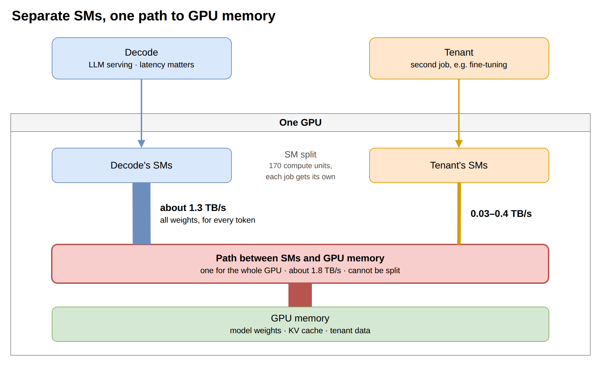

*图 J：答案指向的结构（源文件 `../diagrams/08_shared_memory_path.drawio`）。SM 可以在两个任务之间分，
SM 到显存的通道不能分。这是靠数字节推断出来的，不是从显卡内部看到的。*

**五个问题，每个都是上一个答案引出来的。**

| | 问题 | 怎么测 | 答案 |
|---|---|---|---|
| 1 | decode 被什么卡住，是 SM 还是别的？ | decode 单独跑在 8–170 个 SM 上（图 6） | **不是 SM。** 56–80 个 SM 就到顶，约 1.34 TB/s。卡住它的是通往显存的通道 |
| 2 | 通道被 decode 占着，训练的字节从哪来？ | decode 旁边放真实的训练任务，数两边各搬多少（图 8） | **从 decode 那里扣。** 两个任务的合计不涨 |
| 3 | 少给训练一些 SM，能护住 decode 吗？ | 训练的 SM 从 96 减到 8（图 7、8） | **管得很弱。** SM 减到 1/12，训练自己慢到 1/7，伤害只降到 1/4，还剩约 5 % |
| 4 | decode 真的是在对字节做反应吗？ | 换成每秒搬多少 GB 可以设定的任务（图 9） | **是。** 变慢近似直线：每 100 GB/s 慢 4–7 % |
| 5 | 为什么真实的训练比它的字节更贵？ | 第二个任务分别只读、只写、只启动 kernel、只做算术（图 10） | **字节之外还有三样。** 写、启动 kernel、做算术；功耗也是共用的 |

合起来：decode 付的代价主要取决于训练搬了多少字节，给它多少 SM 只是间接地影响这件事。这是第 10 节的
出发点。

**怎么测的。** 图 6 量的是 decode 单独跑。这一组实验在它旁边放第二个任务，然后数字节（11 月 9 日，GPU 1）。decode 用图 6
的合成步；tenant 是平常形态的训练任务（k = 4 个 micro-batch），跑在 M 个 SM 的 green context 上，其余
SM 归 decode。流量读的是整卡的显存带宽计数器（NVML GPM），用 decode 步已知的读速率校准过：1 % =
17.79 GB/s，54 个点的中位误差 0.5 %。计数器给的是所有任务的合计，每个任务自己的那份由它自己搬的字节数
算出。完整的过程和表格见 **[REPORT_bandwidth_zh.md](REPORT_bandwidth_zh.md)**。

#### 图 7：训练任务单独跑，流量降得比 SM 慢

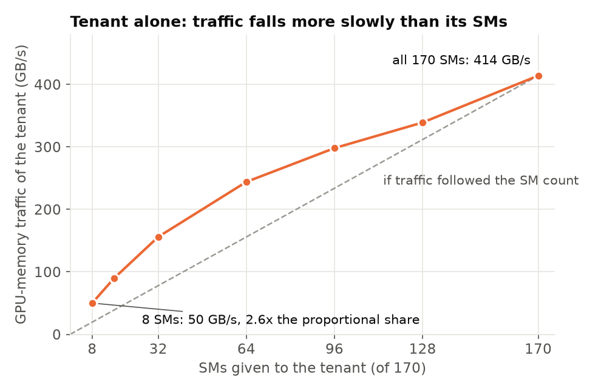

横轴是给训练任务的 SM 数，纵轴是它在 SM 和显存之间搬的流量。虚线是"流量和 SM 数成正比"的样子。

| 训练任务的 SM 数 | tok/s | GB/s | 每个 SM 的 GB/s | 每 token 的 MB | SM 忙碌度 |
|---|---|---|---|---|---|
| 170 | 29,006 | 414 | 2.4 | 14.3 | 59 % |
| 128 | 24,516 | 339 | 2.7 | 13.8 | 59 % |
| 96 | 21,942 | 298 | 3.1 | 13.6 | 63 % |
| 64 | 17,947 | 244 | 3.8 | 13.6 | 69 % |
| 32 | 11,642 | 156 | 4.9 | 13.4 | 83 % |
| 16 | 6,543 | 90 | 5.7 | 13.8 | 91 % |
| 8 | 3,490 | 50 | 6.3 | 14.3 | 96 % |

每个 token 搬的字节一直是 13.4–14.3 MB，所以流量跟着吞吐走。流量不和 SM 数成正比：170 → 8 个 SM
（1/21），流量只从 414 降到 50 GB/s（1/8），每个 SM 的流量从 2.4 涨到 6.3 GB/s。

#### 图 8：decode 旁边有训练任务

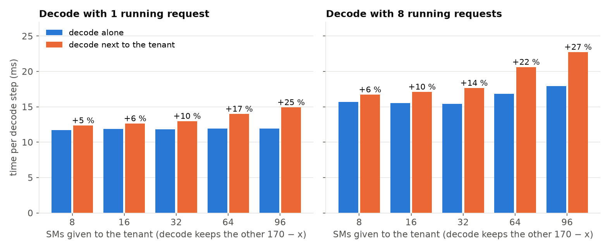

蓝色是 decode 单独跑，橙色是旁边有训练任务，两个任务的 SM 不重叠。蓝色用的就是橙色情况下 decode 拿到的
那批 SM，所以差别不是因为 decode 的 SM 变少了。

| 训练任务的 SM 数 | 训练 tok/s（占单独跑的比例） | 训练 GB/s | decode 变慢：1 / 4 / 8 个请求 | decode 少掉的 GB/s ÷ 训练搬的 GB/s |
|---|---|---|---|---|
| 8 | 2.4–2.9k（69–82 %） | 34–41 | +5.4 / +7.5 / +6.4 % | 2.0–2.4 |
| 16 | 4.5–5.3k（68–81 %） | 62–74 | +6.4 / +9.1 / +9.9 % | 1.3–1.7 |
| 32 | 8.0–9.4k（69–81 %） | 108–126 | +9.7 / +15.3 / +14.4 % | 1.1–1.5 |
| 64 | 13.2–15.2k（74–85 %） | 179–206 | +17.4 / +19.5 / +22.4 % | 1.05–1.14 |
| 96 | 18.5–19.2k（84–88 %） | 251–261 | +24.7 / +29.1 / +26.6 % | 0.98–1.08 |

- **分开 SM 护不住 decode。** 训练任务只占 8 个 SM、搬的流量只有 decode 的 3 %，decode 也慢 5–7 %。
- **总量不涨。** decode 单独 1.33–1.40 TB/s；加上训练任务后两者合计 1.21–1.35 TB/s。训练任务的流量是
  从 decode 那里扣出来的。
- **限 SM 是个弱旋钮。** 从 96 个 SM 减到 8 个：训练任务的流量降到 1/6–1/7，它自己的吞吐降到约 1/7
  （约 1.9 万 → 2.4–2.9k tok/s），对 decode 的伤害只降到约 1/4（25–29 % → 5–7 %），还有约 5 % 的地板。
- **按训练量算，SM 少反而更伤 decode。** 每 1k 训练 tok/s 让 decode 变慢：训练任务在 8 个不相交 SM 上是
  2.2–2.7 %，在 64–96 个上是 1.3–1.5 %。
- 两个任务共用 SM 时（decode 用全部 170 个，训练任务用其中 M 个），训练任务只能跑到自己单独跑的
  34–73 %；SM 不重叠时是 68–88 %。

**带宽上限在哪。**

| 谁在跑 | 显存流量 | 占标称 1.78 TB/s |
|---|---|---|
| decode 单独 | 1.33–1.40 TB/s | 75–79 % |
| decode + 训练任务（合计） | 1.26–1.41 | 71–79 % |
| 只读任务单独（每次 256 MB） | 1.58–1.61 | 88–90 % |
| 只写任务单独（96 个 SM） | 1.55 | 86.6 % |
| decode + 不限速的只读任务（合计） | 1.60–1.62 | 88–91 % |

没有任何组合到过标称值。而且 decode 的损失在合计远低于这些水平时就开始了：只读任务在 96 个 SM 上搬
50 GB/s，旁边是 8 个请求的 decode，decode 从 1,207 降到 1,156 GB/s，合计还是 1,206 GB/s（标称的
68 %），decode 慢 4.3 %。这些测量说明这条通道整体是共用的，但没有说明是通道里的哪一段在限流。

#### 图 9：换成流量可以设定的第二个任务

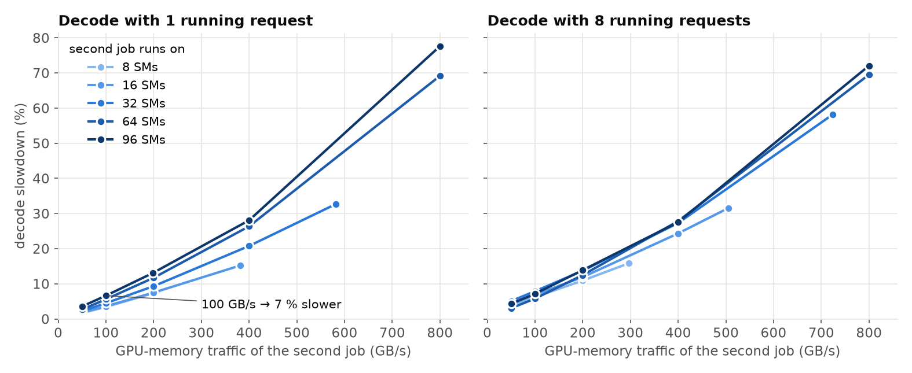

把训练任务换成一个合成任务：跑在自己的 SM 上，只读显存，每秒搬多少 GB 可以设定。每条线是它用的 SM 数。

- SM 数固定时，decode 变慢的幅度对 GB/s 近似是一条直线：每 100 GB/s，从 8–16 个 SM 发出约 4 %，
  从 64–96 个 SM 发出约 7 %（1 个请求）；8 个请求时 5–7 %。
- SM 数决定的是它最多能搬多少：8 个 SM 最多 205–298 GB/s（decode +8–16 %），96 个 SM 到
  955–1,059 GB/s（decode +106–124 %）。

#### 图 10：不只是字节

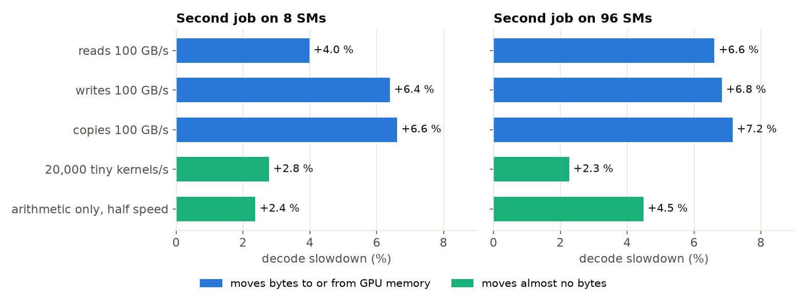

让第二个任务做五种工作，看 decode（1 个请求）各慢多少。蓝色的每秒搬 100 GB；绿色的几乎不搬字节。

| 工作类型 | 在 8 个 SM 上 | 在 96 个 SM 上 |
|---|---|---|
| 读，每 100 GB/s | 4.0 %（1 个请求），5.5–6.3 %（8 个请求） | 5.4–7.0 % |
| 写或拷贝，每 100 GB/s | 6.1–6.6 %（1 个请求），7.1–7.8 %（8 个请求） | 6.1–8.2 % |
| 只启动极小的 kernel，每秒 2k–130k 次 | +0.7 到 +5.8 % | 相同 |
| 只做算术 | +1.4–2.6 %（1 个请求），+3.8–6.9 %（8 个请求） | 全速时 +8.6–9.8 % |

- **真实的训练任务比它的字节更贵。** 它在 8 个 SM 上搬 34–41 GB/s，按图 9 当作只读来算，decode 只该慢
  1.4–2.6 %；实测是 5.4–6.4 %。写、启动 kernel、做算术各自都有代价（分别单独测的），而训练任务三样都做。
- **功耗是两个任务共用的第二样东西。** 96 个 SM 全速做算术会顶到 500 W 上限，时钟频率降 8–9 %。读、写、
  拷贝的那些点时钟没变，所以字节的结论不是功耗造成的。

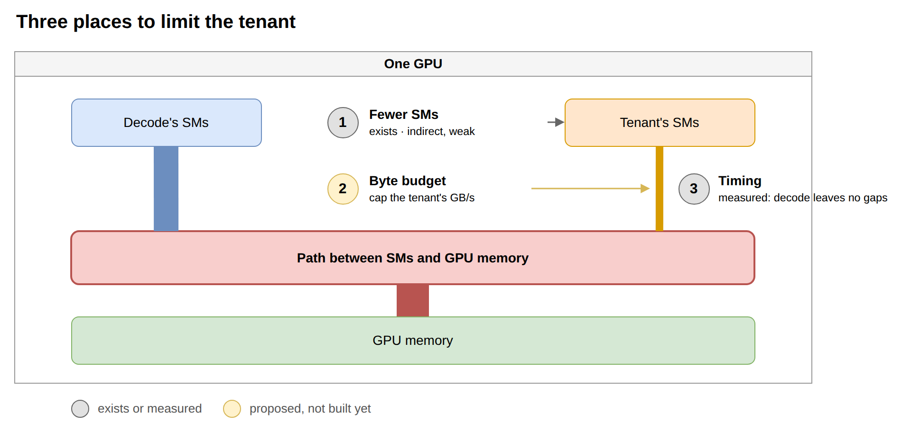

*图 K：可以给训练任务加限制的位置（源文件 `../diagrams/10_where_to_limit.drawio`）。少给 SM（1）是现成的旋钮，
但很弱；字节预算（2）是第 10 节的计划；错开时间（3）几乎没有空间，因为 decode 不留空隙（10.5 节）。*

**局限。** decode 是合成步；大部分点只跑一次（4 秒窗口）；decode 的基线会落在相差约 1 % 的两个水平上，
所以每个"变慢百分比"带约 ±1 个百分点。

### 图 3（每个方案一张，`../results/<方案>_timeline.png`）：逐秒时间线

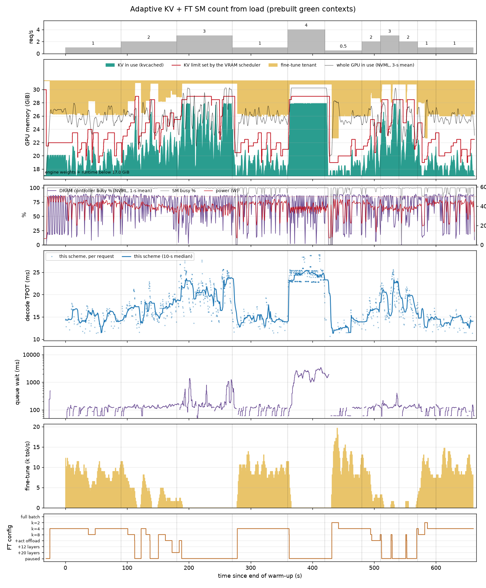

以预建动态 green context（方案 D）为例，七行从上到下：到达率；GPU 显存（青色 = 推理 KV 实际占用，
红线 = VRAM scheduler 设的 KV 上限，黄色 = 训练任务占用，黑细线 = NVML 看到的整卡用量，
只画 17 GiB 引擎固定部分以上）；显存忙碌度 / SM 忙碌度 / 功耗；decode TPOT；调度排队；
训练吞吐；训练所处的档位。到达率涨 → 红线立刻上抬、黄色被压缩、档位往下掉；4 req/s 阶段训练整个
暂停，TPOT 和 baseline 重合；负载回落 5 秒后红线下调、黄色回来、档位爬回 k=2/k=4。

### prefill 引擎当 tenant：单独一份报告

Qwen2.5-3B fp8 只做 prefill、KV 流到 host RAM，相当于 PD 分离里的 prefill 节点和 decode 节点共卡。
这个变种单独写在 **[REPORT_pf_zh.md](REPORT_pf_zh.md)** 里，有它自己的架构图、状态图、图表和数字。
一句话（D19）：三种算力机制没有区别，decode **0.5–1 req/s 时 +4–8%，≥ 2 req/s 时 0%**，因为 tenant
**固定占 4.5 GiB**，两个引擎的 KV 只剩 9.4 GiB，8B 从 2 req/s 起就要得更多，tenant 整段睡着。按 prompt
token 算它的 decode 代价约为训练 tenant 的一半。记账还有两个缺口：睡着时 1.4 GiB 仍按 4.5 记，唤醒余量
小于唤醒成本。

### 数字表

<!-- round2-compact-start -->
*Decode TPOT p50 in ms at each arrival rate (mean over the phases that share the rate; in brackets the change against the baseline), the scheduler queue wait at 3 and 4 req/s, and the tenant's throughput at 0.5 / 1 / 2 req/s (k tok/s; for the prefill tenant, k prompt tok/s). Round 2, 500 W, GPU 0. Full per-phase tables: [round2_tables.md](round2_tables.md).*

**Fine-tune tenant family**

| scheme | 0.5 | 1 | 2 | 3 | 4 | queue @3 / @4 (ms) | tenant k tok/s @0.5 / 1 / 2 |
|---|---|---|---|---|---|---|---|
| Inference alone (baseline) | 12.0 | 12.6 | 16.3 | 20.8 | 26.1 | 214 / 1292 |  |
| Static split | 21.8 (+82 %) | 16.7 (+32 %) | 21.8 (+34 %) | 23.0 (+11 %) | 22.9 (-12 %) | 4941 / 13472 | 13.2 / 12.2 / 12.9 |
| Static split + idle gate | 12.5 (+4 %) | 12.8 (+1 %) | 16.5 (+1 %) | 18.6 (-10 %) | 18.6 (-28 %) | 1019 / 9225 | 0.0 / 0.0 / 0.0 |
| Adaptive KV + gate | 12.1 (+1 %) | 12.8 (+1 %) | 16.5 (+1 %) | 20.9 (+0 %) | 25.2 (-3 %) | 238 / 2262 | 0.0 / 0.0 / 0.0 |
| Adaptive KV + MPS | 15.4 (+29 %) | 16.3 (+29 %) | 18.9 (+16 %) | 21.4 (+3 %) | 25.0 (-4 %) | 257 / 2302 | 14.5 / 11.7 / 3.0 |
| Adaptive KV + MPS 20 % | 13.2 (+10 %) | 14.0 (+11 %) | 18.0 (+10 %) | 21.2 (+2 %) | 25.7 (-2 %) | 254 / 2940 | 7.0 / 6.5 / 2.2 |
| Adaptive KV + disjoint SMs 128/42 | 15.3 (+28 %) | 16.2 (+28 %) | 18.6 (+14 %) | 21.3 (+3 %) | 24.1 (-7 %) | 308 / 3367 | 13.7 / 11.6 / 2.9 |
| Adaptive KV + 5 % latency SLO | 12.8 (+7 %) | 13.1 (+3 %) | 16.9 (+4 %) | 20.8 (-0 %) | 22.3 (-14 %) | 306 / 2425 | 3.8 / 1.2 / 0.4 |
| Adaptive KV + 15 % latency SLO | 12.5 (+5 %) | 14.0 (+11 %) | 17.3 (+6 %) | 20.9 (+1 %) | 24.5 (-6 %) | 280 / 2277 | 3.8 / 4.0 / 1.5 |
| Adaptive KV + dynamic green ctx (prebuilt) | 13.7 (+14 %) | 14.5 (+15 %) | 17.8 (+9 %) | 21.0 (+1 %) | 24.5 (-6 %) | 250 / 2216 | 11.9 / 9.3 / 2.3 |

**Prefill tenant family** (the 8B's host tier is 25.5 GiB here instead of 28, hence its own baseline)

| scheme | 0.5 | 1 | 2 | 3 | 4 | queue @3 / @4 (ms) | tenant k tok/s @0.5 / 1 / 2 |
|---|---|---|---|---|---|---|---|
| Inference alone, 25.5 GiB tier (prefill baseline) | 12.1 | 12.7 | 16.3 | 21.3 | 27.5 | 219 / 1303 |  |
| 3B prefill tenant, MPS | 12.7 (+5 %) | 13.4 (+6 %) | 16.3 (+0 %) | 21.3 (-0 %) | 24.9 (-9 %) | 260 / 3360 | 9.3 / 6.2 / 0.0 |
| 3B prefill tenant, MPS 20 % | 12.5 (+4 %) | 13.7 (+8 %) | 16.4 (+1 %) | 21.4 (+0 %) | 25.3 (-8 %) | 240 / 2176 | 8.9 / 7.1 / 0.6 |
| 3B prefill tenant, disjoint SMs | 12.6 (+4 %) | 13.4 (+6 %) | 16.3 (+0 %) | 21.3 (-0 %) | 25.4 (-8 %) | 262 / 6659 | 9.3 / 6.9 / 0.0 |

<!-- round2-compact-end -->

### 同样的结果，每列最好的三个标出来

①②③ 标的是这一列里最好的三个数；并列的标同一个号，baseline 不参与。TPOT、排队、代价越小越好；训练吞吐
越大越好。一格里有几个数的，每个数单独比。最右一列 = decode 变慢的百分比 ÷ 训练的 k tok/s。

| 方案 | 类别 | TPOT @0.5 req/s | @1 | @2 | 排队 @3 / @4 (ms) | 训练 k tok/s @0.5 / 1 / 2 | 每 1k tok/s 的代价 @0.5 / 1 |
|---|---|---|---|---|---|---|---|
| baseline | – | 12.0 | 12.6 | 16.3 | 214 / 1292 | – | – |
| static split | – | 21.8 (+82 %) | 16.7 (+32 %) | 21.8 (+34 %) | 4941 / 13472 | ③ 13.2 / ① 12.2 / ① 12.9 | 6.2 / 2.7 % |
| A 空闲 gate | 轮流用 | ① 12.1 (+1 %) | ① 12.8 (+1 %) | ① 16.5 (+1 %) | ① 238 / ② 2262 | 0 / 0 / 0 | 训练没跑成 |
| B MPS 不限 | 不限制 | 15.4 (+29 %) | 16.3 (+29 %) | 18.9 (+16 %) | 257 / 2302 | ① 14.5 / ② 11.7 / ② 3.0 | 2.0 / 2.5 % |
| C MPS 20 % | 少给 SM | 13.2 (+10 %) | ③ 14.0 (+11 %) | 18.0 (+10 %) | ③ 254 / 2940 | 7.0 / 6.5 / 2.2 | ③ 1.4 / ② 1.7 % |
| F 不相交 128/42 | 少给 SM | 15.3 (+28 %) | 16.2 (+28 %) | 18.6 (+14 %) | 308 / 3367 | ② 13.7 / ③ 11.6 / ③ 2.9 | 2.0 / ③ 2.5 % |
| D 动态 green context | 少给 SM | 13.7 (+14 %) | 14.5 (+15 %) | 17.8 (+9 %) | ② 250 / ① 2216 | 11.9 / 9.3 / 2.3 | ② 1.2 / ① 1.6 % |
| G 15 % 延迟目标 | 少给时间 | ② 12.5 (+5 %) | ③ 14.0 (+11 %) | ③ 17.3 (+6 %) | 280 / ③ 2277 | 3.8 / 4.0 / 1.5 | ① 1.1 / 2.8 % |
| G 5 % 延迟目标 | 少给时间 | ③ 12.8 (+7 %) | ② 13.1 (+3 %) | ② 16.9 (+4 %) | 306 / 2425 | 3.8 / 1.2 / 0.4 | 1.8 / 3.3 % |

读圈号时注意三点。decode 那几列的 ① 都是方案 A，但它的训练没跑成。训练吞吐那列 static split 拿了 ①，
因为它从不把显存让回去，代价是 TPOT 慢 32–82 %、排队 5–13 秒。限速那两行的最右一列不稳：它们的变慢是
一阵一阵的，用中位数算（本表）是 1.1–3.3 %，用均值算是 2.3–2.9 %；5 % 目标在 1 req/s 的 +3 % 本身就在
±4 % 的噪声里。

### 尾部：TPOT p90

上面的表用的是中位数。同一批请求日志也能算 p90（`../analyze_overlap.py`）：括号里是相对 baseline 的 p90
的变化，每列最好的三个同样标出；最右一列把中位数的变化抄过来对比。

| 方案 | 类别 | p90 @0.5 req/s | p90 @1 | p90 @2 | 对比：中位数 @0.5 / 1 |
|---|---|---|---|---|---|
| baseline | – | 13.3 | 14.1 | 18.9 | – |
| static split | – | 23.1 (+74 %) | 19.2 (+37 %) | 22.8 (+21 %) | +82 / +32 % |
| A 空闲 gate | 轮流用 | ① 13.3 (+0 %) | ① 14.3 (+1 %) | ① 19.1 (+1 %) | +1 / +1 % |
| B MPS 不限 | 不限制 | 17.0 (+27 %) | 18.4 (+31 %) | 21.3 (+13 %) | +29 / +29 % |
| C MPS 20 % | 少给 SM | ② 14.7 (+10 %) | ③ 15.8 (+12 %) | ③ 20.3 (+8 %) | +10 / +11 % |
| F 不相交 128/42 | 少给 SM | 17.0 (+28 %) | 18.2 (+30 %) | 21.5 (+14 %) | +28 / +28 % |
| D 动态 green context | 少给 SM | ③ 15.3 (+15 %) | 16.3 (+16 %) | 20.5 (+9 %) | +14 / +15 % |
| G 15 % 延迟目标 | 少给时间 | 17.1 (+29 %) | 16.3 (+16 %) | ② 20.2 (+7 %) | +5 / +11 % |
| G 5 % 延迟目标 | 少给时间 | 17.0 (+28 %) | ② 14.6 (+4 %) | 20.4 (+8 %) | +7 / +3 % |

- **少给 SM 的两种，尾部和中位数一样**：C 是 +10–12 %，D 是 +15–16 %。它们的变慢是均匀的。
- **限速的两种，在 0.5 req/s 时中位数好看，尾部却和不限速一样**：15 % 目标是 +5 % 对 +29 %，5 % 目标是
  +7 % 对 +28 %；不限速的 B 是 +27 %。
- **原因在反馈环，不在"干一阵歇一阵"本身。** 那个阶段调度器给的上限在 500 和 20 000 tokens/s 之间来回
  摆，训练一次最长歇了 8 秒，其余时候接近全速。赶上全速那几秒的请求就落在尾部。
- **上限固定时没有这个尾巴。** 形态探针用固定的 4k tok/s 上限，训练规律地干 0.35 秒、歇 0.67 秒：中位数
  +5 %，p90 +6 %。一个请求要 1.5–2 秒，跨过一个多周期。

### 图 11：平均值，和训练在跑的那些时刻

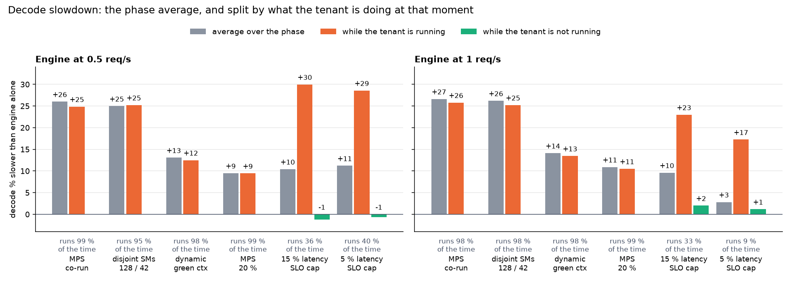

上面的"慢多少"都是一个阶段的平均。请求日志里有 decode 每个 token 的时间戳，训练的日志里有它每一步什么
时候在算、什么时候在歇，所以可以把 decode 的每个 token 间隔归到"训练在跑"或"训练不在跑"
（`../analyze_overlap.py`，表在 `../results/overlap_summary.md`）。这是对已有运行的重新分析。图里灰色是
阶段平均，橙色是训练在跑时，绿色是训练不在跑时；每组下面的小字是训练在跑的时间占比。

| 方案 | 类别 | 训练在跑的时间 | decode 阶段平均 | 训练在跑时 | 训练不在跑时 |
|---|---|---|---|---|---|
| B MPS 不限 | 不限制 | 99 / 98 % | +26.0 / +26.6 % | ③ +24.9 / +25.8 % | – |
| C MPS 20 % | 少给 SM | 99 / 99 % | ① +9.5 / ③ +10.9 % | ① +9.4 / ① +10.5 % | – |
| F 不相交 128/42 | 少给 SM | 95 / 98 % | +25.0 / +26.2 % | +25.2 / +25.2 % | – |
| D 动态 green context | 少给 SM | 98 / 98 % | +13.1 / +14.1 % | ② +12.5 / ② +13.5 % | – |
| G 15 % 延迟目标 | 少给时间 | 36 / 33 % | ② +10.4 / ② +9.6 % | +30.0 / +23.0 % | −1.2 / +2.0 % |
| G 5 % 延迟目标 | 少给时间 | 40 / 9 % | ③ +11.2 / ① +2.8 % | +28.6 / ③ +17.2 % | −0.7 / +1.2 % |

每格两个数：0.5 req/s / 1 req/s。"–"表示这种状态不到 5 % 的时间。方案 A 不在表里，因为它的训练没跑成。
这里是 token 间隔的均值，上面的表是每个请求 TPOT 的中位数，所以数字略有出入。

1. **训练不在跑的时候，decode 回到基线**（−1 到 +2 %）。停顿不留后遗症。
2. **限速不降低重叠那一刻的伤害，它缩短的是重叠的时间。** 训练在跑时 decode 慢 23–30 %，和不限速的 B
   （25–26 %）一样，但训练只有三分之一的时间在跑。平均值就是两者相乘：36 % × 30 % ≈ 10.8 %，实测 10.4 %。
3. **少给 SM 降低的是每一刻的伤害，训练一直在跑**：C 是 +9–11 %，D 是 +12–14 %。F 是例外（+25 %），因为
   训练在 42 个 SM 上仍然跑满。
4. **按每个 token 算，少给时间不省，少给 SM 省。** 1 req/s 时每 1k 训练 tok/s 让 decode 慢：B 2.3 %，
   15 % 目标 2.4 %，F 2.3 %；C 1.7 %，D 1.5 %。
5. **2 req/s 要换一种比法。** 这时训练约一半时间被显存预算暂停，而且恰好是负载冲高的时候，和整段的平均
   比会把两件事混在一起。改成和"同样多请求在跑"时的 baseline 比：训练在跑时 +8–15 %，不在跑时 −2 到 0 %。
   结论相同。

## 7. 传输路径不是瓶颈

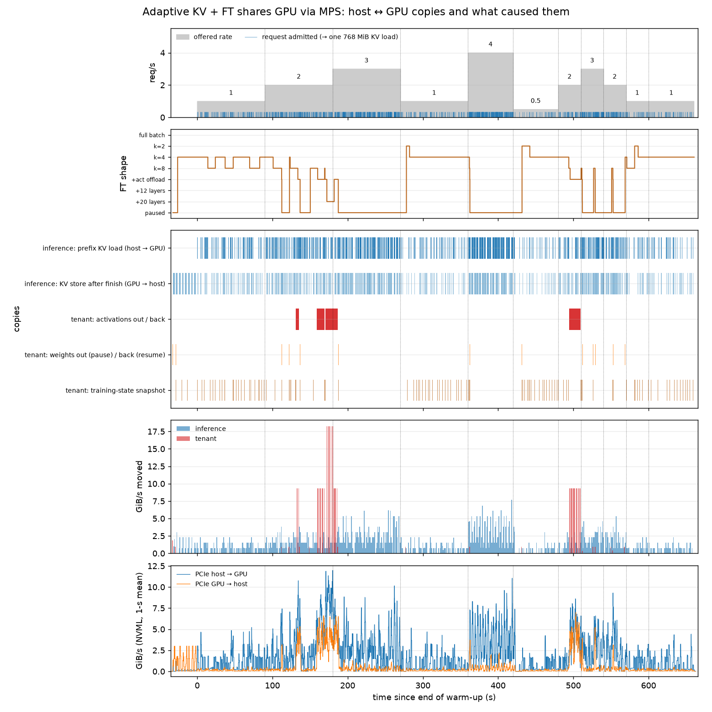

*图 3：MPS 方案里的每一次 host↔GPU 拷贝，以及它为什么发生。上面两行是原因：每个请求进入（蓝色刻度）触发一次 768 MiB 的前缀 KV 加载，结束时触发一次 16 MiB 的回存；训练任务每换一次形态就触发它的拷贝（经过"激活 offload"档时激活出去再回来，暂停时权重出去、恢复时回来），另外每 10 步一次快照。中间一行是拷贝本身，第四行是每秒搬运的字节数（按来源），最后一行是 NVML 的 PCIe 计数。*

推理的 KV load 走 13.5 GiB/s，链路平均只忙 10%；和训练的拷贝有并发时 load 时长中位数没有可测的变化。
所以推理的代价不是 PCIe 争用。但图 5 补了另一面：拷贝之间不互相拖慢，可"拷贝多的训练形态"对 decode 的
代价是不拷贝形态的 3–7 倍——拷贝和 decode 争的是 GPU 的显存系统，不是和彼此争链路。

## 8. kvcached + LMCache（第二轮 P4，GPU 1）

kvcached main 上，LMCache 0.5.6 的 MP connector `engine_driven` 模式**能用了**：10 分钟高强度
store/retrieve、每 15 秒改一次 KV 上限（2 ↔ 12 GiB），341/341 请求成功，输出和不带 connector 的引擎
8/8 一致，没有 Xid。kvcached 0.1.6 上的 Xid 31 崩溃在 main 上消失了（main 把页的 unmap 排在 GPU 进度
之后），为它写的 pin 层没派上用场。零拷贝的 VMM 模式还是卡在 LMCache 那边：它要求一个 tensor 一个
handle，kvcached 是 2 MiB 一页。

## 9. 结论和下一步

**解决了的**
- 不改 vLLM，router + VRAM scheduler + kvcached 让推理 KV 预算随负载在线涨缩，推理零失败、零代价，
  账算实了（实测引擎固定量、给 tenant 留 context、只承诺真空闲的显存）、GPU 从未超卖。
- 训练任务按三层设计降档、卸载、暂停、恢复；tokens/s 限速、预建 green context 切换都工作。
- 算力共享有了两个能用的方案：**预建动态 green context**（+14% 换 9–12k tok/s）和
  **延迟反馈限速**（15% 目标守得住）。
- 干扰的规律：decode 的代价跟着训练的 token 速率走（每 1k tok/s +2.2%），形态决定每个 token 多贵
  （1.3% → 9%）。
- kvcached + LMCache engine_driven 在 kvcached main 上能用。
- decode 单独跑时的显存带宽拐点量出来了（图 6）：1 个请求 56 个 SM，4–14 个请求 72–80 个 SM，
  平台 1.34–1.42 TB/s。
- 干扰的原因量出来了（图 7–10）：分开 SM 隔不开通往显存的通道。两个任务的流量合计 1.21–1.35 TB/s，
  decode 单独是 1.33–1.40 TB/s，训练任务搬的是从 decode 那里扣的；只读的第二个任务每搬 100 GB/s 让
  decode 慢 4–7%；写、启动 kernel、做算术各自还有代价。
- 少给时间和少给 SM 是两种不同的工具（p90 表、图 11）：训练歇着时 decode 回到基线；限速时训练在跑的那一刻
  decode 照样慢 23–30%，只是重叠的时间短了；少给 SM 降低的是每一刻的伤害，每个 token 也更便宜
  （1.5–1.7% 对 2.3–2.4%）。延迟目标的反馈环守得住中位数，但让上限大幅摆动，0.5 req/s 时 p90 是 +28–29%。

**没解决 / 要注意的**
- 5% 这种小目标低于 10 秒窗口的测量噪声，要么目标 ≥ 10%，要么窗口更长（环路就慢于 30–60 秒的阶段）。
- prefill 引擎当 tenant 受显存限制：固定 4.5 GiB 只在 ≤ 1 req/s 时放得下，≥ 2 req/s 就一直在睡；
  睡眠释放的 3 GiB 调度器还没记回 KV 池。
- 零拷贝的 LMCache 模式要 LMCache 那边改。
- 引擎至少要留约 80 个 SM；而且 decode 在平台段上时，tenant 搬的每个字节都是从 decode 那里拿的，
  和 tenant 跑在哪些 SM 上无关。方案 D（`green_dyn2`）为什么更便宜还没有被解释（图 6）。
- 限 SM 是个弱旋钮：训练任务从 96 个 SM 减到 8 个，它自己的吞吐降到约 1/7，对 decode 的伤害只降到
  约 1/4，还有约 5% 的地板（图 8）。

**下一步**：见第 10 节。

## 10. 下一步：限制训练任务的字节，并让它少用字节

10.1 到 10.6 是 11 月 16 日那一晚之前的设计：打算造什么、原型里已经有什么、每一步由哪个实验来决定，引用的
数字都是前面几节量到的。**10.7 节是那一晚实际测到的**，其中有几处修正了 10.1–10.6 的说法。

### 10.1 这些想法建立在什么上面

两部分测量合起来。**图 7–10 回答"该管什么"**：该管的是训练搬的字节，不是它的 SM。**图 11 回答"怎么管"**：
让训练干一阵歇一阵是一个可用的手段，因为它歇着时 decode 回到基线。C1 就是把这两条接起来，从外面限制训练任务。C2 把第一条用到训练任务
自己身上：既然 decode 是在为训练搬的字节付出代价，那就改训练任务，让同样的训练少搬一些。

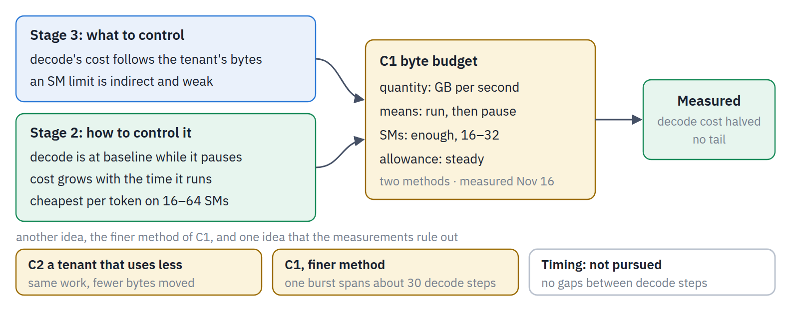

*图 L：从测量到想法（源文件 `../diagrams/15_measurements_to_ideas.svg`，由 `../diagrams/make_svg.py` 画出）。
左边两框是已经测到的；黄框是由它们推出来的设计，还没做。*

| 已经测到的 | 出处 | 所以 | 落到哪个想法 |
|---|---|---|---|
| decode 的变慢跟着第二个任务搬的字节走：每 100 GB/s 慢 4–7 %；两个任务的合计不涨 | 图 8、9 | 要管的量是字节，不是 SM | **C1**：额度用 GB/s |
| 限 SM 间接而且弱，还有约 5 % 的地板。8 个 SM 是每个 token 最贵的点，16–64 个最便宜 | 图 8；图 11 | 不靠挤 SM 来压训练，给它几十个 | **C1**：SM 给够 |
| 训练歇着时 decode 回到基线（−1 到 +2 %）；它在跑时的代价和连续混跑一样 | 图 11 | "干一阵歇一阵"按时间线性起作用，可以用来守额度 | **C1**：靠停顿守额度 |
| 上限固定时 p90 和中位数一样；反馈环让上限大幅摆动时，p90 和不限速一样 | p90 表 | 额度要慢慢调 | **C1**：额度平稳 |
| 同样的 tok/s，不同形态的代价差 7 倍；在跑时它们让 decode 慢得差不多，差在自己的速度 | 图 5；10.4 | tok/s 不是好单位；训练怎么算，决定了一个 token 让 decode 付出多少 | **C1** 的单位；**C2** |
| 在 CPU 上数出来的（不是在 GPU 上量的）：训练一步搬的字节里 88 % 是中间结果；反向传播变短，每 token 的字节少 36–44 % | 10.4 | 同样的训练，搬的字节可以降 | **C2** |
| 训练一次全速要盖住约三十个 decode 步；规律的干–歇按请求算会被平均掉 | p90 表 | 切碎只改善 token 之间的抖动 | **C1** 的第二种做法，后做 |
| decode 步和步之间没有空隙（GPU 93–100 % 在忙）；方案 A 下训练一步都没跑成 | 第 5 节 | 没有能让训练躲进去的时段 | 不做"错开时间" |
| 文献里按字节定预算，只用来保护 CPU 任务 | 第 11 节 | 以 decode 为受害者的字节预算没有先例 | **C1** 是新的 |

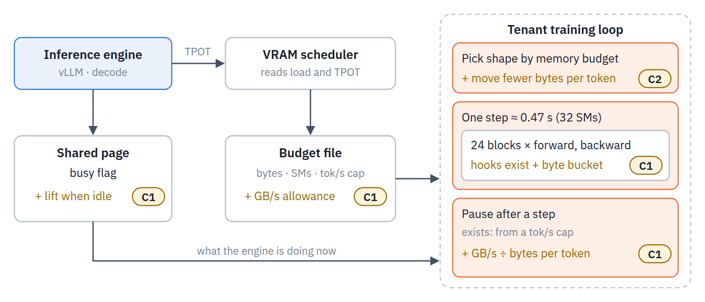

*图 F：每一步接在原型的哪一处（源文件 `../diagrams/11_next_steps_attach.svg`）。普通文字是代码里已经有的，
黄色标签是要新建的。所有改动都只在训练任务自己的循环里，加上两个共享文件里的字段；不改驱动，不拦截
CUDA 调用，不改推理引擎。*

| | 一句话 | 代码里已经有 | 要新建 | 由什么决定 |
|---|---|---|---|---|
| **C1** 字节预算，做法一 | 给训练任务一个 GB/s 额度，超了就停 | tok/s 上限和每步之后的停顿；TPOT 反馈环（方案 G） | 预算文件里的 GB/s 字段；每种形态的每 token 字节；换算 | 实验 E1.1：同样的流量，停顿对限 SM |
| **C1** 字节预算，做法二 | 把停顿从一步之后移到 block 的边界 | 每个 block 前向、反向之前的钩子；CUDA 事件同步 | 钩子里的字节桶 | 每个边界同步一次的开销 |
| **C2** 少占带宽的训练任务 | 改训练任务，让同样的训练少搬字节，decode 少慢一些 | 按显存预算选的 5 种形态；融合的注意力；在 CPU 上数的算子清单 | 用 GPU 计数器量每种形态和变体的每 token 字节；训练任务里的开关：合并算子、输出层分块、只在上面几层加 LoRA | 同样的训练进度下，decode 的变慢是否跟着训练的每 token 字节一起降（还没测） |

### 10.2 C1：字节预算（做法一：每步之后停）

给训练任务一个额度：平均每秒最多搬多少字节。它照常全速干活，额度用完就停，等额度补上再接着干。
守同一个额度有两种做法：每步之后停（本节，代码里已经有一半）；或者在 block 的边界上停，把活切成短得多
的小片（10.3 节）。

现在压训练任务的办法是少给它 SM，让它一直慢慢干。图 8 的表给出了这样做的代价：

| 训练任务的 SM 数（不相交） | 每 1k 训练 tok/s，decode 慢 | 留给 decode 的 SM | decode 只因 SM 变少而慢 |
|---|---|---|---|
| 8 | 2.2–2.7 % | 162 | 约 0 |
| 16 | 1.4–1.9 % | 154 | 约 0 |
| 32 | 1.2–1.7 % | 138 | 约 0 |
| 64 | 1.3–1.5 % | 106 | +2–7 % |
| 96 | 1.3–1.5 % | 74 | +2–14 % |

8 个 SM 是每个 token 最贵的点，是其他档的 1.5–2 倍；从 16 个往上基本持平；给到 64 个以上，decode 自己
开始缺 SM。所以 C1 换一种压法：给 16–32 个 SM，时间给少。一组不需要任何推算的对比：训练在 8 个 SM 上
是 2.4–2.9k tok/s，decode +5.4–7.5 %；在 16 个 SM 上是 4.5–5.3k tok/s，decode +6.4–9.9 %。训练量是 1.9 倍，
decode 多付 1–2.4 个百分点。

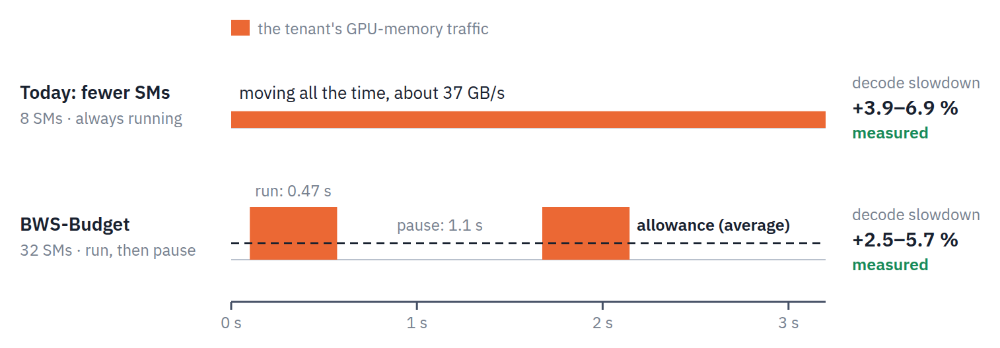

*图 G：C1 的做法一（源文件 `../diagrams/12_c1_budget.svg`）。两行干的活一样多，约 2.6k tok/s；橙色块的高度
是训练此刻的显存流量，面积是搬的字节；横轴 3.2 秒，按比例画。虚线是额度，也就是平均值，和上一行的橙色
一样高。比例的来源：在 32 个不相交 SM 上训练跑 8.0–9.4k tok/s，一步 4,096 个 token 约 0.47 秒；在 8 个 SM
上跑 2.4–2.9k tok/s。*

1. VRAM scheduler 在预算文件里多写一个字段：训练任务此刻可以用多少 GB/s。初值按量到的价格算（允许
   decode 变慢的幅度 ÷ 每 100 GB/s 的代价），之后用 TPOT 反馈慢慢修正（见 p90 表）。
2. 训练任务把 GB/s 换成 tok/s：除以它当前形态的每 token 字节。现在只测过一种形态（13.4–14.3 MB）。
   其余形态在启动时各测一次：那时训练任务独占 GPU，带宽计数器读到的就是它自己的流量。
3. 训练任务跑在 16–32 个 SM 上，每步之后停一会儿，使平均流量不超过额度。停顿的代码已经有，
   现在按 tok/s 算。
4. 没有请求在跑时（引擎的 busy 标志清零），额度放开；第一个请求一来就收回。

额度用字节而不用 tok/s，是因为同样 1k tok/s，不同形态对 decode 的代价最多差 7 倍（图 5）：训练任务一换
形态，tok/s 上限就要重调，字节额度不用。

图 11 已经支持的：训练歇着时 decode 在基线上，它在跑时的代价和连续混跑一样（都是 SM 全部共用的情况）。
还没测的：两件事合起来，也就是训练在 32 个 SM 上干一阵歇一阵。

**决定性的实验（E1.1）。** 用两种办法把训练任务压到同一个 tok/s：只给 8 个 SM，或者给 32 个 SM 加停顿。
3 档流量 × decode 的 1、4、8 个请求，比 decode 每步时间的均值和 p90。约 15 分钟 GPU。如果两条线重合，
字节预算在代价上就不比限 SM 好，剩下的好处是它没有地板、可以连续调。

### 10.3 C1 的第二种做法：在 block 边界上停

停顿放在一步之后时，训练任务是"全速约 0.47 秒，然后停更久"，一次这样的全速段要盖住约三十个 decode 步
（每步 12–18 ms）。第二种做法还是同一个额度，只是把同样的活切成比一个 decode 步还短的小片。

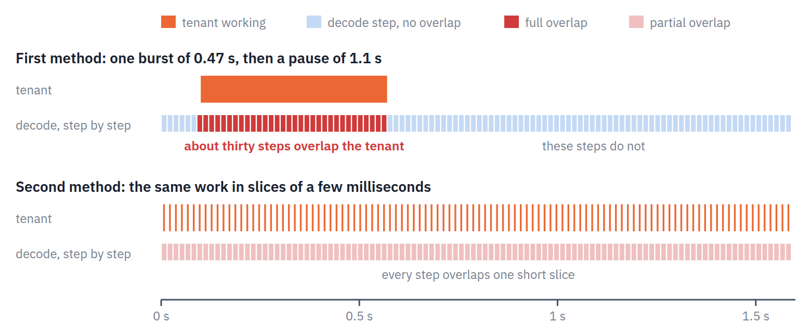

*图 M：两种做法，放大到单个 decode 步来看（源文件 `../diagrams/16_c1_finer.svg`）。每个小格是 decode 的
一步，约 15 ms；横轴 1.6 秒。两行干的活一样多。上一行按测到的数画，下一行是设计。*

1. 训练模型的每个 block 在前向和反向之前已经各有一个钩子，现在用来查显存预算和空闲 gate。模型有 24 个
   block，4 个 micro-batch 的一步里就有 4 × 48 = 192 个可以停的点，在 32 个 SM 上平均每 2.4 ms 一个。
2. 在钩子里放一个字节桶。每过一个边界，按这一步的字节均摊扣一份。桶空了，先等 GPU 把已经提交的 kernel
   跑完（CUDA 事件同步，已经有），再睡到桶补上。
3. 桶的补充速率就是 C1 的 GB/s 额度。桶的大小决定一片多长，目标是比一个 decode 步短。

它为什么后做：它不改变平均值，只改变慢得均不均匀；而按请求算，规律的干–歇本来就被平均掉了（固定上限时
中位数 +5 %，p90 +6 %）。它能改善的是 token 之间的抖动。没覆盖的：优化器更新和算 loss 那一段不在 block
里；一个 block 内部不能再分；"每个边界扣同样多"是假设，前向和反向各搬多少字节还没有量。要先量的：
每个边界同步一次的开销，每步 192 次。

### 10.4 C2：少占显存带宽的训练任务

C1 从外面限制训练任务，训练任务本身不变。C2 改的是训练任务自己：同样的训练，在显存和 SM 之间那条通道上
搬的数据要少，这样 decode 慢得少。衡量它的标准是**同样的训练进度下 decode 慢多少**。C2 还没有任何一项
放在 decode 旁边测过；这一节讲的是目前对训练搬的字节知道什么，以及有哪些手段。

**训练的字节花在哪。** 把训练任务的一个 micro-batch（2 × 512 个 token）按算子拆开，**在 CPU 上数，没有用
GPU**（`../tenant_inventory.py`，`../results/tenant_inventory.md`）：前向和反向里的每一个基本算子读多少
字节、写多少字节，按每个元素 2 字节算。这是数出来的，不是在 GPU 上量的：它假设每个算子是一个独立的
kernel，输入从显存读、输出写回显存。

| 变体 | 搬数据的算子调用次数 | 每 token 的 MB | 其中前向 / 反向 | 权重占比 |
|---|---|---|---|---|
| 训练任务现在的样子（24 层都有 LoRA） | 3,302 | 17.0 | 6.7 / 10.2 | 12 % |
| 只做前向 | 1,318 | 6.7 | 6.7 / 0 | 17 % |
| LoRA 只加在最上面 8 层 | 1,710 | 10.9 | 6.2 / 4.7 | 15 % |
| LoRA 只加在最上面 4 层 | 1,318 | 9.4 | 6.1 / 3.3 | 16 % |
| 一遍处理 8 条序列（1 个 micro-batch） | 3,302 | 15.4 | 5.8 / 9.5 | 3 % |
| 一遍处理 1 条序列（8 个 micro-batch） | 3,301 | 19.1 | 7.9 / 11.2 | 22 % |
| 注意力不融合（`eager`） | 3,720 | 23.3 | 9.8 / 13.5 | 9 % |

- 数出来是每 token 17.0 MB；GPU 计数器量到的是 13.4–14.3 MB（图 7）。数出来的是同一量级的上界。
- **权重只占 12 %；88 % 是中间结果**：一个算子写回显存，下一个算子再读出来。光是逐元素的乘法和加法就占
  37 %。
- **输出层约占五分之一**：151,936 个词的 logits，一个 micro-batch 就是 297 MB，在最后一层投影、loss 和
  它们的反向之间被读写约十次。
- **一遍多处理一些 token 变化不大**：从 1 个到 8 个 micro-batch，每 token 15.4 到 19.1 MB，只有权重那
  部分在变。
- **反向传播变短变化很大**：LoRA 只加在最上面 4–8 层，每 token 9.4–10.9 MB，少 36–44 %，算子调用次数
  减半。
- 训练任务已经在用融合的注意力；不用的话要多 37 %。

**手段**，按改动从小到大。都还没有放在 decode 旁边测过。

| | 手段 | 训练本身变不变 | 目前知道什么 |
|---|---|---|---|
| 1 | 在训练任务已有的形态里选 | 不变 | 放在 decode 旁边测过，每种形态一个 60 秒窗口（见下）。每 token 字节只知道一种形态的 |
| 2 | 设置：micro-batch 大小、注意力的实现 | 不变 | 数出来：micro-batch 大小让每 token 字节变化约 ±10 %；融合的注意力已经在用 |
| 3 | 合并算子，让中间结果留在 SM 里、不写进显存：逐元素的算子链（靠编译器或手写 kernel），输出层和 loss | 不变 | 数出来这两块分别占字节的 37 % 和约五分之一。LoRAFusion 报告合并 LoRA 的 kernel 后显存流量降 34–37 %，目的是任务自己的速度（第 11 节） |
| 4 | 少训几层：LoRA 只加在上面几层 | 变；训练效果是否一样好是另一个问题 | 数出来每 token 字节少 36–44 % |

**只有手段 1（形态）有测量。** "形态"指训练的一步怎么算，训练的内容不变：8 条序列拆成几个 micro-batch
（1、2、4 或 8）；中间结果放不放主机内存；12 层或 20 层的权重放不放主机内存、算到那层才读进来。这些形态
本来是为省显存设计的，decode 要回显存时训练就一档一档往下退。

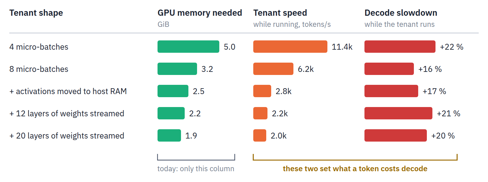

*图 N：形态探针里的五种形态（源文件 `../diagrams/17_shapes.svg`）：各自要占多少显存（`../tiers.json`），
训练在跑时的速度，以及训练在跑时 decode 慢多少（`../results/overlap_summary.md`；每种形态一个 60 秒窗口）。*

训练只要在跑，不管哪种形态，decode 都慢 16–22 %。形态的差别在训练自己的速度，从 11.4k 到 2.0k tok/s：
越省显存的形态越慢，要跑更久才能交出同样多的 token。交出同样的 4k tok/s，第一种形态只要干 31 % 的时间，
第二种 61 %，后三种要一直干。变慢除以速度，就是每 1k tok/s 的代价：约 2 %、2.5 %、6 %、10 %、10 %。
所以在显存放得下的形态里，最快的那种做同样的训练让 decode 付出最少。

**还不知道的，也是决定 C2 成不成立的：**

- **decode 这一边。** decode 的变慢跟着训练的 tok/s 走，这是在同一种形态内测到的（图 8）。同样的 tok/s
  搬的字节少了，decode 是否少慢，还没有用任何变体测过。
- **慢的形态。** 它们在跑时让 decode 慢得和快的形态一样多，而每秒的 token 只有五分之一到四分之一。它们的
  每 token 字节没有量过。要么它们每个 token 搬的字节多好几倍，要么 decode 在那里付出的不是字节的代价。
- **放开跑的训练任务。** 每 token 字节少的变体，可能只是跑得更快，把同样的带宽占满。所以 C2 要在同样的
  训练进度下比，旁边需要 C1 或者 SM 限制把进度固定住。
- **地板。** 一个不搬数据的第二任务，在 8 个 SM 上也让 decode 变慢：1 个请求时 1.4–2.6 %，8 个请求时
  3.8–6.9 %（图 10）。怎么改训练搬的字节，
  也降不到这以下。

### 10.5 不做：错开时间在 decode 节点上空间很小

原来的想法是让训练任务在 decode 不需要这条通道的时候干活。在 decode 节点上，这样的时候只可能有两种：
decode 步和步之间的空隙，或者完全没有请求。

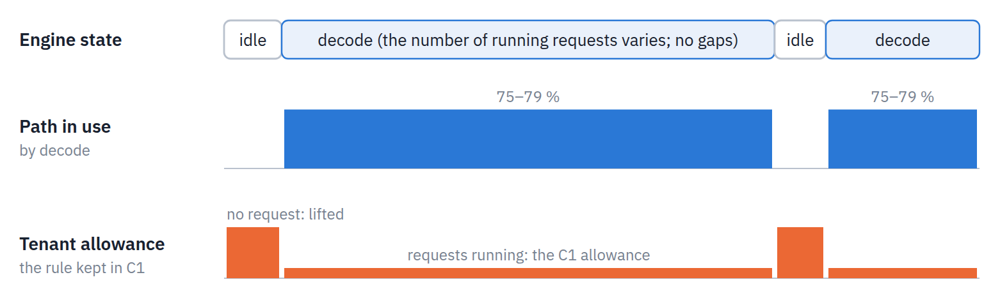

*图 H：decode 节点上错开时间还能用什么（示意图，不按比例；源文件 `../diagrams/13_decode_node_timing.svg`）。
引擎把前缀的 KV 取回来，自己只对每个请求新增的 128 个 token 做 prefill（两者合计约 160 ms），其余都是
decode。*

- **步和步之间没有空隙。** 只要有请求在跑，GPU 有 93–100 % 的时间在忙（0.5–3 req/s，D5）。方案 A 只让
  训练任务在空隙里跑，decode 只慢 1 %，训练一步都没跑成。
- **在跑的请求数不改变 decode 对通道的占用**：1、4、8 个请求时都是标称带宽的 75–79 %。
- **剩下的只有完全没有请求的时间**：0.5 req/s 以上最多约 7 %。

所以错开时间不单独做。它只剩 C1 里的第 4 条规则。

### 10.6 先后顺序

| 顺序 | 做什么 | 回答什么 | GPU 时间（估计） |
|---|---|---|---|
| 1 | E1.1：同样的流量，两种旋钮 | C1 值不值得造 | 约 15 分钟 |
| 2 | C1 做法一：预算文件加 GB/s，训练任务做换算，额度慢慢调 | 在完整的 11 分钟负载上和方案 G、方案 D 比，看中位数和 p90 | 每个方案约 12 分钟 |
| 3 | C2，训练这一边：用 GPU 计数器量出 10.4 节的表，每种形态和变体都量 | 训练的字节花在哪；每种手段能降多少；C1 的换算 | 约 25 分钟 |
| 4 | C2，decode 这一边：每 token 字节少的变体放在 decode 旁边，训练进度相同；然后上 11 分钟负载 | decode 的变慢是否跟着训练的每 token 字节一起降 | 约 35 分钟，然后每个方案约 12 分钟 |
| 5 | C1 做法二：字节桶放进 block 钩子 | token 之间的抖动；同步的开销 | 每个方案约 12 分钟 |

每次运行和事先写下的预测在 [`../PLAN_overnight3.md`](../PLAN_overnight3.md)。

前面几节留下的、同样没做的：把动态 SM 份额改成用 TPOT 偏差驱动（现在的 SM 表是按到达率开环查表）；
prefill tenant 读适配器报的实时占用，把睡眠时释放的显存记回 KV 池，并且预算超过权重才唤醒；SM 分区
不重叠时，引擎保持 ≥ 80 个 SM；把结果换算成提案里的指标——SLO 之内能服务多少负载。

### 10.7 11 月 16 日的实测：C1 和 C2

用了一个晚上、两张卡。每次运行之前都先写下预测（[`../PLAN_overnight3.md`](../PLAN_overnight3.md)），
预测和结果逐条记在 [DECISIONS.md](DECISIONS.md) 的 D20–D28。训练任务这边新加了三样东西：GB/s 额度（预算文件
里的新字段，按当前形态的每 token 字节换算成 tok/s）；守额度的第二种做法（在 block 边界切片）；以及几种
"每 token 少搬字节"的变体开关。合成实验用图 6 的 decode 步，在 GPU 1 上；真引擎实验用 11 分钟的参考负载，
在 GPU 0 上，和当晚自己的基线比（TPOT 中位数 12.0 / 12.7 / 16.4 ms，对应 0.5 / 1 / 2 req/s；11 月 9 日的
基线是 12.0 / 12.6 / 16.3）。两个旧方案当晚重跑了一遍作对照，和 11 月 9 日的结果相差 2 个点以内。

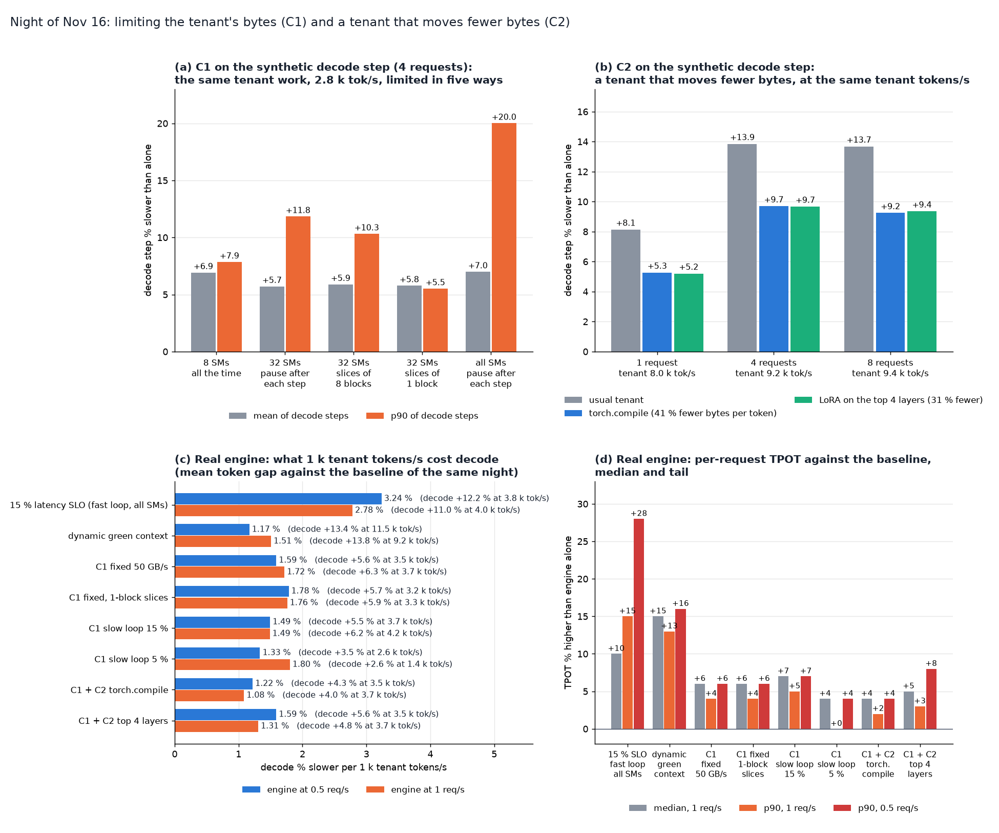

*图 12：11 月 16 日当晚的结果（`../plot_o3.py`）。(a)、(b) 是合成 decode 步，两遍取平均（两遍最多差 0.2 个点）；
(c)、(d) 是真引擎，和当晚的基线比。*

**C2，训练这一边：一个 token 要搬多少字节**（训练单独跑在 32 个 SM 上，每种约 43 秒；计数器重新标定：
1 % = 17.79 GB/s）。

| 训练任务 | 每 token 的 MB | 和原来比 | tok/s | 训练本身变不变 |
|---|---|---|---|---|
| 原来的形态，4 个 micro-batch | 13.47 | – | 11,628 | – |
| 1 / 2 / 8 个 micro-batch | 15.58 / 13.48 / 14.88 | +16 / 0 / +10 % | 14,543 / 13,416 / 9,579 | 不变 |
| 慢形态：中间结果、再加 12 层、20 层权重放主机内存 | 15.19 / 16.57 / 17.61 | +13 / +23 / +31 % | 3,246 / 2,566 / 2,364 | 不变 |
| 注意力不融合（`eager`） | 20.66 | +53 % | 10,096 | 不变 |
| **`torch.compile`** | **7.95** | **−41 %** | 14,457 | 不变 |
| 输出层和 loss 每 16 个位置算一块 | 42.23 | +214 % | 7,706 | 不变 |
| LoRA 只加在最上面 8 层 / 4 层 | 10.10 / 9.24 | −25 / −31 % | 17,743 / 20,198 | 变 |
| 只做前向（参照） | 3.73 | −72 % | 25,010 | 不训练 |

- 用编译器合并算子，训练搬的数据少 41 %，自己还快 24 %，训练内容不变。
- 输出层分块是我设计上的错误：每算一块都要把 272 MB 的输出层权重重新读一遍。
- 10.4 节在 CPU 上数出来的数，把"只训上面几层"的节省高估了约 12 个点，1 个 micro-batch 的方向也数反了。
- 慢形态在跑时每秒只搬 42–49 GB（快形态是 143–181 GB/s）。

**C2，decode 这一边：同样的训练进度，搬得少，decode 就慢得少**（图 12b；训练在 32 个 SM 上，合成 decode 步在
其余 138 个上）。

| 训练任务（都限到原任务的 tok/s） | 1 个请求 | 4 个 | 8 个 | 每 1k tok/s |
|---|---|---|---|---|
| 原来的 | +8.1 % | +13.9 % | +13.7 % | 1.02 / 1.51 / 1.46 % |
| `torch.compile` | +5.3 % | +9.7 % | +9.2 % | 0.66 / 1.06 / 0.99 % |
| LoRA 只加在最上面 4 层 | +5.2 % | +9.7 % | +9.4 % | 0.65 / 1.06 / 1.00 % |

decode 的变慢少了 30–36 %。按训练每秒搬的 GB 来画，所有点在一条线上（1 个请求时每 100 GB/s 慢 7.0–8.5 %）。
如果放开跑，这些变体只是跑得更快：编译版多做三分之一的训练，代价略低（+7.2 %）；只训 4 层的多做 80 %，
代价更高（+9.6 %）。所以 C2 要和 C1 配着用。

**C1 在合成 decode 步上：同样的训练进度，用不同的办法限**（图 12a）。

| 训练进度 2.4 / 2.8 / 2.9k tok/s | 平均（1 / 4 / 8 个请求） | 单步 p90 |
|---|---|---|
| 8 个 SM，一直跑 | +3.9 / +6.9 / +5.9 % | +5.4 / +7.9 / +8.2 % |
| 32 个 SM，每步之后停 | +2.5 / +5.7 / +5.5 % | +5.8 / +11.8 / +11.0 % |
| 32 个 SM，每 8 个 block 一片 | +2.6 / +5.9 / +5.6 % | +5.5 / +10.3 / +9.1 % |
| 32 个 SM，每 1 个 block 一片（约 2.4 ms） | +2.6 / +5.8 / +5.5 % | +2.2 / +5.5 / +5.2 % |
| 全部 SM，每步之后停 | +4.6 / +7.0 / +6.5 % | +12.7 / +20.0 / +19.0 % |

- 给几十个 SM、干一阵歇一阵，确实比 8 个 SM 一直跑便宜，但只便宜 0.4–1.4 个点，不是预测的 2–3 个点：
  训练歇着的时候，4 个和 8 个请求下 decode 仍然慢 2.7–3.0 %（1 个请求时 0.7 %）。查过了，不是功率上限，
  也不是每次突发之后的恢复过程；原因还不知道。
- 全部 SM 加停顿（方案 G 就是这么做的）不比 8 个 SM 好，尾部最差。
- 每 1 个 block 一片，能把单步的 p90 压回到平均值，代价是训练在跑时慢 5 %。同步本身让训练慢不到 1 %。

**C1 和 C2 在真引擎上**（图 12c、d；0.5 / 1 req/s；token 间隔的平均值和每请求 TPOT 都和当晚基线比）。

| 方案 | 训练 tok/s | token 间隔平均 | 每 1k tok/s | TPOT 中位数 | TPOT p90 |
|---|---|---|---|---|---|
| 方案 G：快反馈环，全部 SM（对照） | 3,769 / 3,953 | +12.2 / +11.0 % | 3.2 / 2.8 % | +7 / +10 % | +28 / +15 % |
| 方案 D：SM 数随负载变（对照） | 11,468 / 9,154 | +13.4 / +13.8 % | 1.2 / 1.5 % | +14 / +15 % | +16 / +13 % |
| C1：32 个 SM，固定 50 GB/s，每步之后停 | 3,524 / 3,670 | +5.6 / +6.3 % | 1.6 / 1.7 % | +6 / +6 % | +6 / +4 % |
| C1：同上，每 1 个 block 一片 | 3,195 / 3,348 | +5.7 / +5.9 % | 1.8 / 1.8 % | +6 / +6 % | +6 / +4 % |
| C1：慢反馈环，目标 +15 % | 3,686 / 4,167 | +5.5 / +6.2 % | 1.5 / 1.5 % | +6 / +7 % | +7 / +5 % |
| C1：慢反馈环，目标 +5 % | 2,622 / 1,442 | +3.5 / +2.6 % | 1.3 / 1.8 % | +3 / +4 % | +4 / +0 % |
| C1 + C2：同样的 tok/s，编译版训练任务 | 3,524 / 3,688 | +4.3 / +4.0 % | 1.2 / 1.1 % | +5 / +4 % | +4 / +2 % |
| C1 + C2：同样的 tok/s，LoRA 只加在最上面 4 层 | 3,524 / 3,670 | +5.6 / +4.8 % | 1.6 / 1.3 % | +5 / +5 % | +8 / +3 % |

- **C1 的第一种做法和预测一致。** 训练进度和方案 G 相同时，32 个 SM 上的固定字节额度让 decode 的代价减半
  （+5.6 / +6.3 % 对 +12.2 / +11.0 %），p90 回到中位数附近（+6 / +4 % 对 +28 / +15 %）。
- **慢慢调的额度守得住目标**，快反馈环守不住：目标 +5 % 时，两个负载下中位数都是 +3 / +4 %（快反馈环在
  0.5 req/s 时是 +11 %）。但它比要求的更保守：目标 +15 % 时 decode 只慢 +5.5 / +6.2 %，训练做的并不比
  方案 G 多；目标 +5 % 时，1 req/s 下额度一直贴着下限。
- **C1 的第二种做法在真引擎上看不出效果。** 每请求 TPOT 完全一样，token 间隔的 p90 没变（+7.9 / +14.3 %
  对 +8.2 / +14.7 %），训练还少了 9 % 的 token。合成 decode 步上的好处没有带过来。
- **C2 对编译版成立**：同样的 tok/s，decode 慢 +4.3 / +4.0 %，而不是 +5.6 / +6.3 %。只训 4 层的版本只在
  1 req/s 时看得到好处。
- **不跑慢形态是划算的。** 编译版跑不了带 offload 的形态，只能停：2 req/s 时它做 1,502 tok/s（原来 1,809），
  decode 慢 +2.5 %（原来 +7.3 %）。

**慢形态的代价比它搬的字节高**（真引擎 1 req/s；每种形态都在 32 个 SM 上、同一个 50 GB/s 额度下，各跑 120 秒，
正反两遍）。

| 形态 | 每 token 的 MB | 训练 tok/s | 在跑的时间占比 | 在跑时的 GB/s | decode 的 token 间隔平均 | 每 100 GB/s |
|---|---|---|---|---|---|---|
| 4 个 micro-batch | 13.5 | 3,701 | 62 % | 80 | +6.0 % | 12 % |
| 8 个 micro-batch | 14.9 | 3,321 | 75 % | 66 | +7.5 % | 15 % |
| 再加中间结果放主机内存 | 15.2 | 2,086 | 100 % | 32 | +10.0 % | 32 % |
| 再加 12 层权重放主机内存 | 16.6 | 1,818 | 100 % | 30 | +14.0 % | 46 % |
| 再加 20 层权重放主机内存 | 17.6 | 1,670 | 100 % | 29 | +13.0 % | 44 % |

带 offload 的三种形态搬的数据只有快形态的四成，decode 却慢得更多，交出的 token 只有一半：每个字节的代价是
三到四倍。按字节给的额度管不住它们。它们多做的事情是每个 block 都在主机内存和显存之间拷贝，以及很多小
kernel；decode 到底在为哪一样付出代价，还没有测。所以 C2 里关于形态的规则是：挨着 decode 时不跑带 offload
的形态，改为停。

**地板：不搬数据的第二个任务仍然让 decode 慢 2–10 %**，原因有三个，各自单独看到了（只做算术的任务放开跑，
合成 decode 步）。每秒约 10 万次 16 KB 的小 kernel：+3–5 %，时钟不变，功率没到上限。在 32 个 SM 上做算术：
整卡顶到 500 W 上限，时钟降 2–7 %，decode 慢 4–10 %。64 MB 的工作集挨着 8 个请求：整卡计数器读到的流量比
decode 自己的多 6–8 %，decode 慢 5–7 %，时钟没变。所以合并 kernel（启动次数少）和功率留有余量，也能把
地板降下来。

**没有拿到结果的：prefill tenant 跑在跟着调度器变的 green context 上。** tenant 引擎第一次从启动时用的 stream
切到 green context 时就触发 Xid 31，并且把 decode 引擎一起带倒；开着 CUDA graph 时这样，关掉之后还是这样。
从第一步起就固定在一个 green context 上的引擎，11 月 9 日跑得没有问题（第 6 节），训练任务在几个 context 之间
切换也没有问题。这次运行的预测（decode 的代价不变、tenant 自己的 prefill 变慢）没有被检验。

**换成提案里的指标。** 按 TPOT ≤ 20 ms、TTFT ≤ 500 ms 这两个目标算（这是我暂定的，不是既定值），0.5 和
1 req/s 时所有方案的请求都达标。整段负载上，每秒达标的请求数：引擎单独 1.07；方案 G 0.97；方案 D 1.03；
C1 的几种 1.01–1.02；C1 + C2（编译版）1.03，同时训练任务全程平均 2.1k tok/s。

**这一晚的局限。** 真引擎上每个方案只跑了一次。当晚的两次基线，token 间隔平均值相差不到 0.4 %，但开头那次
的每请求 p90 比收尾那次高 3 %（前几次运行时 GPU 1 在忙，最后几次时它空着），所以跨这条线比 p90 有大约
3 个点的不确定。编译版训练任务当晚加了限制：只用启动时编译好的形态，因为测试发现运行中途第一次编译某个
形态会卡 46 秒。只训最上面 4 层的训练效果是否和全训一样，没有检查。合成实验 R1 被另一张卡的启动脚本里的
清理步骤误停过一次，之后完整重跑。

## 11. 已有工作在做什么

查了两次。第一次（11 月 9 日，约 25 篇）是关于在同卡的任务之间限制或调度显存带宽的工作。第二次（11 月 15 日）
专门找"改变 neighbour 自己的执行方式"的工作，对应 C2（10.4 节）。全部笔记在 [RELATED_bandwidth.md](RELATED_bandwidth.md)。
"没找到"的意思是在读过的部分里没找到。表格最后一列是每篇核对到哪：**正文** = 读了论文正文；**部分** = 读了
一部分，其余来自自动摘要；**摘要** = 只看了摘要或 README。标着**搜索**的行来自第二次查找，它是由一个自动搜索
程序做的：后面写的是它读到哪，我自己没有重读这些论文。

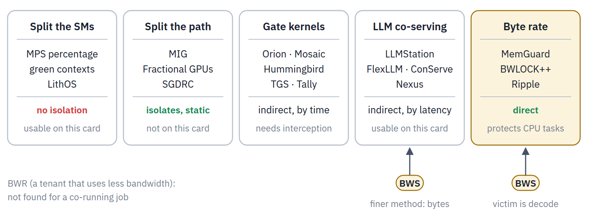

*图 I：已有工作按"拧的是哪个旋钮"分成五类，每类标了能不能管住显存带宽、在这张 RTX 5090 上能不能用；
下面的标签是第 10 节的几步各自落在哪一类（源文件 `../diagrams/14_related_work_map.svg`）。*

1. **分 SM 隔不开带宽，文献和图 7–10 的测量一致。** Elvinger 等、Mosaic、Hummingbird、Ripple 都明说了
   这一点，并给了数字。
2. **能给带宽份额的机制都是把内存路径静态切开**（MIG、通道着色）。在消费级的 RTX 5090 上都用不了；
   固定份额也会限制 decode 自己，它单独就要用掉 75–79 %。
3. **按字节给 GPU 任务定预算，只见于保护 CPU 任务。** 以 decode 为受害者的系统，放行的单位是 kernel 或
   token，依据是延迟；没有一篇数字节。

| 工作 | 它怎么做 | 和我们的关系 | 核对到哪 |
|---|---|---|---|
| Elvinger 等（SoCC 2025） | 只测量。H100 上 Llama-3.1-8B decode 占 64 个 SM，另外 68 个 SM 跑拷贝 kernel，decode 最多慢 1.3 倍 | 和图 8 的现象一致；没有提出机制 | 正文 |
| MIG（NVIDIA） | 每个实例独占一段内存路径：L2 分区、内存控制器、地址总线 | 唯一能隔带宽的官方机制；不支持 GeForce；份额固定 | 正文 |
| Fractional GPUs（RTAS 2019） | 逆向出物理地址到 L2 组和显存 bank 的映射，用页着色让两个分区不共用 | 要改内核驱动和应用源码；只在 GTX 1070/1080、V100 上做过 | 部分 |
| SGDRC（PPoPP 2025） | 同一思路用于新卡：低优先级任务只能用 1/3 的通道；每个张量存两份，混部时切到受限的那份 | 每个型号要约一个月逆向；不支持闭源 kernel；没测生成式 LLM | 正文 |
| Orion（EuroSys 2024） | 离线给每个 kernel 画像。高优先级 kernel 在跑时，只放行 SM 需求小且画像不同的低优先级 kernel（一个吃带宽，另一个就得吃算力） | 按 kernel 决定放不放，不数字节；论文说 LLM 不是它的目标负载 | 正文 |
| Mosaic（预印本） | 用单独跑的画像预测每一对 kernel 的变慢，预测超过延迟目标就不放行 | 两条提醒：只看总带宽预测不了干扰；画像相近的受害者变慢可以差很多 | 部分 |
| Hummingbird（预印本） | 把低优先级 kernel 切成约 400 µs 的片，只在检测到的空隙里跑 | 管时机，不封顶带宽 | 部分 |
| TGS（NSDI 2023）、Tally（ASPLOS 2025） | TGS 看生产任务的性能，反馈调低优先级任务的份额；Tally 在线程块粒度切片和抢占 | TGS 和方案 G 同类，没有带宽模型 | 摘要 |
| MemGuard（RTAS 2013）、BWLOCK++（ECRTS 2018） | CPU 上：每个核每个周期有一个内存访问预算，硬件计数器数到头就把这个核停到下个周期 | 字节预算的原型；靠每个核的计数器，GPU 上没有每个进程的带宽计数器 | 摘要 |
| Ripple（预印本） | CPU 和 GPU 共用内存的设备。把 LLM 的前向切成层单元，按 CPU 任务的截止时间一段一段批准；不依赖计数器 | 最接近"GPU 的字节预算"；但保护的是 CPU 任务，被限的是 LLM 自己 | 正文 |
| LLMStation（ATC 2025） | LoRA 微调和 decode 共用基座模型。每个 decode 迭代决定带几个微调 `tasklet`，使迭代不超延迟目标；prefill 时暂停微调；反向传播可以在算子边界中断 | 场景和我们最近；预算是延迟，不是字节 | 正文 |
| Nexus（预印本） | prefill 和 decode 在同一个引擎里用 green context 分开，运行中调整大小 | 带宽只出现在预测模型里，没有东西去限它 | 部分 |
| FlexLLM、ConServe（预印本） | 以 token 为单位把微调或离线请求和在线推理混跑 | 不数字节 | 摘要 |
| LithOS（SOSP 2025） | 以 SM 组为单位调度，切分 kernel | 没找到对带宽或 L2 的处理 | 部分 |
| Harli（预印本，2025 年 11 月） | 把 PEFT 微调和 LLM decode 放在同一张卡上，用 SM 分区（green context）分开。量到 decode 的显存带宽占用约 85 %、SM 占用约 40 %；把干扰建模成显存带宽争用，和微调任务的 SM 份额成正比；把微调切成每片约 10 ms 的逐层小块 | 场景和诊断都和我们最近。它管带宽的旋钮是 SM 的划分；图 8 的结果是 SM 份额对训练流量的控制很弱 | 搜索，正文 |
| LoRAFusion（EuroSys 2026） | 把 LoRA 微调里受带宽限制的算子融合成定制 kernel。报告显存流量降 34–37 %，kernel 最多快 1.39 倍 | 就是 C2 的手段之一（合并算子），而且量了字节，对象也是同一类任务；目的是任务自己的速度，旁边没有别的任务 | 搜索，正文 |
| ConCo（ICS 2025） | 为每个推理模型编译几个 kernel 变体，各自针对一部分 SM 调优，按并发数选用；提到这些变体对显存带宽的压力更小 | 对等的推理任务，目标是总吞吐；带宽压力变小是副产品，不是目标 | 搜索，正文 |
| QoS-Compile（CGO 2012）、ReQoS（ASPLOS 2013）、Protean Code（MICRO 2014） | CPU 上：改低优先级程序的代码让它当个好邻居，手段是插入空指令和小睡来降低访存速率，或者用非临时访问提示来降低对缓存的压力 | "靠改代码当好邻居"的先例。它们是让任务变慢或少占缓存，没有一个是让它每搬一个字节做更多工作 | 搜索，部分 / 摘要 / 正文 |
| SIRIUS（ATC 2025） | 训练任务在几毫秒内缩小 batch，把显存让给推理 | 为了当好邻居而改的任务，针对的是显存容量，不是带宽 | 搜索，部分 |
| Ladder Side-Tuning（NeurIPS 2022）、Quantized Side Tuning（ACL 2024） | 训练一个挂在冻结主干旁边的小网络，反向传播不经过主干；后者还把主干量化到 4 位 | 可以当省字节的 neighbour 的候选；它们报告的是显存占用，不是显存流量 | 搜索，摘要 |

第 10 节的几步和最接近的工作：

| | 最接近的工作怎么做 | 我们不同在哪 |
|---|---|---|
| **C1** | MemGuard：每核一个周期预算，靠硬件计数器强制。Ripple：按 CPU 任务的截止时间批准 LLM 的层单元 | 受害者是 GPU 上的 decode，被限的是训练任务；没有每进程计数器，所以由训练任务自己用"每 token 字节"记账（合作式） |
| **C1** 做法二 | LLMStation 的 `tasklet` 加可中断的反向传播；Hummingbird 约 400 µs 的 kernel 片；Tally 的线程块级切片 | 训练任务是独立进程，只在 block 边界停（相隔约 1 ms），不改 autograd，不拦截调用；预算是字节 |
| **C2** | LoRAFusion 合并 LoRA 微调里受带宽限制的算子，并且量了字节，目的是任务自己的速度。ConCo 按 SM 份额编译多个 kernel 变体，带宽压力变小只是副产品。Protean Code 那一系在 CPU 上改邻居的代码，让它变慢或少占缓存。SGDRC 给低优先级张量准备受限通道上的第二份 | **因为**旁边有一个带宽受限的 decode，才去降低训练任务做同样训练要搬的字节；结果用 decode 慢多少来衡量 |
| 错开时间（不做） | Orion 逐个 kernel 看画像是否互补；Hummingbird 只在检测到的空隙里跑；LLMStation 在 prefill 时暂停微调 | 这些都依赖受害者有不吃带宽的时段。decode 节点没有，所以只剩"没有请求时放开额度" |

- **没找到先例的位置**：在没有 MIG 的独立 GPU 上，以带宽受限的 decode 为受害者，给低优先级任务按字节定
  预算。这就是 C1。最接近的是 Harli：场景相同，也有带宽模型，但旋钮是 SM 的划分。
- **C2 没有找到做过的**：因为旁边有一个带宽受限的任务，而去改造 neighbour、让它少占显存带宽。几块东西是分开存在的：LoRAFusion 有手段、也量了字节，但旁边没有别的任务；Harli 有场景，旋钮
  是 SM；Protean Code 那一系有"改邻居的代码"这个想法，但在 CPU 上、针对的是缓存。
- **图 7–10 已经能补的两点**：没有人报告过任务的带宽随它的 SM 数怎么变（图 7）；Elvinger 等指出常用的
  profiler 在混部时测不了，而整卡的带宽计数器可以。
- **和 Mosaic 不一致的一点**：Mosaic 说读比写更伤受害者。图 10 量到的是：从 96 个 SM 发出时读、写、拷贝
  每字节差不多；从 8 个 SM 发出时写和拷贝更贵。

## 12. 还没解释的，和这些结果的局限

测到了但还没有解释的：

- decode 单独跑时停在标称带宽的 75–79 %，而只读的任务能到 88–90 %。
- 合计低于这些水平时，是 SM 到显存这条通道里的哪一段在限流。
- 只读任务从 8–16 个 SM 发出时，每字节对 decode 的代价约为从 64–96 个 SM 发出时的一半；真实的训练任务
  方向相反（8 个 SM 是它最贵的点）。
- 只做算术的任务在 8 个 SM 上、时钟没变，仍让 8 个请求的 decode 慢 3.8–6.9 %，这时带宽计数器比 decode
  自己的字节多读出 2.5–6.6 %。
- 方案 D（动态 green context）每个训练 token 的代价比方案 B（MPS 共用全部 SM）低。
- decode 的基线会落在相差约 1 % 的两个水平上，一次运行里固定不变。
- 4 个和 8 个请求时，两个任务的字节之和比计数器低 3–4.5 %。

局限：

- 一种 GPU、一个推理模型（Llama-3-8B）、一种负载分布（Zipf-1.1），大部分数字只来自一种 tenant（LoRA 微调）。
- 图 6–10 里的 decode 是合成步，不是真实的推理引擎；真实引擎（图 1–5、11）表现出同样的现象，噪声更大。
- 每个方案只跑了一次。图 7–10 的大部分点只在 4 秒窗口里跑了一次；重跑了 20 个点，相差不超过 0.5 %。
  基线的两个水平让那里每个"变慢百分比"带约 ±1 个百分点。
- p90 表和图 11 是对已有运行的重新分析；形态探针每种形态只有一个 60 秒窗口。
- 共用通道是靠数字节推断的，没有硬件层面的直接观察。
- 只有一个功耗设置（500 W 上限）；图 10 里的功耗效应依赖它。

---

文件索引：`controller.py`（router + VRAM scheduler）、`ft_worker.py`（训练任务）、`pf_tenant.py`
（prefill tenant 适配器）、`green_ctx.py`、`hp_patch/sitecustomize.py`（引擎观察补丁）、
`run_eval6.sh` / `run_eval_pf.sh` / `run_probe.sh`（各方案的启动脚本）、
`analyze_coloc.py` / `analyze_pf.py` / `analyze_probe.py` / `plot_arms.py` / `plot_dram.py` /
`round2_tables.py`（分析和画图）、`knee_probe.py` / `plot_knee.py`（图 6 的拐点探针）、`knee_corun.py` / `bw_aggr.py` / `aggr_corun.py` /
`plot_bw_report.py`（图 7–10 的带宽测量）、`analyze_overlap.py`（p90 表和图 11）、`tenant_inventory.py`（10.4 节的算子盘点）、
`diagrams/make_svg.py`（图 G、L、M、N）、`../results/`（每个方案的阶段表、时间线图、传输图）、
`../results_600w/`（第一轮）。
