# Report 1 — Changing the KV budget online, and sharing the GPU with a tenant

Stages 1 and 2 of the colocation work (Nov 5–9, 2026). Branch `kvcached-validation`.

**Question.** Earlier studies found that, with KV offloaded to host RAM, a decode engine's performance
does not depend on its GPU-memory budget below a knee that moves with load. The GPU memory below the
knee, and the SMs decode does not use, could then go to a second job on the same GPU (the tenant).
Two things have to hold for that: the KV budget must change while the engine runs, and the freed GPU
memory and compute must go to a tenant without hurting decode.

**Answer in one sentence each.** Stage 1: kvcached changes a running vLLM engine's KV budget within
about 1.3 s, kills no request, costs nothing per step, and at every budget the engine behaves as if
it had been restarted at that budget. Stage 2: a router and a VRAM scheduler outside vLLM make the KV
budget follow the load and hand the rest of GPU memory to a fine-tune tenant with 0 failures,
0 preemptions and 0 s oversubscribed; the tenant's use of compute costs decode about +2.2 % TPOT per
1 k tenant tokens/s, wherever the tenant's SMs are, and this cost was left unexplained at the end of
stage 2.

**Terminology.** Two memories appear here and are kept apart by name. **GPU memory** is the card's own
memory (31.35 GiB usable); "GPU memory bandwidth" is the path between the SMs and GPU memory, and
"GPU-memory-controller busy (NVML)" is NVML's reading of that path. **Host RAM** is the machine's RAM:
the KV offload tier, the tenant's offloaded activations, streamed weights and snapshots live there and
move over PCIe. "Scheme" is one way of sharing the GPU between the engine and the tenant. The "VRAM
scheduler" is the process that sets the engine's KV limit and the tenant's budget (`controller.py`).

## Platform

| item | value |
|---|---|
| GPU | RTX 5090, 170 SMs, 31.35 GiB of GPU memory usable. Stage 1 on GPU 0. Stage 2 round 2 on GPU 0, both GPUs capped at 500 W (round 1: GPU 1, 600 W) |
| host | 60 GiB host RAM, PCIe ≈ 14 GB/s, `/dev/shm` 31 GiB |
| software | vLLM 0.30.0 with Model Runner V2 (`VLLM_USE_V2_MODEL_RUNNER=1`, required by kvcached on vLLM ≥ 0.29), torch 2.13.0+cu130, LMCache 0.5.6 |
| kvcached | 0.1.6 (PyPI) for stage-1 experiments A and B; main `9106e0f` (2026-11-04) for the stage-1 sweeps and all of stage 2 |
| inference model | Llama-3-8B bf16, 128 KiB of KV per token (a 6144-token prefix ≈ 0.77 GiB) |
| tenant | Qwen2.5-0.5B LoRA fine-tune (r = 16 on q/k/v/o, bf16, 8 × 512 tokens per optimizer step) |
| engine flags | `--max-model-len 8192 --max-num-seqs 32`; `VLLM_USE_FLASHINFER_SAMPLER=0` in every run (FlashInfer's sampler JIT refuses sm_120 in this build; attention on FLASH_ATTN) |

---

# Stage 1 — The KV budget can be changed online, at no cost

Directory `kvcached_validation/`. kvcached allocates vLLM's KV cache through the CUDA virtual-memory
API and maps physical 2 MiB pages on demand. `kvctl limit` (or its Python API) sets a limit that the
engine reads from a shared-memory segment every 100 ms.

## 1.1 Shrink and grow under load (kvcached 0.1.6)

kvcached at engine start: 13.7 GiB KV budget (104,704 tokens), 64 MiB mapped at idle. Prefix caching
off, so the only occupied pages belong to running requests. Load: Poisson stream of 6000-token random
prompts, greedy, `ignore_eos`. A 100 ms sampler records NVML memory, kvcached's own counters and vLLM's
gauges; t = 0 of a resize is the first sample in which the new limit is visible.

| run | load | result |
|---|---|---|
| A1 | 3.5 req/s × 128 output tokens, limit 12 G → 3 G → 12 G (above prefill capacity, so ~55 queued before the shrink) | 480/480 completed, 0 preemptions. At the shrink 15 requests ran; 7 after 1 s, 4 after 3 s, all by normal completion. NVML memory 29.66 → 20.66 GiB: first movement 0.5 s, within 2 % of the plateau after 2.7 s. Under the 3 G cap exactly 4 requests (4 × 0.75 GiB) were resident; ITL median 19.6 → 12.8 ms (smaller batches). Grow 3.0 → 11.9 GiB in 6.2 s, paced by 6k-token prefill admissions |
| A2 | 1.2 req/s × 512 output tokens, same limits (~15 requests resident, KV grows during decode) | 160/160 completed with all 512 tokens. No request stopped at the shrink; kvcached used 11.5 → 4.1 GiB in 8 s, under 3 GiB only after 21 s (the resident requests' remaining lifetime). **15 preemptions**, 13 token-stream stalls of 1.7–7.0 s, the first 19.6 s after the shrink. Grow 2.4 → 11.9 GiB in 5.4 s |
| A3 | 8 GiB budget, never binding; plain vLLM (`--kv-cache-memory-bytes`) against kvcached (`kvctl limit 8G`); 1 req/s × 6000-token prompts × 256 tokens, 120 s | decode step p50 / p90 14.03 / 16.17 ms plain, 14.03 / 16.18 ms kvcached; ITL p99 457.9 / 457.6 ms; TTFT p50 / p90 0.49 / 1.13 s against 0.49 / 1.14 s; greedy outputs of 8 fixed prompts byte-identical |

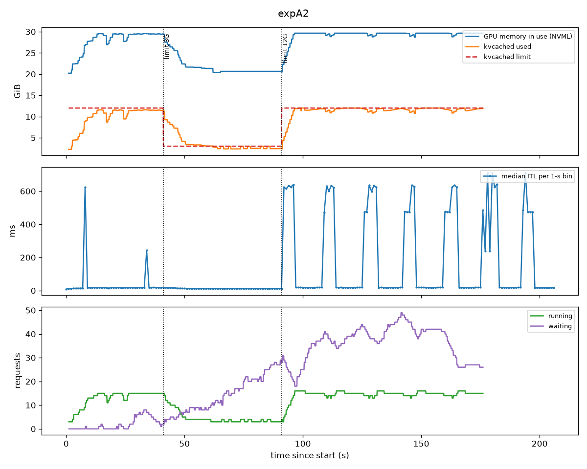

*Figure 1 — run A2. Top: GPU memory in use (NVML), kvcached's used bytes and limit. Middle: median ITL
per 1-s bin. Bottom: running and waiting requests. Memory falls as resident requests finish, not at the
shrink instant.*

**Mechanism.** kvcached enforces a limit by shrinking vLLM's *logical* block pool. Pages held by running
requests are never revoked; they are unmapped as those requests finish (engine log: "shrink to 1536
blocks refused by allocator (in-use pages above target); keeping shrink pending"). A new allocation
beyond the limit fails in vLLM's own scheduler, which then does its ordinary preempt-and-recompute, as
at any full KV cache. kvcached's own "pool exhausted" path was never taken. So a running request
survives a shrink, but if its decode needs more blocks than the cap leaves, it is preempted (A2). A
shrink of a decode engine needs head-room for the growth of the resident requests.

## 1.2 kvcached with LMCache's multi-process connector

LMCache's multi-process (MP) mode runs the cache as a separate server. In the default
`lmcache_driven` transfer the server reads and writes vLLM's GPU KV through CUDA IPC handles; in
`engine_driven` the vLLM worker gathers and scatters KV itself. kvcached creates its pages with
`cuMemCreate` and no shareable handle type.

| kvcached | configuration | result |
|---|---|---|
| 0.1.6 | `lmcache_driven` (default) | fails at KV registration: legacy CUDA IPC cannot export a VMM address (`invalid device pointer`) |
| 0.1.6 | + `use_vmm_api=true` | fails: kvcached's default layout interleaves the 32 layers inside each block, so the tensor is not contiguous |
| 0.1.6 | + per-layer pools | fails one check later: the pages were created non-exportable (`requestedHandleTypes=0`) |
| 0.1.6 | `engine_driven`, 256-token stores, 6 multi-turn sessions, limit 13 G → 2 G → 12 G | runs: 91/91 ok, 0 preemptions; the shrink took effect in 1.9 s and affected no request |
| 0.1.6 | `engine_driven`, 2–3k-token stores (stress) | **engine crash** after 148 s with alternating 2 G / 12 G limits, and after 90 s with no limit change: LMCache's asynchronous store gather reads a kvcached page that is not mapped (`Xid 31`, MMU read fault). The plain engine with the same connector and load: 94/94 ok |
| main (later retest, Nov 9) | `engine_driven`, the same stress load, 2 G / 12 G every 15 s, 10 min | **works**: 341/341 ok, 329 stores / 233 retrieves, 0 Xid; greedy outputs 8/8 identical to the plain engine without the connector |
| main + exportable pages | `lmcache_driven` + `use_vmm_api` | still fails: LMCache imports one handle per tensor and kvcached backs a tensor with many 2 MiB pages. The fix is on LMCache's side |

**Mechanism of the crash.** On 0.1.6, kvcached orders its page releases against the worker's compute
stream and pins pages only for vLLM's native `OffloadingConnector`. LMCache's store gather runs on its
own copy stream in a background thread, so it can read a page after it was unmapped. kvcached main
orders page unmaps behind the GPU's progress; the decision log (D13) reads the retest as that change
closing the window. The pin layer written for LMCache was not needed.

Two side observations from the 0.1.6 environment. The connector's own inline transport moved KV at
5–6k tokens/s on loads and ~1k tokens/s on stores, and each synchronous load of a 4–6k-token prefix
stalled all decoding for ~0.8 s (on the plain engine too). The connector changed 4 of 8 greedy
outputs relative to a no-connector engine; in the kvcached-main environment that difference is gone.

## 1.3 Shrinking live at a fixed 2 QPS with host-RAM offload

This repeats the vram-limit branch's study 1, which swept the GPU KV budget by restarting the engine
at each budget, but shrinks the budget live in one continuous run.

| item | value |
|---|---|
| workload | 32 sessions × 6144-token prefixes (24 GiB of KV demand); every request = one session's prefix + 128 unique tokens → 128 output tokens; Poisson 2 QPS; Zipf-1.1 session choice; 32-request warm-up |
| offload | vLLM native CPU offload, 24 GiB pinned host-RAM tier (`--kv-offloading-backend native`); prefix caching on |
| kvcached | main, because 0.1.6 does not pin pages for the `OffloadingConnector` copies and does not release cached prefixes when the limit is lowered; `KVCACHED_MAX_CACHED_TOKENS=-1` so the GPU prefix cache may fill the budget |
| schedule | 60 s at the start-up limit (13 G), then 10 / 8 / 6 / 5 / 4 / 3 / 2 G, 60 s (≈ 110 requests) each; first 5 s after each change excluded |
| scripts | `scripts/run_shrink_sweep.sh`, `scripts/analyze_sweep.py` |

| limit | with offload: TTFT p50 / p95 (ms) | ITL p50 (ms) | tok/s | GPU prefix hit | host-RAM hit | waiting max | without offload: TTFT p50 / p95 (ms) | waiting max | preemptions |
|---|---|---|---|---|---|---|---|---|---|
| 13 G | 51 / 499 | 12.6 | 263 | 76 % | 72 % | 1 | 52 / 1 265 | 1 | 0 |
| 10 G | 52 / 454 | 12.7 | 247 | 72 % | 81 % | 1 | 66 / 773 | 0 | 0 |
| 8 G | 91 / 399 | 13.1 | 244 | 55 % | 88 % | 2 | 505 / 2 580 | 7 | 0 |
| 6 G | 72 / 351 | 12.6 | 244 | 55 % | 87 % | 1 | 500 / 1 541 | 2 | 0 |
| 5 G | 146 / 770 | 13.1 | 265 | 48 % | 92 % | 4 | 3 488 / 9 041 | 18 | 0 |
| 4 G | 155 / 795 | 12.9 | 277 | 43 % | 95 % | 5 | 7 053 / 13 410 | 26 | 1 |
| 3 G | 3 210 / 5 837 | 12.2 | 251 | 29 % | 91 % | 13 | 27 986 / 56 741 | 52 | 3 |
| 2 G | 18 019 / 23 670 | 11.8 | 230 | 20 % | 93 % | 34 | 89 754 / 107 649 | 107 | 1 |

All requests completed in every window of both runs. The offloaded run had 0 preemptions in every
window; the last column is the run without offload.

- **With offload,** each `kvctl limit` evicted cached prefixes down to exactly the new limit while the
  engine kept serving. From 13 to 4 GiB decode is untouched (ITL 12.6–13.1 ms, 244–277 tok/s). TTFT p50
  rises from 51 to 155 ms because GPU prefix hits fall from 76 % to 43 % and the host-RAM tier takes the
  rest (72 → 95 %); p95 stays under 0.8 s.
- **The knee is the in-flight KV.** 2 QPS × ~1.8 s ≈ 3.7 requests in flight × 0.77 GiB. Below 4 GiB they
  no longer fit, and the engine queues: TTFT p50 3.2 s at 3 GiB and 18 s at 2 GiB, with no preemption.
  Study 1 found the same knee and flat region with restarts.
- **Without offload** an evicted prefix must be recomputed (~0.4 s of prefill for 6144 tokens). The knee
  moves up to where the Zipf hot set stops fitting: TTFT p50 is 0.5 s at 8 GiB and 3.5 s at 5 GiB.

## 1.4 Live against static on the same request timeline

The control for "does resizing live cost anything" is the same vLLM 0.30 engine without kvcached,
restarted at each budget (`--kv-cache-memory-bytes` = 13 … 2 GiB, `scripts/run_static_sweep.sh`), same
offload tier and workload, 300 requests per budget.

The first comparison used the continuous sweep of 1.3, and its 8 GiB window read 91 ms of TTFT p50
against 57 ms static. That was a windowing artefact: the continuous sweep scores every budget on a
different 60-s slice of the seeded Zipf sequence, and slices differ by ±40 ms of TTFT p50 on their own
(the 8 G slice contains a 10-s stretch with 36 % GPU hits and another where 16 % of tokens miss both
tiers). The live run was therefore repeated with the **same timeline at every budget**
(`scripts/run_live_replay_sweep.sh`): the engine keeps running, each limit is applied with `kvctl`, the
engine idles 10 s, the identical seeded workload is replayed (warm-up + 150 s, 300 requests) and only
that window is scored.

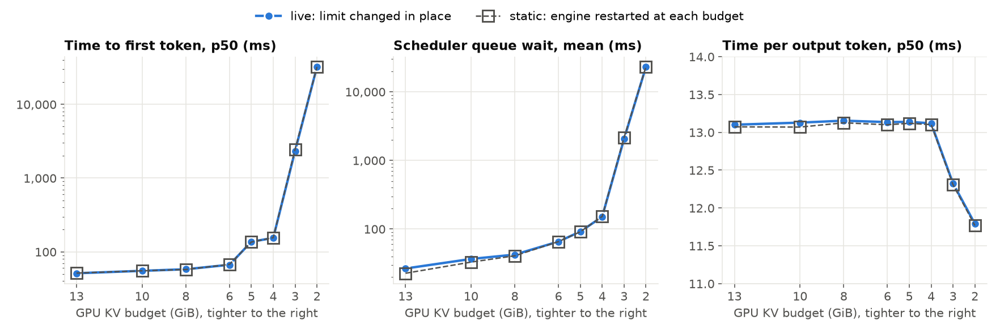

*Figure 2 — TTFT p50, scheduler queue wait and TPOT p50 against the GPU KV budget (tighter to the
right). Blue: limit changed in place with kvcached. Squares: engine restarted at each budget. The two
sets of points coincide.*

| GPU KV | live: TTFT p50 / queue wait / TPOT / tok/s / preempt | static (restart): TTFT p50 / queue wait / TPOT / tok/s / preempt |
|---|---|---|
| 13 GiB | 51 ms / 27 ms / 13.1 ms / 258 / 0 | 52 ms / 23 ms / 13.1 ms / 258 / 0 |
| 10 | 55 / 37 / 13.1 / 258 / 0 | 55 / 33 / 13.1 / 258 / 0 |
| 8 | 58 / 42 / 13.2 / 258 / 0 | 58 / 41 / 13.1 / 258 / 0 |
| 6 | 67 / 66 / 13.1 / 258 / 0 | 68 / 65 / 13.1 / 258 / 0 |
| 5 | 137 / 92 / 13.1 / 257 / 0 | 136 / 91 / 13.1 / 257 / 0 |
| 4 | 154 / 151 / 13.1 / 257 / 2 | 155 / 153 / 13.1 / 257 / 2 |
| 3 | 2 333 / 2 050 / 12.3 / 252 / 0 | 2 451 / 2 154 / 12.3 / 252 / 0 |
| 2 | 32 153 / 22 981 / 11.8 / 179 / 0 | 32 134 / 22 996 / 11.8 / 179 / 0 |

On the same timeline the two are indistinguishable: TTFT p50 within 1–2 ms above the knee, TPOT within
0.1 ms, queue wait within 4 ms, the same 2 preemptions at 4 GiB, the same throughput, and the same deep
queue below the knee. Study 1's preempt-recompute spiral and stall below the knee did not recur here
even with a static budget: vLLM 0.30's scheduler queues instead.

**Decode-only emulation.** To look at a decode engine without a second GPU, the same workload was run
with prefix caching off and a 28 GiB host-RAM tier that holds every prefix: the GPU holds only in-flight
KV, every prefix arrives from the store (95–98 % of looked-up tokens hit it), and the remaining prefill
is the 128 new tokens. Live and static runs use the same timeline.

| GPU KV | live: TPOT / queue wait / tok/s / preempt | static: TPOT / queue wait / tok/s / preempt |
|---|---|---|
| 13 GiB | 13.3 ms / 112 ms / 258 / 0 | 13.3 ms / 114 ms / 258 / 0 |
| 10 | 13.3 / 114 / 258 / 0 | 13.2 / 114 / 258 / 0 |
| 8 | 13.4 / 115 / 258 / 0 | 13.2 / 116 / 258 / 0 |
| 6 | 13.4 / 156 / 257 / 0 | 13.3 / 156 / 257 / 0 |
| 5 | 13.4 / 218 / 257 / 0 | 13.4 / 218 / 257 / 0 |
| 4 | 13.4 / 375 / 255 / 0 | 13.4 / 370 / 256 / 0 |
| 3 | 12.3 / 10 434 / 226 / 0 | 12.3 / 10 543 / 225 / 0 |
| 2 | 11.7 / 29 113 / 158 / 0 | 11.7 / 29 161 / 158 / 0 |

TPOT is 13.2–13.4 ms from 13 GiB down to 4 GiB in both runs; the GPU holds only ~3 GiB of in-flight KV
at any budget. The 110–150 ms of queue wait in the flat region is the KV fetch itself (0.77 GiB per
request). From 6 GiB the in-flight set's p95 (~5.4 GiB) starts to touch the limit and queueing grows
(156 → 375 ms at 6 → 4 GiB). Below 4 GiB the engine is capacity-bound and delivers 226, then 158, of the
258 tok/s offered, with no failure and no preemption. Live and static agree within 5 ms of queue wait
and 0.2 ms of TPOT.

## 1.5 Stage-1 limits

- One GPU, one model, TP = 1. Experiments A and B on kvcached 0.1.6, the sweeps on main.
- Zipf only. Continuous sweeps use 60-s windows (≈ 110 requests); same-timeline sweeps and static
  controls 300 requests per budget.
- With prefix caching on, kvcached 0.1.6 evicts cached prefixes only on the allocation path; main
  releases them when the limit is lowered. The sweeps used main for this reason.
- A1 was over-subscribed (prefill capacity ≈ 9.6k tok/s for 6k-token prompts), A2 at capacity.

---

# Stage 2 — The colocation VRAM-adjust prototype

Directory `coloc_adjust/`. Round 1 ran on Nov 5–6 (GPU 1, 600 W); round 2 on Nov 9 (GPU 0, 500 W).
All tables and figures below are round 2 unless marked.

## 2.1 What was built

One RTX 5090 runs a Llama-3-8B decode node (vLLM 0.30 + kvcached main, native host-RAM offload with a
28 GiB tier in `/dev/shm`, prefix caching off, so the GPU holds only in-flight KV) and, beside it, the
LoRA fine-tune tenant. Nothing inside vLLM's scheduler is changed.

- **Router and VRAM scheduler** (`controller.py`, one process). Every request passes through a streaming
  HTTP router that knows its prompt length, `max_tokens` and tokens generated so far, so the KV block
  demand of the running set and the queue is exact (⌈prompt/16⌉ blocks at admission, +1 block per
  16 generated tokens, 2 MiB per block). Every 100 ms the VRAM scheduler computes
  `need = (running final + waiting final) × 2 MiB + λ̂ · 1 s · 0.78 GiB + 0.5 GiB`. The kvcached limit
  grows to `need` at once and shrinks only after 5 s below `need − 1 GiB`, never below what the running
  set holds. A grow may only promise memory that is free now (kvcached's mapped bytes + NVML free −
  safety); if the tenant has not yet released enough, the grow waits (`grow_wait`), and it is abandoned
  if demand falls back first. The tenant's budget is
  `31.35 − 17.0 − 2.0 − 0.5 − limit` GiB (total − engine weights and runtime, 16.97 GiB measured by NVML
  at start − the tenant's own context, weights and optimizer − safety). It is published to `/dev/shm`, lowered at
  once when the limit rises, and raised only after kvcached's mapped bytes are under the new limit.
  Optionally (`--tpot-slo`) the VRAM scheduler compares decode TPOT over the last 10 s with the no-tenant
  reference for the current arrival rate and publishes a tokens/s cap for the tenant (multiplicative
  update every 2 s).
- **Fine-tune tenant** (`ft_worker.py`). Before each optimizer step it reads its budget and picks the
  highest configuration whose calibrated need fits (drop at once, climb after 3 s). A budget poll every
  50 ms inside the step preempts a step that no longer fits. The torch allocator cap follows the
  budget, so a mis-estimate OOMs the tenant, never the engine. LoRA weights, optimizer, scheduler, step
  and RNG are snapshotted to host RAM every 10 steps and before every configuration change. The tenant
  honours a tokens/s cap by sleeping after each step, and with `--green-prebuilt` it builds green
  contexts of 128/96/64/32/16 SMs at start and only switches streams between steps.
- **Tracing.** Every host↔GPU copy is recorded with its source; a 100 ms sampler records kvcached usage,
  NVML memory, PCIe counters, power, SM busy and GPU-memory-controller busy.

Compute sharing uses the MPS daemon (engine and tenant as MPS clients) and green contexts via ctypes on
libcuda (`green_ctx.py`).

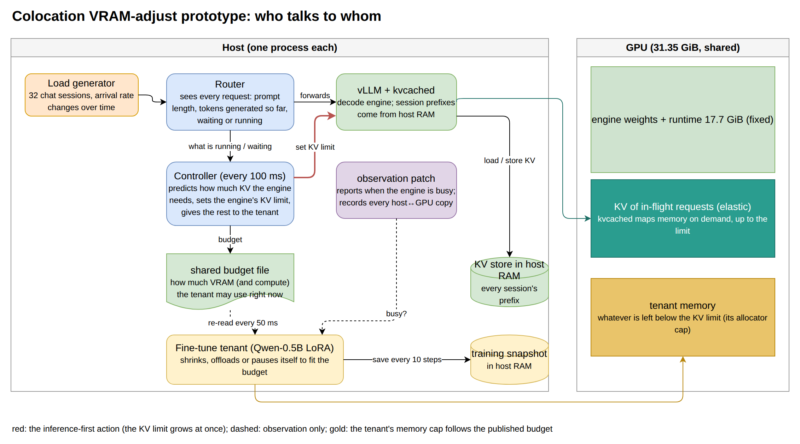

*Diagram 1 — components and triggers: the router feeds demand to the VRAM scheduler; the VRAM scheduler
sets kvcached's limit (inference first) and publishes the remainder to the tenant.*

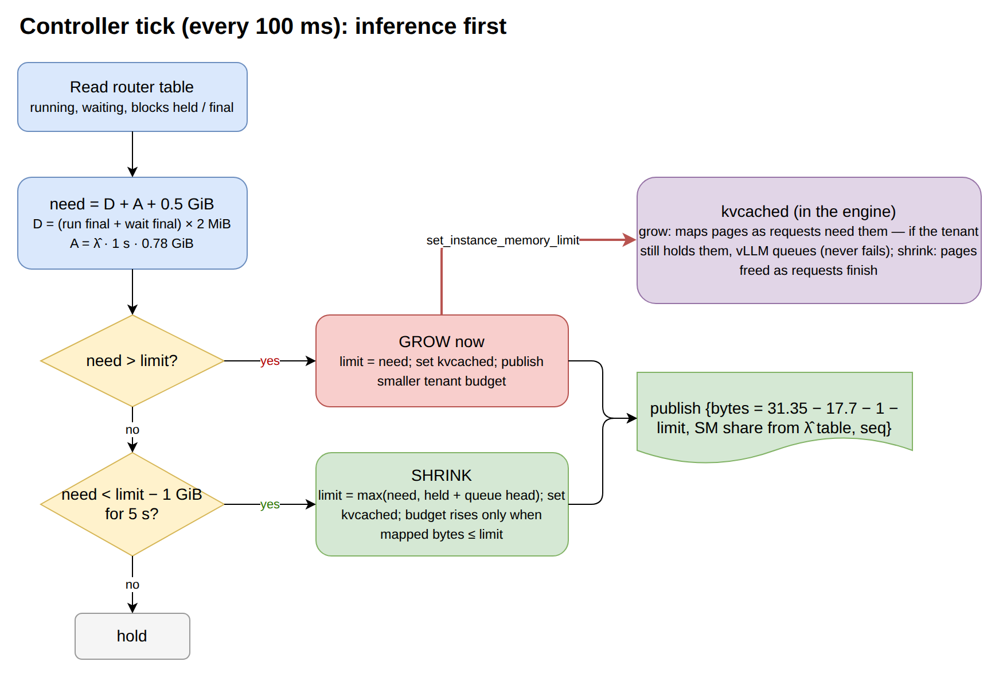

*Diagram 2 — one VRAM scheduler tick: grow at once when demand exceeds the limit; shrink only after 5 s
of slack and never below what running requests hold.*

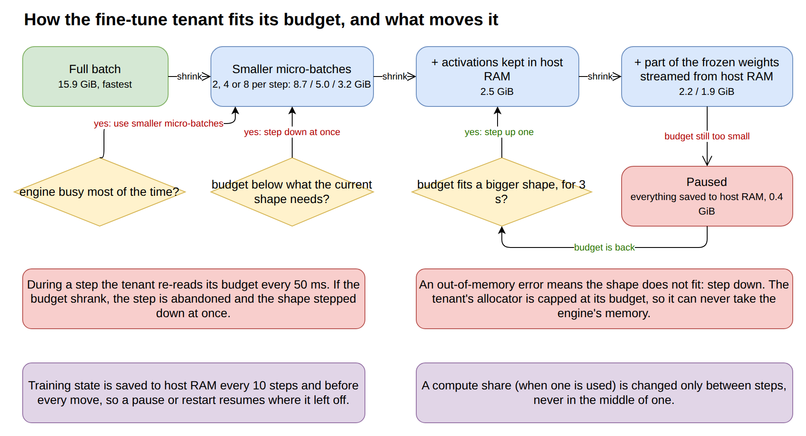

*Diagram 3 — the tenant's ladder and what moves it: budget polls inside the step, OOM as a signal, 3-s
hold before climbing, host-RAM snapshots around every move.*

**Tenant configurations** (calibrated alone on GPU 1, `tiers.json`):

| cfg | tier | micro-batches k | activation offload | layers streamed from host RAM | grad ckpt | need GiB | step ms | tok/s |
|---|---|---|---|---|---|---|---|---|
| 0 | 0 full batch | 1 | – | 0 | off | 15.9 | 91 | 44.8k |
| 1 | 1 | 2 | – | 0 | off | 8.7 | 106 | 38.7k |
| 2 | 1 | 4 | – | 0 | off | 5.0 | 138 | 29.6k |
| 3 | 1 | 8 | – | 0 | off | 3.2 | 210 | 19.5k |
| 4 | 2 | 8 | yes | 0 | on | 2.5 | 1045 | 3.9k |
| 5 | 3 | 8 | yes | 12 | on | 2.2 | 1294 | 3.2k |
| 6 | 3 | 8 | yes | 20 | on | 1.9 | 1452 | 2.8k |
| 7 | 4 pause | – | – | – | – | 0.4 | – | 0 |

Activation offload moves ~4.8 GB per step each way at k = 8 and makes a step 5× slower; with gradient
checkpointing already on it saves little memory (the floor, ~1.9 GiB, is the lm_head/embedding plus one
micro-batch's logits). In practice the ladder is micro-batching down to ~3 GiB, then the slow offload
tiers, then pause.

## 2.2 Evaluation setup

| item | value |
|---|---|
| workload | the stage-1 workload (32 sessions × 6144-token prefixes, +128 new tokens → 128 out, Zipf-1.1, seeded), ~0.77 GiB of KV per request in flight |
| arrival rate | piecewise constant after a 32-request warm-up (table below); the same seeded sequence in every scheme |
| run | one continuous 11-minute run per scheme (`run_eval6.sh`); per-phase numbers skip the first 10 s of each phase |
| decode metrics | TPOT, scheduler queue wait, delivered throughput, failures (TTFT here is fetch + 128-token prefill, ~160 ms, so it is not used) |
| tenant metrics | tokens/s and configuration |
| baseline | the engine alone with its KV limit following the load (`adjust_notenant`). The 500 W cap changed it by nothing measurable: TPOT within 0.3 ms of the 600 W run in every phase. The GPU draws 290–385 W per phase under this load |

| from (s) | 0 | 90 | 180 | 270 | 360 | 420 | 480 | 510 | 540 | 570 | 600–660 |
|---|---|---|---|---|---|---|---|---|---|---|---|
| req/s | 1 | 2 | 3 | 1 | 4 | 0.5 | 2 | 3 | 2 | 1 | 1 |

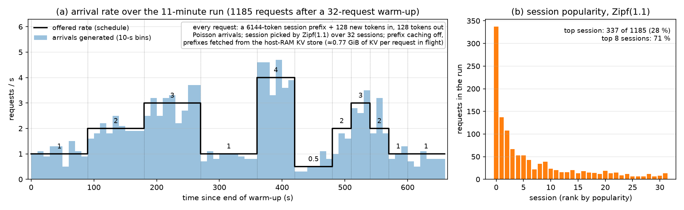

*Figure 3 — (a) offered arrival rate and the Poisson arrivals generated, 10-s bins; (b) session
popularity, Zipf(1.1) over 32 sessions.*

## 2.3 The schemes

Each scheme is one way of sharing compute. GPU memory follows the load in all of them except the static
split.

| class | scheme | GPU memory | compute | when the tenant runs |
|---|---|---|---|---|
| reference | baseline (`adjust_notenant`) | follows load | no tenant | – |
| reference | static split (`static_split`) | **fixed**: engine KV 6.69 GiB (the 2 req/s need), tenant 6 GiB | MPS, all SMs shared | always |
| **A** take turns | idle gate (`adjust`) | follows load | before each block the tenant checks whether the engine is busy and waits if it is | only when the engine is idle |
| **B** together, no limit | MPS (`adjust_nogate`) | follows load | both jobs share all 170 SMs | always |
| **C** together, fewer SMs | MPS 20 % (`adjust_mps20`) | follows load | SMs shared, tenant capped at 20 % of SM threads | always |
| | disjoint SMs 128/42 (`green_split`) | follows load | engine on SMs 0–127, tenant on the other 42 | always |
| | dynamic green contexts (`green_dyn2`) | follows load | tenant SM count from the arrival rate: 96 / 64 / 32 / 16 at 0.5 / 1 / 2 / ≥ 3 req/s; contexts prebuilt, stream switch only | always |
| **D** together, less time | 15 % latency SLO (`tpot_slo15`) | follows load | all SMs shared; every 2 s the VRAM scheduler compares decode TPOT with baseline +15 % and sets a tokens/s cap; the tenant sleeps after each step to keep it | runs, then pauses |
| | 5 % latency SLO (`tpot_slo5`) | follows load | the same with a +5 % target | runs, then pauses |

"Always" means the tenant does not stop by itself. At 3–4 req/s the memory budget is zero and the
tenant is paused in every adaptive scheme. Three sets of runs were repeated before these tables: the first
round-2 static split ran with the idle gate on by mistake and was rerun without it (D15); six adaptive
runs were rerun after a VRAM-scheduler bug that kept the tenant paused once a grow had stalled (D16);
the round-1 dynamic green context re-created a context on every change, leaked allocator memory and
lost its tenant, and was rerun with prebuilt contexts as `green_dyn2` (D8–D9, D18).

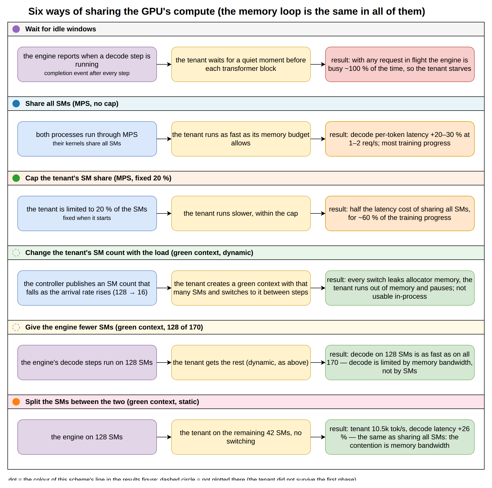

*Diagram 4 — the compute-sharing mechanisms; the memory loop is the same in all of them.*

## 2.4 Results per scheme

Decode TPOT p50 in ms at each arrival rate (mean over the phases that share the rate; in brackets the
change against the baseline), scheduler queue wait at 3 and 4 req/s, tenant throughput at 0.5 / 1 /
2 req/s, and the cost: decode slowdown in % divided by the tenant's k tok/s. ①②③ mark the three best
values of a column (lower is better for TPOT, queue and cost, higher for tenant throughput; ties share
a mark; the baseline does not take part; cells with several numbers are ranked number by number). The
3 and 4 req/s TPOT columns are not ranked: the tenant is paused there.

| scheme | class | TPOT @0.5 | @1 | @2 | @3 | @4 | queue @3 / @4 (ms) | tenant k tok/s @0.5 / 1 / 2 | % per 1k tok/s @0.5 / 1 |
|---|---|---|---|---|---|---|---|---|---|
| baseline | – | 12.0 | 12.6 | 16.3 | 20.8 | 26.1 | 214 / 1 292 | – | – |
| static split | – | 21.8 (+82 %) | 16.7 (+32 %) | 21.8 (+34 %) | 23.0 (+11 %) | 22.9 (−12 %) | 4 941 / 13 472 | ③ 13.2 / ① 12.2 / ① 12.9 | 6.2 / 2.7 |
| idle gate | A | ① 12.1 (+1 %) | ① 12.8 (+1 %) | ① 16.5 (+1 %) | 20.9 (+0 %) | 25.2 (−3 %) | ① 238 / ② 2 262 | 0 / 0 / 0 | tenant did not run |
| MPS | B | 15.4 (+29 %) | 16.3 (+29 %) | 18.9 (+16 %) | 21.4 (+3 %) | 25.0 (−4 %) | 257 / 2 302 | ① 14.5 / ② 11.7 / ② 3.0 | 2.0 / 2.5 |
| MPS 20 % | C | 13.2 (+10 %) | ③ 14.0 (+11 %) | 18.0 (+10 %) | 21.2 (+2 %) | 25.7 (−2 %) | ③ 254 / 2 940 | 7.0 / 6.5 / 2.2 | ③ 1.4 / ② 1.7 |
| disjoint SMs 128/42 | C | 15.3 (+28 %) | 16.2 (+28 %) | 18.6 (+14 %) | 21.3 (+3 %) | 24.1 (−7 %) | 308 / 3 367 | ② 13.7 / ③ 11.6 / ③ 2.9 | 2.0 / ③ 2.5 |
| dynamic green contexts | C | 13.7 (+14 %) | 14.5 (+15 %) | 17.8 (+9 %) | 21.0 (+1 %) | 24.5 (−6 %) | ② 250 / ① 2 216 | 11.9 / 9.3 / 2.3 | ② 1.2 / ① 1.6 |
| 15 % latency SLO | D | ② 12.5 (+5 %) | ③ 14.0 (+11 %) | ③ 17.3 (+6 %) | 20.9 (+1 %) | 24.5 (−6 %) | 280 / ③ 2 277 | 3.8 / 4.0 / 1.5 | ① 1.1 / 2.8 |
| 5 % latency SLO | D | ③ 12.8 (+7 %) | ② 13.1 (+3 %) | ② 16.9 (+4 %) | 20.8 (−0 %) | 22.3 (−14 %) | 306 / 2 425 | 3.8 / 1.2 / 0.4 | 1.8 / 3.3 |

Three cautions. The idle gate holds ① in every decode column because its tenant did not run. The
static split holds ① for tenant throughput because it never gives GPU memory back, and pays with
+32–82 % TPOT and 5–13 s of queueing. The cost column is unstable for the two throttled schemes: their
slowdown comes in bursts, so the median used here gives 1.1–3.3 % where the mean gives 2.3–2.9 %, and
the +3 % of the 5 % scheme at 1 req/s is inside the ±4 % noise of the baseline between repeats of the
same phase.

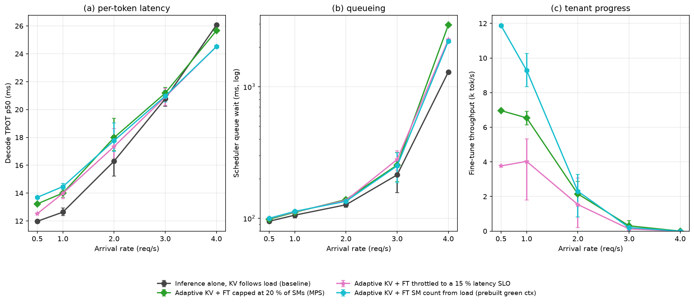

*Figure 4 — baseline and the three schemes with the best latency/throughput trade-off: (a) decode TPOT,
(b) queue wait, (c) tenant throughput, against the arrival rate (marker = mean, bar = min..max over the
repeated phases). MPS 20 % (green) and dynamic green contexts (cyan) give the tenant 7–12k tok/s at
0.5–1 req/s for +10–15 % TPOT; the green context gives 40–70 % more tenant throughput and is back on
the baseline by 2 req/s. The 15 % SLO (pink) stays within its target at every rate and gives the tenant
1–5k tok/s. All schemes: [`arms.png`](../coloc_adjust/report/figures/arms.png).*

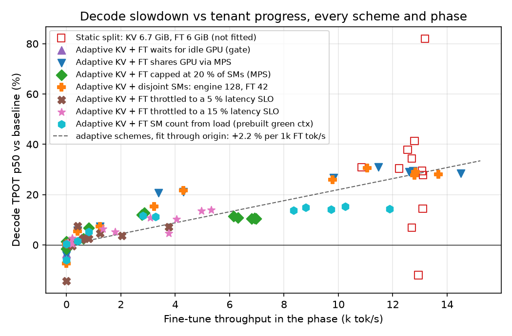

*Figure 5 — one point per scheme and phase: decode slowdown against the tenant's throughput in that
phase. MPS, MPS 20 %, the disjoint split and the SLO-capped runs fall on one line, about +2.2 % TPOT per
1 000 tenant tok/s. Dynamic green contexts (cyan) sit under it (+14 % at 8–12k tok/s). The static
split is off the line: its cost is KV starvation, not the tenant's speed.*

Tenant throughput per phase (tok/s), the same runs:

| phase | static split | idle gate | MPS | MPS 20 % | disjoint 128/42 | 5 % SLO | 15 % SLO | dynamic green |
|---|---|---|---|---|---|---|---|---|
| 1 req/s (0 s) | 12.2k | 0.1k | 9.8k | 6.3k | 9.8k | 0.6k | 1.8k | 8.3k |
| 2 req/s (90 s) | 12.8k | 0.0k | 3.4k | 2.8k | 3.2k | 0.6k | 1.3k | 2.8k |
| 3 req/s (180 s) | 12.7k | 0.0k | 0.0k | 0.0k | 0.0k | 0.0k | 0.1k | 0.0k |
| 1 req/s (270 s) | 12.5k | 0.0k | 12.6k | 6.8k | 12.8k | 0.8k | 4.0k | 9.7k |
| 4 req/s (360 s) | 12.9k | 0.0k | 0.0k | 0.0k | 0.0k | 0.0k | 0.0k | 0.0k |
| 0.5 req/s (420 s) | 13.2k | 0.0k | 14.5k | 7.0k | 13.7k | 3.8k | 3.8k | 11.9k |
| 2 req/s (480 s) | 12.7k | 0.0k | 4.3k | 2.9k | 4.3k | 0.4k | 3.1k | 3.3k |
| 3 req/s (510 s) | 13.1k | 0.0k | 0.4k | 0.6k | 0.4k | 0.2k | 0.2k | 0.4k |
| 2 req/s (540 s) | 13.1k | 0.0k | 1.2k | 0.8k | 1.2k | 0.2k | 0.2k | 0.8k |
| 1 req/s (570 s) | 10.9k | 0.0k | 11.5k | 6.1k | 11.1k | 1.2k | 5.3k | 8.8k |
| 1 req/s (600 s) | 13.1k | 0.0k | 12.8k | 6.9k | 12.8k | 2.0k | 5.0k | 10.3k |

Per-phase decode TPOT, queue wait, KV limit and tenant numbers for every scheme: `../coloc_adjust/results/<scheme>_phases.md`.

## 2.5 The tail: TPOT p90

The tables above use the median. The same request logs give the 90th percentile
(`analyze_overlap.py`, per-request TPOT computed as in `round2_tables.py`): TPOT p90 in ms, change
against the baseline's p90, best three per column marked; the last column repeats the median's change.

| scheme | class | p90 @0.5 req/s | p90 @1 | p90 @2 | median @0.5 / 1 |
|---|---|---|---|---|---|
| baseline | – | 13.3 | 14.1 | 18.9 | – |
| static split | – | 23.1 (+74 %) | 19.2 (+37 %) | 22.8 (+21 %) | +82 / +32 % |
| idle gate | A | ① 13.3 (+0 %) | ① 14.3 (+1 %) | ① 19.1 (+1 %) | +1 / +1 % |
| MPS | B | 17.0 (+27 %) | 18.4 (+31 %) | 21.3 (+13 %) | +29 / +29 % |
| MPS 20 % | C | ② 14.7 (+10 %) | ③ 15.8 (+12 %) | ③ 20.3 (+8 %) | +10 / +11 % |
| disjoint SMs 128/42 | C | 17.0 (+28 %) | 18.2 (+30 %) | 21.5 (+14 %) | +28 / +28 % |
| dynamic green contexts | C | ③ 15.3 (+15 %) | 16.3 (+16 %) | 20.5 (+9 %) | +14 / +15 % |
| 15 % latency SLO | D | 17.1 (+29 %) | 16.3 (+16 %) | ② 20.2 (+7 %) | +5 / +11 % |
| 5 % latency SLO | D | 17.0 (+28 %) | ② 14.6 (+4 %) | 20.4 (+8 %) | +7 / +3 % |

- **For the two fewer-SM schemes the tail equals the median:** +10–12 % with MPS 20 %, +15–16 % with
  dynamic green contexts. Their slowdown is even.
- **For the two throttled schemes the median looks good at 0.5 req/s and the tail is as slow as with no
  throttle:** +5 % against +29 % (15 % SLO), +7 % against +28 % (5 % SLO); MPS without a cap is at +27 %.
- **The cause is the feedback loop.** In that phase the cap swings between 500 and 20,000 tok/s; the
  tenant's longest pause is 8 s and for the rest it runs near full speed. Requests that fall into a
  full-speed stretch make up the tail.
- **A fixed cap has no such tail.** The shape probe (2.8) uses a fixed 4k tok/s cap; the tenant runs
  0.35 s and pauses 0.67 s in a regular pattern: median +5 %, p90 +6 %. A request takes 1.5–2 s and so
  spans more than one cycle.

## 2.6 Decode while the tenant runs and while it pauses

The request log has a timestamp for every decode token, and the tenant's log says when each of its steps
computed and when it slept. Every decode token gap can therefore be assigned to "tenant running" or "tenant
not running" (`analyze_overlap.py`, tables in `coloc_adjust/results/overlap_summary.md`). This is a
re-analysis of the round-2 runs, done on Nov 15.

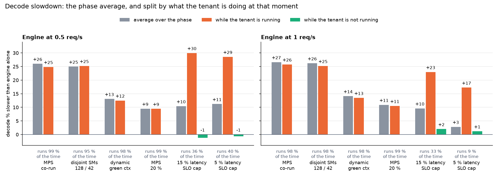

*Figure 6 — decode slowdown at 0.5 and 1 req/s: phase average (grey), while the tenant runs (orange),
while it does not (green); the small print is the share of time the tenant runs. Mean of the token gaps
against the same phases of the no-tenant run.*

| scheme | class | tenant runs, share of time | decode, phase average | while the tenant runs | while it does not |
|---|---|---|---|---|---|
| MPS | B | 99 / 98 % | +26.0 / +26.6 % | ③ +24.9 / +25.8 % | – |
| MPS 20 % | C | 99 / 99 % | ① +9.5 / ③ +10.9 % | ① +9.4 / ① +10.5 % | – |
| disjoint SMs 128/42 | C | 95 / 98 % | +25.0 / +26.2 % | +25.2 / +25.2 % | – |
| dynamic green contexts | C | 98 / 98 % | +13.1 / +14.1 % | ② +12.5 / ② +13.5 % | – |
| 15 % latency SLO | D | 36 / 33 % | ② +10.4 / ② +9.6 % | +30.0 / +23.0 % | −1.2 / +2.0 % |
| 5 % latency SLO | D | 40 / 9 % | ③ +11.2 / ① +2.8 % | +28.6 / ③ +17.2 % | −0.7 / +1.2 % |

Each cell: 0.5 req/s / 1 req/s. "–": that state covers under 5 % of the time. The idle gate is left out
because its tenant did not run. These are means over token gaps; the tables of 2.4 use the median of
per-request TPOT, so the numbers differ a little (15 % SLO: +5 / +11 % there, +10.4 / +9.6 % here).

1. **While the tenant does not run, decode is at its baseline** (−1 to +2 %). A pause leaves nothing
   behind.
2. **Throttling (class D) does not lower the slowdown at the moments of overlap; it shortens the
   overlap.** While the tenant runs, decode is 23–30 % slower, as with uncapped MPS (25–26 %), but the
   tenant runs only a third of the time. The average is the product: 36 % × 30 % ≈ 10.8 %, measured
   10.4 %.
3. **Fewer SMs (class C) lower the slowdown at every moment, with the tenant running all the time:**
   +9–11 % with MPS 20 %, +12–14 % with dynamic green contexts. The disjoint 128/42 split is the
   exception at +25 %: the tenant still runs flat out on its 42 SMs.
4. **Per tenant token, less time saves nothing and fewer SMs do.** Decode slowdown per 1k tenant tok/s
   at 1 req/s: MPS 2.3 %, 15 % SLO 2.4 %, disjoint SMs 2.3 %; MPS 20 % 1.7 %, dynamic green contexts
   1.5 %.
5. **At 2 req/s the comparison changes.** The tenant is paused by its memory budget about half the time,
   exactly when the load peaks, so a phase average mixes load and tenant state. Against the no-tenant
   run at the same number of running requests: +8–15 % while the tenant runs, −2 to 0 % while it does
   not.

## 2.7 Green-context schemes

`green_ctx.py` creates green contexts through ctypes on libcuda. Round-1 details in D8–D10, round 2 in
D18.

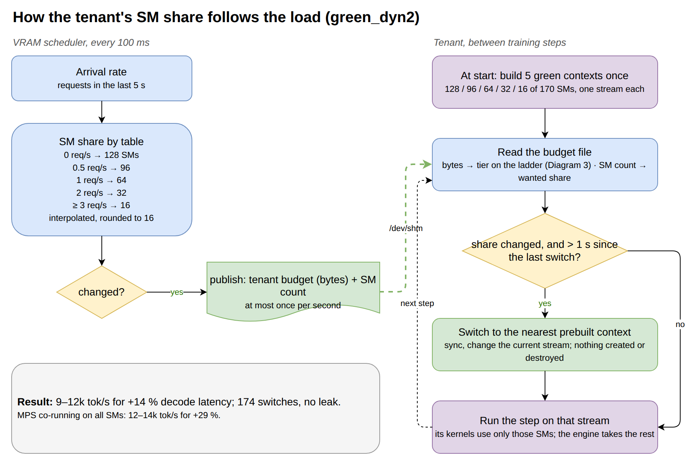

*Diagram 5 — the SM-share loop of `green_dyn2`: the VRAM scheduler maps the arrival rate to an SM count
and publishes it with the budget; the tenant switches between contexts built once at start. The memory
ladder runs unchanged alongside.*

| scheme | decode at 1 / 2 req/s: TPOT, queue wait | tenant at 1 / 0.5 req/s | note |
|---|---|---|---|
| `green32` (tenant on 32 SMs; round 1, 600 W) | 14.4 / 16.6 ms, 119 / 132 ms | 6.3k / 7.3k tok/s | the same trade as MPS 20 % |
| `green_split` (engine 128 SMs, tenant the other 42) | 16.2 / 18.6 ms, 123 / 150 ms | 11.6k / 13.7k | tenant throughput and decode cost both as with uncapped MPS: disjoint SMs alone do not remove the slowdown |
| `green_dyn2` (prebuilt 128/96/64/32/16-SM contexts, stream switch only) | 14.5 / 17.8 ms, 115 / 134 ms | 9.3k / 11.9k | 898 steps, 174 switches, reserved ≤ 8.7 GiB under a ≤ 9.9 GiB budget: no leak. Half the decode cost of uncapped MPS at 80 % of its tenant throughput |

The dynamic green context (64–96 SMs at 0.5–1 req/s) gives the tenant 9–12k tok/s for +14–15 % TPOT,
where uncapped MPS on all SMs pays +29 % for 12–14k and the fixed 42-SM partition pays +28 % for 12–14k.
Why it lies under the Figure-5 line was not identified in stage 2. A fixed partition does not change
the cost; a share that falls with the load does.

## 2.8 Reading the results

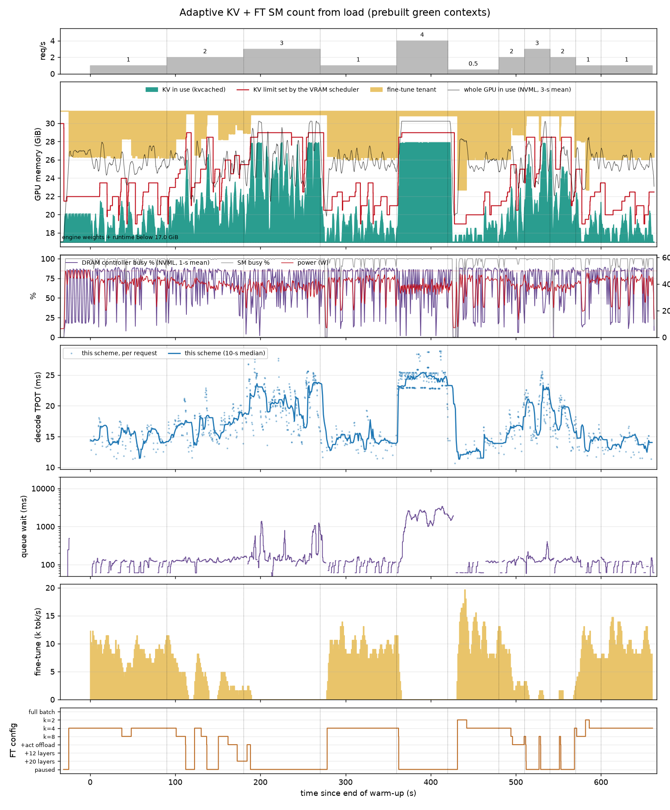

*Figure 7 — one run second by second (dynamic green contexts). Rows: arrival rate; GPU memory (teal =
KV in use, red = KV limit set by the VRAM scheduler, yellow = tenant, black = whole GPU from NVML, above
the 17 GiB engine floor); GPU-memory-controller busy, SM busy and power; decode TPOT against the
baseline; queue wait; tenant throughput; tenant configuration. When the rate rises the limit goes up at
once, the tenant's share shrinks and its configuration drops; at 4 req/s the tenant is paused and TPOT
lies on the baseline; 5 s after the load falls the limit comes down and the tenant climbs back to
k = 2 / k = 4. The same figure for every scheme: `coloc_adjust/results/<scheme>_timeline.png`.*

- **Resizing costs decode nothing.** The engine alone with its limit following the load equals the
  engine alone with a fixed 13 GiB limit in every phase (round 1, TPOT within 0.1 ms). Moving kvcached's
  limit between 2 and 12.65 GiB with the load is invisible to the engine.
- **The memory loop holds, with honest accounting.** Round 2 measures the engine's footprint at start
  (16.97 GiB), reserves 2 GiB for the tenant's context, weights and optimizer and 0.5 GiB safety, and caps
  every grow at the memory actually free. Over every round-2 run, KV mapped + tenant + engine fixed never
  exceeded the GPU (table below). The tenant's footprint exceeds its budget only while it is paused
  (0.6 GiB of model and optimizer against a 0 GiB budget, inside the 2 GiB allowance). The price is
  capacity: at 3–4 req/s demand (12.65 GiB) is above what can be mapped with the tenant paused
  (≈ 12.4 GiB), so the scheduler waits there (`grow_wait` for the whole 4 req/s phase). The KV limit
  then stops at 11–12.5 GiB instead of 12.65 GiB, and the 4 req/s queue is longer than the baseline's
  (2.2–3.4 s against 1.3 s).

  | scheme | max KV limit GiB | tenant above budget (s) | KV + tenant + fixed > total (s) | `grow_wait` (s) | shrinks | tenant steps (preempted) |
  |---|---|---|---|---|---|---|
  | baseline | 12.65 | 0.0 | 0.0 | 0.0 | 28 | – |
  | static split | 6.69 | 0.0 | 0.0 | 0.0 | 0 | 2089 (0) |
  | idle gate | 12.00 | 194.0 | 0.0 | 97.6 | 28 | 2 (21) |
  | MPS | 12.00 | 198.9 | 0.0 | 99.7 | 30 | 1124 (26) |
  | MPS 20 % | 12.50 | 197.1 | 0.0 | 95.7 | 30 | 640 (24) |
  | disjoint SMs 128/42 | 11.00 | 207.6 | 0.0 | 111.2 | 29 | 1115 (26) |
  | 5 % latency SLO | 12.00 | 205.5 | 0.0 | 105.2 | 28 | 141 (6) |
  | 15 % latency SLO | 12.00 | 196.9 | 0.0 | 101.6 | 27 | 340 (7) |
  | dynamic green contexts | 12.00 | 175.8 | 0.0 | 98.4 | 29 | 898 (24) |

  Engine fixed footprint 16.97 GiB in every run.
- **A static split loses at both ends.** With the engine fixed at 6.69 GiB and the tenant running flat
  out beside it (12–13k tok/s), decode pays +32–82 % TPOT at 0.5–2 req/s, queues 5–13 s at 3–4 req/s,
  and the backlog is still 26 s deep when the load has dropped to 0.5 req/s. At low load 4–8 GiB of the
  engine's budget sit unused.
- **Taking turns gives the tenant nothing.** The idle gate protects decode (+1 %) and the tenant trains
  nothing: while any request runs, the Model Runner V2 engine issues one decode step after another and
  the GPU is busy 93–100 % of the time, so there is no gap to fill (D5). The two jobs have to run at the
  same time.
- **Running together, the cost follows how much the tenant runs, not where.** MPS, MPS 20 %, the
  disjoint split and the SLO-capped runs share one line, +2.2 % TPOT per 1k tenant tok/s (Figure 5).
  MPS 20 % gives +10–11 % for ~55 % of the uncapped tenant throughput; the disjoint 128/42 split
  gives the uncapped cost (+28 %) for the uncapped throughput (MPS +29 %).
- **A latency SLO can be enforced directly.** The 15 % scheme stays within +0–14 % in every phase
  (+5 / +6 / +10 / +5 / +10 / +14 / +14 % in the 0.5–2 req/s phases) with the tenant at 1.3–5.3k tok/s, on
  the Figure-5 line: the cap only moves the tenant along the line. The 5 % scheme holds +2–7 % but mostly
  pins the tenant at its 500 tok/s floor, because a 5 % target is inside the ±4 % noise of a 10-s TPOT
  window. These are medians; the tail is in 2.5.
- **The tenant's shape sets the cost of a token.** The shape probe (`run_probe.sh`, `analyze_probe.py`)
  runs the engine at 1 req/s with a fixed 3 GiB KV limit and the tenant at a fixed 7.5 GiB budget and the
  same 4k tok/s cap, one 60-s window per shape (Figure 8). Decode slowdown per 1k tenant tok/s: 1.3 %
  with k = 4 micro-batches, 2.6 % with k = 8, 5.9 % with activation offload, 9.2 / 8.2 % with 12 / 20
  streamed layers. Smaller micro-batches re-read the weights more often per token, and the offload
  shapes add host↔GPU copies: per tenant token, the shapes that move more data cost decode more.
- **NVML's GPU-memory-controller busy does not separate the two users.** It reads 55–75 % whether the
  tenant runs at 0 or 14k tok/s, and the decode slowdown does not follow it; in the shape probe it falls
  for the copy-heavy shapes while their cost rises (Figure 8d). It is not a usable feedback signal; the
  tenant's token rate and shape are. Report 2 measures the traffic itself.

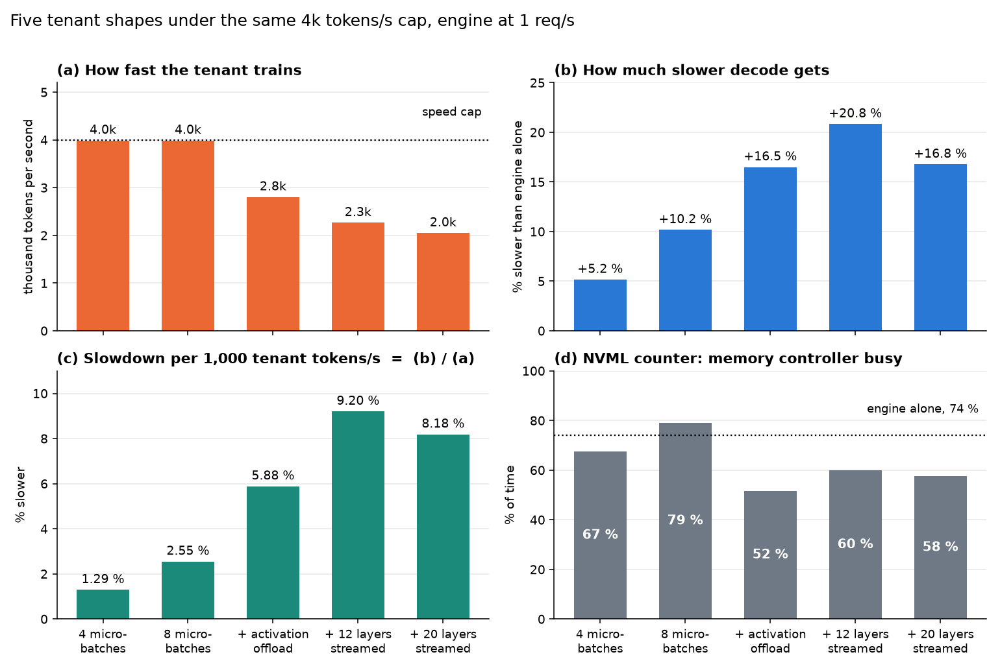

*Figure 8 — the shape probe. (a) Tenant speed: the two micro-batch shapes reach the 4k cap, the others
reach 2.8k, 2.3k and 2.0k tok/s. (b) Decode slowdown against the engine alone: +5.2 % to +20.8 %. (c) Their
ratio, the slowdown per 1k tenant tok/s. (d) NVML's memory-controller busy, engine-alone level dotted.*

Two parts of stage 2 are reported elsewhere: the prefill engine as tenant in
[4_prefill_tenant.md](4_prefill_tenant.md), and the host↔GPU transfer records (PCIe is not the
bottleneck) in [2_bandwidth.md](2_bandwidth.md) and [4_prefill_tenant.md](4_prefill_tenant.md).

## 2.9 What stage 2 left unexplained

The memory half is solved: GPU memory follows the load, the tenant takes the rest, and nothing fails.
The compute half has a measured cost and two ways to bound it (fewer SMs, or a TPOT-driven cap), but
not a cause:

- Disjoint SMs cost decode as much as shared SMs (+28 % against +29 %). The two jobs are not competing
  for SMs.
- The cost tracks the tenant's token rate (+2.2 % per 1k tok/s), and at the same token rate it tracks
  the tenant's shape: the shapes that move more data per token cost more, by up to 7×.
- Dynamic green contexts sit under the line, and why is not known.
- NVML's GPU-memory-controller busy cannot tell the two users apart.

Stage 3 asks what the two jobs share. It finds that decode is limited by the path between the SMs and
GPU memory, and that what the tenant moves on that path, decode loses:
[2_bandwidth.md](2_bandwidth.md). Controlling the tenant's bytes directly (a byte allowance) and making
the tenant move fewer bytes are in [3_c1_c2.md](3_c1_c2.md).

## What this shows

1. A running vLLM engine's KV budget can be lowered and raised from outside the process with kvcached.
   A new limit takes effect in about 1.3 s, costs nothing per step, and, on the same request timeline,
   gives the same TTFT, TPOT, queueing and preemptions as an engine restarted at that budget.
2. A shrink releases memory only as running requests finish (seconds to tens of seconds), and if the
   resident requests keep growing against the cap, vLLM preempts and recomputes them.
3. With host-RAM offload at 2 QPS, decode speed is flat from 13 GiB down to 4 GiB; the knee is the
   in-flight KV. Without offload the knee is at 8 GiB.
4. kvcached 0.1.6 and LMCache's MP connector crash together under store traffic; on kvcached main the
   `engine_driven` mode works with live resizing. The zero-copy modes need a change in LMCache.
5. A router and a VRAM scheduler outside vLLM make the KV limit follow the load and give the rest to a
   tenant that moves along a ladder of configurations: 0 failures, 0 preemptions, 0 s oversubscribed
   over 11 minutes at 0.5–4 req/s. A static split loses at both ends.
6. Taking turns gives the tenant nothing on this engine. Running together costs about +2.2 % TPOT per 1k
   tenant tok/s whatever SMs the tenant uses. Fewer SMs (MPS 20 %, dynamic green contexts) lower the
   slowdown at every moment and per token (1.5–1.7 % per 1k tok/s), with tail = median. A TPOT-driven
   cap shortens the overlap without lowering the slowdown during it, holds the median, and leaves a
   +28–29 % p90 at 0.5 req/s because the loop swings the cap. While the tenant pauses, decode is at
   its baseline.

## Limits

- One GPU model (RTX 5090), one inference model (Llama-3-8B), one workload distribution (Zipf-1.1), one
  tenant (a LoRA fine-tune) for every stage-2 number in this report.
- Each stage-2 scheme was run once (one 11-minute run); the baseline moves ±4 % between repeats of the
  same phase. The shape probe has one 60-s window per shape.
- Sections 2.5 and 2.6 are re-analyses of the round-2 runs.
- Stage-2 round 2 ran at a 500 W cap; `green32` and the "resizing costs nothing" comparison are from
  round 1 at 600 W (baseline TPOT within 0.3 ms between the two).
- Stage-1 experiments A and B used kvcached 0.1.6, everything else kvcached main.

## Files

- Stage 1: decision log
  [`kvcached_validation/DECISIONS.md`](../kvcached_validation/DECISIONS.md), scripts
  `kvcached_validation/scripts/` (`run_resize_exp.sh`, `run_expB.sh`, `run_shrink_sweep.sh`,
  `run_static_sweep.sh`, `run_live_replay_sweep.sh`, `analyze_sweep.py`), results and figures
  `kvcached_validation/results/` (the LMCache retest on kvcached main: `p4_ed_long_*`,
  `p4_vmm_exportable_startup.txt`), engine logs `kvcached_validation/logs/`.
- Stage 2: design [`coloc_adjust/DESIGN.md`](../coloc_adjust/DESIGN.md), decision log
  [`coloc_adjust/report/DECISIONS.md`](../coloc_adjust/report/DECISIONS.md) (D1–D10 round 1, D11–D19
  round 2; D12–D13 the LMCache retest), per-phase tables `coloc_adjust/results/<scheme>_phases.md`
  (summary tables printed by `round2_tables.py`). Earlier reports this one replaces are in git history
  (commit `358cc6b`): `kvcached_validation/REPORT.md`, `coloc_adjust/report/REPORT.md`, `REPORT_zh.md`,
  `PROJECT_RECAP_zh.md`, `round2_tables.md`.
- Stage-2 code: `coloc_adjust/controller.py` (router and VRAM scheduler), `ft_worker.py` (tenant),
  `green_ctx.py`, `tiers.json`; runners `run_eval6.sh`, `run_probe.sh`; analysis `round2_tables.py`,
  `analyze_overlap.py`, `analyze_probe.py`, `plot_arms.py`, `plot_workload.py`, `plot_recap_figs.py` (Figure 2).
- Stage-2 results: `coloc_adjust/results/` (round 2; per scheme `<scheme>_phases.csv`,
  `_controller.csv`, `_ft.csv`, `_sampler.csv`, `_timeline.png`; `overlap_summary.md`,
  `probe_probe.md`), `coloc_adjust/results_600w/` (round 1). Diagram sources `coloc_adjust/diagrams/`.
