# 报告 1：在线调整 KV 预算，以及和 tenant 共用一张 GPU

混部工作的阶段一和阶段二（2026 年 11 月 5–9 日）。分支 `kvcached-validation`。

**问题。** 之前的研究发现：KV offload 到主机内存以后，在一个随负载变化的拐点以下，decode 引擎的性能
不依赖它的显存预算。那么拐点以下的显存，以及 decode 用不上的 SM，就可以让给同一张 GPU 上的第二个任务
（tenant）。要做到这一点，有两件事必须成立：KV 预算能在引擎运行时改；空出来的显存和算力能交给 tenant，
而且不伤 decode。

**各用一句话回答。** 阶段一：kvcached 能在约 1.3 秒内改掉运行中 vLLM 引擎的 KV 预算，不杀请求，每步零开销，
而且在每个预算点上，引擎的表现都和重启到这个预算时一样。阶段二：在 vLLM 外面加一个 router 和一个
VRAM scheduler，就能让 KV 预算跟着负载走，把剩下的显存交给一个微调 tenant，0 失败、0 抢占、0 秒超订；
tenant 用算力的代价是每 1k tenant tok/s 让 decode TPOT 慢约 2.2 %，不管 tenant 用的是哪些 SM。这个代价
的原因在阶段二结束时还没有解释。

**用词约定。** 这里有两种内存，用名字分开。**显存**是卡上自己的内存（可用 31.35 GiB）；"显存带宽"指 SM
和显存之间的那条通道，"显存控制器忙碌度（NVML）"是 NVML 对这条通道的读数。**主机内存**是机器的内存：
KV 的 offload 层、tenant 卸载出去的激活、流式读取的权重和快照都放在那里，经 PCIe 传输。"scheme"指引擎和
tenant 分 GPU 的一种方式。"VRAM scheduler"是设定引擎 KV 上限和 tenant 预算的那个进程（`controller.py`）。

## 平台

| 项 | 值 |
|---|---|
| GPU | RTX 5090，170 个 SM，可用显存 31.35 GiB。阶段一在 GPU 0。阶段二第 2 轮在 GPU 0，两张卡都限 500 W（第 1 轮：GPU 1，600 W） |
| 主机 | 60 GiB 主机内存，PCIe 约 14 GB/s，`/dev/shm` 31 GiB |
| 软件 | vLLM 0.30.0，Model Runner V2（`VLLM_USE_V2_MODEL_RUNNER=1`，vLLM ≥ 0.29 时 kvcached 要求它），torch 2.13.0+cu130，LMCache 0.5.6 |
| kvcached | 阶段一的实验 A 和 B 用 0.1.6（PyPI）；阶段一的扫描和整个阶段二用 main `9106e0f`（2026-11-04） |
| 推理模型 | Llama-3-8B bf16，每 token 128 KiB KV（6144-token 前缀约 0.77 GiB） |
| tenant | Qwen2.5-0.5B LoRA 微调（r = 16，作用于 q/k/v/o，bf16，每个优化器步 8 × 512 token） |
| 引擎参数 | `--max-model-len 8192 --max-num-seqs 32`；所有运行都设 `VLLM_USE_FLASHINFER_SAMPLER=0`（这个 build 里 FlashInfer 采样器的 JIT 不认 sm_120；attention 用 FLASH_ATTN） |

---

# 阶段一：KV 预算可以在线调整，而且不花钱

目录 `kvcached_validation/`。kvcached 通过 CUDA 虚拟内存 API 分配 vLLM 的 KV cache，物理页（2 MiB）按需映射。
`kvctl limit`（或它的 Python API）设一个上限，引擎每 100 ms 从一段共享内存里读一次。

## 1.1 带负载缩和扩（kvcached 0.1.6）

引擎启动时 kvcached 的 KV 预算是 13.7 GiB（104,704 个 token），空闲时只映射 64 MiB。prefix caching 关，
所以被占用的页只属于正在跑的请求。负载：6000-token 随机 prompt 的 Poisson 流，贪心、`ignore_eos`。
100 ms 的采样器记录 NVML 显存、kvcached 自己的计数和 vLLM 的指标；每次调整的 t = 0 是采样器第一次看到
新上限的那一行。

| 运行 | 负载 | 结果 |
|---|---|---|
| A1 | 3.5 req/s × 128 输出 token，上限 12 G → 3 G → 12 G（超过 prefill 能力，缩之前已排队约 55 个） | 480/480 完成，0 抢占。缩的时候 15 个在跑，1 s 后 7 个，3 s 后 4 个，都是正常结束。NVML 显存 29.66 → 20.66 GiB：0.5 s 开始动，2.7 s 到达平台的 2 % 以内。3 G 上限下恰好 4 个请求在驻（4 × 0.75 GiB）；ITL 中位数 19.6 → 12.8 ms（batch 变小）。扩：3.0 → 11.9 GiB 用 6.2 s，受 6k-token prefill 的准入速度限制 |
| A2 | 1.2 req/s × 512 输出 token，同样的上限序列（约 15 个请求在驻，decode 时 KV 还在长） | 160/160 完成，每个都生成了 512 个 token。缩的瞬间没有请求被停；kvcached 用量 8 s 内 11.5 → 4.1 GiB，21 s 后才低于 3 GiB（在驻请求剩下的寿命）。**抢占 15 次**，13 次 token 流停顿 1.7–7.0 s，第一次在缩之后 19.6 s。扩：2.4 → 11.9 GiB 用 5.4 s |
| A3 | 8 GiB 预算，从不顶到；plain vLLM（`--kv-cache-memory-bytes`）对 kvcached（`kvctl limit 8G`）；1 req/s × 6000-token prompt × 256 token，120 s | decode 步 p50 / p90：plain 14.03 / 16.17 ms，kvcached 14.03 / 16.18 ms；ITL p99 457.9 / 457.6 ms；TTFT p50 / p90 0.49 / 1.13 s 对 0.49 / 1.14 s；8 条固定 prompt 的贪心输出逐字节相同 |

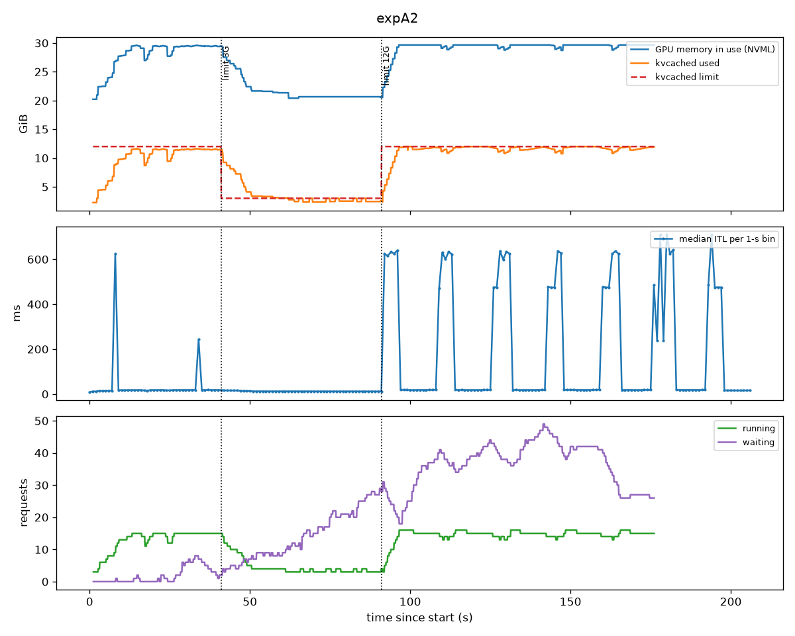

*图 1：A2。上：显存用量（NVML）、kvcached 的用量和上限。中：每 1 秒的 ITL 中位数。下：在跑和排队的请求数。
显存随在驻请求结束而下降，不是在缩的那一刻下降。*

**机制。** kvcached 靠缩小 vLLM 的**逻辑** block 池来执行上限。正在跑的请求持有的页不会被收回，它们在请求
结束时才解除映射（引擎日志："shrink to 1536 blocks refused by allocator (in-use pages above target); keeping
shrink pending"）。超出上限的新分配在 vLLM 自己的调度器里失败，vLLM 就做它平常的"抢占再重算"，和 KV 满了
时一样。kvcached 自己的 "pool exhausted" 路径一次也没走到。所以正在跑的请求能熬过一次缩，但如果它的 decode
还需要比上限剩下的更多的 block，就会被抢占（A2）。缩 decode 引擎时要给在驻请求的继续增长留余量。

## 1.2 kvcached 配 LMCache 的多进程 connector

LMCache 的多进程（MP）模式把缓存放在单独的 server 进程里。默认的 `lmcache_driven` 传输由 server 通过 CUDA IPC
句柄直接读写 vLLM 的 GPU KV；`engine_driven` 则由 vLLM 的 worker 自己做 gather/scatter。kvcached 用
`cuMemCreate` 建页，没有申请可共享的句柄类型。

| kvcached | 配置 | 结果 |
|---|---|---|
| 0.1.6 | `lmcache_driven`（默认） | 注册 KV 时失败：传统 CUDA IPC 不能导出 VMM 地址（`invalid device pointer`） |
| 0.1.6 | 加 `use_vmm_api=true` | 失败：kvcached 默认布局把 32 层交错在每个 block 里，张量不连续 |
| 0.1.6 | 再加按层分池 | 往后一个检查失败：页在创建时就是不可导出的（`requestedHandleTypes=0`） |
| 0.1.6 | `engine_driven`，256-token 的 store，6 个多轮 session，上限 13 G → 2 G → 12 G | 能跑：91/91 成功，0 抢占；缩在 1.9 s 内生效，没有影响任何请求 |
| 0.1.6 | `engine_driven`，2–3k token 的 store（压力版） | **引擎崩溃**：2 G / 12 G 交替时在 148 s，不调上限时在 90 s。LMCache 的异步 store gather 读到了一个没有映射的 kvcached 页（`Xid 31`，MMU 读故障）。plain 引擎配同样的 connector 和负载：94/94 正常 |
| main（后来重测，11 月 9 日） | `engine_driven`，同样的压力负载，每 15 s 在 2 G / 12 G 之间改一次，10 分钟 | **能用**：341/341 成功，329 次 store / 233 次 retrieve，0 次 Xid；贪心输出和不带 connector 的 plain 引擎 8/8 一致 |
| main + 可导出的页 | `lmcache_driven` + `use_vmm_api` | 仍然失败：LMCache 每个张量只导入一个句柄，而 kvcached 用很多 2 MiB 的页拼一个张量。要改的是 LMCache 一侧 |

**崩溃的机制。** 在 0.1.6 上，kvcached 只按 worker 的计算 stream 给页的释放排序，只为 vLLM 原生的
`OffloadingConnector` 钉住页。LMCache 的 store gather 在后台线程里、在它自己的拷贝 stream 上跑，所以可能在页
被解除映射之后才去读。kvcached main 把页的解除映射排在 GPU 的进度之后；决策日志（D13）把这次重测的结果解读为
这个改动堵上了那个时间窗。为 LMCache 写的钉页层没有用上。

0.1.6 环境里的两个附带观察。connector 自己的 inline 传输，加载时只有 5–6k token/s，存储时约 1k token/s；
每次同步加载 4–6k token 的前缀，会让所有 decode 停约 0.8 s（plain 引擎也一样）。和不带 connector 的引擎相比，
connector 改变了 8 条贪心输出里的 4 条；在 kvcached main 的环境里这个差别没有了。

## 1.3 固定 2 QPS、带主机内存 offload，在线缩预算

这是 vram-limit 分支 study 1 的重做。study 1 在每个预算点重启引擎；这里在一次连续运行里在线缩预算。

| 项 | 值 |
|---|---|
| 负载 | 32 个 session × 6144-token 前缀（KV 需求共 24 GiB）；每个请求 = 某个 session 的前缀 + 128 个新 token → 生成 128 token；Poisson 2 QPS；Zipf-1.1 选 session；32 个请求预热 |
| offload | vLLM 原生 CPU offload，24 GiB 的 pinned 主机内存层（`--kv-offloading-backend native`）；prefix caching 开 |
| kvcached | main，因为 0.1.6 不为 `OffloadingConnector` 的拷贝钉页，也不在降上限时释放缓存的前缀；`KVCACHED_MAX_CACHED_TOKENS=-1`，让 GPU 前缀缓存可以占满预算 |
| 时间表 | 启动上限（13 G）跑 60 s，然后 10 / 8 / 6 / 5 / 4 / 3 / 2 G，每档 60 s（约 110 个请求）；每次改动后的前 5 s 不计 |
| 脚本 | `scripts/run_shrink_sweep.sh`，`scripts/analyze_sweep.py` |

| 上限 | 带 offload：TTFT p50 / p95 (ms) | ITL p50 (ms) | tok/s | GPU 前缀命中 | 主机内存命中 | 最多排队 | 不带 offload：TTFT p50 / p95 (ms) | 最多排队 | 抢占 |
|---|---|---|---|---|---|---|---|---|---|
| 13 G | 51 / 499 | 12.6 | 263 | 76 % | 72 % | 1 | 52 / 1 265 | 1 | 0 |
| 10 G | 52 / 454 | 12.7 | 247 | 72 % | 81 % | 1 | 66 / 773 | 0 | 0 |
| 8 G | 91 / 399 | 13.1 | 244 | 55 % | 88 % | 2 | 505 / 2 580 | 7 | 0 |
| 6 G | 72 / 351 | 12.6 | 244 | 55 % | 87 % | 1 | 500 / 1 541 | 2 | 0 |
| 5 G | 146 / 770 | 13.1 | 265 | 48 % | 92 % | 4 | 3 488 / 9 041 | 18 | 0 |
| 4 G | 155 / 795 | 12.9 | 277 | 43 % | 95 % | 5 | 7 053 / 13 410 | 26 | 1 |
| 3 G | 3 210 / 5 837 | 12.2 | 251 | 29 % | 91 % | 13 | 27 986 / 56 741 | 52 | 3 |
| 2 G | 18 019 / 23 670 | 11.8 | 230 | 20 % | 93 % | 34 | 89 754 / 107 649 | 107 | 1 |

两次运行的每个窗口里，所有请求都完成了。带 offload 的那次每个窗口都是 0 次抢占；最后一列是不带 offload 的那次。

- **带 offload 时**，每次 `kvctl limit` 都把缓存的前缀逐出到恰好等于新上限，引擎一直在服务。13 到 4 GiB 之间
  decode 不受影响（ITL 12.6–13.1 ms，244–277 tok/s）。TTFT p50 从 51 ms 升到 155 ms，因为 GPU 前缀命中从 76 %
  降到 43 %，剩下的由主机内存层接住（72 → 95 %）；p95 一直低于 0.8 s。
- **拐点就是在途的 KV。** 2 QPS × 约 1.8 s ≈ 3.7 个在途请求 × 0.77 GiB。低于 4 GiB 就放不下了，引擎开始排队：
  3 GiB 时 TTFT p50 3.2 s，2 GiB 时 18 s，没有抢占。study 1 用重启的办法找到的是同一个拐点、同一段平坦区。
- **不带 offload 时**，被逐出的前缀必须重算（6144 个 token 约 0.4 s 的 prefill）。拐点上移到 Zipf 热集放不下
  的地方：8 GiB 时 TTFT p50 已经是 0.5 s，5 GiB 时 3.5 s。

## 1.4 同一条请求时间线上，在线对静态

要回答"在线改有没有代价"，对照组是同样的 vLLM 0.30 引擎、不带 kvcached、在每个预算点重启
（`--kv-cache-memory-bytes` = 13 … 2 GiB，`scripts/run_static_sweep.sh`），同样的 offload 层和负载，每个预算
300 个请求。

第一次比较用的是 1.3 的连续扫描，8 GiB 窗口读出 TTFT p50 91 ms，静态是 57 ms。这是窗口造成的假象：连续扫描
给每个预算打分用的是固定种子 Zipf 序列里不同的 60 s 切片，切片之间自己就差 ±40 ms 的 TTFT p50（8 G 那段切片里
有一个 10 s 的区间 GPU 命中只有 36 %，另一个区间 16 % 的 token 两层都没命中）。所以在线那组改成**每个预算都用
同一条时间线**重跑（`scripts/run_live_replay_sweep.sh`）：引擎一直在跑，用 `kvctl` 改上限，空闲 10 s，再回放
同一条固定种子的负载（预热 + 150 s，300 个请求），只给这一段打分。

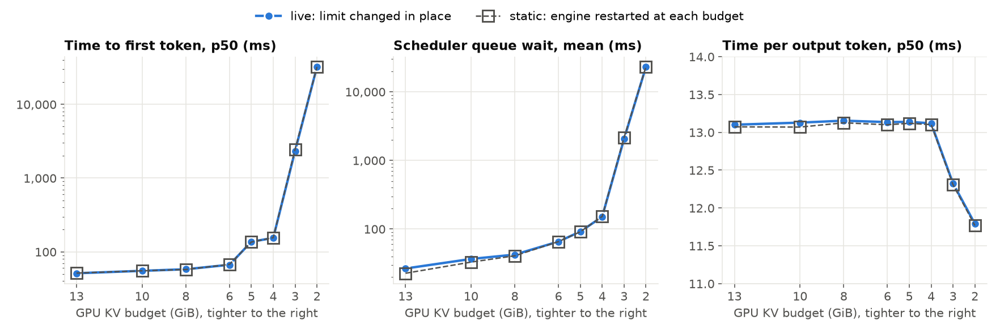

*图 2：TTFT p50、调度排队时间和 TPOT p50 对 GPU KV 预算（越往右越紧）。蓝点 = 用 kvcached 原地改上限，
方框 = 每个预算重启一次。两组点重合。*

| GPU KV | 在线：TTFT p50 / 排队 / TPOT / tok/s / 抢占 | 静态（重启）：TTFT p50 / 排队 / TPOT / tok/s / 抢占 |
|---|---|---|
| 13 GiB | 51 ms / 27 ms / 13.1 ms / 258 / 0 | 52 ms / 23 ms / 13.1 ms / 258 / 0 |
| 10 | 55 / 37 / 13.1 / 258 / 0 | 55 / 33 / 13.1 / 258 / 0 |
| 8 | 58 / 42 / 13.2 / 258 / 0 | 58 / 41 / 13.1 / 258 / 0 |
| 6 | 67 / 66 / 13.1 / 258 / 0 | 68 / 65 / 13.1 / 258 / 0 |
| 5 | 137 / 92 / 13.1 / 257 / 0 | 136 / 91 / 13.1 / 257 / 0 |
| 4 | 154 / 151 / 13.1 / 257 / 2 | 155 / 153 / 13.1 / 257 / 2 |
| 3 | 2 333 / 2 050 / 12.3 / 252 / 0 | 2 451 / 2 154 / 12.3 / 252 / 0 |
| 2 | 32 153 / 22 981 / 11.8 / 179 / 0 | 32 134 / 22 996 / 11.8 / 179 / 0 |

同一条时间线上，两者分不出来：拐点以上 TTFT p50 差 1–2 ms，TPOT 差 ≤ 0.1 ms，排队差 ≤ 4 ms，4 GiB 时都是
2 次抢占，吞吐相同，拐点以下的排队也一样深。study 1 在拐点以下看到的"抢占–重算"螺旋和卡死，这里即使用静态
预算也没有再出现：vLLM 0.30 的调度器改为排队。

**decode-only 模拟。** 为了在没有第二张 GPU 的情况下看 decode 引擎，同样的负载在 prefix caching 关、28 GiB
主机内存层装下所有前缀的条件下再跑一遍：GPU 上只有在途的 KV，每个前缀都从存储里来（查找的 token 有 95–98 %
命中），剩下的 prefill 只是 128 个新 token。在线和静态用同一条时间线。

| GPU KV | 在线：TPOT / 排队 / tok/s / 抢占 | 静态：TPOT / 排队 / tok/s / 抢占 |
|---|---|---|
| 13 GiB | 13.3 ms / 112 ms / 258 / 0 | 13.3 ms / 114 ms / 258 / 0 |
| 10 | 13.3 / 114 / 258 / 0 | 13.2 / 114 / 258 / 0 |
| 8 | 13.4 / 115 / 258 / 0 | 13.2 / 116 / 258 / 0 |
| 6 | 13.4 / 156 / 257 / 0 | 13.3 / 156 / 257 / 0 |
| 5 | 13.4 / 218 / 257 / 0 | 13.4 / 218 / 257 / 0 |
| 4 | 13.4 / 375 / 255 / 0 | 13.4 / 370 / 256 / 0 |
| 3 | 12.3 / 10 434 / 226 / 0 | 12.3 / 10 543 / 225 / 0 |
| 2 | 11.7 / 29 113 / 158 / 0 | 11.7 / 29 161 / 158 / 0 |

13 GiB 到 4 GiB，两组的 TPOT 都在 13.2–13.4 ms；任何预算下 GPU 上都只有约 3 GiB 在途 KV。平坦区里 110–150 ms
的"排队"就是取 KV 本身（每个请求 0.77 GiB）。从 6 GiB 起，在途请求集合的 p95（约 5.4 GiB）开始碰到上限，
排队增加（6 → 4 GiB 时 156 → 375 ms）。低于 4 GiB 引擎受容量限制，供给 258 tok/s 只交付 226，再到 158，
没有失败，没有抢占。在线和静态的排队差 ≤ 5 ms，TPOT 差 ≤ 0.2 ms。

## 1.5 阶段一的限制

- 单 GPU、单模型、TP = 1。实验 A、B 用 kvcached 0.1.6，扫描用 main。
- 只测了 Zipf。连续扫描每个窗口 60 s（约 110 个请求）；同一时间线的扫描和静态对照每个预算 300 个请求。
- prefix caching 开时，kvcached 0.1.6 只在分配路径上逐出缓存的前缀；main 在降上限时就释放。扫描因此用 main。
- A1 超出了 prefill 能力（6k-token prompt 约 9.6k tok/s），A2 正好在容量上。

---

# 阶段二：混部 VRAM 调整原型

目录 `coloc_adjust/`。第 1 轮在 11 月 5–6 日（GPU 1，600 W）；第 2 轮在 11 月 9 日（GPU 0，500 W）。
下面的表和图都是第 2 轮的，第 1 轮的另外标出。

## 2.1 造了什么

一张 RTX 5090 上跑一个 Llama-3-8B 的 decode 节点（vLLM 0.30 + kvcached main，原生主机内存 offload，28 GiB 的层
放在 `/dev/shm`，prefix caching 关，所以 GPU 上只有在途的 KV），旁边跑 LoRA 微调 tenant。vLLM 的调度器
一行不改。

- **Router 和 VRAM scheduler**（`controller.py`，同一个进程）。每个请求都经过一个流式 HTTP router，它知道
  请求的 prompt 长度、`max_tokens` 和已经生成了多少 token，所以在跑的和排队的请求一共要多少 KV block 是精确的
  （准入时 ⌈prompt/16⌉ 个 block，之后每 16 个生成 token 加 1 个，每个 block 2 MiB）。VRAM scheduler 每 100 ms
  算一次 `need = (在跑的最终量 + 排队的最终量) × 2 MiB + λ̂ · 1 s · 0.78 GiB + 0.5 GiB`。kvcached 的上限要涨就
  立刻涨到 `need`；只有在低于 `need − 1 GiB` 持续 5 s 后才缩，而且不低于在跑请求已持有的量。涨的时候只能承诺
  现在真正空闲的显存（kvcached 已映射的 + NVML 显示空闲的 − 余量）；如果 tenant 还没让出足够的显存，就等
  （`grow_wait`），需求先回落的话就放弃这次涨。tenant 的预算是 `31.35 − 17.0 − 2.0 − 0.5 − 上限` GiB（总量 −
  引擎权重和运行时，启动时 NVML 实测 16.97 GiB − tenant 自己的 context、权重和优化器 − 余量），发布到
  `/dev/shm`；上限涨时立刻降，kvcached 的已映射字节低于新上限之后才升。可选项（`--tpot-slo`）：VRAM scheduler
  拿最近 10 s 的 decode TPOT 和当前到达率下没有 tenant 时的参考值比，给 tenant 发布一个 tokens/s 上限（每 2 s
  乘性调整一次）。
- **微调 tenant**（`ft_worker.py`）。每个优化器步之前读自己的预算，挑校准需求能放下的最高配置（要降立刻降，
  要升等 3 s）。step 里每 50 ms 查一次预算，放不下了就在 step 中途放弃。torch 分配器的上限跟着预算走，所以
  估错时 OOM 的是 tenant，不是引擎。LoRA 权重、优化器、学习率调度、步数和随机数状态每 10 步、每次换配置之前
  快照到主机内存。tenant 通过每步之后 sleep 来遵守 tokens/s 上限；带 `--green-prebuilt` 时，它在启动时建好
  128/96/64/32/16 个 SM 的 green context，步与步之间只切 stream。
- **记录。** 每一次主机↔GPU 拷贝都记下来源；100 ms 的采样器记录 kvcached 用量、NVML 显存、PCIe 计数、功耗、
  SM 忙碌度和显存控制器忙碌度。

算力共享用 MPS daemon（引擎和 tenant 都是 MPS 客户端），green context 通过 ctypes 调 libcuda（`green_ctx.py`）。

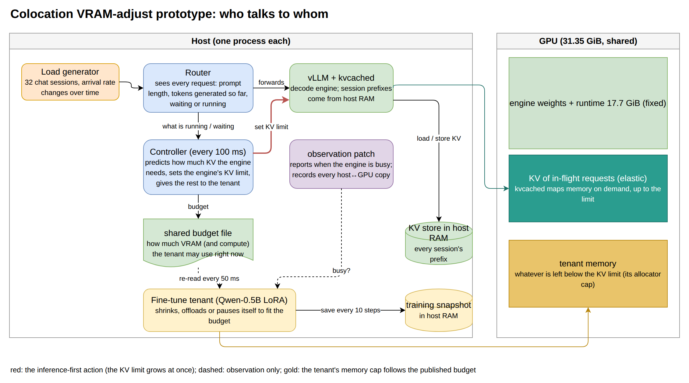

*图示 1：组件和触发关系。router 把需求交给 VRAM scheduler；VRAM scheduler 设 kvcached 的上限（推理优先），
把剩下的发布给 tenant。*

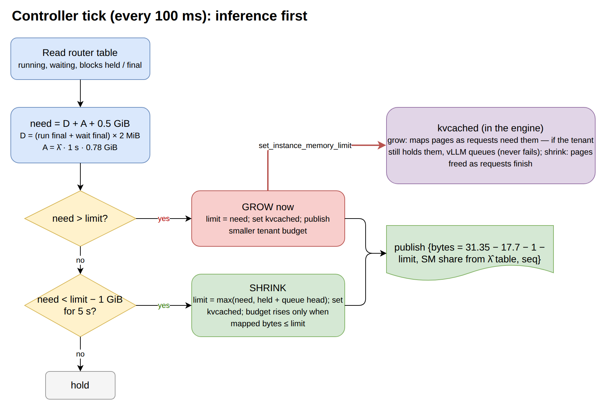

*图示 2：VRAM scheduler 的一拍。需求超过上限立刻涨；有余量持续 5 s 才缩，且不低于在跑请求持有的量。*

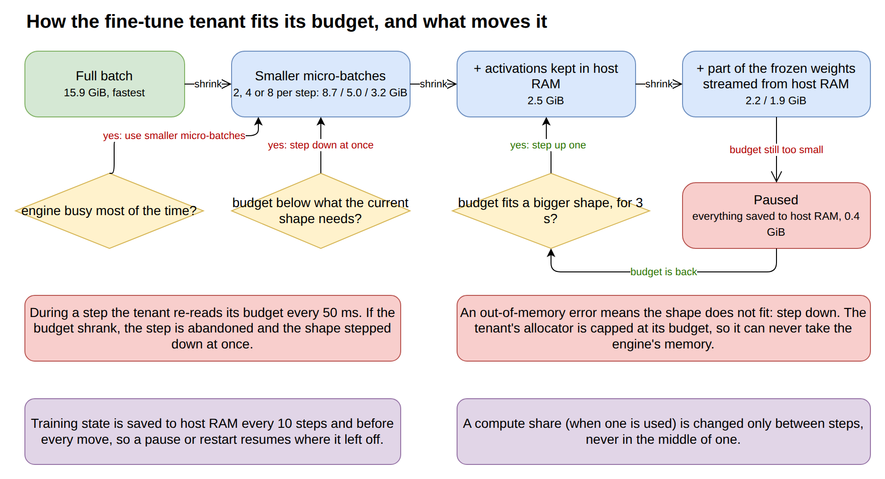

*图示 3：tenant 的配置阶梯，以及推动它的条件：step 中途查预算、OOM 当信号、往上爬之前等 3 s、每次移动前后
快照到主机内存。*

**tenant 的配置**（在 GPU 1 上单独校准，`tiers.json`）：

| cfg | 档 | micro-batch k | 激活 offload | 从主机内存流式读取的层数 | 梯度检查点 | 需要 GiB | 每步 ms | tok/s |
|---|---|---|---|---|---|---|---|---|
| 0 | 0 整批 | 1 | – | 0 | 关 | 15.9 | 91 | 44.8k |
| 1 | 1 | 2 | – | 0 | 关 | 8.7 | 106 | 38.7k |
| 2 | 1 | 4 | – | 0 | 关 | 5.0 | 138 | 29.6k |
| 3 | 1 | 8 | – | 0 | 关 | 3.2 | 210 | 19.5k |
| 4 | 2 | 8 | 是 | 0 | 开 | 2.5 | 1045 | 3.9k |
| 5 | 3 | 8 | 是 | 12 | 开 | 2.2 | 1294 | 3.2k |
| 6 | 3 | 8 | 是 | 20 | 开 | 1.9 | 1452 | 2.8k |
| 7 | 4 暂停 | – | – | – | – | 0.4 | – | 0 |

k = 8 时激活 offload 每步每个方向搬约 4.8 GB，每步慢 5 倍；梯度检查点已经开着时它省的显存很少（下限约 1.9 GiB，
是 lm_head/embedding 加一个 micro-batch 的 logits）。实际上阶梯就是：micro-batch 降到约 3 GiB，然后是慢的
offload 档，然后暂停。

## 2.2 评测怎么做

| 项 | 值 |
|---|---|
| 负载 | 阶段一的负载（32 个 session × 6144-token 前缀，+128 新 token → 生成 128，Zipf-1.1，固定种子），每个在途请求约 0.77 GiB KV |
| 到达率 | 32 个请求预热之后分段恒定（见下表）；每个 scheme 回放同一条固定种子的序列 |
| 运行 | 每个 scheme 一次连续 11 分钟的运行（`run_eval6.sh`）；每个阶段去掉前 10 s |
| decode 指标 | TPOT、调度排队时间、交付吞吐、失败数（这里的 TTFT 是取 KV + 128-token prefill，约 160 ms，所以不用） |
| tenant 指标 | tokens/s 和所处的配置 |
| 基线 | 引擎单独跑，KV 上限跟着负载调（`adjust_notenant`）。500 W 的上限对它没有可测的影响：每个阶段 TPOT 和 600 W 那次差 ≤ 0.3 ms。这个负载下 GPU 每个阶段只用 290–385 W |

| 从第几秒 | 0 | 90 | 180 | 270 | 360 | 420 | 480 | 510 | 540 | 570 | 600–660 |
|---|---|---|---|---|---|---|---|---|---|---|---|
| req/s | 1 | 2 | 3 | 1 | 4 | 0.5 | 2 | 3 | 2 | 1 | 1 |

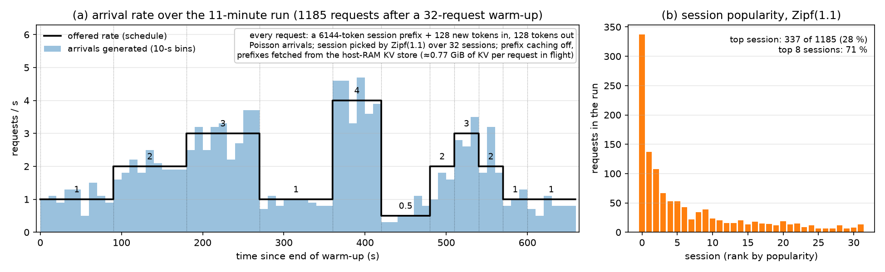

*图 3：(a) 给定的到达率和实际生成的 Poisson 到达，10 s 一格；(b) session 热度，32 个 session 上的 Zipf(1.1)。*

## 2.3 各 scheme 是什么

每个 scheme 是一种分算力的方式。除了静态划分，显存都跟着负载调。

| 类别 | scheme | 显存 | 算力 | tenant 什么时候在跑 |
|---|---|---|---|---|
| 对照 | 基线（`adjust_notenant`） | 跟着负载调 | 没有 tenant | – |
| 对照 | 静态划分（`static_split`） | **固定切开**：引擎 KV 6.69 GiB（2 req/s 时的需求），tenant 6 GiB | MPS，全部 SM 共用 | 一直在跑 |
| **A** 轮流用 | 空闲门（`adjust`） | 跟着负载调 | tenant 每算一个 block 之前先看引擎忙不忙，忙就等 | 只在引擎空闲时 |
| **B** 同时用，不限制 | MPS 混跑（`adjust_nogate`） | 跟着负载调 | 两个任务共用全部 170 个 SM | 一直在跑 |
| **C** 同时用，少给 SM | MPS 限 20 %（`adjust_mps20`） | 跟着负载调 | SM 共用，tenant 最多用 20 % 的 SM 线程 | 一直在跑 |
| | 不相交 SM 128/42（`green_split`） | 跟着负载调 | 引擎用 SM 0–127，tenant 用另外 42 个 | 一直在跑 |
| | 动态 green context（`green_dyn2`） | 跟着负载调 | tenant 的 SM 数随到达率变：0.5 / 1 / 2 / ≥ 3 req/s 时 96 / 64 / 32 / 16 个；context 预先建好，只切 stream | 一直在跑 |
| **D** 同时用，少给时间 | 15 % 延迟 SLO（`tpot_slo15`） | 跟着负载调 | 共用全部 SM；VRAM scheduler 每 2 s 把 decode TPOT 和基线 +15 % 比，设一个 tokens/s 上限；tenant 每步之后歇一会儿来遵守 | 干一阵歇一阵 |
| | 5 % 延迟 SLO（`tpot_slo5`） | 跟着负载调 | 同上，目标 +5 % | 干一阵歇一阵 |

"一直在跑"指 tenant 不主动停。3–4 req/s 时显存预算归零，所有自适应 scheme 里的 tenant 都被暂停。出这些表之前
重跑过三批：第 2 轮第一次的静态划分误开了空闲门，去掉空闲门重跑（D15）；VRAM scheduler 有一个 bug，一次涨卡住
以后 tenant 就一直暂停，修好后重跑了六个自适应 scheme（D16）；第 1 轮的动态 green context 每次切换都新建 context，
分配器漏显存，tenant 挂掉，改为预建 context 后以 `green_dyn2` 重跑（D8–D9、D18）。

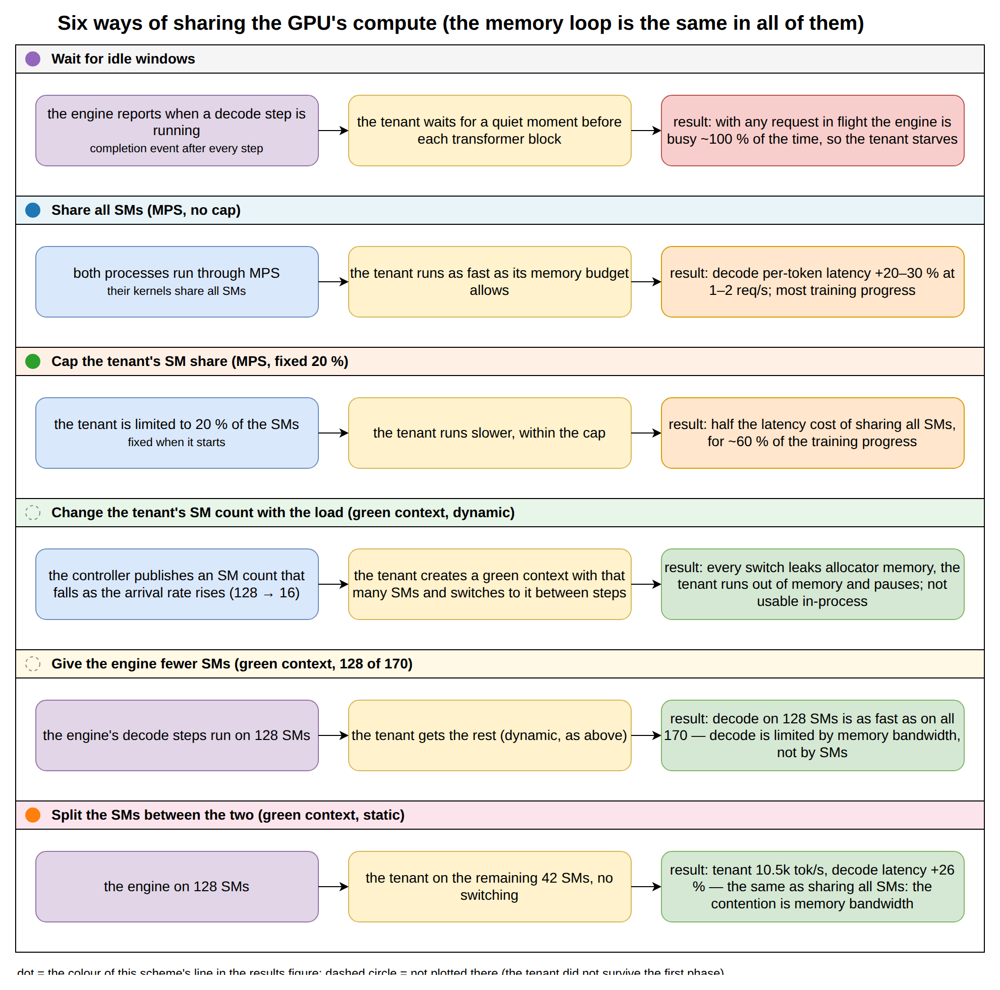

*图示 4：试过的算力共享机制；显存环路在所有 scheme 里相同。*

## 2.4 各 scheme 的结果

各到达率下的 decode TPOT p50（ms，相同到达率的阶段取平均；括号里是相对基线的变化），3 和 4 req/s 时的调度排队，
0.5 / 1 / 2 req/s 时的 tenant 吞吐，以及代价：decode 变慢的百分比 ÷ tenant 的 k tok/s。①②③ 标出每列最好的三个
（TPOT、排队、代价越小越好，tenant 吞吐越大越好；并列的标同一个号；基线不参与；一格里有几个数的，每个数单独比）。
3 和 4 req/s 的 TPOT 两列不排名：那时 tenant 是暂停的。

| scheme | 类别 | TPOT @0.5 | @1 | @2 | @3 | @4 | 排队 @3 / @4 (ms) | tenant k tok/s @0.5 / 1 / 2 | 每 1k tok/s 的代价 % @0.5 / 1 |
|---|---|---|---|---|---|---|---|---|---|
| 基线 | – | 12.0 | 12.6 | 16.3 | 20.8 | 26.1 | 214 / 1 292 | – | – |
| 静态划分 | – | 21.8 (+82 %) | 16.7 (+32 %) | 21.8 (+34 %) | 23.0 (+11 %) | 22.9 (−12 %) | 4 941 / 13 472 | ③ 13.2 / ① 12.2 / ① 12.9 | 6.2 / 2.7 |
| 空闲门 | A | ① 12.1 (+1 %) | ① 12.8 (+1 %) | ① 16.5 (+1 %) | 20.9 (+0 %) | 25.2 (−3 %) | ① 238 / ② 2 262 | 0 / 0 / 0 | tenant 没跑成 |
| MPS 混跑 | B | 15.4 (+29 %) | 16.3 (+29 %) | 18.9 (+16 %) | 21.4 (+3 %) | 25.0 (−4 %) | 257 / 2 302 | ① 14.5 / ② 11.7 / ② 3.0 | 2.0 / 2.5 |
| MPS 限 20 % | C | 13.2 (+10 %) | ③ 14.0 (+11 %) | 18.0 (+10 %) | 21.2 (+2 %) | 25.7 (−2 %) | ③ 254 / 2 940 | 7.0 / 6.5 / 2.2 | ③ 1.4 / ② 1.7 |
| 不相交 SM 128/42 | C | 15.3 (+28 %) | 16.2 (+28 %) | 18.6 (+14 %) | 21.3 (+3 %) | 24.1 (−7 %) | 308 / 3 367 | ② 13.7 / ③ 11.6 / ③ 2.9 | 2.0 / ③ 2.5 |
| 动态 green context | C | 13.7 (+14 %) | 14.5 (+15 %) | 17.8 (+9 %) | 21.0 (+1 %) | 24.5 (−6 %) | ② 250 / ① 2 216 | 11.9 / 9.3 / 2.3 | ② 1.2 / ① 1.6 |
| 15 % 延迟 SLO | D | ② 12.5 (+5 %) | ③ 14.0 (+11 %) | ③ 17.3 (+6 %) | 20.9 (+1 %) | 24.5 (−6 %) | 280 / ③ 2 277 | 3.8 / 4.0 / 1.5 | ① 1.1 / 2.8 |
| 5 % 延迟 SLO | D | ③ 12.8 (+7 %) | ② 13.1 (+3 %) | ② 16.9 (+4 %) | 20.8 (−0 %) | 22.3 (−14 %) | 306 / 2 425 | 3.8 / 1.2 / 0.4 | 1.8 / 3.3 |

读这张表要注意三点。decode 那几列的 ① 都是空闲门，因为它的 tenant 没跑成。tenant 吞吐那列静态划分拿了 ①，因为
它从不把显存让回去，代价是 TPOT 慢 32–82 %、排队 5–13 s。限速那两行的代价一列不稳：它们的变慢是一阵一阵的，
用这里的中位数算是 1.1–3.3 %，用均值算是 2.3–2.9 %；5 % 目标在 1 req/s 的 +3 % 落在基线同一阶段重复之间 ±4 %
的噪声里。

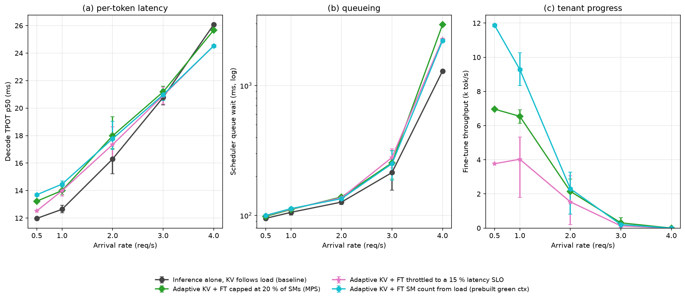

*图 4：基线和延迟/吞吐权衡最好的三个 scheme：(a) decode TPOT，(b) 排队，(c) tenant 吞吐，横轴都是到达率（点 =
均值，误差线 = 重复阶段的最小到最大）。MPS 限 20 %（绿）和动态 green context（青）在 0.5–1 req/s 给 tenant
7–12k tok/s，TPOT +10–15 %；green context 的 tenant 吞吐高 40–70 %，到 2 req/s 就回到基线上。15 % SLO（粉）在
每个到达率都守在目标内，给 tenant 1–5k tok/s。所有 scheme：[`arms.png`](../coloc_adjust/report/figures/arms.png)。*

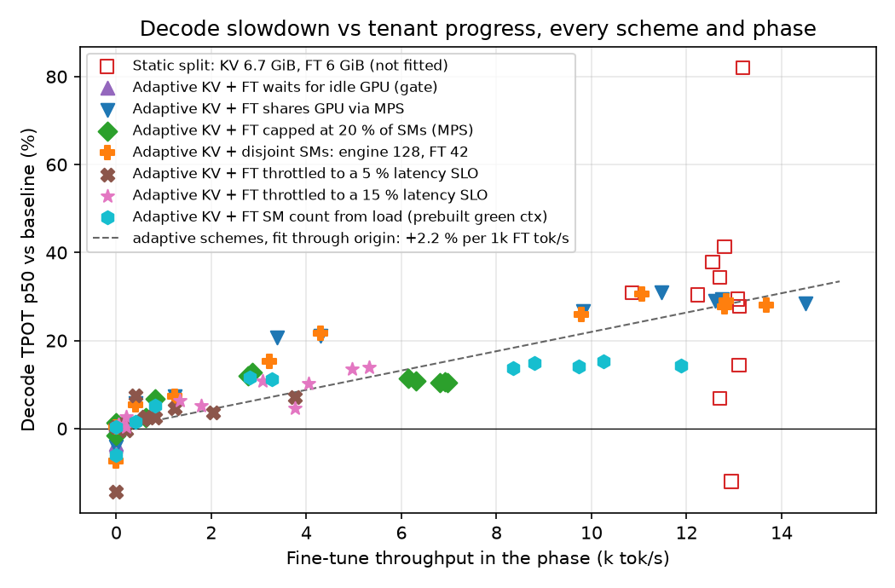

*图 5：每个 scheme 每个阶段一个点：decode 变慢对该阶段的 tenant 吞吐。MPS 混跑、MPS 限 20 %、不相交 SM 和
SLO 限速的点落在一条线上，每 1 000 tenant tok/s 约 +2.2 % TPOT。动态 green context（青）在线下方（8–12k tok/s
时 +14 %）。静态划分不在线上：它的代价来自 KV 不够，不是 tenant 的速度。*

同一批运行里 tenant 每个阶段的吞吐（tok/s）：

| 阶段 | 静态划分 | 空闲门 | MPS 混跑 | MPS 限 20 % | 不相交 128/42 | 5 % SLO | 15 % SLO | 动态 green |
|---|---|---|---|---|---|---|---|---|
| 1 req/s（0 s） | 12.2k | 0.1k | 9.8k | 6.3k | 9.8k | 0.6k | 1.8k | 8.3k |
| 2 req/s（90 s） | 12.8k | 0.0k | 3.4k | 2.8k | 3.2k | 0.6k | 1.3k | 2.8k |
| 3 req/s（180 s） | 12.7k | 0.0k | 0.0k | 0.0k | 0.0k | 0.0k | 0.1k | 0.0k |
| 1 req/s（270 s） | 12.5k | 0.0k | 12.6k | 6.8k | 12.8k | 0.8k | 4.0k | 9.7k |
| 4 req/s（360 s） | 12.9k | 0.0k | 0.0k | 0.0k | 0.0k | 0.0k | 0.0k | 0.0k |
| 0.5 req/s（420 s） | 13.2k | 0.0k | 14.5k | 7.0k | 13.7k | 3.8k | 3.8k | 11.9k |
| 2 req/s（480 s） | 12.7k | 0.0k | 4.3k | 2.9k | 4.3k | 0.4k | 3.1k | 3.3k |
| 3 req/s（510 s） | 13.1k | 0.0k | 0.4k | 0.6k | 0.4k | 0.2k | 0.2k | 0.4k |
| 2 req/s（540 s） | 13.1k | 0.0k | 1.2k | 0.8k | 1.2k | 0.2k | 0.2k | 0.8k |
| 1 req/s（570 s） | 10.9k | 0.0k | 11.5k | 6.1k | 11.1k | 1.2k | 5.3k | 8.8k |
| 1 req/s（600 s） | 13.1k | 0.0k | 12.8k | 6.9k | 12.8k | 2.0k | 5.0k | 10.3k |

每个 scheme 每个阶段的 decode TPOT、排队、KV 上限和 tenant 数字：`../coloc_adjust/results/<scheme>_phases.md`。

## 2.5 尾部：TPOT p90

上面的表用的是中位数。同一批请求日志也能算第 90 百分位（`analyze_overlap.py`，每个请求的 TPOT 和
`round2_tables.py` 算法相同）：TPOT p90（ms），括号里是相对基线 p90 的变化，每列最好的三个标出；最后一列把中位数
的变化抄过来对比。

| scheme | 类别 | p90 @0.5 req/s | p90 @1 | p90 @2 | 中位数 @0.5 / 1 |
|---|---|---|---|---|---|
| 基线 | – | 13.3 | 14.1 | 18.9 | – |
| 静态划分 | – | 23.1 (+74 %) | 19.2 (+37 %) | 22.8 (+21 %) | +82 / +32 % |
| 空闲门 | A | ① 13.3 (+0 %) | ① 14.3 (+1 %) | ① 19.1 (+1 %) | +1 / +1 % |
| MPS 混跑 | B | 17.0 (+27 %) | 18.4 (+31 %) | 21.3 (+13 %) | +29 / +29 % |
| MPS 限 20 % | C | ② 14.7 (+10 %) | ③ 15.8 (+12 %) | ③ 20.3 (+8 %) | +10 / +11 % |
| 不相交 SM 128/42 | C | 17.0 (+28 %) | 18.2 (+30 %) | 21.5 (+14 %) | +28 / +28 % |
| 动态 green context | C | ③ 15.3 (+15 %) | 16.3 (+16 %) | 20.5 (+9 %) | +14 / +15 % |
| 15 % 延迟 SLO | D | 17.1 (+29 %) | 16.3 (+16 %) | ② 20.2 (+7 %) | +5 / +11 % |
| 5 % 延迟 SLO | D | 17.0 (+28 %) | ② 14.6 (+4 %) | 20.4 (+8 %) | +7 / +3 % |

- **少给 SM 的两种，尾部和中位数一样：** MPS 限 20 % 是 +10–12 %，动态 green context 是 +15–16 %。它们的变慢是
  均匀的。
- **限速的两种，0.5 req/s 时中位数好看，尾部却和不限速一样：** 15 % SLO 是 +5 % 对 +29 %，5 % SLO 是 +7 % 对
  +28 %；不限速的 MPS 混跑是 +27 %。
- **原因在反馈环。** 那个阶段上限在 500 和 20 000 tok/s 之间来回摆；tenant 最长一次歇了 8 s，其余时候接近全速。
  赶上全速那几段的请求就构成了尾部。
- **上限固定时没有这个尾巴。** 形状探测（2.8）用固定的 4k tok/s 上限，tenant 规律地干 0.35 s、歇 0.67 s：中位数
  +5 %，p90 +6 %。一个请求要 1.5–2 s，跨过不止一个周期。

## 2.6 tenant 在跑时和歇着时的 decode

请求日志里有 decode 每个 token 的时间戳，tenant 的日志里有它每一步什么时候在算、什么时候在歇。所以 decode 的每个
token 间隔都能归到"tenant 在跑"或"tenant 不在跑"（`analyze_overlap.py`，表在
`coloc_adjust/results/overlap_summary.md`）。这是 11 月 15 日对第 2 轮运行的重新分析。

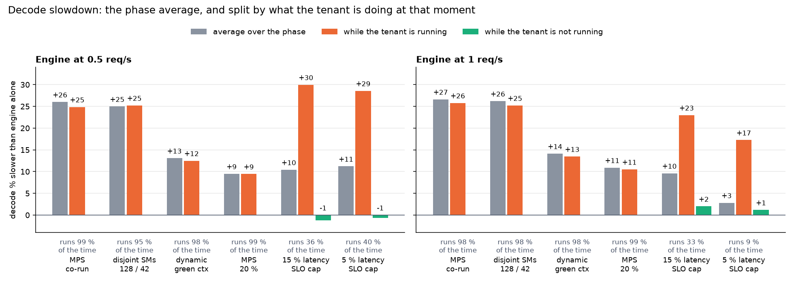

*图 6：0.5 和 1 req/s 时 decode 的变慢：阶段平均（灰）、tenant 在跑时（橙）、不在跑时（绿）；每组下面的小字是
tenant 在跑的时间占比。token 间隔的均值，和没有 tenant 的那次运行的同一阶段比。*

| scheme | 类别 | tenant 在跑的时间占比 | decode 阶段平均 | tenant 在跑时 | tenant 不在跑时 |
|---|---|---|---|---|---|
| MPS 混跑 | B | 99 / 98 % | +26.0 / +26.6 % | ③ +24.9 / +25.8 % | – |
| MPS 限 20 % | C | 99 / 99 % | ① +9.5 / ③ +10.9 % | ① +9.4 / ① +10.5 % | – |
| 不相交 SM 128/42 | C | 95 / 98 % | +25.0 / +26.2 % | +25.2 / +25.2 % | – |
| 动态 green context | C | 98 / 98 % | +13.1 / +14.1 % | ② +12.5 / ② +13.5 % | – |
| 15 % 延迟 SLO | D | 36 / 33 % | ② +10.4 / ② +9.6 % | +30.0 / +23.0 % | −1.2 / +2.0 % |
| 5 % 延迟 SLO | D | 40 / 9 % | ③ +11.2 / ① +2.8 % | +28.6 / ③ +17.2 % | −0.7 / +1.2 % |

每格两个数：0.5 req/s / 1 req/s。"–"表示这种状态不到 5 % 的时间。空闲门不在表里，因为它的 tenant 没跑成。这里是
token 间隔的均值，2.4 的表用的是每个请求 TPOT 的中位数，所以数字略有出入（15 % SLO：那里 +5 / +11 %，这里
+10.4 / +9.6 %）。

1. **tenant 不在跑时，decode 回到基线**（−1 到 +2 %）。停顿不留后遗症。
2. **限速（D 类）不降低重叠那一刻的变慢，它缩短的是重叠的时间。** tenant 在跑时 decode 慢 23–30 %，和不限速的
   MPS 混跑（25–26 %）一样，但 tenant 只有三分之一的时间在跑。平均值就是两者相乘：36 % × 30 % ≈ 10.8 %，实测
   10.4 %。
3. **少给 SM（C 类）降低每一刻的变慢，tenant 一直在跑：** MPS 限 20 % 是 +9–11 %，动态 green context 是
   +12–14 %。不相交 128/42 是例外，+25 %：tenant 在它的 42 个 SM 上仍然跑满。
4. **按每个 tenant token 算，少给时间不省，少给 SM 省。** 1 req/s 时每 1k tenant tok/s 让 decode 慢：MPS 混跑
   2.3 %，15 % SLO 2.4 %，不相交 SM 2.3 %；MPS 限 20 % 1.7 %，动态 green context 1.5 %。
5. **2 req/s 要换一种比法。** 这时 tenant 约一半时间被显存预算暂停，而且恰好是负载冲高的时候，阶段平均会把负载
   和 tenant 状态混在一起。改成和"同样多请求在跑"时的无 tenant 运行比：tenant 在跑时 +8–15 %，不在跑时 −2 到 0 %。

## 2.7 Green context 的 scheme

`green_ctx.py` 通过 ctypes 调 libcuda 建 green context。第 1 轮的细节在 D8–D10，第 2 轮在 D18。

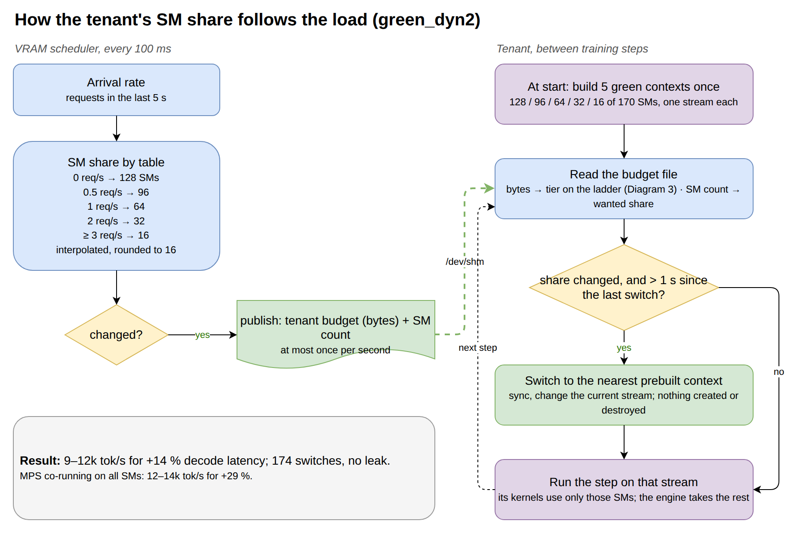

*图示 5：`green_dyn2` 的 SM 份额环路：VRAM scheduler 按到达率查出 SM 数，和预算一起发布；tenant 在启动时建好的
几个 context 之间切换。显存阶梯照常运行。*

| scheme | 1 / 2 req/s 时的 decode：TPOT，排队 | 1 / 0.5 req/s 时的 tenant | 说明 |
|---|---|---|---|
| `green32`（tenant 用 32 个 SM；第 1 轮，600 W） | 14.4 / 16.6 ms，119 / 132 ms | 6.3k / 7.3k tok/s | 和 MPS 限 20 % 的权衡一样 |
| `green_split`（引擎 128 个 SM，tenant 用另外 42 个） | 16.2 / 18.6 ms，123 / 150 ms | 11.6k / 13.7k | tenant 吞吐和 decode 代价都和不限速的 MPS 混跑一样：光把 SM 分开去不掉变慢 |
| `green_dyn2`（预建 128/96/64/32/16 个 SM 的 context，只切 stream） | 14.5 / 17.8 ms，115 / 134 ms | 9.3k / 11.9k | 898 步，174 次切换，预算 ≤ 9.9 GiB 时保留显存 ≤ 8.7 GiB：没有泄漏。decode 代价是 MPS 混跑的一半，tenant 吞吐是它的 80 % |

动态 green context（0.5–1 req/s 时 64–96 个 SM）给 tenant 9–12k tok/s，代价 +14–15 % TPOT；MPS 在全部 SM 上混跑
是 12–14k 换 +29 %，固定 42 个 SM 的划分是 12–14k 换 +28 %。它为什么落在图 5 那条线的下方，阶段二没有找到原因。
固定的划分不改变代价；随负载下降的份额会。

## 2.8 读出来的东西

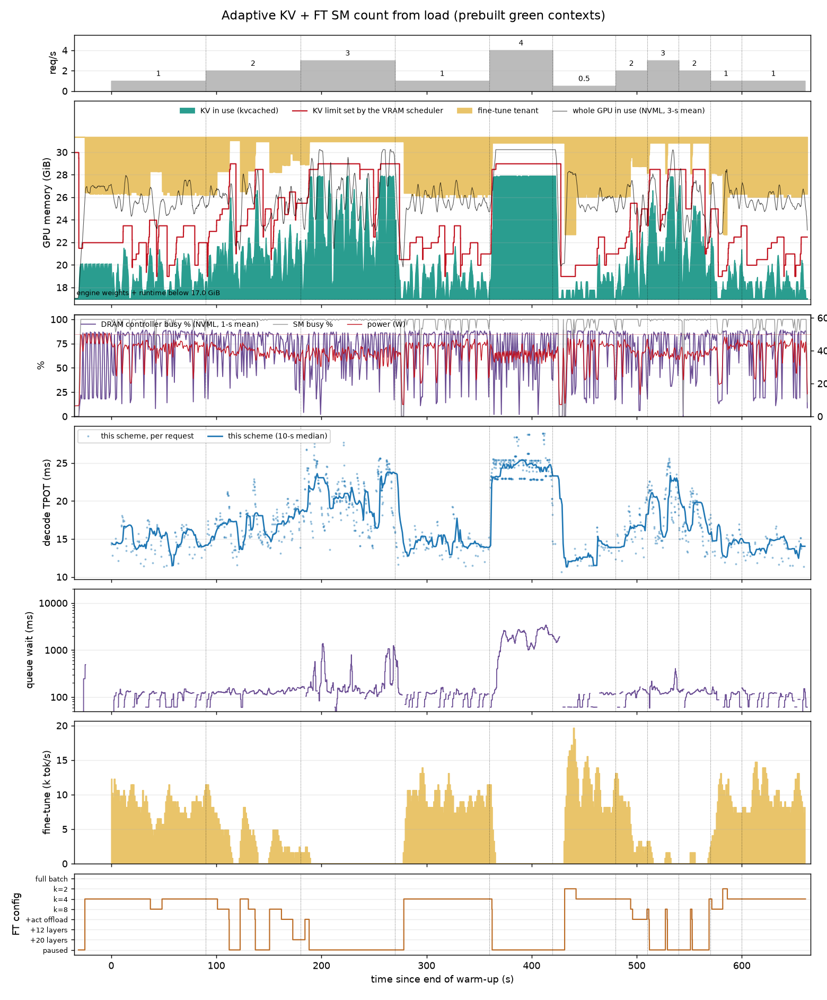

*图 7：一次运行的逐秒视图（动态 green context）。从上到下：到达率；显存（青 = 在用的 KV，红 = VRAM scheduler
设的 KV 上限，黄 = tenant，黑 = NVML 看到的整卡用量，只画 17 GiB 引擎固定部分以上）；显存控制器忙碌度、SM 忙碌度和
功耗；decode TPOT 和基线；排队；tenant 吞吐；tenant 的配置。到达率一涨，上限立刻上抬，tenant 的份额被压缩，配置往下
掉；4 req/s 时 tenant 暂停，TPOT 和基线重合；负载回落 5 s 后上限下调，tenant 爬回 k = 2 / k = 4。每个 scheme 都有
同样的图：`coloc_adjust/results/<scheme>_timeline.png`。*

- **调整本身对 decode 零代价。** 引擎单独跑、上限跟着负载调，和引擎单独跑、上限固定 13 GiB，每个阶段都一样（第 1 轮，
  TPOT 差 ≤ 0.1 ms）。kvcached 的上限跟着负载在 2 到 12.65 GiB 之间变，引擎察觉不到。
- **显存环路守得住，账是实的。** 第 2 轮在启动时实测引擎的固定占用（16.97 GiB），给 tenant 的 context、权重和
  优化器留 2 GiB，再留 0.5 GiB 余量，每次涨都不超过真正空闲的显存。第 2 轮所有运行里，已映射的 KV + tenant + 引擎
  固定部分从来没有超过 GPU（见下表）。tenant 的占用只在暂停时超过它的预算（模型和优化器 0.6 GiB 对 0 GiB 预算，在
  2 GiB 的余量之内）。代价是容量：3–4 req/s 时需求（12.65 GiB）超过 tenant 暂停后能映射的量（约 12.4 GiB），调度器
  就在那里等（4 req/s 整个阶段都是 `grow_wait`）。于是 KV 上限停在 11–12.5 GiB 而不是 12.65 GiB，4 req/s 的排队比
  基线长（2.2–3.4 s 对 1.3 s）。

  | scheme | 最大 KV 上限 GiB | tenant 超出预算 (s) | KV + tenant + 固定 > 总量 (s) | `grow_wait` (s) | 缩的次数 | tenant 步数（被中途放弃） |
  |---|---|---|---|---|---|---|
  | 基线 | 12.65 | 0.0 | 0.0 | 0.0 | 28 | – |
  | 静态划分 | 6.69 | 0.0 | 0.0 | 0.0 | 0 | 2089 (0) |
  | 空闲门 | 12.00 | 194.0 | 0.0 | 97.6 | 28 | 2 (21) |
  | MPS 混跑 | 12.00 | 198.9 | 0.0 | 99.7 | 30 | 1124 (26) |
  | MPS 限 20 % | 12.50 | 197.1 | 0.0 | 95.7 | 30 | 640 (24) |
  | 不相交 SM 128/42 | 11.00 | 207.6 | 0.0 | 111.2 | 29 | 1115 (26) |
  | 5 % 延迟 SLO | 12.00 | 205.5 | 0.0 | 105.2 | 28 | 141 (6) |
  | 15 % 延迟 SLO | 12.00 | 196.9 | 0.0 | 101.6 | 27 | 340 (7) |
  | 动态 green context | 12.00 | 175.8 | 0.0 | 98.4 | 29 | 898 (24) |

  每次运行引擎的固定占用都是 16.97 GiB。
- **静态划分两头都输。** 引擎固定 6.69 GiB，tenant 在旁边全速跑（12–13k tok/s），decode 在 0.5–2 req/s 时 TPOT 慢
  32–82 %，3–4 req/s 时排队 5–13 s，负载降到 0.5 req/s 时积压还有 26 s 深。低负载时引擎预算里有 4–8 GiB 闲着。
- **轮流用 GPU，tenant 什么也得不到。** 空闲门保护了 decode（+1 %），tenant 一步都没训练：只要有请求在跑，
  Model Runner V2 引擎就一步接一步地 decode，GPU 有 93–100 % 的时间在忙，没有空隙可插（D5）。两个任务只能同时跑。
- **同时跑时，代价跟着 tenant 跑多少走，不跟着它在哪跑。** MPS 混跑、MPS 限 20 %、不相交 SM 和 SLO 限速落在同一条
  线上，每 1k tenant tok/s +2.2 % TPOT（图 5）。MPS 限 20 % 用约 55 % 的不限速 tenant 吞吐换 +10–11 %；不相交 128/42
  的代价（+28 %）和吞吐都和不限速（MPS 混跑 +29 %）一样。
- **延迟 SLO 可以直接执行。** 15 % 的 scheme 每个阶段都守在 +0–14 %（0.5–2 req/s 各阶段 +5 / +6 / +10 / +5 / +10 /
  +14 / +14 %），tenant 1.3–5.3k tok/s，点落在图 5 的线上：上限只是让 tenant 沿着这条线移动。5 % 的 scheme 守在
  +2–7 %，但 tenant 大多被压在 500 tok/s 的下限，因为 5 % 的目标落在 10 s TPOT 窗口 ±4 % 的噪声里。这些是中位数；
  尾部见 2.5。
- **tenant 的形状决定一个 token 有多贵。** 形状探测（`run_probe.sh`，`analyze_probe.py`）让引擎在 1 req/s、KV 上限
  固定 3 GiB，tenant 预算固定 7.5 GiB、上限都是 4k tok/s，每种形状一个 60 s 窗口（图 8）。每 1k tenant tok/s 的
  decode 变慢：k = 4 micro-batch 1.3 %，k = 8 2.6 %，激活 offload 5.9 %，12 / 20 层流式 9.2 / 8.2 %。micro-batch 越小，
  每个 token 重读权重的次数越多；offload 形状还多了主机↔GPU 拷贝：按每个 tenant token 算，搬数据越多的形状让 decode
  付得越多。
- **NVML 的显存控制器忙碌度分不出两个用户。** tenant 跑 0 还是 14k tok/s，它都在 55–75 %，decode 的变慢也不跟着它
  走；形状探测里，拷贝多的形状读数反而下降，代价却上升（图 8d）。它不能当反馈信号；tenant 的 token 速率和形状可以。
  流量本身在报告 2 里测量。

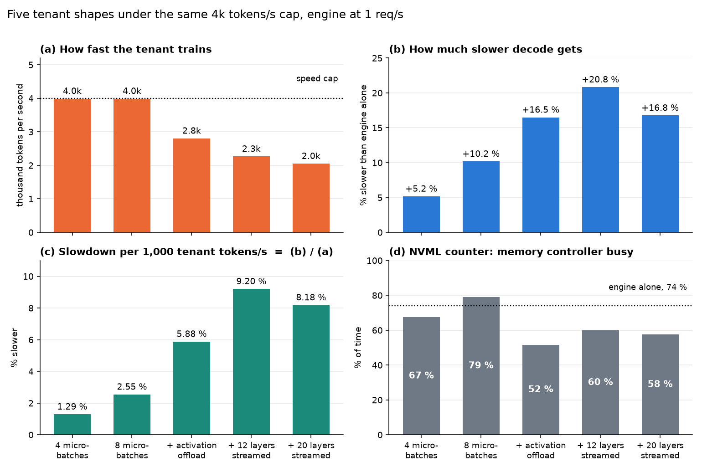

*图 8：形状探测。(a) tenant 的速度：两种 micro-batch 形状跑到 4k 的上限，其余三种是 2.8k、2.3k、2.0k tok/s。
(b) decode 比引擎单独跑慢多少：+5.2 % 到 +20.8 %。(c) 两者之比，每 1k tenant tok/s 的变慢。(d) NVML 的显存控制器
忙碌度，虚线是引擎单独跑的水平。*

阶段二有两部分写在别处：prefill 引擎当 tenant，见 [4_prefill_tenant.md](4_prefill_tenant.md)；主机↔GPU 拷贝的记录
（PCIe 不是瓶颈），见 [2_bandwidth.md](2_bandwidth.md) 和 [4_prefill_tenant.md](4_prefill_tenant.md)。

## 2.9 阶段二没解释的

显存这一半解决了：显存跟着负载走，tenant 拿剩下的，什么都没失败。算力这一半有了量出来的代价和两种限住它的办法
（少给 SM，或按 TPOT 限速），但还没有原因：

- 不相交的 SM 和共用 SM 让 decode 付的代价一样（+28 % 对 +29 %）。两个任务抢的不是 SM。
- 代价跟着 tenant 的 token 速率走（每 1k tok/s +2.2 %）；同样的 token 速率下，又跟着 tenant 的形状走：每个 token
  搬数据越多的形状越贵，最多差 7 倍。
- 动态 green context 落在线的下方，原因不知道。
- NVML 的显存控制器忙碌度分不出两个用户。

阶段三问的是两个任务到底共用什么。它发现 decode 卡在 SM 到显存的那条通道上，tenant 在这条通道上搬多少，decode
就少多少：[2_bandwidth.md](2_bandwidth.md)。直接管 tenant 的字节（字节额度），以及让 tenant 少搬字节，见
[3_c1_c2.md](3_c1_c2.md)。

## 这说明了什么

1. 用 kvcached 可以从进程外面降低和抬高运行中 vLLM 引擎的 KV 预算。新上限约 1.3 s 生效，每步零开销；在同一条请求
   时间线上，TTFT、TPOT、排队和抢占都和重启到这个预算的引擎一样。
2. 缩的时候，显存只随在跑请求的结束而释放（几秒到几十秒）；如果在驻请求还在顶着上限长，vLLM 会抢占再重算。
3. 2 QPS、带主机内存 offload 时，decode 速度从 13 GiB 到 4 GiB 不变；拐点就是在途的 KV。不带 offload 时拐点在 8 GiB。
4. kvcached 0.1.6 配 LMCache 的 MP connector 在 store 流量下会崩；kvcached main 上 `engine_driven` 模式配在线调整
   能用。零拷贝模式要 LMCache 那边改。
5. vLLM 外面的 router 和 VRAM scheduler 让 KV 上限跟着负载走，把剩下的交给沿配置阶梯上下移动的 tenant：11 分钟、
   0.5–4 req/s，0 失败、0 抢占、0 秒超订。静态划分两头都输。
6. 在这个引擎上，轮流用 GPU 时 tenant 什么也得不到。同时跑的代价约为每 1k tenant tok/s +2.2 % TPOT，和 tenant 用
   哪些 SM 无关。少给 SM（MPS 限 20 %、动态 green context）降低每一刻的变慢，按 token 算也更便宜（每 1k tok/s
   1.5–1.7 %），尾部和中位数一样。按 TPOT 限速缩短的是重叠的时间，不降低重叠时的变慢，守得住中位数；因为反馈环让
   上限来回摆，0.5 req/s 时 p90 是 +28–29 %。tenant 歇着时 decode 回到基线。

## 局限

- 一种 GPU（RTX 5090），一个推理模型（Llama-3-8B），一种负载分布（Zipf-1.1）；本报告里阶段二的数字都来自同一个
  tenant（LoRA 微调）。
- 阶段二每个 scheme 只跑了一次（一次 11 分钟）；基线在同一阶段的重复之间有 ±4 % 的波动。形状探测每种形状只有一个
  60 s 窗口。
- 2.5 和 2.6 是对第 2 轮运行的重新分析。
- 阶段二第 2 轮在 500 W 上限下跑；`green32` 和"调整零代价"的比较来自第 1 轮的 600 W（两轮的基线 TPOT 差 ≤ 0.3 ms）。
- 阶段一的实验 A 和 B 用 kvcached 0.1.6，其余用 kvcached main。

## 文件

- 阶段一：决策日志
  [`kvcached_validation/DECISIONS.md`](../kvcached_validation/DECISIONS.md)，脚本 `kvcached_validation/scripts/`
  （`run_resize_exp.sh`、`run_expB.sh`、`run_shrink_sweep.sh`、`run_static_sweep.sh`、`run_live_replay_sweep.sh`、
  `analyze_sweep.py`），结果和图 `kvcached_validation/results/`（kvcached main 上的 LMCache 重测：`p4_ed_long_*`、
  `p4_vmm_exportable_startup.txt`），引擎日志 `kvcached_validation/logs/`。
- 阶段二：设计 [`coloc_adjust/DESIGN.md`](../coloc_adjust/DESIGN.md)，决策日志
  [`coloc_adjust/report/DECISIONS.md`](../coloc_adjust/report/DECISIONS.md)（D1–D10 第 1 轮，D11–D19 第 2 轮；
  D12–D13 是 LMCache 重测），逐阶段的表 `coloc_adjust/results/<scheme>_phases.md`（汇总表由
  `round2_tables.py` 打印）。本报告取代的早先报告在 git 历史里（commit `358cc6b`）：`kvcached_validation/REPORT.md`、
  `coloc_adjust/report/REPORT.md`、`REPORT_zh.md`、`PROJECT_RECAP_zh.md`、`round2_tables.md`。
- 阶段二代码：`coloc_adjust/controller.py`（router 和 VRAM scheduler）、`ft_worker.py`（tenant）、`green_ctx.py`、
  `tiers.json`；运行脚本 `run_eval6.sh`、`run_probe.sh`；分析 `round2_tables.py`、`analyze_overlap.py`、
  `analyze_probe.py`、`plot_arms.py`、`plot_workload.py`、`plot_recap_figs.py`（图 2）。
- 阶段二结果：`coloc_adjust/results/`（第 2 轮；每个 scheme 有 `<scheme>_phases.csv`、`_controller.csv`、`_ft.csv`、
  `_sampler.csv`、`_timeline.png`；`overlap_summary.md`、`probe_probe.md`），`coloc_adjust/results_600w/`（第 1 轮）。
  图示源文件 `coloc_adjust/diagrams/`。
