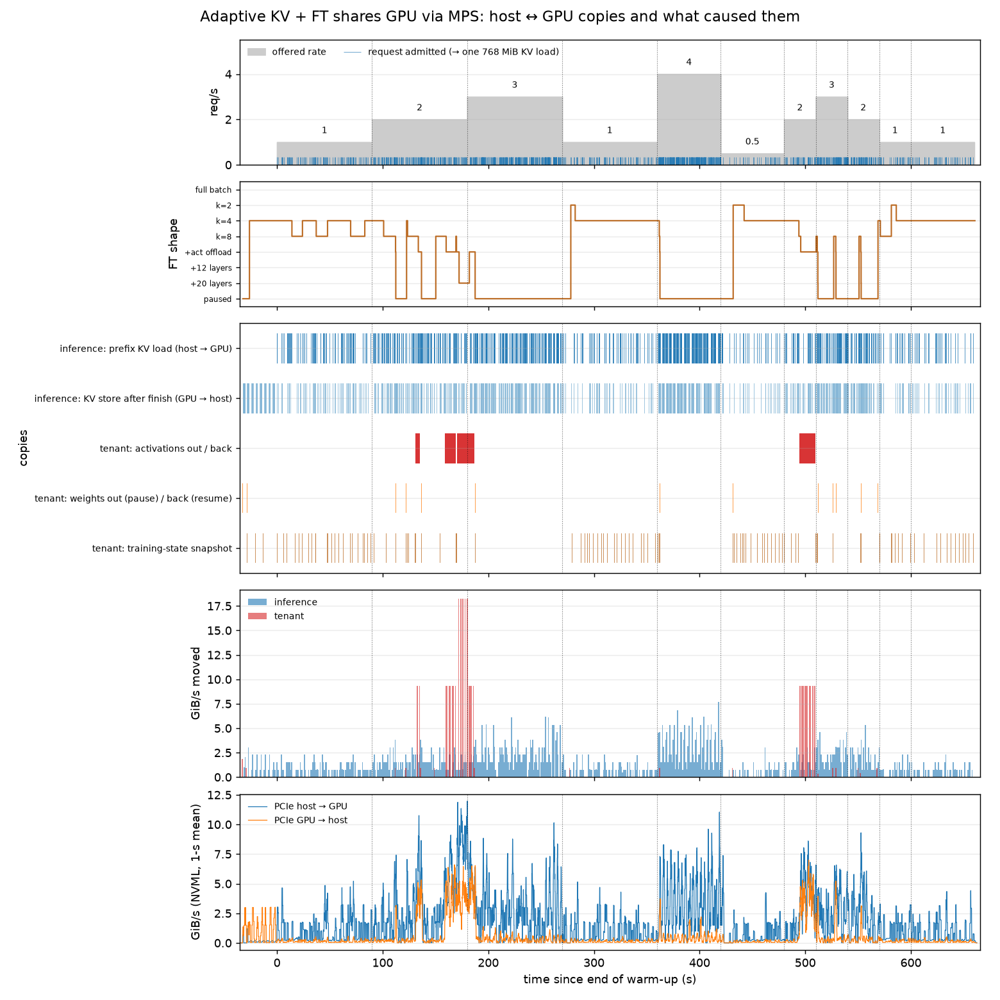
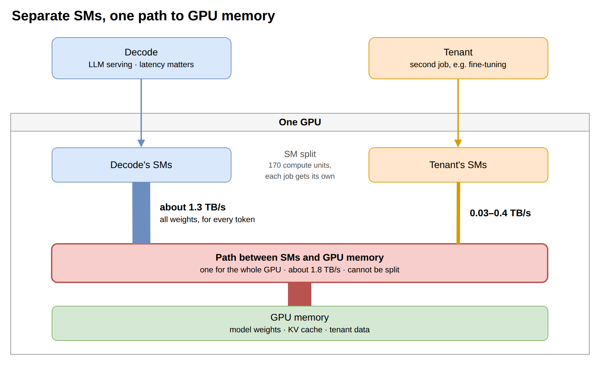
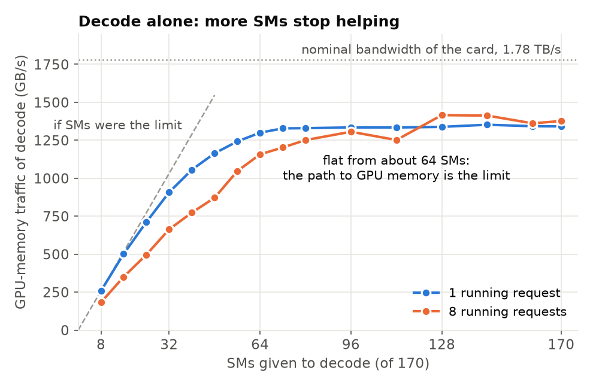
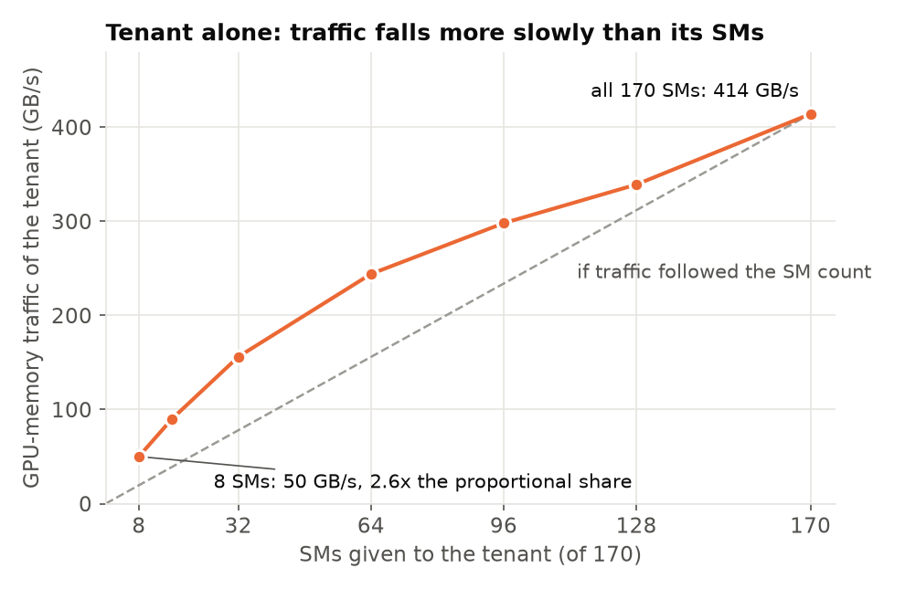
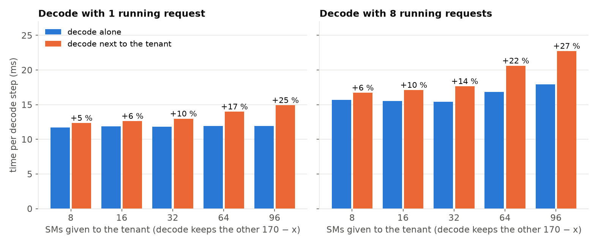
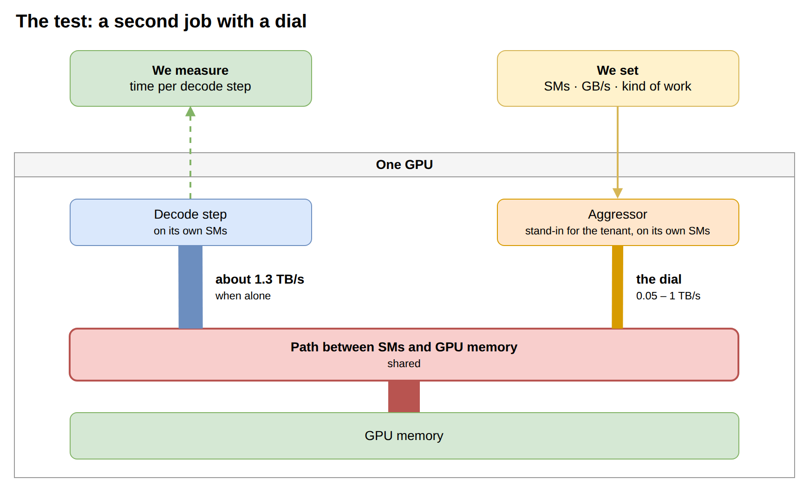
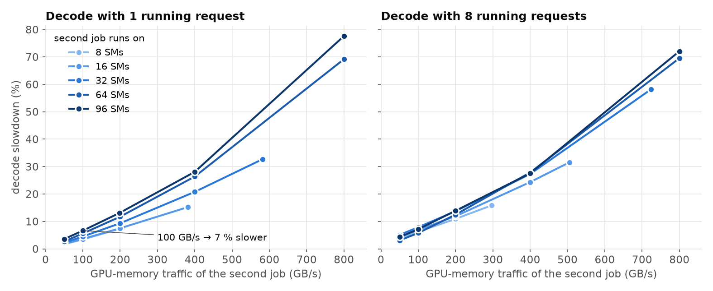
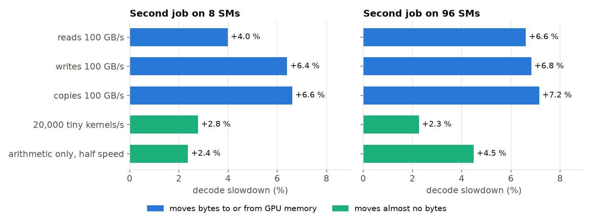
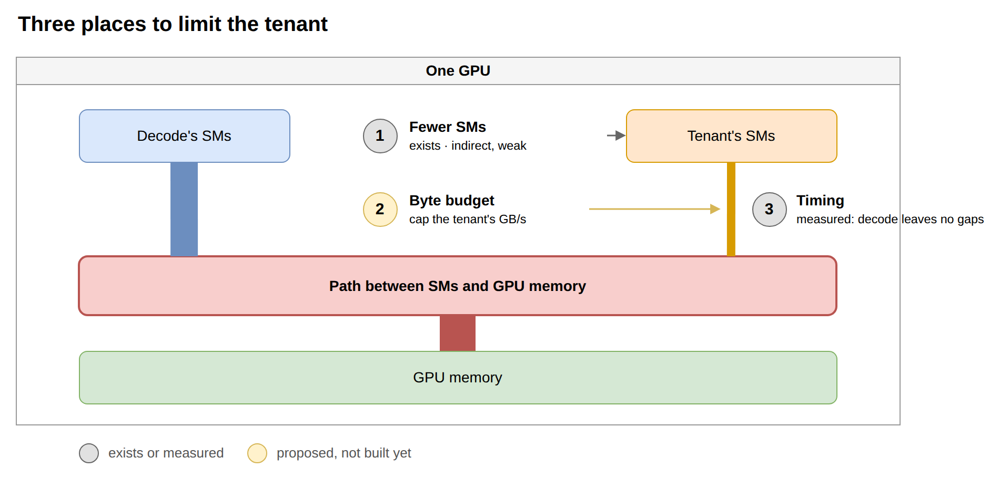

# Report 2 — Why a tenant on its own SMs still slows decode: the shared path to GPU memory

Stage 3 of the colocation study, measured on Nov 9 2026 (stages 1 and 2:
[1_kv_budget_and_schemes.md](1_kv_budget_and_schemes.md)). Chinese version:
[2_bandwidth_zh.md](2_bandwidth_zh.md).

**Question.** A decode node leaves SMs idle, so a second job (the *tenant*, a LoRA fine-tune) can
run on SMs of its own. Why does decode still slow down, and does giving the tenant fewer SMs
protect it?

**Answer in one sentence.** Past 56–80 SMs decode gains nothing from more SMs, and the byte
counts point to the path from the SMs to GPU memory as its limit (inferred, not observed inside
the card); a second job's bytes slow decode even from separate SMs, by 4–7 % per 100 GB/s for a
read-only job; writes, kernel launches and arithmetic cost more on top (for the tenant on 8 SMs,
more than its bytes); and an SM limit reduces all of this only indirectly and weakly.

## Platform and terminology

| Item | Setting |
|---|---|
| GPU | One RTX 5090 (GPU 1), 170 SMs, 31.35 GiB GPU memory, power capped at 500 W |
| GPU memory bandwidth | Nominal 1.78 TB/s (100 % on the counter after calibration) |
| Decode (the job being protected) | A synthetic decode step with Llama-3-8B shapes (32 layers of merged qkv, o, merged gate/up and down projections, grouped-query attention over 6272 tokens of KV per request, lm_head on the last token), random bf16 weights. Each step reads the 15.0 GB of weights once plus 0.82 GB of KV per running request. 1, 4, 8 or 14 running requests |
| Tenant | Qwen2.5-0.5B, LoRA, 8 × 512 tokens per optimizer step as 4 micro-batches (configuration 2) |
| SM partitioning | Green contexts; the driver grants multiples of 8 SMs. Unless stated, decode runs on the SMs the second job does not use (disjoint SMs) |
| Traffic counter | NVML GPM device-wide GPU-memory-bandwidth counter, calibrated against decode alone: 1 % = 17.79 GB/s over 54 points, median error 0.5 %. It gives the sum of all jobs; each job's share comes from its own byte count |
| Windows | Knee probe: median of 5 timed groups per point. Co-runs: 4-s windows, mostly one run per point |

The synthetic step takes 11.8 / 13.6 / 15.7 / 19.4 ms for 1 / 4 / 8 / 14 requests on the full
device; the real engine's TPOT is 12.0–12.6 ms at 0.5–1 req/s. It has no sampling, scheduling or
detokenisation, so it is a lower bound. It is used because step times repeat to under 1 %.

**Terminology.** Two memories appear and are kept apart by name. **GPU memory** is the card's own
GDDR7, where weights and KV live; **GPU memory bandwidth** is the rate of the SM ↔ GPU-memory
path, read here from the NVML GPM counter (stage 2 used NVML's **GPU-memory-controller busy**
reading of the same path). **Host RAM** is the machine's main memory; it is reached over PCIe and
appears only in section 2. **Scheme** is one way of sharing the GPU in the stage-2 runs; the
**VRAM scheduler** is the process that sets the KV limit and the tenant's memory budget.
**Disjoint SMs**: decode and the second job have no SM in common.

**SM** (streaming multiprocessor) is one of the GPU's 170 compute units. **Decode** is the LLM
producing text, one token per step; **TPOT** is the time per output token; **KV** is the
per-request attention cache a decode step reads. A **kernel** is one piece of GPU work a job
launches. **MPS** (NVIDIA Multi-Process Service) lets two processes use the GPU at the same time;
a **green context** confines a process to a fixed set of SMs. **NVML** is NVIDIA's monitoring
library and **GPM** its performance counters. **L2** is the GPU's on-chip cache, shared by all
SMs, between the SMs and GPU memory. A tenant **shape** is one of the tenant's configurations
(number of micro-batches, activations or layers kept in host RAM; report 1, section 2.1).

## 1. Why this stage: three results stage 2 could not explain

If the tenant slowed decode by competing for compute, separating the SMs would fix it. Three
stage-2 results say otherwise (real engine, vLLM 0.30 + kvcached, Llama-3-8B):

| Stage-2 result | Measured |
|---|---|
| Separate SMs, same cost | Engine on 128 SMs, tenant on the other 42 (`green_split`): decode TPOT +28 %. Both on all SMs under MPS: +29 % |
| Decode is not short of SMs | Engine alone on 128 SMs (`engine_green`) is as fast as on all 170 |
| The host link is not busy | PCIe is used about 10 % of the time on average (section 2) |

So the two jobs compete for something that is neither SMs nor PCIe. This stage asks what it is,
and whether the one knob already available, the tenant's SM count, controls it.

## 2. First ruled out: host↔GPU transfers are not the bottleneck

Every host↔GPU copy in the stage-2 runs was recorded with its source, together with NVML's PCIe
counters. The table is the run Figure 1 shows (MPS scheme, 500 W, Nov 9), counted from its trace.

*Figure 1 — every host↔GPU copy in the MPS scheme and its cause. Rows from the top: admitted
requests (each triggers one 768 MiB prefix load) and the tenant's shape; the copies as spans;
GiB per second by source; NVML's PCIe counters. Data: `../coloc_adjust/results/adjust_nogate_xfer_{inf,ft}.csv`.*

| Copy | Per copy | Per 11-minute run |
|---|---|---|
| Inference load (host RAM → GPU, one per admitted request) | 768 MiB in 55.7 ms (median) = 13.5 GiB/s (14.5 GB/s), the rate the link delivered in the earlier fine-tune study | 1,176 loads, 880 GiB, 1.3 GiB/s on average |
| Inference store (GPU → host RAM, one per finished request) | 16 MiB in 1.2 ms (median) | 1,220 stores, 51 GiB |
| Tenant activation offload | 4.7 GiB out and 4.7 GiB back per step, 354 ms out | 28 steps, 261 GiB |
| Tenant weight loads (shapes with layers in host RAM) | 8.9 GiB per load | 5 loads, 44 GiB |
| Tenant pause / resume | about 0.9 GiB in 127 / 94 ms (median) | 8 / 9 times |
| Tenant snapshot | 8 MB | 158 |

- **Overlap slows the copies a little.** 89 of the 1,176 inference loads overlapped a tenant copy
  other than a snapshot. Their median was 59.6 ms against 55.7 ms alone (+7 %), and one in ten
  took 95 ms or more.
- **The link is mostly idle.** The inference loads keep it busy about 10 % of the time; all copies
  together average 1.8 GiB/s against the 13.5 GiB/s it delivers. NVML's 20-ms sampling overstates
  peaks: the 35 GiB/s reading during an activation offload is a window artefact.
- **The harm is elsewhere.** In the stage-2 shape probe (report 1, section 2.8), tenant shapes
  that copy a lot cost decode 3–7 times more per tenant token than shapes that do not, although
  the copies slow each other only a little on the link. The cause was not measured in this stage;
  report 3 (section 6.1) reran these shapes and found three to four times the cost per byte, with
  host↔GPU copies and kernel launches both still candidates. The rest of this report is about
  what the two jobs share inside the GPU.

## 3. The structure and the five questions

*Diagram A — the structure the measurements point to. The SMs can be split between the jobs; the
path from the SMs to GPU memory cannot. This path is inferred from byte counts, not observed
inside the chip.*

Each question below was raised by the answer to the one before.

| | Question | How it was tested | Answer |
|---|---|---|---|
| 1 | What limits decode: SMs or something else? | Decode alone on 8 to 170 SMs | **Not SMs.** It reaches a plateau on 56–80 SMs. The byte counts point to the path to GPU memory as the limit |
| 2 | The path is busy with decode; where do the tenant's bytes come from? | The real tenant next to decode, bytes of both counted | **Out of decode's.** The two jobs' sum does not grow |
| 3 | Does giving the tenant fewer SMs protect decode? | Tenant from 96 down to 8 SMs | **Only weakly.** 1/12 of the SMs: the tenant runs at 1/7, the harm falls to 1/4, about 5 % stays |
| 4 | Is decode reacting to bytes? | A second job whose GB/s can be set | **Yes.** The slowdown is close to linear: 4–7 % per 100 GB/s |
| 5 | Why does the real tenant cost more than its bytes? | The second job doing only reads, writes, launches, or arithmetic | **Three more costs were found**, each measured alone: writes, kernel launches, arithmetic; power is shared too. Whether they add up to the gap is not proven |

Section 3.6 adds a sixth point: why decode loses even though the total traffic stays well below
the nominal bandwidth.

### 3.1 Decode alone: limited by the path, not by the SMs (question 1)

The synthetic decode step runs alone in green contexts of 8 to 160 SMs and on the full device.

*Figure 2 — decode alone on N SMs: GPU-memory read rate (bytes one step must read over the step
time). Three-panel version with step time and relative speed:
[knee_probe.png](../coloc_adjust/report/figures/knee_probe.png). Shown for 1 and 8 requests;
all four loads are in the three-panel version and in the table. Data:
`../coloc_adjust/results/knee_probe.csv`.*

*Step time in ms (speed relative to the full device). Rows for 24, 40, 112, 144 and 160 SMs are in the CSV.*

| SMs | 1 request | 4 requests | 8 requests | 14 requests | Prefill chunk, 2048 tokens |
|---|---|---|---|---|---|
| 8 | 61.4 (19 %) | 94.8 (14 %) | 118.7 (13 %) | 155.1 (13 %) | 3096 (6 %) |
| 16 | 31.6 (37 %) | 48.5 (28 %) | 61.6 (25 %) | 79.8 (24 %) | 1558 (13 %) |
| 32 | 17.5 (68 %) | 26.0 (52 %) | 32.6 (48 %) | 41.3 (47 %) | 784 (25 %) |
| 48 | 13.6 (87 %) | 19.2 (71 %) | 24.8 (63 %) | 30.8 (63 %) | 535 (37 %) |
| 56 | 12.7 (93 %) | 17.5 (78 %) | 20.6 (76 %) | 25.3 (77 %) | 463 (43 %) |
| 64 | 12.2 (97 %) | 15.5 (88 %) | 18.7 (84 %) | 23.6 (82 %) | 404 (49 %) |
| 72 | 11.9 (99 %) | 14.6 (93 %) | 18.0 (87 %) | 22.7 (85 %) | 367 (54 %) |
| 80 | 11.9 (99 %) | 14.3 (95 %) | 17.3 (91 %) | 20.7 (94 %) | 329 (60 %) |
| 96 | 11.9 (100 %) | 13.5 (101 %) | 16.5 (95 %) | 20.1 (97 %) | 280 (71 %) |
| 128 | 11.8 (100 %) | 13.3 (102 %) | 15.2 (103 %) | 18.7 (104 %) | 225 (88 %) |
| 170 | 11.8 (100 %) | 13.6 (100 %) | 15.7 (100 %) | 19.4 (100 %) | 199 (100 %) |

- **Two segments.** Below the knee the read rate grows almost in proportion to the SM count: up to
  40 SMs each SM pulls 26–32 GB/s with 1 request and 19–24 GB/s with 4–14. With 1 request, 8 SMs
  move 258 GB/s. Past the knee the rate is flat at 1.34–1.42 TB/s for all four loads (1 request:
  1.30 TB/s on 64 SMs, 1.33 on 80, 1.34 on 170). More SMs buy nothing; the reading is that the
  step waits for bytes.
- **The knee** (first SM count within 10 % of full-device speed) **is at 56 SMs for 1 request, 72
  for 4, and 80 for 8 and 14** (± one 8-SM grid step; medians move by at most 3 % between runs).
- **A prefill chunk has no knee**: 49 % of full speed on 64 SMs, 88 % on 128. It is limited by
  arithmetic.

So a decode node needs about 80 SMs, and dozens of SMs look free. Being on the plateau, though,
means the step is limited by the one resource that SM partitions do not divide.

### 3.2 The tenant alone: its traffic falls more slowly than its SMs

*Figure 3 — the tenant alone on M SMs: GPU-memory traffic against M. The dashed line is traffic
proportional to the SM count. Note the vertical scale: the tenant reaches 414 GB/s on the full
device, decode about 1,340 GB/s. Data: `../coloc_adjust/results/knee_bw2_summary.md`.*

| Tenant SMs | tok/s | GB/s | GB/s per SM | MB per token | SM busy (of its SMs) |
|---|---|---|---|---|---|
| 170 | 29,006 | 414 | 2.4 | 14.3 | 59 % |
| 128 | 24,516 | 339 | 2.7 | 13.8 | 59 % |
| 96 | 21,942 | 298 | 3.1 | 13.6 | 63 % |
| 64 | 17,947 | 244 | 3.8 | 13.6 | 69 % |
| 32 | 11,642 | 156 | 4.9 | 13.4 | 83 % |
| 16 | 6,543 | 90 | 5.7 | 13.8 | 91 % |
| 8 | 3,490 | 50 | 6.3 | 14.3 | 96 % |

- The tenant moves 13.4–14.3 MB per training token at every SM count, so its traffic follows its
  throughput.
- Its traffic is not proportional to its SMs: from 170 to 8 SMs (1/21) it falls from 414 to
  50 GB/s (1/8). The same work fills the
  remaining SMs more fully (busy 59 % → 96 %), and traffic per SM rises from 2.4 to 6.3 GB/s.
- *Inference, not measured:* this fits "with fewer SMs the tenant's blocks pile onto the SMs that
  remain", but the block-level mechanism was not observed.

### 3.3 The tenant moves in, and its SMs are cut (questions 2 and 3)

*Figure 4 — time per decode step, alone (blue) and next to the tenant (orange), tenant on
disjoint SMs. Blue is decode alone on exactly the SMs it has in the orange case, so the
difference is not caused by decode having fewer SMs. Data: `../coloc_adjust/results/knee_bw2.csv`.*

| Tenant SMs | Tenant tok/s (share of its solo rate) | Tenant GB/s | Decode slowdown, 1 / 4 / 8 requests | Decode's lost GB/s ÷ tenant's GB/s |
|---|---|---|---|---|
| 8 | 2.4–2.9k (69–82 %) | 34–41 | +5.4 / +7.5 / +6.4 % | 2.0–2.4 |
| 16 | 4.5–5.3k (68–81 %) | 62–74 | +6.4 / +9.1 / +9.9 % | 1.3–1.7 |
| 32 | 8.0–9.4k (69–81 %) | 108–126 | +9.7 / +15.3 / +14.4 % | 1.1–1.5 |
| 64 | 13.2–15.2k (74–85 %) | 179–206 | +17.4 / +19.5 / +22.4 % | 1.05–1.14 |
| 96 | 18.5–19.2k (84–88 %) | 251–261 | +24.7 / +29.1 / +26.6 % | 0.98–1.08 |

- **Separate SMs do not protect decode.** With the tenant on 8 SMs, moving 3 % of what decode
  moves, decode is 5–7 % slower.
- **The total does not grow.** Decode alone moves 1.33–1.40 TB/s on the plateau, and
  1.20–1.33 TB/s where the tenant leaves it 74–106 SMs. Decode plus tenant move
  1.21–1.35 TB/s by the two jobs' own byte counts (1.26–1.41 TB/s on the counter). What the tenant
  moves, decode loses. With a 64–96-SM tenant decode loses about one GB/s per tenant GB/s; with an
  8-SM tenant it loses 2.0–2.4.
- **An SM limit is a weak knob.** From 96 to 8 SMs (1/12) the tenant's traffic falls to 1/6–1/7
  and its own throughput to about 1/7 (about 19k → 2.4–2.9k tok/s), while the harm to decode
  falls only to about 1/4 (25–29 % → 5–7 %), with a floor near 5 %.
- **Per unit of training, few SMs cost decode more.** Slowdown per 1k tenant tok/s: 2.2–2.7 % on
  8 disjoint SMs, 1.3–1.5 % on 64–96.
- On shared SMs (decode on all 170, tenant on M of them) the tenant reaches only 34–73 % of its
  solo rate, against 68–88 % on disjoint SMs.

### 3.4 A second job with set traffic: the cost follows bytes (question 4)

The real tenant reads, writes, launches kernels and computes at once, and none of these can be
set alone. It is replaced by a synthetic job on its own SMs (`bw_aggr.py`): a float32
matrix-vector product that reads a 2 GiB buffer in 64 MB calls, paced to a set GB/s.

*Diagram B — the test. The second job runs on its own SMs and moves a set number of GB/s to or
from GPU memory; decode's step time is measured on the remaining SMs. The box labelled
"Aggressor" is this second job.*

| Grid | Values |
|---|---|
| Traffic | 50, 100, 200, 400, 800 GB/s, and unpaced |
| Second job's SMs | 8, 16, 32, 64, 96 (decode on the rest; a control holds decode on 106 SMs) |
| Running requests | 1 and 8 |
| Repeats | Two restarts of the whole grid (step times differ by 0.02 % in the median and 2.4 % at most; slowdowns within 2 points); call-size controls with 32 MB and 256 MB calls |

*Figure 5 — decode slowdown against the read-only job's traffic, one line per SM count. Data:
`../coloc_adjust/results/aggr_corun.csv`.*

Slope of a straight-line fit, % decode slowdown per 100 GB/s (50–400 GB/s; largest residual
2 points, most under 1):

| Second job's SMs | 1 request, decode on the rest | 1 request, decode on 106 SMs | 8 requests, decode on the rest | 8 requests, decode on 106 SMs |
|---|---|---|---|---|
| 96 | 7.0 | | 6.7 | |
| 64 | 6.8 | 6.8 | 7.2 | 7.2 |
| 32 | 5.3 | 5.7 | 6.4 | 6.1 |
| 16 | 3.8 | 4.4 | 5.7 | 5.2 |
| 8 | 3.8 | 4.0 | 4.6 | 4.5 |

- **The slowdown follows the bytes.** At a fixed SM count it is close to linear in GB/s: about
  4 % per 100 GB/s from 8–16 SMs and about 7 % from 64–96 SMs with 1 request.
- **SM count matters less than GB/s.** GB/s varies 8 times across the grid; the SM count changes
  the slope 1.5–1.8 times. Holding decode on 106 SMs gives the same slopes, so the change comes
  from the second job's SM count, not decode's.
- **The SM count sets how much the job can move.** Unpaced next to decode:

| Second job's SMs | Alone | Next to decode (1 / 8 requests) | Decode slowdown (1 / 8 requests) |
|---|---|---|---|
| 8 | 491 GB/s | 205 / 298 GB/s | +8 / +16 % |
| 16 | 894 | 382 / 506 | +15 / +32 % |
| 32 | 1,263 | 585 / 732 | +33 / +57 % |
| 64 | 1,335 | 858 / 972 | +76 / +100 % |
| 96 | 1,342 | 955 / 1,059 | +105 / +124 % |

- **What the second job moves, decode mostly loses.** For each GB/s the reader moves, decode
  moves 0.46–0.78 GB/s less with 1 request and 0.57–0.84 with 8 (200–800 GB/s points). Unlike
  with the tenant, the total does grow here, up to 91 % of the nominal bandwidth on the counter.
- **Call size matters little.** The same GB/s in 256 MB calls changes the decode step by under
  0.8 %; in 32 MB calls (twice the calls, up to 11.9k calls/s) decode is 0–3 % slower.
- The byte accounting closes: decode GB/s + second job's GB/s is within 1.2 % of the counter in
  248 of 252 points.

### 3.5 Why the real tenant costs more than its bytes (question 5)

On 8 SMs the tenant moves 34–41 GB/s. As reads, Figure 5 puts that at 1.4–2.6 % for decode. The
measured slowdown is 5.4–6.4 %. So the second job was given five kinds of work, on 8 and on
96 SMs, next to the same decode step.

*Figure 6 — decode slowdown (1 request) next to five kinds of second job. Blue: jobs that move
100 GB/s. Green: jobs that move almost no bytes. "Tiny kernels": 20,000 very small kernels per
second. "Arithmetic only": 512 × 512 matrix products, small enough to fit in the GPU's L2 cache,
at half their top speed. Data:
`../coloc_adjust/results/aggr_modes.csv`; 20 points rerun in `aggr_modes_r2*`, step times within
0.5 %.*

| Kind of work | On 8 SMs | On 96 SMs |
|---|---|---|
| Read, per 100 GB/s | 4.0 % (1 request), 5.5–6.3 % (8 requests) | 5.4–7.0 % |
| Write or copy, per 100 GB/s | 6.1–6.6 % (1 request), 6.4–7.8 % (8 requests) | 6.1–8.2 % |
| Tiny kernel launches only | 2–5k/s: +0.7–2.1 %; 20–50k/s: +2.1–3.8 %; 100–132k/s: +3.0–5.8 % | the same |
| Arithmetic only | +1.4–2.6 % (1 request), +3.8–6.9 % (8 requests), clock unchanged | +8.6–9.8 % unpaced, at the 500 W cap |

1. **Writes cost more than reads when the job has few SMs.** From 96 SMs reads, writes and copies
   cost about the same per byte; from 8 SMs writes and copies cost more.
2. **Launching work costs something with no bytes.** The cost grows with the launch rate and is the
   same from 8 and from 96 SMs; power and clock do not change.
3. **Arithmetic costs something with no bytes.** From 96 SMs at full speed the board reaches its
   500 W cap and the clock drops 8–9 %: **power is a second resource the two jobs share.** At all
   read, write and copy points the board drew 379–473 W and the clock stayed within 1 %, so the
   byte results are not a power effect.

**Accounting for the gap — an inference, not a measurement.** On 8 SMs the tenant's bytes cost
1.4–2.6 % as reads and 2.1–3.2 % as writes. Launches at 5–20k/s cost 1.4–2.8 % and arithmetic
on 8 SMs 1.4–6.9 %. These are of the size of the rest of the 5.4–6.4 %. It is not proven: the
tenant's launch rate was not measured, and the three were not run together.

### 3.6 Why the total below the nominal ceiling still interferes

| What runs | GPU-memory traffic | Share of the nominal 1.78 TB/s |
|---|---|---|
| Decode alone (on the plateau) | 1.33–1.40 TB/s | 75–79 % |
| Decode + tenant (counter) | 1.26–1.41 TB/s | 71–79 % |
| Read-only job alone, 256 MB calls | 1.58–1.61 TB/s | 88–90 % |
| Write-only job alone, 96 SMs | 1.55 TB/s | 86.6 % |
| Decode + unpaced read-only job on 32–96 SMs (sum) | 1.60–1.62 TB/s | 89–91 % |

- **The nominal figure is not reachable.** No combination reached 100 %. Pure readers or writers
  reach 87–90 %; decode alone stops at 75–79 % however many SMs it has. Why decode stops there is
  not explained.
- **Decode loses well below any of these levels.** A read-only job on 96 SMs moving 50 GB/s next
  to decode with 8 requests: decode falls from 1,207 to 1,156 GB/s, the sum stays at 1,206 GB/s
  (68 % of nominal), and decode is 4.3 % slower. So the cost is not "the pipe is full, then it
  squeezes".
- **Which part of the path does the limiting is not known.** The byte counts are consistent with
  the path as a whole being shared; they do not show which part of it does the limiting. Candidates, none tested on its own: the L2 cache (all GPU-memory traffic
  passes through it, so a job that moves bytes also evicts L2 lines, and these tests cannot
  separate the two); queueing at the GPU-memory controllers; kernel launches and power (measured
  in 3.5, too small to explain all of it).
- One observation points at L2 and is only an observation: the arithmetic-only job on 8 SMs, with
  the clock unchanged, slows decode with 8 requests by 3.8–6.9 %, and the counter then reads
  2.5–5.8 % more bytes than decode's own (6.6 % with the job on 96 SMs at a quarter of its top
  speed, where decode is also 6.9 % slower). One reading is that the job is pushed out of L2 and
  starts reading GPU memory.

## 4. Conclusion: an SM limit is a weak knob; the tenant's bytes should be limited

*Diagram C — three places to limit the tenant: (1) fewer SMs, available and weak; (2) a byte
allowance (the diagram's "byte budget"); (3) timing, moving the tenant's bytes into gaps in decode.
The diagram is as drawn on Nov 9, when (2) was "proposed, not built yet" and (3) had been measured
(decode leaves no gaps). (2) was built and measured on Nov 16; see report 3.*

- **Fewer SMs acts on bytes only indirectly.** 1/12 of the SMs cut the tenant's traffic to
  1/6–1/7 and its own speed to 1/7, but the harm to decode only to 1/4, with a floor near 5 %. It
  does nothing about launch costs.
- **What decode pays for is mainly the bytes the second job moves**: 4–7 % per 100 GB/s for a
  read-only job, about 10 % for the real tenant, and the bytes are the quantity to limit directly.
  Earlier work also reports that SM partitioning does not isolate bandwidth (Elvinger et al.,
  Mosaic, Hummingbird, Ripple; see report 3, section 8).
- **Timing has little room on a decode node.** While any request runs, the GPU is busy 93–100 %
  of the time, and the stage-2 scheme that let the tenant run only in idle gaps trained nothing.
  Decode keeps the path at 75–79 % with 1, 4 and 8 requests.

**Next: report 3.** [3_c1_c2.md](3_c1_c2.md) takes this conclusion and tests two ways to act on
it: C1, a byte allowance for the tenant, and C2, a tenant changed so that the same training moves
fewer bytes.

## What this shows

1. Host↔GPU copies are not the bottleneck: the link is mostly idle, and copies that overlap slow
   each other by about 7 % in the median.
2. Alone, decode reaches its GPU-memory-bandwidth plateau on 56–80 SMs; past that point it is
   limited by the path to GPU memory, not by SMs.
3. With the tenant on disjoint SMs, the two jobs' traffic does not add up: what the tenant moves,
   decode loses. A tenant on 8 SMs still costs decode 5–7 %.
4. A second job's cost to decode is close to linear in its GB/s, 4–7 % per 100 GB/s, and depends
   less on its SM count.
5. Writes, kernel launches and arithmetic each add a cost of their own; power is a second shared
   resource. Measured one at a time, they are of the size of the gap between the tenant's bytes and
   its cost; that they explain it is an inference (the tenant's launch rate is not measured, and
   the three were not run together).
6. Limiting the tenant's SMs is weak; the tenant's bytes are what should be limited.

## Limits

- **Decode is a synthetic step**, not a serving engine. The serving engine showed the same effect
  in stage 2, with more noise.
- **One card, one power setting** (RTX 5090, 500 W cap). The power effect depends on the cap.
- **Mostly one run per point**, 4-s windows. Twenty points of section 3.5 were rerun and agreed
  within 0.5 %. The decode baseline sits on one of two levels 1–3.6 % apart, fixed for a whole
  run, which puts about ±1 point on every slowdown.
- **The shared path is inferred from byte counts**, not observed inside the chip. There is no
  hardware-level profile.
- **One tenant shape** (configuration 2) for the co-run tables.
- **The 8-SM tenant point was one run.** Its repeat on Nov 16 gave +3.9 / +6.9 / +5.9 % against
  +5.4 / +7.5 / +6.4 % here (report 3, section 3.3), so "5–7 %" is 4–7 % over both.
- **The tenant's GB/s next to decode is computed** from its tok/s × its solo bytes per token. With
  4 and 8 requests the two jobs' bytes add up to 3–4.5 % less than the counter reads; the likely
  cause, that the tenant's bytes per token change next to decode, was not checked.

## Open questions

- Why decode alone stops at 75–79 % of the nominal bandwidth while a pure reader reaches 88–90 %.
- Which part of the path (L2, the GPU-memory controllers, something else) does the limiting when
  the total is below these levels. Proposed tests: a second job with a working set just below and
  just above the L2 size at the same call rate (TODO E2.3); Nsight Compute profiles of decode's
  L2 hit rate (E2.5). A first version ran on Nov 16 (report 3, section 6.2): with 8 requests and
  working sets of 3 and 64 MB the counter reads 6–8 % more than decode's own bytes, and decode
  loses 5–7 % with the clock unchanged.
- A reader costs decode about half as much per byte from 8–16 SMs as from 64–96; for the real
  tenant the direction is the opposite (8 SMs is its dearest point).
- Whether decode's loss per GB/s follows how full decode keeps the path (E2.8).
- The tenant's kernel launch rate, and whether writes, launches and arithmetic add up when run
  together (E2.4, E2.5).
- Whether fewer SMs make the tenant's blocks pile onto the remaining SMs (fixed-grid kernel, E3.3).
- At 112 SMs the 4- and 8-request decode steps are about 4 % slower than at 96 SMs; reproduced in
  two reruns, unexplained.

## Files

| What | Where |
|---|---|
| Decision log | `../coloc_adjust/report/DECISIONS.md` (no stage-3 entries; stage 3 is logged in the TODO) |
| Experiment list and numbered results 1–20 (E1.2, E1.3, E2.1, E2.7, E3.1, E3.2) | `../coloc_adjust/TODO.md` |
| Earlier write-ups this report replaces | git history (commit `358cc6b`): `coloc_adjust/report/REPORT_bandwidth.md`, `REPORT.md` sections 2.6, 2.7, 3 |
| Decode alone on N SMs | `../coloc_adjust/knee_probe.py`, `plot_knee.py`; `results/knee_probe.csv`, `results/knee_probe.md` |
| Decode next to the real tenant, tenant alone | `../coloc_adjust/knee_corun.py`, `analyze_knee_bw.py`; `results/knee_bw2.csv`, `results/knee_bw2_summary.md`, `results/knee_bw2_crossrun.md`, reruns `results/knee_bw2_chkA/B*` |
| Second job with set traffic | `../coloc_adjust/bw_aggr.py`, `aggr_corun.py`, `analyze_aggr.py`; `results/aggr_corun*.csv`, `results/aggr_corun_summary.md`, `_r2`, `_chunk32`, `_chunk256` |
| Kinds of work | `../coloc_adjust/aggr_corun.py --modes`, `analyze_modes.py`; `results/aggr_modes.csv`, `results/aggr_modes_summary.md`, rerun `results/aggr_modes_r2*` |
| Host↔GPU transfers | `../coloc_adjust/xfer_trace.py`; `results/<scheme>_xfer_{inf,ft}.csv`, `results/<scheme>_xfer.png` |
| Figures 2–6 | `../coloc_adjust/plot_bw_report.py` → `report/figures/bw_*.png` |
| Diagrams A–C | `../coloc_adjust/diagrams/08_shared_memory_path.drawio`, `09_aggressor_test.drawio`, `10_where_to_limit.drawio` |
