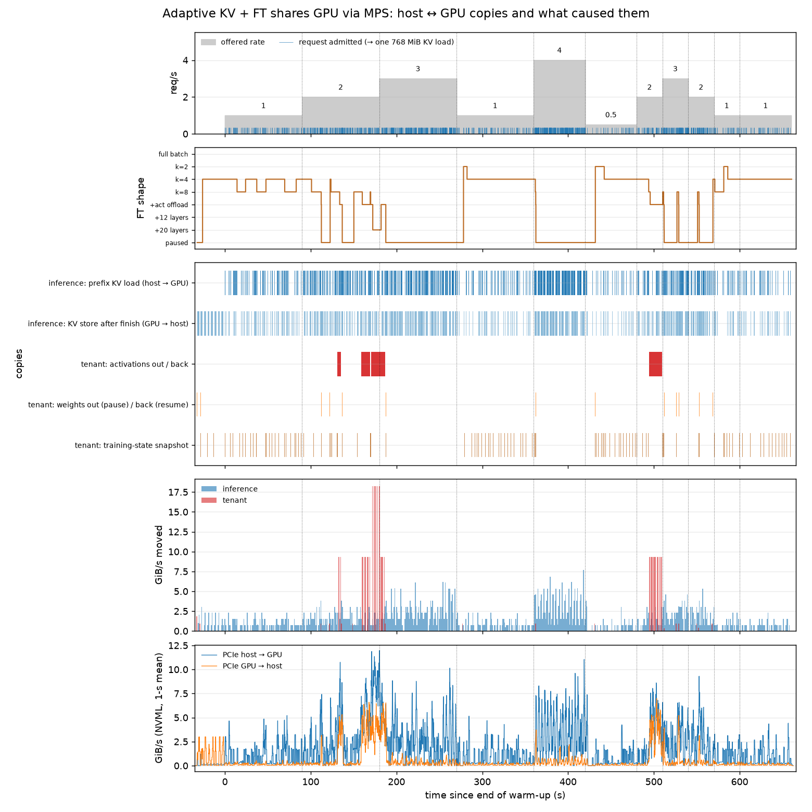
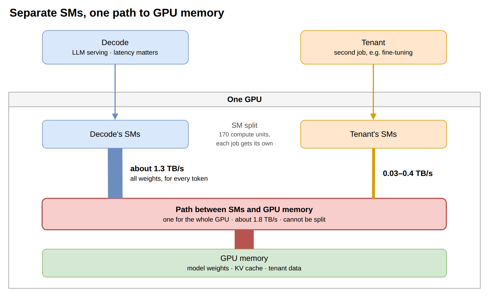
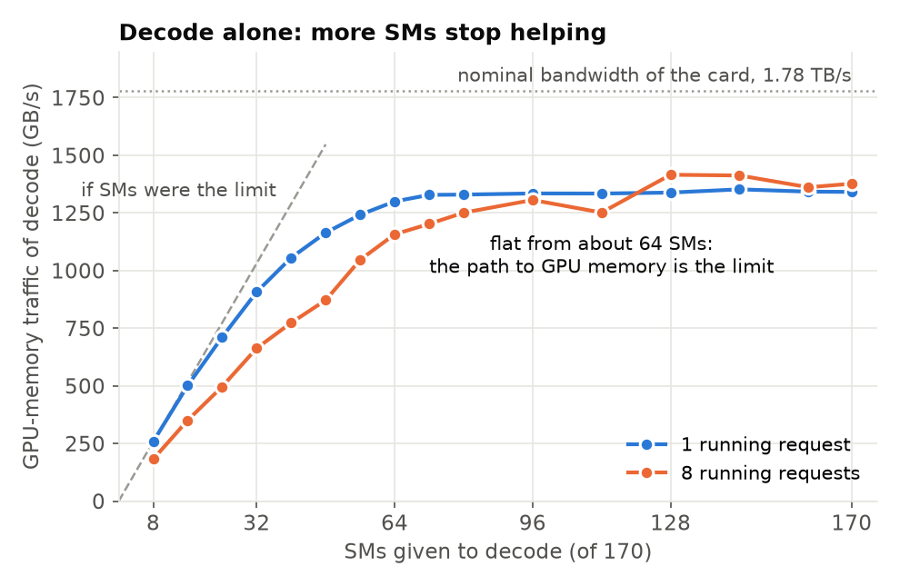
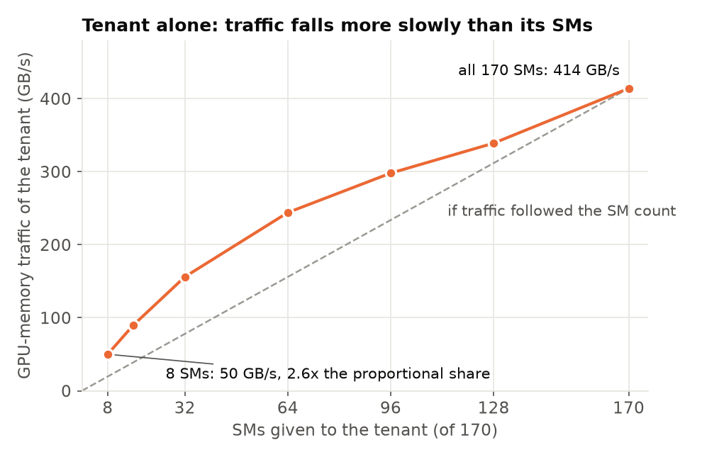
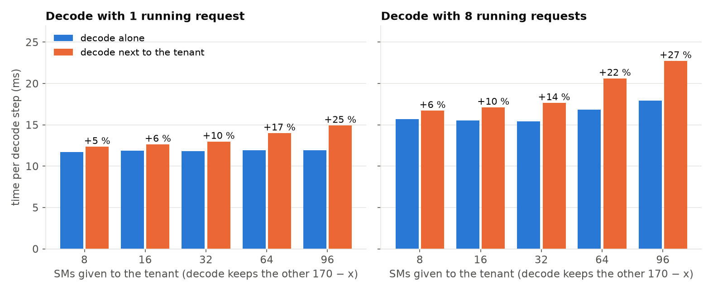
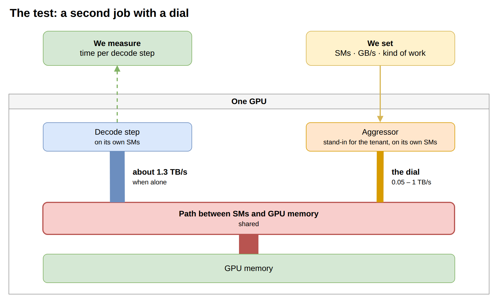
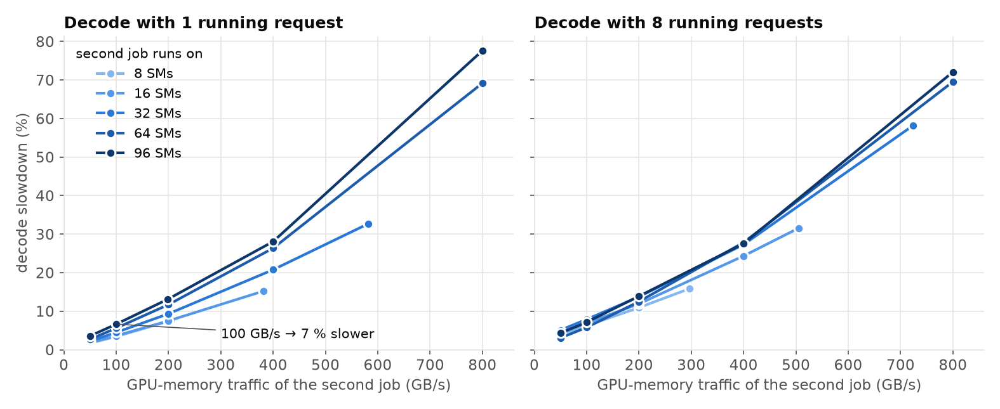
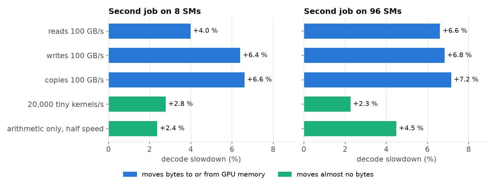
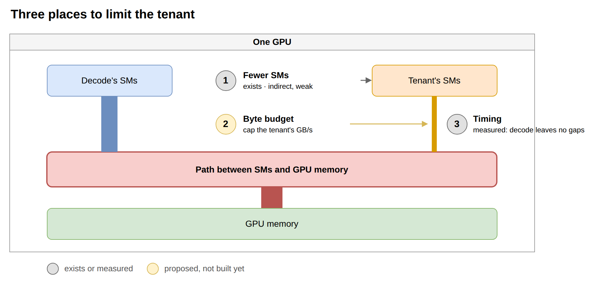

# 报告 2 —— tenant 用自己的 SM，为什么还会拖慢 decode：通往显存的共用通道

混部研究的阶段三，测量于 2026-11-09。英文版：[2_bandwidth.md](2_bandwidth.md)。

**问题。** decode 节点有空闲的 SM，可以让第二个任务（*tenant*，一个 LoRA 微调）在自己专用的 SM 上跑。
为什么 decode 还是会变慢？少给 tenant 一些 SM，能不能护住 decode？

**一句话回答。** decode 卡在 SM 到显存的那条通道上，不是卡在 SM 上；tenant 的字节走的是同一条通道，所以
decode 付的主要是 tenant 字节的代价（每 100 GB/s 慢 4–7 %），另外写显存、启动 kernel、做算术还各有一小部分
代价；限制 SM 只能间接地、很弱地减轻它。

## 平台和用词

| 项目 | 设置 |
|---|---|
| GPU | 一张 RTX 5090（GPU 1），170 个 SM，31.35 GiB 显存，功耗上限 500 W |
| 显存带宽 | 标称 1.78 TB/s（校准后计数器的 100 %） |
| decode（要保护的任务） | 一个合成的 decode 步，形状和 Llama-3-8B 一样（32 层，合并的 qkv、o、合并的 gate/up 和 down 投影，分组查询 attention，每个请求 6272 个 token 的 KV，最后一个 token 过 lm_head），bf16 随机权重。每一步把 15.0 GB 权重读一遍，每个正在跑的请求再读 0.82 GB KV。1、4、8 或 14 个请求 |
| tenant | Qwen2.5-0.5B，LoRA，每个 optimizer step 8 × 512 个 token，分成 4 个 micro-batch（配置 2） |
| SM 划分 | green context；驱动按 8 个 SM 的倍数分配。除非另说，decode 用第二个任务不用的那些 SM（SM 不相交） |
| 流量计数器 | NVML GPM 的整卡显存带宽计数器，用 decode 单独跑校准：1 % = 17.79 GB/s，54 个点，中位误差 0.5 %。它给的是所有任务的总和；每个任务各占多少，按各自的字节数算 |
| 测量窗口 | 拐点测量：每个点取 5 组计时的中位数。混跑：4 秒窗口，大多数点只跑一次 |

这个合成步在整卡上分别是 11.8 / 13.6 / 15.7 / 19.4 ms（1 / 4 / 8 / 14 个请求）；真实引擎在 0.5–1 req/s
时 TPOT 是 12.0–12.6 ms。它没有采样、调度和 detokenize，所以是下界。用它是因为步长的重复误差小于 1 %。

**用词。** 报告里有两种内存，用名字分开。**显存**是显卡自己的 GDDR7，权重和 KV 放在这里；**显存带宽**是
SM ↔ 显存这条通道的速率，这里用 NVML GPM 计数器读（阶段二用的是 NVML 对同一条通道的**显存控制器忙碌度**
读数）。**主机内存**是机器的主内存，经 PCIe 访问，只在第 2 节出现。**scheme** 指阶段二里一种共享 GPU 的
方式；**VRAM scheduler**是设定 KV 上限和 tenant 显存预算的那个进程。**SM 不相交**：decode 和第二个任务没有
共用的 SM。

## 1. 为什么要做这一段：阶段二留下三件解释不了的事

如果 tenant 拖慢 decode 是因为抢算力，把 SM 分开就该好。阶段二的三个结果不是这样（真实引擎，vLLM 0.30 +
kvcached，Llama-3-8B）：

| 阶段二的结果 | 测量值 |
|---|---|
| SM 分开了，代价没变 | 引擎用 128 个 SM、tenant 用另外 42 个（`green_split`）：decode TPOT +28 %。MPS 下两者共用全部 SM：+29 % |
| decode 并不缺 SM | 引擎单独用 128 个 SM（`engine_green`），和用全部 170 个一样快 |
| 主机链路不忙 | PCIe 平均只有约 10 % 的时间在用（第 2 节） |

所以两个任务抢的东西既不是 SM，也不是 PCIe。这一段要回答：抢的是什么；以及手里唯一现成的旋钮——给
tenant 多少 SM——管不管得住它。

## 2. 先排除一个：主机↔GPU 的拷贝不是瓶颈

阶段二的每一次运行里，主机和 GPU 之间的每一次拷贝都带来源记录下来，同时记录 NVML 的 PCIe 计数器。

*图 1 —— MPS scheme 里的每一次主机↔GPU 拷贝和它的原因。从上到下：被接纳的请求（每个触发一次 768 MiB
的前缀加载）和 tenant 的形态；拷贝本身（时间段）；按来源分的每秒 GiB；NVML 的 PCIe 计数器。数据：
`../coloc_adjust/results/adjust_nogate_xfer_{inf,ft}.csv`。*

| 拷贝 | 每次 | 11 分钟合计 |
|---|---|---|
| 推理加载（主机内存 → GPU，每个被接纳的请求一次） | 768 MiB，55.7 ms = 13.5 GiB/s，约为链路实际能力 14.5 GB/s 的 93 % | 1,176 次，880 GiB，平均 1.36 GiB/s |
| 推理存回（GPU → 主机内存，每个完成的请求一次） | 16 MiB，1.2 ms | 1,219 次，51 GiB |
| tenant 激活 offload | 每步换出 4.7 GB、换回 4.7 GB，换出 354 ms | 6 步，56 GiB |
| tenant 暂停 / 恢复 | 约 1 GB，195 / 98 ms | 8 / 9 次 |
| tenant 快照 | 8 MB，< 50 ms | 176 次 |

- **重叠时拷贝不变慢。** 和 tenant 拷贝重叠的推理加载用了 56.1–56.3 ms，单独是 55.7 ms（每个 scheme
  32–74 个样本）。
- **链路大部分时间是闲的。** 平均 1.4 GiB/s。NVML 按 20 ms 采样会高估峰值：激活 offload 时读到的
  35 GiB/s 是窗口假象。
- **伤害在别处。** 阶段二的形态探测里，拷贝多的 tenant 形态让 decode 每个 tenant token 多付 3–7 倍。
  拷贝之间不在链路上互相抢；它们和 decode 抢的是 GPU 的显存系统。这份报告剩下的部分就讲这件事。

## 3. 结构和五个问题

*示意图 A —— 测量结果指向的结构。SM 可以在两个任务之间划分，SM 到显存的通道不能。这条通道是靠数字节
推断出来的，不是在芯片内部看到的。*

每个问题都是上一个答案引出来的。

| | 问题 | 怎么测 | 答案 |
|---|---|---|---|
| 1 | decode 被什么卡住，是 SM 还是别的？ | decode 单独跑，给它 8 到 170 个 SM | **不是 SM。** 56–80 个 SM 就到平台。卡住它的是通往显存的通道 |
| 2 | 通道已经被 decode 占着，tenant 的字节从哪来？ | decode 旁边放真实的 tenant，数两个任务各搬了多少 | **从 decode 那里扣。** 两个任务的合计不涨 |
| 3 | 少给 tenant 一些 SM，能护住 decode 吗？ | 把 tenant 的 SM 从 96 个减到 8 个 | **管得很弱。** SM 减到 1/12，tenant 自己慢到 1/7，伤害只降到 1/4，还剩约 5 % |
| 4 | decode 真的是在对字节做反应吗？ | 换成一个每秒搬多少 GB 可以设定的第二任务 | **是。** 变慢对 GB/s 近似线性：每 100 GB/s 慢 4–7 % |
| 5 | 为什么真实 tenant 比它的字节更贵？ | 让第二个任务只读、只写、只启动 kernel、只做算术 | **还有三样代价。** 写、启动 kernel、做算术；功耗也是共用的 |

3.6 节再补一点：为什么总流量离标称带宽还很远，decode 就已经在损失。

### 3.1 decode 单独跑：卡在通道上，不是卡在 SM 上（问题 1）

合成 decode 步单独跑在 8 到 160 个 SM 的 green context 里，以及整卡上。

*图 2 —— decode 单独跑在 N 个 SM 上：显存读速率（一步必须读的字节数除以步长）。带步长和相对速度的三栏
版本：[knee_probe.png](../coloc_adjust/report/figures/knee_probe.png)。数据：
`../coloc_adjust/results/knee_probe.csv`。*

*步长，单位 ms（括号里是相对整卡的速度）。24、40、112、144、160 个 SM 的行在 CSV 里。*

| SM 数 | 1 个请求 | 4 个请求 | 8 个请求 | 14 个请求 | prefill 块，2048 token |
|---|---|---|---|---|---|
| 8 | 61.4 (19 %) | 94.8 (14 %) | 118.7 (13 %) | 155.1 (13 %) | 3096 (6 %) |
| 16 | 31.6 (37 %) | 48.5 (28 %) | 61.6 (25 %) | 79.8 (24 %) | 1558 (13 %) |
| 32 | 17.5 (68 %) | 26.0 (52 %) | 32.6 (48 %) | 41.3 (47 %) | 784 (25 %) |
| 48 | 13.6 (87 %) | 19.2 (71 %) | 24.8 (63 %) | 30.8 (63 %) | 535 (37 %) |
| 56 | 12.7 (93 %) | 17.5 (78 %) | 20.6 (76 %) | 25.3 (77 %) | 463 (43 %) |
| 64 | 12.2 (97 %) | 15.5 (88 %) | 18.7 (84 %) | 23.6 (82 %) | 404 (49 %) |
| 72 | 11.9 (99 %) | 14.6 (93 %) | 18.0 (87 %) | 22.7 (85 %) | 367 (54 %) |
| 80 | 11.9 (99 %) | 14.3 (95 %) | 17.3 (91 %) | 20.7 (94 %) | 329 (60 %) |
| 96 | 11.9 (100 %) | 13.5 (101 %) | 16.5 (95 %) | 20.1 (97 %) | 280 (71 %) |
| 128 | 11.8 (100 %) | 13.3 (102 %) | 15.2 (103 %) | 18.7 (104 %) | 225 (88 %) |
| 170 | 11.8 (100 %) | 13.6 (100 %) | 15.7 (100 %) | 19.4 (100 %) | 199 (100 %) |

- **两段。** 拐点以下，读速率几乎和 SM 数成正比：到 40 个 SM 为止，1 个请求时每个 SM 拉 26–32 GB/s，
  4–14 个请求时 19–24 GB/s。1 个请求、8 个 SM 时是 258 GB/s。过了拐点，四种负载都平在 1.34–1.42 TB/s
  （1 个请求：64 个 SM 1.30 TB/s，80 个 1.33，170 个 1.34）。再加 SM 没用：这一步在等字节。
- **拐点**（第一个达到整卡速度 90 % 以上的 SM 数）**在 1 个请求时是 56 个 SM，4 个请求 72 个，8 和 14 个
  请求 80 个**（误差一个 8-SM 网格步；两次运行之间中位数最多差 3 %）。
- **prefill 块没有拐点**：64 个 SM 是整卡速度的 49 %，128 个是 88 %。它受限于算术。

所以一个 decode 节点要约 80 个 SM，看上去有几十个 SM 是空的。但处在平台上，意味着这一步受限的正是 SM
划分分不开的那样东西。

### 3.2 tenant 单独跑：流量降得比 SM 慢

*图 3 —— tenant 单独跑在 M 个 SM 上：显存流量对 M。虚线是「流量和 SM 数成正比」。注意纵轴刻度：tenant
全卡也只有 414 GB/s，decode 约 1,340 GB/s。数据：`../coloc_adjust/results/knee_bw2_summary.md`。*

| tenant 的 SM 数 | tok/s | GB/s | 每个 SM 的 GB/s | 每 token MB | SM 忙碌度（它自己的 SM） |
|---|---|---|---|---|---|
| 170 | 29,006 | 414 | 2.4 | 14.3 | 59 % |
| 128 | 24,516 | 339 | 2.7 | 13.8 | 59 % |
| 96 | 21,942 | 298 | 3.1 | 13.6 | 63 % |
| 64 | 17,947 | 244 | 3.8 | 13.6 | 69 % |
| 32 | 11,642 | 156 | 4.9 | 13.4 | 83 % |
| 16 | 6,543 | 90 | 5.7 | 13.8 | 91 % |
| 8 | 3,490 | 50 | 6.3 | 14.3 | 96 % |

- 不管多少 SM，tenant 每训练一个 token 都搬 13.4–14.3 MB，所以它的流量跟着它的吞吐走。
- 它的流量和 SM 数不成正比：170 → 8 个 SM（1/21），流量从 414 降到 50 GB/s（1/8）。同样的工作把剩下的
  SM 填得更满（忙碌度 59 % → 96 %），每个 SM 的流量从 2.4 涨到 6.3 GB/s。
- *推断，未测量：* 这符合「SM 少了，tenant 的 block 堆到剩下的 SM 上」的说法，但 block 层面的机制没有直接
  观察到。

### 3.3 tenant 进来，以及减它的 SM（问题 2 和 3）

*图 4 —— decode 每步的时间，单独（蓝）和旁边有 tenant（橙），tenant 用不相交的 SM。蓝色是 decode 在橙色
情况下同样那批 SM 上单独跑，所以差别不是 decode 的 SM 变少造成的。数据：
`../coloc_adjust/results/knee_bw2.csv`。*

| tenant 的 SM 数 | tenant tok/s（占它单独跑的比例） | tenant GB/s | decode 变慢：1 / 4 / 8 个请求 | decode 少掉的 GB/s ÷ tenant 的 GB/s |
|---|---|---|---|---|
| 8 | 2.4–2.9k（69–82 %） | 34–41 | +5.4 / +7.5 / +6.4 % | 2.0–2.4 |
| 16 | 4.5–5.3k（68–81 %） | 62–74 | +6.4 / +9.1 / +9.9 % | 1.3–1.7 |
| 32 | 8.0–9.4k（69–81 %） | 108–126 | +9.7 / +15.3 / +14.4 % | 1.1–1.5 |
| 64 | 13.2–15.2k（74–85 %） | 179–206 | +17.4 / +19.5 / +22.4 % | 1.05–1.14 |
| 96 | 18.5–19.2k（84–88 %） | 251–261 | +24.7 / +29.1 / +26.6 % | 0.98–1.08 |

- **SM 分开护不住 decode。** tenant 只占 8 个 SM、搬的字节只有 decode 的 3 %，decode 也慢 5–7 %。
- **合计不涨。** decode 单独搬 1.33–1.40 TB/s。decode 加 tenant，按两个任务各自的字节数算是
  1.21–1.35 TB/s（计数器读数是 1.26–1.41 TB/s）。tenant 搬多少，decode 就少多少。tenant 有 64–96 个 SM
  时，tenant 每搬 1 GB/s，decode 约少 1 GB/s；tenant 只有 8 个 SM 时，decode 少 2.0–2.4 GB/s。
- **限 SM 是个弱旋钮。** 从 96 个 SM 减到 8 个（1/12），tenant 的流量降到 1/6–1/7，它自己的吞吐降到约
  1/7（约 19k → 2.4–2.9k tok/s），对 decode 的伤害却只降到约 1/4（25–29 % → 5–7 %），而且有约 5 % 的地板。
- **按训练量算，SM 少反而更贵。** 每 1k tenant tok/s 让 decode 慢多少：8 个不相交 SM 时 2.2–2.7 %，
  64–96 个时 1.3–1.5 %。
- 共用 SM 时（decode 用全部 170 个，tenant 用其中 M 个），tenant 只能跑到它单独跑的 34–73 %；SM 不相交时
  是 68–88 %。

### 3.4 换成流量可设定的第二任务：代价跟着字节走（问题 4）

真实 tenant 同时在读、写、启动 kernel、做算术，哪一样都没法单独调。于是把它换成一个跑在自己 SM 上的合成
任务（`bw_aggr.py`）：一个 float32 矩阵-向量乘，以 64 MB 一次调用读一块 2 GiB 的缓冲区，按设定的 GB/s
限速。

*示意图 B —— 这个测试。第二个任务跑在自己的 SM 上，每秒在显存上搬设定数量的 GB；decode 在剩下的 SM 上，
测它的步长。*

| 网格 | 取值 |
|---|---|
| 流量 | 50、100、200、400、800 GB/s，以及不限速 |
| 第二任务的 SM 数 | 8、16、32、64、96（decode 用其余的；一组对照把 decode 固定在 106 个 SM） |
| 正在跑的请求 | 1 和 8 |
| 重复 | 整个网格重启跑两遍（步长中位数相差 0.02 % 以内，变慢幅度相差 2 个百分点以内）；32 MB 和 256 MB 调用大小两组对照 |

*图 5 —— decode 变慢对只读任务的流量，每个 SM 数一条线。数据：`../coloc_adjust/results/aggr_corun.csv`。*

直线拟合的斜率，每 100 GB/s 让 decode 慢多少 %（50–400 GB/s；最大残差 2 个百分点，大多数小于 1）：

| 第二任务的 SM 数 | 1 个请求，decode 用其余 SM | 1 个请求，decode 固定 106 个 SM | 8 个请求，decode 用其余 SM | 8 个请求，decode 固定 106 个 SM |
|---|---|---|---|---|
| 96 | 7.0 | | 6.7 | |
| 64 | 6.8 | 6.8 | 7.2 | 7.2 |
| 32 | 5.3 | 5.7 | 6.4 | 6.1 |
| 16 | 3.8 | 4.4 | 5.7 | 5.2 |
| 8 | 3.8 | 4.0 | 4.6 | 4.5 |

- **变慢跟着字节走。** 固定 SM 数时，变慢对 GB/s 近似线性：1 个请求时，8–16 个 SM 每 100 GB/s 约 4 %，
  64–96 个 SM 约 7 %。
- **SM 数没有 GB/s 重要。** 整个网格里 GB/s 相差 8 倍；SM 数只让斜率变 1.5–1.8 倍。把 decode 固定在
  106 个 SM，斜率一样，所以变化来自第二任务的 SM 数，不是 decode 的。
- **SM 数决定它最多能搬多少。** 不限速、旁边有 decode 时：

| 第二任务的 SM 数 | 单独 | 旁边有 decode（1 / 8 个请求） | decode 变慢（1 / 8 个请求） |
|---|---|---|---|
| 8 | 491 GB/s | 205 / 298 GB/s | +8 / +16 % |
| 16 | 894 | 382 / 506 | +15 / +32 % |
| 32 | 1,263 | 585 / 732 | +33 / +57 % |
| 64 | 1,335 | 858 / 972 | +76 / +100 % |
| 96 | 1,342 | 955 / 1,059 | +106 / +124 % |

- **第二任务搬多少，decode 大部分就少多少。** 只读任务每搬 1 GB/s，decode 少搬 0.46–0.78 GB/s（1 个请求）
  或 0.57–0.84 GB/s（8 个请求）（200–800 GB/s 的点）。和真实 tenant 不同，这里合计会涨，计数器最高到标称
  带宽的 91 %。
- **调用大小影响很小。** 同样的 GB/s 用 256 MB 一次调用，decode 步长变化小于 0.8 %；用 32 MB（调用次数翻倍，
  最多 11.9k 次/秒），decode 慢 0–3 %。
- 字节账对得上：252 个点里有 248 个，decode 的 GB/s 加第二任务的 GB/s 和计数器相差 1.2 % 以内。

### 3.5 为什么真实 tenant 比它的字节更贵（问题 5）

tenant 在 8 个 SM 上搬 34–41 GB/s。按图 5 的只读线，这只该让 decode 慢 1.4–2.6 %；实测是 5.4–6.4 %。于是
让第二个任务分别做五种工作，在 8 个和 96 个 SM 上，旁边是同一个 decode 步。

*图 6 —— decode（1 个请求）旁边放五种第二任务时的变慢。蓝色：搬 100 GB/s 的任务。绿色：几乎不搬字节的
任务。「tiny kernels」：每秒启动 20,000 个极小的 kernel。「arithmetic only」：512 × 512 的矩阵乘，数据留在
GPU 缓存里，跑在一半的最高速度。数据：`../coloc_adjust/results/aggr_modes.csv`；20 个点在 `aggr_modes_r2*`
里重跑，步长相差 0.5 % 以内。*

| 工作类型 | 在 8 个 SM 上 | 在 96 个 SM 上 |
|---|---|---|
| 读，每 100 GB/s | 4.0 %（1 个请求），5.5–6.3 %（8 个请求） | 5.4–7.0 % |
| 写或拷贝，每 100 GB/s | 6.1–6.6 %（1 个请求），7.1–7.8 %（8 个请求） | 6.1–8.2 % |
| 只启动极小 kernel | 2–5k 次/秒：+0.7–2.1 %；20–50k 次/秒：+2.1–3.8 %；100–132k 次/秒：+3.0–5.8 % | 相同 |
| 只做算术 | +1.4–2.6 %（1 个请求），+3.8–6.9 %（8 个请求），时钟不变 | 不限速 +8.6–9.8 %，顶到 500 W 上限 |

1. **SM 少的时候，写比读贵。** 从 96 个 SM 发出时，读、写、拷贝每字节的代价差不多；从 8 个 SM 发出时，写
   和拷贝更贵。
2. **启动工作本身就有代价，不需要字节。** 代价随启动频率上升，从 8 个和 96 个 SM 发出一样；功耗和时钟不变。
3. **做算术本身就有代价，不需要字节。** 96 个 SM 全速做算术时整卡顶到 500 W 上限，时钟降 8–9 %：**功耗是
   两个任务共用的第二样东西。** 在所有读、写、拷贝的点上，整卡功耗 379–473 W，时钟变化在 1 % 以内，所以
   字节的结论不是功耗造成的。

**差距的来源 —— 推断，不是测量。** 在 8 个 SM 上，tenant 的字节按读算是 1.4–2.6 %，按写算是 2.1–3.2 %。
每秒 5–20k 次的 kernel 启动是 1.4–2.8 %，8 个 SM 上的算术是 1.4–6.9 %。这些和 5.4–6.4 % 里剩下的部分大小
相当。没有证明：tenant 的 kernel 启动频率没有测，三样也没有放在一起测过。

### 3.6 总量没到标称上限，为什么还有干扰

| 谁在跑 | 显存流量 | 占标称 1.78 TB/s |
|---|---|---|
| decode 单独（在平台上） | 1.33–1.40 TB/s | 75–79 % |
| decode + tenant（计数器） | 1.26–1.41 TB/s | 71–79 % |
| 只读任务单独，256 MB 调用 | 1.58–1.61 TB/s | 88–90 % |
| 只写任务单独，96 个 SM | 1.55 TB/s | 86.6 % |
| decode + 不限速的只读任务（合计） | 1.60–1.62 TB/s | 88–91 % |

- **标称值到不了。** 没有任何组合到过 100 %。纯读或纯写的任务到 87–90 %；decode 单独不管给多少 SM 都停在
  75–79 %。decode 为什么停在这里，没有解释。
- **decode 在远低于这些水平时就开始损失。** 只读任务在 96 个 SM 上搬 50 GB/s，旁边 decode 有 8 个请求：
  decode 从 1,207 降到 1,156 GB/s，合计还是 1,206 GB/s（标称的 68 %），decode 慢 4.3 %。所以不是「管子满了
  才挤」。
- **是通道的哪一段在限流，不知道。** 测量只说明通道整体是共用的。候选原因，都没有单独测过：L2 缓存（所有
  显存流量都经过它，所以搬字节的任务同时也在冲刷 L2，这些测试分不开这两件事）；显存控制器的排队；kernel
  启动和功耗（3.5 节量过，不够解释全部）。
- 有一个观察指向 L2，只是一个观察：只做算术的任务在 8 个 SM 上、时钟不变，让 8 个请求的 decode 慢
  3.8–6.9 %，同时计数器读数比 decode 自己的字节多 2.5–6.6 %。一种解读是它被挤出了 L2，开始读显存。

## 4. 结论：限 SM 是弱旋钮，该直接限的是 tenant 的字节

*示意图 C —— 可以给 tenant 加限制的三个位置：(1) 少给 SM，现成但弱；(2) 字节额度；(3) 错开时间，把 tenant
的搬运放进 decode 的空隙。在这一阶段结束时，(2) 和 (3) 还只是提议。*

- **少给 SM 只能间接地作用于字节。** SM 减到 1/12，tenant 的流量降到 1/6–1/7、它自己的速度降到 1/7，对
  decode 的伤害只降到 1/4，还有约 5 % 的地板。它对 kernel 启动的代价也没有作用。
- **decode 付的主要是 tenant 字节的代价**，每 100 GB/s 4–7 %，所以该直接限制的是字节。已有文献也一致认为
  SM 划分不能隔离带宽。
- **在 decode 节点上，错开时间几乎没有空间。** 只要有请求在跑，GPU 就有 93–100 % 的时间在忙；阶段二里只让
  tenant 在空隙里跑的 scheme 什么也没训练出来。decode 在 1、4、8 个请求时都让通道保持在 75–79 %。

**下一步：报告 3。** [3_c1_c2.md](3_c1_c2.md) 从这个结论出发，测两种做法：C1，给 tenant 一个字节额度；C2，
改 tenant 本身，让同样的训练少搬字节。

## 这一段说明了什么

1. 主机↔GPU 的拷贝不是瓶颈：链路大部分时间闲着，重叠的拷贝互不拖慢。
2. decode 单独跑时在 56–80 个 SM 上达到显存带宽平台；过了这一点，限制它的是通往显存的通道，不是 SM。
3. tenant 用不相交的 SM 时，两个任务的流量加不上去：tenant 搬多少，decode 就少多少。tenant 只占 8 个 SM，
   decode 也慢 5–7 %。
4. 第二个任务对 decode 的代价近似和它的 GB/s 成线性，每 100 GB/s 4–7 %，和它的 SM 数关系较小。
5. 写、kernel 启动和算术各自还有代价；功耗是第二样共用的东西。它们合起来和 tenant 字节与实际代价之间的差距
   大小相当。
6. 限制 tenant 的 SM 是弱旋钮；该限制的是 tenant 的字节。

## 局限

- **decode 是合成步**，不是服务引擎。服务引擎在阶段二里表现出同样的效应，噪声更大。
- **一张卡，一种功耗设定**（RTX 5090，500 W 上限）。功耗效应取决于这个上限。
- **大多数点只跑一次**，4 秒窗口。3.5 节有 20 个点重跑过，相差 0.5 % 以内。decode 的基线落在相差 1–3.6 %
  的两个水平之一，整个一次运行里固定不变，这给每个变慢幅度带来约 ±1 个百分点的不确定。
- **共用通道是从字节数推断出来的**，不是在芯片内部看到的。没有硬件层面的 profile。
- 混跑的表格只用了**一种 tenant 形态**（配置 2）。
- **tenant 在 decode 旁边的 GB/s 是算出来的**：tok/s 乘以它单独跑时的每 token 字节数。4 和 8 个请求时，两个
  任务的字节合计比计数器读数少 3–4.5 %；可能的原因是 tenant 在 decode 旁边时每 token 字节数变了，没有核实。

## 未解决的问题

- 为什么 decode 单独跑停在标称带宽的 75–79 %，而纯读任务能到 88–90 %。
- 总量低于这些水平时，是通道的哪一段（L2、显存控制器、还是别的）在限流。提议的测试：第二任务的工作集取
  刚好小于和刚好大于 L2 两档，调用频率相同（TODO 里的 E2.3）；用 Nsight Compute 量 decode 的 L2 命中率
  （E2.5）。
- 只读任务从 8–16 个 SM 发出时，每字节对 decode 的代价约是从 64–96 个 SM 发出的一半；真实 tenant 方向相反
  （8 个 SM 是它最贵的点）。
- decode 每 GB/s 的损失是否跟着 decode 自己把通道占得多满走（E2.8）。
- tenant 的 kernel 启动频率；写、启动、算术放在一起时代价是否相加（E2.4、E2.5）。
- SM 少了以后 tenant 的 block 是否堆到剩下的 SM 上（固定 grid 的 kernel，E3.3）。
- 112 个 SM 时，4 和 8 个请求的 decode 步比 96 个 SM 时慢约 4 %；两次重跑都复现，原因不明。

## 文件

| 内容 | 位置 |
|---|---|
| 决策日志 | `../coloc_adjust/report/DECISIONS.md`（没有阶段三的条目；阶段三记在 TODO 里） |
| 实验清单和编号结果 1–20（E1.2、E1.3、E2.1、E2.7、E3.1、E3.2） | `../coloc_adjust/TODO.md` |
| 这份报告取代的早先文稿 | git 历史（commit `358cc6b`）：`coloc_adjust/report/REPORT_bandwidth_zh.md`、`REPORT_zh.md` 中对应 2.6、2.7 和主机↔GPU 拷贝的章节 |
| decode 单独跑在 N 个 SM 上 | `../coloc_adjust/knee_probe.py`、`plot_knee.py`；`results/knee_probe.csv`、`results/knee_probe.md` |
| decode 旁边放真实 tenant，tenant 单独跑 | `../coloc_adjust/knee_corun.py`、`analyze_knee_bw.py`；`results/knee_bw2.csv`、`results/knee_bw2_summary.md`、`results/knee_bw2_crossrun.md`，重跑 `results/knee_bw2_chkA/B*` |
| 流量可设定的第二任务 | `../coloc_adjust/bw_aggr.py`、`aggr_corun.py`、`analyze_aggr.py`；`results/aggr_corun*.csv`、`results/aggr_corun_summary.md`、`_r2`、`_chunk32`、`_chunk256` |
| 五种工作 | `../coloc_adjust/aggr_corun.py --modes`、`analyze_modes.py`；`results/aggr_modes.csv`、`results/aggr_modes_summary.md`，重跑 `results/aggr_modes_r2*` |
| 主机↔GPU 拷贝 | `../coloc_adjust/xfer_trace.py`；`results/<scheme>_xfer_{inf,ft}.csv`、`results/<scheme>_xfer.png` |
| 图 2–6 | `../coloc_adjust/plot_bw_report.py` → `report/figures/bw_*.png` |
| 示意图 A–C | `../coloc_adjust/diagrams/08_shared_memory_path.drawio`、`09_aggressor_test.drawio`、`10_where_to_limit.drawio` |
