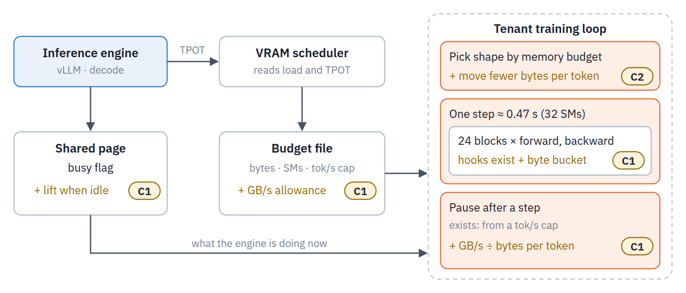
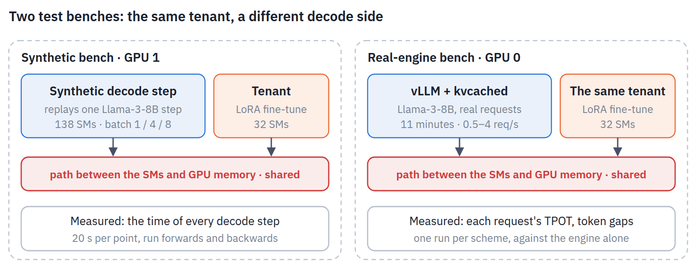
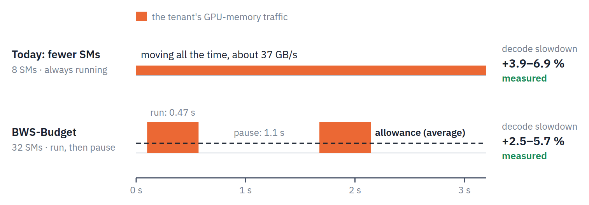
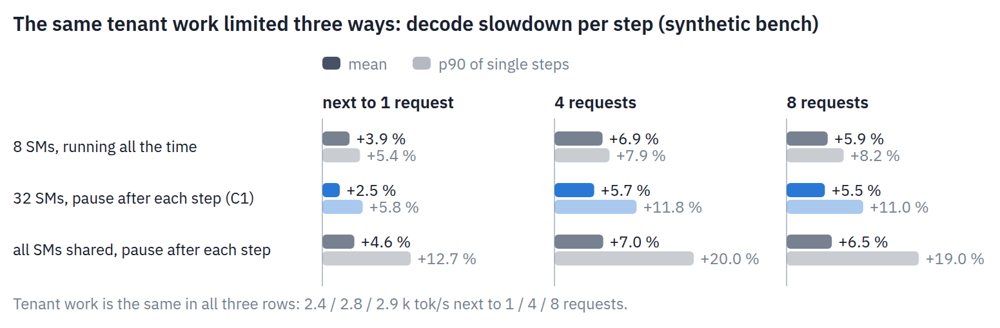
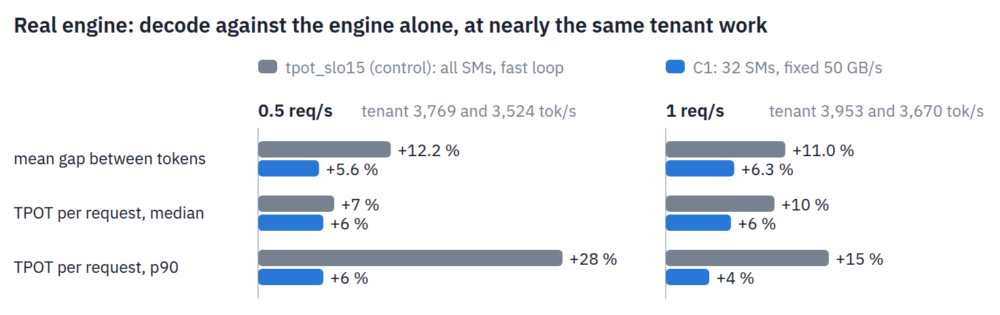
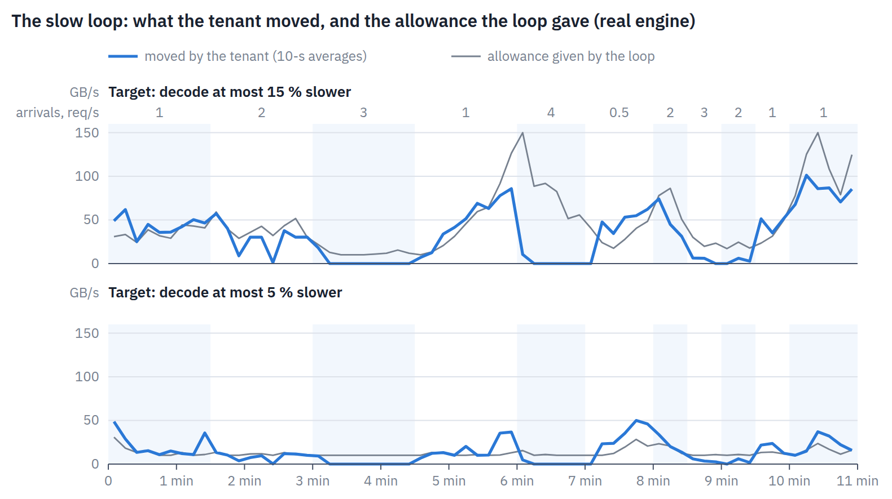
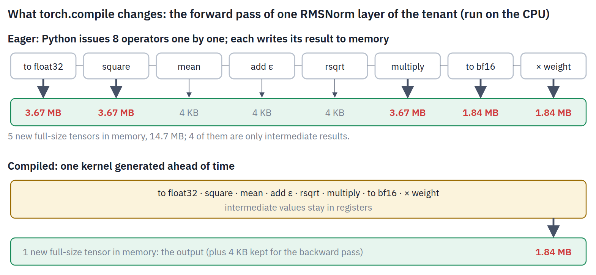
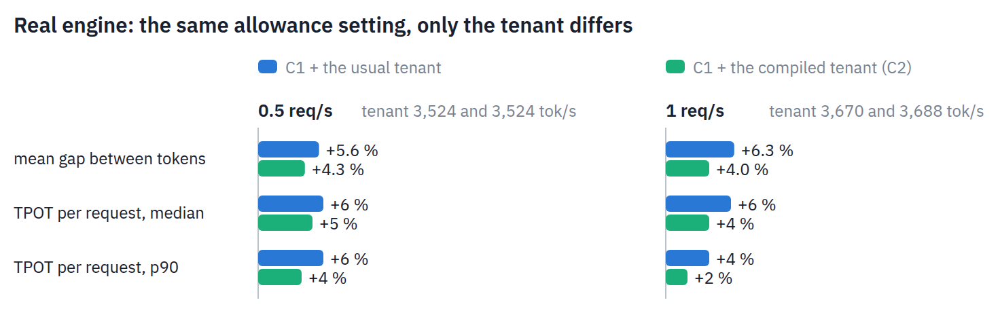

# C1 and C2: limiting the tenant's bytes, and a tenant that moves fewer

**Question.** A LoRA fine-tune (the *tenant*) shares an RTX 5090 with a Llama-3-8B decode engine.
Report 2 found that decode pays for every byte the tenant moves between GPU memory and the SMs,
and that giving the tenant fewer SMs controls this only weakly. Can the tenant keep training
while decode loses less?

**Answer.** Yes, in two ways that add up. **C1** gives the tenant an allowance in GB/s and lets it
work at full speed on 32 SMs until the allowance is used. At the same tenant work as the earlier
latency-feedback scheme, decode's cost halves (+5.6 / +6.3 % instead of +12.2 / +11.0 % at
0.5 / 1 req/s) and the tail disappears (TPOT p90 +6 / +4 % instead of +28 / +15 %). **C2** changes
the tenant so that the same training moves fewer bytes: `torch.compile` cuts its bytes per token
by 41 % without changing what is trained, and at the same tenant work decode's cost falls again,
to +4.3 / +4.0 %. Two refinements of C1 (finer pauses, a feedback-driven allowance) bring nothing
more on the real engine. About 3–5 % of decode's cost does not come from bytes at all.

Everything here was measured on the night of Nov 16 2026, except where a number is marked as
coming from Nov 9 (reports 1 and 2).

Related reports: [1 — KV budget and colocation schemes](1_kv_budget_and_schemes.md),
[2 — why the tenant slows decode](2_bandwidth.md), [4 — a prefill engine as tenant](4_prefill_tenant.md).

**Terminology.** **GPU memory** is the card's own 32 GB; "GPU memory bandwidth" is the path
between the SMs and it (nominal 1.78 TB/s). **Host RAM** is the machine's memory, reached over
PCIe. The word DRAM is not used. **Tenant work** is the tenant's training throughput in tokens per
second. **Decode slowdown** is always against decode alone in the same setting on the same night.

*Figure 1 — the route of this report (`../coloc_adjust/diagrams/make_c1c2_figs.py`, as all figures below). Yellow: a proposal; green: a
measured conclusion; white: a question followed up. The two ideas were proposed together; C1 comes
first because C2 can only be judged at equal tenant work.*

## 1. Where this starts

| Measured before (reports 1 and 2) | So |
|---|---|
| Decode's slowdown follows the second job's bytes: 4–7 % per 100 GB/s, and the two jobs' traffic does not add up beyond what decode alone uses | The quantity to control is the tenant's bytes |
| Cutting the tenant from 96 to 8 SMs cuts its own speed to about 1/7 but the harm to decode only to about 1/4; 8 SMs is the dearest point per tenant token | Fewer SMs is a weak and expensive way to hold the tenant back |
| While the tenant pauses, decode is at its baseline (−1 to +2 %); while it runs, decode pays the full co-running cost | Run-and-pause acts linearly in time |
| A feedback loop that swings the tenant's cap gives TPOT p90 +28–29 % at 0.5 req/s; a fixed cap gives p90 equal to the median | An allowance must be steady |
| At the same tokens/s, tenant shapes differ up to 7-fold in what they cost decode | Tokens/s is the wrong unit; how the tenant computes matters |
| Decode steps leave no gaps (GPU busy 93–100 % while any request runs) | There is no idle time inside a request for the tenant to use |

Two ideas follow, proposed together on Nov 15:

- **C1, a byte allowance**: limit the tenant from outside, in GB/s, and keep the allowance by
  letting it run and pause on a few dozen SMs.
- **C2, a tenant that moves fewer bytes**: change the tenant itself so the same training puts
  less traffic on the path to GPU memory.

C1 comes first below because C2 can only be judged at equal tenant work, and C1 is what holds the
work fixed.

*Diagram 1 — from the measurements to the two ideas (`../coloc_adjust/diagrams/15_measurements_to_ideas.svg`).*

*Diagram 2 — where each idea attaches to the prototype (`../coloc_adjust/diagrams/11_next_steps_attach.svg`).
Both change only the tenant's own loop and fields in the two shared files; no driver change, no
interception of CUDA calls, no change to the inference engine.*

## 2. How it was measured

Two test benches, run at the same time on the two cards.

*Figure 2 — the two benches. The tenant is the same process on both; the decode side is a
replayed step on one and the real engine on the other.*

| | Synthetic bench (GPU 1) | Real-engine bench (GPU 0) |
|---|---|---|
| Decode | A process that replays one Llama-3-8B decode step (reads the 15 GB of weights), batch 1, 4 or 8 | vLLM 0.30 + kvcached serving Llama-3-8B, behind the router and VRAM scheduler of report 1 |
| Tenant | The real LoRA fine-tune (Qwen2.5-0.5B, 8 sequences × 512 tokens per step), same code as on GPU 0 | The same tenant |
| Sharing | Two processes under MPS, each on its own green context, disjoint SMs (e.g. tenant 32, decode 138) | Under MPS; the tenant on a 32-SM green context |
| Load | Fixed batch per point, 20 s per point, every set run forwards and backwards (two passes) | The 11-minute reference schedule, 0.5–4 req/s in phases |
| Decode metric | Time of every decode step (a CUDA event after each step), mean and p90, against decode alone on the same SMs measured at the start, between and after the passes | From the request log: the mean gap between tokens, and each request's TPOT (median, p90), against the engine alone on the same night at the same arrival rate |
| Repeat | The two passes differ by at most 0.2 points | One run per scheme |

Both cards were capped at 500 W. Three checks before the comparisons:

- **The machine matched Nov 9.** Decode alone 11.69 / 13.44 / 15.85 ms per step at batch 1 / 4 / 8
  (Nov 9: 11.68 / 13.39 / 15.80); tenant alone 3,493 / 6,518 / 11,582 tok/s on 8 / 16 / 32 SMs.
  Per-step event timing and grouped wall-clock timing agree to 0.05 %.
- **The engine matched Nov 9.** Engine alone: TPOT median 12.0 / 12.7 / 16.4 ms at 0.5 / 1 / 2
  req/s (Nov 9: 12.0 / 12.6 / 16.3). The two old schemes run again as controls reproduce their
  Nov 9 results within 2 points.
- **The bandwidth counter.** NVML's GPU-memory bandwidth reading (GPM) is device-wide, so it
  shows one job's traffic only when that job is alone. It was calibrated against decode's known
  reads: 1 % = 17.79 GB/s (30 points, median error 0.5 %).

**Equal tenant work.** Every C1 and C2 comparison holds the tenant's tokens/s fixed; otherwise a
smaller slowdown could just mean less training. The reference setting runs first and its measured
tokens/s becomes the cap for every other setting of the comparison; the tenant pauses when it is
ahead. The tables give the tokens/s actually measured.

## 3. C1: a byte allowance

### 3.1 Proposal

Give the tenant an allowance: on average at most so many GB per second. It works at full speed,
stops when the allowance is used and continues when it is refilled.

- **Bytes, not tokens/s**, because a tokens/s cap has to be retuned whenever the tenant changes
  shape (they differ up to 7-fold in cost per token); a byte allowance does not.
- **A few dozen SMs, not 8.** Giving the tenant fewer SMs does lower decode's slowdown, but it
  lowers the tenant's work faster (Nov 9, synthetic bench, tenant and decode on disjoint SMs):

  | Tenant SMs | Tenant work, tok/s | Decode slowdown (1 / 4 / 8 requests) | SMs left for decode |
  |---|---|---|---|
  | 8 | 2.4–2.9 k | +5.4 / +7.5 / +6.4 % | 162 |
  | 16 | 4.5–5.3 k | +6.4 / +9.1 / +9.9 % | 154 |
  | 32 | 8.0–9.4 k | +9.7 / +15.3 / +14.4 % | 138 |
  | 64 | 13.2–15.2 k | +17.4 / +19.5 / +22.4 % | 106 |
  | 96 | 18.5–19.2 k | +24.7 / +29.1 / +26.6 % | 74 |

  

  *Figure 3 — the table's rows at 4 requests. The dashed line is what the slowdown would be if it
  fell in proportion to the tenant's work.*

  With 8 SMs decode's slowdown is the smallest of the five rows. But the tenant then does a
  seventh of the work it does on 96 SMs, while decode keeps a quarter of the slowdown. For the
  same amount of training, 8 SMs is therefore the dearest setting: slowdown divided by tenant work
  is 2.2–2.7 % per 1 k tok/s on 8 SMs, 1.4–1.9 % on 16 and 1.2–1.7 % on 32 to 96. At the other
  end, from 64 SMs up decode itself runs short of SMs: alone on the 106 or 74 SMs left it is
  already 2–7 % or 2–14 % slower than on all 170. So 32 SMs, and less time.
- **Pause between steps**, because while the tenant pauses decode is back at its baseline.

*Diagram 3 — C1 against fewer SMs, at the same tenant work (about 2.6 k tok/s), to scale over
3.2 s (`../coloc_adjust/diagrams/12_c1_budget.svg`). Bar height is the tenant's traffic at that
moment; the dashed line is the allowance. The slowdowns on the right are the synthetic-bench
results of section 3.3 at 1 / 4 / 8 requests.*

### 3.2 Implementation

1. **A GB/s field in the budget file.** The VRAM scheduler already publishes the tenant's GPU-memory
   budget, SM count and a tokens/s cap in `/dev/shm/coloc_ft_budget`; it now also writes `gbps`
   (`controller.py --gbps-fixed`). The night used 50 GB/s: the scheduler writes the same number
   all the time; it does not look at TPOT and does not change it.
2. **Conversion in the tenant.** The tenant divides the allowance by the bytes per token of the
   shape it is running (`pacing.py`: `cap_tok_s = gbps × 1000 / MB_per_token`), using a table
   measured on the GPU (section 5.3). The usual shape moves 13.47 MB per token, so 50 GB/s is
   about 3.7 k tok/s. When the tenant changes shape, its cap changes with it.
3. **Run, then pause.** The tenant runs on a prebuilt 32-SM green context. It computes one step at
   full speed (4,096 tokens, about 0.5 s) and then sleeps until the step's average rate is back
   under the cap: about 0.5 s of work, 0.6 s of pause. The pause existed before; it used to be
   computed from a tokens/s cap.

**What "a fixed 50 GB/s" means.** Nothing measures the tenant's bytes while it runs, and no
hardware enforces the allowance: the device counter cannot tell the tenant's traffic from
decode's. The tenant keeps the account itself, from the bytes per token measured beforehand. The
allowance is a ceiling, not a guarantee: a shape that cannot reach 50 GB/s stays below it.

Unchanged from report 1: the tenant still follows its GPU-memory budget, steps down its ladder of
shapes when decode needs memory, and pauses entirely at ≥ 3 req/s.

### 3.3 Measurement

**Synthetic bench: the same tenant work, limited in different ways.** The reference is the tenant
flat out on 8 SMs (2.4 / 2.8 / 2.9 k tok/s next to 1 / 4 / 8 requests); every other setting is
held to that work.

| Same tenant work, limited by | Decode mean (1 / 4 / 8 requests) | p90 of single steps |
|---|---|---|
| 8 SMs, running all the time | +3.9 / +6.9 / +5.9 % | +5.4 / +7.9 / +8.2 % |
| **32 SMs, pause after each step (C1)** | **+2.5 / +5.7 / +5.5 %** | +5.8 / +11.8 / +11.0 % |
| All SMs shared, pause after each step | +4.6 / +7.0 / +6.5 % | +12.7 / +20.0 / +19.0 % |

*Figure 4 — the table above. C1 in blue.*

A second set with the 16-SM tenant as reference (4.5–5.3 k tok/s) gives the same order: 16 SMs
all the time +4.7 / +9.6 / +8.7 %, 32 SMs with pauses +4.5 / +8.7 / +8.4 %.

- C1 is cheaper than 8 SMs at every batch size, by more than the spread between passes, but only
  by 0.4–1.4 points.
- **Why the gain is small: pausing is not free with 4 and 8 requests.** While the tenant runs,
  decode is +8.1 / +14.0 / +13.5 %, as with the tenant flat out. While it pauses, decode is +0.7 %
  with one request but still +3.0 / +2.7 % with 4 and 8. Three causes were checked in the same
  logs and ruled out: the power limit (clock 0.5 % below decode alone, 475 W on average); a
  recovery after each burst (the offset is the same 50 ms and 1 s after the tenant stops); an idle
  second process (decode next to an idle job equals decode alone). The cause is open.
- Sharing all SMs and pausing, which is what the earlier latency-feedback scheme does, is no
  cheaper than 8 SMs and has the worst tail.

*Figure 5 — every decode step sorted by whether the tenant was running or pausing at that moment
(32 SMs, pause after each step). The proposal assumed 0 while it pauses.*

**Real engine: a fixed 50 GB/s on the 11-minute schedule.** The control is `tpot_slo15`, the
best rate-limiting scheme of report 1. The 15 % is its target: decode's TPOT may be 15 % above the
engine alone. Its tenant shares all SMs and is held back only by a tokens/s cap. Every 2 s the
VRAM scheduler compares the median TPOT of the last 10 s with the target and multiplies the cap,
by as little as 0.5 or as much as 1.5 per step, within 500–20,000 tok/s; it can go from the top to
the bottom in about 12 s. Its tenant work is close to C1's, so the two compare directly.

*Figure 6 — what the tenant moved under the two schemes, in 10-s windows: tokens finished in the
window × MB per token of the shape in use (from the tenant's own log; not a counter reading, since
the counter cannot separate the two jobs). Shaded bands are the phases of the schedule, with their
arrival rate.*

- **Under C1 the tenant sits at 50 GB/s when it can run** (48–50 GB/s in every 10-s window of the
  0.5 and 1 req/s phases). Inside a window it works for about 0.5 s and pauses for about 0.6 s.
- **It is not a flat line.** At 2 req/s GPU memory is tight, the tenant steps down to slower shapes
  and cannot reach the allowance (1–44 GB/s). At 3 and 4 req/s it has no GPU memory and is stopped,
  as under the control.
- **Under the control the tenant swings between 0 and 150 GB/s**, with a median of 31 GB/s over the
  windows in which it works. Over the whole run the two tenants train about the same amount.

*Figure 7 — decode against the engine alone, 0.5 and 1 req/s.*

| Scheme, 0.5 / 1 req/s | Tenant tok/s | Mean token gap | per 1 k tenant tok/s | TPOT median | TPOT p90 |
|---|---|---|---|---|---|
| `tpot_slo15`: fast loop, all SMs (control) | 3,769 / 3,953 | +12.2 / +11.0 % | 3.2 / 2.8 % | +7 / +10 % | +28 / +15 % |
| `green_dyn2`: 16–96 SMs by load (control) | 11,468 / 9,154 | +13.4 / +13.8 % | 1.2 / 1.5 % | +14 / +15 % | +16 / +13 % |
| **`c1_fix`: 32 SMs, fixed 50 GB/s** | 3,524 / 3,670 | **+5.6 / +6.3 %** | 1.6 / 1.7 % | +6 / +6 % | **+6 / +4 %** |

### 3.4 Conclusion

At the same tenant work, a byte allowance on 32 SMs halves decode's cost and removes the tail of
the fast feedback loop: the p90 sits at the median. The `green_dyn2` control trains three times
as much for about twice the slowdown; per tenant token it is about as cheap as C1, but it does not
hold decode near a target. The gain of C1 over "8 SMs all the time" is smaller than expected,
because decode does not fully return to its baseline while the tenant pauses.

## 4. Two questions C1 left

### 4.1 Pausing more finely

**Proposal.** With a pause after each step, one burst of the tenant lasts about 0.47 s and spans
about thirty decode steps (12–18 ms each), which are all slowed while the rest are not. Cutting the
same work into slices shorter than one decode step should spread the slowdown evenly: same mean,
smaller tail per step.

*Diagram 4 — pausing after a step against pausing inside it, at the scale of single decode steps
(`../coloc_adjust/diagrams/16_c1_finer.svg`), 1.6 s shown.*

**Implementation.** The tenant model has 24 blocks, and each block already has a hook before its
forward and before its backward pass: 192 points per step at which the tenant can stop, one every
2.4 ms on 32 SMs. Every N blocks the hook waits for the GPU to finish the kernels already
submitted (a CUDA event sync) and sleeps until the time the allowance gives. A slice that is late
restarts the schedule; lost time is not made up. The output layer, the loss and the optimizer
step are outside the blocks and are not sliced. Slices of 1, 8 and 48 blocks were measured.

**Measurement.**

| Same tenant work as section 3.3, 32 SMs | Decode mean (1 / 4 / 8 requests) | p90 of single steps |
|---|---|---|
| Pause after each step | +2.5 / +5.7 / +5.5 % | +5.8 / +11.8 / +11.0 % |
| Slices of 48 blocks | +2.5 / +5.8 / +5.5 % | +5.7 / +11.8 / +11.0 % |
| Slices of 8 blocks | +2.6 / +5.9 / +5.6 % | +5.5 / +10.3 / +9.1 % |
| **Slices of 1 block (about 2.4 ms)** | +2.6 / +5.8 / +5.5 % | **+2.2 / +5.5 / +5.2 %** |

- On the synthetic bench it works: with one-block slices the p90 of single steps falls to the
  mean. The tenant is 5 % slower while running and delivers 4.4 % under its cap; the syncs alone
  cost it under 1 % (tenant alone, a sync after every block: 11,510 against 11,582 tok/s).
- In every 32-SM setting the p99 of single steps is +26–32 %, whatever the pacing. The part of the
  step that cannot be sliced (output layer, loss, optimizer) is the likely source; not verified.

On the real engine (`c1_fine`, one-block slices, otherwise as `c1_fix`):

| 0.5 / 1 req/s | Tenant tok/s | Mean token gap | TPOT median | TPOT p90 | p90 of single token gaps |
|---|---|---|---|---|---|
| `c1_fix` | 3,524 / 3,670 | +5.6 / +6.3 % | +6 / +6 % | +6 / +4 % | +8.2 / +14.7 % |
| `c1_fine` | 3,195 / 3,348 | +5.7 / +5.9 % | +6 / +6 % | +6 / +4 % | +7.9 / +14.3 % |

*Figure 8 — left: the synthetic bench at 4 requests; right: the real engine.*

**Conclusion.** On the real engine slicing changes nothing visible: per-request TPOT is identical,
the tail of single token gaps is unchanged, and the tenant loses 9 % of its tokens. At this
allowance the tail of the engine's token gaps does not come from the tenant's bursts. Pausing
after each step is kept.

### 4.2 Who sets the allowance

**Proposal.** The 50 GB/s above is a number I chose; a fixed allowance does not know what decode
can afford at a given load. Let the VRAM scheduler set it by feedback: it looks at the result
(decode's TPOT) and adjusts the cause (the tenant's allowance). The control `tpot_slo15` is such a
loop too, but it moves its cap so hard that the tenant alternates between nearly stopped and nearly
flat out, which is what produced its tail. The "slow loop" is the same idea with small steps.

| | Fast loop (`tpot_slo15`, the control) | Slow loop (here) |
|---|---|---|
| Looks at | median TPOT of the last 10 s against the target | the same |
| How often | every 2 s | every 2 s |
| **Largest change per step** | × 0.5 or × 1.5 | **± 10 %** |
| **From the top to the bottom** | about 12 s | **about 50 s** |
| What it sets | the tenant's tokens/s cap, 500–20,000 | the tenant's GB/s allowance, 10–150 |
| Tenant's SMs | all, shared | 32 |
| No request in the engine | nothing special | the ceiling is published; the loop keeps its own value for the next arrival |

**Implementation.** `controller.py --slo-mode slow`. Only the VRAM scheduler's loop changes; the
tenant does what it does under a fixed allowance and accounts for whatever GB/s it reads. Two
targets were run: decode at most 15 % slower, and at most 5 % slower.

**Measurement** (real engine, 0.5 / 1 req/s):

| Scheme | Tenant tok/s | Mean token gap | TPOT median | TPOT p90 | Allowance per phase (median) |
|---|---|---|---|---|---|
| `c1_slow15`: target +15 % | 3,686 / 4,167 | +5.5 / +6.2 % | +6 / +7 % | +7 / +5 % | 36–60 GB/s, 113 in the last phase |
| `c1_slow5`: target +5 % | 2,622 / 1,442 | +3.5 / +2.6 % | +3 / +4 % | +4 / +0 % | 21 GB/s at 0.5 req/s, 10–16 at 1 req/s |

*Figure 9 — what the tenant moved (blue, 10-s windows, computed as in Figure 6) and the allowance
the loop gave at that time (grey), for the two targets.*

- **What the tenant moved.** With the 15 % target, mostly 25–100 GB/s in the 0.5 and 1 req/s
  phases, on average about what the fixed allowance gives. With the 5 % target, mostly 10–15 GB/s
  at 1 req/s and 23–50 GB/s at 0.5 req/s. The blue line is sometimes above the grey one: when no
  request is in the engine the ceiling is published and the tenant uses the gap at full speed.
- **The +5 % target is held** at both rates, which the fast loop did not do (on Nov 9 `tpot_slo5`
  was +11.2 % at 0.5 req/s). The price is tenant work: at 1 req/s the allowance sits at its 10-GB/s
  floor.
- **With a +15 % target the loop is more careful than asked**: decode +5.5 / +6.2 % and no more
  tenant work than `tpot_slo15`. The cause is the error signal: the 10-s median TPOT is compared
  with the engine-alone TPOT at the estimated arrival rate, and whenever requests overlap the TPOT
  is high on its own; the loop charges that to the tenant.

**Conclusion.** A slowly moving allowance holds a strict target without the tail, but its error
signal is biased upward. A fixed allowance does as well at a loose target. A better reference
(engine-alone TPOT at the same number of running requests) is untested.

## 5. C2: a tenant that moves fewer bytes

### 5.1 Proposal

With C1, decode is still about 6 % slower at 3.5–3.7 k tenant tok/s. At fixed tenant work, the
only way to lower that further is to make each token cost fewer bytes. C2 changes how the tenant
computes; its measure is **decode's slowdown at equal tenant work**. A tenant that merely runs
faster would fill the same bandwidth, so C2 needs C1 beside it.

**Where the bytes go.** Before any GPU run, one micro-batch (2 × 512 tokens) was taken apart
operator by operator on the CPU (`../coloc_adjust/tenant_inventory.py`,
`../coloc_adjust/results/tenant_inventory.md`), assuming every operator reads its inputs from GPU
memory and writes its output back. Weights are 12 % of the bytes; **88 % are intermediate results**
that one operator writes and the next reads back. Element-wise multiplications and additions are
37 %; the output layer (logits over a 151,936-token vocabulary, 297 MB per micro-batch) about a
fifth. The backward pass is about 60 % of the total. This is a count, not a measurement; section
5.3 measures it.

### 5.2 Implementation

Three means that leave the training unchanged, from the least to the most invasive, all switches
of `ft_worker.py`:

| | Means | Training changed? | Switch |
|---|---|---|---|
| 1 | Choose among the tenant's existing shapes (micro-batches, offload) | No | the shape ladder |
| 2 | Settings: micro-batch count, attention implementation | No | `--attn` |
| 3 | Merge operators so intermediate results stay in the SMs: `torch.compile`; a hand-written chunked output layer and loss (`loss_chunk.py`) | No | `--compile`, `--loss-chunk 16` |

**What `torch.compile` changes.** Without it, PyTorch runs the model operator by operator: each
operator is one kernel that reads its inputs from GPU memory and writes a full-size result back,
and the next operator reads that result again. With it, the forward and backward passes are first
recorded as graphs, and chains of element-wise operators are generated as one kernel that reads
the input once, keeps the intermediate values in registers and writes only the final result.
Matrix products are left to the libraries. The compiler also decides which intermediate results to
save for the backward pass and recomputes cheap ones instead.

*Figure 10 — the forward pass of one RMSNorm layer of the tenant, eager and compiled. Thick arrows
write a tensor as large as the activations.*

One layer of the tenant shows it, on the CPU (`../coloc_adjust/compile_demo.py`; the RMS
normalisation of one micro-batch, 2 × 512 × 896):

| One RMSNorm layer, one micro-batch | Eager | Compiled |
|---|---|---|
| Forward | 8 operators; 5 full-size tensors written, 14.7 MB | 1 generated kernel; 1 tensor written, 1.84 MB |
| Backward | about 20 operators, about 35 MB written | 1 generated kernel; 1 tensor written, 1.84 MB |
| Saved for the backward pass | several full-size tensors | 1,024 numbers (4 KB); the rest is recomputed from the input |
| Input gradient | – | equal within bf16 rounding (max difference 0.004, max value 1.35) |

The CPU code is not what runs on the GPU, but the same operators are merged. How the 41 % saving
of section 5.3 splits over normalisation, the LoRA branch, the activations and the output layer
was not measured.

Restrictions found on the night: compiling a shape takes about 34 s, and a shape first met in
mid-run stalled the tenant for 46 s inside one step. The compiled tenant therefore compiles the two
shapes that fit at start and uses only those, so it never runs the shapes with offload and pauses
instead. Compiled, the block hooks no longer fire, so it can only pause after a step.

### 5.3 Measurement, tenant side: bytes per token

Tenant alone on 32 SMs, about 43 s per variant; the counter reads its traffic, divided by its
tokens/s. Besides the compiled tenant, the other variants of the table in 5.2 were measured, and a
forward pass without training as a lower bound.

*Figure 11 — bytes per token of each variant. The dashed line is the usual tenant; the last bar is
cut (42.23 MB).*

| Tenant | MB per token | vs usual | tokens/s | Training changed? |
|---|---|---|---|---|
| Usual shape, 4 micro-batches | 13.47 | – | 11,628 | – |
| **`torch.compile`** | **7.95** | **−41 %** | 14,457 | No |
| 1 / 2 / 8 micro-batches | 15.58 / 13.48 / 14.88 | +16 / 0 / +10 % | 14,543 / 13,416 / 9,579 | No |
| Gradient checkpointing alone | 13.08 | −3 % | 8,857 | No |
| Shapes with offload: activations, + 12, + 20 layers in host RAM | 15.19 / 16.57 / 17.61 | +13 / +23 / +31 % | 3,246 / 2,566 / 2,364 | No |
| Attention not fused (`eager`) | 20.66 | +53 % | 10,096 | No |
| Output layer and loss in chunks of 16 positions | 42.23 | +214 % | 7,706 | No |
| Forward pass only (lower bound) | 3.73 | −72 % | 25,010 | Nothing trained |

- **`torch.compile` is the only variant that saves bytes without changing the training**: 41 %
  fewer bytes per token, and the tenant is 24 % faster. It goes on to the decode side.
- **The forward pass alone moves 3.73 MB per token.** It trains nothing and is here as a lower
  bound: about seven tenths of the usual tenant's bytes come from the backward pass.
- **The settings give nothing.** Other micro-batch counts are 0 to +16 %; gradient checkpointing
  alone −3 % at a 24 % slower tenant; the attention that is not fused +53 %, which says the fused
  one already saves a large part.
- **The chunked output layer was my design error.** Each chunk reads the whole 272-MB output matrix
  again, 64 times per micro-batch, so the bytes triple. What would help is reading the output
  matrix once per micro-batch without writing the logits; not built.
- **The CPU count was off**: it had the direction wrong for one micro-batch (−9 % counted, +16 %
  measured).
- The shapes with offload move only 42–49 GB/s while running, against 143–181 GB/s for the fast
  shapes on the same 32 SMs.

### 5.4 Measurement, decode side: synthetic bench

Tenant on 32 SMs, synthetic decode on the other 138. The usual tenant runs flat out; the
compiled tenant, which is faster on its own, is paced to the same tokens/s.

| Tenant, all at 8.0 / 9.2 / 9.4 k tok/s | 1 request | 4 | 8 | per 1 k tok/s |
|---|---|---|---|---|
| Usual | +8.1 % | +13.9 % | +13.7 % | 1.02 / 1.51 / 1.46 % |
| `torch.compile` | +5.3 % | +9.7 % | +9.2 % | 0.66 / 1.06 / 0.99 % |

*Figure 12 — the table above.*

- At equal tenant work decode's slowdown falls by 30–35 %, with 41 % fewer bytes per token.
- Against the tenant's GB/s (tokens/s × MB per token) the three settings at one request (usual
  flat out, compiled flat out, compiled paced) lie at 7.5–8.5 % per 100 GB/s.
- **Flat out, the compiled tenant just runs faster.** It does a third more work (10.7 k against
  8.0 k tok/s at one request) and decode is +7.2 % against +8.1 %: most of the bytes saved are
  spent on more training. Without C1, C2 turns into more training, not less harm.

### 5.5 Measurement, decode side: real engine

Same as `c1_fix` (32 SMs, pause after a step), with the tenant held to the tokens/s that 50 GB/s
gives the usual tenant. The compiled tenant therefore moves only about 28–29 GB/s.

| Scheme, 0.5 / 1 req/s | Tenant tok/s | Mean token gap | per 1 k tenant tok/s | TPOT median | TPOT p90 |
|---|---|---|---|---|---|
| `c1_fix`: usual tenant | 3,524 / 3,670 | +5.6 / +6.3 % | 1.6 / 1.7 % | +6 / +6 % | +6 / +4 % |
| **`c2a`: compiled tenant** | 3,524 / 3,688 | **+4.3 / +4.0 %** | 1.2 / 1.1 % | +5 / +4 % | +4 / +2 % |

*Figure 13 — the table above.*

- The compiled tenant computes 42–44 % of the time where the usual one computes 54–62 %.
- At 2 req/s, where GPU memory is tight, the usual tenant steps down to a shape with offload and
  keeps running; the compiled tenant has none and pauses. It then does 1,502 tok/s against 1,809,
  and decode is +2.5 % against +7.3 %.

### 5.6 Conclusion

C2 holds for the compiled tenant: the same training at the same rate costs decode 1.3–2.3 points
less on the real engine and 30–35 % less on the synthetic bench, with no change to what is
trained. Changing the micro-batch count or the attention gives nothing. C2 needs C1 beside it:
without a limit on its work, the lighter tenant spends the saved bytes on more training.

## 6. Two findings C2 led to

### 6.1 The shapes with offload cost more than their bytes

The ladder of shapes (report 1) saves GPU memory by moving activations or weights to host RAM.
Every shape was run under the same 50 GB/s allowance on 32 SMs, real engine at 1 req/s, engine KV
limit 3 GiB, 120 s per shape, two passes in opposite order, with three no-tenant windows as the
reference.

| Shape | MB per token | Tenant tok/s | Share of time computing | GB/s while computing | Decode, mean token gap | per 100 GB/s |
|---|---|---|---|---|---|---|
| 4 micro-batches | 13.5 | 3,701 | 62 % | 80 | +6.0 % | 12 % |
| 8 micro-batches | 14.9 | 3,321 | 75 % | 66 | +7.5 % | 15 % |
| + activations in host RAM | 15.2 | 2,086 | 100 % | 32 | +10.0 % | 32 % |
| + 12 layers in host RAM | 16.6 | 1,818 | 100 % | 30 | +14.0 % | 46 % |
| + 20 layers in host RAM | 17.6 | 1,670 | 100 % | 29 | +13.0 % | 44 % |

*Figure 14 — the table above; below the dashed line are the shapes with offload.*

The three shapes with offload move four tenths of the fast shapes' traffic and slow decode by more,
for half the tokens: three to four times the cost per byte. They stay under any allowance a fast
shape would get, so a byte allowance does not charge them correctly. What they do besides moving
bytes on the GPU is copy between host RAM and GPU memory for every block and launch many small
kernels; which of these decode pays for was not measured. The two passes differ by up to 4.5 points
for one slow shape, so their order among themselves is not resolved. **Rule: next to decode, do
not run a shape with offload; pause instead** (what the compiled tenant did at 2 req/s).

### 6.2 The floor: a job that moves no bytes

No change to the tenant's bytes can go below what a job that moves no bytes costs. An
arithmetic-only job ran flat out next to the synthetic decode step, on 32 or 8 SMs, at 1 and
8 requests: a 16-KB element-wise kernel, and square matrix products of order 128, 512 and 2304
(working sets 0.2, 3 and 64 MB).

| Second job | Launches per second | Decode (1 / 8 requests), job on 32 SMs | Job on 8 SMs | Power, clock (32 SMs) |
|---|---|---|---|---|
| 16-KB element-wise | 95–124 k | +4.8 / +3.8 % | +5.3 / +3.2 % | 435–451 W, clock unchanged |
| Product of order 128 | 48–67 k | +5.1 / +4.4 % | +5.3 / +3.3 % | 441–459 W, unchanged |
| Product of order 512 | 5–22 k | +4.4 / +5.0 % | +2.6 / +6.9 % | 500 W, clock −2 to −5 % |
| Product of order 2304 | 0.1–0.6 k | +5.7 / +10.2 % | +2.4 / +5.4 % | 500 W, clock −6 to −7 % |

Three causes, each seen on its own:

1. **Kernel launches.** About 100 k launches per second of a kernel that moves 16 KB cost decode
   3–5 %, with the clock unchanged and the card under its power limit.
2. **The power limit.** Arithmetic on 32 SMs brings the card to 500 W; the clock falls by 2–7 %
   and decode slows by 4–10 %. On 8 SMs the limit is not reached.
3. **The shared cache.** With 8 requests and the larger working sets the counter reads 6–8 % more
   traffic than decode's own; there, on 8 SMs with no clock change and few launches, decode loses
   5–7 %.

*Figure 15 — the three causes and where each was seen.*

So the floor is not one number. Merged kernels (fewer launches, as `torch.compile` gives) and
headroom under the power limit lower it too.

## 7. What this shows

1. **The tenant should be limited in bytes, on enough SMs, by pausing.** A fixed GB/s allowance on
   32 SMs halves decode's cost at the same tenant work and gives a p90 equal to the median.
2. **How the tenant computes is a second, independent lever.** `torch.compile` cuts its bytes per
   token by 41 % and decode's cost at equal work by a further 1.3–2.3 points, without changing the
   training. Combined, C1 + C2 costs decode 1.1–1.2 % per 1 k tenant tok/s, against 1.2–1.5 % for
   `green_dyn2` and 2.8–3.2 % for `tpot_slo15`, with the smallest tail of all schemes that train.
3. **Finer control did not pay on this engine.** Slices shorter than a decode step remove the tail
   of single steps on the synthetic bench but nothing on the real engine; a TPOT-driven allowance
   holds a strict target but is more careful than asked.
4. **Bytes are most of the cost, not all of it.** Pausing leaves about 3 % at 4–8 requests;
   launches, the power limit and the cache leave 2–10 % for a job that moves no bytes; shapes with
   offload cost three to four times more per byte.

*Figure 16 — every scheme of the night on the real engine: tenant work against decode's mean
slowdown, two points per scheme (0.5 and 1 req/s). The dashed lines are 1, 2 and 3 % of decode
slowdown per 1 k tenant tok/s.*

**Configuration this supports**: a fixed or slowly moving GB/s allowance, the tenant on 32 SMs
pausing after each step, compiled, and no shapes with offload next to decode.

**In the proposal's metric.** With targets of TPOT ≤ 20 ms and TTFT ≤ 500 ms per request (my
proposal, not agreed), every scheme serves all requests within both at 0.5 and 1 req/s; the
differences come from 2 and 3 req/s, where the engine alone already misses them for two thirds of
the requests at 3 req/s. Requests per second served within both targets over the whole schedule:

| Engine alone | `tpot_slo15` | `green_dyn2` | `c1_fix` | `c1_fine` | `c1_slow15` | `c1_slow5` | `c2a` |
|---|---|---|---|---|---|---|---|
| 1.07 | 0.97 | 1.03 | 1.01 | 1.02 | 1.01 | 1.02 | 1.03 |

At 2 req/s the share within target is 91 % for the engine alone, 78 % for `tpot_slo15`, 82 % for
`c1_fix` and 88 % for `c2a` and `c1_slow5`. `c2a` trains 2.1 k tok/s on average over the run.

## 8. Related work

Two searches: Nov 9, about 25 sources on limiting or scheduling GPU memory bandwidth between
co-running jobs; Nov 15, work that changes the neighbour's own execution. "Not found" means not
found in what was read. The last column says how far each source was read: **full text**,
**partial** (the rest from an automatic summary), **abstract** (abstract or README only); rows
marked **search** come from the second search, carried out by an automated search agent, and I
have not re-read them.

*Diagram 5 — existing work grouped by the knob it turns (`../coloc_adjust/diagrams/14_related_work_map.svg`).*

1. **Splitting SMs does not isolate bandwidth**; Elvinger et al., Mosaic, Hummingbird and Ripple
   say so, with numbers, in line with report 2.
2. **What does give a bandwidth share is a static partition of the memory path** (MIG, path
   colouring). None is usable on a consumer RTX 5090, and a fixed share would also cap decode,
   which alone uses 75–79 % of the nominal bandwidth.
3. **A byte budget for a GPU job exists only to protect CPU tasks.** Systems with decode as the
   victim admit work per kernel or per token, by latency; none counts bytes.

| Work | What it does | Relation to C1 / C2 | Read |
|---|---|---|---|
| Elvinger et al. (SoCC 2025) | H100: Llama-3.1-8B decode on 64 SMs next to a copy kernel on the other 68 slows by up to 1.3× | The effect of report 2; no mechanism | full text |
| MIG (NVIDIA) | Each instance owns part of the memory path | Isolates bandwidth; not on GeForce; fixed shares | full text |
| Fractional GPUs (RTAS 2019), SGDRC (PPoPP 2025) | Page colouring so partitions share no L2 sets or memory channels | Driver changes and per-model reverse engineering; static | partial / full text |
| Orion (EuroSys 2024), Mosaic (preprint) | Admit a low-priority kernel by its offline profile or a predicted pair slowdown | Per kernel, not bytes; Mosaic warns that total bandwidth alone does not predict interference | full text / partial |
| Hummingbird (preprint), TGS (NSDI 2023), Tally (ASPLOS 2025) | Kernel slices in detected gaps; feedback on the production job's performance; thread-block slicing | Timing and latency feedback (TGS is of the kind of `tpot_slo15`); no bandwidth model | partial / abstract |
| MemGuard (RTAS 2013), BWLOCK++ (ECRTS 2018) | CPU cores stalled when a per-period memory-access budget is used, by hardware counters | The original byte budget; a GPU has no per-process counter | abstract |
| Ripple (preprint) | Unified-memory device: admits the LLM's layer units by the CPU task's deadline | Nearest to a GPU byte budget; protects CPU tasks, throttles the LLM | full text |
| LLMStation (ATC 2025) | LoRA fine-tuning and decode share a base model; per decode iteration it chooses how many fine-tuning `tasklet`s fit a latency target | The closest setting; budget in latency, not bytes | full text |
| Nexus, FlexLLM, ConServe (preprints), LithOS (SOSP 2025) | Green-context partitions resized at run time; token-level co-serving; SM-group scheduling | Do not limit bytes | partial / abstract |
| Harli (preprint, Nov 2025) | PEFT fine-tuning beside LLM decode on green-context SM splits; models interference as bandwidth contention linear in the fine-tuner's SM share | Closest in setting and diagnosis; its lever is the SM split, which report 2 finds weak | search, full text |
| LoRAFusion (EuroSys 2026) | Fuses the memory-bound operators of LoRA fine-tuning; GPU-memory traffic −34–37 % | C2's merged-operator means, for the job's own speed; no co-runner | search, full text |
| ConCo (ICS 2025) | Kernel variants per SM share for inference; less bandwidth pressure as a by-product | Symmetric jobs, throughput goal | search, full text |
| QoS-Compile (CGO 2012), ReQoS (ASPLOS 2013), Protean Code (MICRO 2014) | On CPUs, change the low-priority program's code to slow it or cut its cache pressure | Precedent for "a good neighbour by code change"; none raises work per byte | search, partial |

| | Nearest work | What is different here |
|---|---|---|
| **C1** | MemGuard (budget per core and period, hardware counters); Ripple (deadline-sized grants) | The victim is decode on the GPU; the tenant is throttled; with no per-process counter, it accounts for itself with its bytes per token |
| **C1**, finer pauses | LLMStation's suspendable `tasklet`s; Hummingbird's ~400 µs pieces; Tally | A separate process stopping at block boundaries, no autograd change, no call interception; budget in bytes |
| **C2** | LoRAFusion (fusion with byte measurements, own speed); ConCo; the Protean Code line | The tenant's bytes are lowered **because** a bandwidth-bound decode runs beside it, and judged by decode's slowdown |

No source was found for either position: a byte budget for a low-priority tenant with
bandwidth-bound decode as the victim, on a discrete GPU without MIG (C1); or changing the neighbour
so that it moves fewer bytes because of the job beside it (C2). Harli, LoRAFusion and ConCo have to
be read in full before this is claimed in a paper. Sources are listed in Appendix B; the longer
working notes are in git history (`coloc_adjust/report/RELATED_bandwidth.md`, commit `358cc6b`).

## 9. Limits and open questions

Limits:

- **One run per scheme on the real engine.** The two engine-alone baselines of the night agree
  within 0.4 % in the mean token gap, but the per-request p90 of the opening one is 3 % above the
  closing one (GPU 1 was busy during the first runs and idle during the last three, `c1_fine` and
  `c2a` among them).
  Comparisons of p90 across that line carry about 3 points of doubt; the means do not.
- The SLO targets are my proposal.
- The compiled tenant was restricted to two shapes compiled at start.
- One GPU model, one inference model, one tenant model, one workload distribution, a 500 W cap.

Open:

- Why decode is still +2.7–3.0 % while the tenant pauses, with 4 and 8 requests.
- What the shapes with offload make decode pay besides bytes: host↔GPU copies or launches.
- A slow loop whose reference does not read high when requests overlap.
- A compiled tenant that can change shape without stalling (compile every shape off the critical
  path); an output layer that reads its matrix once and writes no logits; a merged LoRA branch as
  in LoRAFusion; how the 41 % of `torch.compile` splits over the layer types.
- Repeats of `tpot_slo15`, `c1_fix` and `c2a` to put error bars on "halves" and "a further 1–2
  points".

## 10. Files

| What | Where |
|---|---|
| Run plan with a prediction before every run | `coloc_adjust/PLAN_overnight3.md` |
| Predictions against outcomes, run by run | `coloc_adjust/report/DECISIONS.md`, D20–D28 |
| Experiment list and open items | `coloc_adjust/TODO.md`, sections D and E |
| Tenant (allowance, block pacing, variants) | `coloc_adjust/ft_worker.py`, `pacing.py`, `loss_chunk.py` |
| VRAM scheduler (GB/s field, slow loop) | `coloc_adjust/controller.py` |
| Synthetic bench; bytes per token; launchers | `coloc_adjust/corun2.py`, `tenant_bytes.py`, `run_eval7.sh`, `run_probe2.sh`, `run_o3_gpu0*.sh`, `run_o3_gpu1.sh` |
| Analysis | `coloc_adjust/analyze_o3.py`, `analyze_probe2.py`, `o3_synth_tables.py` |
| Figures 1–16 of this report; the diagrams | `coloc_adjust/diagrams/make_c1c2_figs.py`; `coloc_adjust/diagrams/make_svg.py` |
| `torch.compile` on one layer, CPU | `coloc_adjust/compile_demo.py` |
| Result tables | `coloc_adjust/results_o3/`: `r4_summary.md` (real engine), `r1_table.md` (C1 synthetic), `r3_table.md` (C2 synthetic), `r2_bytes.md` (bytes per token), `probe2_summary.md` (shapes), `r6_floor_summary.md` (floor) |

## Appendix A. The night of Nov 16

All runs of sections 3–6 were done in one night, 02:06–05:40, each with a prediction written
down beforehand.

| Run | Time | Card | What | Section |
|---|---|---|---|---|
| R0 | 02:06–02:12 | GPU 1 | Decode alone, tenant alone, counter calibration, cost of the syncs | 2, 4.1 |
| R2 | 02:12–02:30 | GPU 1 | Bytes per token of 14 tenant variants | 5.3 |
| R3 | 02:33–02:49 | GPU 1 | Tenants with fewer bytes next to the synthetic decode, equal work | 5.4 |
| R1 | 02:49–03:14 | GPU 1 | Same tenant work limited nine ways, 54 points (rerun) | 3.3, 4.1 |
| R6 | 03:14–03:18 | GPU 1 | A job that moves no bytes | 6.2 |
| R4 | 02:06–04:14 | GPU 0 | Ten runs of the 11-minute schedule: baseline, two controls, four C1, two with a lighter tenant, baseline | 3.3, 4, 5.5 |
| R5 | 04:14–04:43 | GPU 0 | Every shape under the same allowance | 6.1 |
| R7 | 04:43–05:40 | GPU 0 | Prefill tenant on green contexts that follow the VRAM scheduler: no result | report 4 |

**Deviations from the plan.** The plan was written for one card in series; with both cards
available the real-engine runs went to GPU 0 and the synthetic runs to GPU 1 at the same time, and
the two controls ran first because the C1 and C2 runs needed R2's bytes-per-token table and R1's
slice length from the other card. Kernel launches per second were not measured with the profiler.
R6 has no register-only kernel (that needs hand-written CUDA); four sizes of arithmetic job instead.

**A fault (02:33).** The real-engine launcher stopped every tenant process at the start of a
scheme, a line written when only one card was used. It stopped R1's tenant on the other card
(R1 failed after 3 of 54 points) and cut one R2 variant short (35 s instead of 43 s, still valid).
Fixed at 02:43; R1 was rerun in full. No real-engine run was affected.

**Measured and left out of this report.** LoRA on the top 8 or 4 layers only (10.10 / 9.24 MB per
token; one of the ten real-engine runs, `c2b`). It changes what is trained, so it is not "the same
training with fewer bytes", and whether it trains as well was not checked. The numbers are in
`coloc_adjust/results_o3/` and in DECISIONS D22, D23 and D26.

**Predictions against outcomes** (each written before the run; details in DECISIONS D20–D28):

| Run | Prediction | Outcome | |
|---|---|---|---|
| R0 | Within 3 % of Nov 9 | Within 0.5 % | met |
| R2 | 1 micro-batch about −9 %; forward only about −60 %; compile, chunking, slow shapes: no basis | +16 %; −72 %; compile −41 %, chunking +214 % | partly |
| R3 | At equal work decode's slowdown falls with the bytes: from 1.2–1.7 % to about 0.7–1.1 % per 1 k tok/s | 1.02–1.51 % to 0.66–1.06 %, −30 to −35 % | met |
| R1, mean | 32 SMs + pauses +2.9 / +4.6 / +4.4 %, 2–3 points below 8 SMs | +2.5 / +5.7 / +5.5 %, 0.4–1.4 points below | partly |
| R1, tail | One-block slices: p90 within 2 points of the mean | Within 0.4 points | met |
| R4, `c1_fix` | Decode +5.3–6.3 %; p90 within 2 points of the median | +5.6 / +6.3 %; p90 +6 / +4 % at a median of +6 / +6 % | met |
| R4, `c1_fine` | p90 of single token gaps down to near the mean | Unchanged | not met |
| R4, `c1_slow15` | Allowance does not bind; tenant 1.6–2× `tpot_slo15`; p90 < +20 % at 0.5 req/s | Binds in all but the last phase; tenant equal; p90 +7 % | partly |
| R4, `c1_slow5` | Allowance settles at 40–45 GB/s; decode median +4–6 % | At its floor at 1 req/s; median +3 / +4 % | partly |
| R4, `c2a` | Decode mean down to about +3.0–4.0 % | +4.3 / +4.0 % | met at 1 req/s |
| R5 | Fastest shape +5–6 %; slow shapes +8–12 % at under half the tokens | +6.0 %; slow shapes +10–14 %, bytes do not explain them | met, slow shapes worse |
| R6 | No basis; three readings to tell apart | All three seen | – |
| R7 | Decode's cost unchanged; the prefill tenant slower | No result | untested |

## Appendix B. Related-work sources

How far each was read: [T] text, [P] partly (rest from an automatic summary), [A] abstract or
README only, [M] from memory, not checked. Entries marked *search* came from the automated search
of Nov 15 and were not re-read by me.

- MIG User Guide [T]: https://docs.nvidia.com/datacenter/tesla/mig-user-guide/
- Fractional GPUs, RTAS 2019 [T, partial]: https://github.com/sakjain92/Fractional-GPUs
- SGDRC, PPoPP 2025 [T]: https://arxiv.org/abs/2407.13996
- Effective bandwidth by parallelism throttling (simulation), HPCA 2018 [T, partial]: https://par.nsf.gov/servlets/purl/10082111
- Elvinger et al., SoCC 2025 [T]: https://arxiv.org/abs/2501.16909
- Orion, EuroSys 2024 [T]: https://anakli.inf.ethz.ch/papers/orion_eurosys24.pdf
- Mosaic [T/P]: https://arxiv.org/abs/2610.07504
- Hummingbird [T/P]: https://arxiv.org/abs/2601.04071
- LithOS, SOSP 2025 [P]: https://arxiv.org/abs/2504.15465
- Nexus [T/P]: https://arxiv.org/abs/2507.06608
- LLMStation, USENIX ATC 2025 [T]: https://www.usenix.org/system/files/atc25-he-yongjun.pdf
- Ripple [T, appendix P]: https://arxiv.org/abs/2611.01067
- GUST, CIDR 2026 (the host link) [T]: https://www.vldb.org/cidrdb/papers/2026/p13-jiang.pdf
- TGS, NSDI 2023 [A]: https://www.usenix.org/conference/nsdi23/presentation/wu
- Tally, ASPLOS 2025 [A]: https://arxiv.org/abs/2410.07381
- ConServe [A]: https://arxiv.org/abs/2410.01228
- FlexLLM [A]: https://arxiv.org/abs/2402.18789
- MemGuard (via a reproduction report that describes the mechanism) [A]: https://arxiv.org/abs/2609.04547
- BWLOCK++ [A]: https://arxiv.org/abs/1712.08738
- *search* Harli [T]: https://arxiv.org/abs/2511.11729
- *search* LoRAFusion, EuroSys 2026 [T]: https://arxiv.org/abs/2510.00206
- *search* ConCo, ICS 2025 [T]: https://hpcrl.github.io/ICS2025-webpage/program/Proceedings_ICS25/ics25-73.pdf
- *search* Protean Code, MICRO 2014 [T]: https://www.jasonmars.org/wp-content/uploads/2020/05/MICRO.2014.21.pdf
- *search* ReQoS, ASPLOS 2013 [A]: https://www.jasonmars.org/wp-content/uploads/2020/05/2490301.2451126.pdf
- *search* SIRIUS, USENIX ATC 2025 (a training job that hands GPU memory to inference) [P]: https://www.usenix.org/conference/atc25/presentation/wang-jiali
- *search* Ladder Side-Tuning, NeurIPS 2022 [A]: https://arxiv.org/abs/2206.06522
- *search* Quantized Side Tuning, ACL 2024 [A]: https://arxiv.org/abs/2401.07159
- *search* VELTAIR, ASPLOS 2022 [P]: https://arxiv.org/abs/2201.06212
- *search* FlashAttention, NeurIPS 2022 [A]: https://arxiv.org/abs/2205.14135
- Not checked [M]: REEF (OSDI 2022), Intel RDT memory bandwidth allocation, iGniter, gpulet.
