# 带宽调度（BWS）、SLO-aware BWS 和带宽削减（BWR）

**问题。** 一个 LoRA 微调任务（下文叫 *tenant*）和 Llama-3-8B 的 decode 引擎共用一张 RTX 5090。
报告 2 发现，tenant 在显存和 SM 之间每搬一个字节，decode 都要付出代价；而少给 tenant SM，
只能很弱地控制这件事。能不能让 tenant 照常训练，同时让 decode 少受影响？

**回答。** 能，有两种做法，而且可以叠加。**BWS** 给 tenant 一个 GB/s 额度，让它在 32 个 SM 上全速干，
额度用完就歇。tenant 的进度和原来按延迟反馈的 scheme 相同时，decode 的代价减半（0.5 / 1 req/s 时
+5.6 / +6.3 %，原来 +12.2 / +11.0 %），长尾消失（TPOT p90 +6 / +4 %，原来 +28 / +15 %）。**BWR** 改 tenant
本身，让同样的训练少搬字节：`torch.compile` 让每 token 的字节少 41 %，训练内容不变；同样的 tenant 进度下，
decode 的代价再降到 +4.3 / +4.0 %。BWS 的两种改进（歇得更细、额度跟着反馈调）在vLLM 服务上没有带来更多。
decode 的代价里约有 3–5 % 根本不是字节造成的。

本报告的数字都是 2026 年 11 月 16 日晚上测的；标明来自 11 月 9 日的（报告 1、2）除外。

相关报告：[1 — KV 预算和混部 scheme](1_kv_budget_and_schemes_zh.md)、
[2 — tenant 为什么拖慢 decode](2_bandwidth_zh.md)、[4 — prefill 引擎当 tenant](4_prefill_tenant_zh.md)。

**用词。** **显存**是显卡自带的 32 GB；**显存带宽**指 SM 和显存之间的通道（标称 1.78 TB/s）。
**主机内存**是机器的内存，经 PCIe 访问。不用 DRAM 这个词。**tenant 进度**是 tenant 每秒训练的 token 数。
**decode 变慢**一律是和同一晚、同样设置下 decode 单独跑相比。

**名字。** **BWS**（bandwidth scheduling，带宽调度）：从外面限制 tenant 对显存通道的使用。它有两种方法：
**BWS-Budget**（固定的字节额度；正文里叫「额度」，和 tenant 的显存预算区分开）和 **BWS-Budget-Slicing**。
**SLO-aware BWS** 按 decode 的 SLO 来定这个额度。**BWR**（bandwidth reduction，带宽削减）：改 tenant 自己，让同样的
训练需要更少的带宽；目前有效的方法只有 **BWR-Compile**。决策日志、TODO、运行计划和代码里用的是之前的名字：
C1 = BWS（C1-A = BWS-Budget，C1-B = BWS-Budget-Slicing，C1-C = SLO-aware BWS），C2 = BWR（C2-A = BWR-Compile）。
`c1_fix`、`c2a` 这些运行名没有改。

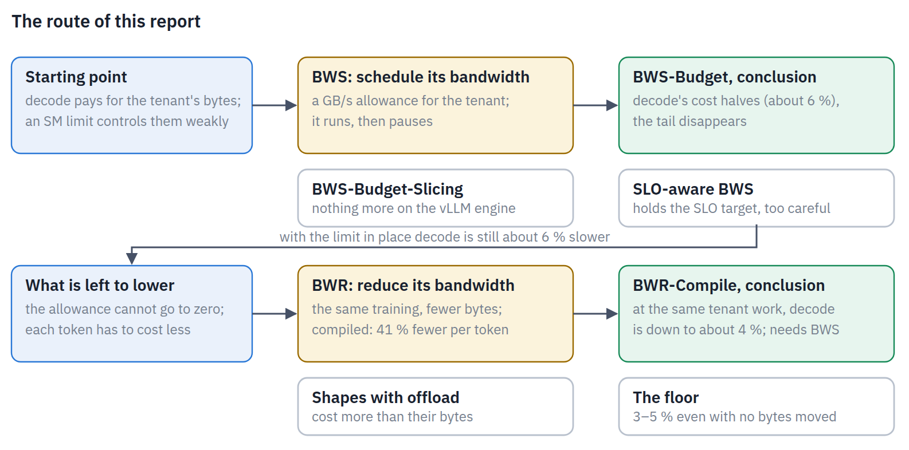

*图 1 — 这份报告的路线（`../coloc_adjust/diagrams/make_c1c2_figs.py`，下面各图同）。黄框是提出的方案，绿框是测到的结论，白框是顺着查下去的问题。
两个想法是同时提出的；先讲 BWS，因为 BWR 只能在 tenant 进度相同时比较。*

## 总览：做了什么，哪个方法最好

这一节的数字全部来自 vLLM 服务（接真实请求），0.5 / 1 req/s 两档，和同一个引擎没有 tenant 时比。细节在第 3 到 6 节。

### 第一层：三个部分，各改什么

目标只有一个：tenant 照常训练，decode 尽量不变慢。

- **带宽调度（BWS，bandwidth scheduling）** 管的是 tenant 什么时候用显存通道、用多少。tenant 的计算方式不变，从外面
  给它一个字节额度。
- **SLO-aware BWS** 不从额度出发，而从 decode 的 SLO 出发：目标是「decode 最多慢百分之几」，带宽调度是守住这个目标的
  方法。它要对比的是之前那个同样看 SLO、但用 tok/s 上限来限制的方法。
- **带宽削减（BWR，bandwidth reduction）** 改的是 tenant 怎么算，让同样的训练需要更少的带宽。

BWS 和 BWR 可以叠加。SLO-aware BWS 架在 BWS 之上。

### 第二层：具体方法

| 属于 | 方法 | 具体做法 | 小节 |
|---|---|---|---|
| BWS | **BWS-Budget** | tenant 只用 32 个 SM，平均每秒最多搬 50 GB。它算完一步就歇，歇到平均不超额 | 3.1–3.4 |
| BWS | **BWS-Budget-Slicing** | 同一个额度。不等一步算完，在一步中间每算几毫秒就歇一下 | 3.5 |
| SLO-aware | **SLO-aware BWS** | 额度不固定。VRAM scheduler 盯着 decode 实测的 TPOT 慢慢调它，朝 SLO 目标走（decode 最多慢 15 %，或最多慢 5 %）。tenant 的行为和 BWS-Budget 一样 | 4 |
| SLO-aware | 之前的 SLO 方法（`tpot_slo15`、`tpot_slo5`） | SLO-aware BWS 的对比对象：tenant 用全部 SM，只受一个 tok/s 上限限制，scheduler 按 TPOT 快速调这个上限 | 4 |
| BWR | **BWR-Compile** | `torch.compile` 把一串小算子合成少数几个，中间结果不再写进显存：每 token 少搬 41 % 的字节 | 5 |
| BWR | 改设置 | 换微批数、换 attention 的实现、只开梯度 checkpoint：没有省 | 5.3 |
| BWR | 输出层分块 | 手写的，想省掉输出层的大张量：多搬 214 %，设计错了 | 5.3 |

做带宽调度的三种方法只在两件事上不同：

| | 额度是多少 | 谁定 | tenant 歇在哪 |
|---|---|---|---|
| BWS-Budget | 50 GB/s，不变 | 人定 | 每步之后：约干 0.7 秒、歇 0.4 秒 |
| BWS-Budget-Slicing | 50 GB/s，不变 | 人定 | 一步中间：干 3.9 ms、歇 2.4 ms |
| SLO-aware BWS | 10–150 GB/s，会变 | VRAM scheduler，按 decode 的 TPOT 和 SLO 目标 | 每步之后 |

### 第三层：结果

| 方法 | decode 平均慢 | decode 的 TPOT p90 | tenant 进度，tok/s |
|---|---|---|---|
| 之前的 SLO 方法，目标 15 % | +12.2 / +11.0 % | +28 / +15 % | 3.8k / 4.0k |
| BWS-Budget | +5.6 / +6.3 % | +6 / +4 % | 3.5k / 3.7k |
| BWS-Budget-Slicing | +5.7 / +5.9 % | +6 / +4 % | 3.2k / 3.3k |
| SLO-aware BWS，目标 15 % | +5.5 / +6.2 % | +7 / +5 % | 3.7k / 4.2k |
| SLO-aware BWS，目标 5 % | +3.5 / +2.6 % | +4 / +0 % | 2.6k / 1.4k |
| **BWS-Budget + BWR-Compile** | **+4.3 / +4.0 %** | **+4 / +2 %** | 3.5k / 3.7k |

平均慢 = token 间隔的平均值；p90 是各请求 TPOT 的 p90。

### 第四层：哪个好，哪个不好，为什么

**最好：BWS-Budget 加 BWR-Compile。**
1. decode 平均只慢 +4.3 / +4.0 %，tenant 进度相同的方法里最小。
2. 没有长尾：p90 是 +4 / +2 %。
3. tenant 进度 3.5k / 3.7k tok/s，和单用 BWS-Budget 一样。

原因是两件事叠加：额度稳定，tenant 不会一阵全速；每个 token 搬的字节少了四成。

**好：单用 BWS-Budget。**
1. decode 平均慢 +5.6 / +6.3 %，是之前 SLO 方法的一半。
2. 长尾消失：p90 是 +6 / +4 %，之前是 +28 / +15 %。
3. tenant 进度差不多。

之前那个方法的上限在最低和最高之间来回摆，tenant 一阵接近停、一阵在全部 SM 上全速；全速那几段把 decode 拖得最慢。
BWS-Budget 的额度不动，tenant 又只有 32 个 SM，干的时候对 decode 的影响也温和。

**没有更好：BWS-Budget-Slicing。**
1. decode 平均和 BWS-Budget 一样。
2. 尾部也一样。
3. tenant 少做 9 %。

原因有三个。BWS-Budget 下 tenant 干的那一段本来就不重，没什么可摊匀的。最长的那 1 % token 间隔是引擎自己产生的：
其中 95 % 发生在另一个请求结束前后 30 ms 之内，没有 tenant 时的占比（1.1 %）和两种方法下（1.2 %）一样。少掉的 9 %
是时间表的缺陷，可以修（3.5 节）。

**SLO-aware BWS 对比之前的 SLO 方法**（同一个目标，15 %）。
1. decode 平均更小：+5.5 / +6.2 %，之前是 +12.2 / +11.0 %。
2. 尾部小得多：p90 是 +7 / +5 %，之前是 +28 / +15 %。
3. tenant 进度差不多：3.7k / 4.2k 对 3.8k / 4.0k tok/s。

目标 5 % 时，它是这里唯一守住目标的方法（TPOT 中位数 +3 / +4 %，p90 +4 / +0 %）；代价是 tenant 进度，只有
2.6k / 1.4k tok/s。和 BWS-Budget 比：目标 15 % 时没有多出好处（结果一样），目标 5 % 时 decode 的代价更低、训练更少。
它判断「decode 慢了多少」的方式偏高，把请求之间互相造成的变慢也算了进去，所以比要求的更保守。它和之前的方法有
三处同时不同（单位、步长、tenant 的 SM 数），没有逐个单独测（第 4 节）。

**不好：之前的 SLO 方法。** decode 平均慢 +12.2 / +11.0 %，尾部最差（p90 +28 / +15 %），tenant 进度却不比
BWS-Budget 多多少。

**BWR 里不好的：** 改设置没有省字节；输出层分块搬了三倍的字节，因为每算一块都要重读一遍输出层的权重。

两点提醒。每个方法在 vLLM 服务上只跑了一遍，1 个点左右的差别还不算确认。BWS-Budget-Slicing「没有更好」是当前这个
设置下的结论，不代表换一个设置也一样。

## 1. 出发点

| 之前测到的（报告 1、2） | 所以 |
|---|---|
| decode 的变慢跟着第二个任务搬的字节走：每 100 GB/s 慢 4–7 %；两个任务的流量加起来不超过 decode 单独时的用量 | 该管的量是 tenant 的字节 |
| tenant 从 96 个 SM 减到 8 个，它自己的速度降到约 1/7，对 decode 的伤害只降到约 1/4；8 个 SM 时每个 tenant token 最贵 | 少给 SM 是一个又弱又贵的办法 |
| tenant 歇着时 decode 回到基线（−1 到 +2 %）；它在跑时 decode 付全额的混跑代价 | 「干一阵歇一阵」按时间线性起作用 |
| 让上限大幅摆动的反馈环，0.5 req/s 时 TPOT p90 是 +28–29 %；上限固定时 p90 和中位数一样 | 额度要平稳 |
| 同样的 tok/s，tenant 不同形状对 decode 的代价最多差 7 倍 | tok/s 不是好单位；tenant 怎么算很重要 |
| decode 步和步之间没有空隙（只要有请求在跑，GPU 93–100 % 在忙） | 请求进行中没有可以让 tenant 躲进去的空闲 |

由此提出两个想法，11 月 15 日同时提出：

- **BWS，字节额度**：从外面限制 tenant，单位是 GB/s；让它在几十个 SM 上干一阵歇一阵来守住额度。
- **BWR，少搬字节的 tenant**：改 tenant 自己，让同样的训练在显存通道上的流量更少。

下面先讲 BWS，因为 BWR 只能在 tenant 进度相同时比较，而固定进度靠的就是 BWS。

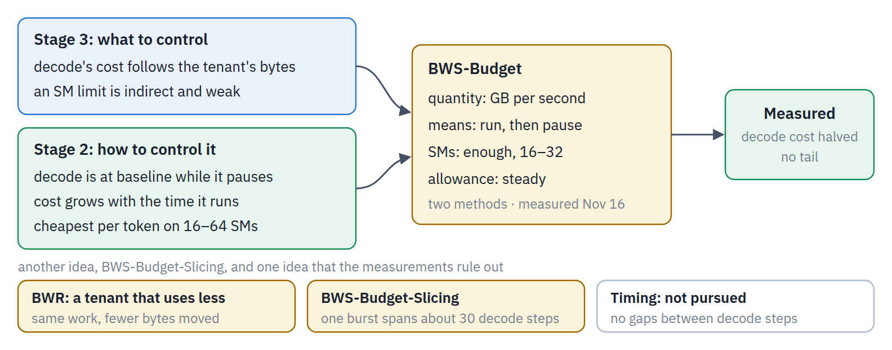

*示意图 1 — 从测量到两个想法（`../coloc_adjust/diagrams/15_measurements_to_ideas.svg`）。*

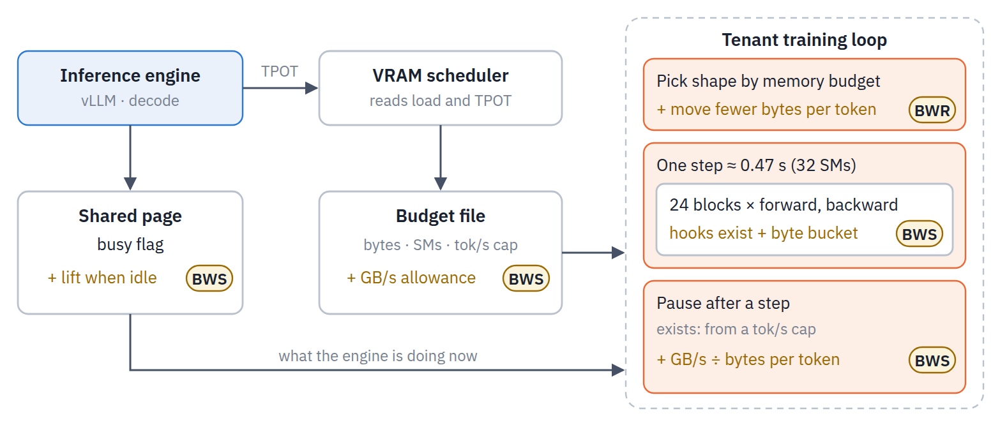

*示意图 2 — 每个想法接在原型的哪一处（`../coloc_adjust/diagrams/11_next_steps_attach.svg`）。两者都只改 tenant
自己的循环和两个共享文件里的字段；不改驱动，不拦截 CUDA 调用，推理引擎不用改。*

## 2. 怎么测的

两个实验台，在两张卡上同时跑。**vLLM 服务**是真正的推理引擎，接真实请求；哪个方法更好，以它为准。**模拟 decode**
是一个小程序，循环重放 decode 的一步，不接请求；它用来看机制，对每个请求的延迟和尾部给不出可靠的结论。

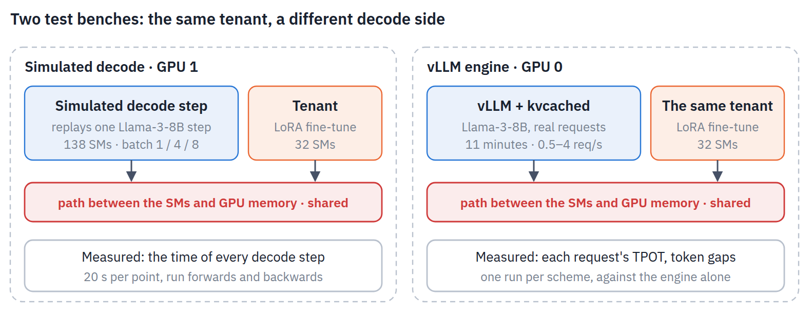

*图 2 — 两个实验台。两边的 tenant 是同一个进程；decode 这一边，一个是重放的一步，一个是vLLM 服务。*

| | 模拟 decode（GPU 1） | vLLM 服务（GPU 0） |
|---|---|---|
| decode | 一个进程按 Llama-3-8B 的形状重放 decode 的一步（读一遍 15 GB 权重），批大小 1、4、8 | vLLM 0.30 + kvcached 跑 Llama-3-8B，前面是报告 1 的 router 和 VRAM scheduler |
| tenant | 真的 LoRA 微调（Qwen2.5-0.5B，一步 8 条序列 × 512 个 token），和 GPU 0 上是同一份代码 | 同一个 tenant |
| 共用方式 | 两个进程通过 MPS 共用，各在自己的 green context 上，SM 不重叠（例如 tenant 32 个，decode 138 个） | MPS；tenant 在一个 32 个 SM 的 green context 上 |
| 负载 | 每个点固定批大小，跑 20 秒；每组点正着、倒着各跑一遍 | 11 分钟的参考时间线，0.5–4 req/s 分段 |
| decode 的指标 | 每一步的时间（每步后放一个 CUDA 事件），平均和 p90；和同样 SM 数下 decode 单独跑比，单独跑在开头、两遍之间和结尾各测一次 | 从请求日志算：token 间隔的平均值，和每个请求的 TPOT（中位数、p90）；和同一晚、同一到达率下引擎单独跑比 |
| 重复 | 两遍最多差 0.2 个点 | 每个 scheme 一遍 |

两张卡都限 500 W。比较之前先做了三项检查：

- **机器和 11 月 9 日一致。** decode 单独，批大小 1 / 4 / 8 时每步 11.69 / 13.44 / 15.85 ms（11 月 9 日
  11.68 / 13.39 / 15.80）；tenant 单独，8 / 16 / 32 个 SM 上 3,493 / 6,518 / 11,582 tok/s。按步计时和按整段
  墙钟计时相差 0.05 %。
- **引擎和 11 月 9 日一致。** 引擎单独：0.5 / 1 / 2 req/s 时 TPOT 中位数 12.0 / 12.7 / 16.4 ms（11 月 9 日
  12.0 / 12.6 / 16.3）。两个旧 scheme 当晚重跑作对照，和 11 月 9 日的结果相差 2 个点以内。
- **带宽计数器。** NVML 的显存带宽读数（GPM）是整张卡的，只有一个任务单独跑时才等于它自己的流量。
  用 decode 已知的读取量标定：1 % = 17.79 GB/s（30 个点，误差中位数 0.5 %）。

**同样的 tenant 进度。** BWS 和 BWR 的每个对比都固定 tenant 的 tok/s；否则 decode 少慢，可能只是因为训练少了。
做法：先跑参照设置，把它实际的 tok/s 作为同一组里其他设置的上限，tenant 超前了就歇。表里给的是实际量到的
tok/s。

## 3. 带宽调度（BWS）

### 3.1 BWS-Budget：方案

给 tenant 一个额度：平均每秒最多搬多少 GB。它全速干，额度用完就停，补上了再接着干。

- **用字节，不用 tok/s**：tenant 一换形状，tok/s 上限就要重调（各形状每 token 的代价最多差 7 倍）；字节额度不用。
- **几十个 SM，不是 8 个。** 少给 tenant SM，decode 确实慢得少，但 tenant 自己的进度掉得更快（11 月 9 日，
  模拟 decode，tenant 和 decode 的 SM 不重叠）：

  | tenant 的 SM | tenant 进度，tok/s | decode 变慢（1 / 4 / 8 个请求） | decode 剩下的 SM |
  |---|---|---|---|
  | 8 | 2.4–2.9k | +5.4 / +7.5 / +6.4 % | 162 |
  | 16 | 4.5–5.3k | +6.4 / +9.1 / +9.9 % | 154 |
  | 32 | 8.0–9.4k | +9.7 / +15.3 / +14.4 % | 138 |
  | 64 | 13.2–15.2k | +17.4 / +19.5 / +22.4 % | 106 |
  | 96 | 18.5–19.2k | +24.7 / +29.1 / +26.6 % | 74 |

  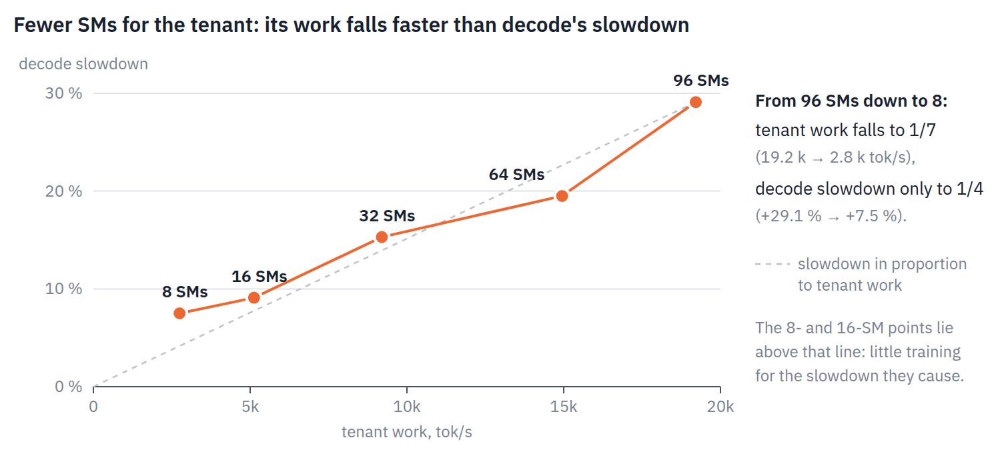

  *图 3 — 上表 4 个请求时的各行。虚线是「decode 的变慢和 tenant 的进度成比例下降」时的位置。*

  8 个 SM 时 decode 的变慢是五行里最小的。但这时 tenant 只做 96 个 SM 时七分之一的活，decode 的变慢却还剩
  四分之一。所以要做同样多的训练，8 个 SM 是最贵的设置：用变慢除以 tenant 的进度，8 个 SM 是每 1k tok/s
  2.2–2.7 %，16 个是 1.4–1.9 %，32 到 96 个是 1.2–1.7 %。另一头，从 64 个 SM 起 decode 自己开始缺 SM：它单独跑在
  剩下的 106 或 74 个 SM 上，就已经比用全部 170 个慢 2–7 % 或 2–14 %。所以给 32 个 SM，再用时间来压。
- **在步与步之间歇**，因为 tenant 歇着时 decode 回到基线。

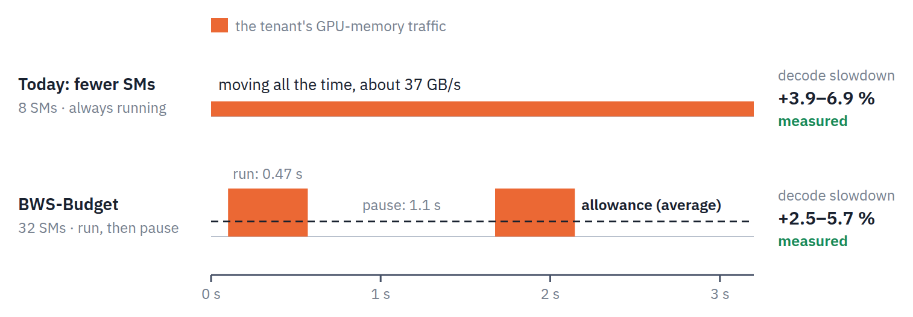

*示意图 3 — tenant 进度相同（约 2.6k tok/s）时，BWS 和少给 SM 的对比，横轴 3.2 秒，按比例画
（`../coloc_adjust/diagrams/12_c1_budget.svg`）。条的高度是 tenant 此刻的流量；虚线是额度。右边的数字是
3.3 节模拟 decode在 1 / 4 / 8 个请求下的结果。*

### 3.2 BWS-Budget：实现

1. **预算文件加一个 GB/s 字段。** VRAM scheduler 原来就在 `/dev/shm/coloc_ft_budget` 里发布 tenant 的显存
   预算、SM 数和 tok/s 上限；现在多写一个 `gbps`（`controller.py --gbps-fixed`）。当晚用 50 GB/s：scheduler 一直写同一个数，不看 TPOT，
   也不调它。
2. **tenant 自己换算。** tenant 用额度除以当前形状的每 token 字节（`pacing.py`：
   `cap_tok_s = gbps × 1000 / 每 token MB`），每 token 字节表是在 GPU 上量的（5.3 节）。原来的形状每 token
   13.47 MB，所以 50 GB/s 约等于 3.7k tok/s。tenant 换形状时，上限跟着变。
3. **干一阵，歇一阵。** tenant 跑在一个预建的 32 个 SM 的 green context 上。它全速算完一步（4,096 个 token，
   约 0.5 秒），然后睡到这一步的平均速度回到上限以内：大约干 0.5 秒、歇 0.6 秒。停顿原来就有，以前按 tok/s
   上限算。

**「固定 50 GB/s」是什么意思。** tenant 在跑的时候，没有东西在测量它搬了多少字节，也没有硬件在强制这个额度：
整卡的计数器分不开 tenant 和 decode 的流量。是 tenant 按事先量好的每 token 字节自己记账。额度是上限，不是
保证：一种做不到 50 GB/s 的形状，就停在它以下。

和报告 1 相同的部分：tenant 仍然服从显存预算，decode 要回显存时沿形状阶梯往下退，≥ 3 req/s 时完全暂停。

### 3.3 BWS-Budget：测量

**模拟 decode：同样的 tenant 进度，不同的限法。** 参照是 tenant 在 8 个 SM 上放开跑（旁边 1 / 4 / 8 个请求时
2.4 / 2.8 / 2.9k tok/s）；其他设置都限到这个进度。

| 同样的 tenant 进度，限法 | decode 平均（1 / 4 / 8 个请求） | 单步 p90 |
|---|---|---|
| 8 个 SM，一直跑 | +3.9 / +6.9 / +5.9 % | +5.4 / +7.9 / +8.2 % |
| **32 个 SM，每步之后歇（BWS）** | **+2.5 / +5.7 / +5.5 %** | +5.8 / +11.8 / +11.0 % |
| 全部 SM 共用，每步之后歇 | +4.6 / +7.0 / +6.5 % | +12.7 / +20.0 / +19.0 % |

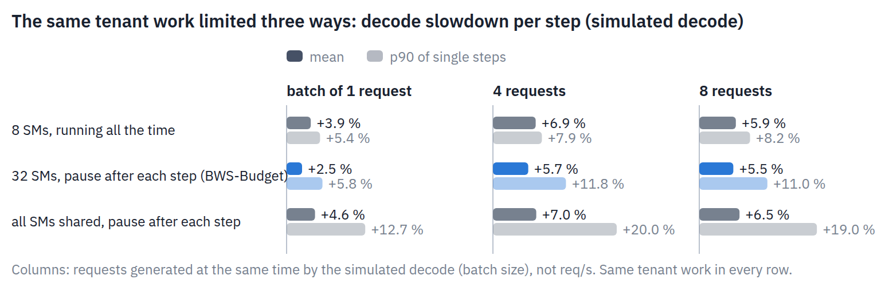

*图 4 — 上表。蓝色是 BWS。各栏是模拟 decode 同时在生成的请求数（批大小），不是到达率。*

另一组以 16 个 SM 的 tenant 为参照（4.5–5.3k tok/s），顺序相同：16 个 SM 一直跑 +4.7 / +9.6 / +8.7 %，
32 个 SM 加停顿 +4.5 / +8.7 / +8.4 %。

- 每种批大小下 BWS 都比 8 个 SM 便宜，差距大于两遍之间的波动，但只有 0.4–1.4 个点。
- **差距小的原因：4 和 8 个请求时，歇着并不免费。** tenant 在干时，decode 慢 +8.1 / +14.0 / +13.5 %，
  和 tenant 放开跑一样。tenant 歇着时，1 个请求下 decode 只慢 +0.7 %，4 和 8 个请求下仍慢 +3.0 / +2.7 %。
  在同一批日志里查过并排除了三种原因：功率上限（时钟只比 decode 单独时低 0.5 %，平均 475 W）；每次突发后的
  恢复（tenant 停下后 50 ms 和 1 秒时偏差一样）；多了一个空闲进程（旁边放一个空闲任务时 decode 和单独一样）。
  原因未知。
- 全部 SM 共用再加停顿（原来按延迟反馈的 scheme 就是这样）不比 8 个 SM 便宜，尾部最差。

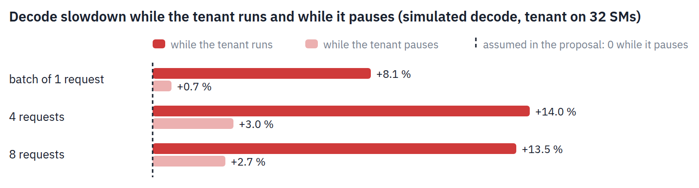

*图 5 — 把 decode 的每一步按「当时 tenant 在干还是在歇」分开统计（32 个 SM，每步之后歇）。方案里假设歇着时为 0。*

**vLLM 服务：固定 50 GB/s，跑完整的 11 分钟。** 对照是 `tpot_slo15`，报告 1 里最好的限速 scheme。15 % 是它的
目标：允许 decode 的 TPOT 比引擎单独时高 15 %。它的 tenant 共用全部 SM，唯一的限制是一个 tok/s 上限。
VRAM scheduler 每 2 秒拿最近 10 秒的 TPOT 中位数和目标比，把上限乘上一个系数，一步最小乘 0.5、最大乘 1.5，
范围 500–20,000 tok/s；从最高调到最低大约只要 12 秒。它的 tenant 进度和 BWS 接近，可以直接比。

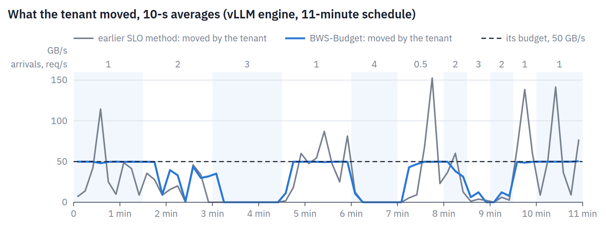

*图 6 — 两种 scheme 下 tenant 实际搬的字节，每 10 秒一个点：这 10 秒里做完的 token 数 × 所用形状的每 token MB
（来自 tenant 自己的日志；不是计数器的读数，计数器分不开两个任务）。浅色竖带是时间线的各阶段，上面是到达率。*

- **BWS 下，tenant 能干的时候贴着 50 GB/s**（0.5 和 1 req/s 的各阶段里，每个 10 秒窗口都是 48–50 GB/s）。
  一个窗口之内，它是干约 0.5 秒、歇约 0.6 秒。
- **它不是一条直线。** 2 req/s 时显存紧，tenant 退到更慢的形状，做不到额度（1–44 GB/s）。3 和 4 req/s 时它
  没有显存可用，停着；对照下也一样。
- **对照下，tenant 在 0 和 150 GB/s 之间摆**，有活干的窗口里中位数是 31 GB/s。整段算下来，两个 tenant 做的
  训练差不多一样多。

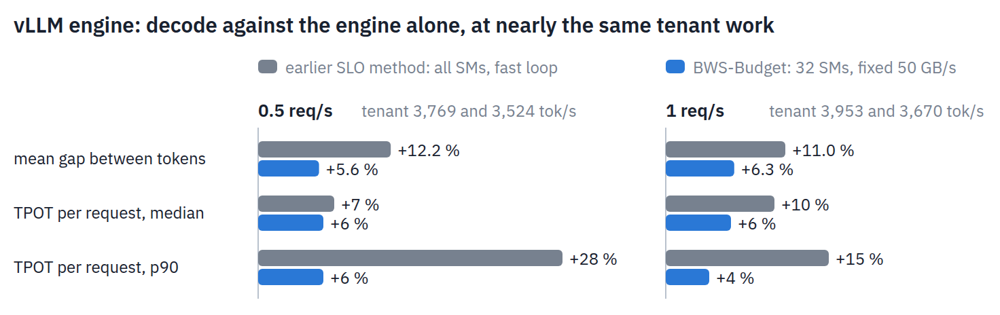

*图 7 — decode 和引擎单独时相比，0.5 和 1 req/s。*

| scheme，0.5 / 1 req/s | tenant tok/s | token 间隔平均 | 每 1k tenant tok/s | TPOT 中位数 | TPOT p90 |
|---|---|---|---|---|---|
| `tpot_slo15`：快反馈，全部 SM（对照） | 3,769 / 3,953 | +12.2 / +11.0 % | 3.2 / 2.8 % | +7 / +10 % | +28 / +15 % |
| `green_dyn2`：按负载给 16–96 个 SM（对照） | 11,468 / 9,154 | +13.4 / +13.8 % | 1.2 / 1.5 % | +14 / +15 % | +16 / +13 % |
| **`c1_fix`：32 个 SM，固定 50 GB/s** | 3,524 / 3,670 | **+5.6 / +6.3 %** | 1.6 / 1.7 % | +6 / +6 % | **+6 / +4 %** |

### 3.4 BWS-Budget：结论

tenant 进度相同时，32 个 SM 上的字节额度让 decode 的代价减半，并消掉了快反馈环的长尾：p90 落在中位数附近。
对照 `green_dyn2` 的训练量是三倍，代价约两倍；按每个 tenant token 算和 BWS 差不多便宜，但它不能把 decode 守在
一个目标附近。BWS 比「8 个 SM 一直跑」省得比预期少，原因是 tenant 歇着时 decode 没有完全回到基线。

### 3.5 BWS-Budget-Slicing：同一个额度，在一步里面切片

**方案。** 每步之后歇时，tenant 一次突发约 0.47 秒，盖住约三十个 decode 步（每步 12–18 ms），这些步都被拖慢，
其余的不受影响。把同样的活切成比一个 decode 步还短的片，应当能把慢摊匀：平均不变，单步的尾部变小。

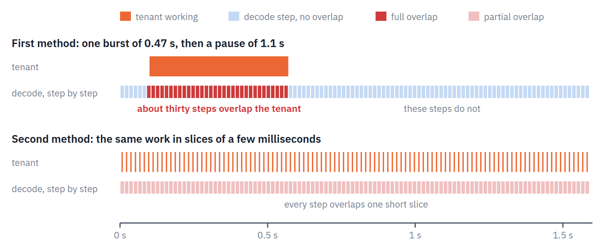

*示意图 4 — 每步之后歇和在步内歇，按单个 decode 步的尺度画（`../coloc_adjust/diagrams/16_c1_finer.svg`），横轴 1.6 秒。*

**实现。** tenant 的模型有 24 个 block，每个 block 的前向和反向之前原来就各有一个钩子：一步里有 192 个
可以停的位置，在 32 个 SM 上平均每 2.4 ms 一个。每过 N 个 block，钩子先等 GPU 把已经提交的 kernel 跑完
（CUDA 事件同步），再睡到额度允许的时刻。迟到的片会重新起算，丢掉的时间不补。输出层、loss 和优化器更新
不在 block 里，切不到。测了每 1、8、48 个 block 一片。

**测量。**

| 和 3.3 节同样的 tenant 进度，32 个 SM | decode 平均（1 / 4 / 8 个请求） | 单步 p90 |
|---|---|---|
| 每步之后歇 | +2.5 / +5.7 / +5.5 % | +5.8 / +11.8 / +11.0 % |
| 每 48 个 block 一片 | +2.5 / +5.8 / +5.5 % | +5.7 / +11.8 / +11.0 % |
| 每 8 个 block 一片 | +2.6 / +5.9 / +5.6 % | +5.5 / +10.3 / +9.1 % |
| **每 1 个 block 一片（约 2.4 ms）** | +2.6 / +5.8 / +5.5 % | **+2.2 / +5.5 / +5.2 %** |

- 模拟 decode上有效：每 1 个 block 一片时，单步 p90 降到平均值。tenant 在跑时慢 5 %，实际进度比上限低 4.4 %；
  同步本身让它慢不到 1 %（tenant 单独、每个 block 后同步一次：11,510 对 11,582 tok/s）。
- 所有 32 个 SM 的设置里，单步 p99 都是 +26–32 %，和怎么歇无关。可能来自切不到的那一段（输出层、loss、
  优化器），没有验证。

vLLM 服务上（`c1_fine`，每 1 个 block 一片，其余和 `c1_fix` 相同）：

| 0.5 / 1 req/s | tenant tok/s | token 间隔平均 | TPOT 中位数 | TPOT p90 | 单个 token 间隔的 p90 |
|---|---|---|---|---|---|
| `c1_fix` | 3,524 / 3,670 | +5.6 / +6.3 % | +6 / +6 % | +6 / +4 % | +8.2 / +14.7 % |
| `c1_fine` | 3,195 / 3,348 | +5.7 / +5.9 % | +6 / +6 % | +6 / +4 % | +7.9 / +14.3 % |

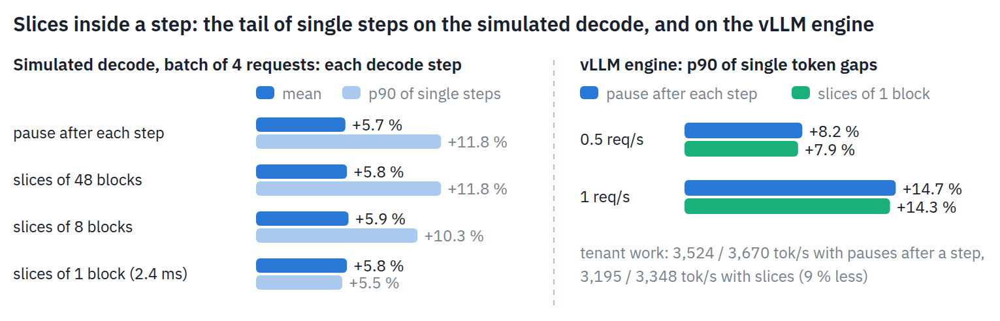

*图 8 — 左：模拟 decode，4 个请求；右：vLLM 服务。*

**结论。** vLLM 服务上切片看不出变化：每请求 TPOT 完全一样，单个 token 间隔的尾部没变，tenant 还少了 9 % 的
token。在这个额度下，引擎 token 间隔的尾部不是 tenant 的突发造成的。保留每步之后歇的做法。

## 4. SLO-aware BWS：目标是 SLO，方法是带宽调度

**方案。** BWS-Budget 并不知道 decode 慢了多少：它的 50 GB/s 是我选的一个数。SLO-aware 的方法从另一头出发：输入是
目标，「decode 的 TPOT 最多比引擎单独时高百分之几」，然后去调 tenant，直到目标达到。项目里原来就有这样一个方法，
报告 1 的 `tpot_slo15` 和 `tpot_slo5`：它在全部 SM 上用一个 tok/s 上限压住 tenant，而且调得很猛，tenant 被推得一阵
接近停、一阵接近全速，它的长尾就是这么来的。SLO-aware BWS 保留 SLO 目标，换掉被调的东西：32 个 SM 上的字节额度，
每次只调一点。

| | 之前的 SLO 方法（`tpot_slo15`、`tpot_slo5`） | SLO-aware BWS（`c1_slow15`、`c1_slow5`） |
|---|---|---|
| 看什么 | 最近 10 秒的 TPOT 中位数，和 SLO 目标比 | 一样 |
| 多久调一次 | 每 2 秒 | 每 2 秒 |
| 调的是什么 | tenant 的 tok/s 上限，500–20,000 | tenant 的字节额度（GB/s），10–150 |
| **一步最多调多少** | 乘 0.5 或乘 1.5 | **±10 %** |
| **从最高调到最低** | 约 12 秒 | **约 50 秒** |
| tenant 的 SM | 全部，共用 | 32 个 |
| 引擎里没有请求时 | 不特殊处理 | 发布上限值；环自己的值留着，下一个请求来时接着用 |

**实现。** `controller.py --slo-mode slow`。改的只是 VRAM scheduler 里的反馈环；tenant 和 BWS-Budget 时一样，读到
多少 GB/s 就按多少记账：全速算完一步，然后歇。跑了两个目标：decode 最多慢 15 %，和最多慢 5 %。

反馈环每 2 秒做一遍：

1. 取最近 10 秒里完成的请求的 TPOT 中位数。
2. 取一个参照：当前到达率下引擎单独跑时的 TPOT，来自没有 tenant 的那次运行。
3. decode 的变慢 = 前者除以后者再减一。误差 = 变慢减去目标（0.15 或 0.05）。
4. 额度乘上 `exp(−4 × 误差)`，这个系数一步限制在 0.9 到 1.1 之间，额度保持在 10–150 GB/s 之内。起始值是
   150 GB/s。最近 10 秒没有请求完成时，额度保持不变。
5. 引擎里没有请求时，发给 tenant 的是 150 GB/s；环自己的值留着，下一个请求来时再发出去。

**测量**（vLLM 服务，0.5 / 1 req/s；之前的方法在 5 % 目标下用的是 11 月 9 日的运行，11 月 16 日没有重跑，所以没有算它的
token 间隔平均值）：

| SLO 目标 | 方法 | tenant tok/s | token 间隔平均 | TPOT 中位数 | TPOT p90 |
|---|---|---|---|---|---|
| 15 % | 之前的 SLO 方法（`tpot_slo15`） | 3,769 / 3,953 | +12.2 / +11.0 % | +7 / +10 % | +28 / +15 % |
| 15 % | **SLO-aware BWS**（`c1_slow15`） | 3,686 / 4,167 | **+5.5 / +6.2 %** | +6 / +7 % | **+7 / +5 %** |
| 5 % | 之前的 SLO 方法（`tpot_slo5`，11 月 9 日） | 3.8k / 1.2k | – | +7 / +3 % | +28 / +4 % |
| 5 % | **SLO-aware BWS**（`c1_slow5`） | 2,622 / 1,442 | **+3.5 / +2.6 %** | +3 / +4 % | **+4 / +0 %** |

反馈环给出的额度，按阶段的中位数：目标 15 % 时 36–60 GB/s（最后一个阶段 113）；目标 5 % 时，0.5 req/s 是 21 GB/s，
1 req/s 是 10–16 GB/s。

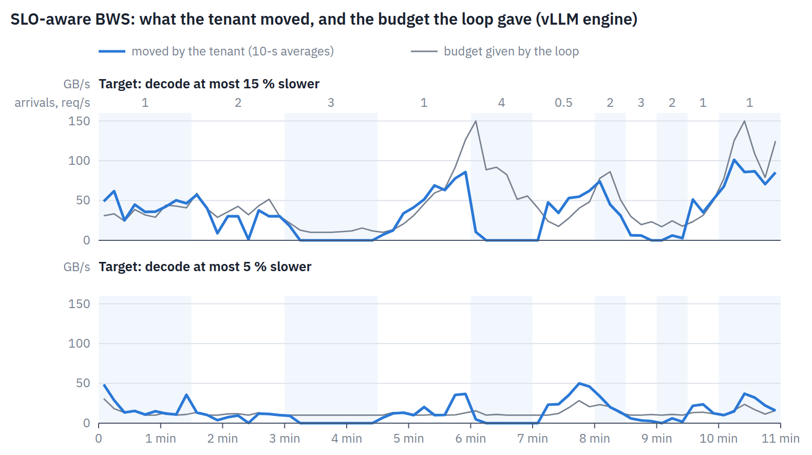

*图 9 — 两个目标下，tenant 实际搬的（蓝线，每 10 秒一个点，算法同图 6）和反馈环当时给出的额度（灰线）。*

- **tenant 实际搬了多少。** 目标 15 % 时，0.5 和 1 req/s 的各阶段大多是 25–100 GB/s，平均和固定额度给的差不多。
  目标 5 % 时，1 req/s 大多是 10–15 GB/s，0.5 req/s 是 23–50 GB/s。蓝线有时高过灰线：引擎里没有请求时发布的是
  上限值，tenant 趁这个空全速干一阵。
- **+5 % 的目标守住了**，两档负载都是。快反馈环守不住（11 月 9 日 `tpot_slo5` 在 0.5 req/s 时是 +11.2 %）。
  代价是 tenant 的进度：1 req/s 时额度一直贴着 10 GB/s 的下限。
- **目标 +15 % 时，环比要求的更保守**：decode 只慢 +5.5 / +6.2 %，tenant 也没有比 `tpot_slo15` 多干。原因在
  误差信号：它拿 10 秒的 TPOT 中位数和估计到达率下引擎单独时的 TPOT 比，而只要请求有重叠，TPOT 本来就高，
  环把这也算到了 tenant 头上。

**结论。** 慢慢调的额度能守住严格的目标，而且没有长尾，但它的误差信号偏高。目标宽松时，固定额度效果一样。
更好的参照（同样的在跑请求数下引擎单独的 TPOT）还没有试。

## 5. 带宽削减（BWR）：BWR-Compile，编译版 tenant

### 5.1 方案

有了 BWS，tenant 在 3.5–3.7k tok/s 时 decode 仍慢约 6 %。tenant 进度固定时，要再往下降，只能让每个 token
少搬字节。BWR 改的是 tenant 的计算方式；衡量标准是**同样的 tenant 进度下 decode 慢多少**。一个只是跑得更快的
tenant 会把同样的带宽占满，所以 BWR 需要 BWS 在旁边。

**字节花在哪。** 上 GPU 之前，先在 CPU 上把一个微批（2 × 512 个 token）按算子拆开数
（`../coloc_adjust/tenant_inventory.py`、`../coloc_adjust/results/tenant_inventory.md`），假设每个算子从显存读
输入、把输出写回显存。权重占 12 %；**88 % 是中间结果**，一个算子写出来，下一个再读回去。逐元素的乘法和加法占
37 %；输出层（15 万词表上的 logits，一个微批 297 MB）约占五分之一。反向传播约占总数的 60 %。这是数出来的，
不是量的；5.3 节在 GPU 上量了。

### 5.2 实现

三类不改变训练内容的手段，按改动从小到大，都是 `ft_worker.py` 的开关：

| | 手段 | 训练变不变 | 开关 |
|---|---|---|---|
| 1 | 在 tenant 已有的形状里选（微批数、offload） | 不变 | 形状阶梯 |
| 2 | 改设置：微批数、attention 的实现 | 不变 | `--attn` |
| 3 | 合并算子，让中间结果留在 SM 里：`torch.compile`；手写的输出层和 loss 分块算（`loss_chunk.py`） | 不变 | `--compile`、`--loss-chunk 16` |

**`torch.compile` 改了什么。** 不编译时，PyTorch 一个算子一个算子地执行：每个算子是一个 kernel，从显存读
输入，把一个完整大小的结果写回显存，下一个算子再把它读出来。编译时，前向和反向先各记成一张计算图，一串
逐元素算子被生成为一个 kernel：读一次输入，中间值留在寄存器里，只写最后的结果。矩阵乘法仍交给原来的库。
编译器还决定哪些中间结果要存下来给反向用，便宜的就不存、到时重算。

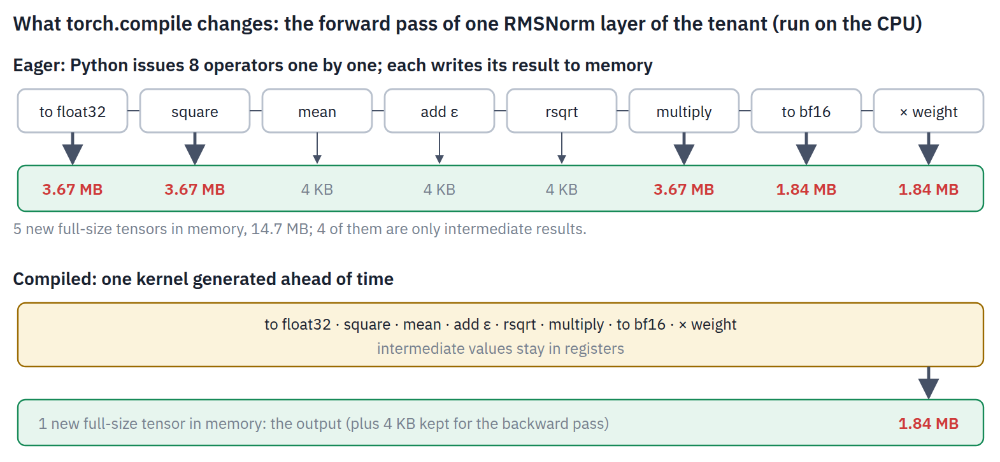

*图 10 — tenant 的一层 RMSNorm 的前向，不编译和编译。粗箭头表示写出一个和激活一样大的张量。*

用 tenant 的一层在 CPU 上演示（`../coloc_adjust/compile_demo.py`；一个微批 2 × 512 × 896 的 RMS 归一化）：

| 一层 RMSNorm，一个微批 | 不编译 | 编译 |
|---|---|---|
| 前向 | 8 个算子；写 5 个完整大小的张量，14.7 MB | 1 个生成的 kernel；写 1 个张量，1.84 MB |
| 反向 | 约 20 个算子，写约 35 MB | 1 个生成的 kernel；写 1 个张量，1.84 MB |
| 为反向存下来的 | 几个完整大小的张量 | 1,024 个数（4 KB）；其余从输入重算 |
| 输入的梯度 | – | 在 bf16 舍入之内相同（最大差 0.004，最大值 1.35） |

CPU 上生成的代码不是 GPU 上跑的代码，但合并的是同一批算子。5.3 节那 41 % 在归一化、LoRA 分支、激活函数、
输出层之间怎么分，没有测。

当晚发现的限制：编译一个形状约 34 秒，运行中途第一次遇到某个形状时，tenant 在一步里卡了 46 秒。所以编译版
tenant 在启动时把放得下的两种形状编译好，之后只用这两种，也就不跑带 offload 的形状，改为停。编译以后
block 钩子不再起作用，所以它只能在每步之后歇。

### 5.3 测量，tenant 这一边：每 token 字节

tenant 单独跑在 32 个 SM 上，每种做法约 43 秒；计数器读到它的流量，除以它的 tok/s。除了编译版，还量了
5.2 节表里的其他做法，以及一个不训练、只做前向的下限。

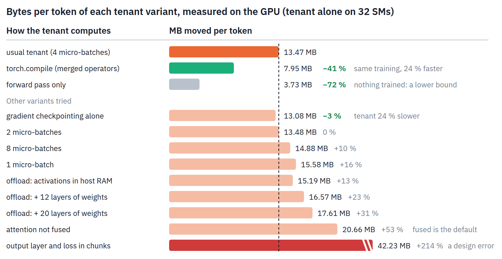

*图 11 — 每种做法的每 token 字节。虚线是原来的 tenant；最后一条被截短了（42.23 MB）。*

| tenant | 每 token MB | 和原来比 | tok/s | 训练变不变 |
|---|---|---|---|---|
| 原来的形状，4 个微批 | 13.47 | – | 11,628 | – |
| **`torch.compile`** | **7.95** | **−41 %** | 14,457 | 不变 |
| 1 / 2 / 8 个微批 | 15.58 / 13.48 / 14.88 | +16 / 0 / +10 % | 14,543 / 13,416 / 9,579 | 不变 |
| 只开梯度 checkpoint | 13.08 | −3 % | 8,857 | 不变 |
| 带 offload 的形状：中间结果、再加 12 层、20 层权重放主机内存 | 15.19 / 16.57 / 17.61 | +13 / +23 / +31 % | 3,246 / 2,566 / 2,364 | 不变 |
| 不融合的 attention（`eager`） | 20.66 | +53 % | 10,096 | 不变 |
| 输出层和 loss 每 16 个位置一块 | 42.23 | +214 % | 7,706 | 不变 |
| 只做前向（下限） | 3.73 | −72 % | 25,010 | 不训练 |

- **不改变训练又省字节的做法，只有 `torch.compile`**：每 token 少 41 % 的字节，tenant 自己还快 24 %。它进入
  decode 这一边的测试。
- **只做前向时每 token 搬 3.73 MB。** 它不训练，放在这里当下限：原来的 tenant 约七成的字节来自反向传播。
- **改设置没有收益。** 换微批数是 0 到 +16 %；只开梯度 checkpoint 是 −3 %，tenant 自己慢 24 %；不融合的
  attention 是 +53 %，说明融合的 attention 已经省掉了一大块。
- **输出层分块是我设计上的错误。** 每算一块都要把 272 MB 的输出层权重整个重读一遍，一个微批读 64 次，字节变成
  三倍。真正有用的是每个微批只读一遍输出层权重、同时不把 logits 写进显存；没有做。
- **CPU 上数的数不准**：1 个微批的方向数反了（数出来 −9 %，量到 +16 %）。
- 带 offload 的形状在跑时每秒只搬 42–49 GB；快形状在同样 32 个 SM 上是 143–181 GB/s。

### 5.4 测量，decode 这一边：模拟 decode

tenant 在 32 个 SM 上，模拟 decode 在其余 138 个上。原来的 tenant 放开跑；编译版本身跑得更快，
限到同样的 tok/s。

| tenant，都是 8.0 / 9.2 / 9.4k tok/s | 1 个请求 | 4 个 | 8 个 | 每 1k tok/s |
|---|---|---|---|---|
| 原来的 | +8.1 % | +13.9 % | +13.7 % | 1.02 / 1.51 / 1.46 % |
| `torch.compile` | +5.3 % | +9.7 % | +9.2 % | 0.66 / 1.06 / 0.99 % |

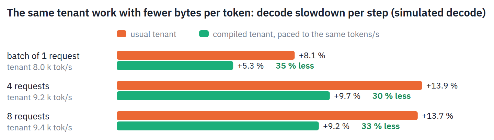

*图 12 — 上表。*

- 同样的 tenant 进度下，decode 的变慢少了 30–35 %；每 token 字节少的是 41 %。
- 按 tenant 每秒搬的 GB（tok/s × 每 token MB）算，1 个请求时的三个设置（原来的放开跑、编译版放开跑、编译版限速）
  都在每 100 GB/s 慢 7.5–8.5 %。
- **放开跑时，编译版只是跑得更快。** 它多做三分之一的训练（1 个请求时 10.7k 对 8.0k tok/s），decode 是 +7.2 %，
  原来的 tenant 是 +8.1 %：省下的字节大半花在了多做的训练上。没有 BWS，BWR 变成的是更多训练，而不是更少伤害。

### 5.5 测量，decode 这一边：vLLM 服务

设置和 `c1_fix` 相同（32 个 SM，每步之后歇），tenant 限到 50 GB/s 对原来 tenant 换算出的 tok/s。所以编译版
实际只搬约 28–29 GB/s。

| scheme，0.5 / 1 req/s | tenant tok/s | token 间隔平均 | 每 1k tenant tok/s | TPOT 中位数 | TPOT p90 |
|---|---|---|---|---|---|
| `c1_fix`：原来的 tenant | 3,524 / 3,670 | +5.6 / +6.3 % | 1.6 / 1.7 % | +6 / +6 % | +6 / +4 % |
| **`c2a`：编译版 tenant** | 3,524 / 3,688 | **+4.3 / +4.0 %** | 1.2 / 1.1 % | +5 / +4 % | +4 / +2 % |

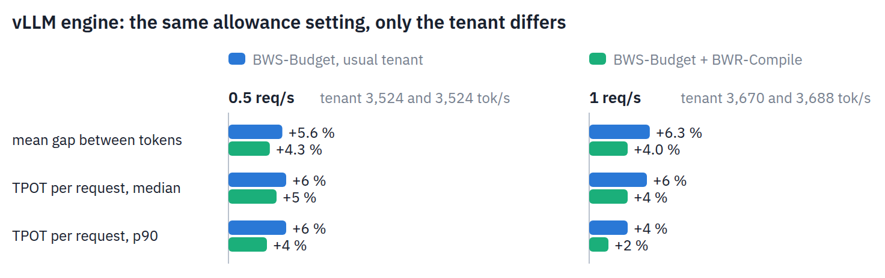

*图 13 — 上表。*

- 编译版只有 42–44 % 的时间在算，原来的要 54–62 %。
- 2 req/s 时显存紧，原来的 tenant 退到带 offload 的形状接着跑；编译版没有这种形状，只能停。它做 1,502 tok/s
  （原来 1,809），decode 慢 +2.5 %（原来 +7.3 %）。

### 5.6 结论

BWR 对编译版成立：同样的训练、同样的速度，vLLM 服务上 decode 少慢 1.3–2.3 个点，模拟 decode上少 30–35 %，训练内容
不变。改微批数或 attention 没有收益。BWR 需要 BWS 在旁边：不限制进度，更轻的 tenant 会把省下的字节花在更多的
训练上。

## 6. BWR 带出来的两个发现

### 6.1 带 offload 的形状，代价比它搬的字节高

形状阶梯（报告 1）靠把中间结果或权重放到主机内存来省显存。每种形状都在同一个 50 GB/s 额度、32 个 SM 下跑，
vLLM 服务 1 req/s，引擎 KV 上限 3 GiB，每种 120 秒，正反两遍，中间插三段没有 tenant 的窗口作基准。

| 形状 | 每 token MB | tenant tok/s | 在算的时间占比 | 在算时的 GB/s | decode，token 间隔平均 | 每 100 GB/s |
|---|---|---|---|---|---|---|
| 4 个微批 | 13.5 | 3,701 | 62 % | 80 | +6.0 % | 12 % |
| 8 个微批 | 14.9 | 3,321 | 75 % | 66 | +7.5 % | 15 % |
| 再加中间结果放主机内存 | 15.2 | 2,086 | 100 % | 32 | +10.0 % | 32 % |
| 再加 12 层权重放主机内存 | 16.6 | 1,818 | 100 % | 30 | +14.0 % | 46 % |
| 再加 20 层权重放主机内存 | 17.6 | 1,670 | 100 % | 29 | +13.0 % | 44 % |

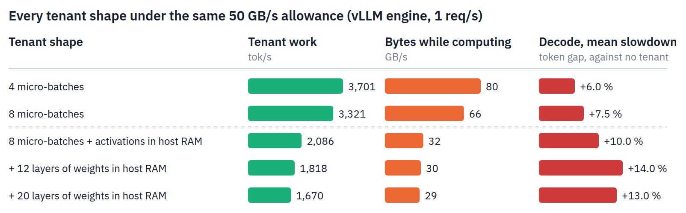

*图 14 — 上表；虚线以下是带 offload 的形状。*

带 offload 的三种形状只搬快形状四成的流量，decode 却慢得更多，交出的 token 只有一半：每个字节的代价是三到四倍。
它们一直在快形状能拿到的任何额度之下，所以字节额度没有正确地给它们计价。它们除了在 GPU 上搬字节，还在每个
block 都做主机内存和显存之间的拷贝，并启动很多小 kernel；decode 到底在为哪一样付出代价，没有测。同一种慢形状
的两遍最多差 4.5 个点，所以三种慢形状之间的顺序没有分清。**规则：挨着 decode 时不跑带 offload 的形状，改为停**
（编译版在 2 req/s 时就是这么做的）。

### 6.2 下限：不搬字节的任务

tenant 的字节怎么减，也低不过一个不搬字节的任务的代价。让一个只做算术的任务挨着模拟 decode 放开跑，在 32 个
或 8 个 SM 上，1 个和 8 个请求：一个 16 KB 的逐元素 kernel，以及 128、512、2304 阶的方阵相乘（工作集 0.2、3、
64 MB）。

| 第二个任务 | 每秒启动次数 | decode（1 / 8 个请求），任务在 32 个 SM | 任务在 8 个 SM | 功率、时钟（32 个 SM） |
|---|---|---|---|---|
| 16 KB 逐元素 | 9.5–12.4 万 | +4.8 / +3.8 % | +5.3 / +3.2 % | 435–451 W，时钟不变 |
| 128 阶方阵相乘 | 4.8–6.7 万 | +5.1 / +4.4 % | +5.3 / +3.3 % | 441–459 W，不变 |
| 512 阶 | 0.5–2.2 万 | +4.4 / +5.0 % | +2.6 / +6.9 % | 500 W，时钟 −2 到 −5 % |
| 2304 阶 | 100–600 | +5.7 / +10.2 % | +2.4 / +5.4 % | 500 W，时钟 −6 到 −7 % |

三个原因，各自单独看到了：

1. **kernel 启动。** 每秒约 10 万次只动 16 KB 的 kernel，让 decode 慢 3–5 %，时钟不变，功率没到上限。
2. **功率上限。** 32 个 SM 上做算术，整卡到 500 W，时钟降 2–7 %，decode 慢 4–10 %。8 个 SM 时到不了上限。
3. **共享缓存。** 8 个请求、工作集较大时，计数器读到的流量比 decode 自己的多 6–8 %；这时任务在 8 个 SM 上，
   时钟没变，启动次数很少，decode 仍慢 5–7 %。

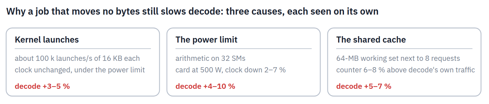

*图 15 — 三个原因，以及各自在什么情况下看到。*

所以下限不是一个数。合并 kernel（启动次数少，`torch.compile` 就有这个效果）和给功率留余量，也能把它降下来。

## 7. 结论

1. **tenant 应当按字节限制，给够 SM，靠停顿守额度。** 32 个 SM 上的固定 GB/s 额度，在 tenant 进度相同时让
   decode 的代价减半，p90 等于中位数。
2. **tenant 怎么算是第二个、独立的把手。** `torch.compile` 让每 token 字节少 41 %，同样进度下 decode 的代价
   再降 1.3–2.3 个点，训练不变。BWS + BWR 合起来，每 1k tenant tok/s 让 decode 慢 1.1–1.2 %；`green_dyn2` 是
   1.2–1.5 %，`tpot_slo15` 是 2.8–3.2 %；在所有训练的 scheme 里尾部最小。
3. **更精细的控制在这台引擎上没有回报。** 比 decode 步还短的切片在模拟 decode上消掉了单步的尾部，在vLLM 服务上
   没有变化；按 TPOT 调的额度能守住严格目标，但比要求的更保守。
4. **字节是代价的大部分，不是全部。** 4–8 个请求时停顿仍剩约 3 %；启动、功率上限和缓存让不搬字节的任务也有
   2–10 %；带 offload 的形状每字节贵三到四倍。

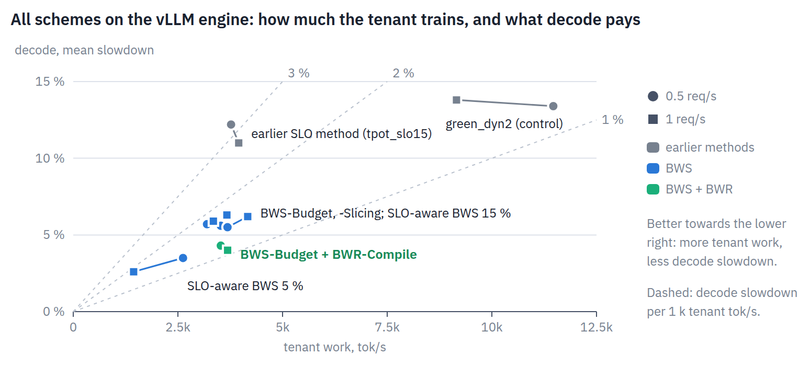

*图 16 — 当晚vLLM 服务上的所有 scheme：tenant 的进度和 decode 的平均变慢，每个 scheme 两个点（0.5 和 1 req/s）。
三条虚线是每 1k tenant tok/s 让 decode 慢 1 %、2 %、3 %。*

**由此支持的配置**：固定或慢慢调的 GB/s 额度；tenant 在 32 个 SM 上、每步之后歇、用编译版；挨着 decode 时不跑
带 offload 的形状。

**换成提案里的指标。** 按每个请求 TPOT ≤ 20 ms、TTFT ≤ 500 ms 两个目标（我暂定的，没有商定），0.5 和 1 req/s
时所有 scheme 的请求都达标；差别来自 2 和 3 req/s，3 req/s 时引擎单独也有三分之二的请求达不到。整条时间线上
每秒在两个目标之内服务的请求数：

| 引擎单独 | `tpot_slo15` | `green_dyn2` | `c1_fix` | `c1_fine` | `c1_slow15` | `c1_slow5` | `c2a` |
|---|---|---|---|---|---|---|---|
| 1.07 | 0.97 | 1.03 | 1.01 | 1.02 | 1.01 | 1.02 | 1.03 |

2 req/s 时达标的比例：引擎单独 91 %，`tpot_slo15` 78 %，`c1_fix` 82 %，`c2a` 和 `c1_slow5` 88 %。`c2a` 全程平均
训练 2.1k tok/s。

## 8. 已有工作

查了两次：11 月 9 日，约 25 篇，关于在同卡任务之间限制或调度显存带宽；11 月 15 日，关于改变邻居自己执行方式
的工作。「没找到」指在读过的部分里没找到。最后一列是读到哪：**正文**；**部分**（其余来自自动摘要）；
**摘要**（只看了摘要或 README）；标着**搜索**的来自第二次查找，由自动搜索完成，我没有重读。

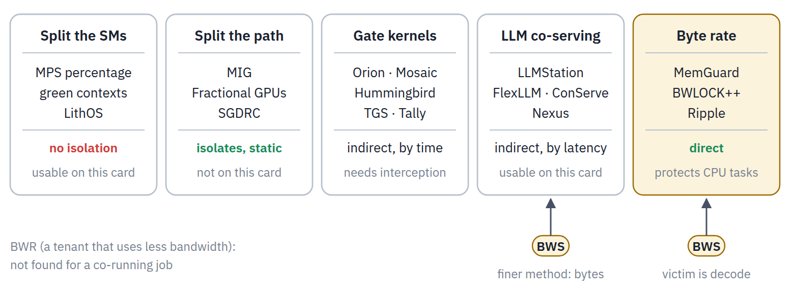

*示意图 5 — 已有工作按拧的旋钮分类（`../coloc_adjust/diagrams/14_related_work_map.svg`）。*

1. **分 SM 隔不开带宽**；Elvinger 等、Mosaic、Hummingbird、Ripple 都这么说，并给了数字，和报告 2 一致。
2. **能给带宽份额的是把显存通道静态切开**（MIG、通道着色）。在消费级 RTX 5090 上都用不了；而且固定份额也会
   限住 decode，它单独就用掉标称带宽的 75–79 %。
3. **按字节给 GPU 任务定预算，只见于保护 CPU 任务。** 以 decode 为受害者的系统按 kernel 或 token 放行，依据是
   延迟；没有一个数字节。

| 工作 | 它做什么 | 和 BWS / BWR 的关系 | 读到哪 |
|---|---|---|---|
| Elvinger 等（SoCC 2025） | H100 上，64 个 SM 的 Llama-3.1-8B decode 挨着另外 68 个 SM 上的拷贝 kernel，最多慢 1.3 倍 | 报告 2 的现象；没有提机制 | 正文 |
| MIG（NVIDIA） | 每个实例独占一段显存通道 | 能隔带宽；GeForce 不支持；份额固定 | 正文 |
| Fractional GPUs（RTAS 2019）、SGDRC（PPoPP 2025） | 页着色，让分区不共用 L2 组和显存通道 | 要改驱动、每个型号逆向；静态 | 部分 / 正文 |
| Orion（EuroSys 2024）、Mosaic（预印本） | 按离线画像或预测的成对变慢放行低优先级 kernel | 按 kernel，不按字节；Mosaic 提醒只看总带宽预测不了干扰 | 正文 / 部分 |
| Hummingbird（预印本）、TGS（NSDI 2023）、Tally（ASPLOS 2025） | 在检测到的空隙里跑 kernel 片；按生产任务的性能反馈；线程块级切片 | 管时机和延迟反馈（TGS 和 `tpot_slo15` 同类）；没有带宽模型 | 部分 / 摘要 |
| MemGuard（RTAS 2013）、BWLOCK++（ECRTS 2018） | CPU 核每个周期的访存预算用完就停，靠硬件计数器 | 字节预算的原型；GPU 没有每进程计数器 | 摘要 |
| Ripple（预印本） | 统一内存设备上，按 CPU 任务的截止时间放行 LLM 的层单元 | 最接近 GPU 的字节预算；保护的是 CPU 任务，被限的是 LLM | 正文 |
| LLMStation（ATC 2025） | LoRA 微调和 decode 共用基座模型；每个 decode 迭代决定带几个微调 `tasklet`，使迭代不超延迟目标 | 场景最近；预算是延迟，不是字节 | 正文 |
| Nexus、FlexLLM、ConServe（预印本），LithOS（SOSP 2025） | 运行中调整大小的 green context 分区；以 token 为单位共服务；按 SM 组调度 | 不限字节 | 部分 / 摘要 |
| Harli（预印本，2025 年 11 月） | PEFT 微调和 LLM decode 混部，用 green context 分 SM；把干扰建模成和微调任务 SM 份额成正比的带宽争用 | 场景和诊断最近；旋钮是 SM 划分，报告 2 测到这个旋钮很弱 | 搜索，正文 |
| LoRAFusion（EuroSys 2026） | 把 LoRA 微调里受带宽限制的算子融合；显存流量 −34–37 % | 就是 BWR 的「合并算子」，为的是任务自己的速度；旁边没有别的任务 | 搜索，正文 |
| ConCo（ICS 2025） | 为推理模型按 SM 份额编译多个 kernel 变体；带宽压力变小是副产品 | 对等任务，目标是吞吐 | 搜索，正文 |
| QoS-Compile（CGO 2012）、ReQoS（ASPLOS 2013）、Protean Code（MICRO 2014） | CPU 上改低优先级程序的代码，让它变慢或少占缓存 | 「改代码当好邻居」的先例；没有一个让它每字节多干活 | 搜索，部分 |

| | 最接近的工作 | 这里的不同 |
|---|---|---|
| **BWS** | MemGuard（每核每周期预算，硬件计数器）；Ripple（按截止时间批准） | 受害者是 GPU 上的 decode，被限的是 tenant；没有每进程计数器，tenant 用每 token 字节自己记账 |
| **BWS**，歇得更细 | LLMStation 可暂停的 `tasklet`；Hummingbird 约 400 µs 的片；Tally | 独立进程，只在 block 边界停，不改 autograd，不拦截调用；预算是字节 |
| **BWR** | LoRAFusion（融合并量了字节，为自身速度）；ConCo；Protean Code 一系 | **因为**旁边有带宽受限的 decode，才降低 tenant 的字节，并用 decode 慢多少来衡量 |

两个位置都没找到先例：在没有 MIG 的独立 GPU 上，以带宽受限的 decode 为受害者、给低优先级 tenant 按字节定预算
（BWS）；以及因为旁边的任务而让邻居少搬字节（BWR）。写进论文之前，Harli、LoRAFusion、ConCo 要通读。来源列在
附录 B；更长的工作笔记在 git 历史里（`coloc_adjust/report/RELATED_bandwidth.md`，commit `358cc6b`）。

## 9. 局限和未解的问题

局限：

- **vLLM 服务上每个 scheme 只跑了一遍。** 当晚两次引擎单独的 baseline，token 间隔平均值相差不到 0.4 %，但开头那次
  的每请求 p90 比收尾那次高 3 %（前几次运行时 GPU 1 在忙，最后三次时它空着，其中有 `c1_fine` 和 `c2a`）。跨这条线比 p90，
  有约 3 个点的不确定；平均值没有这个问题。
- SLO 目标是我暂定的。
- 编译版 tenant 限定在启动时编译好的两种形状。
- 一种 GPU、一个推理模型、一个 tenant 模型、一种负载分布、500 W 上限。

未解：

- 4 和 8 个请求时，tenant 歇着 decode 为什么仍慢 +2.7–3.0 %。
- 带 offload 的形状除了字节还让 decode 付出什么：主机↔GPU 拷贝还是 kernel 启动。
- 一个不会因请求重叠而读高的慢反馈参照。
- 能换形状而不卡顿的编译版 tenant（在关键路径之外把每种形状都编译好）；只读一遍输出层权重、不写 logits 的输出层；
  像 LoRAFusion 那样合并的 LoRA 分支；`torch.compile` 的 41 % 在各类层之间怎么分。
- 重复 `tpot_slo15`、`c1_fix`、`c2a`，给「减半」和「再降 1–2 个点」定误差范围。

## 10. 文件

| 什么 | 在哪 |
|---|---|
| 运行计划，每次运行前写下预测 | `coloc_adjust/PLAN_overnight3.md` |
| 预测和结果，逐次对照 | `coloc_adjust/report/DECISIONS.md`，D20–D28 |
| 实验清单和待办 | `coloc_adjust/TODO.md`，D 和 E 两节 |
| tenant（额度、block 切片、变体） | `coloc_adjust/ft_worker.py`、`pacing.py`、`loss_chunk.py` |
| VRAM scheduler（GB/s 字段、慢反馈） | `coloc_adjust/controller.py` |
| 模拟 decode；每 token 字节；启动脚本 | `coloc_adjust/corun2.py`、`tenant_bytes.py`、`run_eval7.sh`、`run_probe2.sh`、`run_o3_gpu0*.sh`、`run_o3_gpu1.sh` |
| 分析 | `coloc_adjust/analyze_o3.py`、`analyze_probe2.py`、`o3_synth_tables.py` |
| 本报告的图 1–16；示意图 | `coloc_adjust/diagrams/make_c1c2_figs.py`；`coloc_adjust/diagrams/make_svg.py` |
| 一层上的 `torch.compile`，CPU | `coloc_adjust/compile_demo.py` |
| 结果表 | `coloc_adjust/results_o3/`：`r4_summary.md`（vLLM 服务）、`r1_table.md`（BWS，模拟 decode）、`r3_table.md`（BWR，模拟 decode）、`r2_bytes.md`（每 token 字节）、`probe2_summary.md`（形状）、`r6_floor_summary.md`（下限） |

## 附录 A. 11 月 16 日那一晚

第 3–6 节的所有运行都在同一个晚上做完（02:06–05:40），每次运行前都先写下预测。

| 运行 | 时间 | 卡 | 做什么 | 对应小节 |
|---|---|---|---|---|
| R0 | 02:06–02:12 | GPU 1 | decode 单独、tenant 单独、计数器标定、同步的开销 | 2、3.5 |
| R2 | 02:12–02:30 | GPU 1 | 14 种 tenant 做法的每 token 字节 | 5.3 |
| R3 | 02:33–02:49 | GPU 1 | 少搬字节的 tenant 挨着模拟 decode，同样进度 | 5.4 |
| R1 | 02:49–03:14 | GPU 1 | 同样的 tenant 进度、九种限法，54 个点（重跑） | 3.3、3.5 |
| R6 | 03:14–03:18 | GPU 1 | 不搬字节的任务 | 6.2 |
| R4 | 02:06–04:14 | GPU 0 | 11 分钟时间线跑 10 遍：baseline、两个对照、四个 BWS、两个更轻的 tenant、baseline | 3.3、3.5、4、5.5 |
| R5 | 04:14–04:43 | GPU 0 | 每种形状在同一额度下 | 6.1 |
| R7 | 04:43–05:40 | GPU 0 | prefill tenant 跟着 VRAM scheduler 切 green context：没有结果 | 报告 4 |

**和计划的偏离。** 计划是按一张卡串行写的；两张卡都能用以后，vLLM 服务的运行放到 GPU 0、模拟 decode 的放到 GPU 1 同时跑；
两个对照先跑，因为 BWS 和 BWR 的运行要用另一张卡上 R2 的每 token 字节表和 R1 选出的切片长度。每秒 kernel 启动次数
没有用 profiler 量。R6 里没有只用寄存器的 kernel（要手写 CUDA），用四种大小的算术任务代替。

**一次故障（02:33）。** vLLM 服务的启动脚本在每个 scheme 开始时停掉所有 tenant 进程，这一行是只用一张卡时写的。
它停掉了另一张卡上 R1 的 tenant（R1 只跑了 54 个点里的 3 个），还让 R2 的一种做法少跑了 8 秒（35 秒，仍有效）。
02:43 修好，R1 完整重跑。vLLM 服务的运行没有受影响。

**量过、但这份报告没有采用的。** LoRA 只加在顶部 8 或 4 层（每 token 10.10 / 9.24 MB；vLLM 服务十次运行里的一次，
`c2b`）。它改变了训练内容，不算「同样的训练、少搬字节」，它的训练效果是否一样好也没有检查。数字在
`coloc_adjust/results_o3/` 和 DECISIONS 的 D22、D23、D26。

**预测和结果**（预测都在运行前写下；细节见 DECISIONS D20–D28）：

| 运行 | 预测 | 结果 | |
|---|---|---|---|
| R0 | 和 11 月 9 日差 3 % 以内 | 差 0.5 % 以内 | 对 |
| R2 | 1 个微批少约 9 %；只做前向少约 60 %；编译、分块、慢形状没有依据 | +16 %；−72 %；编译 −41 %，分块 +214 % | 部分 |
| R3 | 同样进度下 decode 的变慢跟着字节降：每 1k tok/s 从 1.2–1.7 % 到约 0.7–1.1 % | 从 1.02–1.51 % 到 0.66–1.06 %，少 30–35 % | 对 |
| R1，平均 | 32 个 SM 加停顿 +2.9 / +4.6 / +4.4 %，比 8 个 SM 少 2–3 个点 | +2.5 / +5.7 / +5.5 %，少 0.4–1.4 个点 | 部分 |
| R1，尾部 | 每 1 个 block 一片时，p90 和平均差 2 个点以内 | 差 0.4 个点以内 | 对 |
| R4，`c1_fix` | decode +5.3–6.3 %；p90 和中位数差 2 个点以内 | +5.6 / +6.3 %；p90 +6 / +4 %，中位数 +6 / +6 % | 对 |
| R4，`c1_fine` | 单个 token 间隔的 p90 降到平均值附近 | 没变 | 不对 |
| R4，`c1_slow15` | 额度不起作用；tenant 是 `tpot_slo15` 的 1.6–2 倍；0.5 req/s 时 p90 低于 +20 % | 除最后一个阶段都在起作用；tenant 一样多；p90 +7 % | 部分 |
| R4，`c1_slow5` | 额度稳定在 40–45 GB/s；decode 中位数 +4–6 % | 1 req/s 时贴着下限；中位数 +3 / +4 % | 部分 |
| R4，`c2a` | decode 平均降到约 +3.0–4.0 % | +4.3 / +4.0 % | 1 req/s 对 |
| R5 | 最快的形状 +5–6 %；慢形状 +8–12 %，token 不到一半 | +6.0 %；慢形状 +10–14 %，字节解释不了 | 对，慢形状更差 |
| R6 | 没有依据；要区分三种解释 | 三种都看到了 | – |
| R7 | decode 的代价不变；prefill tenant 变慢 | 没有结果 | 没有检验 |

## 附录 B. 已有工作的来源

读到哪：[T] 正文，[P] 部分（其余来自自动摘要），[A] 只看了摘要或 README，[M] 凭记忆，没有核对。标 *搜索* 的来自
11 月 15 日的自动搜索，我没有重读。

- MIG User Guide [T]：https://docs.nvidia.com/datacenter/tesla/mig-user-guide/
- Fractional GPUs，RTAS 2019 [T，部分]：https://github.com/sakjain92/Fractional-GPUs
- SGDRC，PPoPP 2025 [T]：https://arxiv.org/abs/2407.13996
- 并行度节流下的有效带宽（模拟器），HPCA 2018 [T，部分]：https://par.nsf.gov/servlets/purl/10082111
- Elvinger 等，SoCC 2025 [T]：https://arxiv.org/abs/2501.16909
- Orion，EuroSys 2024 [T]：https://anakli.inf.ethz.ch/papers/orion_eurosys24.pdf
- Mosaic [T/P]：https://arxiv.org/abs/2610.07504
- Hummingbird [T/P]：https://arxiv.org/abs/2601.04071
- LithOS，SOSP 2025 [P]：https://arxiv.org/abs/2504.15465
- Nexus [T/P]：https://arxiv.org/abs/2507.06608
- LLMStation，USENIX ATC 2025 [T]：https://www.usenix.org/system/files/atc25-he-yongjun.pdf
- Ripple [T，附录 P]：https://arxiv.org/abs/2611.01067
- GUST，CIDR 2026（主机链路）[T]：https://www.vldb.org/cidrdb/papers/2026/p13-jiang.pdf
- TGS，NSDI 2023 [A]：https://www.usenix.org/conference/nsdi23/presentation/wu
- Tally，ASPLOS 2025 [A]：https://arxiv.org/abs/2410.07381
- ConServe [A]：https://arxiv.org/abs/2410.01228
- FlexLLM [A]：https://arxiv.org/abs/2402.18789
- MemGuard（经一篇描述其机制的复现报告）[A]：https://arxiv.org/abs/2609.04547
- BWLOCK++ [A]：https://arxiv.org/abs/1712.08738
- *搜索* Harli [T]：https://arxiv.org/abs/2511.11729
- *搜索* LoRAFusion，EuroSys 2026 [T]：https://arxiv.org/abs/2510.00206
- *搜索* ConCo，ICS 2025 [T]：https://hpcrl.github.io/ICS2025-webpage/program/Proceedings_ICS25/ics25-73.pdf
- *搜索* Protean Code，MICRO 2014 [T]：https://www.jasonmars.org/wp-content/uploads/2020/05/MICRO.2014.21.pdf
- *搜索* ReQoS，ASPLOS 2013 [A]：https://www.jasonmars.org/wp-content/uploads/2020/05/2490301.2451126.pdf
- *搜索* SIRIUS，USENIX ATC 2025（训练任务把显存让给推理）[P]：https://www.usenix.org/conference/atc25/presentation/wang-jiali
- *搜索* Ladder Side-Tuning，NeurIPS 2022 [A]：https://arxiv.org/abs/2206.06522
- *搜索* Quantized Side Tuning，ACL 2024 [A]：https://arxiv.org/abs/2401.07159
- *搜索* VELTAIR，ASPLOS 2022 [P]：https://arxiv.org/abs/2201.06212
- *搜索* FlashAttention，NeurIPS 2022 [A]：https://arxiv.org/abs/2205.14135
- 没有核对 [M]：REEF（OSDI 2022）、Intel RDT 内存带宽分配、iGniter、gpulet。
