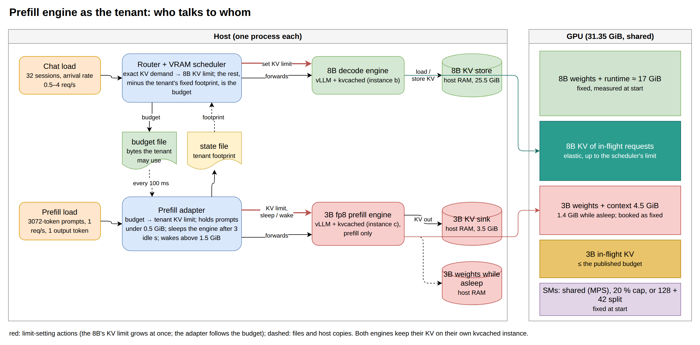
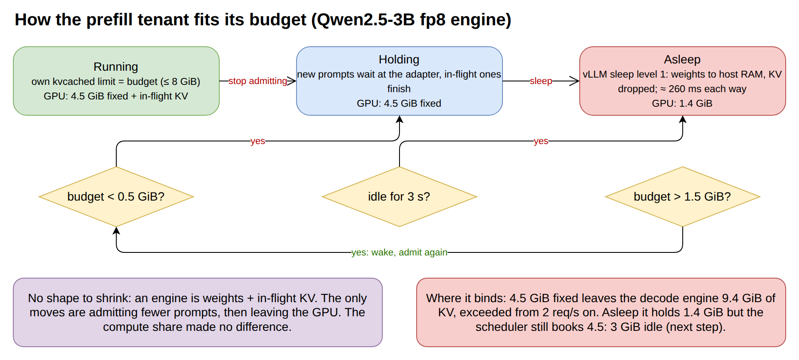
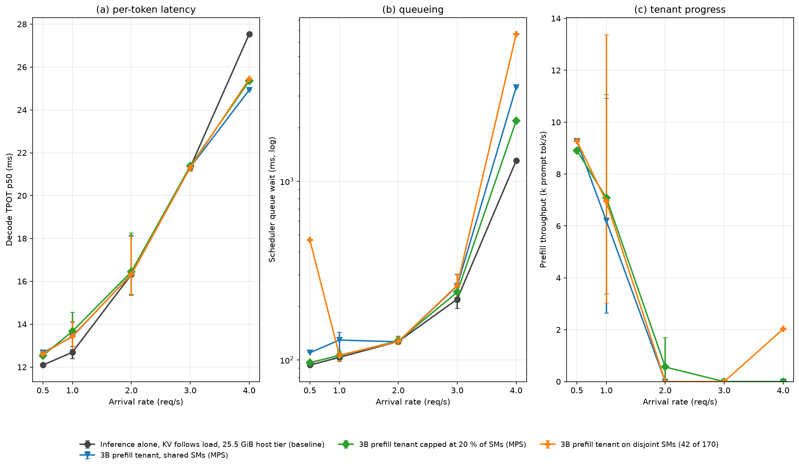
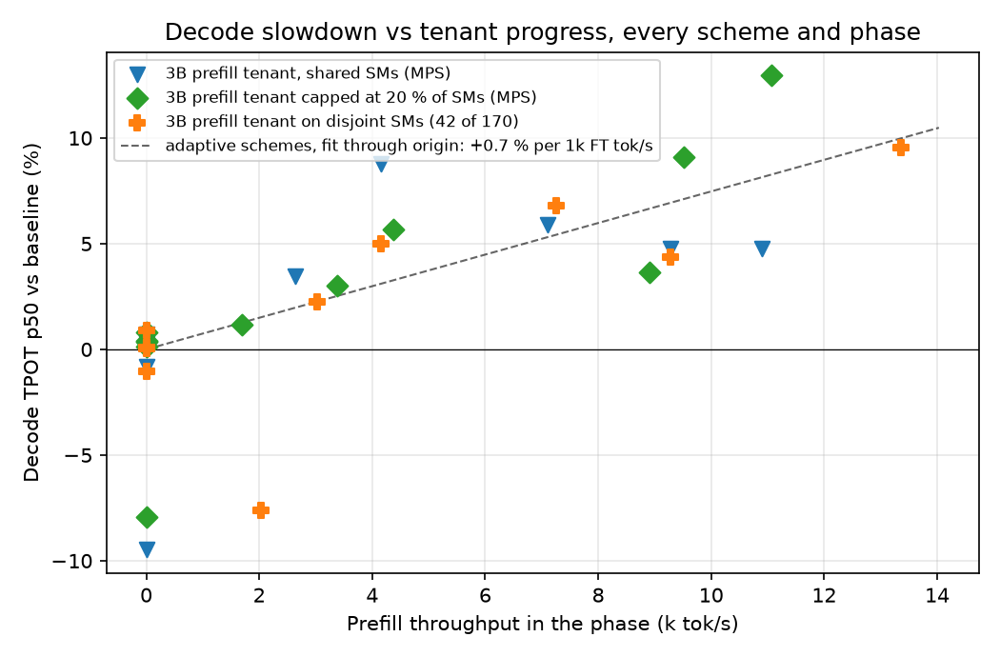
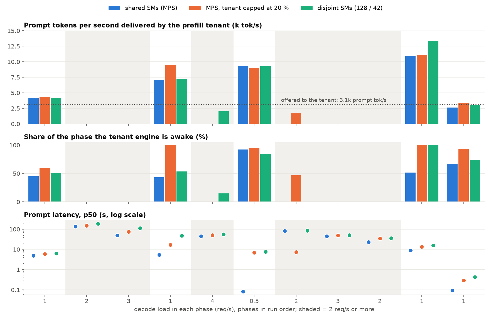
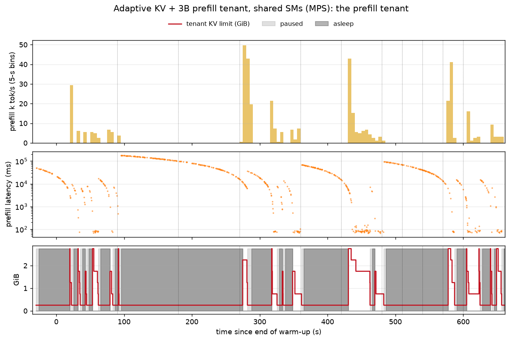
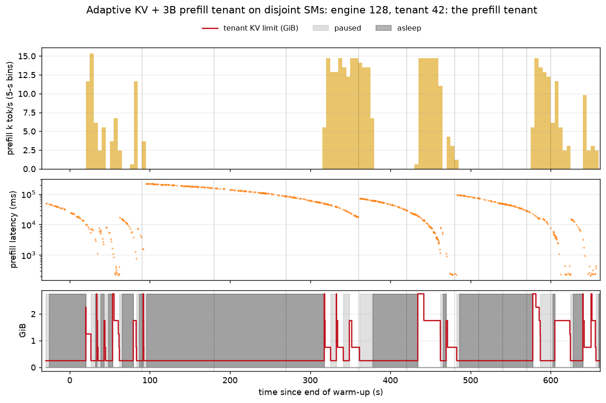

# 4. A prefill engine as the colocation tenant

**Question.** In the colocation prototype a tenant uses the GPU memory that the Llama-3-8B decode
engine does not need at low load. Can that tenant be a second inference engine that only does
prefill (the prefill node of a disaggregated pair), instead of a LoRA fine-tune job?

**Answer.** It follows the VRAM scheduler's budget with no change to vLLM, but its fixed GPU-memory
footprint (4.5 GiB) is too large: it fits beside the decode engine only at ≤ 1 req/s and sleeps
through every phase of 2 req/s or more. It is limited by GPU memory, not by compute. A second
attempt (Nov 16), with the tenant's SM share following the VRAM scheduler on prebuilt green
contexts, gave no result: the engine faulted at its first switch.

This report compares against the fine-tune tenant schemes of
[1_kv_budget_and_schemes.md](1_kv_budget_and_schemes.md). Why a tenant slows decode at all is in
[2_bandwidth.md](2_bandwidth.md); the byte allowance and the lighter tenant are in
[3_c1_c2.md](3_c1_c2.md).

## Platform and terminology

| item | value |
|---|---|
| GPU | RTX 5090, 31.35 GiB GPU memory, 170 SMs, GPU 0, power capped at 500 W |
| host | 60 GiB host RAM; vLLM's host-RAM KV tiers live in /dev/shm (31 GiB) |
| decode engine | Llama-3-8B, vLLM 0.30 + kvcached main (instance `vllm_b`), native host-RAM KV offload, prefix caching off |
| tenant engine | Qwen2.5-3B fp8, second vLLM 0.30 engine, own kvcached instance `vllm_c` |
| dates | Nov 9 2026 (four schemes, results below); Nov 16 2026 (green-context attempt, no result) |
| decisions | [DECISIONS.md](../coloc_adjust/report/DECISIONS.md) D14 (bring-up), D19 (outcome), D28 (Nov 16) |

**Terminology.** *GPU memory* is the card's own 31.35 GiB; *GPU memory bandwidth* is the path
between the SMs and that memory. *Host RAM* is the machine's memory; the KV tiers and the sleeping
tenant's weights live there. *VRAM scheduler*: the process (`controller.py`) that sets the decode
engine's kvcached KV limit from the router's exact KV demand and publishes what is left as the
tenant's *budget*. *Adapter*: `pf_tenant.py`, which turns the budget into the tenant engine's
actions. *Scheme*: one way of running the pair (tenant, compute sharing, memory policy). *Phase*:
one interval of constant decode arrival rate in the reference schedule.

## 1. What was built

*Figure 1 — the prefill-tenant setup (source `../coloc_adjust/diagrams/07_pf_architecture.drawio`).
Two vLLM engines share the GPU, each on its own kvcached instance. The VRAM scheduler sets the 8B's
KV limit from the router's exact demand and publishes the remainder, minus the tenant's fixed
footprint, as the budget. The adapter turns the budget into the 3B's KV limit and, when it is too
small, holds prompts and puts the engine to sleep. It writes the tenant's footprint back to a state
file.*

**Why this tenant.** Prefill is compute-bound and keeps no state between requests. So the tenant
has no ladder of reduced configurations like the fine-tune job: it runs, waits, or leaves the GPU.

### 1.1 Tenant engine and load

| item | value |
|---|---|
| model | Qwen2.5-3B, `--quantization fp8` (sm_120) |
| engine limits | `--max-model-len 4608`, `--max-num-seqs 8`, `--max-num-batched-tokens 8192` |
| KV | kvcached instance `vllm_c`; native offload to a 3.5 GiB host-RAM tier; the KV is written there and never read back (a sink) |
| decode engine's tier | 25.5 GiB instead of 28 GiB, so both tiers fit in /dev/shm (D14) |
| tenant load | 3072-token prompts, 1 req/s, `max_tokens = 1` (3.1k prompt tok/s offered), sent through the adapter |
| decode load | the reference chat trace: 32 sessions × 6144-token prefixes + 128 new tokens → 128 out, Zipf 1.1, phases of 0.5–4 req/s |
| prefill time | 71 ms for a 3072-token prompt, engine awake and alone |

### 1.2 The adapter (`pf_tenant.py`)

Every 100 ms the adapter reads the budget file and moves between three states.

| state | when | what it does |
|---|---|---|
| running | budget ≥ 0.5 GiB | sets the 3B's kvcached limit to the budget (256 MiB steps, at most 8 GiB); in-flight prompts are bounded by it |
| holding | budget < 0.5 GiB | new prompts wait at the adapter; in-flight ones finish; limit at its 256 MiB floor; admission resumes as soon as the budget is back |
| asleep | 3 s of holding with nothing in flight | calls vLLM `/sleep?level=1` (weights to host RAM, KV discarded; needs `VLLM_SERVER_DEV_MODE=1`): 4.5 → 1.4 GiB on the GPU in ≈ 260 ms; `/wake_up` (≈ 260 ms) when the budget is back above 1.5 GiB (0.5 GiB + 1 GiB wake margin) |

It writes its footprint (fixed + kvcached mapped) to the state file the VRAM scheduler reads.

*Figure 2 — the adapter's three states and what moves it between them (source
`../coloc_adjust/diagrams/06_pf_tiers.drawio`). The red note marks where the scheme binds.*

### 1.3 Memory accounting

The runner measures the tenant engine's fixed footprint by NVML right after the engine starts (used
memory before vs after): **4.50 GiB** (fp8 weights, CUDA context, kvcached segment). It passes
this to the VRAM scheduler. The budget is then

`31.35 − 16.97 (8B fixed) − 4.50 (3B fixed) − 0.5 (safety) − 8B KV limit` GiB,

so the 8B's KV and the 3B's KV share a pool of **9.4 GiB**. The 8B's limit is capped at memory that
is actually free, so the GPU was never oversubscribed (0 s in any run).

### 1.4 Schemes (`run_eval_pf.sh`)

| scheme | compute sharing | memory |
|---|---|---|
| `pf_base` | 8B alone, 25.5 GiB host-RAM tier | baseline for this family |
| `pf_mps` | both engines on all SMs through MPS | VRAM scheduler + adapter |
| `pf_mps20` | tenant engine capped at 20 % of the SM threads (MPS) | same |
| `pf_split` | 8B on the first 128 SMs (green context), tenant on the other 42 | same |

All three tenant schemes run with sleep enabled (`PF_SLEEP=1`).

## 2. Protocol

One continuous 11-minute run per scheme, Nov 9 2026, GPU 0, 500 W. The 8B is driven by the
reference schedule below; the tenant by its own 1 req/s prefill stream. Per-phase numbers skip the
first 10 s of each phase.

| from (s) | 0 | 90 | 180 | 270 | 360 | 420 | 480 | 510 | 540 | 570 | 600–660 |
|---|---|---|---|---|---|---|---|---|---|---|---|
| req/s | 1 | 2 | 3 | 1 | 4 | 0.5 | 2 | 3 | 2 | 1 | 1 |

Decode is judged on TPOT p50 and the VRAM scheduler's queue wait. The tenant is judged on delivered
prompt tokens/s, prompt latency at the adapter (adapter queueing included), failures, and the share
of each phase it spends asleep.

## 3. Results

### 3.1 By arrival rate

Phases with the same rate pooled. TPOT p50 in ms, change against `pf_base` in brackets; queue wait
at 3 and 4 req/s in ms; tenant throughput in k prompt tok/s at 0.5 / 1 / 2 req/s.

| scheme | 0.5 req/s | 1 | 2 | 3 | 4 | queue @3 / @4 | tenant @0.5 / 1 / 2 |
|---|---|---|---|---|---|---|---|
| `pf_base` | 12.1 | 12.7 | 16.3 | 21.3 | 27.5 | 219 / 1303 | — |
| `pf_mps` | 12.7 (+5 %) | 13.4 (+6 %) | 16.3 (+0 %) | 21.3 (−0 %) | 24.9 (−9 %) | 260 / 3360 | 9.3 / 6.2 / 0.0 |
| `pf_mps20` | 12.5 (+4 %) | 13.7 (+8 %) | 16.4 (+1 %) | 21.4 (+0 %) | 25.3 (−8 %) | 240 / 2176 | 8.9 / 7.1 / 0.6 |
| `pf_split` | 12.6 (+4 %) | 13.4 (+6 %) | 16.3 (+0 %) | 21.3 (−0 %) | 25.4 (−8 %) | 262 / 6659 | 9.3 / 6.9 / 0.0 |

0 failed requests in every run. `pf_base` equals the main baseline of report 1 (TPOT within 0.2 ms,
except 27.5 vs 26.1 ms at 4 req/s; queue identical), so shrinking the 8B's host-RAM tier from 28 to
25.5 GiB cost nothing.

*Figure 3 — the three tenant schemes against `pf_base` (`plot_arms.py --pf`): (a) decode TPOT,
(b) queue wait, (c) delivered prompt tok/s, per arrival rate (marker = mean over phases, bar =
min..max). The three tenant lines nearly coincide.*

*Figure 4 — decode slowdown over `pf_base` against tenant prompt tok/s, one point per scheme and
phase. The three compute mechanisms lie on one line, with a slope of ≈ 1 % per 1k prompt tok/s.
The fine-tune tenant's slope is 2.2 % per 1k tok/s (report 1).*

### 3.2 By phase

Each cell: decode TPOT p50 in ms (change against `pf_base`) · tenant prompt tok/s delivered ·
share of the phase the tenant engine was asleep.

| phase | `pf_base` | `pf_mps` | `pf_mps20` | `pf_split` |
|---|---|---|---|---|
| 0 s, 1 req/s | 13.0 | 14.1 (+9 %) · 4.1k · 55 % | 13.7 (+6 %) · 4.4k · 41 % | 13.6 (+5 %) · 4.1k · 49 % |
| 90 s, 2 | 15.3 | 15.4 (+0 %) · 0 · 100 % | 15.4 (+0 %) · 0 · 100 % | 15.3 (+0 %) · 0 · 100 % |
| 180 s, 3 | 21.3 | 21.5 (+1 %) · 0 · 100 % | 21.4 (+0 %) · 0 · 100 % | 21.5 (+1 %) · 0 · 100 % |
| 270 s, 1 | 12.5 | 13.3 (+6 %) · 7.1k · 57 % | 13.7 (+9 %) · 9.5k · 0 % | 13.4 (+7 %) · 7.3k · 47 % |
| 360 s, 4 | 27.5 | 24.9 (−9 %) · 0 · 100 % | 25.3 (−8 %) · 0 · 100 % | 25.4 (−8 %) · 2.0k · 85 % |
| 420 s, 0.5 | 12.1 | 12.7 (+5 %) · 9.3k · 8 % | 12.5 (+4 %) · 8.9k · 5 % | 12.6 (+4 %) · 9.3k · 15 % |
| 480 s, 2 | 15.5 | 15.5 (+0 %) · 0 · 100 % | 15.7 (+1 %) · 1.7k · 53 % | 15.5 (+0 %) · 0 · 100 % |
| 510 s, 3 | 21.4 | 21.2 (−1 %) · 0 · 100 % | 21.4 (+0 %) · 0 · 100 % | 21.1 (−1 %) · 0 · 100 % |
| 540 s, 2 | 18.1 | 18.2 (+0 %) · 0 · 100 % | 18.2 (+1 %) · 0 · 100 % | 18.1 (+0 %) · 0 · 100 % |
| 570 s, 1 | 12.9 | 13.5 (+5 %) · 10.9k · 48 % | 14.6 (+13 %) · 11.1k · 0 % | 14.1 (+10 %) · 13.4k · 0 % |
| 600 s, 1 | 12.4 | 12.8 (+3 %) · 2.6k · 33 % | 12.8 (+3 %) · 3.4k · 7 % | 12.7 (+2 %) · 3.0k · 26 % |

Full per-phase tables with queue wait, KV limit and budget:
`../coloc_adjust/results/pf_*_phases.md`.

*Figure 5 — the tenant's own performance per phase, phases in run order, x-axis = decode arrival
rate; shaded = 2 req/s or more (`../coloc_adjust/plot_recap_figs.py`, from `../coloc_adjust/results/pf_*_phases.csv`).
Top: delivered prompt tok/s (dotted line: the 3.1k offered). Middle: share of the phase the engine
is awake. Bottom: prompt latency p50 at the adapter (log scale). In the shaded phases the tenant
does almost no work; in the others it delivers more than is offered because it drains its backlog.
The schemes differ mainly in when they wake, not in compute.*

### 3.3 Over time

*Figure 6 — the tenant under `pf_mps` over the run (`analyze_pf.py`). Top: delivered prompt tok/s in
5-s bins. Middle: latency of every prompt, adapter queueing included (the ≈ 70 ms floor is the
prefill itself). Bottom: the tenant's KV limit, with holding (light) and asleep (dark) spans. The
2, 3 and 4 req/s phases are asleep from end to end. Throughput comes in bursts of up to 50k tok/s
when the engine wakes and drains the prompts that queued while it slept.*

*Figure 7 — the same for `pf_split`. In the 4 req/s phase (360–420 s) the budget came back briefly,
the engine woke and prefilled 2.0k tok/s, and the 8B's queue wait in that phase was 6.7 s against
3.4 s under `pf_mps`.*

## 4. What this shows

1. **Memory sets the limit, compute does not.** The 4.5 GiB fixed footprint leaves 9.4 GiB for both
   engines' KV. From 2 req/s on, the 8B's own demand exceeds that pool. The budget falls to zero,
   the adapter holds prompts, and the engine sleeps for the whole phase. The tenant works only in the
   0.5 and 1 req/s phases, and under `pf_mps` it is still asleep 33–57 % of each 1 req/s phase
   (Section 3.2).
2. **So the three compute mechanisms are indistinguishable.** MPS, a 20 % MPS cap and a disjoint
   128/42 SM split give the same decode cost (+4–8 % at 0.5–1 req/s, 0 % from 2 req/s on) and the
   same tenant throughput. Compute never became the limit.
3. **Delivered throughput is backlog, not steady state.** The offered load is 3.1k prompt tok/s.
   The 6–13k tok/s in the awake phases are prompts that queued during sleep, drained in bursts
   (Figure 6). This is also why prompt latency at the adapter is 45–190 s (median) in the sleeping
   phases and ≈ 70 ms when the engine is awake and idle.
4. **The tenant's footprint costs decode at high load.** The 8B's maximum KV limit is 12.0 GiB
   (`pf_mps`, `pf_split`) or 12.5 GiB (`pf_mps20`) against 12.65 GiB in `pf_base`. At 4 req/s the
   8B therefore queues longer: 2.2–6.7 s against 1.3 s. Its TPOT is 8–9 % lower there for the same
   reason: fewer requests in the batch. Smaller batch and longer queue is a cost, not a gain.
5. **Per prompt token, prefill is a cheap tenant.** +6 % decode for 6–7k prompt tok/s is ≈ 1 % per
   1k tok/s, against 2.2 % for the fine-tune tenant. A prefill batch of up to 8k tokens reads the
   weights once, so it moves fewer bytes per token than a training step. This matches the relation
   found for the fine-tune tenant: decode's cost follows the bytes the tenant moves per token
   ([2_bandwidth.md](2_bandwidth.md)).
6. **The mechanism works without changing vLLM.** An adapter, the kvcached limit and vLLM's sleep
   mode are enough to make a prefill engine follow the budget; leaving the GPU takes ≈ 260 ms.
   Nothing failed and the GPU was never oversubscribed.

### 4.1 Two accounting gaps found

Both make the tenant look worse than it has to be.

- **The sleeping footprint is not credited back.** Asleep, the engine holds 1.4 GiB, but the VRAM
  scheduler keeps booking the 4.5 GiB measured at start. About 3 GiB sit idle in every phase of
  2 req/s or more. The 8B's KV could have used them to queue less at 4 req/s.
- **The wake margin is below the wake cost.** The adapter wakes when the budget exceeds 1.5 GiB
  (0.5 GiB + 1 GiB margin). Waking puts about 3.1 GiB of weights back on the GPU within 260 ms.
  In `pf_split` this let the engine wake inside the 4 req/s phase, and the 8B's queue wait doubled
  (Figure 7). This is a defect of the adapter, not of the disjoint SM split.

## 5. Nov 16: tenant SM share following the VRAM scheduler — no result

**What was tried.** The tenant engine built five prebuilt green contexts (128, 96, 64, 32 and
16 SMs) at start, and the VRAM scheduler chose its SM share from the decode arrival rate
(`run_eval_pf2.sh pf_green_dyn`, GPU 0). The prediction was: decode's cost does not change,
because this tenant is limited by GPU memory, and the tenant's own prefill slows down. It was not
tested.

**What happened.** The engine ran its start-up steps on its default stream. At the first step of
the load it moved to the 128-SM green context, and at that moment the driver logged Xid 31 (MMU
fault). The fault also took down the decode engine, because both engines are clients of one MPS
server. Every request of the run failed.

**The first diagnosis was wrong.** It was that CUDA graphs captured on the default stream cannot be
replayed on a green context. The run was repeated with the tenant engine in `--enforce-eager` (no
CUDA graphs). The fault came back at the first switch. So CUDA graphs are not the cause, or not
the only one. The reference runs of the same night (`pf_mps`, `pf_mps_eager`) ran normally. Data of
the two faulted runs is not reported.

**What is known.**

| setup | switch | outcome |
|---|---|---|
| prefill engine on one green context from its first step (`pf_split`, Nov 9) | none | no fault |
| fine-tune tenant switching between prebuilt green contexts (report 1) | between green contexts | no fault |
| prefill engine, CUDA graphs on (`pf_green_dyn`, Nov 16) | default stream → green context | Xid 31 at first switch |
| prefill engine, CUDA graphs off (`pf_green_dyn_eager`, Nov 16) | default stream → green context | Xid 31 at first switch |

The one difference left is an engine that leaves the stream it started on. Whether that is the
cause is **an open question**. Untested next step: put the engine on the largest prebuilt green
context from its very first step and switch only among green contexts.

## 6. Limits

- One 11-minute run per scheme and no repeats, so there is no noise estimate for differences of a
  few percent between schemes.
- One tenant size (3B fp8, 4.5 GiB fixed), one tenant load (3072-token prompts at 1 req/s), one GPU
  (32 GiB) and one decode model (8B). The fit threshold (≤ 1 req/s) belongs to this combination.
- The tenant's KV is a sink: written to host RAM and never read back. A real prefill–decode pair
  would also move that KV to a decode node; that traffic is not in these numbers.
- The ≈ 1 % per 1k prompt tok/s slope comes from burst draining after sleep, not from a steady
  prefill stream.
- Both accounting gaps (Section 4.1) were present in every tenant run, so the results show the
  tenant with the larger booking and the smaller wake margin.
- Section 5 produced no measurement.

## 7. Open questions and next steps

- (a) Make the VRAM scheduler read the tenant's live footprint from the state file (1.4 GiB asleep)
  instead of the fixed 4.5 GiB, and give the freed ≈ 3 GiB to the 8B's KV limit (less queueing at
  4 req/s). Not implemented.
- (b) Wake only when the budget exceeds the weights (≈ 3.1 GiB) plus the first prompt's KV, or let
  the VRAM scheduler grant the wake. Not implemented.
- (c) A smaller fixed footprint, e.g. a 1.5B fp8 engine (≈ 2.5 GiB). The prediction was that it
  fits up to 2 req/s; it was not tested.
- (d) The Xid 31 fault of Section 5: start the engine on the largest prebuilt green context and
  switch only among green contexts. Only after that can the SM share be made to follow the load.
- (e) A real prefill–decode pair: the 3B's KV read back by a decode node instead of being a sink.

## 8. Files

All paths relative to this file.

| what | path |
|---|---|
| decision log (D14 bring-up, D19 outcome, D28 Nov 16) | [../coloc_adjust/report/DECISIONS.md](../coloc_adjust/report/DECISIONS.md) |
| earlier report on this tenant (replaced by this one) | git history: `coloc_adjust/report/REPORT_pf.md`, `REPORT_pf_zh.md` (commit `358cc6b`) |
| adapter | `../coloc_adjust/pf_tenant.py` |
| VRAM scheduler | `../coloc_adjust/controller.py` |
| runner, Nov 9 (both engines, VRAM scheduler, adapter, loads, analysis) | `../coloc_adjust/run_eval_pf.sh` (run: `PF_SLEEP=1 bash run_eval_pf.sh pf_mps`) |
| runner, Nov 16 (adds `pf_green_dyn`, `*_eager`) | `../coloc_adjust/run_eval_pf2.sh` |
| analysis and figures | `../coloc_adjust/analyze_pf.py` (Figures 6–7), `../coloc_adjust/plot_arms.py --pf` (Figures 3–4), `../coloc_adjust/plot_recap_figs.py` (Figure 5) |
| diagram sources | `../coloc_adjust/diagrams/07_pf_architecture.drawio`, `06_pf_tiers.drawio` |
| results, Nov 9 | `../coloc_adjust/results/pf_{base,mps,mps20,split}_*` |
| reference runs, Nov 16 | `../coloc_adjust/results_o3/pf_mps_*`, `pf_mps_eager_*`; engine logs in `../coloc_adjust/logs_o3/` (kept local, not in git) |
