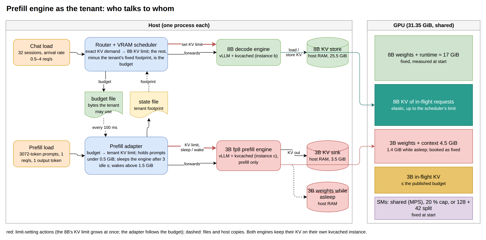
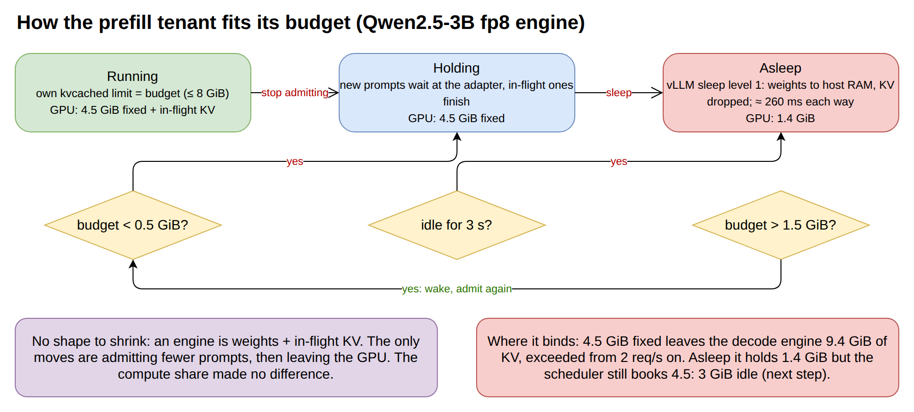
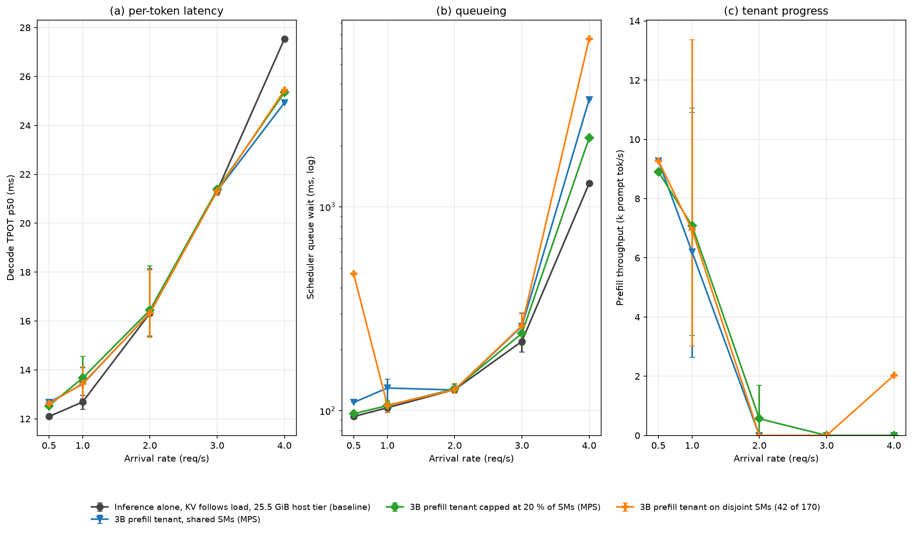
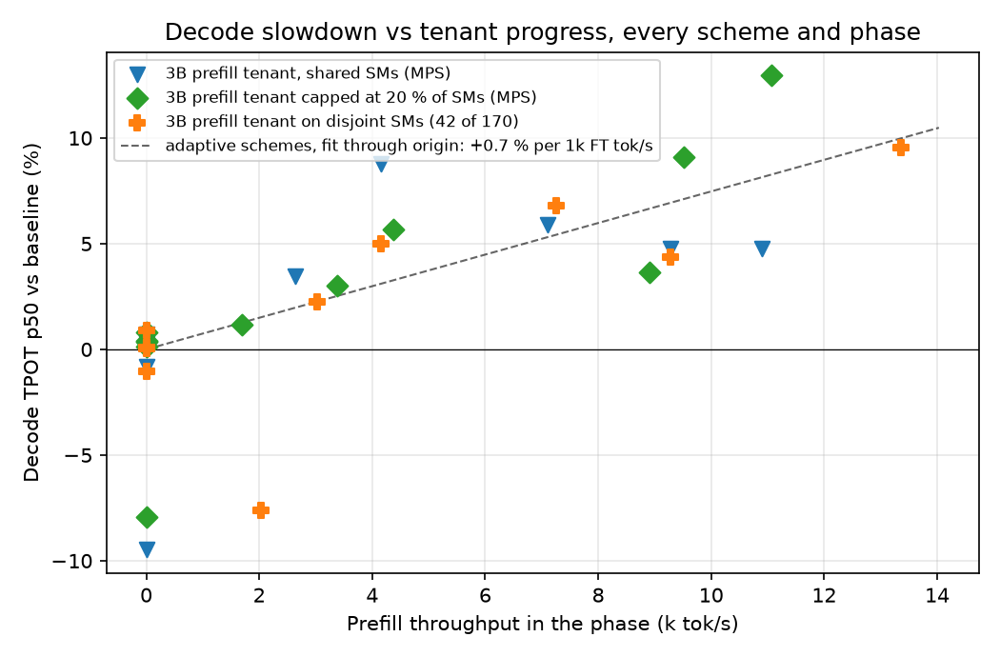
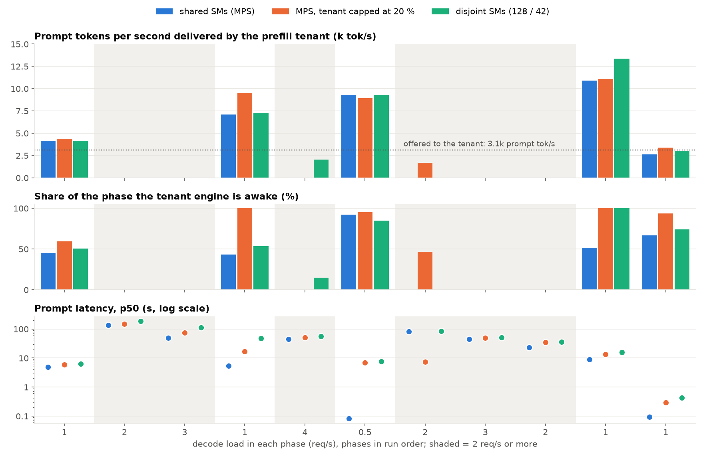
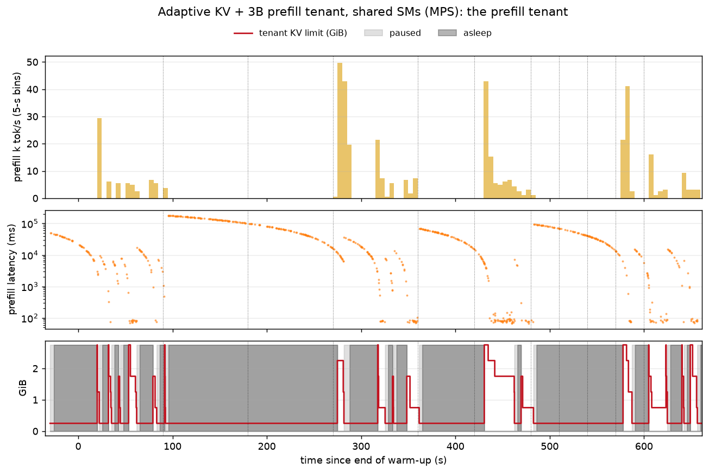
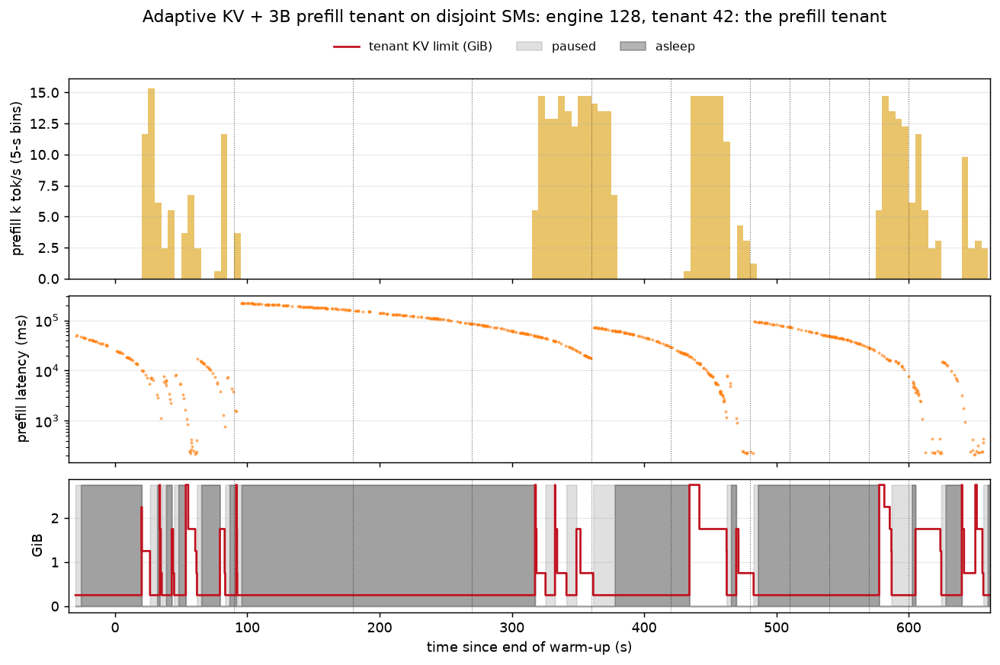

# 4. 用一个 prefill 引擎当 colocation 的 tenant

**问题。** 在 colocation 原型里，tenant 使用 Llama-3-8B decode 引擎在低负载时用不到的显存。这个 tenant
能不能换成第二个只做 prefill 的推理引擎（相当于 PD 分离里的 prefill 节点），而不是 LoRA 微调任务？

**回答。** 它不改 vLLM 就能跟着 VRAM scheduler 的预算走，但它固定占用的显存（4.5 GiB）太大：只有 decode
负载 ≤ 1 req/s 时放得下，2 req/s 及以上的每个阶段都整段在睡。限制它的是显存，不是算力。第二次尝试（11 月
16 日）让 tenant 的 SM 份额在预建的 green context 之间跟着 VRAM scheduler 变，没有得到结果：引擎在第一次
切换时就出错。

这份报告的对照是 [1_kv_budget_and_schemes.md](1_kv_budget_and_schemes.md) 里微调 tenant 的各个
scheme。tenant 为什么会拖慢 decode 见 [2_bandwidth.md](2_bandwidth.md)；字节限额和更轻的 tenant 见
[3_c1_c2.md](3_c1_c2.md)。

## 平台和术语

| 项目 | 值 |
|---|---|
| GPU | RTX 5090，31.35 GiB 显存，170 个 SM，GPU 0，功率上限 500 W |
| 主机 | 60 GiB 主机内存；vLLM 的主机内存 KV 层放在 /dev/shm（31 GiB） |
| decode 引擎 | Llama-3-8B，vLLM 0.30 + kvcached main（实例 `vllm_b`），原生主机内存 KV 卸载，prefix caching 关闭 |
| tenant 引擎 | Qwen2.5-3B fp8，第二个 vLLM 0.30 引擎，自己的 kvcached 实例 `vllm_c` |
| 日期 | 2026 年 11 月 9 日（四个 scheme，下文的结果）；2026 年 11 月 16 日（green context 尝试，无结果） |
| 决策记录 | [DECISIONS.md](../coloc_adjust/report/DECISIONS.md) D14（启动调试）、D19（结果）、D28（11 月 16 日） |

**术语。** *显存* 指卡上自己的 31.35 GiB；*显存带宽* 指 SM 和显存之间的通路。*主机内存* 指机器的内存，KV
层和睡眠中 tenant 的权重都在那里。*VRAM scheduler*：进程 `controller.py`，按 router 看到的精确 KV 需求设
decode 引擎的 kvcached KV 上限，把剩下的作为 tenant 的*预算*发布。*适配器*：`pf_tenant.py`，把预算变成
tenant 引擎的动作。*scheme*：一种运行方式（tenant、算力怎么分、显存策略）。*阶段*：参考负载里 decode
到达率不变的一段时间。

## 1. 造了什么

*图 1：prefill tenant 的结构（源文件 `../coloc_adjust/diagrams/07_pf_architecture.drawio`）。两个 vLLM
引擎共用一张卡，各自一个 kvcached 实例。VRAM scheduler 按 router 的精确需求设 8B 的 KV 上限，把剩下的显存
扣掉 tenant 的固定占用后作为预算发布。适配器把预算变成 3B 的 KV 上限；预算太小时扣住 prompt、让引擎睡眠。
它把 tenant 的占用写回状态文件。*

**为什么试这个 tenant。** prefill 是算力密集的，请求之间不留状态。所以它没有微调任务那种逐级降配：要么跑，
要么等，要么离开 GPU。

### 1.1 tenant 引擎和负载

| 项目 | 值 |
|---|---|
| 模型 | Qwen2.5-3B，`--quantization fp8`（sm_120） |
| 引擎参数 | `--max-model-len 4608`、`--max-num-seqs 8`、`--max-num-batched-tokens 8192` |
| KV | kvcached 实例 `vllm_c`；原生卸载到 3.5 GiB 的主机内存层；KV 写进去后不再读回（只写不读） |
| decode 引擎的层 | 25.5 GiB 而不是 28 GiB，这样两个层都放得进 /dev/shm（D14） |
| tenant 负载 | 3072-token 的 prompt，1 req/s，`max_tokens = 1`（供给 3.1k prompt tok/s），经过适配器 |
| decode 负载 | 参考对话负载：32 个会话 × 6144-token 前缀 + 128 个新 token → 输出 128，Zipf 1.1，阶段 0.5–4 req/s |
| prefill 时间 | 引擎醒着且独占时，3072-token 的 prompt 71 ms |

### 1.2 适配器（`pf_tenant.py`）

适配器每 100 ms 读一次预算文件，在三个状态间切换。

| 状态 | 条件 | 动作 |
|---|---|---|
| 运行 | 预算 ≥ 0.5 GiB | 把 3B 的 kvcached 上限设成预算（256 MiB 步进，最多 8 GiB），在途 prompt 受它限制 |
| 扣住 | 预算 < 0.5 GiB | 新 prompt 在适配器处等；在途的跑完；上限退到 256 MiB 地板；预算一回来就放行 |
| 睡眠 | 扣住 3 s 且没有在途请求 | 调 vLLM `/sleep?level=1`（权重进主机内存，KV 丢掉；需要 `VLLM_SERVER_DEV_MODE=1`）：显存占用 4.5 → 1.4 GiB，约 260 ms；预算回到 1.5 GiB 以上（0.5 GiB + 1 GiB 唤醒余量）时 `/wake_up`，约 260 ms |

它把自己的占用（固定 + kvcached 已映射）写进 VRAM scheduler 读的状态文件。

*图 2：适配器的三个状态和切换条件（源文件 `../coloc_adjust/diagrams/06_pf_tiers.drawio`）。红色注释标出
scheme 卡住的地方。*

### 1.3 显存记账

启动脚本在 tenant 引擎起来后用 NVML 量它的固定占用（前后的已用显存之差）：**4.50 GiB**（fp8 权重、CUDA
context、kvcached 段），并传给 VRAM scheduler。预算于是为

`31.35 − 16.97（8B 固定）− 4.50（3B 固定）− 0.5（安全）− 8B 的 KV 上限` GiB，

也就是 8B 的 KV 和 3B 的 KV 共用一个 **9.4 GiB** 的池子。8B 的上限按实际空闲的显存封顶，所以显存从没超订
（所有运行都是 0 s）。

### 1.4 scheme（`run_eval_pf.sh`）

| scheme | 算力怎么分 | 显存 |
|---|---|---|
| `pf_base` | 8B 单跑，主机内存层 25.5 GiB | 这一组的 baseline |
| `pf_mps` | 两个引擎通过 MPS 共用所有 SM | VRAM scheduler + 适配器 |
| `pf_mps20` | tenant 引擎限 20% 的 SM 线程（MPS） | 同上 |
| `pf_split` | 8B 用前 128 个 SM（green context），tenant 用剩下 42 个 | 同上 |

三个 tenant scheme 都开了睡眠（`PF_SLEEP=1`）。

## 2. 评测方法

每个 scheme 连续跑一次 11 分钟，2026 年 11 月 9 日，GPU 0，500 W。8B 走下面的参考负载，tenant 走自己 1 req/s
的 prefill 流。逐阶段的数字跳过每个阶段的前 10 s。

| 起点 (s) | 0 | 90 | 180 | 270 | 360 | 420 | 480 | 510 | 540 | 570 | 600–660 |
|---|---|---|---|---|---|---|---|---|---|---|---|
| req/s | 1 | 2 | 3 | 1 | 4 | 0.5 | 2 | 3 | 2 | 1 | 1 |

decode 看 TPOT p50 和 VRAM scheduler 的排队等待。tenant 看交付的 prompt tok/s、在适配器处的 prompt 延迟
（含在适配器排队）、失败数，以及每个阶段睡着的时间比例。

## 3. 结果

### 3.1 按到达率

相同到达率的阶段合并。TPOT p50 单位 ms，括号里是相对 `pf_base` 的变化；3 和 4 req/s 的排队等待单位 ms；
tenant 吞吐单位 k prompt tok/s，分别是 0.5 / 1 / 2 req/s。

| scheme | 0.5 req/s | 1 | 2 | 3 | 4 | 排队 @3 / @4 | tenant @0.5 / 1 / 2 |
|---|---|---|---|---|---|---|---|
| `pf_base` | 12.1 | 12.7 | 16.3 | 21.3 | 27.5 | 219 / 1303 | — |
| `pf_mps` | 12.7 (+5%) | 13.4 (+6%) | 16.3 (+0%) | 21.3 (−0%) | 24.9 (−9%) | 260 / 3360 | 9.3 / 6.2 / 0.0 |
| `pf_mps20` | 12.5 (+4%) | 13.7 (+8%) | 16.4 (+1%) | 21.4 (+0%) | 25.3 (−8%) | 240 / 2176 | 8.9 / 7.1 / 0.6 |
| `pf_split` | 12.6 (+4%) | 13.4 (+6%) | 16.3 (+0%) | 21.3 (−0%) | 25.4 (−8%) | 262 / 6659 | 9.3 / 6.9 / 0.0 |

所有运行 0 个失败请求。`pf_base` 和报告 1 的主 baseline 一致（TPOT 差 0.2 ms 以内，只有 4 req/s 是 27.5
对 26.1 ms；排队相同），所以 8B 的主机内存层从 28 缩到 25.5 GiB 没有代价。

*图 3：三个 tenant scheme 对 `pf_base`（`plot_arms.py --pf`）：(a) decode TPOT，(b) 排队等待，(c) 交付的
prompt tok/s，按到达率（点 = 各阶段平均，竖线 = 最小..最大）。三条 tenant 线几乎重合。*

*图 4：decode 相对 `pf_base` 变慢多少 对 tenant 的 prompt tok/s，每个 scheme 每个阶段一个点。三种算力机制
落在同一条线上，斜率约每 1k prompt tok/s 1%。微调 tenant 的斜率是每 1k tok/s 2.2%（报告 1）。*

### 3.2 按阶段

每格：decode TPOT p50（ms，括号里是相对 `pf_base` 的变化）· tenant 交付的 prompt tok/s · 该阶段 tenant 引擎
睡着的时间比例。

| 阶段 | `pf_base` | `pf_mps` | `pf_mps20` | `pf_split` |
|---|---|---|---|---|
| 0 s，1 req/s | 13.0 | 14.1 (+9%) · 4.1k · 55% | 13.7 (+6%) · 4.4k · 41% | 13.6 (+5%) · 4.1k · 49% |
| 90 s，2 | 15.3 | 15.4 (+0%) · 0 · 100% | 15.4 (+0%) · 0 · 100% | 15.3 (+0%) · 0 · 100% |
| 180 s，3 | 21.3 | 21.5 (+1%) · 0 · 100% | 21.4 (+0%) · 0 · 100% | 21.5 (+1%) · 0 · 100% |
| 270 s，1 | 12.5 | 13.3 (+6%) · 7.1k · 57% | 13.7 (+9%) · 9.5k · 0% | 13.4 (+7%) · 7.3k · 47% |
| 360 s，4 | 27.5 | 24.9 (−9%) · 0 · 100% | 25.3 (−8%) · 0 · 100% | 25.4 (−8%) · 2.0k · 85% |
| 420 s，0.5 | 12.1 | 12.7 (+5%) · 9.3k · 8% | 12.5 (+4%) · 8.9k · 5% | 12.6 (+4%) · 9.3k · 15% |
| 480 s，2 | 15.5 | 15.5 (+0%) · 0 · 100% | 15.7 (+1%) · 1.7k · 53% | 15.5 (+0%) · 0 · 100% |
| 510 s，3 | 21.4 | 21.2 (−1%) · 0 · 100% | 21.4 (+0%) · 0 · 100% | 21.1 (−1%) · 0 · 100% |
| 540 s，2 | 18.1 | 18.2 (+0%) · 0 · 100% | 18.2 (+1%) · 0 · 100% | 18.1 (+0%) · 0 · 100% |
| 570 s，1 | 12.9 | 13.5 (+5%) · 10.9k · 48% | 14.6 (+13%) · 11.1k · 0% | 14.1 (+10%) · 13.4k · 0% |
| 600 s，1 | 12.4 | 12.8 (+3%) · 2.6k · 33% | 12.8 (+3%) · 3.4k · 7% | 12.7 (+2%) · 3.0k · 26% |

带排队、KV 上限、预算的完整逐阶段表：`../coloc_adjust/results/pf_*_phases.md`。

*图 5：tenant 自己每个阶段的表现，阶段按运行顺序，横轴是 decode 到达率；灰底是 ≥ 2 req/s 的阶段
（`../coloc_adjust/plot_recap_figs.py`，数据来自 `../coloc_adjust/results/pf_*_phases.csv`）。上：交付的 prompt tok/s
（点线是供给 3.1k）。中：该阶段引擎醒着的比例。下：适配器处的 prompt 延迟 p50（对数轴）。灰底阶段里 tenant
基本不干活；其他阶段它在清积压，所以交付量高于供给。几个 scheme 的差别主要来自各自醒来的时机，不来自算力。*

### 3.3 随时间

*图 6：`pf_mps` 下 tenant 在整个运行中的情况（`analyze_pf.py`）。上：每 5 s 交付的 prompt tok/s。中：每个
prompt 的延迟，含在适配器排队（约 70 ms 的地板就是 prefill 本身）。下：tenant 的 KV 上限，浅灰 = 扣住，
深灰 = 睡着。2、3、4 req/s 的阶段整段都在睡。吞吐是一阵一阵的：引擎醒来时把睡着期间排队的 prompt 一次
清掉，峰值 50k tok/s。*

*图 7：`pf_split` 的同一张图。4 req/s 阶段（360–420 s）里预算短暂回来，引擎醒了，做了 2.0k tok/s 的
prefill，8B 在该阶段的排队等待是 6.7 s，`pf_mps` 下是 3.4 s。*

## 4. 结果说明了什么

1. **限制来自显存，不来自算力。** 固定 4.5 GiB 之后，两个引擎的 KV 只剩 9.4 GiB。从 2 req/s 起，8B 自己的
   需求就超过这个池子。预算归零，适配器扣住 prompt，引擎整段睡眠。tenant 只在 0.5 和 1 req/s 的阶段干活，
   而且 `pf_mps` 下在每个 1 req/s 阶段仍有 33–57% 的时间在睡（3.2 节）。
2. **所以三种算力机制没有区别。** MPS、MPS 限 20%、128/42 不相交 SM，decode 代价相同（0.5–1 req/s 时
   +4–8%，2 req/s 起 0%），tenant 吞吐也相同。算力从没成为限制。
3. **交付的吞吐是在清积压，不是稳态。** 供给是 3.1k prompt tok/s。醒着阶段的 6–13k tok/s 是睡着期间排队的
   prompt 被一阵一阵清掉（图 6）。这也是为什么睡着的阶段里适配器处的 prompt 延迟中位数是 45–190 s，而引擎
   醒着且空闲时约 70 ms。
4. **高负载时 tenant 的占用反过来让 decode 付代价。** 8B 的 KV 上限最高只到 12.0 GiB（`pf_mps`、`pf_split`）
   或 12.5 GiB（`pf_mps20`），`pf_base` 是 12.65 GiB。所以 4 req/s 时 8B 排队更久：2.2–6.7 s 对 1.3 s。
   那里 TPOT 低 8–9% 是同一个原因：batch 里请求更少。batch 小、排队长，是代价，不是收益。
5. **按 prompt token 算，prefill 是便宜的 tenant。** +6% 的 decode 换 6–7k prompt tok/s，约每 1k tok/s 1%，
   微调 tenant 是 2.2%。一批最多 8k token 的 prefill 只读一遍权重，所以每 token 搬的字节比一个训练 step 少。
   这和微调 tenant 上得到的关系一致：decode 的代价跟着 tenant 每 token 搬的字节走
   （[2_bandwidth.md](2_bandwidth.md)）。
6. **机制不用改 vLLM 就能工作。** 一个适配器、kvcached 上限和 vLLM 的 sleep 模式就够让 prefill 引擎跟着预算
   走；离开 GPU 约 260 ms。没有失败，显存从没超订。

### 4.1 发现的两个记账缺口

两个缺口都让 tenant 显得比它本该的差。

- **睡着时释放的显存没记回。** 睡着时引擎实际占 1.4 GiB，但 VRAM scheduler 仍按启动时量的 4.5 GiB 记。
  每个 ≥ 2 req/s 的阶段都有约 3 GiB 闲着。8B 的 KV 本可以用它们，让 4 req/s 时少排队。
- **唤醒余量小于唤醒成本。** 适配器在预算超过 1.5 GiB（0.5 GiB + 1 GiB 余量）时唤醒。唤醒在 260 ms 内把约
  3.1 GiB 权重放回 GPU。`pf_split` 因此在 4 req/s 阶段中途醒了一次，8B 的排队等待翻倍（图 7）。这是适配器的
  缺陷，不是不相交 SM 本身的问题。

## 5. 11 月 16 日：tenant 的 SM 份额跟着 VRAM scheduler 变，没有结果

**试了什么。** tenant 引擎启动时预建五个 green context（128、96、64、32、16 个 SM），由 VRAM scheduler
按 decode 到达率选它的 SM 份额（`run_eval_pf2.sh pf_green_dyn`，GPU 0）。预测是：decode 的代价不变（这个
tenant 受显存限制），tenant 自己的 prefill 变慢。这个预测没有被检验。

**发生了什么。** 引擎在默认 stream 上跑完启动步骤。负载的第一个 step 时它切到 128-SM 的 green context，
就在这一刻驱动报了 Xid 31（MMU 错误）。这个错误把 decode 引擎也带倒了，因为两个引擎是同一个 MPS server 的
client。这次运行的所有请求都失败了。

**第一次的判断是错的。** 当时的判断是：在默认 stream 上 capture 的 CUDA graph 不能在 green context 上
replay。于是 tenant 引擎改用 `--enforce-eager`（不用 CUDA graph）重跑。第一次切换时错误照样出现。所以
CUDA graph 不是原因，或者不是唯一原因。同一晚的对照运行（`pf_mps`、`pf_mps_eager`）都正常。两次出错运行的
数据不报告。

**已知的情况。**

| 设置 | 切换 | 结果 |
|---|---|---|
| prefill 引擎从第一个 step 起就在一个 green context 上（`pf_split`，11 月 9 日） | 无 | 没出错 |
| 微调 tenant 在预建的 green context 之间切换（报告 1） | green context 之间 | 没出错 |
| prefill 引擎，开 CUDA graph（`pf_green_dyn`，11 月 16 日） | 默认 stream → green context | 第一次切换 Xid 31 |
| prefill 引擎，关 CUDA graph（`pf_green_dyn_eager`，11 月 16 日） | 默认 stream → green context | 第一次切换 Xid 31 |

剩下的唯一区别是：引擎离开了它启动时用的 stream。这是不是原因，**是一个没有答案的问题**。未测试的下一步：
让引擎从第一个 step 起就在最大的预建 green context 上，之后只在 green context 之间切换。

## 6. 局限

- 每个 scheme 只跑一次 11 分钟，没有重复，所以 scheme 之间几个百分点的差别没有噪声估计。
- 只有一种 tenant 大小（3B fp8，固定 4.5 GiB）、一种 tenant 负载（3072-token prompt，1 req/s）、一张卡
  （32 GiB）和一个 decode 模型（8B）。"≤ 1 req/s 才放得下"这个界限属于这个组合。
- tenant 的 KV 只写不读：写到主机内存后不再读回。真正的 prefill–decode 对还要把这份 KV 传给 decode 节点，
  这部分流量不在这些数字里。
- 约每 1k prompt tok/s 1% 的斜率来自睡醒后的清积压，不是来自稳定的 prefill 流。
- 两个记账缺口（4.1 节）在所有 tenant 运行里都存在，所以结果是在更大的记账和更小的唤醒余量下得到的。
- 第 5 节没有产生测量结果。

## 7. 未解决的问题和下一步

- (a) VRAM scheduler 从状态文件读 tenant 的实时占用（睡着 1.4 GiB），而不是固定的 4.5 GiB，把省出的约
  3 GiB 给 8B 的 KV 上限（4 req/s 时少排队）。未实现。
- (b) 预算超过权重（约 3.1 GiB）加第一个 prompt 的 KV 才唤醒，或由 VRAM scheduler 批准唤醒。未实现。
- (c) 更小的固定占用，例如 1.5B fp8 引擎（约 2.5 GiB）。预测是它能撑到 2 req/s；没有测试。
- (d) 第 5 节的 Xid 31 错误：让引擎从最大的预建 green context 起步，只在 green context 之间切换。这一步做通
  之后，SM 份额才能跟着负载变。
- (e) 真正的 prefill–decode 对：3B 的 KV 由 decode 节点读回，而不是写进去就不管。

## 8. 文件

路径相对于本文件。

| 内容 | 路径 |
|---|---|
| 决策记录（D14 启动调试、D19 结果、D28 11 月 16 日） | [../coloc_adjust/report/DECISIONS.md](../coloc_adjust/report/DECISIONS.md) |
| 这个 tenant 之前的报告（由本报告取代） | git 历史：`coloc_adjust/report/REPORT_pf.md`、`REPORT_pf_zh.md`（commit `358cc6b`） |
| 适配器 | `../coloc_adjust/pf_tenant.py` |
| VRAM scheduler | `../coloc_adjust/controller.py` |
| 启动脚本，11 月 9 日（两个引擎、VRAM scheduler、适配器、负载、分析） | `../coloc_adjust/run_eval_pf.sh`（运行：`PF_SLEEP=1 bash run_eval_pf.sh pf_mps`） |
| 启动脚本，11 月 16 日（加了 `pf_green_dyn`、`*_eager`） | `../coloc_adjust/run_eval_pf2.sh` |
| 分析和画图 | `../coloc_adjust/analyze_pf.py`（图 6–7）、`../coloc_adjust/plot_arms.py --pf`（图 3–4）、`../coloc_adjust/plot_recap_figs.py`（图 5） |
| 示意图源文件 | `../coloc_adjust/diagrams/07_pf_architecture.drawio`、`06_pf_tiers.drawio` |
| 结果，11 月 9 日 | `../coloc_adjust/results/pf_{base,mps,mps20,split}_*` |
| 对照运行，11 月 16 日 | `../coloc_adjust/results_o3/pf_mps_*`、`pf_mps_eager_*`；引擎日志在 `../coloc_adjust/logs_o3/`（只在本地，不在 git 里） |
