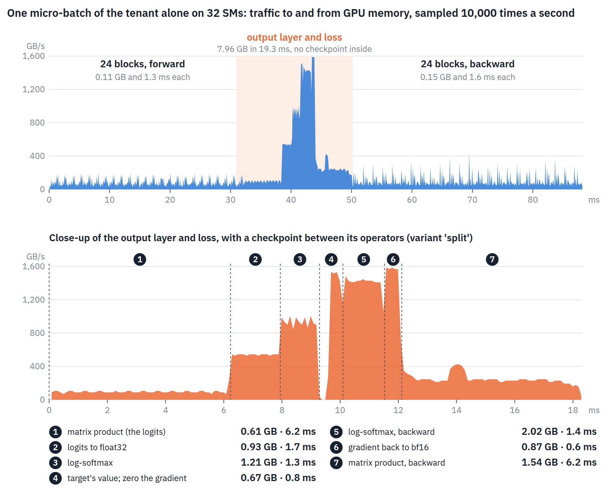
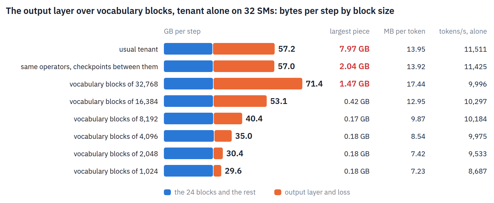
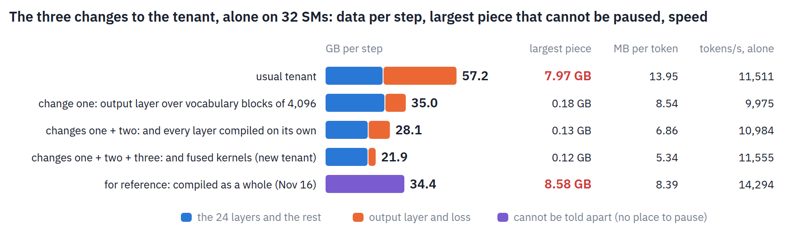
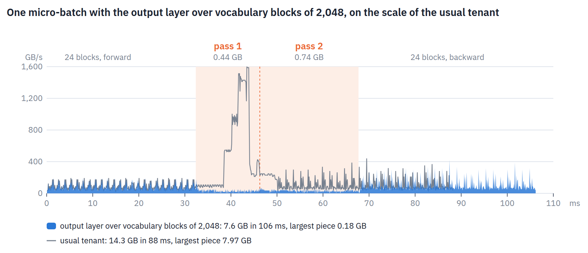
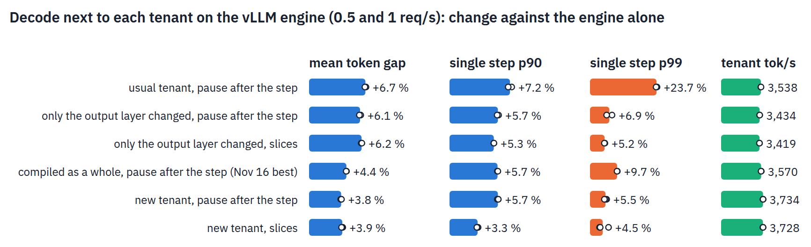
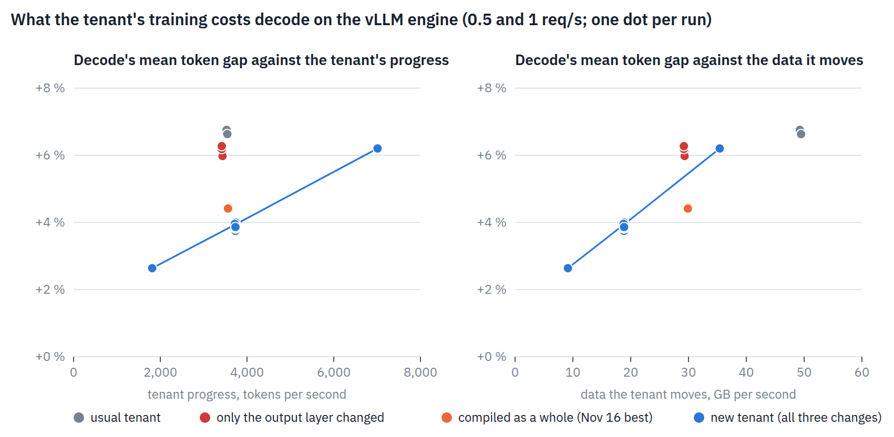
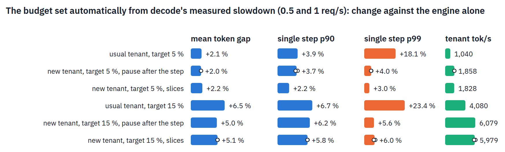

# From measuring to changing the tenant and its pauses: what was done on Nov 21–22 and what it shows

This document tells the round of work from the start and does not assume the reader saw any of it. It states the
problem first and then proceeds in the order "what was measured → so what was done → what exactly that is → the
result, and against what it is compared".

**Setting.** One RTX 5090 runs two jobs at the same time:

- **decode**: vLLM serving Llama-3-8B to real requests. It is the job to protect.
- **tenant**: a training job (a LoRA fine-tune of Qwen2.5-0.5B) that uses what decode leaves. Its training data are
  randomly generated token sequences; its role is to produce the computing load of a real fine-tune.

**One aim**: the tenant keeps training and decode slows as little as possible.

**Words used throughout.**

| Word | Meaning |
|---|---|
| A step (of the tenant) | One parameter update: 8 sequences of 512 tokens, 4,096 tokens. GPU memory does not allow all 8 at once, so they are computed in several batches (the measurements below use 4 batches of 2 sequences; while running, the tenant chooses the number of batches from the free GPU memory, see 3.4); below, "a batch" |
| Tenant progress | Tokens the tenant trains per second (tok/s) |
| Moving data | Bytes read and written between GPU memory and the compute units (SMs) during computation, in GB. The nominal limit of this path on this card is 1,780 GB per second |
| Budget | A rule for the tenant: "at most so many GB per second on average" |
| A decode step | Decode emits one token for every request being generated; about 12 milliseconds |
| Token gap | The time between two consecutive tokens of one request, i.e. the time of one decode step |
| TPOT | For one request, the average time per token |
| p90, p99 | Sort all values; the value at the 90 % / 99 % position. p99 speaks about the slowest 1 % |

**Every "x % slower" is computed the same way**: a statistic measured with the tenant, divided by **the same statistic
measured with no tenant on the same night in the same setting**, minus 1. For example "p99 +19 %" means: the p99 of
decode's single-step time with the tenant is 19 % above the p99 of decode's single-step time without it.

**The conclusions first** (how each was obtained, and the data, are in the sections named).

1. **The data moved by each part of a tenant step was measured.** A step of the usual tenant moves 57.2 GB, and 55 % of
   it is in the output layer and the loss at the end: four blocks per step of 7.97 GB each, with no place to pause
   inside, and a momentary traffic close to the limit of this card. (Section 2)
2. **From that, three changes were made to the tenant's computation**: the output layer and the loss computed over
   blocks of the vocabulary; the 24 layers of the model compiled one by one; the small operations inside each vocabulary
   block merged into one fused kernel. The training is unchanged. The tenant with all three (the "new tenant" below)
   moves 21.9 GB per step, 62 % less; runs as fast alone; can pause after every layer; needs less than half of the GPU
   memory for the same way of splitting a step into batches. (Section 3)
3. **The rule for pausing was changed to follow the data actually moved.** (Section 4)
4. **On vLLM next to decode, with the tenant doing the same amount of training (about 3,500–3,700 tokens per
   second)**: decode's mean token gap, against the runs without a tenant, is +6.7 % next to the usual tenant
   and +3.8 % next to the new tenant; the p99 of decode's single-step time, against the p99 without a
   tenant, is +23.7 % and +5.5 %. The best method of Nov 16 (the tenant compiled as a whole): mean
   +4.4 %, p99 +9.7 %. (Section 5.3)
5. **"Cutting the pause into small ones" now works, with a limited effect.** The tenant loses almost no progress; the
   p90 of decode's single-step time falls from +5.7 % above the no-tenant value to +3.3 %;
   decode's mean does not change (+3.8 % against +3.9 %) and the TPOT per request does not
   improve. (Section 5.4)
6. **Decode's cost follows the data the tenant moves.** With half and with twice the budget for the new tenant,
   decode's mean is +2.6 % and +6.2 % (tenant progress 1,812 and
   7,011 tokens per second); with the tenant on 16, 32 or 64 SMs the cost is almost the same.
   (Sections 5.5, 5.6)
7. **Not done**: the data per part with the tenant next to decode was not measured, the values of the tenant alone are
   used; the cautious automatic budget was not fixed; only the two lighter loads (0.5 and 1 request per second) are
   counted. (Section 7)

---

## 1. What was known before this round, and where it was stuck

Conclusions of the night of Nov 16 (details in `3_c1_c2.md`):

1. How much decode slows follows mainly the data the tenant moves per second.
2. So the tenant gets a budget (50 GB per second on average): on 32 SMs it computes a step at full speed and then pauses
   until its average is back under the budget. Decode's mean cost halves against the earlier method.
3. Compiling the whole tenant with `torch.compile` makes it move about four tenths less data per token, and decode's
   cost falls a little further.

Three things were left unsolved:

- **A. Pausing in small slices did not help.** The idea: instead of one long pause after a whole step, pause briefly
  every few milliseconds, so that every decode step is affected alike. Decode did not improve and the tenant lost 9 %
  of its training.
- **B. The slowest 1 % of decode steps were more than 20 % slower, with no known cause.**
- **C. Only the total data of a tenant step was known (13.47 MB per token on average), not which part of the step moves
  it.** The budget and "moving less data" both turn on this quantity, and there was only one average.

This round starts from C.

---

## 2. First: measure how much data each part of a tenant step moves

### 2.1 How

- The tenant's code has fixed places where a pause can be inserted: the start of each batch, and before the forward and
  before the backward computation of each of the model's 24 layers. The computation between two neighbouring places is
  called **a segment** below. The tenant can pause only between segments, so a segment is the smallest unit that can be
  scheduled.
- The tenant runs **alone** on the GPU (no decode), set up as in the experiments (32 SMs). At every place where it could
  pause, it first waits for the GPU to finish the work issued so far and then emits a named time mark.
- At the same time NVIDIA's Nsight Systems reads the card's memory read and write traffic 10,000 times a second.
- The traffic between two marks is the data that segment moved. It is averaged over many steps.
- Calibration: the GPU copies a 1 GiB tensor several times; the data moved is known and turns the tool's percentage
  into GB.

How reliable: two rounds on the same evening agree within 0.1 % on a step's total (57.13 and 57.17 GB); a second tool
(Nsight Compute, hardware counters kernel by kernel) gives 7.98 GB for the largest segment against 7.97 GB.

### 2.2 What it shows

A step of the usual tenant moves **57.2 GB** in 356 milliseconds (13.95 MB per token; the value of Nov 16, measured in another way, was 13.47 MB).

| Segment | Per batch | Data each | Time each | Data per second while it runs |
|---|---|---|---|---|
| One layer, forward | 24 | 0.11 GB | 1.3 ms | 82 GB |
| One layer, backward | 24 | 0.16 GB | 1.6 ms | 99 GB |
| Output layer and loss (forward and backward) | 1 | **7.97 GB** | 19.3 ms | 413 GB; for about 6 ms of it 500–1,500 GB |

*Figure 1 — top: memory traffic over one batch (2 sequences) of the usual tenant, every sample drawn; the shaded stretch
is the segment that holds the output layer and the loss. Bottom: the shaded stretch enlarged, split into its seven
operators.*

Three findings:

1. **55 % of a step's data is the output layer and the loss**, in 21 % of the time. The vocabulary has 151,936 entries:
   the model ends by computing 150 thousand scores (logits) for each of 1,024 positions. That tensor is 311–622 MB and is
   read and written about a dozen times while the loss is computed.
2. **There is no place to pause inside this segment.** Each batch has one block of 7.97 GB; a step has four.
3. **This segment peaks very high.** For about 6 ms in each batch the tenant moves 500–1,500 GB per second, close to the
   card's limit (1,780 GB), while decode itself normally uses about 1,300–1,400 GB per second.

### 2.3 What the three findings mean

- **For problem A (slices did not help)**: the old slicing code assumed every segment was the same amount of work. The
  largest segment is 70 times the smallest. The four blocks of 7.97 GB cannot be cut and upset the timetable; the 9 % the
  tenant lost are exactly these four blocks.
- **For problem B (the slowest 1 %)**: four times per step, for about 6 ms each, the tenant takes nearly the whole memory
  path. The decode steps that meet these milliseconds are the likely slowest 1 %. At this point that was an inference;
  section 5 checks it on vLLM.
- **For where to move less data**: change the output layer and the loss first; they are more than half.

So two things follow: **change the tenant's computation so that it moves less data and can pause everywhere** (section
3), and **change the rule for pausing so that pauses follow the data actually moved** (section 4).

---

## 3. Second: three changes to the tenant's computation

None of the three changes what is trained: the loss is the same and the gradients of the parameters are the same within
numerical error (3.4). All numbers in this section are measured with the **tenant alone** and compared with the "usual
tenant".

### 3.1 Change one: the output layer and the loss computed in blocks of the vocabulary

**Before**: all 1,024 × 151,936 scores are computed at once into one large tensor, and the loss and its gradient are
computed on that tensor.

**Now**: the 150 thousand vocabulary entries are cut into small blocks (4,096 entries each) and processed block by
block, in two passes:

- Pass 1: for each block, compute the scores of all positions on this block; add up only the sum that the normalisation
  needs and note the score of the correct answer; then drop the block's scores. After pass 1 the loss is known.
- Pass 2: for each block, compute the scores again, turn them into probabilities, and add up the gradient that goes back
  into the model.

The large tensor never exists; a block's intermediate results are a few MB. The price is one more matrix product (three
instead of two). It requires that the output layer's weights are not trained, which holds for a LoRA fine-tune.

On Nov 16 another split was tried, grouping the **positions**; it tripled the data, because every group read the 272 MB
of output weights again. Splitting along the **vocabulary** reads the weights twice per batch.

Result (the block size matters):

| Entries per block | Data per step | Against the usual tenant | Largest piece that cannot be paused | Tenant speed alone |
|---|---|---|---|---|
| Usual tenant (no blocks) | 57.2 GB | – | 7.97 GB | 11,511 tok/s |
| 32,768 | 71.4 GB | 25 % more | 1.47 GB | 9,996 |
| 8,192 | 40.4 GB | 29 % less | 0.17 GB | 10,184 |
| 4,096 | 35.0 GB | 39 % less | 0.18 GB | 9,975 |
| 2,048 | 30.4 GB | 47 % less | 0.18 GB | 9,533 |
| 1,024 | 29.6 GB | 48 % less | 0.18 GB | 8,687 |

*Figure 2 — data per step by block size. Blue: the 24 layers; orange: the output layer and the loss.*

- Blocks that are too large make it worse; savings start at 8,192 and stop growing below 2,048.
- The largest piece that cannot be paused goes from 7.97 GB to 0.18 GB (one layer of the model). The four large blocks
  are gone.
- The price: the tenant alone is 13–25 % slower, from the extra matrix product and many very small computations.

### 3.2 Change two: each of the 24 layers compiled on its own

`torch.compile` merges chains of small computations into a few, so that intermediate results are no longer written to
GPU memory. On Nov 16 the **whole model** was compiled as one piece: four tenths less data, but no place to pause inside
the compiled model (a batch is one block of 8.6 GB), so slicing could not be used at all.

Now **every layer is compiled separately**: the places to pause between layers stay.

One trap on the way: after the first attempt neither the data nor the speed had changed. PyTorch limits how often the
same piece of code may be recompiled (8 times); only the first 8 of the 24 layers were really compiled and the others
fell back to uncompiled without any message. With the limit raised all 24 are compiled.

Result: the data of the 24 layers goes from 25.5 GB per step to 18.7 GB (27 % less), and the tenant can still pause
after every layer.

A fact that was not known before follows from this: Nov 16's whole-model compilation moves 22.8 GB less per step
(57.2 → 34.4 GB), and compiling the 24 layers can save only 6.8 GB. So about seven tenths of those "four tenths less"
came from the output layer and the loss and only about three tenths from the 24 layers (estimated from what the
per-layer compilation saves).

### 3.3 Change three: the small computations of each vocabulary block merged into fused kernels

In change one every vocabulary block runs about ten small computations (type conversion, exponential, sums, subtracting
the correct answer, …). The ones between the two matrix products are compiled into one merged kernel that keeps its
intermediate results in registers instead of GPU memory.

Result: the output layer and the loss move 3.2 GB per step instead of 8.9 GB (change one, blocks of 4,096; the usual
tenant: 31.4 GB), and the speed comes back.

### 3.4 The three changes together

| Tenant | Data per step | Against usual | Largest piece that cannot be paused | Speed alone | GPU memory needed with this way of splitting (4 batches of 2) |
|---|---|---|---|---|---|
| Usual | 57.2 GB | – | 7.97 GB | 11,511 tok/s | 5.0 GiB |
| Change one only (blocks of 4,096) | 35.0 GB | 39 % less | 0.18 GB | 9,975 (13 % slower) | not measured |
| Changes one + two | 28.1 GB | 51 % less | 0.13 GB | 10,984 (5 % slower) | not measured |
| **Changes one + two + three** | **21.9 GB** | **62 % less** | **0.12 GB** | **11,555 (the same)** | **2.3 GiB** |
| For reference: the whole-model compilation of Nov 16 | 34.4 GB | 40 % less | 8.58 GB | 14,294 (24 % faster) | not measured |

*Figure 3 — data per step of each tenant. Purple: after whole-model compilation the output layer cannot be told apart.
Red figures: a piece of more than 1 GB that cannot be paused.*

Below, the tenant with changes one + two + three is called **the new tenant**, and the one with change one only **the
tenant with only the output layer changed**.

Against the usual tenant, the new tenant moves 62 % less data, is as fast, can pause after every layer and needs less
than half of the GPU memory for the same way of splitting a step into batches.

**What exactly "the new tenant" is.** The model (Qwen2.5-0.5B), the LoRA (rank 16, on the q, k, v and o matrices of the
attention), the training data and the step of 8 sequences × 512 tokens are those of the usual tenant. The only
difference is these start-up options:

| Option | What it does |
|---|---|
| `--head vocab --vocab-block 4096` | Change one: the output layer and the loss over blocks of the vocabulary, 4,096 entries per block |
| `--compile-blocks` | Change two: the 24 layers compiled one by one |
| `--head-fused` | Change three: the small computations of each vocabulary block merged into fused kernels |
| `--no-slow-shapes` | The ways of splitting a step that keep part of the data in host RAM are not used (the per-layer compilation does not support them); if not even the smallest way fits in GPU memory, the tenant pauses |
| `--tiers-json results_prof/tiers_cb_vocab4096f.json` | Its own measured table of GPU-memory needs instead of the usual tenant's |

**Into how many batches a step is split is chosen by the tenant while it runs, from the GPU memory free at that
moment**: fewer batches if memory allows (faster), more if not. The tables above were all measured with "4 batches of
2 sequences", so that both tenants are compared in the same way of splitting. The new tenant in each way (measured
alone):

| How a step is split | GPU memory needed | Data per step | Largest piece that cannot be paused | Speed alone |
|---|---|---|---|---|
| 1 batch of 8 | 5.01 GiB | 26.9 GB | 0.68 GB | 15,243 tok/s |
| 2 batches of 4 | 3.25 GiB | 20.5 GB | 0.24 GB | 13,741 tok/s |
| 4 batches of 2 | 2.32 GiB | 21.9 GB | 0.12 GB | 11,555 tok/s |
| 8 batches of 1 | 1.84 GiB | 29.1 GB | 0.08 GB | 9,225 tok/s |

"1 batch of 8" moves more data, so it is switched off for the new tenant. **In the vLLM runs of section 5 the new
tenant computed about 90 % of its steps as "2 batches of 4"** (it needs little memory, so this larger way fits most of
the time) and 7–8 % as "4 batches of 2". The usual tenant computed about 67 % of its steps as "4 batches of 2" and about
22 % as "8 batches of 1". The table of data per part that slices use was measured separately for each way of splitting
the new tenant's step.

**Is the training the same?** Checked on one batch with the real model:

- Loss: the same value for every algorithm (to five decimals).
- Gradients on the LoRA parameters: the new algorithm differs from the original by about 0.5 %; the original run twice
  differs from itself by 0.4 % (the error of half-precision arithmetic).
- Training for 1,500 steps (same data, same random seed, tenant alone): the loss of the new tenant and of the usual tenant
  differs by 0.0009 per step on average and by 0.06 at most; the usual tenant run a second time differs from its first
  run by 0.0014 on average and 0.11 at most. So the new tenant is no further from the usual one than the usual one is
  from itself. The loss at step 1,500 is 11.9357 against 11.9359.

So "the same within numerical error", not bit for bit.

*Figure 4 — traffic over one batch with only the output layer changed (blocks of 2,048, blue), on the axes of the usual
tenant (grey line). The stretch that reached 1,500 GB per second is gone.*

---

## 4. Third: a rule for pausing that follows the data actually moved

### 4.1 What it does

The budget is "at most so many GB per second on average". The new rule uses the table of section 2 directly:

1. The table holds the data of every segment of a step, so at any place where the tenant could pause, "how much this
   step has moved so far" is known.
2. By the budget, the time by which that much data "should" have been moved is known too: data so far ÷ budget.
3. Choose a time window (for example 12 ms, about one decode step). Budget × window is the size of one chunk of data.
   Every time a chunk is full, the tenant stops at the nearest place where it can pause and waits until the time
   computed in 2.
4. If a segment ran slower than the budget allows (it is late), the time owed is made up by shorter pauses later, by at
   most one window.
5. At the end of the step the account is settled once more, so that the step's average stays within the budget.

"Compute a whole step, then pause" is a special case: an infinite window, settled only at the end of the step. So the
two ways of pausing below run the same code and differ only in the window:

- **Pause after the step**: compute a step at full speed, then pause until the average is within the budget.
- **Slices**: pause briefly every time "budget × 12 ms" of data has been moved.

### 4.2 Checking the rule by itself first

The tenant runs **alone** under a budget of 50 GB per second (no decode). Two questions.

**Does the tenant get all the progress the budget allows?**

| Way of pausing | Progress the budget allows | Progress obtained |
|---|---|---|
| The old slices of Nov 16 | 3,582 tok/s | 3,522 tok/s (98.3 %; next to vLLM that night only 91 %) |
| The new rule, slices | 3,582 tok/s | 3,581 tok/s (100 %) |

**Is the traffic even?** In any 12 ms (the length of a decode step), how much does the tenant use at most:

| Tenant and way of pausing | Data per second in the worst 12 ms | Times the budget |
|---|---|---|
| Usual tenant, pause after the step | 610 GB | 12 |
| Usual tenant, slices | 610 GB | 12 |
| Only the output layer changed, pause after the step | 107 GB | 2.1 |
| Only the output layer changed, slices | 72 GB | 1.4 |

Conclusion: the new rule no longer loses progress. For the usual tenant slices still cannot even out the traffic,
because the four blocks of 7.97 GB cannot be cut; only once the tenant is changed do slices flatten it. **The two go
together: the tenant must be able to pause everywhere before slicing means anything.**

This section shows only that the rule itself is right. It says nothing about how much less decode slows; that is the
next section.

---
## 5. Fourth: on vLLM, next to decode

The numbers of the three sections above were measured with the tenant alone. This section is where the conclusions
are: both jobs run on one card at the same time, and what counts is how much decode slows and how much the tenant
trains.

### 5.1 How it was measured

- **Decode**: vLLM serves Llama-3-8B and receives an 11-minute sequence of requests. The arrival rate changes in
  phases, from 0.5 to 4 requests per second. Each request carries a prompt of about 6,300 tokens and generates 128
  tokens.
- **Tenant**: on the same card as decode, confined to 32 SMs.
- **Every setting is run once in full, 11 minutes.** Only the phases with 0.5 and 1 request per second are counted
  below (about four and a half minutes together). These two loads are light, decode does not queue by itself, and the
  tenant's effect shows most clearly. The first 10 seconds of each phase and the first 30 seconds of the run are left
  out (the tenant is still starting).
- **Baseline**: runs on the same night with the same setting and no tenant. There were several tonight; they are
  pooled. Among them the mean and the median differ by less than 0.2 %; the p99 of the single-step time differs by
  about 4 %, so for the p99 numbers below a difference within 3–4 points should not be taken as real.
- **How the budget is chosen**: so that every tenant progresses at about the same rate (about 3,500 tokens per
  second); what is compared is then "for the same amount of training, what decode pays". Tenants move different
  amounts of data per token, so the budgets differ in GB: 50 GB per second for the usual tenant, 19.2 GB per second for
  the new tenant.

**The quantities** (each is "the value with the tenant ÷ the baseline's value of the same quantity − 1"):

| Quantity | What it is |
|---|---|
| Mean token gap | The mean of all gaps between consecutive tokens of all requests. How much slower decode is as a whole |
| TPOT median, TPOT p90 | First "average time per token" for each request, then the median and the p90 over all requests. The speed a user sees |
| Single-step time: median, p90, p99 | Token gaps taken one by one, without two kinds that have nothing to do with the tenant: gaps during which another request arrived, and the engine's own occasional gaps of double length or near zero. The rest is grouped by "how many requests were being generated", each group is compared with the same group of the baseline, and the groups are averaged |
| Tenant progress | Tokens the tenant trains per second in the counted phases; the average over the whole 11 minutes is given too |

**Why the single-step time leaves those two kinds out.** With no tenant, the longest 1 % of all token gaps are
already 66 milliseconds, more than 5 times a normal step (about 12 milliseconds). They happen when another request
arrives and the engine first processes its prompt; every request being generated has to wait. This has nothing to do
with the tenant, but it is so large that it hides what the tenant does: whichever tenant is there, "the p99 of all
gaps" changes by only about 1 %. To see the tenant's effect on each decode step these gaps have to be taken out
first. So that not only filtered numbers are given, the tables below also give the p90 and p95 of "all gaps", with
nothing left out.

### 5.2 First a check: tonight's measurements match Nov 16

Before comparing anything new, the two methods of Nov 16 were run again unchanged, to see whether tonight's machine
behaves as it did then.

| setting | runs | decode mean token gap | TPOT p90 | single step, median | single step p90 | single step p99 | all gaps p95 (nothing left out) | tenant progress (tok/s) | tenant progress over the 11 minutes (tok/s) |
|---|---|---|---|---|---|---|---|---|---|
| usual tenant, pause after the step | 2 | +6.7 % | +6.8 % (+6.6 % to +6.9 %) | +5.0 % (+4.9 % to +5.1 %) | +7.2 % (+7.0 % to +7.4 %) | +23.7 % (+23.5 % to +23.9 %) | +11.4 % | 3,538 | 2,145 (2,111 to 2,179) |
| tenant compiled as a whole, pause after the step | 2 | +4.4 % | +4.5 % (+4.4 % to +4.6 %) | +3.0 % | +5.7 % | +9.7 % | +5.9 % (+5.8 % to +6.0 %) | 3,570 | 2,077 (2,030 to 2,123) |

The Nov 16 values below were computed again from that night's raw records with tonight's script, so both nights
are measured in the same way.

- With no tenant, decode's mean token gap: 12.68 ms on Nov 16, 12.63 ms tonight (median 12.01 against 11.98 ms).
- Usual tenant, pause after the step: decode's mean, +6.3 % on Nov 16 and +6.7 % tonight; the p99 of single
  steps, +24.0 % against +23.7 %.
- Tenant compiled as a whole, pause after the step (the best method of Nov 16): decode's mean, +4.2 % then and
  +4.4 % tonight; the p99 of single steps, +10.7 % against +9.7 %.
- Repeats of one setting differ by less than 0.2 points in the mean. So differences of 0.5 points or more in a mean
  can be trusted below; for the p99 of single steps a difference needs 3–4 points to count.

### 5.3 How much less decode slows once the tenant is changed

Four tenants, all pausing after the step, each with the budget that gives a tenant progress of about 3,500 tokens per
second: 50 GB per second for the usual tenant, 30.7 GB per second for the tenant with only the output layer changed,
19.2 GB per second for the new tenant; the tenant compiled as a whole keeps its setting of Nov 16 (the same cap on
progress as the usual tenant, 3,712 tokens per second).

| setting | runs | decode mean token gap | TPOT p90 | single step, median | single step p90 | single step p99 | all gaps p95 (nothing left out) | tenant progress (tok/s) | tenant progress over the 11 minutes (tok/s) | share of time the tenant computes |
|---|---|---|---|---|---|---|---|---|---|---|
| usual tenant | 2 | +6.7 % | +6.8 % (+6.6 % to +6.9 %) | +5.0 % (+4.9 % to +5.1 %) | +7.2 % (+7.0 % to +7.4 %) | +23.7 % (+23.5 % to +23.9 %) | +11.4 % | 3,538 | 2,145 (2,111 to 2,179) | 60 % |
| only the output layer changed | 2 | +6.1 % (+6.0 % to +6.1 %) | +6.3 % | +5.3 % | +5.7 % (+5.7 % to +5.8 %) | +6.9 % (+5.9 % to +7.8 %) | +7.3 % (+7.1 % to +7.4 %) | 3,434 | 2,150 (2,135 to 2,166) | 68 % |
| compiled as a whole (the best of Nov 16) | 2 | +4.4 % | +4.5 % (+4.4 % to +4.6 %) | +3.0 % | +5.7 % | +9.7 % | +5.9 % (+5.8 % to +6.0 %) | 3,570 | 2,077 (2,030 to 2,123) | 44 % |
| new tenant | 3 | +3.8 % | +4.0 % | +2.1 % | +5.7 % | +5.5 % (+5.1 % to +5.9 %) | +4.0 % (+2.7 % to +5.1 %) | 3,734 | 2,480 | 39 % |

*Figure 5 — the six settings of this section and the next side by side. Each bar is the change against tonight's runs
with no tenant; where a setting was run more than once, the circles are the single runs. The last column is the tenant's
progress.*

Row by row:

1. **Only the output layer changed (change one).** Decode's mean hardly moves (+6.7 % → +6.1 %),
   but the p99 of single-step time falls from +23.7 % to +6.9 %. This confirms the inference of
   section 2: **the slowest 1 % of decode steps were the ones that met the output-layer segments**. Problem B is
   answered.
2. **The new tenant (all three changes).** Decode's mean falls to +3.8 %, almost half of the usual
   tenant's; the TPOT p90 per request falls from +6.8 % to +4.0 %.
3. **Against the best method of Nov 16 (whole-model compilation)**: decode's mean is a little lower
   (+3.8 % against +4.4 %), not by much. The clear gains are elsewhere: a lower p99 of single
   steps (+5.5 % against +9.7 %), and about 19 % more training over the
   whole 11 minutes (2,480 against 2,077 tok/s). The reason for the latter was not worked
   out. The logs show that both tenants were stopped for lack of GPU memory for only about 2 seconds, so it is not
   "one can still train and the other has to stop"; the difference arises in the phases with many requests, where
   every step of both tenants gets slower and those of the tenant compiled as a whole more so (1.86 against 1.66 seconds
   per step on average over the run).

One thing is not explained: the tenant with only the output layer changed and the tenant compiled as a whole move about
the same data per second when measured alone (about 30 GB), yet decode's mean cost differs (+6.1 % against
+4.4 %). So "data moved per second" explains most of the differences but not all. A possible reason is that the
data a tenant moves next to decode is not what it moves alone (section 7); that was not measured tonight.

### 5.4 Do slices help

Same tenant, same budget, only the way of pausing differs: compute a whole step and then pause, or pause briefly every
time "budget × 12 ms" of data has been moved.

| setting | runs | decode mean token gap | TPOT p90 | single step, median | single step p90 | single step p99 | all gaps p95 (nothing left out) | tenant progress (tok/s) | tenant progress over the 11 minutes (tok/s) |
|---|---|---|---|---|---|---|---|---|---|
| only the output layer changed, pause after the step | 2 | +6.1 % (+6.0 % to +6.1 %) | +6.3 % | +5.3 % | +5.7 % (+5.7 % to +5.8 %) | +6.9 % (+5.9 % to +7.8 %) | +7.3 % (+7.1 % to +7.4 %) | 3,434 | 2,150 (2,135 to 2,166) |
| only the output layer changed, slices | 2 | +6.2 % | +6.8 % | +5.0 % | +5.3 % | +5.2 % | +6.6 % (+6.4 % to +6.7 %) | 3,419 | 2,123 |
| new tenant, pause after the step | 3 | +3.8 % | +4.0 % | +2.1 % | +5.7 % | +5.5 % (+5.1 % to +5.9 %) | +4.0 % (+2.7 % to +5.1 %) | 3,734 | 2,480 |
| new tenant, slices | 3 | +3.9 % | +4.3 % (+4.2 % to +4.4 %) | +3.2 % | +3.3 % | +4.5 % (+3.4 % to +6.6 %) | +3.5 % | 3,728 | 2,420 |

- **The tenant loses almost no progress any more.** For the new tenant: in the phases counted here,
  3,734 tok/s with the pause after the step and 3,728 with slices, the same; over the whole
  11 minutes 2,480 against 2,420 tok/s, about 2 % less with slices. The old slices of
  Nov 16 lost 9 % in the counted phases alone. The "lost progress" half of problem A is solved.
- **Decode's steps are affected more evenly.** For the new tenant: the median single-step time rises from
  +2.1 % to +3.2 % and the p90 falls from +5.7 % to +3.3 %; the two
  meet. That is what slices are for: no group of decode steps that is hit hard while the rest is not hit at all.
- **The mean does not change** (+3.8 % against +3.9 %). Slices spread the same total effect;
  they do not shrink it.
- **No visible gain for the TPOT per request** (p90: +4.0 % against +4.3 %). A request
  has 128 steps, so unevenness between single steps averages out inside a request anyway.

So the full answer to problem A: slices now work as designed and lower the p90 of decode's single steps by about 2
points; they do not lower the mean and do not help request-level figures. Use them if the worst gap between tokens
matters; if only the TPOT per request matters, pausing after the step is enough.

### 5.5 What more tenant training costs decode

The new tenant, slices, three fixed budgets.

| setting | runs | decode mean token gap | TPOT p90 | single step, median | single step p90 | single step p99 | all gaps p95 (nothing left out) | tenant progress (tok/s) | tenant progress over the 11 minutes (tok/s) | share of time the tenant computes |
|---|---|---|---|---|---|---|---|---|---|---|
| 9.6 GB per second | 1 | +2.6 % | +2.8 % | +2.2 % | +2.4 % | +2.7 % | +2.2 % | 1,812 | 1,204 | 21 % |
| 19.2 GB per second | 3 | +3.9 % | +4.3 % (+4.2 % to +4.4 %) | +3.2 % | +3.3 % | +4.5 % (+3.4 % to +6.6 %) | +3.5 % | 3,728 | 2,420 | 42 % |
| 38.4 GB per second | 1 | +6.2 % | +7.0 % | +4.9 % | +5.4 % | +8.5 % | +5.7 % | 7,011 | 4,562 | 76 % |

*Figure 6 — one dot per run. Left: decode's mean cost against the tenant's progress. Right: the same dots with the
tenant's data per second on the horizontal axis (progress times the data per token measured alone).*

- Each further 1,000 tok/s of tenant training costs decode about 0.7 points in the mean. About 1.3 points are there as
  soon as the tenant is present at all.
- **Twice the training at the same cost to decode**: the new tenant at 7,011 tokens per second slows
  decode by +6.2 %; the usual tenant at 3,538 tokens per second already slows it by
  +6.7 %.
- The other way round, **the same training at about half the cost** (section 5.3).

### 5.6 How many SMs for the tenant

On Nov 16 the tenant was given 32 SMs. The new tenant is much lighter, so 16 and 64 were tried again. Same budget
(19.2 GB per second), slices.

| setting | runs | decode mean token gap | TPOT p90 | single step p90 | single step p99 | tenant progress (tok/s) | share of time the tenant computes |
|---|---|---|---|---|---|---|---|
| 16 SMs | 1 | +4.1 % | +4.4 % | +3.3 % | +3.5 % | 3,466 | 66 % |
| 32 SMs | 3 | +3.9 % | +4.3 % (+4.2 % to +4.4 %) | +3.3 % | +4.5 % (+3.4 % to +6.6 %) | 3,728 | 42 % |
| 64 SMs | 1 | +4.2 % | +4.3 % | +3.9 % | +4.6 % | 3,702 | 27 % |

- Decode's mean cost is almost the same for the three SM counts.
- The share of time the tenant computes differs more than twofold (66 % on 16 SMs,
  27 % on 64). So **decode's cost follows the data the tenant moves, not how many SMs it uses or how
  long it computes**.
- On 16 SMs the tenant cannot keep up with its budget and loses about 7 % of its progress. 32 SMs stay a good choice;
  there is no reason to change it.

### 5.7 Letting the budget follow decode's measured slowdown

The budgets so far were fixed by hand. Another way (already there on Nov 16) is to give a target, for example "decode
at most 5 % slower": every 2 seconds the scheduler looks at how much slower decode actually is, lowers the tenant's
budget if it is too slow and raises it otherwise. Tonight this was joined with the new tenant and the new rule for
pausing.

| setting | runs | decode mean token gap | TPOT p90 | single step, median | single step p90 | single step p99 | all gaps p95 (nothing left out) | tenant progress (tok/s) | tenant progress over the 11 minutes (tok/s) |
|---|---|---|---|---|---|---|---|---|---|
| usual tenant, target 5 % (as on Nov 16) | 1 | +2.1 % | +1.7 % | +0.9 % | +3.9 % | +18.1 % | +4.5 % | 1,040 | 676 |
| new tenant, target 5 %, pause after the step | 2 | +2.0 % | +2.4 % (+2.2 % to +2.6 %) | +1.2 % | +3.7 % (+3.5 % to +3.9 %) | +4.0 % (+4.0 % to +4.1 %) | +1.2 % (+1.1 % to +1.3 %) | 1,858 | 1,225 (1,197 to 1,253) |
| new tenant, target 5 %, slices | 1 | +2.2 % | +2.6 % | +1.8 % | +2.2 % | +3.0 % | +1.9 % | 1,828 | 1,142 |
| usual tenant, target 15 % (as on Nov 16) | 1 | +6.5 % | +6.7 % | +4.9 % | +6.7 % | +23.4 % | +10.5 % | 4,080 | 2,389 |
| new tenant, target 15 %, pause after the step | 1 | +5.0 % | +5.2 % | +3.6 % | +6.2 % | +5.6 % | +5.9 % | 6,079 | 3,859 |
| new tenant, target 15 %, slices | 2 | +5.1 % | +5.3 % (+5.1 % to +5.5 %) | +3.8 % | +5.8 % | +6.0 % (+5.5 % to +6.4 %) | +4.5 % (+4.4 % to +4.6 %) | 5,979 (5,829 to 6,128) | 3,848 (3,748 to 3,947) |

*Figure 7 — The six settings of the table above. Each bar is the change against tonight's runs without a tenant; where
a setting was run more than once the dots are the single runs. The last column is the tenant's progress.*

- **Target 5 %**: with the new tenant (pause after the step) decode's mean is +2.0 % slower and the
  tenant progresses at 1,858 tokens per second. The usual tenant on the same night:
  +2.1 %, 1,040. So for about the same cost to decode the new tenant trains about 1.8 times
  as much; and with the usual tenant the p99 of decode's single-step time is still +18.1 % above the
  no-tenant value, with the new tenant +4.0 %.
- **Target 15 %**: with the new tenant (pause after the step) decode's mean is +5.0 % slower and
  the tenant progresses at 6,079 tokens per second. The usual tenant on the same night:
  +6.5 %, 4,080. So decode slows less and the tenant trains about 1.5 times as much; the
  p99 of single steps is +5.6 % against +23.4 %.
- **The two rows of the usual tenant are one run each, and where the automatic setting settles differs from run to
  run.** The Nov 16 records, computed again with the same script: usual tenant, target 5 %: decode +2.9 %, 1,607 tok/s
  (tonight +2.1 %, 1,040); target 15 %: +6.4 %, 4,096 tok/s (tonight +6.5 %,
  4,080). Both nights together give the same conclusion: where decode is 2–3 % slower the usual tenant
  trains 1,000–1,600 tokens per second, and the new tenant reaches 1,858 at
  +2.0 %.
- **The automatic setting is cautious**: the target says 15 % and decode ends up only 5–6 % slower. The reason found on
  Nov 16 is that its measure of "how much slower decode is" also counts the slowdown requests cause each other. That
  reason was not checked again tonight and the setting was not changed. So "target 5 %" and "target 15 %" are here the
  names of two levels, not the slowdown actually reached.
- **Slices do here what they do under a fixed budget**: at the 5 % target the p90 of decode's single steps falls from
  +3.7 % (pause after the step) to +2.2 % (slices), with the mean and the tenant's
  progress about unchanged. At the 15 % target the two ways of pausing differ little (p90 of single steps:
  +6.2 % against +5.8 %). The table gives the number of runs of each setting,
  one or two.
- One setting was changed on the way: the range of budgets for the automatic setting had been chosen for the usual
  tenant (10–150 GB per second). The new tenant moves four tenths of the data per token, so for it the lower end was too
  high to slow it down. Scaled to 4–60 GB per second it works. The one run made before that change is listed apart and
  not used for conclusions.

---

## 6. Conclusions

Answering the three problems of the start.

**C. Which part of a tenant step moves the data?** Measured: 55 % is the output layer and the loss, four blocks of
7.97 GB each that cannot be paused and that peak near the card's limit. This measurement became the basis of everything
after it.

**B. What caused the slowest 1 % of decode steps?** Those four blocks. With the output layer computed over blocks of the
vocabulary, the p99 of decode's single-step time goes from +23.7 % above the no-tenant value to
+6.9 %; with the new tenant and slices it is +4.5 %.

**A. Why did slices not help, and now?** They did not because the slicing code assumed all segments were equal while
they differ 70-fold, and the four largest could not be cut at all. Now pauses follow the data actually moved and the
tenant can pause everywhere, and slices work as designed: almost no lost progress (about 2 % over the whole 11 minutes), and the p90 of decode's single steps about
2 points lower. They do not lower decode's mean and do not help the TPOT per request.

**For the main line (the tenant keeps training, decode slows as little as possible) the most useful result of the night
is the three changes to the tenant:**

| What is compared | Usual tenant, pause after the step (the method of Nov 16) | New tenant, slices |
|---|---|---|
| Decode's mean slowdown at the same tenant training (about 3,500–3,700 tok/s) | +6.7 % | +3.9 % |
| The same, TPOT p90 per request | +6.8 % | +4.3 % |
| The same, p99 of decode's single-step time | +23.7 % | +4.5 % |
| Tenant training when decode is a little over 6 % slower | 3,538 tok/s | 7,011 tok/s |
| Budget set automatically, level "target 5 %" (decode's mean in fact about 2 % slower): how much the tenant trains | 1,040 tok/s | 1,828 tok/s |
| Data per step, tenant alone | 57.2 GB | 21.9 GB |
| GPU memory needed with the same way of splitting a step (4 batches of 2) | 5.0 GiB | 2.3 GiB |

Against the best method of Nov 16 (the tenant compiled as a whole) the new tenant is only a little better in decode's
mean (+4.4 % → +3.9 %). The progress is mainly: a smaller tail of decode's single steps, about
17 % more tenant training over the whole 11 minutes, and a place to pause after every layer, so
that slices and the automatic budget can be used with it.

**One more conclusion, about where the cost comes from**: at one budget, with the tenant on 16, 32 or 64 SMs, decode's
mean cost is almost the same. Decode's cost follows the data the tenant moves. This supports the overall direction of
controlling that data once more.

---

## 7. What did not work, and what to read with care

- **Leave 3–4 points of margin on any p99.** Between tonight's no-tenant baselines the p99 of single steps itself
  differs that much. Means, medians and p90 do not have this problem (they differ by less than 0.2 points).
- **The single-step statistics leave out two kinds of gaps** (those while another request is admitted, and the engine's
  own occasional double gaps); see 5.1. With nothing left out, the p99 of token gaps is set mainly by the engine itself
  and changes by about 1 % with or without a tenant; the tables also give the p95 with nothing left out.
- **The data per segment was measured with the tenant alone.** Whether it is the same next to decode was not measured
  tonight; it was used as "about the same". The unexplained difference of 5.3 may come from this.
- **Only the arrival rates of 0.5 and 1 request per second are counted.** At higher rates decode queues by itself and
  the tenant often stops for lack of GPU memory; that was not analysed separately.
- **The new tenant does not support the ways of splitting a step that keep part of the data in host RAM.** When GPU memory is very tight it can
  only pause. It needs less GPU memory to begin with, and under tonight's load it trained more over the 11 minutes than
  the usual tenant; more extreme memory pressure was not tried.
- **The cautious automatic setting (5.7) was left as it is.**
- **Four runs are not used for conclusions** and are listed in the table at the end of this section: one was cut
  13 seconds before its end; one was made while the new tenant still used the usual tenant's table of memory needs (it
  needs less than half of that memory; with the old table it took the larger ways of splitting for too large and
  computed 73 % of its steps as "4 batches" and 25 % as "8 batches" instead of the "2 batches" that would have fitted); one was made while the new tenant still used "1 batch of 8" (63 % of its steps), which moves more data; one was
  made before the range of the automatic budget was changed.
- **Whether the training is the same was checked as far as "the loss agrees step by step over 1,500 steps"** (3.4).
  The tenant trains on randomly generated token sequences; it is a stand-in job that produces load. So what is compared
  is numerical agreement, not how good the final model is. A training on real data run to its end was not compared.
- **A problem found and fixed on the way**: the per-layer compilation at first compiled only 8 layers (PyTorch's limit
  on recompilations) without any message; it showed only in "the data did not change".
- One comparison was started tonight on a program that imitates decode instead of vLLM; it was stopped half-way and
  none of it is used in this document.

The four runs not used for conclusions (the values are still against tonight's runs without a tenant):

| setting | runs | decode mean token gap | TPOT p90 | single step, median | single step p90 | single step p99 | all gaps p95 (nothing left out) | tenant progress (tok/s) | tenant progress over the 11 minutes (tok/s) |
|---|---|---|---|---|---|---|---|---|---|
| new tenant, pause after the step, the run cut 13 s before its end | 1 | +4.4 % | +4.9 % | +3.3 % | +4.9 % | +8.4 % | +5.8 % | 2,961 | 1,911 |
| new tenant, pause after the step, with the usual tenant's table of memory needs | 1 | +3.9 % | +4.3 % | +3.0 % | +4.6 % | +4.2 % | +5.6 % | 3,449 | 2,091 |
| new tenant, pause after the step, while it still computed a step as 1 batch of 8 | 1 | +3.6 % | +3.6 % | +1.9 % | +6.3 % | +9.0 % | +3.2 % | 3,056 | 2,110 |
| new tenant, automatic budget, target 5 %, slices, before the range was changed | 1 | +3.3 % | +4.0 % | +2.6 % | +3.0 % | +4.8 % | +2.9 % | 4,001 | 2,476 |

---

## 8. What could come next

1. **Measure the data per segment with tenant and decode running together**, turning the "about the same" of section 7
   into a measurement.
2. **Fix the cautious automatic setting**, so that "target 15 %" really uses 15 %. By the relation of 5.5 the tenant
   could then train a good deal more.
3. **The data left in the 24 layers**: 85 % of the new tenant's data is in them. In the usual tenant's 24 layers, 58 %
   is in the MLP part (measured alone). That is the next place for a fused kernel.
4. **Run one training on real data to its end** to confirm that the three changes leave the final model unchanged.
5. Behaviour at higher arrival rates and under more memory pressure.
