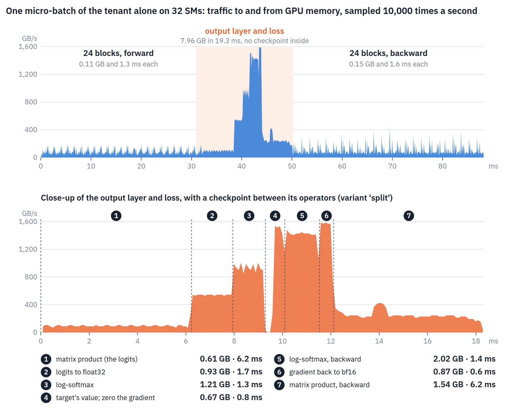
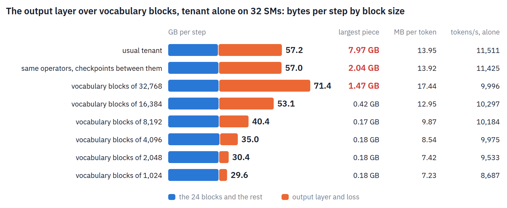
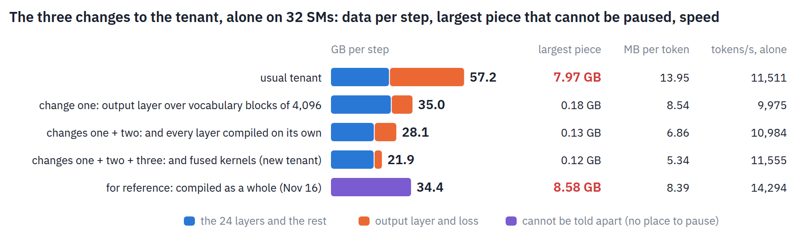
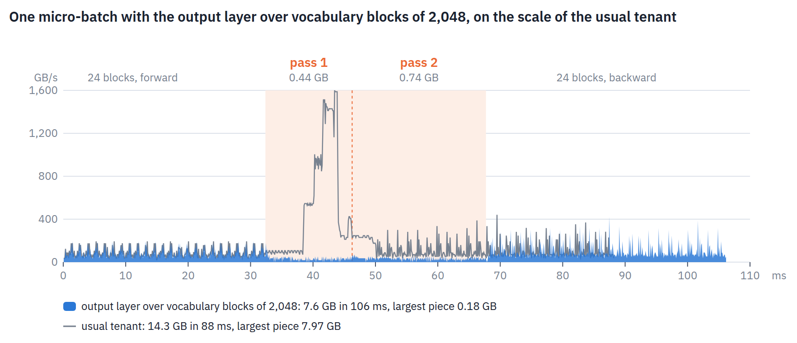
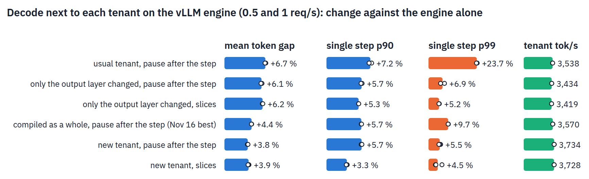
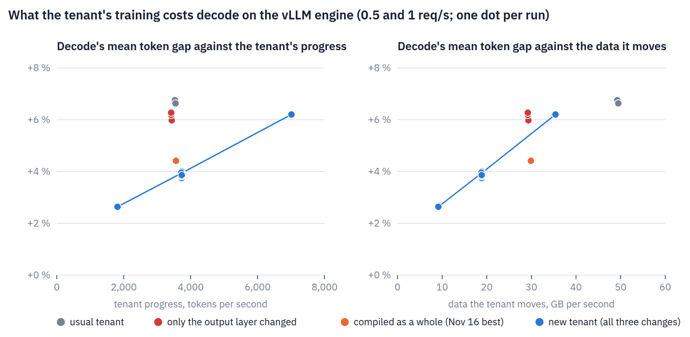
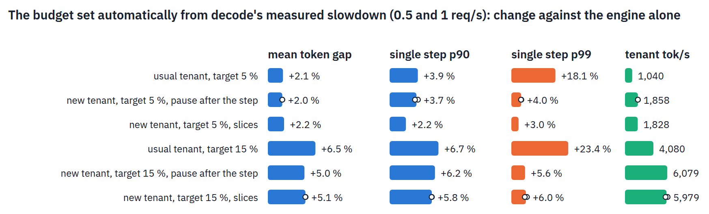

# 从"量清楚"到"改 tenant、改停法"：11 月 21–22 日这一轮做了什么，结论是什么

这份文档从头讲这一轮工作，不假设读者看过中间过程。先说要解决的问题，再按"量到了什么 → 所以做了什么 →
这个做法具体是什么 → 结果是多少、和什么比"的顺序往下讲。

**场景。** 一张 RTX 5090 上同时跑两个任务：

- **decode**：用 vLLM 提供 Llama-3-8B 的推理服务，接真实请求。它是要保护的一方。
- **tenant**：一个训练任务（给 Qwen2.5-0.5B 做 LoRA 微调），用 decode 剩下的资源。它的训练数据是随机生成的 token 序列，
  作用是产生和真实微调一样的计算负载。

**目标只有一个**：tenant 照常训练，decode 尽量不变慢。

**几个会反复出现的词。**

| 词 | 意思 |
|---|---|
| 一步（tenant） | tenant 做一次参数更新：8 条序列、每条 512 个 token，共 4,096 个 token。显存不够一次算完，所以分成几批算（下文的测量都以 4 批、每批 2 条序列为准；实际运行时分几批由 tenant 按空闲显存自己选，见 3.4 节），下文叫"一批" |
| tenant 进度 | tenant 每秒训练多少个 token（tok/s） |
| 搬数据 | 计算时在显存和计算单元（SM）之间读、写的数据量，单位 GB。这张卡这条通道的标称上限是每秒 1,780 GB |
| 额度 | 给 tenant 规定的"平均每秒最多搬多少 GB" |
| decode 的一步 | decode 给每个正在生成的请求各吐一个 token，约 12 毫秒 |
| token 间隔 | 同一个请求相邻两个 token 之间隔了多久，也就是 decode 一步的时间 |
| TPOT | 一个请求平均每个 token 用多久 |
| p90、p99 | 把所有值从小到大排，第 90 %、第 99 % 位置上的值。p99 说的是最慢的那 1 % |

**所有"慢了百分之几"都是这样算的**：有 tenant 时的某个统计量，除以**同一晚、同一套设置下没有 tenant 时的同一个统计量**，再减 1。
例如"p99 +19 %"指：有 tenant 时 decode 单步时间的 p99，比没有 tenant 时 decode 单步时间的 p99 高 19 %。

**先说结论**（每一条的做法和数据在后面对应的节里）。

1. **量出了 tenant 一步里每一段搬多少数据。** 普通 tenant 一步搬 57.2 GB，其中 55 % 在最后的输出层和 loss 上：一步里有四块，
   每块 7.97 GB，中间不能停，瞬时流量接近这张卡的上限。（第 2 节）
2. **据此对 tenant 的计算做了三处改动**：输出层和 loss 沿词表分块算；模型的 24 层逐层编译；每个词表块里的小计算合并成一个融合的
   kernel。训练内容不变。三处都做的 tenant（下文叫"新 tenant"）一步搬 21.9 GB，少 62 %；单独跑的速度不变；每一层之后都能停；
   同一种分批方式下需要的显存不到一半。（第 3 节）
3. **把停顿的规则改成按实际搬的数据量来安排。**（第 4 节）
4. **在 vLLM 上和 decode 一起跑，tenant 做同样多的训练（每秒约 3,500–3,700 个 token）时**：decode 的平均 token 间隔（相对没有 tenant 时），
   旁边是普通 tenant 为 +6.7 %，旁边是新 tenant 为 +3.8 %；decode 单步时间的 p99（相对没有 tenant 时的 p99），
   分别为 +23.7 % 和 +5.5 %。11 月 16 日最好的方法（把 tenant 整体编译）是平均 +4.4 %、p99 +9.7 %。（5.3 节）
5. **"把停顿切细"现在能用了，但作用有限。** tenant 基本不丢进度；decode 单步时间的 p90 从比没有 tenant 时高 +5.7 % 降到
   +3.3 %；decode 的平均不变（+3.8 % 对 +3.9 %），每个请求的 TPOT 也没有变好。（5.4 节）
6. **decode 的代价跟着 tenant 搬的数据量走。** 新 tenant 的额度减半、翻倍，decode 的平均是 +2.6 % 和 +6.2 %
   （tenant 进度每秒 1,812 和 7,011 个 token）；tenant 用 16、32、64 个 SM，代价几乎一样。（5.5、5.6 节）
7. **没做的**：tenant 和 decode 一起跑时每段搬多少数据没有量，用的是单独跑时的值；额度自动调节偏保守的问题没有修；只统计了较轻的两档
   负载（每秒 0.5 和 1 个请求）。（第 7 节）

---

## 1. 这一轮开始前知道什么，卡在哪

11 月 16 日那一晚得到的结论（详见 `3_c1_c2_zh.md`）：

1. decode 变慢的幅度，主要跟着 tenant 每秒搬的数据量走。
2. 所以给 tenant 一个额度（平均每秒最多搬 50 GB），让它在 32 个 SM 上全速算完一步、然后歇到平均不超额。这样
   decode 的平均代价比之前的办法减半。
3. 再用 `torch.compile` 把 tenant 整个编译一遍，它每个 token 少搬约四成数据，decode 的代价再降一点。

当时留下三个没解决的问题：

- **A. "把停顿切细"没有用。** 想法是：与其算完一整步再歇一大段，不如每算几毫秒就歇一下，让 decode 每一步受到的影响
  都差不多。结果 decode 没有变好，tenant 反而少做了 9 % 的训练。
- **B. decode 最慢的那 1 % 的步，慢了两成多，不知道是什么造成的。**
- **C. 只知道 tenant 一步总共搬多少数据（平均每 token 13.47 MB），不知道一步里面哪一段搬得多。** 额度和"少搬数据"
  都是围着这个量转的，却只有一个平均值。

这一轮从 C 入手。

---

## 2. 第一件事：把 tenant 一步里每一段搬多少数据量出来

### 2.1 具体怎么量

- tenant 的代码里有一些固定的位置可以插入停顿：每一批开始时、模型 24 层中每一层的前向计算之前、每一层的反向计算之前。
  相邻两个位置之间的那段计算，下文叫**一段**。tenant 只能在段和段之间停，所以"段"是能调度的最小单位。
- 让 tenant **单独**在 GPU 上跑（没有 decode），设置和实验里一样（32 个 SM）。在每个可停的位置上，先等 GPU 把已经
  发出的计算做完，再打一个带名字的时间标记。
- 同时用 NVIDIA 的 Nsight Systems 工具每秒 10,000 次读取这张卡的显存读、写流量。
- 把两个标记之间的流量加起来，就是这一段搬的数据量。多步取平均。
- 校准：让 GPU 连续拷贝一个 1 GiB 的张量若干次，搬的数据量是已知的，用它把工具读到的百分比换算成 GB。

可靠程度：同一晚量两轮，每步的总量相差不到 0.1 %（57.13 和 57.17 GB）；用另一个工具（Nsight Compute，逐个 kernel
读硬件计数）核对最大的那一段，是 7.98 GB 对 7.97 GB。

### 2.2 量到了什么

普通 tenant 一步搬 **57.2 GB**，用时 356 毫秒（合每个 token 13.95 MB；11 月 16 日用另一种办法量的是 13.47 MB）。

| 这一段是什么 | 一批里有几段 | 每段搬多少 | 每段多久 | 这一段运行时每秒搬多少 |
|---|---|---|---|---|
| 一层的前向计算 | 24 | 0.11 GB | 1.3 毫秒 | 82 GB |
| 一层的反向计算 | 24 | 0.16 GB | 1.6 毫秒 | 99 GB |
| 输出层和 loss（前向加反向） | 1 | **7.97 GB** | 19.3 毫秒 | 413 GB，其中有约 6 毫秒是 500–1,500 GB |

*图 1 — 上：普通 tenant 一批（2 条序列）里显存流量随时间的变化，每个采样点都画出；阴影是输出层和 loss 所在的那一段。
下：把阴影段放大，按里面的七个算子分开。*

三点发现：

1. **一步的数据量里，55 % 花在输出层和 loss 上**，而这部分只占 21 % 的时间。原因是词表有 151,936 项：模型最后要给
   1,024 个位置各算出 15 万个分数（logits），这个张量有 311–622 MB，算 loss 时被来回读写了十来遍。
2. **这一段中间没有可以停的位置。** 每一批里有一整块 7.97 GB，一步里有四块。
3. **这一段冲得很高。** 每一批里有约 6 毫秒，tenant 每秒搬 500–1,500 GB，接近这张卡的上限（1,780 GB），而 decode
   自己平时就要用每秒约 1,300–1,400 GB。

### 2.3 这三点发现说明什么

- **对问题 A（切片没用）**：旧的切片代码假设每一段的工作量相等。实际上最大的一段是最小一段的 70 倍。那四块 7.97 GB
  既切不开，又把时间表打乱，tenant 少掉的 9 % 正是这四块造成的。
- **对问题 B（最慢的 1 %）**：每一步有四次、每次约 6 毫秒，tenant 几乎要占满显存通道。撞上这几毫秒的 decode 步最可能
  就是那最慢的 1 %。这在当时只是推断，第 5 节在 vLLM 上验证了它。
- **对"少搬数据"该改哪里**：先改输出层和 loss，它占一半以上。

所以接下来做两件事：**改 tenant 的计算，让它少搬数据、并且处处能停**（第 3 节）；**改停顿的规则，按实际搬的数据量来安排
停顿**（第 4 节）。

---

## 3. 第二件事：改 tenant 的计算（三处改动）

三处改动都不改变训练的内容：算出来的 loss 相同，参数的梯度在数值误差范围内相同（见 3.4）。下面的数字都是 **tenant 单独跑**
时量的，和"普通 tenant"比。

### 3.1 改动一：输出层和 loss 沿词表分块算

**原来的算法**：一次算出全部 1,024 × 151,936 个分数，存成一个大张量，再在这个大张量上算 loss 和梯度。

**新的算法**：把 15 万项词表切成小块（每块 4,096 项），一块一块地算，分两遍：

- 第一遍：对每一块，算出所有位置在这一块上的分数，只把"归一化要用的和"累加起来，并记下正确答案那一项的分数；这一块的
  分数用完就丢掉。第一遍结束就得到了 loss。
- 第二遍：对每一块，把分数重算一遍，变成概率，直接累加出要传回模型的梯度。

这样完整的大张量从不存在，每一块的中间结果只有几 MB。代价是多做一次矩阵乘法（三次而不是两次）。它要求输出层的权重
不参与训练，LoRA 微调满足这一点。

之前（11 月 16 日）试过另一种分法，是把**位置**分组，结果数据量变成三倍，因为每一组都要把 272 MB 的输出层权重重读
一遍。这次沿**词表**分，权重每一批只读两遍。

结果（块的大小不同，效果不同）：

| 每块多少项 | 一步搬多少 | 和普通 tenant 比 | 不能停的最大一块 | tenant 单独跑的速度 |
|---|---|---|---|---|
| 普通 tenant（不分块） | 57.2 GB | – | 7.97 GB | 11,511 tok/s |
| 32,768 | 71.4 GB | 多 25 % | 1.47 GB | 9,996 |
| 8,192 | 40.4 GB | 少 29 % | 0.17 GB | 10,184 |
| 4,096 | 35.0 GB | 少 39 % | 0.18 GB | 9,975 |
| 2,048 | 30.4 GB | 少 47 % | 0.18 GB | 9,533 |
| 1,024 | 29.6 GB | 少 48 % | 0.18 GB | 8,687 |

*图 2 — 不同块大小下一步搬的数据量。蓝色是 24 层，橙色是输出层和 loss。*

- 块太大反而更糟；从 8,192 往下才省；小到 2,048 以下几乎不再省。
- 不能停的最大一块从 7.97 GB 变成 0.18 GB（就是模型的一层）。那四块大的没有了。
- 代价：tenant 单独跑时慢 13–25 %，因为多了一次矩阵乘法，还多出很多很小的计算。

### 3.2 改动二：模型的 24 层逐层编译

`torch.compile` 会把一连串小的计算合并成少数几个，中间结果不再写进显存。11 月 16 日是把**整个模型**编译成一块，
数据量少了四成，但编译后的模型中间没有任何可以停的位置（一批是一整块 8.6 GB），切片完全用不上。

这次改成**每一层单独编译**：层和层之间的停顿位置都保留。

中间踩了一个坑：第一次做完，数据量和速度都没有变化。原因是 PyTorch 对"同一段代码最多重新编译几次"有个上限（8 次），
24 层里只有前 8 层真的被编译了，其余悄悄退回了不编译，没有任何报错。把上限调高后 24 层都编译了。

结果：24 层搬的数据量从每步 25.5 GB 降到 18.7 GB（少 27 %），每一层之后仍然能停。

顺带可以推出一个之前不知道的事实：11 月 16 日"整体编译"每步少搬 22.8 GB（57.2 → 34.4 GB），而编译 24 层只能省 6.8 GB。
所以那四成里约七成其实来自输出层和 loss，只有约三成来自 24 层（按逐层编译省下的量估算）。

### 3.3 改动三：把每个词表块里的小计算合并成融合的 kernel

改动一里，每个词表块要做十来个小计算（类型转换、取指数、求和、减去正确答案等）。把两次矩阵乘法之间的这些小计算编译成
一个合并的 kernel，中间结果留在寄存器里，不再经过显存。

结果：输出层和 loss 每步搬的数据量从 8.9 GB（改动一，每块 4,096）降到 3.2 GB（普通 tenant 是 31.4 GB），速度也回来了。

### 3.4 三处改动合起来

| tenant | 一步搬多少 | 和普通 tenant 比 | 不能停的最大一块 | 单独跑的速度 | 这种分批方式（4 批、每批 2 条）需要的显存 |
|---|---|---|---|---|---|
| 普通 | 57.2 GB | – | 7.97 GB | 11,511 tok/s | 5.0 GiB |
| 只做改动一（每块 4,096） | 35.0 GB | 少 39 % | 0.18 GB | 9,975（慢 13 %） | 未单独量 |
| 改动一 + 二 | 28.1 GB | 少 51 % | 0.13 GB | 10,984（慢 5 %） | 未单独量 |
| **改动一 + 二 + 三** | **21.9 GB** | **少 62 %** | **0.12 GB** | **11,555（相同）** | **2.3 GiB** |
| 对照：11 月 16 日的整体编译 | 34.4 GB | 少 40 % | 8.58 GB | 14,294（快 24 %） | 未单独量 |

*图 3 — 各种 tenant 一步搬的数据量。紫色表示整体编译后分不出输出层。红字表示有超过 1 GB 的一块不能停。*

下文把"改动一 + 二 + 三"的 tenant 叫**新 tenant**，把只做改动一的叫**只改输出层的 tenant**。

新 tenant 和普通 tenant 相比：少搬 62 % 的数据，速度一样，每一层之后都能停，同一种分批方式下需要的显存不到一半。

**"新 tenant"具体是什么配置。** 模型（Qwen2.5-0.5B）、LoRA（秩 16，加在注意力的 q、k、v、o 四个矩阵上）、训练数据、每步 8 条序列 × 512 个 token，
都和普通 tenant 一样。不同的只有启动参数里多出的这几项：

| 启动参数 | 作用 |
|---|---|
| `--head vocab --vocab-block 4096` | 改动一：输出层和 loss 沿词表分块算，每块 4,096 项 |
| `--compile-blocks` | 改动二：24 层逐层编译 |
| `--head-fused` | 改动三：每个词表块里的小计算合并成融合的 kernel |
| `--no-slow-shapes` | 不使用"把一部分数据放到主机内存"的那几种分批方式（逐层编译不支持它们）；显存连最小的分批方式都放不下时就暂停 |
| `--tiers-json results_prof/tiers_cb_vocab4096f.json` | 用它自己量出来的显存需求表，而不是普通 tenant 的 |

**一步分成几批，是 tenant 运行时按当时空闲的显存自己选的**：显存够就少分几批（更快），不够就多分几批。上面各表都是在"4 批、每批 2 条"
下量的，这样两种 tenant 才是同一种分法在比。新 tenant 在各种分法下（单独跑时量的）：

| 一步怎么分 | 需要的显存 | 一步搬多少 | 不能停的最大一块 | 单独跑的速度 |
|---|---|---|---|---|
| 1 批、8 条 | 5.01 GiB | 26.9 GB | 0.68 GB | 15,243 tok/s |
| 2 批、每批 4 条 | 3.25 GiB | 20.5 GB | 0.24 GB | 13,741 tok/s |
| 4 批、每批 2 条 | 2.32 GiB | 21.9 GB | 0.12 GB | 11,555 tok/s |
| 8 批、每批 1 条 | 1.84 GiB | 29.1 GB | 0.08 GB | 9,225 tok/s |

"1 批、8 条"搬的数据反而更多，所以给新 tenant 关掉了这种分法。**在第 5 节的 vLLM 运行里，新 tenant 约 90 % 的步用的是"2 批、每批 4 条"**
（它需要的显存少，所以大多数时候放得下这种更大的分法），7–8 % 用"4 批、每批 2 条"。普通 tenant 约 67 % 的步用"4 批、每批 2 条"，
约 22 % 用"8 批、每批 1 条"。切片用的每段数据量表，对新 tenant 的每种分法都单独量过。

**训练内容是否相同。** 用真实模型核对一批数据：

- loss：各种算法都是同一个值（一致到小数点后 5 位）。
- LoRA 参数上的梯度：新算法和原算法相差约 0.5 %；而原算法自己连跑两次也相差 0.4 %（半精度计算本身的误差）。
- 连续训练 1,500 步（同样的数据、同样的随机种子，tenant 单独跑）：新 tenant 和普通 tenant 每一步的 loss 平均相差 0.0009，最大相差 0.06；
  而普通 tenant 自己再跑一遍，和第一遍平均相差 0.0014，最大相差 0.11。也就是新 tenant 和普通 tenant 之间的差别，不比普通 tenant
  两次运行之间的差别大。第 1,500 步的 loss 是 11.9357 对 11.9359。

所以是"在数值误差范围内相同"，不是逐位相同。

*图 4 — 只改输出层（每块 2,048）之后，一批里的流量（蓝色），和普通 tenant（灰线）画在同一坐标上。原来冲到每秒
1,500 GB 的那一段没有了。*

---

## 4. 第三件事：改停顿的规则，按实际搬的数据量来停

### 4.1 具体做法

额度是"平均每秒最多搬多少 GB"。新的规则直接用第 2 节量出来的表：

1. 表里有 tenant 一步中每一段搬多少数据，所以算到任何一个可停的位置时，"这一步到目前为止搬了多少"是已知的。
2. 按额度，这些数据"应该"在什么时刻之前搬完，也就确定了：已搬的数据量 ÷ 额度。
3. 选一个时间窗（例如 12 毫秒，约等于 decode 的一步）。额度 × 时间窗 就是一块数据的大小。每搬满一块，tenant 就在最近的
   可停位置停下，等到上面算出的时刻再继续。
4. 如果某一段算得比额度允许的慢（迟到了），欠下的时间在后面少歇一点补回来，最多补一个时间窗。
5. 一步结束时再结一次账，保证整步的平均不超额。

"算完一整步再歇"只是它的一个特例：时间窗取无穷大，只在步末结账。所以下文两种停法用的是同一套代码，区别只是时间窗：

- **步后停**：全速算完一步，然后歇到平均不超额。
- **切片**：每搬满"额度 × 12 毫秒"的数据就歇一下。

### 4.2 先单独检查这套规则本身对不对

让 tenant **单独**按每秒 50 GB 的额度跑（没有 decode），看两件事。

**tenant 有没有拿到额度允许的全部进度？**

| 停法 | 额度允许的进度 | 实际拿到 |
|---|---|---|
| 11 月 16 日的旧切片 | 3,582 tok/s | 3,522 tok/s（98.3 %；当时在 vLLM 旁边只有 91 %） |
| 新规则，切片 | 3,582 tok/s | 3,581 tok/s（100 %） |

**流量平不平？** 看任意 12 毫秒（decode 一步那么长）里，tenant 最多用到多少：

| tenant 和停法 | 最猛的 12 毫秒里每秒搬多少 | 是额度的几倍 |
|---|---|---|
| 普通 tenant，步后停 | 610 GB | 12 倍 |
| 普通 tenant，切片 | 610 GB | 12 倍 |
| 只改输出层的 tenant，步后停 | 107 GB | 2.1 倍 |
| 只改输出层的 tenant，切片 | 72 GB | 1.4 倍 |

结论：新规则不再丢进度。但对普通 tenant，切片仍然压不平，因为那四块 7.97 GB 切不开；只有 tenant 改了之后，切片才真的
把流量压平。**两件事要配合：先让 tenant 处处能停，切片才有意义。**

这一节只说明规则本身是对的，不说明 decode 因此少慢多少。那是下一节的事。

---
## 5. 第四件事：放到 vLLM 上，和 decode 一起跑

前面三节的数字都是 tenant 单独跑时量的。这一节才是结论所在：两个任务同时在一张卡上跑，看 decode 慢了多少、tenant 做了
多少训练。

### 5.1 怎么测的

- **decode 那边**：vLLM 提供 Llama-3-8B 的服务，接一个 11 分钟的请求序列。请求的到达率按段变化，从每秒 0.5 个到每秒
  4 个。每个请求带约 6,300 个 token 的提示，生成 128 个 token。
- **tenant 那边**：和 decode 在同一张卡上，限定在 32 个 SM 上运行。
- **每个设置完整跑一遍 11 分钟。** 下面只统计到达率为每秒 0.5 个和每秒 1 个请求的那几段（共约 4 分半钟）。这两档负载
  较轻，decode 自己不排队，最能看清 tenant 的影响。每段开头的 10 秒和整次运行开头的 30 秒不算（tenant 这时还在启动）。
- **基准**：同一晚、同样的设置、不放 tenant 的运行。今晚跑了多次，合在一起当基准。各次基准之间：平均值和中位数相差
  不到 0.2 %；单步时间的 p99 相差约 4 %，所以下面 p99 的数字，3–4 个点以内的差别不要当真。
- **额度怎么定**：让各种 tenant 的进度大致相同（每秒约 3,500 个 token），这样比的是"做同样多的训练，decode 付出多少"。
  不同 tenant 每个 token 搬的数据量不同，所以额度的数值不同：普通 tenant 是每秒 50 GB，新 tenant 是每秒 19.2 GB。

**看哪几个量**（每个都是"有 tenant 时的值 ÷ 基准里同一个量的值 − 1"）：

| 量 | 是什么 |
|---|---|
| 平均 token 间隔 | 所有请求、所有相邻 token 之间的间隔的平均值。反映 decode 整体慢了多少 |
| TPOT 中位数、TPOT p90 | 先对每个请求算"平均每个 token 多久"，再在所有请求里取中位数和 p90。反映用户感受到的速度 |
| 单步时间的中位数、p90、p99 | 把 token 间隔逐个拿出来看，但去掉两类和 tenant 无关的：别的请求刚进来时的间隔，以及引擎自己偶尔出现的双倍长或接近零的间隔。剩下的按"当时有几个请求在生成"分组，各组和基准的同一组比，再取平均 |
| tenant 进度 | 这几段里 tenant 每秒训练的 token 数；另给出整个 11 分钟的平均 |

**为什么"单步时间"要去掉那两类。** 没有 tenant 时，所有 token 间隔里最长的 1 % 本来就有 66 毫秒，是普通一步（约 12 毫秒）
的 5 倍多。它们发生在别的请求进来、引擎要先处理它的提示的时候，所有正在生成的请求都得等。这和 tenant 无关，但数值太大，
会把 tenant 造成的变化完全盖住：不管放哪种 tenant，"所有间隔的 p99"都只变化 1 % 左右。所以要看 tenant 对 decode 每一步的
影响，得先把这些拿掉。为了不只给过滤后的数，下面的表同时给出"所有间隔"的 p90 和 p95，那是什么都不去掉的。

### 5.2 先核对：今晚的测量和 11 月 16 日对得上

在比新东西之前，先把 11 月 16 日的两个方法原样重跑，看今晚的机器和当时是不是一回事。

| 设置 | 次数 | decode 平均 token 间隔 | TPOT p90 | 单步中位数 | 单步 p90 | 单步 p99 | 所有间隔 p95（不过滤） | tenant 进度（tok/s） | 整个 11 分钟的 tenant 进度（tok/s） |
|---|---|---|---|---|---|---|---|---|---|
| 普通 tenant，步后停 | 2 | +6.7 % | +6.8 %（+6.6 % 到 +6.9 %） | +5.0 %（+4.9 % 到 +5.1 %） | +7.2 %（+7.0 % 到 +7.4 %） | +23.7 %（+23.5 % 到 +23.9 %） | +11.4 % | 3,538 | 2,145（2,111 到 2,179） |
| 整体编译的 tenant，步后停 | 2 | +4.4 % | +4.5 %（+4.4 % 到 +4.6 %） | +3.0 % | +5.7 % | +9.7 % | +5.9 %（+5.8 % 到 +6.0 %） | 3,570 | 2,077（2,030 到 2,123） |

下面"11 月 16 日"的数，是把当晚留下的原始记录用今晚同一个统计脚本重新算出来的，所以两晚是同一种算法。

- 没有 tenant 时，decode 的平均 token 间隔：11 月 16 日 12.68 毫秒，今晚 12.63 毫秒（中位数 12.01 对 11.98 毫秒）。
- 普通 tenant、步后停：decode 的平均，11 月 16 日 +6.3 %，今晚 +6.7 %；单步 p99，+24.0 % 对 +23.7 %。
- 整体编译的 tenant、步后停（11 月 16 日最好的方法）：decode 的平均，当时 +4.2 %，今晚 +4.4 %；单步 p99，+10.7 % 对 +9.7 %。
- 同一个设置重复跑，平均值相差不到 0.2 个点。所以下面 0.5 个点以上的平均值差别是可信的；单步 p99 则要 3–4 个点以上才算数。

### 5.3 改 tenant 之后，decode 少慢多少

四种 tenant，都用"步后停"，额度都定在让 tenant 进度约为每秒 3,500 个 token：普通 tenant 每秒 50 GB，只改输出层的 tenant 每秒 30.7 GB，
新 tenant 每秒 19.2 GB；整体编译的 tenant 沿用 11 月 16 日的设置（进度上限和普通 tenant 相同，每秒 3,712 个 token）。

| 设置 | 次数 | decode 平均 token 间隔 | TPOT p90 | 单步中位数 | 单步 p90 | 单步 p99 | 所有间隔 p95（不过滤） | tenant 进度（tok/s） | 整个 11 分钟的 tenant 进度（tok/s） | tenant 在计算的时间占比 |
|---|---|---|---|---|---|---|---|---|---|---|
| 普通 tenant | 2 | +6.7 % | +6.8 %（+6.6 % 到 +6.9 %） | +5.0 %（+4.9 % 到 +5.1 %） | +7.2 %（+7.0 % 到 +7.4 %） | +23.7 %（+23.5 % 到 +23.9 %） | +11.4 % | 3,538 | 2,145（2,111 到 2,179） | 60 % |
| 只改输出层的 tenant | 2 | +6.1 %（+6.0 % 到 +6.1 %） | +6.3 % | +5.3 % | +5.7 %（+5.7 % 到 +5.8 %） | +6.9 %（+5.9 % 到 +7.8 %） | +7.3 %（+7.1 % 到 +7.4 %） | 3,434 | 2,150（2,135 到 2,166） | 68 % |
| 整体编译的 tenant（11 月 16 日最好的） | 2 | +4.4 % | +4.5 %（+4.4 % 到 +4.6 %） | +3.0 % | +5.7 % | +9.7 % | +5.9 %（+5.8 % 到 +6.0 %） | 3,570 | 2,077（2,030 到 2,123） | 44 % |
| 新 tenant | 3 | +3.8 % | +4.0 % | +2.1 % | +5.7 % | +5.5 %（+5.1 % 到 +5.9 %） | +4.0 %（+2.7 % 到 +5.1 %） | 3,734 | 2,480 | 39 % |

*图 5 — 这一节和下一节的六种设置放在一起看。每条是相对今晚没有 tenant 时的变化；同一设置跑了多次时，圆点是各次的值。
最右一栏是 tenant 的进度。*

逐行说：

1. **只改输出层（改动一）。** decode 的平均几乎没变（+6.7 % → +6.1 %），但单步时间的 p99 从 +23.7 % 降到
   +6.9 %。这验证了第 2 节的推断：**decode 最慢的那 1 % 的步，就是撞上输出层那几段造成的**。问题 B 有了答案。
2. **新 tenant（三处改动都做）。** decode 的平均降到 +3.8 %，比普通 tenant 少了将近一半；每个请求的 TPOT p90 从
   +6.8 % 降到 +4.0 %。
3. **和 11 月 16 日最好的方法（整体编译）比**：decode 的平均略低（+3.8 % 对 +4.4 %），差别不大；明显的好处在
   另外两处：单步 p99 更低（+5.5 % 对 +9.7 %）；整个 11 分钟里 tenant 多做了约 19 % 的训练
   （2,480 对 2,077 tok/s）。后者的原因没有分析清楚。日志显示，两种 tenant 因为显存不够而完全停下的
   时间都只有 2 秒左右，所以不是"一个还能训练、一个只能停"；差别出在请求多的那几个阶段，那时两种 tenant 的每一步都变慢，整体编译的
   tenant 慢得更多（整次运行平均每步 1.86 秒对 1.66 秒）。

有一点没有解释清楚：只改输出层的 tenant 和整体编译的 tenant，单独跑时每秒搬的数据量差不多（约 30 GB），但 decode 的平均代价
不一样（+6.1 % 对 +4.4 %）。也就是说，"每秒搬多少数据"能解释大部分差别，但不是全部。可能的原因是 tenant 和 decode
一起跑时搬的数据量和单独跑时不一样（见第 7 节），这一点今晚没有量。

### 5.4 切片有没有用

同一个 tenant、同一个额度，只换停法：算完一整步再歇，还是每搬满"额度 × 12 毫秒"的数据就歇一下。

| 设置 | 次数 | decode 平均 token 间隔 | TPOT p90 | 单步中位数 | 单步 p90 | 单步 p99 | 所有间隔 p95（不过滤） | tenant 进度（tok/s） | 整个 11 分钟的 tenant 进度（tok/s） |
|---|---|---|---|---|---|---|---|---|---|
| 只改输出层的 tenant，步后停 | 2 | +6.1 %（+6.0 % 到 +6.1 %） | +6.3 % | +5.3 % | +5.7 %（+5.7 % 到 +5.8 %） | +6.9 %（+5.9 % 到 +7.8 %） | +7.3 %（+7.1 % 到 +7.4 %） | 3,434 | 2,150（2,135 到 2,166） |
| 只改输出层的 tenant，切片 | 2 | +6.2 % | +6.8 % | +5.0 % | +5.3 % | +5.2 % | +6.6 %（+6.4 % 到 +6.7 %） | 3,419 | 2,123 |
| 新 tenant，步后停 | 3 | +3.8 % | +4.0 % | +2.1 % | +5.7 % | +5.5 %（+5.1 % 到 +5.9 %） | +4.0 %（+2.7 % 到 +5.1 %） | 3,734 | 2,480 |
| 新 tenant，切片 | 3 | +3.9 % | +4.3 %（+4.2 % 到 +4.4 %） | +3.2 % | +3.3 % | +4.5 %（+3.4 % 到 +6.6 %） | +3.5 % | 3,728 | 2,420 |

- **tenant 的进度基本不再丢。** 以新 tenant 为例：统计的这几段里，步后停 3,734、切片 3,728 tok/s，相同；整个 11 分钟是
   2,480 对 2,420 tok/s，切片少约 2 %。11 月 16 日的旧切片在统计的这几段里就少 9 %。问题 A 里"白丢进度"这一半解决了。
- **decode 每一步受到的影响变均匀了。** 以新 tenant 为例：单步时间的中位数从 +2.1 % 升到 +3.2 %，p90 从
   +5.7 % 降到 +3.3 %，两者靠到了一起。这正是切片要做的事：不让一部分 decode 步特别慢、另一部分完全不受影响。
- **平均值不变**（+3.8 % 对 +3.9 %）。切片只是把同样多的影响摊开，不会让总的影响变小。
- **对每个请求的 TPOT 没有可见的好处**（p90：+4.0 % 对 +4.3 %）。一个请求有 128 步，单步之间的不均匀在
   请求内部本来就被平均掉了。

所以对问题 A 的完整回答是：切片现在按设计工作，能把 decode 单步的 p90 压下来约 2 个点；但它不降低平均值，对请求级别的指标
也没有帮助。如果关心的是每个 token 的最坏间隔，用它；如果只看每个请求的 TPOT，步后停就够了。

### 5.5 tenant 多训练一些，decode 要多付多少

新 tenant、切片，固定额度取三档。

| 设置 | 次数 | decode 平均 token 间隔 | TPOT p90 | 单步中位数 | 单步 p90 | 单步 p99 | 所有间隔 p95（不过滤） | tenant 进度（tok/s） | 整个 11 分钟的 tenant 进度（tok/s） | tenant 在计算的时间占比 |
|---|---|---|---|---|---|---|---|---|---|---|
| 每秒 9.6 GB | 1 | +2.6 % | +2.8 % | +2.2 % | +2.4 % | +2.7 % | +2.2 % | 1,812 | 1,204 | 21 % |
| 每秒 19.2 GB | 3 | +3.9 % | +4.3 %（+4.2 % 到 +4.4 %） | +3.2 % | +3.3 % | +4.5 %（+3.4 % 到 +6.6 %） | +3.5 % | 3,728 | 2,420 | 42 % |
| 每秒 38.4 GB | 1 | +6.2 % | +7.0 % | +4.9 % | +5.4 % | +8.5 % | +5.7 % | 7,011 | 4,562 | 76 % |

*图 6 — 每个点是一次运行。左：decode 的平均代价对 tenant 的进度；右：同样的点，横轴换成 tenant 每秒搬的数据量（按单独跑时量的
每 token 数据量折算）。*

- tenant 每多训练 1,000 tok/s，decode 的平均大约多慢 0.7 个点。另有约 1.3 个点是 tenant 只要在场就有的。
- **同样的 decode 代价，训练量翻倍**：新 tenant 训练到每秒 7,011 个 token 时，decode 慢 +6.2 %；普通 tenant
   训练每秒 3,538 个 token，decode 就已经慢 +6.7 %。
- 反过来，**同样的训练量，代价接近减半**（5.3 节）。

### 5.6 tenant 用多少个 SM

11 月 16 日给 tenant 选了 32 个 SM。新 tenant 轻了很多，所以重新试了 16 和 64。额度相同（每秒 19.2 GB），切片。

| 设置 | 次数 | decode 平均 token 间隔 | TPOT p90 | 单步 p90 | 单步 p99 | tenant 进度（tok/s） | tenant 在计算的时间占比 |
|---|---|---|---|---|---|---|---|
| 16 个 SM | 1 | +4.1 % | +4.4 % | +3.3 % | +3.5 % | 3,466 | 66 % |
| 32 个 SM | 3 | +3.9 % | +4.3 %（+4.2 % 到 +4.4 %） | +3.3 % | +4.5 %（+3.4 % 到 +6.6 %） | 3,728 | 42 % |
| 64 个 SM | 1 | +4.2 % | +4.3 % | +3.9 % | +4.6 % | 3,702 | 27 % |

- decode 的平均代价在三种 SM 数下几乎一样。
- tenant 在计算的时间占比却差了一倍多（16 个 SM 时 66 %，64 个 SM 时 27 %）。也就是说，**decode 的代价
   跟着 tenant 搬的数据量走，不跟着它用了多少个 SM、算了多长时间走**。
- 16 个 SM 时 tenant 自己跟不上额度，进度少了约 7 %。所以 32 个 SM 仍然是合适的选择，没有必要改。

### 5.7 让额度跟着 decode 的实测变慢程度自动调

前面的额度都是人定的固定值。另一种做法（11 月 16 日已有）是给一个目标，例如"decode 最多慢 5 %"，由调度程序每 2 秒看一次
decode 实际慢了多少，慢得多就把 tenant 的额度调小，慢得少就调大。今晚把它和新 tenant、新的停法接在一起。

| 设置 | 次数 | decode 平均 token 间隔 | TPOT p90 | 单步中位数 | 单步 p90 | 单步 p99 | 所有间隔 p95（不过滤） | tenant 进度（tok/s） | 整个 11 分钟的 tenant 进度（tok/s） |
|---|---|---|---|---|---|---|---|---|---|
| 普通 tenant，目标 5 %（11 月 16 日的做法） | 1 | +2.1 % | +1.7 % | +0.9 % | +3.9 % | +18.1 % | +4.5 % | 1,040 | 676 |
| 新 tenant，目标 5 %，步后停 | 2 | +2.0 % | +2.4 %（+2.2 % 到 +2.6 %） | +1.2 % | +3.7 %（+3.5 % 到 +3.9 %） | +4.0 %（+4.0 % 到 +4.1 %） | +1.2 %（+1.1 % 到 +1.3 %） | 1,858 | 1,225（1,197 到 1,253） |
| 新 tenant，目标 5 %，切片 | 1 | +2.2 % | +2.6 % | +1.8 % | +2.2 % | +3.0 % | +1.9 % | 1,828 | 1,142 |
| 普通 tenant，目标 15 %（11 月 16 日的做法） | 1 | +6.5 % | +6.7 % | +4.9 % | +6.7 % | +23.4 % | +10.5 % | 4,080 | 2,389 |
| 新 tenant，目标 15 %，步后停 | 1 | +5.0 % | +5.2 % | +3.6 % | +6.2 % | +5.6 % | +5.9 % | 6,079 | 3,859 |
| 新 tenant，目标 15 %，切片 | 2 | +5.1 % | +5.3 %（+5.1 % 到 +5.5 %） | +3.8 % | +5.8 % | +6.0 %（+5.5 % 到 +6.4 %） | +4.5 %（+4.4 % 到 +4.6 %） | 5,979（5,829 到 6,128） | 3,848（3,748 到 3,947） |

*图 7 — 上表的六种设置。每条是相对今晚没有 tenant 时的变化；同一设置跑了多次时，圆点是各次的值。最右一栏是 tenant 的进度。*

- **目标 5 %**：新 tenant（步后停）下 decode 的平均慢 +2.0 %，tenant 进度每秒 1,858 个 token。同一晚普通 tenant：
   +2.1 %，1,040。也就是 decode 付出差不多的代价，新 tenant 的训练量约是普通 tenant 的 1.8 倍；而且普通 tenant 下 decode
   单步时间的 p99 仍比没有 tenant 时高 +18.1 %，新 tenant 下是 +4.0 %。
- **目标 15 %**：新 tenant（步后停）下 decode 的平均慢 +5.0 %，tenant 进度每秒 6,079 个 token。同一晚普通 tenant：
   +6.5 %，4,080。也就是 decode 慢得更少，tenant 的训练量约是 1.5 倍；单步 p99 是 +5.6 % 对 +23.4 %。
- **普通 tenant 的这两行各只跑了一次，而自动调节每次停在哪里会有出入。** 用同一个脚本重算 11 月 16 日的记录：普通 tenant、目标 5 % 那次是
   decode +2.9 %、1,607 tok/s（今晚 +2.1 %、1,040）；目标 15 % 那次是 +6.4 %、4,096 tok/s（今晚 +6.5 %、4,080）。
   两晚合起来看，结论不变：decode 慢 2–3 % 时，普通 tenant 每秒训练 1,000–1,600 个 token，新 tenant 在 decode 慢 +2.0 % 时就有 1,858。
- **这个自动调节偏保守**：目标写的是 15 %，实际 decode 只慢了 5–6 %。11 月 16 日找到的原因是，它判断"decode 慢了多少"时把请求之间
   互相造成的变慢也算了进去。今晚没有重新核对这个原因，也没有改它。所以"目标 5 %""目标 15 %"在这里只是两个档位的名字，不是实际达到的变慢程度。
- **切片在这里的作用和固定额度时一样**：目标 5 % 时，decode 单步的 p90 从 +3.7 %（步后停）降到 +2.2 %（切片），
   平均值和 tenant 进度基本不变。目标 15 % 时两种停法差别很小（单步 p90：+6.2 % 对 +5.8 %）。各设置跑的次数见表，都只有 1–2 次。
- 过程中改了一处设置：自动调节的额度范围原来是按普通 tenant 定的（每秒 10–150 GB）。新 tenant 每个 token 搬的数据只有四成，
   同样的范围对它来说下限太高，压不下去。按比例改成每秒 4–60 GB 之后才正常。范围没改之前跑的那一次单列在表里，不用来下结论。

---

## 6. 结论

按开头的三个问题来回答。

**C. tenant 一步里哪一段搬的数据多？** 量出来了：55 % 在输出层和 loss，是四块各 7.97 GB、中间不能停、峰值接近这张卡
上限的计算。这个测量本身成了后面所有工作的基础。

**B. decode 最慢的 1 % 是什么造成的？** 就是上面那四块。把输出层改成沿词表分块之后，decode 单步时间的 p99 从比没有 tenant 时
高 +23.7 % 降到 +6.9 %，新 tenant 加切片是 +4.5 %。

**A. 切片为什么没用，现在呢？** 之前没用，是因为切片代码假设每一段一样大，而实际相差 70 倍，并且最大的四块根本切不开。
现在停顿按实际搬的数据量安排，tenant 也改成了处处能停，切片按设计工作：tenant 基本不丢进度（整个 11 分钟少约 2 %），decode 单步的 p90 降约 2 个点。
但它不降低 decode 的平均值，对每个请求的 TPOT 也没有帮助。

**对主线（tenant 照常训练，decode 尽量不变慢）来说，今晚最有用的是对 tenant 的三处改动**：

| 比什么 | 普通 tenant，步后停（11 月 16 日的方法） | 新 tenant，切片 |
|---|---|---|
| tenant 做同样多的训练（约 3,500–3,700 tok/s）时，decode 平均慢多少 | +6.7 % | +3.9 % |
| 同上，每个请求的 TPOT p90 | +6.8 % | +4.3 % |
| 同上，decode 单步时间的 p99 | +23.7 % | +4.5 % |
| decode 慢 6 % 多一点时，tenant 能训练多少 | 3,538 tok/s | 7,011 tok/s |
| 额度自动调节、"目标 5 %"这一档（decode 实际平均慢约 2 %）时，tenant 能训练多少 | 1,040 tok/s | 1,828 tok/s |
| tenant 单独跑时一步搬的数据量 | 57.2 GB | 21.9 GB |
| 同一种分批方式（4 批、每批 2 条）需要的显存 | 5.0 GiB | 2.3 GiB |

和 11 月 16 日最好的方法（整体编译的 tenant）比，新 tenant 在 decode 平均值上只好一点点（+4.4 % → +3.9 %），
主要的进步是：decode 单步的长尾更小、tenant 在整个 11 分钟里多训练约 17 %、以及每一层之后都能停，所以切片和自动调节
都能用在它身上。

**还有一条关于"代价从哪来"的结论**：同一个额度下，tenant 用 16、32、64 个 SM，decode 的平均代价几乎一样。decode 的代价跟着
tenant 搬的数据量走。这再次支持"控制数据量"这个总方向。

---

## 7. 没做成的、和要小心读的地方

- **p99 的数字要留 3–4 个点的余量。** 今晚几次没有 tenant 的基准之间，单步 p99 本身就差这么多。平均值、中位数、p90 没有这个问题
  （相差不到 0.2 个点）。
- **"单步时间"的统计去掉了两类间隔**（别的请求进来时的、引擎自己偶尔的双倍间隔），做法见 5.1 节。不做任何过滤时，token 间隔的
  p99 主要由引擎自己决定，放不放 tenant 只差约 1 %；表里另给了不做过滤的 p95。
- **每段搬多少数据是 tenant 单独跑时量的。** 和 decode 一起跑时会不会不一样，今晚没有量，是按"差不多"来用的。5.3 节里那个没解释
  清楚的差别可能和这有关。
- **只统计了每秒 0.5 和 1 个请求这两档。** 更高的到达率下 decode 自己就在排队，tenant 也经常因为显存紧张停下，没有单独分析。
- **新 tenant 不支持把一部分数据放到主机内存的那几种分批方式。** 显存非常紧张时它只能暂停。它需要的显存本来就少，今晚的负载下它在整个
  11 分钟里反而比普通 tenant 多训练；但更极端的显存压力下没有试。
- **自动调节（5.7 节）偏保守的问题没有动。**
- **有四次运行不计入结论**，列在这一节末尾的表里：一次在最后 13 秒被中断；一次是新 tenant 还沿用普通 tenant 的显存需求表（它实际
  需要的显存不到一半，沿用旧表时它以为放不下，73 % 的步用了"4 批"、25 % 用了"8 批"，而不是它本来放得下的"2 批"）；一次是新 tenant 还在用数据量更大的"1 批、8 条"这种分法时跑的（63 % 的步）；一次是自动调节的
  额度范围还没改时跑的。
- **训练是否相同，核对到了"连续 1,500 步的 loss 逐步一致"**（3.4 节）。tenant 用的训练数据是随机生成的 token 序列，只是一个用来
  产生负载的替身任务，所以这里比的是数值上是否一致，不是模型最终好不好用。在真实数据上训练到底的对比没有做。
- **中途还发现并修掉的问题**：逐层编译一开始只编译了 8 层（PyTorch 的重编译次数上限），没有任何报错，是从"数据量没变"才看出来的。
- 今晚跑过一次不用 vLLM、用程序模拟 decode 的对比，中途停掉了，结果没有用在这份文档里。

不计入结论的四次运行（数值仍然是相对今晚没有 tenant 时）：

| 设置 | 次数 | decode 平均 token 间隔 | TPOT p90 | 单步中位数 | 单步 p90 | 单步 p99 | 所有间隔 p95（不过滤） | tenant 进度（tok/s） | 整个 11 分钟的 tenant 进度（tok/s） |
|---|---|---|---|---|---|---|---|---|---|
| 新 tenant，步后停，最后 13 秒被中断的一次 | 1 | +4.4 % | +4.9 % | +3.3 % | +4.9 % | +8.4 % | +5.8 % | 2,961 | 1,911 |
| 新 tenant，步后停，沿用普通 tenant 的显存需求表 | 1 | +3.9 % | +4.3 % | +3.0 % | +4.6 % | +4.2 % | +5.6 % | 3,449 | 2,091 |
| 新 tenant，步后停，还在用“1 批、8 条”分法时 | 1 | +3.6 % | +3.6 % | +1.9 % | +6.3 % | +9.0 % | +3.2 % | 3,056 | 2,110 |
| 新 tenant，自动调节目标 5 %，切片，额度范围未改时 | 1 | +3.3 % | +4.0 % | +2.6 % | +3.0 % | +4.8 % | +2.9 % | 4,001 | 2,476 |

---

## 8. 接下来可以做什么

1. **量 tenant 和 decode 一起跑时每段搬多少数据**，把第 7 节里那条"按差不多来用"的假设变成实测。
2. **修自动调节偏保守的问题**，让"目标 15 %"真的用到 15 %。按 5.5 节的关系，那时 tenant 还能再多训练不少。
3. **24 层里剩下的数据量**：新 tenant 的数据量 85 % 在这 24 层里。普通 tenant 的 24 层中，58 % 在 MLP 部分（单独量的）。
   这是下一个可以用融合 kernel 去削的地方。
4. **在真实数据上把一次训练跑到底**，确认三处改动对最终模型没有影响。
5. 更高到达率、更大显存压力下的表现。
