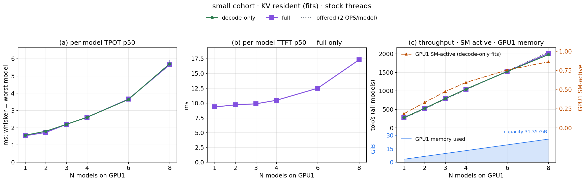
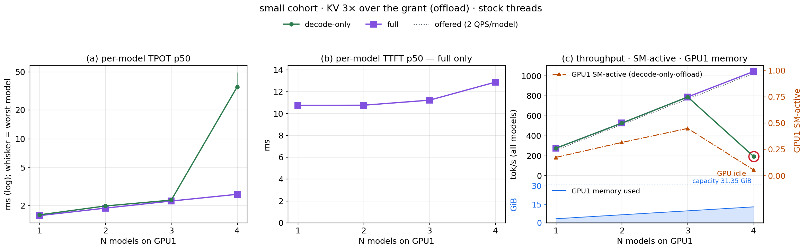
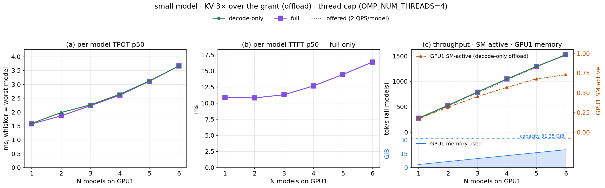
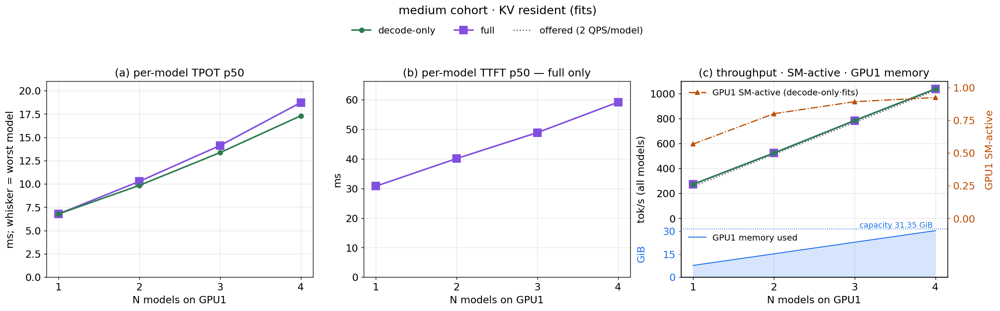
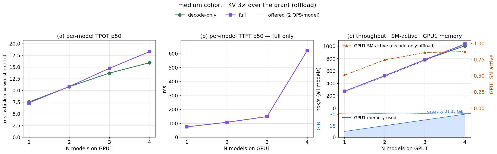
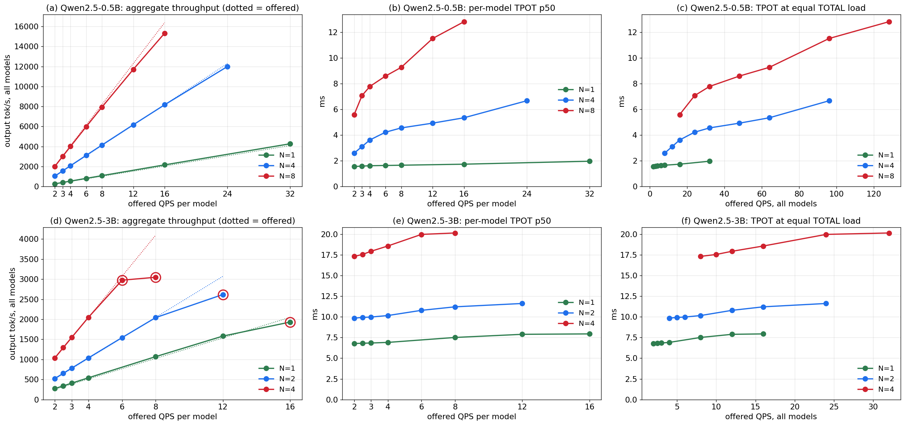

# Multi-inference-engine colocation: summary

A short walk-through of the seventh study. The full write-up, with every table and the
evidence behind each claim, is [report_colocation_multi.md](report_colocation_multi.md).

**The question:** put N identical inference models on one GPU. How do per-model latency
and aggregate throughput move as N grows, and what are the bottlenecks?

---

## Setup

Two models: a small one (**Qwen2.5-0.5B**) and a medium one (**Qwen2.5-3B**). All N
models run on one RTX 5090 under MPS, each as its own vLLM engine.

For each model there are four setups:

1. prefill + decode (full), all KV fits in the GPU
2. decode only, all KV fits in the GPU
3. prefill + decode (full), part of the KV cache offloaded to host DRAM
4. decode only, part of the KV cache offloaded to host DRAM

In all setups the VRAM per model is the same: about **3.22 GiB** for the 0.5B (1.04 GiB of
it is KV cache) and **7.65 GiB** for the 3B (0.94 GiB KV cache). To force offload we do
not shrink the memory; we increase the number of distinct sessions, so the KV working set
is about 3× the KV cache.

| | Case 1: full, fits | Case 2: decode-only, fits | Case 3: full, offload | Case 4: decode-only, offload |
|---|---|---|---|---|
| Request rate | 2 QPS per model, open-loop | same | same | same |
| Prompt | 6144-token session prefix + 128-token unique suffix | 6144-token session prefix only | prefix + 128-token suffix | prefix only |
| Output | 128 tokens | 128 tokens | 128 tokens | 128 tokens |
| Prefill during measurement | yes (the 128-token suffix) | none (prefix KV pre-stored) | yes | none |
| Session reuse | zipf-1.1 | uniform | zipf-1.1 | uniform |
| Distinct sessions (0.5B / 3B) | 8 / 3 | 8 / 3 | 48 / 14 | 48 / 14 |
| KV working set (0.5B / 3B) | 0.56 / 0.63 GiB | 0.56 / 0.63 GiB | 3.38 / 2.95 GiB | 3.38 / 2.95 GiB |
| vs. KV cache per model (1.04 / 0.94 GiB) | 54% / 67%, fits | 54% / 67%, fits | 3.2× / 3.1× over | 3.2× / 3.1× over |
| Requests per model | 300 | 300 | 300 | 300 |

The number of models is swept over 1, 2, 3, 4, 6, 8 for the 0.5B and 1–4 for the 3B (4 is
all that fits in VRAM).

---

## Result 1: 0.5B, everything fits in the GPU (cases 1, 2)

When all the data fits in the GPU, the TPOT curves for full and decode-only are almost
identical. TTFT is not applicable to decode-only, since there is no prefill. TPOT
increases with the number of models (1.56 ms at N=1 → 5.7 ms at N=8, 3.6×), and
SM-active increases as well. Every model still serves its full 2 QPS at every N, with no
queueing.

**Hypothesis 1:** letting N identical models each process a 2 QPS workload is similar to
one model processing a 2·N QPS workload, except that we lose batching once the load is
spread across N models. One model would batch all 2·N QPS into the same decode steps; N
separate engines cannot batch with each other, so each runs its own small-batch steps. So
the higher GPU utilization we see from colocating N models is not a real gain: it is the
same work done less efficiently.

This hypothesis only applies to colocating N identical models. If the models are
different, they could not be batched together anyway, so no batching is lost.

---

## Result 2: 0.5B with offload (cases 3, 4)

Here we hit the first bottleneck. With the default settings we could only scale to 4
models: at N=4 the decode-only offload case collapses. 40–50% of its requests time out
and throughput drops to ~18% of offered. This reproduced in 4 of 4 runs. The full offload
case still works at N=4.

**Observation:** host CPU is at 93–97% (32 logical cores) while the GPU is almost idle
(SM-active ~0.05).

**Root cause:** vLLM/PyTorch defaults assume one engine per machine. Each engine process
has ~135 threads, with its CPU thread pool sized for all 32 cores. With offload, every
request does CPU-side KV copies on that pool. With 4 engines the threads spin-wait
against each other, pin all 32 cores, and starve the GPU. We confirmed this with
per-thread sampling: during the collapse ~27 threads burn all 32 cores in user mode and
involuntary context switches go up 42×.

**Fix:** set `OMP_NUM_THREADS=4` to cap each engine's thread pool. We checked that the
cap does not hurt when it is not needed: results are within 1–3% of uncapped for a single
model, and identical for N=1–3. The 3B model collapses the same way at N=4 without the
cap. Details and controls are in
[Appendix A of the full report](report_colocation_multi.md#appendix-a-the-failure-that-stops-colocation-cpu-thread-oversubscription).

With the cap, offload scales cleanly. TPOT follows the same curve as the fits case
(3.66 ms at N=6 vs 3.63 ms), so reloading KV from DRAM adds no per-token cost for the
small model. TTFT (full case) is ~1 ms higher than in the fits case and has the same
shape.

We stopped at N=6 instead of 8 because of host RAM (the machine is already swapping at
N=6; each model needs ~7.4 GB of host memory with offload). We expect N=8 to follow the
same trend, but that is not tested.

---

## Result 3: 3B model

The fits case looks like the 0.5B: full and decode-only have the same TPOT, and every
model still serves its 2 QPS. But the 3B is much heavier per model: each added model
costs ~3.5 ms of TPOT (6.8 ms at N=1 → 17.3 ms at N=4, 2.55×), and VRAM is full at N=4.

The offload case is different. For the 0.5B, offload was free once the threads were
capped. For the 3B, TPOT stays on the fits curve but requests queue, and the queue grows
with N: mean wait goes from 0.08 s at N=1 to 4.7 s at N=4, and full-case TTFT from 74 ms
to 621 ms. Each 3B prefix is 216 MiB of KV and the cache holds only ~4 of them, so nearly
every request has to reload its prefix from DRAM first.

---

## Result 4: capacity (increase QPS at fixed N)

All the results above are at 2 QPS per model, where everything keeps up, so they show
latency but not capacity. For this experiment we use the fits case, decode-only, with the
thread cap, and increase the per-model QPS at fixed N until requests start to queue.

**How to read it:** top row is the 0.5B, bottom row the 3B; each line is one N. Left:
total tokens/s vs per-model QPS (dotted = offered load; a line that bends away from it is
saturated). Middle: per-model TPOT vs per-model QPS. Right: the same TPOT vs total QPS
across all N models, so each x value is the same traffic split across more models. A red
ring marks a point where requests started to queue.

**This supports Hypothesis 1:** at 32 QPS total, one 0.5B model has TPOT 1.97 ms, 4
models 4.56 ms, and 8 models 7.78 ms. Splitting the same traffic across 8 identical
models costs about 4× per token.

**0.5B:** we could not saturate it. N=8 serves 16 QPS per model (~15k tok/s total) with
zero queueing. Higher load is absorbed by bigger batches, so the price is TPOT
(5.6 → 12.8 ms). The "knee" at N=6–8 in Result 1 is a latency knee, not a capacity limit.

**3B:** it saturates at 12 / 8 / 4 QPS per model for N = 1 / 2 / 4. The limit is the
per-engine concurrency cap (`max-num-seqs=16`), which was lowered from 64 to give each
model more KV cache, not the GPU.

---

## Summary

- With stock settings, the first thing that breaks is host CPU threads, not the GPU. One
  environment variable fixes it.
- With that fixed, colocating N identical models costs per-token latency (lost batching,
  Hypothesis 1), not capacity.
- What runs out next depends on the case: GPU time for small models that fit, host RAM
  for small models with offload, VRAM and the concurrency cap for the 3B, and KV-reload
  queueing for the 3B with offload.

## Caveats

- Most points are single runs (the collapse was repeated 4×).
- The capacity points are short windows (10–20 s at the highest rates) and cover the
  fits, decode-only case only.
- The exact capacity limit of the 0.5B was not found.
- Full and decode-only cases differ in session skew (zipf vs uniform) as well as in
  prefill, so gaps between them under offload are not attributable to prefill alone.
- The "GPU utilization is not a real gain" part of Hypothesis 1 is an inference: the
  per-token cost of lost batching is measured, but SM-active itself did not track
  capacity in these runs (it fell from 0.78 to 0.68 at N=4 while throughput doubled).
