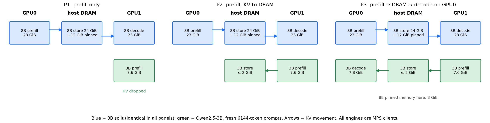
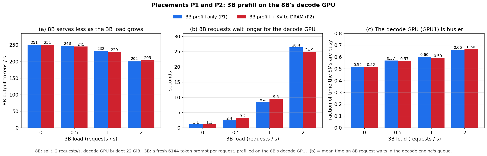
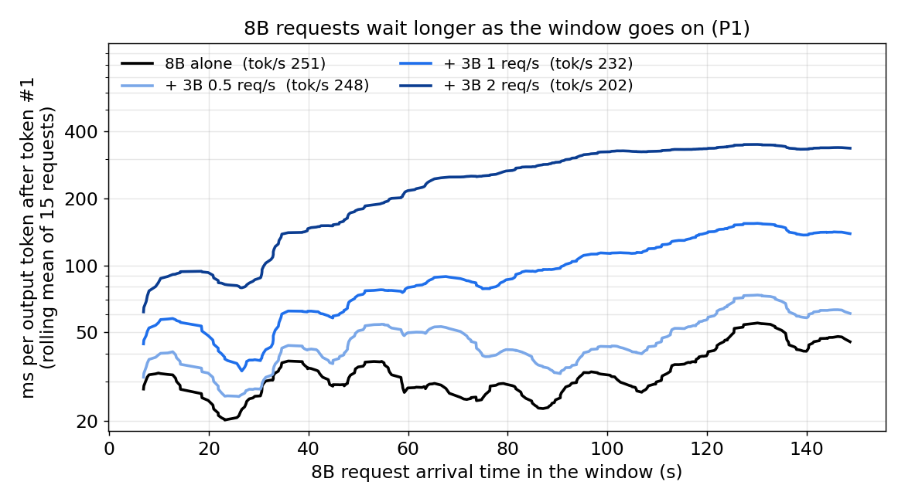
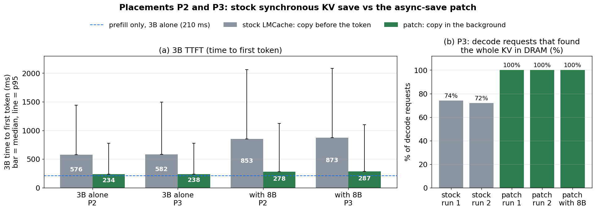
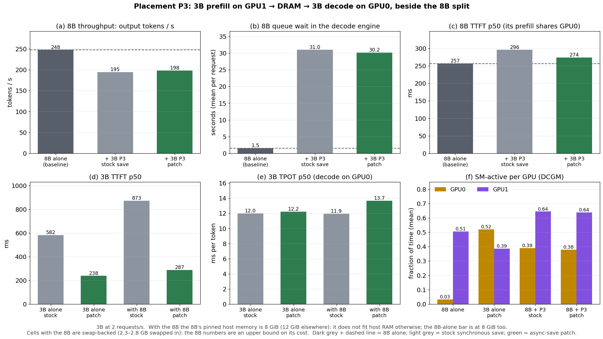

# Another model's prefill on the decode GPU

Eighth study. In the disaggregated 8B (prefill on GPU0, decode on GPU1, KV offloaded to
host DRAM), the decode GPU's SMs are nearly empty: SM occupancy ~3%, SM-active ~0.5,
memory-bound. The [fifth](report_colocation_ft.md) study filled that GPU with a
fine-tune, the [sixth](report_colocation_inf.md) with a second model's decode. This one
fills it with a second model's **prefill** — compute-dense work, the thing decode leaves
idle — and asks: **does a Qwen2.5-3B prefill on the 8B's decode GPU raise its compute
utilization, and what do both models pay?**

The short answer:

> **Utilization rises, but modestly, and the 8B pays for it in capacity.** Two requests
> per second of fresh 6144-token 3B prefills lift GPU1 SM-active from 0.52 to 0.66. The
> 8B's per-token time does not move (14.4 → 14.5 ms between tokens), but each 8B request
> stays longer on its decode engine, and at a 22 GiB decode budget — already at its
> in-flight-KV knee — that turns into an unbounded queue: −1%, −7% and −19% of 8B
> throughput at 0.5, 1 and 2 3B requests per second. The 3B itself is barely slowed
> (TTFT 210 → 231 ms).
>
> **Writing the 3B's KV to DRAM should not cost TTFT, but stock vLLM + LMCache makes it
> cost 2.7×.** The connector copies the KV GPU→host *inside* the engine step, before
> token #1 is returned, and the engine is blocked for it. A patch that moves the copy to
> a background thread brings the 3B's TTFT from 576–873 ms back to 234–287 ms, within
> 25–55 ms of prefill-only. It also exposed a race in the stock split: 26–28% of decode
> requests found only part of their KV and re-prefilled the rest.
>
> **The full split of the 3B (decode on the 8B's prefill GPU) only fits this box with
> the 8B's pinned host pools cut by a third, and then swaps.**

Run-level decisions, every prediction and its outcome are in
[DECISIONS_PF_COLOC.md](../DECISIONS_PF_COLOC.md); study-level predictions in
[PLAN_PF_COLOC.md](../PLAN_PF_COLOC.md).

---

## 1. Setup



### 1.1 The two models

| | 8B (incumbent) | 3B (tenant) |
|---|---|---|
| model | Llama-3-8B-Instruct | Qwen2.5-3B |
| layout | split: prefill GPU0, decode GPU1, router with `--forward-first-token` | prefill on GPU1 (beside the 8B decode); decode on GPU0 in P3 only |
| workload | reference: 32 sessions × 6144-token prefix + 128 suffix, 128 output tokens, zipf-1.1, 2 QPS open loop, 300 requests | a **fresh** 6144-token prompt per request (16-token stub + unique tail), open loop, 0.5 / 1 / 2 req/s |
| output | 128 tokens | 1 token (P1, P2); 128 tokens (P3) |
| KV | 24 GiB working set in a DRAM store; decode budget **22 GiB** = 5.77 GiB KV grant; prefill util 0.74 = 4.78 GiB grant | never offloaded; 0.21 GiB per prompt; prefill engine grant 0.46 GiB (one prompt per step) |
| GPU memory | 23 GiB on each GPU | prefill engine 7.6 GiB; decode engine 7.8 GiB |
| host memory | 24 GiB store + 2 × 6 GiB pinned L1 + engines | per engine ~4.5 GB; store capped at 2 GiB |

The 3B's prompts are fresh so that every request is a full prefill: a session-reuse
workload would hit the prefix cache and compute only a 128-token suffix. The 22 GiB 8B
decode budget is forced by memory: it is the smallest budget that held 2 QPS in the
split study, and it leaves GPU1 just enough for a 3B engine (23.1 + 7.6 of 31.8 GiB).
The 8B prefill util is lowered from the usual 0.80 to 0.74 in every cell so that the 3B
decode of P3 fits on GPU0; one 8B configuration means one baseline.

### 1.2 The three placements of the 3B

| | P1 | P2 | P3 |
|---|---|---|---|
| 3B prefill | GPU1 | GPU1 | GPU1 |
| its KV | dropped (no connector) | written to the 3B's own DRAM store | written to the store, read by a 3B decode engine on GPU0 |
| 3B decode | — | — | GPU0, beside the 8B prefill; own router with `--forward-first-token` |
| metrics | TTFT, throughput (req/s) | TTFT, throughput (req/s) | TTFT, TPOT, throughput (tok/s) |

The stock LMCache store server has no evictor and 300 fresh prompts would write 65 GiB,
so the 3B's store evicts oldest-first beyond 2 GiB. A read of an evicted chunk is
counted and invalidates the cell; it never happened.

### 1.3 How a cell runs

Every cell is one launch. Driver starts MPS → GPU and host monitors → mem_guard and
heartbeat → 8B stack → 8B warmup (fills its store) → RAM gate on the measured headroom
→ 3B engines → 3B warmup → both clients start at the same instant → stall watchdog on
the engines' token counters → per-engine `/metrics` deltas, telemetry, raw JSON →
teardown. All engines are **MPS clients** with the default (equal, uncapped) share,
verified with `nvidia-smi` (process type `M+C`); the 8B-alone baseline also runs under
MPS. `OMP_NUM_THREADS=8` everywhere (up to four engines on 32 cores). Baselines: the 8B
alone, and the 3B alone in each placement. No cell stalled.

**Telemetry caveat.** DCGM counters are per GPU: on GPU1 they blend the 8B decode and
the 3B prefill. Per-model claims rest on client latencies and per-engine metrics.

---

## Which experiment ran in which placement

| section | placement(s) | 3B load | with the 8B | 3B alone | KV save |
|---|---|---|---|---|---|
| §2 cost and utilization | **P1, P2** | 0.5, 1, 2 req/s | yes | yes | stock (synchronous) |
| §3 why the 8B saturates | **P1** | 0, 0.5, 1, 2 req/s | yes | — | — |
| §4 the synchronous save | **P2** | 0.5, 1, 2 req/s | yes | yes | stock |
| §5 asynchronous save | **P2, P3** | 2 req/s | yes | yes | stock vs patch |
| §6 the full 3B split | **P3** | 2 req/s | yes (8B pinned memory 8 GiB) | yes | stock vs patch |

P1 = 3B prefill only, KV dropped · P2 = 3B prefill, KV written to DRAM · P3 = 3B
prefill → DRAM → 3B decode on GPU0. The 3B prefill is on GPU1 in all three.

## 2. What the 3B prefill costs the 8B, and what it buys — P1 and P2

> **Placements: P1 (prefill only) and P2 (prefill + KV to DRAM, stock synchronous
> save).** 3B at 0.5 / 1 / 2 req/s, beside the 8B and alone.



*8B split at 2 requests/s, decode budget 22 GiB; the 3B's load on the x axis. Grey bar and dashed line = **the 8B alone (baseline)**; blue = with the 3B in
P1, red = in P2. (a) 8B output throughput. (b) Mean time an 8B request waits in the
decode engine's queue. (c) GPU1 SM-active (fraction of time the SMs are busy).*

| 3B rate (req/s) | 8B tok/s P1 / P2 | 8B decode queue P1 / P2 | 8B TPOT p50 P1 / P2 | 8B ITL p50 | 3B TTFT p50, alone → with 8B: P1 | P2 (sync save) | GPU1 SM-active / occupancy (P1) |
|---|---|---|---|---|---|---|---|
| 0 | 250.8 | 1.1 s | 31.6 ms | 14.4 ms | — | — | 0.52 / 0.031 |
| 0.59 | 247.5 / 245.0 | 2.4 / 3.2 s | 45 / 51 ms | 14.5 ms | 209 → 224 ms | 266 → 322 ms | 0.57 / 0.041 |
| 1.12 | 232.5 / 228.6 | 8.4 / 9.5 s | 93 / 102 ms | 14.5 ms | 209 → 225 ms | 305 → 460 ms | 0.60 / 0.050 |
| 2.14 | 202.2 / 204.7 | 26.4 / 24.9 s | 274 / 263 ms | 14.5 ms | 210 → 231 ms | 576 → 853 ms | 0.66 / 0.064 |

*Zero failed requests in every cell. The 2 req/s P1 cell was run twice (202.2 / 202.5
tok/s, TPOT 274 / 276 ms). 8B TTFT p50 stays 167–195 ms in all of them (176 alone).*

**Observations:**

- **GPU1 does more compute, but less than the 3B adds alone.** Alone, each req/s of 3B
  prefill adds ~0.19 SM-active on GPU1; beside the 8B it adds ~0.07. Part of the gain is
  cancelled because the 8B does less work in the same window.
- **The 8B loses throughput from the first step, and the loss grows faster than the
  load.** 1% at 0.6 req/s, 7% at 1.1, 19% at 2.1.
- **The 8B's per-token time does not move.** The median gap between two output tokens is
  14.4–14.5 ms in every cell. What grows is the time requests wait to be scheduled on the
  decode engine (1.1 s → 26 s). The 8B's "TPOT" here counts that wait: with the router
  forwarding token #1 from the prefill leg, the decode engine's queue lands between
  tokens #1 and #2.
- **P1 and P2 cost the 8B the same.** Whether the 3B writes its KV to DRAM makes no
  difference to the incumbent at any rate.
- **The 3B is barely slowed in P1** (+7% TTFT at every rate). In P2 it is slowed a lot,
  alone as well as colocated — that is the synchronous save of §4, not the 8B.
- **The 8B's TTFT is a GPU0 quantity and stays put** (167–195 ms vs 176 alone).

## 3. Why the 8B saturates — P1

> **Placement: P1 (prefill only).** The same holds for P2: §2 shows both cost the 8B the
> same.



*Per 8B request (P1 cells): the time it waited instead of decoding — end minus first
token, minus 127 tokens at the run's median gap between tokens (14.4–14.5 ms in every
cell) — against when it arrived; rolling mean of 15 requests.*

The 8B decode engine at 22 GiB holds a 5.77 GiB KV grant; each in-flight 8B request
holds a whole 6272-token prompt (0.77 GiB), so ~7 requests fit at once. By Little's law,
2 QPS needs 2 × (time a request spends on the decode engine) slots. Alone that time is
3.1 s (KV load 286 ms + decode 2.8 s) → ~6.2 slots: just inside the grant, and the
baseline already queues ~1 s. With 2 req/s of 3B prefill beside it, the KV load grows to
574 ms and the decode phase to 3.7 s (the 3B's kernels share the SMs and memory
bandwidth, so each decode step and each copy into the 8B's KV takes longer) → 4.3 s ×
2 = 8.6 slots > 7. The engine can then admit fewer requests per second than arrive, and
the queue grows for the whole window — the figure's rising curves, which do not level
off at 1 or 2 req/s.

So the cost is not a property of prefill-as-neighbour so much as of the 8B having no
headroom: any neighbour that stretches its residence time by a few hundred milliseconds
tips it over. Separating the two would need the 8B off its knee (a larger decode budget,
which GPU1 cannot fit beside a 3B, or a lower 8B rate); that was not run.

The baseline's TTFT (176 ms) is higher than the split study's b22 (111 ms) because of
the smaller prefill grant, not MPS: the 8B alone at prefill util 0.80 reads 77 ms with
identical TPOT and throughput (`pfc_base_pf80`). All comparisons here are at 0.74.

## 4. Writing the 3B's KV to DRAM: a synchronous copy in front of token #1 — P2

> **Placement: P2 (prefill + KV to DRAM), stock LMCache.** Compared against P1, which
> writes nothing.

Alone at 2 req/s, writing the KV to DRAM raises the 3B's TTFT from 210 to 576 ms. That
should not happen: token #1 exists as soon as the forward pass ends.

What the engine log shows per request: forward ~205 ms, then LMCache's GPU→host copy,
**55 ms** (96 ms beside the 8B). The push from the host L1 pool to the store server is
asynchronous. The copy is not: vLLM calls `kv_connector.wait_for_save()` inside
`execute_model`, before the step's outputs are returned, and LMCache's
`get_finished()` returns `(None, None)` — it never uses vLLM's delayed-free path. So
token #1 waits for the copy, and the next request waits for both. The 55 ms adds ~25% to
the service time; at 2 req/s (whole-prompt prefill admits one request per step) queueing
multiplies it into +366 ms of TTFT. At 0.6 req/s, where nothing queues, the cost is
exactly the copy: 266 vs 209 ms.

## 5. An asynchronous save — P2 and P3

> **Placements: P2 and P3, each with the stock synchronous save and with the patch.**
> 3B at 2 req/s, beside the 8B and alone.



*(a) 3B time to first token at 2 req/s (bar = median, line = p95), stock synchronous
save vs the patch; dashed = prefill only, 3B alone. P3 with the 8B uses 8 GiB of 8B
pinned memory (§6). (b) P3: share of decode requests that found their whole prompt in
the store.*

The patch (`scripts/inf_pf_coloc/async_save_patch/`, loaded into the 3B prefill engine
only) changes three connector methods: `wait_for_save` hands the copy to one background
thread and returns at once; `request_finished` tells the scheduler to keep a request's
KV blocks while its copy is still reading them; `get_finished` reports the request when
the copy is done, and the scheduler frees the blocks (vLLM's own mechanism).

| cell | 3B TTFT p50 sync → async | 3B TTFT p95 sync → async | 3B TPOT (P3) | 8B tok/s sync → async |
|---|---|---|---|---|
| 3B alone, P2 | 576 → **234 ms** | 1441 → 774 ms | — | — |
| 3B alone, P3 | 582 → **238 ms** | 1496 → 777 ms | 12.0 → 12.2 ms | — |
| with 8B, P2 | 853 → **278 ms** | 2062 → 1122 ms | — | 204.7 → 200.5 |
| with 8B, P3 (8 GiB pinned) | 873 → **287 ms** | 2082 → 1102 ms | 12.0 → 13.7 ms | 194.5 → 198.2 |

**Observations:**

- **TTFT returns to within 25–55 ms of prefill-only.** The copy no longer sits in front
  of the token or of the next request's admission.
- **Throughput and the 8B are unchanged.** The 8B still saturates (§3).
- **The copy itself gets slower** — ~230–275 ms instead of 55 — because it now overlaps
  the next request's forward and queues behind it on the GPU. Backlog stayed ≤ 2 copies,
  no errors, no preemptions.
- **The decode leg needs a gate.** Without one, 11 of 30 smoke-test decode requests
  looked the KV up before it existed and re-prefilled on GPU0. The router now waits for a
  marker the patch writes once the copy *and* LMCache's push to the store server are
  done; the decode leg then starts ~250 ms after token #1, and 300 of 300 requests find
  their whole prompt.
- **The stock split was already racing.** With the synchronous save, 216–222 of 300 P3
  decode requests found their whole prompt; the rest found part of it and re-prefilled
  the remainder on GPU0, because the L1 → store push is asynchronous upstream and the
  router sends the decode leg at once. The synchronous P3 numbers include that
  recompute.
- **Content check.** Eight fixed prompts, greedy, 32 tokens, through the split: the
  texts are identical for sync, async and a connector-free reference (one engine that
  prefills and decodes itself). Because random-token prompts give degenerate text, token
  logprobs were compared as well: max |Δ| against the reference is 0.05–0.20 for sync
  and 0.05–0.42 for async — the same order, the split path's own numerics. Evidence that
  the stored KV is right, not a bit-exact proof.
- **Not handled:** a request preempted while its copy is in flight would lose its blocks
  under the copy (prefill-only engines here never preempt).

## 6. The full 3B split — P3

> **Placement: P3 (prefill on GPU1 → DRAM → decode on GPU0).** 3B at 2 req/s; beside
> the 8B only with the 8B's pinned memory cut from 12 to 8 GiB.



*3B at 2 req/s. Top row: the 8B (baseline = the 8B alone, also at 8 GiB pinned). Bottom
row: the 3B alone and beside the 8B, stock synchronous save vs the async-save patch, and
SM-active on each GPU. Cells with the 8B are swap-backed.*

With the 8B's two pinned L1 pools at 6 GiB each, P3 does not fit host RAM: available
memory fell to 4 GB 68 s into the window and mem_guard killed the engines (`pfc_p3`).
With the pools at 4 GiB it runs (`pfc_p3_l1x4`, `pfc_p3_async_l1x4`):

| | 8B TTFT p50 | 8B TPOT p50 | 8B tok/s | 3B TTFT p50 | 3B TPOT p50 | 3B tok/s | GPU0 / GPU1 SM-active | swapped in |
|---|---|---|---|---|---|---|---|---|
| 8B alone, 8 GiB pinned | 257 ms | 35.7 ms | 247.9 | — | — | — | 0.03 / 0.51 | 0.3 GB |
| + P3, sync save | 296 ms | 331 ms | 194.5 | 873 ms | 12.0 ms | 270 | 0.39 / 0.64 | 2.8 GB |
| + P3, async save | 274 ms | 316 ms | 198.2 | 287 ms | 13.7 ms | 271 | 0.38 / 0.64 | 2.3 GB |

- **GPU0 gets work too** (SM-active 0.03 → 0.38), and the 3B decode beside the 8B prefill
  runs at its solo TPOT (12–14 ms) and full throughput.
- **The smaller pinned pools cost the 8B on their own:** TTFT 176 → 257 ms alone.
- **These cells are swap-backed** (2–3 GB swapped in during the window, although
  12–16 GB read as available: the kernel swaps anonymous pages and keeps the model files
  in page cache; without root this cannot be changed). The 8B numbers in P3 are an upper
  bound on its cost, not a clean measurement.

## 7. Takeaways

1. **Prefill is a usable neighbour for the decode GPU in compute terms:** GPU1 SM-active
   0.52 → 0.66 at 2 req/s of 6144-token prompts, and the tenant's own TTFT barely moves
   (+7%).
2. **The incumbent pays in capacity, not per-token latency** — and only because it had
   no headroom. At a 22 GiB budget the 8B decode is at its in-flight-KV knee; stretching
   each request's stay by ~40% tips it into an unbounded queue (−19% throughput at
   2 req/s). Size the incumbent with headroom before lending its GPU.
3. **"Store the KV to DRAM" is free for TTFT only if the save is asynchronous.** Stock
   vLLM 0.15.1 + LMCache 0.4.4 copies inside the step; a three-method patch removes the
   2.7× TTFT penalty.
4. **A prefill→DRAM→decode handoff needs a readiness signal.** Without one, a quarter of
   decode requests in the stock split re-prefill part of their prompt.
5. **Host RAM bounds what can be colocated on this box**, again: the 3B's full split
   fits only with the 8B's pinned memory cut, and then swaps.

## Caveats

- Most cells are single runs; the 2 req/s P1 cell was repeated (agreed within 0.2%).
- The 8B was at its knee in every cell, so the measured cost mixes "prefill as a
  neighbour" with "an incumbent without headroom" (§3).
- Swap: the two 2 req/s P1 runs (0.9 and 1.7 GB swapped in; P2 at the same rate had
  none and the same 8B result), `pfc_p2_async_r2` (1.1 GB) and all P3 cells.
- One launch failed to bind the 3B store's port (`pfc_p2_async`; nothing was listening;
  cause not found). The launcher now retries for ~45 s and the rerun is reported.
- The capacity test of the multi-model study (engine queue wait) is used informally
  here: the 8B queues ~1 s even alone, so no cell would pass it.

---

## Reproducing

```bash
D=scripts/inf_pf_coloc/pfc_sweep.py; PY=.venv/bin/python; export OMP_NUM_THREADS=8
# round 1: baselines and the three placements at 2 req/s
$PY $D --cells base s1 s2 s3 p1 p2 p3 --sm-store-cap-gb 2
# round 2: prefill-util control, 3B rate sweep, P3 with 4 GiB pinned pools
scripts/inf_pf_coloc/queue_round2.sh
# round 3: the async-save patch (+ the KV content check)
scripts/inf_pf_coloc/queue_round3.sh
$PY $D --cells p2 --sm-store-cap-gb 2 --sm-async-save --name-suffix _r2
$PY $D --cells s3 --sm-store-cap-gb 2 --name-suffix _v2
$PY $D --cells s3 --sm-store-cap-gb 2 --sm-async-save --name-suffix _v2
$PY $D --cells s1 --name-suffix _v2

# figures (view them before believing them)
$PY scripts/plots/plot_pfc_layout.py
$PY scripts/plots/plot_pfc_results.py
```

Data: `output/summary_pfc.csv` (rebuilt from raw on every run); raw records
`output/raw/pfc_*.json` (gitignored); 3B client outputs `output/inf_pf_coloc/`;
per-second GPU and host telemetry `output/gpumon/pfc_*{,_host}.csv`; engine logs per
launch `output/logs/pfc_archive/<cell>/`. Name suffixes: `_q<rate>` 3B rate; `_async`
async save; `_l1x4` 8B pinned pools at 4 GiB; `_pf80` 8B prefill util 0.80; `_r2`
rerun; `_v`, `_v2` runs that carry the KV content check.
