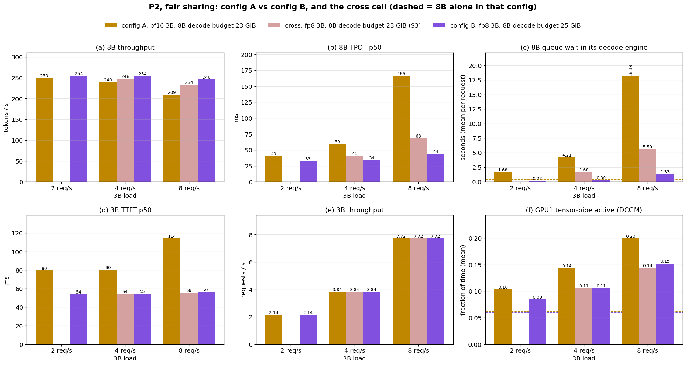
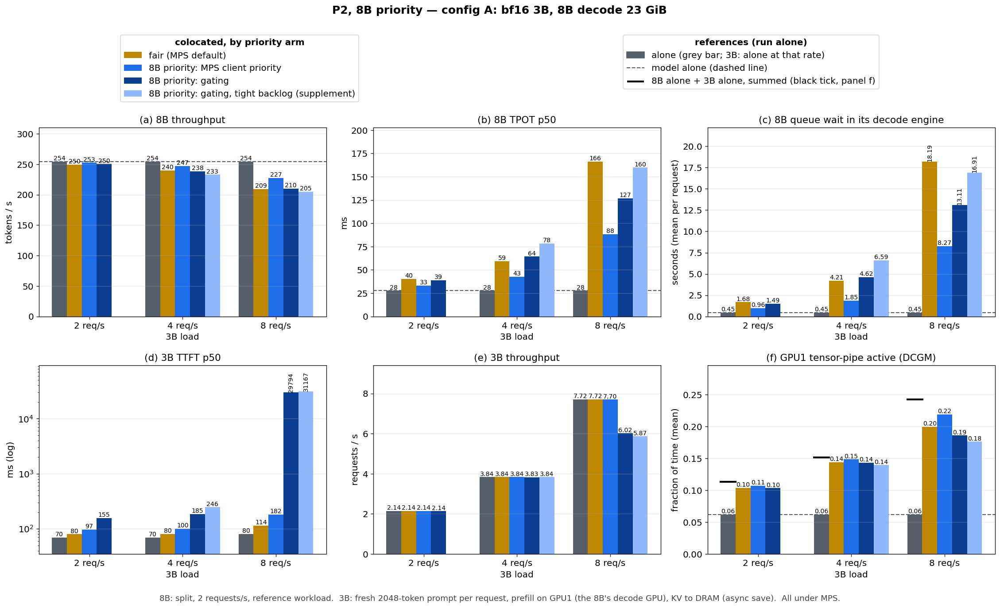
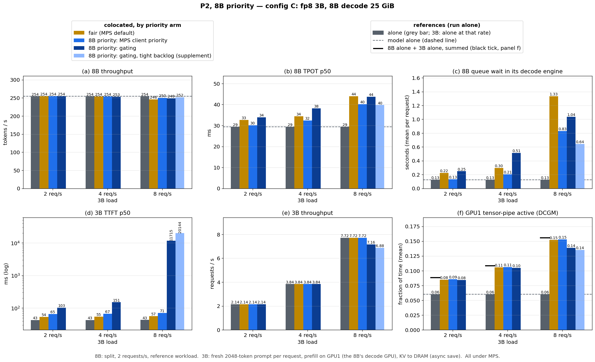
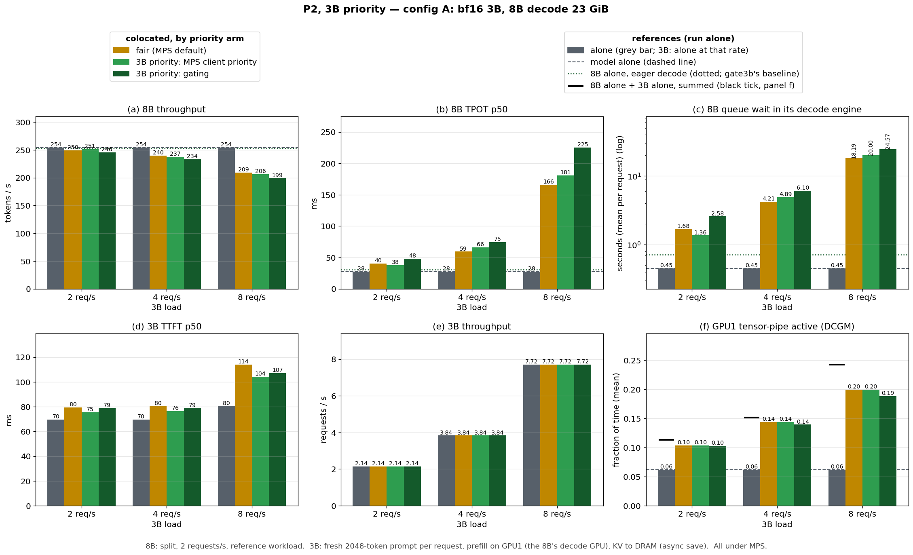
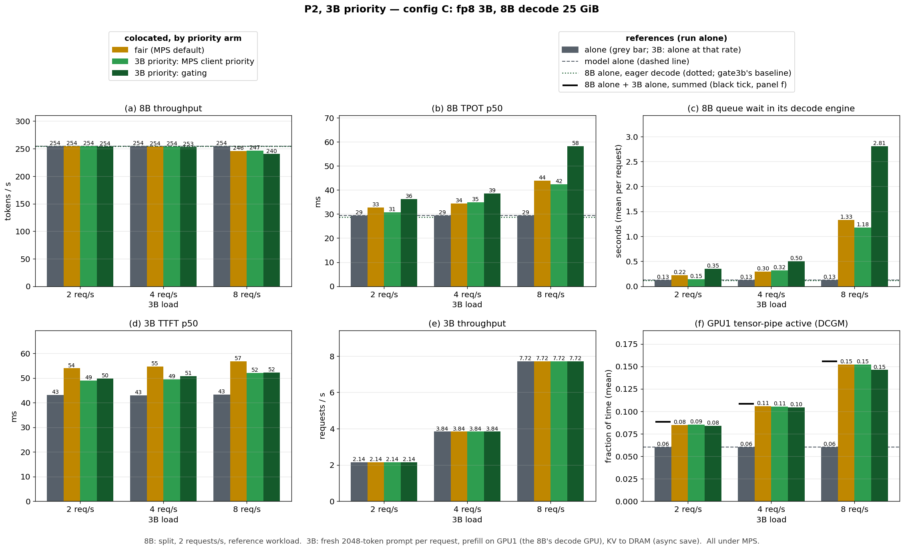
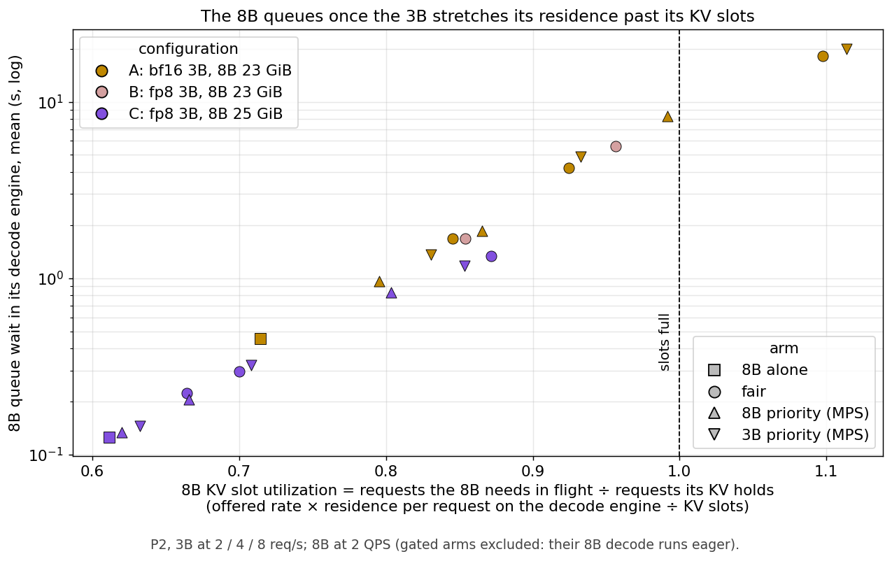

# Who goes first on the shared GPU: the 8B decode or a 3B prefill

Ninth study. The [eighth](report_colocation_prefill.md) put a Qwen2.5-3B prefill on the
8B split's decode GPU (placement **P2**: prefill on GPU1, KV written to host DRAM) and found
that the 8B pays in capacity, but at a decode budget of 22 GiB the 8B was already at its
knee, so any neighbour hurt it. This study gives the 8B headroom, runs P2 in three
configurations, and asks **what happens to both models when the 8B has priority, when
the 3B has priority, and when neither does — and whether it matters if priority is
enforced by MPS or by gating.**

The short answer:

> **The cost of a prefill neighbour to a decode is KV slots, and it is predictable.** The
> 3B rarely slows the 8B's median token; it lengthens the time each 8B request holds a
> KV slot on its decode engine (+10–55% here). The 8B queues once its offered rate ×
> that residence approaches the number of requests its KV grant holds — every non-gated
> cell, across configurations, arms and 3B rates, falls on one curve of queue wait against that
> ratio (§6). A decode with slot headroom absorbs the prefill almost for free: with an
> fp8 3B beside an 8B at a 25 GiB budget, 16k prompt tokens/s of prefill cost the 8B
> 1.7% of its throughput.
>
> **Give priority to the decode, and do it with MPS client priority.** The decode has a
> capacity cliff and the prefill does not: under fair sharing the 3B is only 10–34 ms
> slower than alone, while the 8B can fall off its slot limit. Making the 3B a
> low-priority MPS client shortens the 8B's residence enough to pull it back (8 3B-req/s,
> config A: queue 18 → 8 s, TPOT 166 → 88 ms) for 20–70 ms of 3B TTFT. Prioritizing the
> 3B buys it 5–10 ms. A launch-time gate gives the 8B nothing over fair sharing and
> starves the 3B.

Run-level decisions, every prediction and its outcome are in
[DECISIONS_PF_PRIO.md](../DECISIONS_PF_PRIO.md); the study-level predictions in
[PLAN_PF_PRIO.md](../PLAN_PF_PRIO.md). *(The log and the plan call configuration C
"config B" and configuration B "the cross cell" / S3: the names were changed for this
report.)*

---

## 1. Setup

### 1.1 Three configurations of P2

Everything is P2: the 3B prefills on GPU1 beside the 8B decode and writes its KV to its
own host-DRAM store, with the eighth study's async-save patch (token #1 is not held back
by the GPU→host copy). The 8B always runs the reference workload (split, 32 sessions ×
6144 + 128 suffix, 128 output, zipf-1.1, 2 QPS); the 3B gets a fresh **2048-token**
prompt per request (1 output token) at 2 / 4 / 8 req/s — shorter than the reference so a
3B engine fits beside an 8B with headroom.

| | A | B | C |
|---|---|---|---|
| 3B weights | bf16 (5.75 GiB) | fp8 (3.17 GiB) | fp8 (3.17 GiB) |
| 3B on GPU1 (KV) | 7.1 GiB (0.42) | 4.8 GiB (0.64) | 4.8 GiB (0.64) |
| 8B decode budget (KV) | 23 GiB (6.77) | 23 GiB (6.77) | 25 GiB (8.77) |
| 8B alone: tok/s, TPOT, queue | 254, 28 ms, 0.45 s | same as A | 254, 29 ms, 0.13 s |
| 3B alone: TTFT p50 | 70–80 ms | 43 ms | 43 ms |
| runs | all arms, 2/4/8 req/s | fair, 4 and 8 req/s | all arms, 2/4/8 req/s |

A is the largest 8B budget a bf16 3B fits beside; C buys the 8B two more GiB with an fp8
3B. A → C changes two things; B changes only the 3B, so A vs B is the 3B's weight and
B vs C the 8B's headroom (§3.2).

### 1.2 The priority arms

All under MPS. Each colocated cell runs one arm at one 3B rate (150 s windows).

| arm | priority | mechanism |
|---|---|---|
| `fair` | neither | MPS default |
| `mps8b` | 8B | 3B at MPS client priority "below normal" (`CUDA_MPS_CLIENT_PRIORITY=1`) |
| `gate8b` | 8B | 8B decode publishes when it is inside `execute_model`; the 3B's kernel launches wait meanwhile (CUPTI gate, K=8, ≤ 3 pending; 3B eager) |
| `mps3b` | 3B | 8B decode at "below normal" |
| `gate3b` | 3B | 3B publishes its busy window; the 8B decode's launches wait (8B eager) |

Controls: the 8B alone with an eager decode (gate3b's baseline), the 3B alone at each
rate, the 8B eager beside the 3B without a gate (8 req/s). Supplements: tighter gating
(`gate8bt`: K=1, ≤ 1 pending) and repeats (§4).

### 1.3 Measurement

One launch per cell through the launch scripts (mem_guard, heartbeat, RAM gate);
`OMP_NUM_THREADS=8`; GPU telemetry adds **tensor-pipe active** (DCGM 1004), the
compute-utilization metric (SM-active reads high for decode too). No cell stalled and no
request failed in the whole study.

**Swap.** Host RAM is tight (the 8B's 24 GiB store and 12 GiB of pinned pools on a
60 GiB box) and some windows swapped, which inflates the 8B's numbers: swap-free reruns
were 20–40% better on 8B TPOT (A gate8b at 4 req/s: 64 vs 107 ms), while two clean runs
of a cell agree within 1–3%. Rule, set before rerunning: every cell with > 0.5 GB swapped
in was rerun and the run with less swap is reported; cells that swapped in every attempt
are marked †.

---

## 2. Baselines

| | 8B tok/s | 8B TPOT p50 | 8B ITL p50 | 8B decode queue | GPU1 tensor-active |
|---|---|---|---|---|---|
| 8B alone, 23 GiB (A, B) | 254.3 | 27.7 ms | 14.8 ms | 0.45 s | 0.062 |
| 8B alone, 23 GiB, eager decode | 252.9 | 31.0 ms | 15.8 ms | 0.72 s | 0.061 |
| 8B alone, 25 GiB (C) | 254.3 | 29.4 ms | 15.9 ms | 0.13 s | 0.060 |
| 8B alone, 25 GiB, eager decode | 254.2 | 28.8 ms | 16.1 ms | 0.12 s | 0.061 |

The 8B reaches its offered rate at both budgets; at 23 GiB it queues ~0.45 s on its
decode engine alone, at 25 GiB almost nothing. An eager decode costs ~3 ms of TPOT at
23 GiB and nothing measurable at 25.

---

## 3. Fair sharing: how much does the 3B cost the 8B?



*P2 under fair MPS sharing in configs A, B and C, by 3B load (B was run at 4 and 8 req/s
only). Dashed = the 8B alone at 23 GiB (A, B) and 25 GiB (C).*

| 3B load | A: 8B tok/s / TPOT / queue | C: 8B tok/s / TPOT / queue | 3B TTFT A (alone) | 3B TTFT C (alone) | tensor-active A / C (sum alone) |
|---|---|---|---|---|---|
| 0 | 254.3 / 28 ms / 0.45 s | 254.3 / 29 ms / 0.13 s | — | — | 0.062 / 0.060 |
| 2 req/s | 249.6 / 40 ms / 1.7 s | 254.4 / 33 ms / 0.22 s | 80 (70) ms | 54 (43) ms | 0.103 (0.114) / 0.085 (0.088) |
| 4 req/s | 239.6 / 59 ms / 4.2 s | 253.7 / 34 ms / 0.30 s | 81 (70) ms | 55 (43) ms | 0.144 (0.152) / 0.106 (0.109) |
| 8 req/s | 209.3 / 166 ms / 18.2 s | 246.1 / 44 ms / 1.3 s | 114 (80) ms | 57 (43) ms | 0.199 (0.242) / 0.152 (0.156) |

**Observations:**

- **In A the 8B pays in capacity:** throughput −18% and an 18 s queue on its decode
  engine at 8 req/s. **In C it barely pays:** −3%, 1.3 s.
- **The 3B is only mildly slowed:** +10 ms (A, 2–4 req/s), +34 ms (A, 8 req/s),
  +11–14 ms (C).
- **Compute utilization rises with the 3B's load** — GPU1 tensor-active from 0.06 to
  0.20 (A) and 0.15 (C) at 8 req/s. In C it is close to the sum of the two models alone
  (0.152 vs 0.156); in A it falls short at 8 req/s (0.199 vs 0.242): the 8B is not getting
  its own work done.

### 3.1 Why the 8B queues: residence against KV slots

The 8B's median gap between tokens does not move (ITL p50 14.8 → 15.0–15.3 ms in A), but
its *mean* does: a request's 128-token decode takes 2.8 s alone and 4.1 s beside the 3B
at 8 req/s. Most decode steps are untouched; the few that collide with a 3B prefill are
long, and they add up. With the KV load from DRAM, each 8B request's **residence** on
the decode engine grows:

| 8B residence on its decode engine (KV load + decode) | alone | 2 req/s | 4 req/s | 8 req/s |
|---|---|---|---|---|
| A (bf16 3B, 23 GiB), fair | 3.10 s | 3.66 (+18%) | 4.01 (+29%) | 4.76 (+54%) |
| B (fp8 3B, 23 GiB), fair | 3.10 s | — | 3.70 (+19%) | 4.14 (+34%) |
| C (fp8 3B, 25 GiB), fair | 3.43 s | 3.73 (+9%) | 3.93 (+15%) | 4.89 (+43%) |

Each request in flight holds its whole prompt's KV (6400 tokens × 0.125 MiB = 0.78 GiB),
so the decode engine holds **~8.7 requests at 23 GiB and ~11.2 at 25 GiB** — its *slots*.
How many slots the 8B *needs* follows from Little's law: requests arrive at 2 per second
and each stays for its residence, so on average 2 × residence are in flight. The ratio
of the two is the **KV slot utilization**:

> slot utilization = (offered rate × residence) ÷ slots

Worked through for config A: alone, 2 req/s × 3.10 s = 6.2 requests in flight on 8.7
slots → **0.71**. With the 3B at 8 req/s each request stays 4.76 s, so 9.5 are needed on
the same 8.7 slots → **1.10**: more requests want a slot than there are, and the excess
waits in the decode engine's queue. (Like a car park: arrivals per second × minutes
parked = cars inside; once that exceeds the spaces, a queue forms at the gate. The 3B
does not slow the cars; it makes each one stay longer.)

Under fair sharing, the 8B's queue follows its slot utilization:

| 8B slot utilization → queue wait | alone | 2 req/s | 4 req/s | 8 req/s |
|---|---|---|---|---|
| A (8.7 slots) | 0.71 → 0.45 s | 0.85 → 1.7 s | 0.92 → 4.2 s | **1.10 → 18.2 s** |
| B (8.7 slots) | 0.71 → 0.45 s | — | 0.85 → 1.7 s | 0.96 → 5.6 s |
| C (11.2 slots) | 0.61 → 0.13 s | 0.66 → 0.22 s | 0.70 → 0.30 s | 0.87 → 1.3 s |

Below ~0.7 the queue is a fraction of a second; at 0.85–0.96 it is seconds; past 1.0 it
grows without bound. It rises before 1.0 because arrivals are random: bursts fill the
slots before the average does. §6 shows the priority arms follow the same rule.

### 3.2 What fp8 and two more GiB each do

| 3B load | A: bf16 3B, 23 GiB | B: fp8 3B, 23 GiB | C: fp8 3B, 25 GiB |
|---|---|---|---|
| 4 req/s: 8B tok/s / TPOT / queue | 239.6 / 59 ms / 4.2 s | 247.9 / 41 ms / 1.7 s | 253.7 / 34 ms / 0.30 s |
| 8 req/s: 8B tok/s / TPOT / queue | 209.3 / 166 ms / 18.2 s | 233.7 / 68 ms / 5.6 s | 246.1 / 44 ms / 1.3 s |
| 8 req/s: slot utilization | 1.10 | 0.96 | 0.87 |

- **A → B (fp8 3B, same 8B) cuts the interference by about a third:** residence +54% →
  +34% at 8 req/s. The fp8 prefill occupies the GPU about half as long (3B alone at
  8 req/s: tensor-active 0.096 vs 0.181; TTFT 43 vs 80 ms). Whether that is fewer FLOPs
  or fewer weight bytes is not separable here.
- **The large visible gap is the cliff amplifying it.** A 13% shorter residence (4.76 →
  4.14 s) moves the 8B from just past its slots (1.10) to just under (0.96), and its queue
  from 18 to 5.6 s.
- **B → C (two more GiB for the 8B) adds slots, not speed:** 8.7 → 11.2 requests. The
  residence is no shorter (4.89 s), but the slot utilization falls to 0.87 and the queue to 1.3 s.

---

## 4. 8B priority





*P2 with the 8B as the priority model: fair vs MPS client priority vs gating vs the
tighter gating (supplement; A at 4 and 8 req/s, C at 8). Grey = alone (for the 3B, alone at
that rate); black tick in (f) = the two models' tensor-active alone, summed.*

| config, 3B load | 8B TPOT p50: fair / mps8b / gate8b / gate8bt | 8B tok/s: fair / mps8b / gate8b / gate8bt | 3B TTFT p50: fair / mps8b / gate8b / gate8bt | 3B served (of offered) gate8b / gate8bt |
|---|---|---|---|---|
| A, 2 | 40 / 33 / 39 / — | 249.6 / 252.6 / 250.4 / — | 80 / 97 / 155 / — | 2.14 / — |
| A, 4 | 59 / 43 / 64 / 78 | 239.6 / 247.4 / 238.4 / 232.9 | 81 / 100 / 185 / 246 | 3.83 / 3.84 |
| A, 8 | 166 / 88 / 127 / 160† | 209.3 / 227.4 / 210.0 / 204.9† | 114 / 182 / 29,794 / 31,167† | 6.02 / 5.87 (of 7.72) |
| C, 2 | 33 / 30 / 34 / — | 254.4 / 254.5 / 254.4 / — | 54 / 65 / 103 / — | 2.14 / — |
| C, 4 | 34 / 32 / 38 / — | 253.7 / 253.9 / 253.3 / — | 55 / 67 / 151 / — | 3.84 / — |
| C, 8 | 44 / 40 / 44 / 40 | 246.1 / 250.0 / 248.6 / 251.9 | 57 / 71 / 11,715 / 20,144 | 7.16 / 6.88 (of 7.72) |

*† = swap-backed in every attempt (> 0.5 GB). Repeats of clean cells agree within 1–3%:
A fair 8 req/s 164.5 vs 166 ms; A mps8b 4 req/s 42.7 vs 42.1 ms.*

**Observations:**

- **MPS client priority protects the 8B, at a modest cost to the 3B.** In A at 4 req/s
  it keeps the 8B at 247 tok/s and 43 ms (fair: 240, 59 ms) and cuts its queue from 4.2
  to 1.9 s; the 3B's TTFT goes 81 → 100 ms. At 8 req/s it is the best 8B arm by a wide
  margin: 88 ms and 227 tok/s vs 166 ms and 209 tok/s at fair. In C the same ordering
  holds with small margins, because fair sharing costs the 8B little there. It works on
  the quantity that matters: the 8B's residence grows +39% instead of +54% (A, 8 req/s),
  enough to bring the slot utilization from 1.10 to 0.99 (§6).
- **Gating gives the 8B no more than fair sharing.** A at 4 req/s 64 ms (fair 59); at
  8 req/s 127 ms (fair 166, mps8b 88), with the 8B's per-token gap rising from 15 to 24 ms.
- **…and it starves the 3B.** The gated 3B issues kernels only between 8B decode steps:
  TTFT 2× fair at 2–4 req/s, and at 8 req/s it saturates in both A (6.0 of 7.7 req/s
  served, TTFT 30 s) and C (7.2, 12 s).
- **Tighter gating does not fix it.** It tested whether the 8B was waiting behind the
  ~24 3B kernels the default credits let through, by allowing at most one in flight. In A
  at 4 req/s — where the 3B is still fully served — the 8B gets *worse* (78 vs 64 ms) and
  the 3B's TTFT rises to 246 ms, so the backlog is not the explanation. In C at 8 req/s
  the 8B looks better (40 vs 44 ms, 252 tok/s), but only because the 3B is throttled:
  it is served 6.9 of 7.7 req/s with a 20 s TTFT. MPS priority gives the 8B the same
  there (40 ms, 250 tok/s) with the 3B fully served at 71 ms. What the gate does not
  see — copies (the 3B's KV save, the 8B's own KV loads) and the 8B's work between
  decode steps — is a candidate, not measured.

### 4.1 Capacity: the 8B at a higher load

Above, the 8B is offered its reference 2 QPS. To test whether MPS priority protects its
*capacity*, config A was rerun with the 8B offered 2.5 QPS (and 3 QPS alone), the 3B at
4 req/s:

| config A, 3B at 4 req/s | 8B offered | 8B tok/s | 8B TPOT p50 | 8B decode queue | 3B TTFT p50 |
|---|---|---|---|---|---|
| 8B alone | 2 QPS | 254.3 | 28 ms | 0.45 s | — |
| 8B alone | 2.5 QPS (~318 tok/s) | 280.8 | 70 ms | 6.5 s | — |
| 8B alone | 3 QPS (~382 tok/s) | 286.0† | 148 ms† | 15.2 s† | — |
| + 3B, fair (two runs) | 2.5 QPS | 240.7 / 246.2 | 158 / 144 ms | 17.5 / 15.6 s | 81 / 80 ms |
| + 3B, mps8b (two runs) | 2.5 QPS | 254.5 / 256.0 | 120 / 116 ms | 12.8 / 12.3 s | 100 / 100 ms |

- **The 8B at 23 GiB saturates at ~285 tok/s on its own** (≈ 2.2 QPS); 2.5 QPS is beyond
  it, so these cells measure how much of that capacity each arm keeps.
- **Fair sharing gives up ~38 tok/s** (281 → 241–246); **MPS priority ~26** (→ 255): it
  keeps about a third of what fair sharing loses, for +20 ms of 3B TTFT. Both arms repeat
  within 2.3% (a third fair attempt swapped 10 GB and is excluded). Once the 8B is itself
  saturated, priority cannot create capacity, only shift GPU time toward it.

## 5. 3B priority





*P2 with the 3B as the priority model: fair vs MPS client priority vs gating. Dotted line
in the 8B panels = the 8B alone with an eager decode, gate3b's baseline.*

| config, 3B load | 3B TTFT p50: alone / fair / mps3b / gate3b | 8B TPOT p50: fair / mps3b / gate3b (eager, no gate) | 8B tok/s: fair / mps3b / gate3b |
|---|---|---|---|
| A, 2 | 70 / 80 / 75 / 79 | 40 / 38 / 48 | 249.6 / 251.4 / 245.7 |
| A, 4 | 70 / 81 / 76 / 79 | 59 / 66 / 75 | 239.6 / 237.5 / 233.7 |
| A, 8 | 80 / 114 / 104 / 107 | 166 / 181 / 225 (193) | 209.3 / 206.4 / 199.1 |
| C, 2 | 43 / 54 / 49 / 50 | 33 / 31 / 36 | 254.4 / 254.3 / 254.1 |
| C, 4 | 43 / 55 / 49 / 51 | 34 / 35 / 39 | 253.7 / 253.7 / 253.2 |
| C, 8 | 43 / 57 / 52 / 52 | 44 / 42 / 58 (45) | 246.1 / 246.8 / 240.4 |

**Observations:**

- **There is little for 3B priority to recover.** Under fair sharing the 3B is 10–34 ms
  slower than alone — the decode is memory-bound and leaves it most of the SMs. MPS
  priority recovers 4–10 ms of that, gating about the same.
- **The two models are not symmetric.** The 3B's cost under sharing is tens of
  milliseconds and grows smoothly; the 8B's is a cliff (§3.1). Priority to the 3B buys it
  5–10 ms; priority to the 8B buys it its throughput back. MPS 3B priority costs the 8B
  little until it sits near its slot limit (A, 8 req/s: TPOT 166 → 181 ms).
- **Gating the 8B costs it more than the eager decode it requires.** At 8 req/s the 8B
  with an eager decode and no gate has 193 ms (A) / 45 ms (C) of TPOT; gated, 225 / 58 ms.

## 6. One rule across configurations and arms

§3.1 explained the 8B's queue under fair sharing by its KV slot utilization. The priority
arms change the same quantity. MPS 8B priority shortens the 8B's residence (A, fair →
mps8b: 3.66 → 3.45 s at 2 req/s, 4.01 → 3.75 at 4, 4.76 → 4.30 at 8; growth +54% → +39%
at 8 req/s); MPS 3B priority lengthens it slightly. Plotting every non-gated cell
against its slot utilization:



*Every non-gated P2 cell (A, B, C; fair, MPS 8B priority, MPS 3B priority; 8B alone):
the 8B's mean queue wait on its decode engine against its KV slot utilization. 1.0 = on
average every slot is taken.*

**All cells fall on one curve.** The queue is ~0.1–0.3 s below 0.7 of the slots, ~1–2 s
at 0.8–0.87, 4–8 s at 0.92–0.99, and 18–20 s past 1.0 (A at 8 req/s, fair and 3B
priority). Configuration, arm and 3B rate matter only through where they put the slot
utilization.

The priority arms add no separate effect: they help or hurt the 8B exactly as far as they
move its residence, and the rule says where that matters — near 1.0. That is why MPS 8B
priority looks strong in A at 8 req/s (1.10 → 0.99) and marginal in C (0.87 → 0.80).
The gated arms are left out because their 8B decode runs eager (gate3b) or their 3B is
starved below its offered rate (gate8b at 8 req/s), which changes the load, not just the
residence.

## 7. Takeaways

1. **A prefill neighbour costs a decode KV slots, not tokens.** It leaves the decode's
   median step alone but stretches how long each request holds its KV (+10–55% here).
   The decode is safe while offered rate × residence stays clearly below the requests its
   KV grant holds (≤ ~0.8 of it for < 1 s of queue at Poisson arrivals); past ~0.9 it
   queues for seconds, past 1.0 without bound (§3.1, §6). This is a sizing rule: measure the
   residence with the neighbour, and size the decode's KV for it.
2. **With slot headroom, prefill on the decode GPU is nearly free.** Config C with MPS 8B
   priority: 7.7 req/s × 2048 tokens ≈ 16k prompt tokens/s of 3B prefill at 71 ms TTFT,
   for 1.7% of the 8B's throughput; GPU1 tensor-active 0.06 → 0.15.
3. **A lighter neighbour and more decode KV act on different sides of the rule.** fp8 cut
   the 8B's residence growth by about a third — near the cliff that read as a 3× shorter
   queue; two more GiB of decode KV moved the slot limit itself. Each closed about half
   of the A → C gap.
4. **Give priority to the side with the cliff — the decode — with MPS client priority.**
   One environment variable on the prefill process, no eager mode; it pulled config A at
   8 req/s from past the slot limit back to it (TPOT 166 → 88 ms) for 20–70 ms of prefill
   TTFT. Priority cannot create capacity: with the 8B already past its own limit it keeps
   about a third of what sharing costs (§4.1).
5. **Launch-time gating is the wrong tool against a prefill neighbour.** It gives the
   decode nothing over fair sharing and starves the prefill; tighter gating helps the
   decode only by starving the prefill further.

## Caveats

- Most cells are single runs; the key A cells at 4 and 8 req/s have two (fair, mps8b),
  and clean repeats agree within 1–3%. Swap-backed cells are marked †.
- Config B was run under fair sharing only, at 4 and 8 req/s.
- The slot rule (§3.1, §6) is fitted on one 8B, one workload and P2 only; the residence a
  neighbour adds has to be measured, not derived.
- The 3B workload is synthetic (fresh 2048-token prompts, one output token); MPS client
  priority has two levels only.
- The 8B's own load was raised once (2.5 QPS, config A, 3B at 4 req/s, §4.1).
- The gate's own counters (how often and how long it held the 3B) are printed at process
  exit and were lost to the SIGKILL teardown.

---

## Reproducing

```bash
export OMP_NUM_THREADS=8; D=scripts/inf_pf_prio/pfp_sweep.py; PY=.venv/bin/python
# 8B alone at 23 and 25 GiB
$PY $D --cells base --budget 23 --sm-quant "" --name-suffix _b23
$PY $D --cells base --budget 25 --sm-quant fp8 --sm-util 0.13 --sm-first --name-suffix _fp8b25
# configs A and C, all arms (queue_prio.sh), swap reruns, supplements
scripts/inf_pf_prio/queue_prio.sh
scripts/inf_pf_prio/queue_reruns.sh
scripts/inf_pf_prio/queue_supp.sh; scripts/inf_pf_prio/queue_supp2.sh
scripts/inf_pf_prio/queue_supp3.sh; scripts/inf_pf_prio/queue_supp4.sh   # config B
$PY $D --cells p2 --arm gate8bt --sm-qps 8 --budget 23 --sm-quant "" --sm-util 0.205 --name-suffix _b23_r2
scripts/inf_pf_prio/queue_supp6.sh          # §4.1, the 8B at 2.5 / 3 QPS
# figures (view them before believing them)
$PY scripts/plots/plot_pfp_results.py     # incl. pfp_slots.png (§6)
```

Data: `output/summary_pfp.csv` (rebuilt from raw on every run); raw records
`output/raw/pfp_*.json` (gitignored); per-second GPU (incl. tensor-active) and host
telemetry `output/gpumon/pfp_*`; engine logs per launch `output/logs/pfp_archive/<cell>/`.
Names: `pfp_<base|s2|p2>_<arm>[_q<rate>]<suffix>[_r2|_r3]`, suffix `_b23` = A,
`_fp8b23` = B, `_fp8b25` = C.
