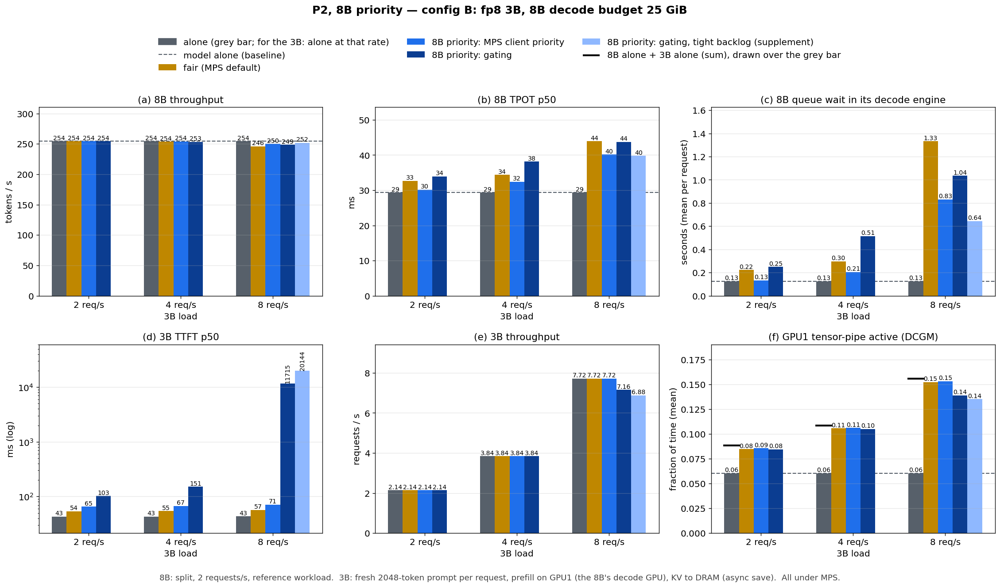
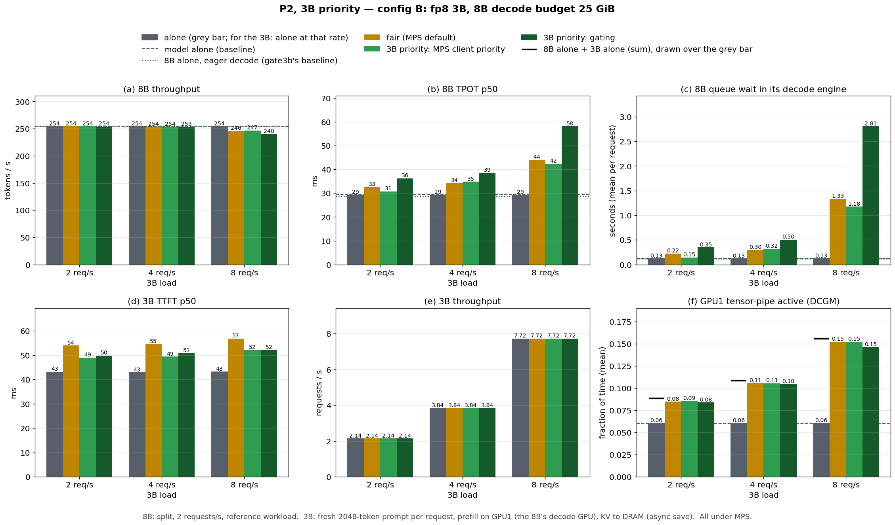

# Who goes first on the shared GPU: the 8B decode or a 3B prefill

Ninth study. The [eighth](report_colocation_prefill.md) put a Qwen2.5-3B prefill on the
8B split's decode GPU (placement **P2**: prefill on GPU1, KV written to host DRAM) and found
that the 8B pays in capacity, but at a decode budget of 22 GiB the 8B was already at its
knee, so any neighbour hurt it. This study gives the 8B headroom, runs P2 in two
configurations, and asks **what happens to both models when the 8B has priority, when
the 3B has priority, and when neither does — and whether it matters if priority is
enforced by MPS or by gating.**

The short answer:

> **MPS client priority is the lever that works; gating does not protect the 8B.** With
> the 8B as the high-priority MPS client and the 3B at "below normal", the 8B keeps
> 247 tok/s and 43 ms TPOT at 4 3B-requests/s where fair sharing gives it 240 tok/s and
> 59 ms, and the 3B pays only ~20 ms of TTFT. The launch gate that worked for a fine-tune
> neighbour in the fifth study gives the 8B nothing over fair sharing here (64 ms at
> 4 req/s, 127 ms at 8), starves the 3B (TTFT 30 s, 6 of 7.7 req/s served at 8 req/s),
> and tightening it makes both sides worse.
>
> **Whether priority matters at all depends on how heavy the 3B is relative to the 8B's
> headroom.** With a bf16 3B beside an 8B at a 23 GiB budget (config A), fair sharing
> costs the 8B 18% of its throughput at 8 3B-requests/s; with an fp8 3B beside an 8B at
> 25 GiB (config B) it costs 3%, and there is little left for any policy to protect.
>
> **The 3B barely needs protecting.** Under fair sharing its TTFT rises only 10–35 ms
> over running alone. MPS 3B priority recovers 4–10 ms of that at little cost to the 8B;
> gating recovers the same and costs the 8B more than its required eager decode does.

Run-level decisions, every prediction and its outcome are in
[DECISIONS_PF_PRIO.md](../DECISIONS_PF_PRIO.md); the study-level predictions (including
the two-configuration addendum) in [PLAN_PF_PRIO.md](../PLAN_PF_PRIO.md).

---

## 1. Setup

### 1.1 Two configurations of P2

Everything is P2: the 3B prefills on GPU1 beside the 8B decode, and its KV is written to
its own host-DRAM store with the async-save patch of the eighth study (token #1 is not
held back by the GPU→host copy).

| | config A | config B |
|---|---|---|
| 8B | split (prefill GPU0, decode GPU1), reference workload: 32 sessions × 6144 + 128 suffix, 128 output, zipf-1.1, 2 QPS | same |
| 8B decode budget (KV grant) | **23 GiB** (6.77 GiB) | **25 GiB** (8.77 GiB) |
| 8B alone: tok/s, TPOT p50, decode queue | 254.3, 27.7 ms, 0.45 s | 254.3, 29.4 ms, 0.13 s |
| 3B weights | **bf16**, 5.75 GiB | **fp8** (online quantization), 3.17 GiB |
| 3B engine on GPU1 | util 0.205, 7.1 GiB, KV 0.42 GiB | util 0.13, 4.8 GiB, KV 0.64 GiB |
| 3B workload | a fresh **2048-token** prompt per request, 1 output token, 2 / 4 / 8 req/s | same |
| 3B alone: TTFT p50 at 2 / 4 / 8 req/s | 70 / 70 / 80 ms | 43 / 43 / 43 ms |
| launch order | 8B first | 3B first (fp8 loading peaks at 7–9 GiB); 8B KV grant verified unchanged |

The workloads differ from the reference only on the 3B side, as the study allows: a
2048-token prompt instead of 6144 so that a 3B engine fits beside an 8B with headroom.
Config A is the largest 8B budget a bf16 3B fits beside (b23.5 fails vLLM's free-memory
check); config B buys two more GiB for the 8B with an fp8 3B. **The two configurations
differ in both the 3B's weight and the 8B's headroom**; §3 separates them with a cross
cell.

### 1.2 The priority arms

All under MPS. Each colocated cell runs one arm at one 3B rate (2, 4 or 8 req/s; 150 s
windows).

| arm | who has priority | mechanism |
|---|---|---|
| `fair` | neither | MPS default |
| `mps8b` | 8B | the 3B is an MPS client at priority "below normal" (`CUDA_MPS_CLIENT_PRIORITY=1`) |
| `gate8b` | 8B | the 8B decode publishes when it is inside `execute_model`; the 3B's kernel launches wait while it is (CUPTI gate, credits K=8 / max 3 pending; the 3B runs eager) |
| `mps3b` | 3B | the 8B decode is the "below normal" MPS client |
| `gate3b` | 3B | the 3B publishes its busy window; the 8B decode's launches wait (the 8B decode runs eager) |

Controls: the 8B alone with an eager decode (gate3b's own baseline), the 3B alone at each
rate, and the 8B eager beside the 3B without a gate at 8 req/s. Supplements: a tighter gate
(`gate8bt`, K=1 / max 1 pending) and repeats (§4).

### 1.3 Measurement

One launch per cell through the launch scripts (mem_guard, heartbeat, RAM gate);
`OMP_NUM_THREADS=8`; per-second GPU telemetry now includes **tensor-pipe active** (DCGM
1004), the compute-utilization metric (SM-active reads high for decode as well). No cell
stalled and no request failed in the whole study.

**Swap.** Host RAM is tight (the 8B's 24 GiB store plus 12 GiB of pinned pools on a
60 GiB box), and some windows swapped. Swap inflates the 8B's numbers: swap-free reruns
of swap-backed cells were 20–40% better on 8B TPOT (A gate8b at 4 req/s: 64 vs 107 ms),
while two clean runs of the same cell agree within 1–3%. Rule, set before rerunning:
every cell that swapped more than 0.5 GB in was rerun, and the run with less swap is
reported. Cells that swapped in every attempt are marked † in the tables.

---

## 2. Baselines

| | 8B tok/s | 8B TPOT p50 | 8B ITL p50 | 8B decode queue | GPU1 tensor-active |
|---|---|---|---|---|---|
| A: 8B alone | 254.3 | 27.7 ms | 14.8 ms | 0.45 s | 0.062 |
| A: 8B alone, eager decode | 252.9 | 31.0 ms | 15.8 ms | 0.72 s | 0.061 |
| B: 8B alone | 254.3 | 29.4 ms | 15.9 ms | 0.13 s | 0.060 |
| B: 8B alone, eager decode | 254.2 | 28.8 ms | 16.1 ms | 0.12 s | 0.061 |

The 8B decode reaches its offered rate in both configurations; config A queues ~0.45 s
on its decode engine alone, config B almost nothing. An eager decode costs ~3 ms of TPOT
in A and nothing measurable in B.

---

## 3. Fair sharing: how much does the 3B cost the 8B?


*P2 under fair MPS sharing, config A (bf16 3B, 8B at b23) vs config B (fp8 3B, 8B at b25),
by 3B load. Dashed = the 8B alone in that configuration. Panel titles name the metric.*

| 3B load | A: 8B tok/s / TPOT / queue | B: 8B tok/s / TPOT / queue | A: 3B TTFT (alone) | B: 3B TTFT (alone) | GPU1 tensor-active A / B (8B alone + 3B alone) |
|---|---|---|---|---|---|
| 0 | 254.3 / 27.7 ms / 0.45 s | 254.3 / 29.4 ms / 0.13 s | — | — | 0.062 / 0.060 |
| 2 req/s | 249.6 / 40 ms / 1.7 s | 254.4 / 33 ms / 0.22 s | 80 (70) ms | 54 (43) ms | 0.103 (0.114) / 0.085 (0.088) |
| 4 req/s | 239.6 / 59 ms / 4.2 s | 253.7 / 34 ms / 0.30 s | 81 (70) ms | 55 (43) ms | 0.144 (0.152) / 0.106 (0.109) |
| 8 req/s | 209.3 / 166 ms / 18.2 s | 246.1 / 44 ms / 1.3 s | 114 (80) ms | 57 (43) ms | 0.199 (0.242) / 0.152 (0.156) |

**Observations:**

- **In config A the 8B pays in capacity, as in the eighth study.** Its per-token gap is
  unchanged (ITL p50 15.0–15.3 ms); what grows is the queue on its decode engine, to 18 s
  at 8 req/s, and throughput falls 18%.
- **In config B it barely pays.** −3% throughput and a 1.3 s queue at 8 req/s.
- **The 3B is only mildly slowed** in both: +10 ms (A, 2–4 req/s), +34 ms (A, 8 req/s),
  +11–14 ms (B).
- **Compute utilization rises with the 3B's load** — GPU1 tensor-active from 0.06 to
  0.20 (A) and 0.15 (B) at 8 req/s. In B it is close to the sum of the two models alone
  (0.152 vs 0.156): they overlap with little interference. In A it falls short of the sum
  at 8 req/s (0.199 vs 0.242): the 8B is not getting its own work done.

*Which of the two differences between A and B — the 3B's weight or the 8B's headroom —
is responsible is measured by a cross cell: §3.1.*

### 3.1 Lighter 3B or more 8B headroom?

Config A → B changes two things at once. The cross cell puts config B's fp8 3B beside
config A's 8B (b23), fair sharing, at 4 and 8 req/s (pink bars in the figure above):

| 3B load | A: bf16 3B, b23 | cross: fp8 3B, b23 | B: fp8 3B, b25 |
|---|---|---|---|
| 4 req/s: 8B tok/s / TPOT / queue | 239.6 / 59 ms / 4.2 s | 247.9 / 41 ms / 1.7 s | 253.7 / 34 ms / 0.30 s |
| 8 req/s: 8B tok/s / TPOT / queue | 209.3 / 166 ms / 18.2 s | 233.7 / 68 ms / 5.6 s | 246.1 / 44 ms / 1.3 s |

**Both differences matter, about equally.** Swapping the bf16 3B for the fp8 one (same 8B)
closes roughly half of the A→B gap; giving the 8B two more GiB closes the other half. The
lighter prefill stretches each 8B request's stay on its decode engine less; the extra KV
grant lets the 8B absorb what stretch remains.

---

## 4. 8B priority




*P2 with the 8B as the priority model: fair vs MPS client priority vs gating vs the
tighter gate (supplement; A at 4 and 8 req/s, B at 8 only). Grey = alone (for the 3B,
alone at that rate); black tick in (f) = the two models' tensor-active alone, summed.*

| config, 3B load | 8B TPOT p50: fair / mps8b / gate8b / gate8bt | 8B tok/s: fair / mps8b / gate8b / gate8bt | 3B TTFT p50: fair / mps8b / gate8b / gate8bt | 3B served (of offered) gate8b / gate8bt |
|---|---|---|---|---|
| A, 2 | 40 / 33 / 39 / — | 249.6 / 252.6 / 250.4 / — | 80 / 97 / 155 / — | 2.14 / — |
| A, 4 | 59 / 43 / 64 / 78 | 239.6 / 247.4 / 238.4 / 232.9 | 81 / 100 / 185 / 246 | 3.83 / 3.84 |
| A, 8 | 166 / 88 / 127 / 160† | 209.3 / 227.4 / 210.0 / 204.9† | 114 / 182 / 29,794 / 31,167† | 6.02 / 5.87 (of 7.72) |
| B, 2 | 33 / 30 / 34 / — | 254.4 / 254.5 / 254.4 / — | 54 / 65 / 103 / — | 2.14 / — |
| B, 4 | 34 / 32 / 38 / — | 253.7 / 253.9 / 253.3 / — | 55 / 67 / 151 / — | 3.84 / — |
| B, 8 | 44 / 40 / 44 / 40 | 246.1 / 250.0 / 248.6 / 251.9 | 57 / 71 / 11,715 / 20,144 | 7.16 / 6.88 (of 7.72) |

*† = swap-backed in every attempt (> 0.5 GB swapped in); swap inflates the 8B's TPOT, so
for mps8b these understate its advantage. Repeats of clean cells agree within 1–3%:
A fair 8 req/s 164.5 vs 166 ms, A mps8b 4 req/s 42.7 vs 42.1 ms.*

**Observations:**

- **MPS client priority protects the 8B, at a modest cost to the 3B.** In config A at
  4 req/s it keeps the 8B at 247 tok/s and 43 ms (fair: 240, 59 ms; clean runs) and
  cuts its queue from 4.2 to 1.9 s; the 3B's TTFT goes 81 → 100 ms. At 8 req/s it is
  still the best 8B arm by a wide margin: 88 ms and 227 tok/s vs 166 ms and 209 tok/s at
  fair (the two earlier, swap-backed attempts read 106 and 86 ms). In config B the same
  ordering holds with small margins, because fair sharing costs the 8B little there.
- **Gating gives the 8B no more than fair sharing.** A at 4 req/s 64 ms (fair 59);
  at 8 req/s 127 ms (fair 166, mps8b 88), with the 8B's per-token gap rising from 15 to
  24 ms.
- **…and it starves the 3B.** The gated 3B can only issue kernels between 8B decode
  steps: TTFT 2× fair at 2–4 req/s, and at 8 req/s it saturates in both configurations
  (A 6.0 of 7.7 req/s served, TTFT 30 s; B 7.2, 12 s).
- **The tighter gate (S1) is worse on both sides.** It was run to test whether the 8B
  was waiting behind the ~24 3B kernels the default credits let through. With at most one
  3B kernel in flight the 8B's TPOT is *higher* (A 4 req/s 78 ms) and the 3B is starved
  further. So the backlog is not the explanation. What the gate does not see — copies
  (the 3B's KV save, the 8B's own KV loads) and the 8B's work between decode steps — is a
  candidate, not measured.

### 4.1 Capacity: the 8B at a higher load

Everything above offers the 8B its reference 2 QPS. To see whether MPS priority protects
the 8B's *capacity* and not only its latency at one load, config A was rerun with the 8B
offered 2.5 QPS (and 3 QPS alone), the 3B at 4 req/s:

| config A, 3B at 4 req/s | 8B offered | 8B tok/s | 8B TPOT p50 | 8B decode queue | 3B TTFT p50 |
|---|---|---|---|---|---|
| 8B alone | 2 QPS | 254.3 | 28 ms | 0.45 s | — |
| 8B alone | 2.5 QPS (~318 tok/s) | 280.8 | 70 ms | 6.5 s | — |
| 8B alone | 3 QPS (~382 tok/s) | 286.0† | 148 ms† | 15.2 s† | — |
| + 3B, fair (two clean runs) | 2.5 QPS | 240.7 / 246.2 | 158 / 144 ms | 17.5 / 15.6 s | 81 / 80 ms |
| + 3B, mps8b (two runs) | 2.5 QPS | 254.5 / 256.0 | 120 / 116 ms | 12.8 / 12.3 s | 100 / 100 ms |

- **The 8B at b23 saturates at ~285 tok/s on its own** (≈ 2.2 QPS): 2.5 QPS is already
  beyond its capacity, so these cells measure how much of that capacity each arm keeps.
- **Fair sharing gives up ~38 tok/s of it** (281 → 241–246); **MPS priority gives up
  ~26** (→ 255), i.e. it keeps about a third of what fair sharing loses, for +20 ms of 3B
  TTFT. Both arms repeat within 2.3% (a third fair attempt swapped 10 GB and is excluded).
  At the reference load (§4) the same lever looks stronger because the 8B still had slack
  there; once the 8B is itself saturated, priority cannot create capacity, only shift
  the shared GPU's time toward it.

## 5. 3B priority




*P2 with the 3B as the priority model: fair vs MPS client priority vs gating. Dotted line
in the 8B panels = the 8B alone with an eager decode, gate3b's own baseline.*

| config, 3B load | 3B TTFT p50: alone / fair / mps3b / gate3b | 8B TPOT p50: fair / mps3b / gate3b (eager, no gate) | 8B tok/s: fair / mps3b / gate3b |
|---|---|---|---|
| A, 2 | 70 / 80 / 75 / 79 | 40 / 38 / 48 | 249.6 / 251.4 / 245.7 |
| A, 4 | 70 / 81 / 76 / 79 | 59 / 66 / 75 | 239.6 / 237.5 / 233.7 |
| A, 8 | 80 / 114 / 104 / 107 | 166 / 181 / 225 (193) | 209.3 / 206.4 / 199.1 |
| B, 2 | 43 / 54 / 49 / 50 | 33 / 31 / 36 | 254.4 / 254.3 / 254.1 |
| B, 4 | 43 / 55 / 49 / 51 | 34 / 35 / 39 | 253.7 / 253.7 / 253.2 |
| B, 8 | 43 / 57 / 52 / 52 | 44 / 42 / 58 (45) | 246.1 / 246.8 / 240.4 |

**Observations:**

- **There is little for 3B priority to recover.** Under fair sharing the 3B is 10–34 ms
  slower than alone; MPS priority recovers 4–10 ms of that, gating about the same.
- **MPS 3B priority costs the 8B little**, except at the highest load in config A
  (TPOT 181 vs 166 ms).
- **Gating the 8B costs it more than the eager decode it requires.** At 8 req/s, the 8B
  with an eager decode and no gate has 193 ms (A) / 45 ms (B) of TPOT; gated, 225 / 58 ms.
  The 3B gains nothing over MPS priority for that.

## 6. Takeaways

1. **To give a decode priority over a prefill neighbour, use MPS client priority.** It is
   one environment variable on the low-priority process, needs no eager mode, and was the
   best 8B arm at every load where fair sharing hurt the 8B (config A, 8 req/s: TPOT
   166 → 88 ms, throughput 209 → 227 tok/s). The prefill pays 20–70 ms of TTFT for it.
   When the 8B is itself loaded past its capacity, priority keeps only part of it
   (§4.1: about a third of what fair sharing loses).
2. **A launch-time busy-window gate does not protect a decode from a prefill neighbour**,
   unlike a fine-tune neighbour in the fifth study: it gives the 8B nothing over fair
   sharing, starves the prefill, and tightening it makes both worse.
3. **Size before you prioritize.** Whether the neighbour hurts at all is decided by the
   8B's headroom and the neighbour's weight, about equally (§3.1): an fp8 3B beside an 8B
   with a 25 GiB decode budget costs it 3% at 8 3B-requests/s, a bf16 3B beside a 23 GiB
   8B 18%.
4. **Colocated prefill raises the decode GPU's compute utilization roughly additively**
   (tensor-active ~0.06 → 0.15–0.20 at 8 req/s), as long as the incumbent has headroom.

## Caveats

- Most cells are single runs; the key A cells at 4 and 8 req/s have two (fair, mps8b),
  and clean repeats agree within 1–3%. Swap-backed cells are marked †.
- Config A vs B changes two things at once; §3.1 separates them for fair sharing only.
- The 3B workload is synthetic (fresh 2048-token prompts, one output token); MPS client
  priority has two levels only.
- The 8B's own load was raised once (2.5 QPS, config A, 3B at 4 req/s, §4.1); it was not
  swept further.
- The gate's own counters (how often and how long it held the 3B) are printed at process
  exit and were lost to the SIGKILL teardown.

---

## Reproducing

```bash
export OMP_NUM_THREADS=8; D=scripts/inf_pf_prio/pfp_sweep.py; PY=.venv/bin/python
# checkpoints (8B alone) for both configurations
$PY $D --cells base --budget 23 --sm-quant "" --name-suffix _b23
$PY $D --cells base --budget 25 --sm-quant fp8 --sm-util 0.13 --sm-first --name-suffix _fp8b25
# the full two-configuration run, the swap reruns, the supplements
scripts/inf_pf_prio/queue_prio.sh
scripts/inf_pf_prio/queue_reruns.sh
scripts/inf_pf_prio/queue_supp.sh; scripts/inf_pf_prio/queue_supp2.sh
scripts/inf_pf_prio/queue_supp3.sh; scripts/inf_pf_prio/queue_supp4.sh
$PY $D --cells p2 --arm gate8bt --sm-qps 8 --budget 23 --sm-quant "" --sm-util 0.205 --name-suffix _b23_r2
scripts/inf_pf_prio/queue_supp6.sh          # §4.1, the 8B at 2.5 / 3 QPS
# figures (view them before believing them)
$PY scripts/plots/plot_pfp_results.py
```

Data: `output/summary_pfp.csv` (rebuilt from raw on every run); raw records
`output/raw/pfp_*.json` (gitignored); per-second GPU (incl. tensor-active) and host
telemetry `output/gpumon/pfp_*`; engine logs per launch `output/logs/pfp_archive/<cell>/`.
Names: `pfp_<base|s2|p2>_<arm>[_q<rate>]<_b23|_fp8b25|_fp8b23>[_r2|_r3]`.
