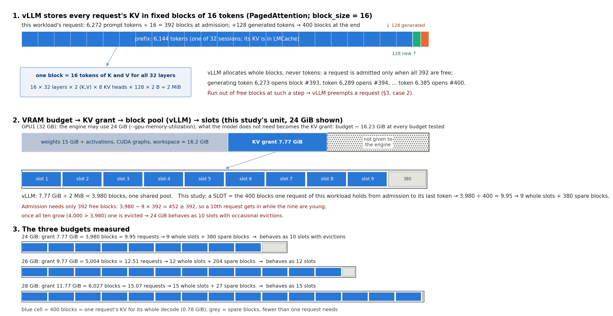
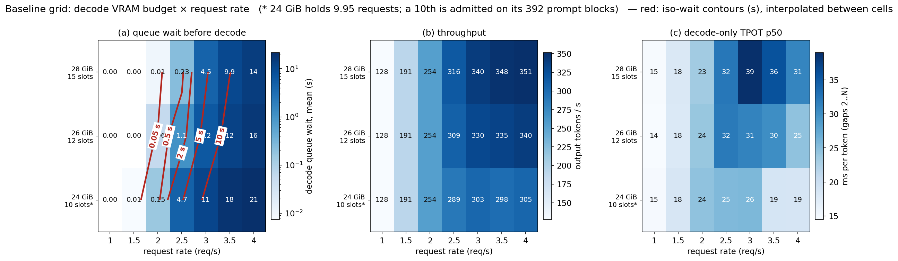

# KV slots on the decode GPU — baseline study (E0–E3)

**Question.** On the decode engine of a prefill/decode-split Llama-3-8B, how do the KV
space on the GPU, the number of requests it can run, and the VRAM budget relate — and
what, exactly, does a request wait for?

**Answer in one paragraph.** The decode engine is a bank of *integer* KV slots: a request
occupies 392–400 blocks of 16 tokens from the moment it is admitted until its last token,
and the number of requests that can be resident is ⌊grant ÷ 400 blocks⌋ (9.95 → 10 with
evictions, 12, 15 at 24 / 26 / 28 GiB). Waiting is fully explained by "c slots, first
come first served, each request's measured residence": a FCFS replay with that slot count
reproduces the measured mean queue wait to within 2% at every one of 23 grid cells. But
the residence itself is not fixed: every admission copies 0.75 GiB of KV from host RAM
*synchronously inside the engine thread*, and the whole batch stops for ~200 ms each time.
A request resident among more slots sits through more of these stalls (1.8 at 3 running →
12 at 14), so adding slots lengthens residence: +50% slots (24 → 28 GiB) buys +17%
saturation throughput. Below the knee (≤ 1.5 req/s) the budget does not matter at all.

Plan: [PLAN_KV_VRAM.md](../PLAN_KV_VRAM.md) (predictions, annotated); run log:
[DECISIONS_KV_VRAM.md](../DECISIONS_KV_VRAM.md); starting facts:
[NOTES_KV_SLOTS.md](../NOTES_KV_SLOTS.md). E4 (feasibility of APC / layerwise / async /
fp8) and E5 (re-running the grid with them) are not part of this report.

---

## 1. Setup

| item | value |
|---|---|
| machine | 2× RTX 5090 (32 GB), PCIe Gen4 ×8 (14.47 GB/s pinned H2D measured), 32 cores, 60 GiB RAM |
| model | NousResearch/Meta-Llama-3-8B-Instruct, bf16; KV = 128 KiB per token (32 layers × 2 × 8 KV heads × 128 × 2 B) |
| stack | vLLM 0.15.1; prefill engine on GPU0 (util 0.80, APC on); decode engine on GPU1 at the budget under test, APC **off**; KV handed over through LMCache 0.4.4 (chunk 256, 6 GiB pinned L1 per engine, TCP store, Python copy path); router forwards token #1 and admits everything |
| decode engine | `--gpu-memory-utilization` = budget ÷ 31.35 GiB; FLASH_ATTN; CUDA graphs; async scheduling; no MPS, nothing else on GPU1 |
| workload | 32 sessions × 6,144-token fixed prefix + 128 unique tokens, 128 output tokens, zipf-1.1 session popularity, open-loop Poisson arrivals, seed 0, 300 requests; only the rate changes |
| cells | budgets 24 / 26 / 28 GiB × 1, 1.5, 2, 2.5, 3, 3.5, 4 req/s (+ 2.25, 2.75 at 24 GiB); one fresh launch and warm-up per cell |
| instrumentation | record-only engine trace (`scripts/kv_vram/site/kv_trace.py`): per request arrival / admission / first token / finish and free blocks at each; per step batch size and wall time; per `start_load_kv` call its duration. Validated: trace on vs off differs by −0.56 ms decode TPOT, 0% throughput (two runs each) |

Metric conventions: *decode queue wait* = vLLM's `request_queue_time` on the decode
engine (arrival at its scheduler → admitted); *capacity* = the highest rate with mean
queue wait < 50 ms and no failed request; *tpot2* = per-token time over gaps 2..N (gap 1
holds the decode queue + KV load with a forwarded token #1); *residence* = admitted →
last token. All 24 cells are `ok` (one cell was rerun after a router keep-alive race lost
a single request; the clean rerun is reported).

## 2. Blocks (vLLM's unit) and slots (this study's unit)

**Block — a vLLM concept.** vLLM's PagedAttention keeps every request's KV cache in
fixed-size *blocks* of `block_size` = 16 tokens; one block holds the K and V of those 16
tokens for all 32 layers (2 MiB for this model). The engine's KV *grant* — what is left of
its VRAM budget after weights, activations and CUDA graphs (budget − 16.23 GiB at every
budget tested) — is carved into one shared pool of such blocks. The scheduler allocates
whole blocks, never tokens: a request is admitted only when enough free blocks exist for
its whole prompt (6,272 tokens → 392 blocks here), and during generation it takes one
more block each time a new 16-token group starts — generating token 6,273 opens block
393, token 6,289 opens block 394, …, token 6,385 opens block 400. If no block is free at
such a step, vLLM preempts a request (§3, case 2). None of this is specific to our
workload; it is how vLLM manages KV for any request.

**Slot — this study's unit.** Every request of the reference workload has the same
length (6,144 prefix + 128 new + 128 generated = 6,400 tokens = 400 blocks), so the pool
can be read in units of "whole requests that fit": we call the 400 blocks one request
holds from admission to its last token a *slot*, and c = ⌊blocks ÷ 400⌋ the number of
whole slots. vLLM has no such notion — it only sees blocks — which is exactly why the
fractional part matters (below). Probed grants:

| budget | 22 | 23 | 24 | 25 | 26 | 28 GiB |
|---|---|---|---|---|---|---|
| KV tokens | 47,296 | 55,488 | 63,680 | 71,872 | 80,064 | 96,432 |
| blocks ÷ 400 | 7.39 | 8.67 | 9.95 | 11.23 | 12.51 | 15.07 |
| whole slots c | 7 | 8 | 9 | 11 | 12 | 15 |

The fractional part matters through the admission rule (§4.2): at 24 GiB the 0.95 is
enough to admit a 10th request, at 26 / 28 GiB the 0.51 / 0.07 is not.

## 3. What the scheduler does with the blocks

Two situations compete for the same pool of free blocks in every scheduler step:

- **Case 1 — admission.** The head of the FCFS waiting queue needs ⌈tokens/16⌉ free
  blocks (392 for a fresh request). If they are free it is admitted and its prefix KV is
  loaded; if not, it waits — and so does everyone behind it. That wait is the measured
  decode queue time.
- **Case 2 — eviction.** Running requests take one more block every 16 generated
  tokens. When one needs a block and none is free, the most recently admitted running
  request is evicted: blocks freed, progress reset, back to the *head* of the queue. It
  returns only when a slot frees, needing more blocks than before, and its prefix is
  loaded a second time.

Admission is where the synchronous load lives (Figure "case 1", left): vLLM calls the
connector's `start_load_kv` before the forward pass of the step that admits the request,
LMCache 0.4.4 copies all 32 layers into the paged blocks on the engine thread, and the
step — the whole batch — waits. vLLM has a hook for the alternative (a request can sit in
`WAITING_FOR_REMOTE_KVS` while its KV arrives, right panel, dashed); whether LMCache's
options reach it is E4's question.

## 4. Results

### 4.1 The grid

Each cell is one launch and one 300-request run: (a) mean decode queue wait (log colour
scale), (b) output tokens per second, (c) decode-only per-token time. The same numbers:

| req/s | 1 | 1.5 | 2 | 2.25 | 2.5 | 2.75 | 3 | 3.5 | 4 |
|---|---|---|---|---|---|---|---|---|---|
| 24 GiB | 0 (128) | 8 (191) | 153 (254) | 941 (282) | 4,680 (289) | 8,913 (292) | 10,977 (303) | 18,409 (298) | 21,413 (305) |
| 26 GiB | 0 (128) | 0 (191) | 56 (254) | – | 1,054 (309) | – | 6,210 (330) | 12,224 (335) | 16,252 (340) |
| 28 GiB | 0 (128) | 0 (191) | 10 (254) | – | 235 (316) | – | 4,511 (340) | 9,858 (348) | 14,294 (351) |

- **Capacity** (queue < 50 ms): 24 GiB between 1.5 and 2 req/s; 26 GiB ≈ 2 (56 ms);
  28 GiB between 2 and 2.5. The plan predicted 2.0–2.5 / 2.5–3.0 / 3.0–3.5 — each one grid
  step too high.
- **Saturation throughput** ≈ 2.3 / 2.65 / 2.7 req/s: +50% slots buys +17%.
- **Below the knee the budget is irrelevant:** at 1 req/s all three budgets give 128
  tok/s, 0 ms queue and the same 14.5–14.7 ms per token.
- **Above it, per-token speed rises with budget**, not falls: tpot2 at 3 req/s is 25.7 /
  31.2 / 39.0 ms at 24 / 26 / 28 GiB — bigger batches and more stalls (§4.3).
- **Preemptions:** 1–35 per cell at 24 GiB, none at 26 / 28 GiB.

Where the knee lies is easier to read with iso-wait lines. The figure below repeats panel
(a) with contours at 0.05 s (the capacity line), 0.5, 2, 5 and 10 s, interpolated
linearly between the measured cells; each line marks the (budget, rate) combinations
that give the same mean wait, so its slope says how much rate one GiB buys — about
0.25 req/s per 2 GiB along the 0.05 s line, less along the 10 s line.

The 3D view of the same surface is [kv_grid_3d.png](../figures/kv_grid_3d.png).

### 4.2 Waiting is integer slots, FCFS, and nothing else

**The model, defined.** Treat the decode engine as a queue with c identical servers (the
slots): a request arrives at the decode scheduler at time *aᵢ*, waits until a server is
free (FCFS), then occupies it for its *service time* Sᵢ — the measured residence, admitted
→ last token, which already includes its own KV load and every stall it sat through. In
Kendall's notation this is **M/G/c**: Poisson arrivals (M), a general service-time
distribution (G), c servers. Three predictions of the mean wait Wq are compared with the
measurement, all using only the slot count and the measured residences:

| prediction | inputs | what it assumes |
|---|---|---|
| **FCFS replay** (discrete-event simulation) | the cell's own arrival times aᵢ and each request's own Sᵢ; c | nothing beyond "c servers, FCFS": each request starts at max(aᵢ, earliest server free) |
| **M/M/c** (Erlang C) | λ = arrivals ÷ window, mean S, c | exponential service, steady state |
| **Lee–Longton M/G/c** | λ, mean S, CV² of S, c | Wq(M/G/c) ≈ ½(1 + CV²) · Wq(M/M/c): the standard closed-form correction for non-exponential service |

The replay is the strict test: it uses the same 300 arrivals the engine saw, so any gap
between it and the measurement is behaviour that "c slots, FCFS, measured residence"
does not contain. The two formulas test whether the *shape* of the curve is the generic
multi-server shape.

**Result.** The replay with the *effective* slot count reproduces the measured mean wait
at every rate: within 2% at 24 GiB with c = 10, within 0.1% at 26 / 28 GiB with c = 12 /
15 (the dashed line lies on the measured one). With c ± 1 it is off by 1.5–3×. Because
the replay takes the measured residences as given it is partly circular; what it
establishes is narrower and more useful than "a model fits": *nothing besides the slot
count and the residence is needed to explain the queue* — no scheduler overhead, no
router effect, no KV-transfer delay beyond what is already inside the residence.

Why c = 10 at 24 GiB with a 9.95-request grant: the admission rule needs 392 free blocks,
3,980 − 9 × 392 = 452, so a 10th request is admitted while the nine are young; when all
ten grow (10 × 400 > 3,980) one is evicted. The trace confirms max Running = 10 and
9–35 evictions per cell; at 26 GiB (5,004 − 12 × 392 = 300 < 392) Running never exceeds
12 and nothing is evicted.

The closed-form Lee–Longton M/G/c approximation (mean and CV² of the measured residence)
matches only near ρ ≈ 0.9 (26 GiB / 2.5 req/s: 1,037 vs 1,054 ms); at ρ < 0.7 it
underpredicts up to 7× because a 300-request window of one Poisson sample is far from
steady state when waits are tens of milliseconds.

Per request the rule is binary: a request that reaches the decode scheduler with ≥ 1
request-worth of free blocks waits 0 ms; one that finds the pool full waits 0.1–10 s
depending on load. The handful of 28 GiB requests that waited with 1–3 requests free
arrived during a multi-request load call — the scheduler thread itself was blocked (§4.3).

### 4.3 What the slots cost: the synchronous load stalls the batch

Per request, residence splits into decode steps that overlap no KV load and steps
stalled by someone's load (the trace marks every `start_load_kv` call):

| cell | mean running | step (no load) | decode | = own steps | + load stalls |
|---|---|---|---|---|---|
| 24 GiB, 1 req/s | 3.3 | 12.2 ms | 1.90 s | 1.57 s | 0.34 s (1.8 × 185 ms) |
| 24 GiB, 2 req/s | 7.5 | 15.0 ms | 2.96 s | 1.87 s | 1.09 s (5.5 × 198 ms) |
| 26 GiB, 3 req/s | 11.6 | 17.9 ms | 3.93 s | 2.05 s | 1.86 s (8.6 × 217 ms) |
| 28 GiB, 3 req/s | 14.3 | 19.4 ms | 4.80 s | 2.22 s | 2.56 s (12.1 × 211 ms) |

Of the 2.9 s of extra residence from the lightest to the heaviest cell, the larger batch
makes the steps themselves slower by 0.65 s (decode is weight-read bound: ~0.5 ms per
extra request on an ~11 ms base) and load stalls add 2.2 s. At 24 GiB / 2 req/s the
stalls are 34% of all decode wall time. One load call: p50 171 ms, mean 198 ms, p95
300 ms for 0.75 GiB — ~4.4 GB/s, a third of the measured 14.47 GB/s link, because
LMCache's compiled kernels do not load against this torch and the Python fallback copies
chunk by chunk.

Two consequences visible in the grid: (i) more slots → more admissions during a
residence → longer residence, which is why 26 → 28 GiB barely moves saturation
throughput; (ii) at ≥ 3.5 req/s per-token time *drops* at 24 GiB (25.7 → 18.6 ms) because
under a deep queue requests finish and are admitted in cohorts — one load call brings in
up to 10 requests (104 calls vs 191 at 3 req/s) — so each request sits through fewer
separate stalls. Decode time = 128 steps + (stalls met while resident) × stall length;
the stall count depends on the admission pattern, not only on load.

### 4.4 A request followed across two budgets

Same arrival sequence (seeded), 2 req/s, 24 vs 28 GiB. Request #256 reaches the decode
scheduler at t = 126.3 s. At 24 GiB it finds 14 free blocks (0.0 requests), all ten lanes
occupied, and waits 1,306 ms for lane 1 to free; then loads for 283 ms and decodes for
2.8 s. At 28 GiB the same request finds 888 free blocks (2.2 requests) and waits 0 ms;
it happens to be admitted in a cohort of seven, so its own load takes 477 ms (one call
copying seven requests), then it decodes for 2.9 s. The valley at 130–135 s in both
panels is the arrival process, not the engine: 122–127 s brought 16 arrivals (3.2 /s)
that filled the pool and queued, 127–133 s brought 8 (1.3 /s) while 17–20 finished.
Row (c) shows the load stalls: every orange band is a step of 150–500 ms during which
no running request gets a token.

### 4.5 Hypothesis 1 — the slots hold duplicate prefixes

With prefix caching off on the decode engine, concurrent requests from the same session
each hold their own copy of the 6,144-token prefix. Time-weighted over the traced cells,
10 running requests at 24 GiB span 6.4–6.5 distinct sessions, 12 at 26 GiB span 7.1–7.5,
15 at 28 GiB span 8.2–8.5: **about one third of the resident KV is a copy of a prefix
already on the GPU.** (Predicted from the arrival sequence: 10.3 requests / 6.8 sessions.)
This is the lever E4's decode-side APC test targets.

## 5. Why decode cannot stream its KV instead of holding it

A stand-alone benchmark (`scripts/kv_vram/bench_stream.py`, no vLLM) runs one
8B-shaped decode step with the KV either resident in HBM or streamed per layer from
pinned host memory with prefetch depth d:

| batch | resident step | copy floor (B × 0.78 GiB ÷ 14.47 GB/s) | streamed, d = 0 | streamed, d ≥ 1 |
|---|---|---|---|---|
| 1 | 12.0 ms | 58.1 ms | 70.3 ms | 58.5 ms |
| 4 | 12.1 ms | 232 ms | 244 ms | 232 ms |
| 16 | 18.0 ms | 928 ms | 946 ms | 928 ms |

Every decode step needs every layer's KV for every resident token, so streaming moves
0.78 GiB per request per step: 4.9× the resident step at batch 1 and 52× at batch 16.
Prefetch depth beyond 1 changes nothing (the copy, not the compute, is the bound), and
the compute that could hide copies is 12–18 ms per step — enough for ~6 of 32 layers of
*one* request at batch 1. Layer-wise pipelining can therefore only shorten the one-time
load; it cannot reduce what must be resident.

## 6. What this means for the methods to test (E4)

| lever | what it changes | expected from this study |
|---|---|---|
| decode-side prefix caching | raises the *effective* slot count by sharing the ~1/3 duplicate prefixes; loaded blocks become cache for the next same-session request | capacity up at equal budget; also fewer loads → fewer stalls |
| asynchronous / layer-wise load | removes or shrinks the ~200 ms batch stall per admission (2.2 s of the 4.8 s residence at 28 GiB / 3 req/s) | residence down → more throughput per slot; the 4.4 GB/s copy path is the bound, not PCIe |
| fp8 KV | halves bytes per block → c ≈ 19 at 24 GiB | capacity up, but each slot still pays the stalls; needs a bf16 control on the same attention backend (fp8 forces a backend change on sm_120) |

Related-work notes with sources: [related_work_notes.md](../output/kv_vram/related_work_notes.md).

## 7. Data

`output/summary_kv.csv` (one row per cell), `output/raw/kv_*.json` (per-request client
records, engine metrics deltas), `output/kv_vram/trace/*.jsonl.gz` (engine traces),
`output/kv_vram/timeline/*.csv` (joined per-request / per-step tables),
`output/kv_vram/mgc.csv`, `output/kv_vram/probe_base.json`,
`output/kv_vram/pcie_gpu{0,1}.json`, `output/kv_vram/bench_stream.json`. Figures:
`scripts/plots/plot_kv_*.py`.
