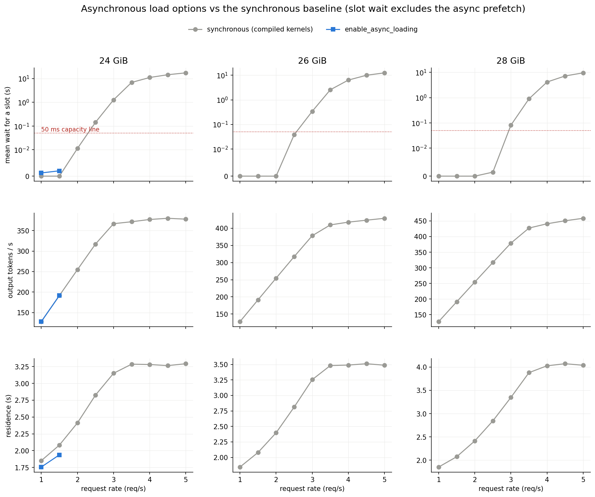
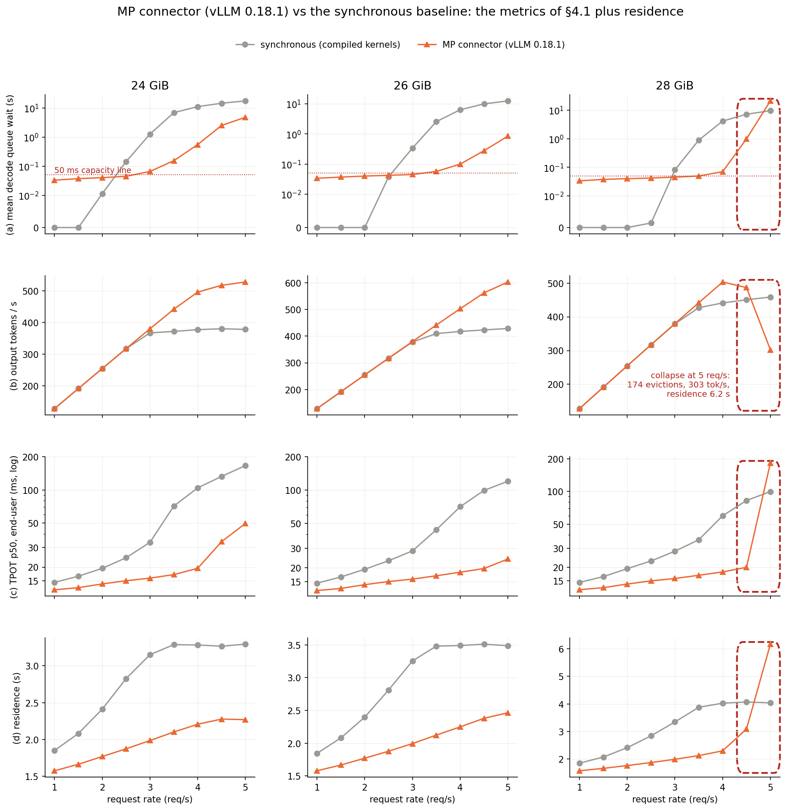

# KV slots on the decode GPU (E0–E4, LMCache compiled kernels)

**Question.** On the decode engine of a prefill/decode-split Llama-3-8B, how do the KV
space on the GPU, the number of requests it can run, and the VRAM budget relate — and
what, exactly, does a request wait for?

**Answer in one paragraph.** The decode engine is a bank of *integer* KV slots. A request
holds 392–400 blocks of 16 tokens from admission to its last token, so the number of
requests that can be resident is ⌊grant ÷ 400 blocks⌋: 9.95 → 10 (with evictions), 12
and 15 at 24 / 26 / 28 GiB. Waiting is fully explained by "c slots, first come first
served, each request's measured residence". A FCFS replay with that slot count reproduces
the measured mean queue wait at every cell of the grid (within 0.1% at 26 / 28 GiB, 2% at
24 GiB). The residence itself depends on the slot count. Every admission copies 0.75 GiB
of KV from host RAM *synchronously inside the engine thread*, and the whole batch stops
for ~120 ms each time. A request among more neighbours sits through more of these stalls
(1.6 at 1 req/s → 8.7 at 28 GiB / 3 req/s). So +50% slots (24 → 28 GiB) buys +21%
saturation throughput: 2.97 → 3.58 req/s. Up to 2 req/s nobody waits at any budget, and
the budget does not matter. The load path is the lever: LMCache's
multi-process connector (on vLLM 0.18.1) takes the copy out of the step, residence stops
growing with the slot count, and capacity rises by 0.5–1 req/s counting its ~40 ms wait for
the KV as queue time (1–1.5 req/s counting only the wait for a slot); this part ran on a
newer vLLM, with a slightly larger KV grant (§6.4).

**What changed from the first version.** The first version of this study
([report_kv_slots_fallback.md](report_kv_slots_fallback.md)) ran LMCache on its Python
fallback copy path, as did all nine earlier studies on this box. The PyPI wheel's
`c_ops.so` does not load against torch 2.9.1, and LMCache silently falls back. This
report reruns the whole grid with LMCache's own CUDA kernels, built for this torch.
The slot mechanism is unchanged. Every absolute number moved (§5).

Plan: [PLAN_KV_VRAM.md](../PLAN_KV_VRAM.md) (predictions, annotated); run log with each
prediction and outcome: [DECISIONS_KV_VRAM.md](../DECISIONS_KV_VRAM.md) (D6 = this grid).

---

## 1. Setup

| item | value |
|---|---|
| machine | 2× RTX 5090 (32 GB), PCIe Gen4 ×8 (14.47 GB/s pinned H2D measured), 32 cores, 60 GiB RAM |
| model | Meta-Llama-3-8B-Instruct, bf16; KV = 128 KiB per token |
| stack | vLLM 0.15.1. Prefill engine on GPU0 (util 0.80, APC on). Decode engine on GPU1 at the budget under test, APC off. KV handed over through LMCache 0.4.4: chunk 256, 6 GiB pinned L1 per engine, TCP store, **compiled `c_ops` on both engines**. The router forwards token #1 and admits everything. |
| decode engine | `--gpu-memory-utilization` = budget ÷ 31.35 GiB; FLASH_ATTN; CUDA graphs; async scheduling; nothing else on GPU1 |
| workload | 32 sessions × 6,144-token prefix + 128 unique tokens, 128 output tokens, zipf-1.1, open-loop Poisson, seed 0, 300 requests; only the rate changes |
| cells | 24 / 26 / 28 GiB × 1, 1.5, …, 5 req/s (27 cells), one fresh launch per cell; all `ok` |
| instrumentation | record-only engine trace on the decode engine: per request arrival / admission / first token / finish with free blocks at each; per step batch size and wall time; per `start_load_kv` call its duration |

**Kernel build.** LMCache's `c_ops` were built from the 0.4.4 sdist against torch 2.9.1+cu128
(sm_120) in a separate venv, and loaded only when `KV_COPS=1`. A guard fails any cell
whose engines report a different LMCache backend than the arm expects.

**Metrics.**
- *Decode queue wait*: vLLM's `request_queue_time` on the decode engine, from arrival at
  its scheduler to admission.
- *Capacity*: the highest rate with mean queue wait < 50 ms.
- *TPOT*: what the user sees. Token #1 → last token, ÷ 127. Token #1 comes from the
  prefill engine, so the first gap holds the decode queue wait and the KV load.
- *Residence*: admitted → last token.

## 2. Blocks (vLLM's unit) and slots (this study's unit)

**Block — vLLM's unit.** PagedAttention stores KV in blocks of 16 tokens (2 MiB here).
A request is admitted only when its prompt's 392 blocks are free. It takes one more block
every 16 generated tokens.

The KV grant is what the budget leaves after the model: budget − 16.23 GiB, in one shared
pool.

**Slot — this study's unit.** Every request here is 400 blocks, so the pool reads as
whole requests: c = ⌊blocks ÷ 400⌋ = 9 / 12 / 15. vLLM only sees blocks, so the
fractional part matters. At 24 GiB, 3,980 − 9 × 392 = 452 ≥ 392, so a 10th request gets
in; when all ten grow past 3,980 blocks, one is evicted. At 26 / 28 GiB the remainder
(300 / 27 blocks) admits no extra request.

## 3. What the scheduler does with the blocks

**Case 1 — admission.** The head of the FCFS queue needs 392 free blocks. If they are free,
it is admitted and its prefix KV is copied in from host RAM. If not, it waits, and so does
everyone behind it; that is the decode queue time. The copy runs inside the step that
admits the request (`start_load_kv` before the forward), so the whole batch waits ~115 ms.
The right panel is the alternative vLLM has a hook for: KV arriving in the background.
LMCache 0.4.4 cannot use it here (§6).

**Case 2 — eviction (24 GiB only).** Running requests take one more block every 16
tokens. When the pool is empty, the most recently admitted request is evicted to the
*head* of the queue. It returns once a slot frees, and its prefix is loaded a second time.

## 4. Results

### 4.1 The grid

Mean decode queue wait in ms (output tokens/s in brackets):

| req/s | 1 | 1.5 | 2 | 2.5 | 3 | 3.5 | 4 | 4.5 | 5 |
|---|---|---|---|---|---|---|---|---|---|
| 24 GiB | 0 (128) | 0 (191) | 11 (255) | 143 (317) | 1,265 (367) | 6,852 (372) | 11,036 (377) | 14,453 (380) | 17,334 (378) |
| 26 GiB | 0 (128) | 0 (191) | 0 (255) | 38 (317) | 340 (378) | 2,565 (410) | 6,381 (418) | 9,998 (423) | 12,551 (429) |
| 28 GiB | 0 (128) | 0 (191) | 0 (255) | 1 (317) | 81 (379) | 894 (427) | 4,137 (441) | 7,184 (451) | 9,546 (459) |

- **Capacity** (queue < 50 ms): 24 GiB 2–2.5 req/s, 26 GiB 2.5–3, 28 GiB 2.5–3.
- **Saturation throughput** 2.97 / 3.35 / 3.58 req/s. +50% slots buys +21%; 26 → 28 GiB
  (+25% slots) buys +7%.
- **While nobody waits, the budget does not matter.** At 1–2 req/s all three budgets
  give the same throughput, 0 ms queue and the same TPOT (14.5 ms at 1 req/s).
- **Once requests queue, TPOT follows the queue.** At 3.5 req/s it is 72 / 44 / 36 ms at
  24 / 26 / 28 GiB, because the first token gap carries the queue wait.
- **Preemptions** only at 24 GiB: 0–1 per cell up to 2 req/s, 7–11 at 2.5–3, ~34 once
  saturated. None at 26 / 28 GiB.

The same three quantities as surfaces. In (a) height is the mean wait. The flat floor is
"nobody waits", the cliff is where waiting begins. The red lines join (budget, rate)
points with equal mean wait (0.05, 0.5, 2, 5, 10 s), interpolated between cells. Their
slope says how much rate one GiB buys. (b) flattens at each budget's saturation
throughput. (c) is flat while nobody waits, then climbs, less steeply at larger budgets.

### 4.2 Is the waiting explained by integer slots alone? A simulation of our explanation

**Our explanation.** A request waits only when every slot is taken, and slots go first
come, first served. If that is the whole story, the waiting depends only on how many
slots there are and how long each request keeps one.

**The check.** Simulate exactly that with measured inputs. Picture c parking spaces. Cars
arrive at the recorded times. A car that finds a free space takes it; otherwise it joins
a FCFS line. Each car stays as long as its request actually stayed (traced). Both inputs
are measured, so this is a **re-simulation of a measured result, not a predictive
model**. It answers one yes/no question: does "c slots, FCFS" account for the waiting?

**Answer: yes.** With the slot count the engine actually ran with (10 / 12 / 15), the
simulated mean wait matches the measured one within 0.1% at every 26 / 28 GiB cell with a
wait. At 24 GiB it matches within 2% from 2.5 req/s up (−7% at 2 req/s, where the wait is 11 ms). With one
slot more or fewer it is off by 1.5–3×, so the match is not loose. The thin lines are
textbook curves for reference (Erlang C and Lee–Longton M/G/c). They have the right shape
near saturation but are off for small waits, because 300 arrivals are far from the steady
state they assume.

So the queue needs nothing beyond slots and residence. Everything the engine does to a
request shows up in its *residence* (§4.3).

Per request, the rule is exact once the queue is counted. The x axis is **k, the number of
running requests that must finish before this request is admitted**: the requests already
waiting ahead of it, minus the admissions the free blocks allow (free ÷ 392), floored at 0.
First come, first served gives the free blocks to the requests ahead first.
- **k = 0: no wait.** All 1,258 such requests in the six cells shown waited ≤ 0.2 ms.
- **k ≥ 1: it waits**, all 542 of them, 17 ms – 4.8 s.
- **The wait is about k × (residence ÷ c)**, the mean time between two slots freeing,
  drawn as the dashed / dotted line per cell. At 24 GiB / 3 req/s it holds out to k = 13
  (4.08 s measured, 4.10 s predicted).

(Corrections, 2026-10-26: an earlier version plotted free space alone and blamed the waits
next to free blocks on the scheduler being blocked by a load call; every one of them had
requests queued ahead. A later version plotted "free admissions − requests ahead" and
explained 125 apparent exceptions as same-step frees; those were an off-by-one: the
trace's waiting count, taken right after `add_request`, includes the request itself.)

### 4.3 What the slots cost: the synchronous load stalls the batch

Per request, the decode time (token 1 → last) splits into steps that overlap no KV load
and steps stalled by someone's load:

| cell | mean running | step (no load) | decode | = own steps | + load stalls |
|---|---|---|---|---|---|
| 24 GiB, 1 req/s | 2.9 | 11.6 ms | 1.71 s | 1.54 s | 0.17 s (1.6 × 106 ms) |
| 24 GiB, 2 req/s | 5.8 | 12.5 ms | 2.24 s | 1.76 s | 0.48 s (4.2 × 114 ms) |
| 24 GiB, 3 req/s | 9.4 | 16.2 ms | 2.97 s | 2.02 s | 0.95 s (7.9 × 120 ms) |
| 26 GiB, 3 req/s | 10.4 | 16.3 ms | 3.03 s | 2.03 s | 1.00 s (8.3 × 121 ms) |
| 28 GiB, 3 req/s | 11.0 | 16.0 ms | 3.15 s | 2.08 s | 1.07 s (8.7 × 122 ms) |

From the lightest to the heaviest cell, decode time grows 1.44 s. Slower steps from the
larger batch account for 0.54 s; load stalls account for 0.90 s. At 24 GiB / 2 req/s the
stalls are 20% of decode wall time (fallback: 34%). One load call copies 0.75 GiB in
~115 ms (~7 GB/s), half the measured link speed. The kernel itself takes 2 ms per layer;
the rest is LMCache's L1/store fetch and Python around it.

This is why more slots give diminishing returns. More slots mean more admissions during
a residence, which means a longer residence. Decode time per request is roughly
128 steps + (loads during its residence) × ~120 ms. The second term is what an
asynchronous load path would remove.

### 4.4 Same request scheduling in VRAM 24 vs VRAM 28

**Why this section.** Everything above is a mean over 300 requests. Here the same 300
requests are run once at 24 GiB and once at 28 GiB, at 3 req/s. The arrival sequence is
identical because the seed is fixed. One request (#255) is followed through both runs. It
meets the same neighbours in both runs, so any difference is the effect of the slots
alone.

What to look at:

- **The followed request.** #255 reaches the decode scheduler at t = 84 s.
  - At 24 GiB it finds 19 free blocks, all ten lanes taken, and **waits 4,226 ms**.
  - At 28 GiB it finds 89 free blocks and **waits 750 ms**.
  - Once admitted, its load (112 / 120 ms) and decode (3.1 / 3.0 s) are nearly the same.
    The five extra slots change the wait, not the service.
- **Row (b): the queue.** At 24 GiB, 5–13 requests wait throughout this window, and #255
  joins a queue of ~13. At 28 GiB the queue empties within a second or two after each burst.
- **Row (c): the stalls of §4.3 as they happen.** Each dot is one engine step; each pale
  orange band is one KV load call. A step that contains a load takes 30–300 ms instead of
  ~16 ms, and no running request gets a token meanwhile. At 28 GiB there are more bands,
  because more admissions fit.

### 4.5 Observation — the slots hold duplicate prefixes

Prefix caching is off on the decode engine. Concurrent requests from the same session
therefore each hold their own copy of the 6,144-token prefix. Time-weighted, at 3 req/s
9.2 / 10.0 / 10.1 running requests span 6.1 / 6.5 / 6.4 distinct sessions (24 / 26 /
28 GiB). **About a third of the resident KV is a prefix already on the GPU.** This is
reported, not tested: decode-side prefix caching would change what the workload is, not
how the engine handles it.

## 5. Compiled kernels vs the Python fallback

Same flags, same workload, same grid. Only LMCache's copy path differs.

| | fallback | compiled kernels |
|---|---|---|
| copy per request (`start_load_kv`) | 180–200 ms | 112–124 ms |
| load, admitted → token 1, p50 at 3 req/s | 327–584 ms | 168–182 ms |
| stall share of decode wall time, 24 GiB / 2 req/s | 34% | 20% |
| residence at 3 req/s (24 / 26 / 28 GiB) | 4.05 / 4.36 / 5.18 s | 3.15 / 3.25 / 3.35 s |
| capacity (24 / 26 / 28 GiB) | 1.5–2 / 1.5–2 / 2–2.5 req/s | 2–2.5 / 2.5–3 / 2.5–3 req/s |
| saturation throughput | 2.38 / 2.66 / 2.75 req/s | 2.97 / 3.35 / 3.58 req/s |
| gain 24 → 28 GiB | +16% | +21% |
| TPOT at 1 req/s | 17 ms | 14.5 ms |
| TTFT p50, 24 GiB, 2.5 / 1 req/s | 163 / 38 ms | 48 / 32 ms |

- **The mechanism did not change.** It is still integer slots, FCFS, and a synchronous
  load per admission. The re-simulation now matches more tightly.
- **Each stall is shorter, but not gone.** Stall count per residence is about the same at
  equal load; each stall is ~120 ms instead of ~210 ms.
- **The prefill engine benefits too.** Its KV save to LMCache uses the same kernels, so
  TTFT is ~3× lower at 2.5 req/s.
- **What is not fixed.** LMCache's L1 staging pool still fails allocation ~3,400 times per
  run (≈ 11 per request) on the whole-request retrieve path. And the trace's
  zero-overhead check (trace on vs off) was done under the fallback, not repeated here.

## 6. Can the load leave the critical path?

### 6.1 Streaming KV per step: no

**The idea.** If a request could hold only the layers being computed, with the rest
streamed from host RAM just in time, the same grant would hold several times more
requests.

**Why it fails.** A decode step needs every layer's KV for every resident token. So
streaming moves the full 0.78 GiB per request *per step*. A stand-alone benchmark (no
vLLM) gives a streamed step of 58 ms at batch 1 vs 12 ms resident (4.9×), and 928 ms vs
18 ms at batch 16 (52×). Prefetch depth beyond 1 changes nothing, because the copy is the
bound. Pipelining layers can shorten the *one-time* load at admission; it cannot reduce
what must stay resident.

### 6.2 LMCache's load-path options

**`use_layerwise`** splits the one-time load at admission into per-layer pieces, hoping to
overlap copy with compute. Measured at 24 GiB / 2.5 req/s:

No gain: queue 143 → 136 ms, own load 0.18 → 0.19 s, residence 2.83 → 2.76 s, all within
run-to-run noise. The direct check of overlap is the time that load-carrying steps add to
a request's residence: 0.67 s without, 0.70 s with layerwise. If the copies overlapped the
forward, this would shrink. The rest of the decode time (each step counted up to 1.5 × the median
step) reads 1.98 vs 1.88 s, but that is bookkeeping, not faster decoding: a request spans
the same 127 steps in both runs, a step with no admission takes 14.5 vs 14.4 ms, and the
synchronous run simply has more mildly slow steps (9% vs 5% over the cap) whose first
1.5 × median lands in that part. Both parts together: 2.65 vs 2.58 s.

Why there is no overlap: the admitting step, drawn to scale from the measured copy
(115 ms) and forward (14 ms):

Each layer's copy waits for that layer's L1/store fetch, and the forward for layer i
waits for copy i. The 32 pieces alternate but never run at the same time, so the step
takes the same total either way. The schematic shows *why*; the measured figure above
shows that this is what happened.

### 6.3 `enable_async_loading`: the store fetch leaves the step

With the compiled kernels this option runs (under the fallback it crashed LMCache). It
moves the fetch from LMCache's store into its pinned staging pool to *before* admission:
the request waits for that prefetch (~100 ms) without holding blocks, and only the last
hop, staging pool → GPU, stays inside the admitting step. Full grid, same 27 cells
(DECISIONS D10):

Same metrics as §4.1, plus residence. (a) is vLLM's queue time, which includes the prefetch;
the part spent waiting for a slot alone is in the capacity table below.

vLLM's queue time now contains the prefetch, which the user still waits through before
the first decode step but which holds no slot. The table gives capacity both ways: on
vLLM's queue time (the study's rule) and on the **slot wait** alone (queue time minus
prefetch; the trace marks when each lookup is asked and answered). One run per cell;
capacity is resolved to the 0.5 req/s grid step.

| | 24 GiB | 26 GiB | 28 GiB |
|---|---|---|---|
| capacity on vLLM queue time (< 50 ms), sync → async | 2 → **none** (≥ 121 ms everywhere: the prefetch) | 2.5 → none | 2.5 → none |
| capacity on slot wait only, sync → async | 2 → 2 req/s (2.5 reads 50.3 ms) | 2.5 → 2.5 (3 reads 84 ms) | 2.5 → **3** |
| slot wait at 3 req/s | 1,265 → 260 ms | 340 → 84 | 81 → 17 |
| residence, async ÷ sync (1–3.5 req/s) | 0.88–0.95 | 0.85–0.95 | 0.84–0.95 |
| saturation | 2.97 → 3.16 req/s (≤ 3.5; unstable above) | 3.35 → 3.57 | 3.58 → 3.85 |
| TPOT p50 at 1 / 3 / 3.5 req/s | 14.6 / 33.6 / 71.5 → 14.6 / 25.2 / 44.4 ms | 14.5 / 28.4 / 44.0 → 14.6 / 24.1 / 28.8 | 14.6 / 28.2 / 36.0 → 14.5 / 23.8 / 28.8 |

- At 24 GiB / 2.5 req/s the copy left in the step falls 116 → 70 ms per request and the
  extra time of load-carrying steps 0.67 → 0.41 s per request.
- Every request pays the prefetch (~100 ms at low load) before admission. It lands in the
  first token gap, yet TPOT at 1 req/s stays 14.5 ms: the shorter stalls offset it.
- **Unstable under deep queues.** At 24 GiB and 4–5 req/s the decode engine crashed on
  LMCache 0.4.4's lookup-timeout `KeyError` — also with the timeout raised from 3 s to
  30 s, so some lookups never completed. vLLM starts the asynchronous lookup for every
  waiting request it skips past; with 30–90 requests queued they compete for the 6 GiB
  staging pool (~8 requests' worth). That reading follows the code path; it was not traced
  further. At 26 / 28 GiB, with shallower queues, every cell ran, but at 4–5 req/s the
  prefetch itself queues for 1.4–3.9 s: the store fetch becomes the next bottleneck.

### 6.4 The multi-process connector: the copy leaves the engine

LMCache's MP connector runs the copy in a separate server process, which writes into the
decode engine's blocks over CUDA IPC while the batch keeps decoding; a new request is
granted its blocks and joins when its KV has arrived. vLLM 0.15.1's copy of this connector
keys lookups by block hashes and does not work with LMCache 0.4.4, so this part runs on
**vLLM 0.18.1** (torch 2.10, where LMCache's stock kernels load natively). A source review
found the same admission and eviction rules as 0.15.1, but the measured grant is
**0.5–0.6 GiB larger at every budget**: 4,266 / 5,290 / 6,313 blocks = 10.67 / 13.2 / 15.8
requests (0.15.1: 9.95 / 12.51 / 15.07), and the median decode step is ~2 ms shorter at
small batches. No same-version synchronous control was run, so every comparison below
mixes the connector with these version effects. Full grid, 27 cells, all ok (DECISIONS D11):

Same metrics as §4.1, plus residence; the dashed red box marks the 28 GiB collapse at
4.5–5 req/s (5 req/s: 174 evictions, 303 tok/s, residence 6.2 s). (a) is vLLM's queue time, which includes the ~42 ms KV
wait after the block grant (the wait for a slot alone is in the capacity table below).

| | 24 GiB | 26 GiB | 28 GiB |
|---|---|---|---|
| slots on 0.18.1 (by the 392-block rule) | 10, never evicts | 13, never evicts | 15 + a lent 16th → evicts |
| capacity on vLLM queue time (incl. the ~42 ms KV wait), sync 0.15.1 → MP 0.18.1 | 2 → **2.5** req/s | 2.5 → **3** | 2.5 → **3.5** |
| capacity on slot wait only | 2 → 3 | 2.5 → 3.5 | 2.5 → 4 |
| best throughput, sync → MP | 380 → 528 tok/s (+39%) | 429 → 603 (+41%, still rising) | 458 → 503 at 4 req/s, then collapses |
| residence at 3 req/s | 3.15 → 1.99 s | 3.25 → 1.99 | 3.35 → 1.99 |
| TPOT p50 at 1 / 3 / 3.5 req/s | 14.6 / 33.6 / 71.5 → 12.4 / 15.9 / 17.1 ms | 14.5 / 28.4 / 44.0 → 12.5 / 15.8 / 16.9 | 14.6 / 28.2 / 36.0 → 12.5 / 15.8 / 16.9 |

- **The stall is gone.** Extra time of load-carrying steps 0.05–0.06 s per request in every
  cell (synchronous: 0.67 s at 24 GiB / 2.5 req/s). A new request waits 41–44 ms (p50) for
  its KV after getting its blocks, without stalling anyone.
- **Residence no longer grows with the neighbours.** From 1 to 5 req/s it rises only
  1.58 → 2.3–2.5 s, the cost of a bigger batch; the §4.3 mechanism behind the diminishing
  returns is removed, and each extra slot is worth close to a full slot.
- **28 GiB collapses at 4.5–5 req/s** (5 req/s: 174 evictions, 303 tok/s, residence 6.2 s).
  The larger 0.18.1 grant lets the admission rule lend a 16th slot, so evictions return, and
  this connector does not reload an evicted request (`TODO: support loading KV for
  preempted requests` in its source): each eviction recomputes the 6,144-token prefix on
  the decode GPU. With the copy off the critical path, evictions become the dominant cost.

### 6.5 Summary of the levers

| lever | effect measured here | status |
|---|---|---|
| compiled LMCache kernels | copy 190 → 114 ms; saturation +25–30% | adopted as the baseline (§5) |
| `use_layerwise` | none (no overlap) | not useful on this stack |
| `enable_async_loading` | residence −5 to −16%; +7% saturation; no capacity by queue time (prefetch ~100 ms); unstable at 24 GiB ≥ 4 req/s | marginal |
| MP connector (vLLM 0.18.1) | stall removed; capacity +0.5–1 req/s (queue time); +40% throughput; collapses when evictions recompute | best lever; not version-matched; avoid budgets whose admission rule lends a slot |
| fp8 KV | would halve bytes per block (≈ 20 slots at 24 GiB) | not run; needs a bf16 control on the same attention backend |
| decode-side prefix caching | would free the duplicated third of resident KV (§4.5) | not tested: it changes the workload |

Related-work notes with sources: [related_work_notes.md](../output/kv_vram/related_work_notes.md).

## 7. Data

- `output/summary_kv.csv`: one row per cell. Rows `kv_cops_*` are this report; the
  `lmcache_backend` column holds `lmcache.c_ops`.
- `output/raw/kv_cops_*.json`: per-request client records and engine metric deltas.
- `output/kv_vram/trace/`, `output/kv_vram/timeline/`: engine traces and joined
  per-request / per-step tables.
- `output/kv_vram/mgc.csv`: the re-simulation.
- Figures: `KV_METHOD=cops .venv/bin/python scripts/plots/plot_kv_*.py`.
