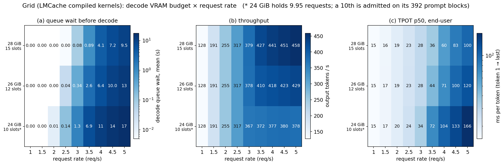
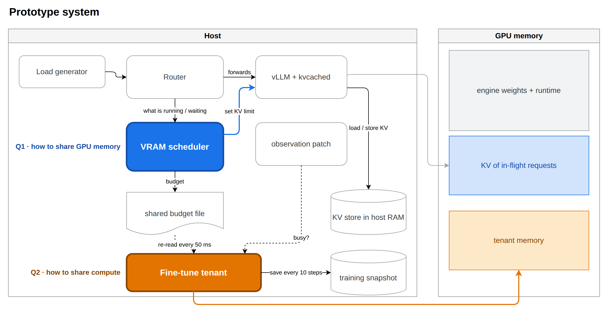
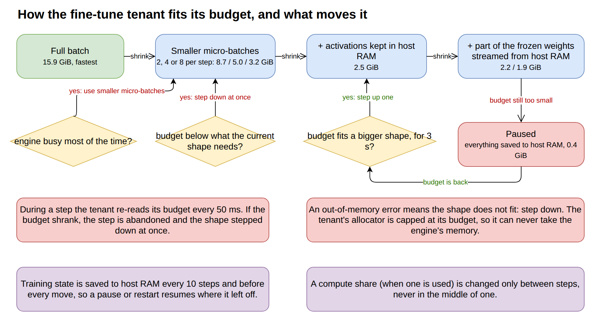
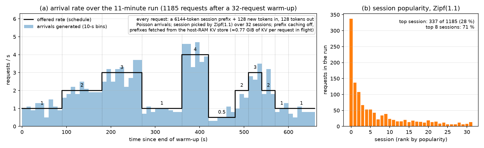
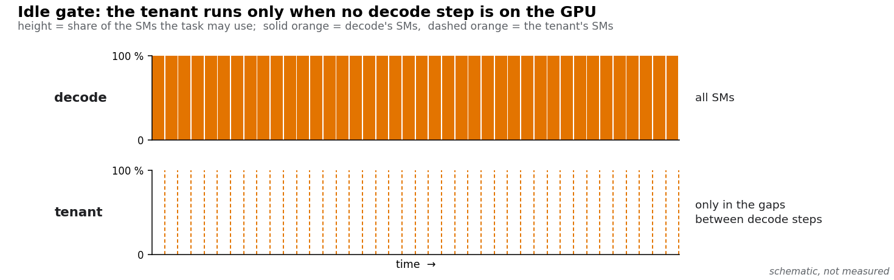
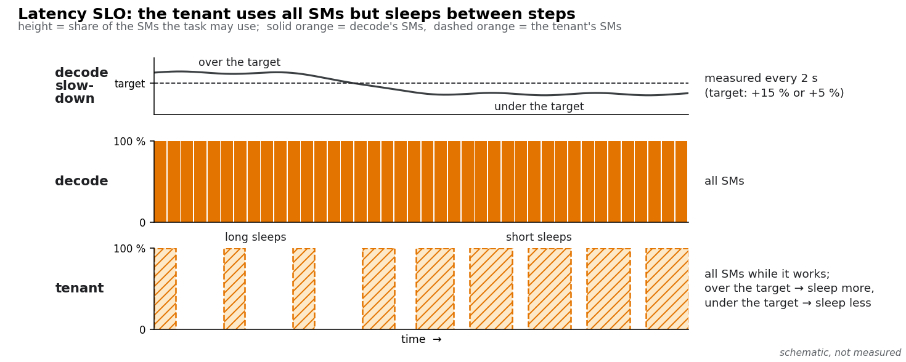
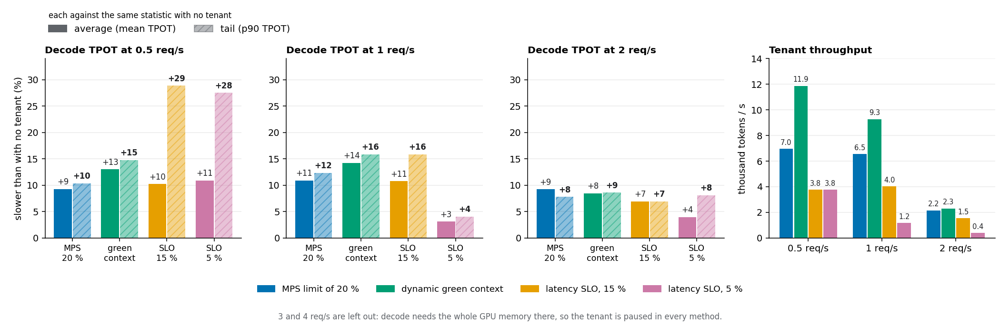

# 故事线（工作稿）

这是边讨论边补的工作稿，不是成品。每一步写三样东西：**要讲什么**（按 Jiaxuan 口述的顺序）、**手里已有的材料**（图、公式、数字、
出处）、**缺口或要定的事**。成品会是一份独立的 markdown，不依赖之前的报告。这个目录（`storyline/`）自己带着用到的图，在 `figures/` 下；
"出处"一栏写的是图和数字原来在仓库里的位置。

约定：显存 = GPU 上的内存；主机内存 = 机器的内存。数字后面都注明是哪一次测的、和什么比。

状态：第 0–7 步已记录；问题 2 后面的部分（BWS、BWR、新 tenant）和问题 3 还没讲到。

---

## 0. 带进来的结论：decode 引擎需要的显存是"正好够"，不是越多越好

**要讲什么。** KV 可以 offload 到主机内存时，decode 引擎的性能在一个拐点以上不随显存预算变化；低于拐点才开始排队。
拐点的位置由到达率决定，可以算出来。

**公式（来自之前的 study 1–4 和 study 10，`project_summary/REPORT_SUMMARY.md` 3.3、3.5、7 节）。**

- GPU 上必须放得下的是**在途请求的 KV**（正在生成的请求，它的 KV 必须全部在显存里）。
- 平均在途请求数：`N = λ × R`。λ 是到达率（req/s），R 是一个请求在 GPU 上停留的时间（秒）。
- 需要的 KV 显存：`在途请求数的 p95 × 每个请求的 KV`。
- 例子（参考负载，2 req/s）：2 × 1.83 s ≈ 3.7 个在途请求；Poisson 的 p95 是 7 个；每个请求 0.766 GiB；需要 5.36 GiB。
  实测把它夹在中间：5.77 GiB 正常，3.77 GiB 出问题。
- study 10 的另一种写法：引擎相当于 `c = ⌊KV 显存 ÷ 每个请求的 KV⌋` 个整数"槽"，先到先服务；`λ × R` 明显小于 c 时不排队。

**要说明的限制。** R 不是常数，负载高时会变长（batch 变大、每次载入 KV 会停一下）。之前的报告明确写了：槽模型是用**实测的 R**
复算排队，不是能预测 R 的模型。所以"可以建模"准确的说法是：给定 λ 和 R，需要多少显存可以算；R 要量。

**图的候选（都是已有的图）。**

| 图 | 内容 | 出处 |
|---|---|---|
| 图 0-1，`figures/live_vs_static.png` | 固定 2 req/s，KV 预算从 13 GiB 缩到 2 GiB：TTFT、排队时间、TPOT。13 到 4 GiB 是平的，3 GiB 以下排队暴涨 | 本分支阶段一，vLLM 0.30 |
| 图 0-2，`figures/kv_grid_heat.png` | decode 预算 24 / 26 / 28 GiB × 到达率 1–5 req/s 的排队时间、吞吐、TPOT：1–2 req/s 时三个预算完全一样，到达率越高需要的预算越大 | study 10，vLLM 0.15 + LMCache，拆分的 prefill/decode |

第一张说明"缩显存到拐点之前没有代价"，第二张说明"拐点跟着到达率走"。两张的软件版本和系统结构不同，放在一起要注明。

*图 0-1：固定 2 req/s，GPU 上的 KV 预算从 13 GiB 缩到 2 GiB（越往右越紧）。蓝点是运行中改上限，方框是重启到这个预算。*

*图 0-2：之前 study 10 的网格，decode 预算 × 到达率。(a) 排队时间，(b) 吞吐，(c) TPOT。*

**数字（第一张图对应的表，报告 1 的 1.3、1.4 节）。** 2 req/s 时：KV 预算 13 → 4 GiB，TPOT 13.1 ms 不变，吞吐 257–258 tok/s 不变，
TTFT p50 从 51 ms 升到 154 ms；3 GiB 时 TTFT p50 2.3 s；2 GiB 时 32 s。

---

## 1. 能在运行时改显存大小的插件：kvcached

**要讲什么。** kvcached 是什么、怎么改、改的时候发生什么，以及它怎么和 LMCache 一起用。

**已有的材料（报告 1 的阶段一，1.1、1.2 节）。**

- **是什么**：一个让 vLLM 的 KV cache 按需占用显存的库。它用 CUDA 的虚拟内存接口给 KV cache 留一大段地址，物理显存以 2 MiB 一页
  按需映射，用完解除映射。
- **怎么改**：`kvctl limit <大小>`（或 Python 接口）写一个上限到共享内存，引擎每 100 ms 读一次。
- **改的时候发生什么**：上限约 1.3 秒生效。往下缩时，正在跑的请求不会被杀，它们占的页在请求结束时才释放（3–21 秒）；
  新请求放不下就排队。上限不变时，每一步没有额外开销（和不带 kvcached 的 vLLM 比，decode 步 p50 都是 14.03 ms，输出逐字节相同）。
- **要注意的一点**：如果一个正在跑的请求还要继续长，而上限剩下的空间不够，它会被 vLLM 抢占重算（实验 A2：15 次抢占）。
  所以缩的时候要给在途请求留余量。这正是后面 VRAM scheduler 要做的事。
- **和 LMCache 一起用**：

  | 组合 | 结果 |
  |---|---|
  | kvcached 0.1.6 + LMCache 多进程模式，默认的 `lmcache_driven` | 不行：LMCache 的 server 要直接读写 vLLM 的显存，而 kvcached 的页不能导出给别的进程 |
  | kvcached 0.1.6 + `engine_driven`（由 vLLM 自己搬 KV） | 轻负载能跑；压力负载下引擎崩溃（读到一个没有映射的页，Xid 31） |
  | **kvcached main 分支（2026-11-04）+ `engine_driven`** | **能用**：10 分钟压力负载，每 15 秒在 2 G / 12 G 之间改一次上限，341/341 成功，输出和不带 LMCache 的引擎一致 |

**要定的事。** 后面的原型系统里，KV 的主机内存层用的是 **vLLM 自带的 offload**，不是 LMCache。LMCache 这条路只验证到"能一起启动、
能在线改上限"为止。讲的时候要说清楚，不然听的人会以为后面的结果都是带 LMCache 测的。

---

## 2. 动态改和静态设，效果一样

**要讲什么。** 运行中把上限改到某个值，和重启引擎直接设成这个值，引擎的表现分不出来。

**已有的材料（报告 1 的 1.4 节，图是上面的图 0-1）。**

- 做法：同一条固定的请求序列（2 req/s，300 个请求），每个预算点跑两次：一次是引擎不停、用 `kvctl` 改上限；一次是不带 kvcached、
  重启到这个预算。预算 13 / 10 / 8 / 6 / 5 / 4 / 3 / 2 GiB。
- 结果：拐点以上（13 到 4 GiB），TTFT p50 差 1–2 ms，TPOT 差 ≤ 0.1 ms，排队时间差 ≤ 4 ms，吞吐相同，抢占次数相同。
  拐点以下两者也一样差。
- 只留在途 KV 的版本（所有前缀都从主机内存取）：13 到 4 GiB，TPOT 都在 13.2–13.4 ms，两者排队时间差 ≤ 5 ms。

**限制。** 一张卡、一个模型、一种负载分布（Zipf），每个预算点一次运行。

---

## 3. 主线任务和三个问题

**主线。** 已知"把 decode 的显存缩到正好够，不影响它在这个到达率下的性能"。在这个前提下：怎样在同一张 GPU 上放第二个任务，
并且让它对 decode 的干扰最小。

**三个问题。**

1. 怎样正好给 decode 它需要的显存。
2. 第二个任务有了显存之后，怎样和 decode 共用算力，对 decode 的干扰最小。
3. 除了算力和显存，还有什么会让两个任务互相争用。

**和已有工作的对应（我的整理，待确认）。**

| 问题 | 对应的工作 | 出处 |
|---|---|---|
| 1 | VRAM scheduler：按在途和排队的请求算需求，实时改 kvcached 的上限 | 报告 1 阶段二 |
| 2 | 各种共用算力的方式（轮流用、MPS、分 SM、限速），以及之后的 BWS、BWR、新 tenant | 报告 1 阶段二、报告 3、夜间报告 |
| 3 | SM 到显存的共用通道（带宽）；另外还有 kernel 启动次数、功率上限、共用的 L2 缓存 | 报告 2、报告 3 第 7 节 |

---

## 4. 原型系统

**图。** `figures/story_01_system.png`（新做的一版；原图 `coloc_adjust/report/figures/01_system_architecture.png` 没动；
源文件 `figures/story_01_system.drawio`）。

*图 4-1：原型系统。*

- 所有格子里的解释性文字去掉了，只留名字。
- VRAM scheduler（蓝）和 Fine-tune tenant（橙）高亮，旁边标了"Q1 · how to share GPU memory"和"Q2 · how to share compute"。
- 右边 GPU 显存的三块：引擎权重（灰）、在途请求的 KV（浅蓝，对应 VRAM scheduler）、tenant 的显存（浅橙，对应 tenant）。

**要定的事。** 这张图只画了显存怎么分，没有画算力（SM）怎么分。问题 2 是在这张图上加一块"算力"，还是另画一张，待定。

---

## 5. VRAM scheduler 怎么定预算，tenant 怎么适应预算

**VRAM scheduler（报告 1 的 2.1 节；数字是 `coloc_adjust/controller.py` 的默认值）。**

*图 5-1：VRAM scheduler 每 100 ms 检查一次时做的事（新画的，由 `make_scheduler_fig.py` 生成）。*

每 100 ms 检查一次，每次做四件事：

1. **读 router 的表。** 所有请求都经过 router，所以每个在跑和排队的请求的 prompt 长度、最多生成多少 token、已经生成了多少，都是精确知道的。
   同时算到达率 λ = 最近 5 秒到达的请求数 ÷ 5 秒。
2. **算需求：`需求 = D + A + H`。**

   | 项 | 含义 | 怎么算 |
   |---|---|---|
   | D | 所有在跑和排队的请求，**长到最终长度时**要的 KV | 每个请求 ⌈(prompt + 最多输出的 token) ÷ 16⌉ 个 block，每个 block 2 MiB，求和 |
   | A | 未来 1 秒内预计会到的请求要的 KV。1 秒是 tenant 把显存让出来需要的时间 | λ × 1 s × 表里请求的平均最终 KV（这个负载下是 0.78 GiB） |
   | H | 余量 | 0.5 GiB |

   算完向上取整到 0.5 GiB 的倍数，并限制在 2.0 到 12.65 GiB 之间。
3. **需求 > 当前上限：涨，看到的第一次检查就动手。**
   - 先把 tenant 的预算降下来（立刻发布）。
   - 把 KV 上限往需求涨，但只能涨到**现在真正空着**的显存为止：已经映射的 KV + 整卡空闲显存 − 0.5 GiB。
   - 空闲的还不够（tenant 还没让出来）：之后每次检查都再试，直到涨到位；如果这期间需求自己降回去了，就放弃这次涨。
4. **需求 < 当前上限 − 1 GiB，并且连续 50 次检查（5 秒）都是这样：缩。**
   - 上限降到需求，但不低于：在跑请求已经占的 KV + 排队请求的 prompt 要的 KV + 0.5 GiB。
   - tenant 的预算要等引擎实际映射的 KV 降到新上限以下才涨（每次检查都看一眼）。
   - 中间只要有一次检查需求又高了，5 秒重新计。

两个方向不对称的原因：涨是为了保护 decode，所以一次检查就够；缩只对 tenant 有好处，所以要等 5 秒、还留 1 GiB 的差，
免得上限跟着每一个请求来回动。

tenant 的显存预算 = 整卡 31.35 GiB − 引擎权重和运行时（约 17 GiB，启动时实测）− tenant 自己的固定开销 2.0 GiB − 余量 0.5 GiB − KV 上限，
写在一个共享文件里，tenant 每 50 ms 读一次。

**tenant 怎么适应。** 每一步之前读预算，选放得下的最快配置：

*图 5-2：tenant 的各档配置，以及什么时候升档、降档。*

| 配置 | 做法 | 需要显存 | 速度（单独跑） |
|---|---|---|---|
| 0 | 一步 8 条序列一次算完 | 15.9 GiB | 44.8k tok/s |
| 1 | 分 2 批，每批 4 条 | 8.7 GiB | 38.7k |
| 2 | 分 4 批，每批 2 条 | 5.0 GiB | 29.6k |
| 3 | 分 8 批，每批 1 条 | 3.2 GiB | 19.5k |
| 4–6 | 再把中间结果、部分权重放到主机内存 | 2.5 → 1.9 GiB | 3.9k → 2.8k |
| 7 | 暂停，状态存到主机内存 | 0.4 GiB | 0 |

预算降了立刻降档（一步中间每 50 ms 查一次，放不下就放弃这一步）；预算升了等 3 秒再升档。tenant 自己的显存上限跟着预算走，
所以估错时出错的是 tenant，不是 decode 引擎。

这张表是普通 tenant 在 11 月 6 日校准的值。11 月 21–22 日的新 tenant 有自己的一张表（夜间报告 3.4 节）。

---

## 6. 基线：只有 decode，显存跟着负载调，对比只有 decode、显存给满

**有这组数据。** 两次运行，同一条 11 分钟的请求序列（到达率 0.5–4 req/s 分段变化），都没有 tenant：

- **显存给满**（`decode_alone`）：KV 上限固定在 13 GiB，加上引擎的 17 GiB，约占整卡 31.35 GiB 里的 30 GiB。
- **跟着负载调**（`adjust_notenant`）：VRAM scheduler 开着，没有人用腾出来的显存。

**这一步要出的图（Jiaxuan 指定的顺序）。**

1. **负载的形状**：图 6-1，`figures/workload.png`（已有）。(a) 11 分钟里到达率怎么变（1 → 2 → 3 → 1 → 4 → 0.5 → 2 → 3 → 2 → 1 → 1 req/s），
   (b) 32 个 session 的热度分布。
2. **两种做法在这个负载上的时间线，放在同一张图里**：图 6-2，`figures/baseline_compare_timeline.png`（新画的，由 `make_baseline_fig.py`
   从两次已有的运行生成，没有新实验）。从上到下：
   - 到达率；
   - Run A（显存给满）的显存：KV 上限是一条平线；
   - Run B（跟着负载调）的显存：KV 上限跟着用量起伏，上限以上的浅橙色就是没有留给 decode 的显存；
   - decode 的 TPOT，两次运行画在同一个坐标里，两条线重合。

   TPOT 一栏的图例里写了整次运行的平均差别：**TPOT 平均 18.61 ms 对 18.62 ms，B 比 A +0.07 %**（1,185 个请求）。
   排队时间没有画在图里（Jiaxuan 要求去掉这一栏）；数字在下面的表里，整次运行的平均是 349 ms 对 351 ms，B 比 A +0.8 %。

*图 6-1：负载。(a) 到达率随时间的变化，(b) session 的热度。*

*图 6-2：只有 decode、没有 tenant 的两次运行。Run A：KV 上限固定 13 GiB（显存给满）。Run B：KV 上限由 VRAM scheduler 跟着负载调。
数据是第 1 轮（11 月 5 日，GPU 1，600 W），原文件在 `coloc_adjust/results_600w/` 下的 `decode_alone_*` 和 `adjust_notenant_*`。*

**每个阶段的数字。**

| 阶段，req/s | TPOT p50，给满 / 跟着调（ms） | 排队，给满 / 跟着调（ms） | 吞吐，给满 / 跟着调（tok/s） | 跟着调时的 KV 上限（GiB） | 腾出来能给 tenant 的显存（GiB） |
|---|---|---|---|---|---|
| 1 | 12.92 / 12.92 | 107 / 107 | 138 / 138 | 5.0 | 7.65 |
| 2 | 15.19 / 15.20 | 124 / 124 | 258 / 258 | 8.0 | 4.65 |
| 3 | 21.20 / 21.17 | 267 / 270 | 402 / 402 | 12.65 | 0 |
| 1 | 12.49 / 12.50 | 105 / 105 | 115 / 115 | 4.5 | 8.15 |
| 4 | 25.96 / 26.01 | 1,209 / 1,228 | 517 / 517 | 12.65 | 0 |
| 0.5 | 11.97 / 11.98 | 95 / 94 | 79 / 79 | 3.0 | 9.65 |
| 2 | 15.48 / 15.49 | 122 / 123 | 205 / 205 | 7.5 | 5.15 |
| 3 | 20.19 / 20.04 | 157 / 159 | 339 / 339 | 12.65 | 0 |
| 2 | 18.08 / 18.07 | 133 / 134 | 314 / 314 | 11.5 | 1.15 |
| 1 | 12.70 / 12.71 | 102 / 109 | 128 / 128 | 4.5 | 8.15 |
| 1 | 12.37 / 12.38 | 101 / 100 | 99 / 99 | 4.0 | 8.65 |

两次都是 0 失败、0 抢占。TPOT p50 最多差 0.15 ms，排队最多差 19 ms（4 req/s，约 1.5 %）。
结论：让 KV 上限跟着负载实时改，decode 没有可测的代价；1 req/s 及以下能腾出约 8–10 GiB，2 req/s 约 5 GiB，3 req/s 以上腾不出来。

出处：`coloc_adjust/results_600w/decode_alone_phases.md`、`coloc_adjust/results_600w/adjust_notenant_phases.md`；
当时的记录在 `coloc_adjust/report/DECISIONS.md` 的 D6。

**限制和缺口。**

- 这是**第 1 轮**（11 月 5 日，GPU 1，功耗上限 600 W）的数据，各一次运行。第 2 轮（11 月 9 日，GPU 0，500 W，后面所有结果用的那一轮）
  只跑了"跟着调"的基线，没有重跑"给满"的那次。两轮"跟着调"的基线每个阶段 TPOT 差 ≤ 0.3 ms。
- 最后一列是第 1 轮的值。第 2 轮同样的上限下这个数小约 0.8 GiB（例如 1 req/s 时 6.88 GiB），应该是因为预留给 tenant 固定开销的量
  改大了（我的推断，没有回查代码历史）。
- 这组对比没有写进之前任何一份报告。

---

## 7. 问题 2：tenant 有了显存之后，怎么和 decode 共用算力

**承上。** 到第 6 步为止，问题 1 有了一个能用的解：不完全通用（它依赖 router 知道每个请求的长度，只在一种负载上测过），但能用。
接下来看问题 2。之前试过很多种共用算力的方式，这里只挑有用的四种讲。四种方式里显存那一半都一样（第 5 步的 VRAM scheduler）。

数据都来自第 2 轮（11 月 9 日，GPU 0，500 W）：同一条 11 分钟的请求序列，每种方式跑一次，和同一轮没有 tenant 的基线比。

### 7.1 四种方式各是什么

每张示意图都是同样的两栏：上面是 decode，下面是 tenant；高度是这个任务能用多少比例的 SM，横向是时间。SM 都用橙色表示：
实心橙色是 decode 的 SM，橙色虚线（斜线填充）是 tenant 的 SM。示意图不是实测。

**(a) 按时间切：空闲门（gating）。** tenant 只在 GPU 上没有 decode 的 kernel 时才算。

*图 7-1：空闲门。tenant 只在两步 decode 之间的空隙里算。*

具体实现：在 vLLM 引擎里加一个观察补丁，一步 decode 开始时把一个"忙"标志置上，GPU 真正算完这一步时清掉（用一个 CUDA 事件确认）。
tenant 每算一层之前看一眼这个标志，忙就等。

**(b) 按 SM 切，固定：MPS 限 20 %。** decode 一直能用全部 SM，tenant 一直在跑，但最多用 20 % 的 SM。

*图 7-2：MPS 限 20 %。*

具体实现：两个进程都通过 NVIDIA 的 MPS 同时在 GPU 上跑；启动 tenant 时设 `CUDA_MPS_ACTIVE_THREAD_PERCENTAGE=20`。这个比例启动后不能改。

**(c) 按 SM 切，跟着负载变：动态 green context。** tenant 一直在跑，能用多少个 SM 跟着到达率变：请求越多，给 tenant 的 SM 越少。

*图 7-3：动态 green context。到达率 0.5 / 1 / 2 / 3 req/s 及以上时，tenant 用 96 / 64 / 32 / 16 个 SM（整卡 170 个）。*

具体实现：
- green context 是 CUDA 里绑定到一部分固定 SM 上的 context。tenant 启动时一次建好五个（128、96、64、32、16 个 SM）。
- VRAM scheduler 按最近 5 秒的到达率查表得到 SM 数，和显存预算一起发布，最多每秒发布一次。
- tenant 每一步之前看一眼：SM 数变了（并且距上次切换超过 1 秒），就切到对应大小的那个 context。切换时不新建也不销毁任何东西。
- 第一版是每次切换都新建 context，结果显存泄漏、tenant 挂掉；改成预先建好之后，一次运行切换 174 次没有泄漏。

**(d) SM 全给，按时间限：延迟 SLO（目标 15 % 或 5 %）。** tenant 干活时用全部 SM，但每一步之后歇一会儿；歇多久由 decode 实测的变慢程度决定。

*图 7-4：延迟 SLO。decode 比目标慢，tenant 就多歇；比目标快，就少歇。*

具体实现：
- VRAM scheduler 每 2 秒算一次 decode 现在慢了多少：最近 10 秒完成的请求的 TPOT 中位数，除以"同样到达率下没有 tenant 时的 TPOT"（取自基线那次运行），减 1。
- 用这个数和目标（15 % 或 5 %）的差去调 tenant 的速度上限（每秒多少 token）：超过目标就调低，低于目标就调高，每次最多减半或加一半，范围 500 到 20,000 tok/s。
- tenant 每一步之后 sleep，使自己的速度不超过这个上限。

**分类上要注意的一点（待你确认）。** 你口述时把 (d) 归在"空间切片"里。按实现，它不限制 SM：tenant 干活时用全部 SM，限制的是时间（干一阵歇一阵）。
所以更准确的分法是：(a) 等空隙，(b)(c) 少给 SM，(d) 少给时间。报告 1 里也是这么分的。

### 7.2 空闲门不可行

- **结果**：decode 几乎不受影响（TPOT +1 %），但 tenant 在 11 分钟里只完成了 2 步训练（另有 21 步中途被放弃）。
- **原因**：只要有请求在跑，decode 的步就是一步接一步发出去的，GPU 上几乎没有"没有 kernel 在跑"的时间。单独量过（8 个 session，每档 25 秒）：

  | 到达率 | decode 每秒多少步 | GPU 上有 decode 步在跑的时间占比 |
  |---|---|---|
  | 0.5 req/s | 49 | 约 100 % |
  | 1 req/s | 72 | 93 % |
  | 2 req/s | 75 | 约 100 % |
  | 3 req/s | 66 | 100 % |

- 引擎只有在一个请求都没有时才空闲：1 req/s 时约 15 % 的时间，2 req/s 及以上约为 0。
- 更早的研究（vLLM 0.15）看到过 30–50 % 的空闲，那是两步之间 CPU 花的时间；vLLM 0.30 的 Model Runner V2 把这段去掉了。
- **结论**：在 decode 专用的节点上（prefill 和 decode 分离，KV 从主机内存取），优化过的 decode 中间没有可用的空隙。两个任务只能同时跑。

### 7.3 其余三种方式的对比

*图 7-5：前三栏是 0.5 / 1 / 2 req/s 时 decode 的 TPOT 比没有 tenant 时慢多少：实心是平均（平均 TPOT 对比基线的平均 TPOT），
斜线是尾部（p90 TPOT 对比基线的 p90 TPOT）。第四栏是 tenant 的进度。3 和 4 req/s 没画：那时 decode 需要全部显存，所有方式里 tenant 都被暂停。*

| 方式 | decode 平均慢，0.5 / 1 / 2 req/s | decode p90 慢，0.5 / 1 / 2 req/s | tenant 进度，千 tok/s |
|---|---|---|---|
| MPS 限 20 % | +9 / +11 / +9 % | +10 / +12 / +8 % | 7.0 / 6.5 / 2.2 |
| 动态 green context | +13 / +14 / +8 % | +15 / +16 / +9 % | 11.9 / 9.3 / 2.3 |
| 延迟 SLO 15 % | +10 / +11 / +7 % | **+29** / +16 / +7 % | 3.8 / 4.0 / 1.5 |
| 延迟 SLO 5 % | +11 / +3 / +4 % | **+28** / +4 / +8 % | 3.8 / 1.2 / 0.4 |

平均 = 每个请求的 TPOT 取平均；p90 = 每个请求的 TPOT 的第 90 百分位；都和基线的同一个统计量比。
（报告 1 的表用的是中位数，例如 SLO 15 % 是 +5 / +11 / +6 %；p90 两边一致。）

读出来的东西：

1. **少给 SM 的两种（MPS 限 20 %、动态 green context），尾部和平均差不多。** 它们的变慢是均匀的：tenant 一直在跑，每一刻都慢差不多的幅度。
   动态 green context 让 tenant 多做 40–70 % 的训练，decode 多慢 3–4 个点。
2. **按时间限的两种（SLO），0.5 req/s 时平均是 +10–11 %，尾部却是 +28–29 %。** 原因是它不降低 tenant 干活那一刻的影响，只是缩短干活的时间：
   - tenant 在跑时，decode 慢 23–30 %；tenant 歇着时，decode 回到基线（−1 到 +2 %）。
   - SLO 15 % 下 tenant 只有约三分之一的时间在跑，所以平均是两者相乘：36 % × 30 % ≈ 11 %。
   - 速度上限在 500 和 20,000 tok/s 之间来回摆，tenant 一阵接近停、一阵全速。赶上全速那几段的请求就是尾部。
3. **SLO 5 % 在 0.5 req/s 没有守住目标**（平均 +11 %）。1 和 2 req/s 守住了，代价是 tenant 被压到 0.4–1.2k tok/s。
4. **按每个 tenant token 算**（1 req/s，每 1k tenant tok/s 让 decode 慢多少）：SLO 15 % 是 2.4 %，MPS 限 20 % 是 1.7 %，动态 green context 是 1.5 %。少给 SM 更便宜，少给时间不省。

限制：每种方式只跑了一次；0.5 req/s 只有一个 60 秒的阶段、32 个请求，这一档的 p90 最不稳；基线同一档的重复之间有 ±4 % 的波动。

### 7.4 为什么 4 req/s 时有的方式 TPOT 比基线还低

**不是变好了，是延迟从 TPOT 挪到了排队里。**

| 4 req/s 阶段 | TPOT p50（ms） | 排队（ms） | 吞吐（tok/s） | KV 上限（GiB） | 实际用的 KV（GiB） |
|---|---|---|---|---|---|
| 基线（没有 tenant） | 26.1 | 1,292 | 517 | 12.65 | 11.7 |
| MPS 限 20 % | 25.7 | 2,940 | 497 | 12.5 | 11.0 |
| 动态 green context | 24.5 | 2,216 | 504 | 12.0 | 10.9 |
| 延迟 SLO 15 % | 24.5 | 2,277 | 504 | 12.0 | 10.9 |
| 延迟 SLO 5 % | 22.3 | 2,425 | 512 | 12.0 | 10.9 |

- 4 req/s 时所有方式里 tenant 都已经暂停，不占算力。
- 但暂停的 tenant 还占着一点显存（0.3–1.3 GiB）。VRAM scheduler 只承诺真正空着的显存，所以 KV 上限停在 11–12.5 GiB，到不了基线的 12.65 GiB。
- 上限低，同时在跑的请求就少（KV 用量 10.9–11.0 对 11.7 GiB）。同一批里请求少，每个 token 算得快，TPOT 就低。
- 进不去的请求在外面排队：排队 2.2–2.9 秒，基线是 1.3 秒；吞吐也略低（497–512 对 517 tok/s）。

所以这一档要看排队和吞吐，不能只看 TPOT。3 req/s 时同样的现象小得多（TPOT 相同，排队 308–326 对 271 ms）。

---

## 待办和要定的事（汇总）

| 事 | 需要什么 |
|---|---|
| 第 0 步用哪张图（或两张都用） | 你定 |
| 第 1 步是否点明"原型用的是 vLLM 自带的 offload，不是 LMCache" | 你定 |
| 原型图是否要加算力的部分 | 你定 |
| 第 6 步是否在 500 W 的设置下重跑"给满"的那次 | 新实验，约 15 分钟 GPU；等"启动" |
| 第 7 步：延迟 SLO 归在哪一类（按实现它是"少给时间"，不是空间切片） | 你定 |
| 第 7 步之后的故事（BWS、BWR、新 tenant；问题 3） | 等你继续讲 |
